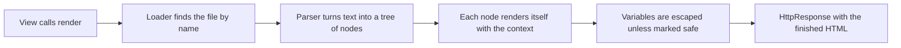

# Templates and the Django template language

> **Before this lesson:** you can write a view that returns `HttpResponse` and connect it to a URL ([The request/response cycle, views, URLs and first tests](#/lesson/django/request-response)). You should recognise basic HTML tags such as `<h1>`, `<p>`, `<ul>` and `<a>`; a page of practice with any HTML tutorial is enough.

## In plain words

In the last lesson a view answered with a sentence typed inside Python code. Real pages are hundreds of lines of HTML, and nobody wants to write those inside Python strings. A **template** is an HTML file with **blanks** in it. At request time Django fills the blanks with values supplied by the view and sends the finished page.

An everyday picture: a form letter. "Dear ______, your order number ______ will arrive on ______." The letter is written once; a clerk fills in different names and dates for each customer. The template is the letter, the view is the clerk, and the collection of values to fill in is called the **context**.

The rules for writing blanks and small bits of logic (repeat this for every item; show that only if ...) are the **Django template language**, shortened to **DTL**.

Why it matters for a job: separating *what the page looks like* (template) from *how the data is obtained* (view) lets designers and programmers work on the same site without colliding, and it is the "T" in Django's MTV architecture, which interviews ask about. Templates are also where a whole class of security bugs (cross-site scripting) is prevented, and you need to know how.

## A new example project

This module builds a small brochure site for a bakery. Starting from an empty folder with an activated virtual environment and Django installed:

```bash
django-admin startproject config .
python manage.py startapp storefront
```

Add `"storefront"` to `INSTALLED_APPS` in `config/settings.py`.

## Step 1: where templates live

Django can look for templates in two kinds of places.

1. **Inside each app**: a folder `storefront/templates/storefront/`. Found automatically because `APP_DIRS` is `True`. The app name is repeated on purpose, so the template's name becomes `storefront/menu.html` and cannot collide with another app's `menu.html`.
2. **In one project-level folder**: `templates/` next to `manage.py`. Convenient for small sites and for templates shared by all apps, but it must be switched on.

This track uses the project-level folder for site-wide files and app folders for app-specific ones. Switch it on by editing one line of `config/settings.py`:

```python
# config/settings.py
TEMPLATES = [
    {
        "BACKEND": "django.template.backends.django.DjangoTemplates",
        "DIRS": [BASE_DIR / "templates"],   # was: []
        "APP_DIRS": True,
        # ... OPTIONS unchanged ...
    },
]
```

`DIRS` is a list of folders searched **first**, before app folders. `BASE_DIR / "templates"` is the folder `templates` in the project root. Create that folder now.

## Step 2: the simplest template

Create `templates/home.html` with plain HTML and no blanks yet:

```html
<!-- templates/home.html -->
<h1>Crumb &amp; Co.</h1>
<p>Fresh bread every morning.</p>
```

A view sends it with the `render` shortcut:

```python
# storefront/views.py
from django.shortcuts import render


def home(request):
    return render(request, "home.html")
```

`render(request, template_name)` does three things: finds the template by name, fills it in, and wraps the result in an `HttpResponse`. Wire it up as before:

```python
# storefront/urls.py  (new file)
from django.urls import path

from . import views

urlpatterns = [
    path("", views.home, name="home"),
]
```

```python
# config/urls.py
from django.contrib import admin
from django.urls import include, path

urlpatterns = [
    path("admin/", admin.site.urls),
    path("", include("storefront.urls")),
]
```

Run the server and the heading appears. So far the template is a static file; now for the blanks.

## Step 3: variables and the context

The third argument of `render` is the context: a dictionary whose keys become names available inside the template.

```python
# storefront/views.py
def home(request):
    context = {
        "shop_name": "Crumb & Co.",
        "opens_at": "07:00",
        "baker": {"name": "Odile", "years": 12},
        "specials": ["Rye loaf", "Cardamom knots", "Seeded batard"],
    }
    return render(request, "home.html", context)
```

```html
<!-- templates/home.html -->
<h1>{{ shop_name }}</h1>
<p>Open from {{ opens_at }}. Head baker: {{ baker.name }}, {{ baker.years }} years at the oven.</p>
<p>Today's first special: {{ specials.0 }}</p>
```

`{{ name }}` is a **variable tag**: Django replaces it with the value of `name` from the context. Three things to notice in the rendered page:

- `{{ baker.name }}` uses a dot to reach inside a value. Django tries, in order: dictionary key (`baker["name"]`), attribute (`baker.name`), list index (`specials[0]` is written `specials.0`). In templates you always write a dot, whichever it is.
- If the result of a lookup is a method that takes no arguments, Django calls it for you. `{{ title.upper }}` works; you never write parentheses in templates.
- A name that does not exist renders as an **empty string**, with no error. That is forgiving for visitors and treacherous for developers: a typo such as `{{ bakr.name }}` produces a blank, not a crash.

## Step 4: filters

A **filter** transforms a value on its way to the page. It is written after a vertical bar, and filters can be chained left to right. An argument follows a colon.

```html
<h1>{{ shop_name|upper }}</h1>
<p>{{ specials|length }} specials today: {{ specials|join:", " }}</p>
<p>{{ tagline|default:"Baked this morning." }}</p>
<p>{{ long_description|truncatewords:12 }}</p>
<p>Updated {{ updated|date:"j F Y" }}</p>
```

| Filter | Effect | Example result |
|---|---|---|
| `upper`, `lower`, `title` | change letter case | `CRUMB & CO.` |
| `length` | number of items or characters | `3` |
| `join:", "` | glue a list into text | `Rye loaf, Cardamom knots, ...` |
| `default:"text"` | use the text when the value is empty or missing | `Baked this morning.` |
| `truncatewords:12`, `truncatechars:40` | shorten with an ellipsis | `Our sourdough starter is ...` |
| `date:"j F Y"` | format a date | `20 November 2026` |
| `pluralize` | add "s" unless the number is 1 | `3 loaves`, see below |
| `floatformat:2` | fixed decimals | `4.50` |
| `linebreaks` | turn blank lines in text into paragraphs | `<p>...</p>` |

Django ships about sixty filters; these cover most pages.

## Step 5: tags for logic

**Template tags** are written `` and do things rather than print things. The two you need every day are loops and conditions.

```html
<h2>Specials</h2>
<ul>
  
    <li>{{ forloop.counter }}. {{ item }} (baker's pick)</li>
  
    <li>Sold out for today.</li>
  
</ul>


  <p>{{ baker.name }} is a master baker.</p>

  <p>{{ baker.name }} is an experienced baker.</p>

  <p>{{ baker.name }} recently joined us.</p>

```

- ` ... ` repeats its body once per element. Inside the loop, the automatic variable `forloop` offers `counter` (1, 2, 3 ...), `first`, `last` and a few more.
- `` is an optional branch shown when the list has no items.
- `` supports `==`, `!=`, `<`, `>`, `<=`, `>=`, `in`, `not`, `and`, `or`. Every opening tag needs its closing tag (`endif`, `endfor`).

The third everyday tag builds links from URL **names**, the template-side twin of `reverse()`:

```html
<a href="">Home</a>
<a href="">{{ item.name }}</a>
```

And comments, which never reach the browser:

```html
{# a one-line note to future developers #}

  several lines that are ignored

```

> [!TIP]
> Keep logic in templates shallow. A template may loop and choose; it should not compute. If you find yourself wanting arithmetic, sorting or database filters in a template, do that work in the view and pass the finished result in the context. DTL deliberately lacks the ability to call functions with arguments, precisely to push you in this direction.

## Step 6: escaping, the built-in shield

Suppose a customer leaves a review whose text is `<script>stealCookies()</script>`. If a page inserted that text raw, every visitor's browser would run the script. This attack is **cross-site scripting (XSS)**: getting your own JavaScript to run on someone else's page.

Django defends by default with **autoescaping**: when a variable is printed, the five characters with special meaning in HTML are replaced by harmless codes (`<` becomes `&lt;`, `>` becomes `&gt;`, `&` becomes `&amp;`, and both quote characters). The browser then *shows* the angle brackets instead of obeying them.

The model below implements variables, dotted lookup, three filters and autoescaping in a few lines. Run it, then add `|safe` to the review line and watch the script tag come through raw.

```python-run
import html, re

def lookup(path, context):
    value = context
    for part in path.split("."):
        if isinstance(value, dict) and part in value:
            value = value[part]
        elif isinstance(value, list) and part.isdigit() and int(part) < len(value):
            value = value[int(part)]
        else:
            return ""                      # missing names render as nothing
    return value

def render(template, context):
    def fill(match):
        parts = [p.strip() for p in match.group(1).split("|")]
        value, safe = lookup(parts[0], context), False
        for f in parts[1:]:
            if f == "upper":
                value = str(value).upper()
            elif f == "length":
                value = len(value)
            elif f == "safe":
                safe = True                # the author vouches for this value
        text = str(value)
        return text if safe else html.escape(text)   # autoescape by default
    return re.sub(r"{{(.*?)}}", fill, template)

context = {
    "shop": {"name": "Crumb & Co."},
    "specials": ["Rye loaf", "Cardamom knots"],
    "review": "<script>stealCookies()</script> Lovely bread!",
}
page = """<h1>{{ shop.name|upper }}</h1>
<p>{{ specials|length }} specials, first: {{ specials.0 }}</p>
<p>Review: {{ review }}</p>
<p>Typo: [{{ shopp.name }}]</p>"""
print(render(page, context))
```

In the output the ampersand became `&amp;` and the script tag became `&lt;script&gt;`, which a browser displays as text. The typo line shows empty brackets: the silent-failure behaviour described earlier.

The `safe` filter switches escaping off for one value. Use it only for HTML your own code produced; never for anything a visitor typed.

> [!WARNING]
> `{{ user_comment|safe }}` is one of the most common ways to create an XSS hole in a Django site. If a value contains anything typed by a user, it must be escaped. See [Cross-site scripting (XSS) and output encoding](#/lesson/web-security/xss) for what an attacker does with such a hole.

## Step 7: what the template gets for free

Besides your context dictionary, templates receive a few variables automatically from **context processors**, functions listed under `OPTIONS` in the `TEMPLATES` setting that add entries to every context:

| Variable | Provided by | Use |
|---|---|---|
| `request` | `context_processors.request` | the current request, e.g. `{{ request.path }}` |
| `user` | `auth.context_processors.auth` | the logged-in user, e.g. `` |
| `messages` | `messages.context_processors.messages` | one-time notifications |
| `perms` | `auth.context_processors.auth` | permission checks |

These only appear when the template is rendered with a request, which `render()` always does.

## A realistic page

Putting the pieces together: a menu page driven entirely by data from the view.

```python
# storefront/views.py
def menu(request):
    products = [
        {"name": "Country sourdough", "price": 6.5, "vegan": True, "allergens": ["gluten"]},
        {"name": "Butter croissant", "price": 2.8, "vegan": False, "allergens": ["gluten", "milk"]},
        {"name": "Almond financier", "price": 3.2, "vegan": False, "allergens": ["nuts", "egg", "milk"]},
    ]
    return render(request, "storefront/menu.html", {"products": products, "currency": "€"})
```

```html
<!-- storefront/templates/storefront/menu.html -->
<h1>Menu</h1>
<p>{{ products|length }} item{{ products|length|pluralize }} today.</p>
<table>
  
    <tr>
      <td>{{ product.name }} <em>(vegan)</em></td>
      <td>{{ currency }}{{ product.price|floatformat:2 }}</td>
      <td>Contains: {{ product.allergens|join:", " }}</td>
    </tr>
  
</table>
<p><a href="">Back to the front page</a></p>
```

Add `path("menu/", views.menu, name="menu")` to `storefront/urls.py`. The template lives in the app folder, so its name includes the app prefix.

## How rendering works inside



Django compiles the template text into a tree of nodes once, then renders the tree against the context. Text nodes copy themselves, variable nodes look up and filter a value, and block tags such as `for` render their children repeatedly. The Hard problem "A miniature template engine" in this module's problem set has you build exactly this pipeline.

> [!INTERVIEW]
> **"How does Django protect against XSS, and when can it fail?"** Autoescaping: every `{{ variable }}` is HTML-escaped at output unless explicitly marked safe. It fails when developers disable it (`|safe`, ``, `mark_safe()` on user data), when values are placed where HTML escaping is the wrong kind of escaping (inside a `<script>` block or an unquoted attribute; use the `json_script` filter and always quote attributes), and when HTML is built by string concatenation in Python instead of `format_html()`.

## Pitfalls

- **`TemplateDoesNotExist`.** Check, in order: the spelling of the name, the app in `INSTALLED_APPS`, the doubled folder (`storefront/templates/storefront/menu.html`), and `DIRS` for project-level templates. The error page lists every location Django tried.
- **Silent blanks from typos.** A misspelled variable prints nothing. While developing, check the rendered HTML source.
- **Python syntax in templates.** `{{ specials[0] }}` and `{{ baker["name"] }}` are errors; use dots.
- **Calling with arguments.** `{{ product.price_in("USD") }}` is not possible; compute in the view.
- **Unclosed tags.** A missing `` gives `TemplateSyntaxError` naming the line of the opening tag.
- **Forgetting quotes in ``.** `` treats `home` as a variable name; write ``.
- **Overusing `safe`.** Each use is a decision to trust a value completely.

## Cheat sheet

| Syntax | Meaning |
|---|---|
| `{{ value }}` | print a variable, escaped |
| `{{ a.b.0 }}` | dictionary key, attribute or index lookup |
| `{{ value\|filter:arg }}` | transform before printing |
| ` ...  ... ` | loop with an empty branch |
| ` ...  ...  ... ` | condition |
| `` | address from a URL name |
| `{# note #}` | comment |
| `{{ forloop.counter }}`, `forloop.first`, `forloop.last` | loop helpers |
| `render(request, "name.html", context)` | fill a template and respond |
| `TEMPLATES[0]["DIRS"] = [BASE_DIR / "templates"]` | project-level template folder |

## Summary

- A template is HTML with blanks; the view supplies a context dictionary and `render()` combines the two.
- `{{ }}` prints, `` does logic, `|` applies filters, and dots reach into dictionaries, objects and lists.
- Missing variables render as empty strings; method calls take no arguments; heavy logic belongs in the view.
- Autoescaping converts HTML-significant characters on output and is the main defence against XSS. `safe` turns it off and must never touch user-supplied text.
- Templates are found in `DIRS` first, then in each installed app's `templates/` folder, in `INSTALLED_APPS` order.

## Glossary

- **Template**: a text file (usually HTML) containing placeholders and simple logic.
- **Context**: the dictionary of names and values available to a template.
- **DTL**: the Django template language.
- **Variable tag**: `{{ ... }}`, prints a value.
- **Filter**: `|name`, transforms a value before it is printed.
- **Template tag**: ``, performs logic such as loops, conditions or URL building.
- **Autoescaping**: automatic replacement of HTML-special characters when printing variables.
- **XSS (cross-site scripting)**: an attack that runs the attacker's script in another user's browser.
- **Context processor**: a function that adds variables (such as `user`) to every template context.
- **Template loader**: the component that finds a template file from its name.

```quiz
[
  {"q": "What does `{{ baker.name }}` try, in order?",
   "options": ["Attribute, then method call, then index", "Dictionary key, then attribute, then list index", "Only attribute access", "List index, then dictionary key"],
   "answer": 1,
   "explain": "The dot is a universal lookup: Django tries a dictionary key first, then an attribute (calling it if it is a no-argument callable), then a numeric index."},
  {"q": "A template contains `{{ shpo_name }}` (a typo) and the context has `shop_name`. What does the visitor see?",
   "options": ["A TemplateSyntaxError page", "The text None", "Nothing at that position", "A 404 page"],
   "answer": 2,
   "explain": "Unknown variables render as an empty string by default, which is why typos in templates are easy to miss."},
  {"q": "A review contains `<b>great</b>`. With default settings, what does `{{ review }}` send to the browser?",
   "options": ["<b>great</b>", "&lt;b&gt;great&lt;/b&gt;", "great", "An error"],
   "answer": 1,
   "explain": "Autoescaping replaces < and > with entities, so the browser displays the tags as text instead of interpreting them."},
  {"q": "When is using the `safe` filter acceptable?",
   "options": ["Whenever the HTML looks broken", "Only on HTML produced by your own trusted code, never on user input", "On any value from the database", "On all form fields"],
   "answer": 1,
   "explain": "safe disables escaping for that value. Database content often originates from users, so it is not automatically trustworthy."},
  {"q": "Where should the template named `storefront/menu.html` be stored for the app loader to find it?",
   "options": ["storefront/menu.html", "storefront/templates/menu.html", "storefront/templates/storefront/menu.html", "templates/storefront.menu.html"],
   "answer": 2,
   "explain": "The loader looks inside each app's templates/ directory for the given name. Repeating the app name namespaces the template."},
  {"q": "Which is valid template syntax for the first element of a list?",
   "options": ["{{ specials[0] }}", "{{ specials.0 }}", "{{ specials(0) }}", "{{ specials->0 }}"],
   "answer": 1,
   "explain": "Templates use dot notation for indexes. Square brackets raise TemplateSyntaxError."},
  {"q": "What does `` produce?",
   "options": ["The word menu", "The path of the URL pattern named 'menu', e.g. /menu/", "A full HTML link element", "The view function"],
   "answer": 1,
   "explain": "The url tag is the template equivalent of reverse(): it returns the path string for a named pattern."},
  {"q": "Why does DTL not allow calling methods with arguments?",
   "options": ["It is a missing feature planned for later", "To keep business logic out of templates and in views or models", "Because HTML forbids parentheses", "For performance only"],
   "answer": 1,
   "explain": "The language is intentionally limited so that templates stay presentation-only; computation is done before rendering."}
]
```

> **Source:** Vincent, *Django for Beginners*, ch. 3 (Pages app: templates). Docs: https://docs.djangoproject.com/en/5.2/topics/templates/ · https://docs.djangoproject.com/en/5.2/ref/templates/language/ · https://docs.djangoproject.com/en/5.2/ref/templates/builtins/
