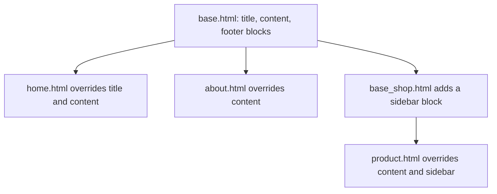
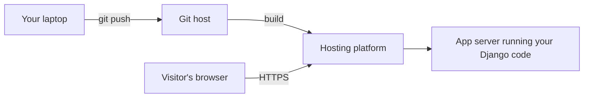

# Class-based views, template inheritance, page tests and a first deployment

> **Before this lesson:** you can render a template from a function view with a context ([Templates and the Django template language](#/lesson/django/templates-dtl)). You should know what a Python class and a method are; if not, read [Classes: modelling things with objects](#/lesson/python/py-start-classes) first.

## In plain words

Two kinds of repetition appear as soon as a site has more than one page.

**Repeated view code.** Most views do one of a handful of jobs: show a template, show a list of things, show one thing, process a form. Django ships ready-made views for those jobs. They are written as classes, so they are called **class-based views**. You state what differs (which template, which data) and inherit everything else.

**Repeated HTML.** Every page of a site shares the same header, navigation and footer. Copying them into every template guarantees that one day the phone number is updated in six places and forgotten in the seventh. **Template inheritance** lets you write the shared frame once and have each page fill in only its own part.

An everyday picture for both: pre-printed stationery. The company letterhead (logo on top, address at the bottom) is printed once; each letter only adds the middle. And for routine letters there are standard forms where you tick boxes instead of writing from scratch.

Why it matters for a job: nearly every production Django codebase uses class-based views and a `base.html`, and "function-based or class-based views, and why?" is a standard interview question. This lesson also covers the first honest answer to "how does this get onto the internet?".

## Part 1: class-based views

### From function to class

Here is the bakery's "about" page as a function view:

```python
# storefront/views.py
from django.shortcuts import render


def about(request):
    return render(request, "about.html")
```

And the same page as a class-based view:

```python
# storefront/views.py
from django.views.generic import TemplateView


class AboutView(TemplateView):
    template_name = "about.html"
```

- `TemplateView` is a class supplied by Django whose job is "render a template for GET requests".
- `class AboutView(TemplateView):` creates your own class that **inherits** from it, meaning it starts with all of `TemplateView`'s behaviour.
- `template_name = "about.html"` sets a class attribute that the inherited code reads to know which template to use.

The URL entry needs one extra call:

```python
# storefront/urls.py
from django.urls import path

from .views import AboutView, HomeView

urlpatterns = [
    path("", HomeView.as_view(), name="home"),
    path("about/", AboutView.as_view(), name="about"),
]
```

`path()` expects a *function* it can call with a request, but `AboutView` is a class. `as_view()` is a class method that returns such a function. Forgetting it is the classic first error with class-based views.

### Adding data: `get_context_data`

A function view passes a dictionary to `render`. A class-based view builds its context in a method that you may **override**, that is, replace with your own version:

```python
# storefront/views.py
class HomeView(TemplateView):
    template_name = "home.html"

    def get_context_data(self, **kwargs):
        context = super().get_context_data(**kwargs)   # start with what the parent provides
        context["specials"] = ["Rye loaf", "Cardamom knots", "Seeded batard"]
        context["opens_at"] = "07:00"
        return context
```

Line by line: `super().get_context_data(**kwargs)` runs the parent class's version first, so nothing it supplies is lost; then you add your own keys; then you return the dictionary. This "call super, add, return" shape is the single most common piece of code in class-based views.

### What `as_view()` does

The mystery disappears when you see the mechanism. The model below is a faithful miniature of Django's `View` class: `as_view()` returns a function; that function creates an instance for each request and calls `dispatch`, which picks the method named after the HTTP method.

```python-run
class View:
    http_method_names = ["get", "post"]

    @classmethod
    def as_view(cls):
        def view(request, **kwargs):
            self = cls()                      # a fresh instance for every request
            self.request, self.kwargs = request, kwargs
            return self.dispatch(request, **kwargs)
        return view                           # a plain function, as path() wants

    def dispatch(self, request, **kwargs):
        method = request["method"].lower()
        handler = getattr(self, method, None) if method in self.http_method_names else None
        if handler is None:
            return 405, "Method Not Allowed"
        return handler(request, **kwargs)


class TemplateView(View):
    template_name = None

    def get_context_data(self, **kwargs):
        return {"view": type(self).__name__, **kwargs}

    def get(self, request, **kwargs):
        context = self.get_context_data(**kwargs)
        return 200, f"render {self.template_name} with {context}"


class HomeView(TemplateView):
    template_name = "home.html"

    def get_context_data(self, **kwargs):
        context = super().get_context_data(**kwargs)
        context["opens_at"] = "07:00"
        return context


view_function = HomeView.as_view()
print(view_function({"method": "GET"}))
print(view_function({"method": "POST"}))     # TemplateView defines no post()
```

The second call prints `405`: because `TemplateView` has no `post` method, a POST request is refused automatically. With a function view you would have to write that check yourself.

### Which style should you use?

| | Function-based view | Class-based view |
|---|---|---|
| Reads like | a recipe, top to bottom | a form with boxes to fill in |
| Best for | unusual, one-off logic | standard patterns (template, list, detail, forms) |
| Reuse through | helper functions, decorators | inheritance and mixins |
| Risk | repeating boilerplate | hidden behaviour you must look up |

Both are fully supported and the right answer is "whichever is clearer for this view". When the inherited behaviour of a generic view puzzles you, the reference site ccbv.co.uk lists every attribute and method of each generic class.

## Part 2: template inheritance

### The base template

Create `templates/base.html`. It holds everything shared and marks the replaceable regions with `` tags:

```html
<!-- templates/base.html -->
<!DOCTYPE html>
<html lang="en">
<head>
  <meta charset="utf-8">
  <title>Crumb &amp; Co.</title>
</head>
<body>
  <header>
    <nav>
      <a href="">Home</a> |
      <a href="">About</a>
    </nav>
  </header>

  <main>
    
  </main>

  <footer>
    <p>Open daily from 07:00. 12 Mill Lane.</p>
  </footer>
</body>
</html>
```

A **block** is a named hole with optional default content. `title` and `footer` have defaults; `content` is empty. Repeating the name in the closing tag (``) is optional and makes long templates easier to read.

### Child templates

A page template declares its parent on the **first line** and then supplies only the blocks it wants to change:

```html
<!-- templates/home.html -->


Fresh bread | {{ block.super }}


  <h1>Fresh bread every morning</h1>
  <ul>
    <li>{{ item }}</li>
  </ul>

```

```html
<!-- templates/about.html -->



  <h1>About us</h1>
  <p>Three bakers, one wood-fired oven, since 2011.</p>

```

Rules that explain every surprise:

- `` must be the first tag in the file.
- In a child, **only content inside blocks is used**. Text written outside any block is discarded without a warning.
- A block the child does not mention keeps the parent's default (`about.html` gets the default title and footer).
- `{{ block.super }}` inserts the parent's version of the current block, so the home page title becomes "Fresh bread | Crumb & Co.".
- Inheritance can have several levels: `base.html` → `base_shop.html` → `product.html`.



### How blocks are resolved

Django loads the child, follows `extends` up to the root, and then renders the **root** template, asking for each block "who is the most specific template that defined this?". The model below does the same for a three-level chain.

```python-run
import re

BLOCK = re.compile(r"(.*?)", re.S)

templates = {
    "base.html": "<title>Crumb & Co.</title>"
                 "<main></main>"
                 "<footer>Open daily</footer>",
    "shop.html": '{{ block.super }} | Shop closes 18:00',
    "rye.html":  'Rye loaf | {{ block.super }}'
                 "Dense, dark, delicious. this stray text is ignored",
}

def render(name):
    chain = []
    while True:                                   # climb from the child up to the root
        source = templates[name]
        chain.append(source)
        parent = re.match(r'', source)
        if not parent:
            break
        name = parent.group(1)
    resolved = {}
    for source in reversed(chain):                # root first, most specific last
        for block_name, body in BLOCK.findall(source):
            resolved[block_name] = body.replace("{{ block.super }}", resolved.get(block_name, ""))
    return BLOCK.sub(lambda m: resolved[m.group(1)], chain[-1])

print(render("rye.html"))
```

The output uses the title from `rye.html` (with the root's text appended through `block.super`), the footer from the middle template, and drops the stray text outside blocks.

### Sharing fragments with include

Inheritance shares the outer frame. For a small piece reused *inside* pages, such as a product card, use ``:

```html

  

```

The leading underscore in the file name is a convention meaning "partial, not a whole page".

## Part 3: testing pages

Tests for template-driven pages add one assertion to the three from the previous lesson: which template was used.

```python
# storefront/tests.py
from django.test import SimpleTestCase
from django.urls import reverse


class HomePageTests(SimpleTestCase):
    def setUp(self):
        self.response = self.client.get(reverse("home"))

    def test_status_code(self):
        self.assertEqual(self.response.status_code, 200)

    def test_templates(self):
        self.assertTemplateUsed(self.response, "home.html")
        self.assertTemplateUsed(self.response, "base.html")

    def test_content(self):
        self.assertContains(self.response, "Fresh bread every morning")
        self.assertNotContains(self.response, "this text should not be here")

    def test_context(self):
        self.assertEqual(len(self.response.context["specials"]), 3)


class AboutPageTests(SimpleTestCase):
    def test_about_at_expected_address(self):
        self.assertEqual(self.client.get("/about/").status_code, 200)

    def test_post_is_refused(self):
        self.assertEqual(self.client.post("/about/").status_code, 405)
```

- `setUp` runs before each test method; here it fetches the page once per test and stores the response.
- `assertTemplateUsed` checks that a template took part in rendering, including parents.
- `response.context` exposes the context the view built, so data can be checked without parsing HTML.
- The last test documents the free behaviour of `TemplateView`: POST is not allowed.

Run `python manage.py test`. Six dots and `OK` mean the pages, names, templates and context all behave.

## Part 4: what "deploying" means

So far the site only exists on your computer. **Deployment** is the process of putting the code on a machine that is always on and reachable from the internet. A complete treatment comes in the module on deployment; here is the shape of it, so the term is no longer a mystery.



A **Platform as a Service (PaaS)** is a hosting company that takes your repository and runs it for you: it installs the packages from `requirements.txt`, starts your app and gives it a web address. For a first deployment four changes are needed, each of which later lessons explain in depth:

1. **A production server.** `runserver` is for development. Install `gunicorn` (a WSGI server) and tell the platform to start the site with `gunicorn config.wsgi`.
2. **`DEBUG = False`** in production, so error pages do not reveal internals.
3. **`ALLOWED_HOSTS`** must list the site's real domain, for example `["crumbandco.example"]`.
4. **Static files.** With `DEBUG = False` Django no longer serves CSS and images itself; the `whitenoise` package fills that gap.

Then `python manage.py check --deploy` prints a list of remaining production warnings.

> [!NOTE]
> **What changed since the book.** The source book deploys this stage to Heroku's free tier with Pipenv files. Heroku removed its free tier in November 2022. The same four steps apply on today's platforms (Fly.io, Render, Railway, Heroku's paid dynos and others); only the dashboard differs. The deployment module walks through one end to end.

> [!INTERVIEW]
> **"When would you choose a function-based view over a class-based view?"** Choose by clarity. Generic class-based views remove boilerplate for standard shapes (render a template, list or show objects, create/update/delete with a form) and compose through mixins such as `LoginRequiredMixin`. Function views are better when the control flow is unusual, because everything is visible in one place. Show that you know the mechanics: `as_view()` returns a function that instantiates the class per request and calls `dispatch()`, which routes to `get()`, `post()` and so on, returning 405 for methods the class does not define.

> [!TIP]
> Name your blocks for their purpose, not their position: `title`, `content`, `extra_head`, `scripts`. An empty `` inside `<head>` costs nothing and lets any page add its own stylesheet later.

## Pitfalls

- **Forgetting `.as_view()`.** `path("about/", AboutView)` fails with a `TypeError` about `__init__` arguments the first time the page is requested.
- **Not calling `super().get_context_data()`.** You lose everything the parent adds, including `view` and, for other generic views, the object or list itself.
- **Text outside blocks in a child template.** It vanishes silently. If your new paragraph does not appear, check that it is inside a block.
- **`` not first.** A comment or blank tag above it raises `TemplateSyntaxError`.
- **Block name typos.** `` in a child defines a block the parent never uses; the page shows the parent's default instead. No error is raised.
- **State on the class.** Class attributes are shared by all requests. Per-request data belongs on `self` inside methods, never in mutable class attributes such as a list.

## Cheat sheet

| Need | Code |
|---|---|
| Page from a template | `class AboutView(TemplateView): template_name = "about.html"` |
| Route to a class view | `path("about/", AboutView.as_view(), name="about")` |
| Extra context | override `get_context_data`, call `super()` first |
| Declare a hole | `` |
| Inherit | `` on line 1 |
| Parent's content | `{{ block.super }}` |
| Reusable fragment | `` |
| Check the template in a test | `self.assertTemplateUsed(response, "home.html")` |
| Check context in a test | `response.context["specials"]` |
| Production readiness report | `python manage.py check --deploy` |

## Summary

- Class-based views package common behaviour; you subclass, set attributes such as `template_name`, and override methods such as `get_context_data`.
- `as_view()` converts the class into the function Django's URL system needs; `dispatch()` selects the method for the HTTP verb.
- `base.html` defines named blocks; children `extend` it and override blocks. Only block content counts in a child, and `block.super` reuses the parent's text.
- Page tests check status, URL name, template used and content.
- Deployment means a production server, `DEBUG = False`, correct `ALLOWED_HOSTS` and a plan for static files.

## Glossary

- **Class-based view (CBV)**: a view written as a class, usually by subclassing one of Django's generic views.
- **Generic view**: a ready-made view class for a common task (`TemplateView`, `ListView`, ...).
- **Inherit / subclass**: create a class that starts with another class's behaviour.
- **Override**: define a method in a subclass that replaces the parent's version.
- **`super()`**: a way to call the parent class's version of a method.
- **`as_view()`**: the class method that returns a callable view function.
- **`dispatch()`**: the method that routes a request to `get()`, `post()` and so on.
- **Template inheritance**: building a page from a parent template by overriding blocks.
- **Block**: a named, replaceable region of a template.
- **Partial**: a template fragment meant to be included in others.
- **Deployment**: publishing the application on a server reachable by users.
- **PaaS**: Platform as a Service, a host that builds and runs your code for you.

```quiz
[
  {"q": "Why must a class-based view be written as `AboutView.as_view()` in urls.py?",
   "options": ["To create a database table", "Because path() needs a callable taking a request, and as_view() returns one", "To enable template inheritance", "It is optional and only improves speed"],
   "answer": 1,
   "explain": "as_view() returns a function that instantiates the class for each request and calls dispatch()."},
  {"q": "A TemplateView subclass receives a POST request. What happens by default?",
   "options": ["The template is rendered as for GET", "A 405 Method Not Allowed response", "A 500 error", "A redirect to the home page"],
   "answer": 1,
   "explain": "dispatch() looks for a method named post; TemplateView only defines get, so the request is refused with 405."},
  {"q": "What is wrong with this override? `def get_context_data(self, **kwargs): return {'specials': [...]}`",
   "options": ["Nothing", "It discards the context built by the parent class because super() is not called", "It must be a class method", "Dictionaries are not allowed"],
   "answer": 1,
   "explain": "Always start with context = super().get_context_data(**kwargs) and add to it."},
  {"q": "In a child template, where does text written outside all blocks end up?",
   "options": ["At the top of the page", "At the bottom of the page", "Nowhere; it is ignored", "It raises TemplateSyntaxError"],
   "answer": 2,
   "explain": "Only blocks from a child are used; the parent decides the structure. Stray content is dropped silently."},
  {"q": "What does `{{ block.super }}` insert?",
   "options": ["The whole parent template", "The parent's content for the block currently being defined", "The name of the parent template", "The first block of the page"],
   "answer": 1,
   "explain": "It is the template version of calling super(): reuse the inherited content and add to it."},
  {"q": "about.html extends base.html and does not define the `title` block. What title does the page have?",
   "options": ["An empty title", "The default content of the title block in base.html", "The file name", "An error is raised"],
   "answer": 1,
   "explain": "Blocks not overridden by the child keep the parent's default content."},
  {"q": "Which assertion verifies that a response was rendered with base.html?",
   "options": ["assertContains(response, 'base.html')", "assertTemplateUsed(response, 'base.html')", "assertEqual(response.template, 'base.html')", "assertInHTML('base.html', response)"],
   "answer": 1,
   "explain": "assertTemplateUsed inspects the list of templates involved in rendering, including parent templates."},
  {"q": "Which of these is NOT part of preparing a first deployment?",
   "options": ["Setting DEBUG to False", "Listing the real domain in ALLOWED_HOSTS", "Running the site with runserver on the server", "Using a production server such as Gunicorn"],
   "answer": 2,
   "explain": "runserver is a development tool. Production uses a WSGI or ASGI server."}
]
```

> **Source:** Vincent, *Django for Beginners*, ch. 3 (Pages app: class-based views, extending templates, tests, deployment). Docs: https://docs.djangoproject.com/en/5.2/topics/class-based-views/ · https://docs.djangoproject.com/en/5.2/ref/templates/language/#template-inheritance · https://docs.djangoproject.com/en/5.2/topics/testing/tools/ · https://docs.djangoproject.com/en/5.2/howto/deployment/checklist/
