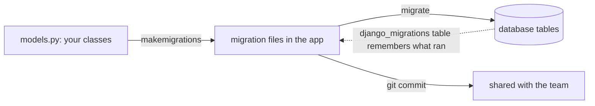
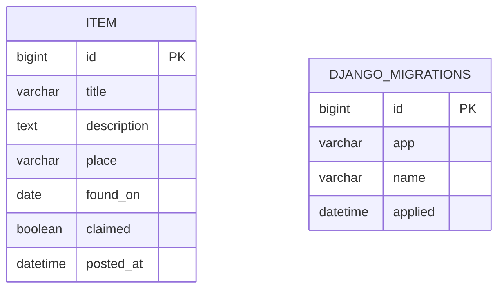

# Models, migrations and the admin

> **Before this lesson:** you can create a project and an app, register the app, write views and templates ([Class-based views, template inheritance, page tests and a first deployment](#/lesson/django/cbv-inheritance)). You should know Python classes. No database knowledge is assumed; if you later want the full story of tables and queries, see [the relational model](#/lesson/sql/relational-model).

## In plain words

Until now every page showed text typed into the code. Real sites remember things: posts, orders, users. Things that must survive after the program stops are kept in a **database**, a program specialised in storing and finding records reliably.

A database stores records in **tables**. A table is like a spreadsheet: each **row** is one record (one lost umbrella), each **column** is one property of it (where it was found, on which date). The language used to talk to most databases is **SQL** (Structured Query Language).

Django lets you avoid writing SQL by hand for everyday work. You describe each kind of record as a Python class called a **model**, and Django translates between Python objects and table rows. That translator is the **ORM**, the object-relational mapper.

Three ideas, three everyday pictures:

- A **model** is the design of a paper form: which boxes exist and what may be written in each.
- A **migration** is a set of written instructions for changing the filing cabinet to match a new form design ("add a drawer", "add a box for the date"). The instructions are kept, so any cabinet anywhere can be brought to the same state.
- The **admin** is the back office: a ready-made website where trusted staff can add, edit and delete records without a programmer building screens for them.

Why it matters for a job: models are the centre of every Django application; most of your working hours go into them. Migrations are where teams hurt themselves, so employers probe them. And the admin regularly saves weeks of work on internal tools.

## The example: a lost-and-found board

This module builds a message-board style site for a campus: people post items they found, and others browse the list. Start a new project in an empty folder (virtual environment active, Django installed):

```bash
django-admin startproject config .
python manage.py startapp board
```

Add `"board"` to `INSTALLED_APPS` in `config/settings.py`.

## Step 1: the smallest model

Open `board/models.py`:

```python
# board/models.py
from django.db import models


class Item(models.Model):
    title = models.CharField(max_length=120)
```

- `from django.db import models` imports Django's model toolkit.
- `class Item(models.Model):` declares a model. Inheriting from `models.Model` is what makes the class a database table instead of an ordinary Python class.
- `title = models.CharField(max_length=120)` declares one column. `CharField` means "a short piece of text"; `max_length` is required for it and becomes a limit in the database.

Django will create a table named `board_item` (app name, underscore, model name in lower case) with **two** columns: `title`, and an automatic `id` column, a number that Django assigns to each row. The `id` is the **primary key**: the value that uniquely identifies a row. You can refer to it as `item.id` or `item.pk`.

## Step 2: migrations, in two commands

Writing the class changed nothing in the database yet. Two commands do that, and the difference between them is the most important thing in this lesson.

```bash
python manage.py makemigrations
```

```
Migrations for 'board':
  board/migrations/0001_initial.py
    + Create model Item
```

`makemigrations` compares your model classes with the migration files that already exist, and **writes a new migration file** describing the difference. It does not touch the database. Open the file it wrote:

```python
# board/migrations/0001_initial.py  (generated; shortened)
from django.db import migrations, models


class Migration(migrations.Migration):
    initial = True
    dependencies = []
    operations = [
        migrations.CreateModel(
            name="Item",
            fields=[
                ("id", models.BigAutoField(auto_created=True, primary_key=True, serialize=False, verbose_name="ID")),
                ("title", models.CharField(max_length=120)),
            ],
        ),
    ]
```

It is ordinary Python: a list of **operations** (here one, `CreateModel`) and a list of **dependencies**, the migrations that must run before this one. Now apply it:

```bash
python manage.py migrate
```

`migrate` reads all migration files that have not been applied yet and **runs them against the database**. The first time, it also creates the tables of the built-in apps (`auth`, `admin`, `sessions` ...), which is why the output is long. Django records which migrations have run in a table of its own called `django_migrations`, so running `migrate` twice does nothing the second time.



To see the SQL a migration will run, without running it:

```bash
python manage.py sqlmigrate board 0001
```

```sql
CREATE TABLE "board_item" ("id" integer NOT NULL PRIMARY KEY AUTOINCREMENT, "title" varchar(120) NOT NULL);
```

> [!WARNING]
> Migration files are source code. Commit them to Git together with the model change that produced them, and never edit or delete one that a teammate or a server has already applied. A database whose history disagrees with the files is painful to repair.

## Step 3: a realistic model

Grow the model one idea at a time. Replace `board/models.py` with:

```python
# board/models.py
from django.db import models


class Item(models.Model):
    class Place(models.TextChoices):
        LIBRARY = "LIB", "Library"
        GYM = "GYM", "Gym"
        CANTEEN = "CAN", "Canteen"
        OTHER = "OTH", "Somewhere else"

    title = models.CharField(max_length=120)
    description = models.TextField(blank=True)
    place = models.CharField(max_length=3, choices=Place.choices, default=Place.OTHER)
    found_on = models.DateField()
    claimed = models.BooleanField(default=False)
    posted_at = models.DateTimeField(auto_now_add=True)

    class Meta:
        ordering = ["-posted_at"]

    def __str__(self):
        return self.title
```

What each new piece means:

| Code | Meaning |
|---|---|
| `TextField(blank=True)` | long text with no length limit; `blank=True` allows forms to leave it empty |
| `choices=Place.choices` | the value must be one of a fixed list; the database stores the short code (`"LIB"`), people see the label (`"Library"`) |
| `default=...` | value used when none is given |
| `DateField()` | a calendar date |
| `BooleanField(default=False)` | true or false |
| `DateTimeField(auto_now_add=True)` | date and time, filled in automatically when the row is created |
| `class Meta: ordering = ["-posted_at"]` | default sort order for lists of items; the minus sign means newest first |
| `def __str__(self)` | the text shown wherever Django needs to display an item (admin lists, the shell, drop-downs) |

`Meta` is a small inner class for settings about the model as a whole, as opposed to settings about one field.

Because the model changed, repeat the two commands:

```bash
python manage.py makemigrations
```

Django stops and asks a question:

```
It is impossible to add a non-nullable field 'found_on' to item without specifying a default.
 1) Provide a one-off default now
 2) Quit and manually define a default value in models.py
```

This puzzles everyone the first time. The reasoning: the table might already contain rows, and every existing row needs *some* value in the new required column. Django cannot invent one. Choose option 1 and type `timezone.now` (the prompt has `timezone` available) to stamp existing rows with today's date, or quit and add `default=` or `null=True` to the field. Then run `python manage.py migrate`. A second file, `0002_...py`, now sits beside the first and depends on it.

### Field options you will use constantly

| Option | Affects | Meaning |
|---|---|---|
| `null=True` | database | the column may store "no value" (`NULL`) |
| `blank=True` | validation | forms and the admin accept an empty input |
| `default=value` | both | value when none is supplied |
| `unique=True` | database | no two rows may share the value |
| `choices=[...]` | validation | restrict to listed values |
| `verbose_name`, `help_text` | display | label and hint shown in forms |
| `db_index=True` | database | build an index for faster lookups on this column |

`null` and `blank` are separate on purpose. For text fields the convention is `blank=True` alone, so that "empty" is stored as an empty string and there is only one way to say "nothing". For dates and numbers that may be absent, use both: `null=True, blank=True`.

## What the ORM does underneath

The following model is a tiny ORM built on Python's bundled `sqlite3` module. It turns a class description into `CREATE TABLE`, turns `create()` into `INSERT`, and turns rows back into objects. Django's ORM is this idea with fifteen years of refinement. Run it and read the SQL it prints.

```python-run
import sqlite3

db = sqlite3.connect(":memory:")        # a throw-away database in memory

class Field:
    def __init__(self, sql_type, default=None):
        self.sql_type, self.default = sql_type, default

class Model:
    @classmethod
    def fields(cls):
        return {k: v for k, v in vars(cls).items() if isinstance(v, Field)}

    @classmethod
    def create_table(cls):                      # what a CreateModel migration does
        cols = ", ".join(f"{name} {f.sql_type}" for name, f in cls.fields().items())
        sql = f"CREATE TABLE {cls.__name__.lower()} (id INTEGER PRIMARY KEY AUTOINCREMENT, {cols})"
        print("SQL:", sql)
        db.execute(sql)

    @classmethod
    def create(cls, **values):                  # like Item.objects.create(...)
        data = {n: values.get(n, f.default) for n, f in cls.fields().items()}
        marks = ", ".join("?" for _ in data)
        sql = f"INSERT INTO {cls.__name__.lower()} ({', '.join(data)}) VALUES ({marks})"
        print("SQL:", sql, list(data.values()))
        cursor = db.execute(sql, list(data.values()))
        return cls._from_row((cursor.lastrowid, *data.values()))

    @classmethod
    def all(cls):                               # like Item.objects.all()
        rows = db.execute(f"SELECT id, {', '.join(cls.fields())} FROM {cls.__name__.lower()}")
        return [cls._from_row(r) for r in rows]

    @classmethod
    def _from_row(cls, row):
        obj = cls()
        for name, value in zip(["id", *cls.fields()], row):
            setattr(obj, name, value)
        return obj

class Item(Model):
    title = Field("VARCHAR(120)")
    place = Field("VARCHAR(3)", default="OTH")
    claimed = Field("BOOL", default=False)

Item.create_table()
Item.create(title="Blue umbrella", place="LIB")
Item.create(title="Calculator")
for item in Item.all():
    print(item.id, item.title, item.place, bool(item.claimed))
```

Notice the `?` marks in the `INSERT`: the values travel separately from the SQL text, so a title containing quote characters cannot change the meaning of the statement. Django does the same for every query, which is its built-in protection against **SQL injection** (an attack in which user input is interpreted as SQL).

## Step 4: trying the real ORM in the shell

```bash
python manage.py shell
```

```
>>> from datetime import date
>>> from board.models import Item
>>> Item.objects.create(title="Blue umbrella", place="LIB", found_on=date(2026, 11, 18))
<Item: Blue umbrella>
>>> Item.objects.count()
1
>>> first = Item.objects.get(pk=1)
>>> first.get_place_display()
'Library'
>>> first.claimed = True
>>> first.save()
```

`Item.objects` is the model's **manager**, the gateway for database queries. `create` inserts a row and returns the object; `get` fetches exactly one; `save` writes changes back. `get_place_display()` is generated automatically for every field with `choices` and returns the human label. The `<Item: Blue umbrella>` text comes from your `__str__` method; without it you would see the unhelpful `<Item: Item object (1)>`.

## Step 5: the admin

The admin is an app in `INSTALLED_APPS` and its URL (`admin/`) is already in `config/urls.py`. It needs two things from you: an account allowed to log in, and a list of models to manage.

Create a **superuser**, an account with every permission:

```bash
python manage.py createsuperuser
```

Answer the prompts for username, e-mail and password (the password does not echo as you type). Then register the model:

```python
# board/admin.py
from django.contrib import admin

from .models import Item


@admin.register(Item)
class ItemAdmin(admin.ModelAdmin):
    list_display = ["title", "place", "found_on", "claimed"]
    list_filter = ["place", "claimed"]
    search_fields = ["title", "description"]
    date_hierarchy = "found_on"
```

- `@admin.register(Item)` tells the admin site to manage `Item` using the class below it. (A **decorator**, the line starting with `@`, wraps the class in a function call.)
- `list_display` chooses the columns of the list page.
- `list_filter` adds a sidebar of one-click filters.
- `search_fields` adds a search box over those text columns.
- `date_hierarchy` adds drill-down links by year, month and day.

The bare minimum is a single line, `admin.site.register(Item)`; the `ModelAdmin` class is where customisation goes. Run the server, open `http://127.0.0.1:8000/admin/`, log in and add a few items. Each form you see was generated from the model: the `place` field is a drop-down because of `choices`, `found_on` has a calendar widget because it is a `DateField`, and `posted_at` is absent because `auto_now_add` fields are not editable.

> [!TIP]
> The admin is for trusted staff, not for the public. A good rule: if a screen must be pleasant, branded or restricted in clever ways, build normal views. If it only needs to let colleagues fix data, register the model and move on.

## How the pieces relate



One model, one table. The second table is Django's own bookkeeping of applied migrations.

> [!NOTE]
> **What changed since the book.** Automatic primary keys are now `BigAutoField` (64-bit) through the `DEFAULT_AUTO_FIELD` setting introduced in Django 3.2; the book's projects used 32-bit `AutoField`. `TextChoices` (3.0) replaced hand-written tuples of choices. Django 5.0 added `db_default` (a default computed by the database) and `GeneratedField`; 5.2 added composite primary keys. The `@admin.register` decorator and the two migration commands are unchanged.

> [!INTERVIEW]
> **"What is the difference between `makemigrations` and `migrate`?"** `makemigrations` inspects the models, compares them with the state described by existing migration files, and writes new migration files; it never touches the database. `migrate` applies unapplied migration files to a database in dependency order and records each in the `django_migrations` table. The split exists so that schema changes are code: reviewed, versioned and replayed identically on every developer machine and server. A frequent follow-up is "`null` versus `blank`?": `null` is a database rule, `blank` is a validation rule.

## Pitfalls

- **Changing a model and forgetting the commands.** The symptom is `OperationalError: no such column` or `no such table`. Run `makemigrations` and `migrate`.
- **`No changes detected`** although you added a model: the app is missing from `INSTALLED_APPS`, or the model is not in (or imported into) `models.py`.
- **Deleting migration files or `db.sqlite3` to "fix" things.** Fine on day one of a toy project, destructive anywhere else. Learn to read the error instead.
- **No `__str__`.** Admin lists and drop-downs fill with `Item object (3)`.
- **`null=True` on text fields.** Creates two kinds of empty (`""` and `NULL`) and bugs when filtering.
- **Editing the database by hand.** Tables created or altered outside migrations drift away from what Django believes exists.
- **Weak superuser passwords on a deployed site.** The admin is a favourite target; the URL `/admin/` is guessed by every scanner.

## Cheat sheet

| Task | Code or command |
|---|---|
| Declare a model | `class Item(models.Model): title = models.CharField(max_length=120)` |
| Write migration files | `python manage.py makemigrations` |
| Apply them | `python manage.py migrate` |
| Show status | `python manage.py showmigrations` |
| Show the SQL | `python manage.py sqlmigrate board 0001` |
| Admin account | `python manage.py createsuperuser` |
| Register in admin | `@admin.register(Item)` above a `ModelAdmin` class |
| Insert | `Item.objects.create(title="...", found_on=date.today())` |
| Fetch one | `Item.objects.get(pk=1)` |
| Update | change attributes, then `item.save()` |
| Delete | `item.delete()` |
| Label of a choice | `item.get_place_display()` |

## Summary

- A model is a Python class that maps to a database table; each field is a column, and Django adds an `id` primary key.
- `makemigrations` writes change instructions as files; `migrate` executes them and remembers that it did. Commit the files.
- Field options split into database rules (`null`, `unique`, `db_index`) and validation rules (`blank`, `choices`).
- `__str__` and `Meta.ordering` make objects readable and lists predictable.
- The admin gives staff a full editing interface after one registration line; `ModelAdmin` options tune lists, filters and search.

## Glossary

- **Database**: software that stores and retrieves structured data reliably.
- **Table / row / column**: a collection of records / one record / one property of the records.
- **SQL**: the language for querying and changing relational databases.
- **ORM (object-relational mapper)**: the layer that converts between Python objects and table rows.
- **Model**: a class describing one table.
- **Field**: a model attribute describing one column and its rules.
- **Primary key**: the column whose value uniquely identifies each row (`id`, also `pk`).
- **Migration**: a file listing operations that change the database structure.
- **Schema**: the structure of a database: its tables, columns and constraints.
- **Manager**: the `objects` attribute through which queries are made.
- **Superuser**: an account with all permissions.
- **SQL injection**: an attack that smuggles SQL through user input; prevented by parameterised queries.

```quiz
[
  {"q": "Which command changes the database?",
   "options": ["makemigrations", "migrate", "Both", "Neither; saving models.py is enough"],
   "answer": 1,
   "explain": "makemigrations only writes migration files. migrate executes unapplied migrations and records them."},
  {"q": "You add a required DateField to a model that already has rows. Why does makemigrations ask for a default?",
   "options": ["Dates always need defaults", "Existing rows need a value for the new non-null column, and Django cannot guess one", "The field name is reserved", "SQLite does not support dates"],
   "answer": 1,
   "explain": "A NOT NULL column cannot be added to populated rows without a value. Provide a one-off default, a field default, or allow null."},
  {"q": "What is the difference between null=True and blank=True?",
   "options": ["They are synonyms", "null is a database rule allowing NULL; blank is a validation rule allowing empty form input", "null is for numbers, blank for text only", "blank changes the database, null changes forms"],
   "answer": 1,
   "explain": "They act at different layers. Text fields usually use blank=True alone so that empty is stored as an empty string."},
  {"q": "What table name does Django give to the model Item in the app board?",
   "options": ["Item", "items", "board_item", "board.Item"],
   "answer": 2,
   "explain": "The default is <app label>_<model name in lower case>. It can be changed with Meta.db_table."},
  {"q": "Why should migration files be committed to version control?",
   "options": ["They are needed to import the app", "They are the reproducible history of schema changes that every environment must replay", "Git requires them", "They contain the data"],
   "answer": 1,
   "explain": "Teammates and servers reach the same schema by applying the same files in order."},
  {"q": "What does defining __str__ on a model change?",
   "options": ["The table name", "How instances are displayed in the admin, shell and form drop-downs", "The primary key", "The sort order"],
   "answer": 1,
   "explain": "Without it you see 'Item object (1)'. It has no effect on the database."},
  {"q": "In ItemAdmin, what does list_filter = ['place', 'claimed'] add?",
   "options": ["Columns in the list", "A sidebar with clickable filters for those fields", "A search box", "Validation rules"],
   "answer": 1,
   "explain": "list_display controls columns, search_fields the search box, list_filter the filter sidebar."},
  {"q": "How does the ORM protect against SQL injection?",
   "options": ["It encrypts all queries", "It sends values as parameters, separate from the SQL text", "It rejects quotes in input", "It only allows SELECT statements"],
   "answer": 1,
   "explain": "Parameterised queries mean user data is never parsed as SQL."}
]
```

> **Source:** Vincent, *Django for Beginners*, ch. 4 (Message Board app: models, migrations, admin). Docs: https://docs.djangoproject.com/en/5.2/topics/db/models/ · https://docs.djangoproject.com/en/5.2/topics/migrations/ · https://docs.djangoproject.com/en/5.2/ref/models/fields/ · https://docs.djangoproject.com/en/5.2/ref/contrib/admin/
