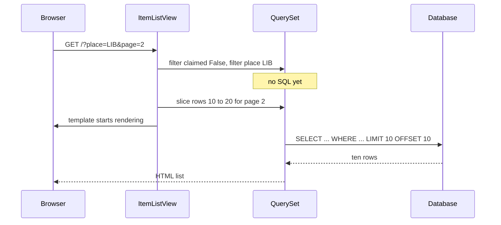

# ListView, querysets and tests with a database

> **Before this lesson:** you have the `lostfound` project with the `Item` model, applied migrations and a few items entered through the admin ([Models, migrations and the admin](#/lesson/django/models-migrations-admin)). You know class-based views and template inheritance ([Class-based views, template inheritance, page tests and a first deployment](#/lesson/django/cbv-inheritance)).

## In plain words

The database now holds records, and the admin lets staff edit them. Visitors still see nothing. This lesson builds the public page that lists the records, and to do so it introduces the object you will use more than any other in Django: the **queryset**.

A **queryset** is a description of a question you want to ask the database: "all unclaimed items found in the library, newest first". It is not the answer. Django waits to ask the database until you need the answer, for example when a template starts looping over the items.

An everyday picture: a shopping list. Writing "milk, eggs, bread from the corner shop" costs nothing and you can keep adding lines. The trip to the shop happens once, when you are hungry. A queryset is the list; iterating over it is the trip.

Why it matters for a job: listing things is what most web pages do, and how you ask the database decides whether a page takes 20 milliseconds or 20 seconds. Interviewers ask "are querysets lazy, and what does that mean?" almost as often as the request-lifecycle question.

## Step 1: the simplest list page

Django's generic `ListView` does the whole job of "fetch all rows of a model and render them".

```python
# board/views.py
from django.views.generic import ListView

from .models import Item


class ItemListView(ListView):
    model = Item
```

Two lines of substance. `model = Item` tells the view which table to list. Everything else has a default:

| Default | Value for this view | Override with |
|---|---|---|
| Queryset | `Item.objects.all()` | `queryset` or `get_queryset()` |
| Template | `board/item_list.html` (`<app>/<model>_list.html`) | `template_name` |
| Name of the list in the template | `object_list` and also `item_list` | `context_object_name` |

Wire the URL:

```python
# board/urls.py  (new file)
from django.urls import path

from .views import ItemListView

urlpatterns = [
    path("", ItemListView.as_view(), name="item-list"),
]
```

```python
# config/urls.py
from django.contrib import admin
from django.urls import include, path

urlpatterns = [
    path("admin/", admin.site.urls),
    path("", include("board.urls")),
]
```

And write the template at the default location:

```html
<!-- board/templates/board/item_list.html -->
<h1>Lost and found</h1>
<ul>
  
    <li>
      <strong>{{ item.title }}</strong>
      found in the {{ item.get_place_display|lower }} on {{ item.found_on|date:"j M" }}
      <em>(claimed)</em>
    </li>
  
    <li>Nothing has been handed in yet.</li>
  
</ul>
```

Open the site and the items from the admin appear, newest first because of `Meta.ordering` on the model. Note `item.get_place_display` without parentheses: templates call no-argument methods for you.

> [!TIP]
> Set `context_object_name = "items"` on the view when the automatic name reads awkwardly. A template that says `` explains itself; `object_list` does not.

## Step 2: asking better questions

`Item.objects.all()` means "every row". Most pages want a subset. Open `python manage.py shell` and try each line; the comments show the meaning.

```python
from board.models import Item

Item.objects.all()                              # every item
Item.objects.filter(claimed=False)              # only rows where claimed is False
Item.objects.exclude(place="GYM")               # everything except gym items
Item.objects.filter(claimed=False, place="LIB") # both conditions must hold (AND)
Item.objects.order_by("found_on")               # oldest find first
Item.objects.order_by("-found_on", "title")     # newest first; ties sorted by title
Item.objects.count()                            # a number, computed by the database
Item.objects.filter(claimed=False).exists()     # True or False, cheaply
Item.objects.first()                            # one object or None
Item.objects.get(pk=3)                          # exactly one object, or an exception
```

`filter`, `exclude` and `order_by` each return a **new queryset**, so they chain:

```python
Item.objects.filter(claimed=False).exclude(place="OTH").order_by("-found_on")[:5]
```

The slice `[:5]` means "at most five", translated to SQL `LIMIT 5`.

### Field lookups

The keyword `claimed=False` is short for `claimed__exact=False`. A double underscore followed by a **lookup** name expresses other comparisons:

| Lookup | Example | Meaning |
|---|---|---|
| `exact` (default) | `place="LIB"` | equals |
| `iexact` | `title__iexact="umbrella"` | equals, ignoring letter case |
| `contains` / `icontains` | `title__icontains="blue"` | contains the text (case-sensitive / not) |
| `startswith`, `endswith` | `title__startswith="Key"` | begins / ends with |
| `gt`, `gte`, `lt`, `lte` | `found_on__gte=date(2026, 11, 1)` | greater than, greater or equal, less than, less or equal |
| `in` | `place__in=["LIB", "GYM"]` | is one of the listed values |
| `range` | `found_on__range=(start, end)` | between two values, inclusive |
| `isnull` | `description__isnull=True` | has no value |
| `year`, `month`, `day` | `found_on__year=2026` | part of a date |

### `get` versus `filter`

`filter` returns a queryset, possibly empty. `get` returns one object and raises `Item.DoesNotExist` when nothing matches or `Item.MultipleObjectsReturned` when several do. Use `get` only with conditions that identify at most one row, typically the primary key or a unique field.

## Step 3: laziness, made visible

Creating and chaining querysets sends **no SQL**. The query runs when the queryset is *evaluated*: when you loop over it, call `list()` or `len()` on it, slice it with a step, test it in an `if`, or print it in the shell. After evaluation the rows are kept in the queryset's cache, so looping over the *same* queryset object again costs nothing.

The model below reproduces this behaviour over a list of dictionaries and counts simulated database trips. Predict the number of queries before you run it.

```python-run
ROWS = [
    {"id": 1, "title": "Blue umbrella", "place": "LIB", "claimed": False},
    {"id": 2, "title": "Calculator", "place": "LIB", "claimed": True},
    {"id": 3, "title": "Water bottle", "place": "GYM", "claimed": False},
    {"id": 4, "title": "Scarf", "place": "CAN", "claimed": False},
]
queries = 0

class QuerySet:
    def __init__(self, conditions=None, order=None):
        self.conditions, self.order = conditions or {}, order
        self._cache = None                       # filled on first evaluation

    def filter(self, **kwargs):                  # returns a NEW queryset; no database trip
        return QuerySet({**self.conditions, **kwargs}, self.order)

    def order_by(self, key):
        return QuerySet(self.conditions, key)

    def _fetch(self):
        global queries
        if self._cache is None:                  # only the first evaluation hits the database
            queries += 1
            rows = [r for r in ROWS if all(r[k] == v for k, v in self.conditions.items())]
            if self.order:
                rows.sort(key=lambda r: r[self.order.lstrip("-")], reverse=self.order.startswith("-"))
            self._cache = rows
        return self._cache

    def __iter__(self):
        return iter(self._fetch())

    def __len__(self):
        return len(self._fetch())

qs = QuerySet().filter(claimed=False)
qs = qs.filter(place="LIB").order_by("-id")
print("after building the queryset:", queries, "queries")

for row in qs:
    print("  found:", row["title"])
print("after the first loop:", queries, "queries")

print("length:", len(qs), "| after len():", queries, "queries (cache reused)")

again = qs.filter(claimed=False)                 # a new queryset has an empty cache
print("rows in new queryset:", len(again), "| total queries:", queries)
```

Building did nothing; the first loop cost one query; `len()` reused the cache; the derived queryset needed its own trip. The practical consequences in Django:

- Build querysets freely in views; pass them to templates unevaluated.
- In a template, `{{ item_list|length }}` after a `` loop is free, while `{{ item_list.count }}` asks the database again.
- To know only *whether* rows exist, use `.exists()`; to know only *how many*, use `.count()`. Both let the database answer without sending the rows.

To see the SQL Django generated, print `str(queryset.query)` in the shell.

## Step 4: a filtered, paginated ListView

Customise the list by overriding `get_queryset`, the method that supplies the rows. This version shows only unclaimed items, lets the visitor filter by place with `?place=LIB`, and splits the list into pages.

```python
# board/views.py
from django.views.generic import ListView

from .models import Item


class ItemListView(ListView):
    model = Item
    context_object_name = "items"
    paginate_by = 10

    def get_queryset(self):
        queryset = Item.objects.filter(claimed=False)
        place = self.request.GET.get("place", "")
        if place in Item.Place.values:
            queryset = queryset.filter(place=place)
        return queryset

    def get_context_data(self, **kwargs):
        context = super().get_context_data(**kwargs)
        context["places"] = Item.Place.choices
        context["current_place"] = self.request.GET.get("place", "")
        return context
```

- `self.request` is the current request, available in every method of a class-based view.
- `Item.Place.values` is the list of valid codes. Checking membership before filtering means a made-up value such as `?place=XYZ` is ignored instead of producing an empty page.
- `paginate_by = 10` makes the view cut the queryset into pages of ten and read the page number from `?page=2`. The template receives `page_obj` and `is_paginated`.

```html
<!-- board/templates/board/item_list.html -->
<h1>Lost and found</h1>

<p>
  <a href="">All places</a>
  
    | <a href="?place={{ code }}">{{ label }}</a>
  
</p>

<ul>
  
    <li><strong>{{ item.title }}</strong>, {{ item.get_place_display }}, {{ item.found_on|date:"j M" }}</li>
  
    <li>No unclaimed items here.</li>
  
</ul>


  <p>
    
      <a href="?page={{ page_obj.previous_page_number }}&place={{ current_place }}">Newer</a>
    
    Page {{ page_obj.number }} of {{ page_obj.paginator.num_pages }}
    
      <a href="?page={{ page_obj.next_page_number }}&place={{ current_place }}">Older</a>
    
  </p>

```

Pagination works because querysets are lazy: the view slices the queryset before evaluation, so the database is asked for ten rows (`LIMIT 10 OFFSET 10`), not for the whole table.



## Step 5: tests that use the database

Tests that create model objects must inherit from `TestCase` instead of `SimpleTestCase`. Django then builds a separate, empty **test database**, wraps every test in a transaction and undoes it afterwards. Your development data is never touched, and each test starts from a clean slate.

```python
# board/tests.py
from datetime import date

from django.test import TestCase
from django.urls import reverse

from .models import Item


class ItemModelTests(TestCase):
    def test_str_and_defaults(self):
        item = Item.objects.create(title="Blue umbrella", found_on=date(2026, 11, 18))
        self.assertEqual(str(item), "Blue umbrella")
        self.assertFalse(item.claimed)
        self.assertEqual(item.get_place_display(), "Somewhere else")


class ItemListViewTests(TestCase):
    @classmethod
    def setUpTestData(cls):
        cls.umbrella = Item.objects.create(title="Blue umbrella", place="LIB", found_on=date(2026, 11, 18))
        cls.bottle = Item.objects.create(title="Water bottle", place="GYM", found_on=date(2026, 11, 19))
        cls.claimed = Item.objects.create(title="Old scarf", place="LIB", found_on=date(2026, 11, 1), claimed=True)

    def test_lists_only_unclaimed_items(self):
        response = self.client.get(reverse("item-list"))
        self.assertEqual(response.status_code, 200)
        self.assertTemplateUsed(response, "board/item_list.html")
        self.assertContains(response, "Blue umbrella")
        self.assertNotContains(response, "Old scarf")

    def test_filter_by_place(self):
        response = self.client.get(reverse("item-list"), {"place": "GYM"})
        self.assertQuerySetEqual(response.context["items"], [self.bottle])

    def test_unknown_place_is_ignored(self):
        response = self.client.get(reverse("item-list"), {"place": "XYZ"})
        self.assertEqual(len(response.context["items"]), 2)

    def test_single_query_for_the_page(self):
        with self.assertNumQueries(2):          # one COUNT for the paginator, one SELECT
            self.client.get(reverse("item-list"))
```

- `setUpTestData` runs once for the whole class and is the efficient place to create shared rows.
- `self.client.get(url, {"place": "GYM"})` adds a query string.
- `assertQuerySetEqual` compares a queryset with a list of expected objects, in order.
- `assertNumQueries` fails if the block issues a different number of SQL queries. It is the cheapest insurance against a page that slowly grows from 2 queries to 200.

> [!NOTE]
> **What changed since the book.** The assertion was spelled `assertQuerysetEqual` and compared against `repr()` strings; since Django 4.2 it is `assertQuerySetEqual`, compares objects directly, and the old name was removed in 5.1. Django 5.1 added the `` template tag, which builds links like `?page=2` while keeping the other parameters and replaces the hand-written `&place=` above.

> [!INTERVIEW]
> **"Querysets are lazy. What does that mean and when is one evaluated?"** Building or chaining a queryset creates a query description without touching the database. Evaluation happens on iteration, `list()`, `len()`, `bool()`, slicing with a step, `repr()`, or pickling. Results are cached on that queryset instance, but each chained call returns a new instance with an empty cache. Follow with the practical uses: pagination slices before evaluation; `.exists()` and `.count()` avoid loading rows; and laziness is also why a queryset passed to a template can issue queries during rendering, which is where N+1 problems hide.

> [!WARNING]
> `if queryset:` loads **all** matching rows into memory to decide whether there is at least one. For a yes/no question write `if queryset.exists():`.

## Pitfalls

- **Template in the wrong place or with the wrong name.** `ListView` looks for `<app>/<model>_list.html`; the error page lists the names it tried.
- **Looping over `object_list` when you set `context_object_name`.** Both names exist, but pick one and be consistent.
- **Calling `.get()` for something that may be missing.** Catch `DoesNotExist`, or use `.filter(...).first()`, or `get_object_or_404` in views.
- **Using `SimpleTestCase` with models.** It refuses database access with a clear error; switch to `TestCase`.
- **Expecting test data in the real database, or real data in tests.** The test database is separate and starts empty.
- **Unordered pagination.** Without a defined ordering, pages may overlap; Django warns with `UnorderedObjectListWarning`. Set `Meta.ordering` or call `order_by`.
- **Trusting query-string values.** Validate anything from `request.GET` before using it in a filter.

## Cheat sheet

| Need | Code |
|---|---|
| List page | `class ItemListView(ListView): model = Item` |
| Custom rows | override `get_queryset()` |
| Name in template | `context_object_name = "items"` |
| Pages of ten | `paginate_by = 10` → `page_obj`, `is_paginated` |
| Keep / drop rows | `.filter(...)`, `.exclude(...)` |
| Sort | `.order_by("-found_on", "title")` |
| First n | `queryset[:n]` |
| One row | `.get(pk=...)`, `.first()` |
| Cheap checks | `.exists()`, `.count()` |
| See the SQL | `print(queryset.query)` |
| Database test class | `django.test.TestCase` with `setUpTestData` |
| Guard query count | `with self.assertNumQueries(n):` |

## Summary

- `ListView` needs only `model`; it supplies a queryset, a template name and context names by convention.
- A queryset describes a query. `filter`, `exclude` and `order_by` chain and return new querysets; lookups such as `__icontains` and `__gte` express comparisons.
- Nothing is sent to the database until the queryset is evaluated; results are cached per queryset object.
- Override `get_queryset` for filtering, set `paginate_by` for pages, and validate query-string input.
- `TestCase` gives every test an isolated database; test the model, the view's content, its context and its query count.

## Glossary

- **Queryset**: a lazy, chainable description of a database query that yields model instances.
- **Lazy evaluation**: postponing work until its result is needed.
- **Evaluate**: run the query and load its rows.
- **Lookup**: the comparison after a double underscore, such as `__gte` or `__icontains`.
- **Manager**: `Model.objects`, the starting point of querysets.
- **Pagination**: splitting a long list into numbered pages.
- **`LIMIT` / `OFFSET`**: SQL clauses meaning "at most n rows" and "skip the first n".
- **Test database**: a temporary database created for the test run and destroyed afterwards.
- **Transaction**: a group of database operations that succeed or are undone together.
- **N+1 problem**: one query for a list plus one more per item; covered in the ORM module.

```quiz
[
  {"q": "When does `qs = Item.objects.filter(claimed=False)` send SQL to the database?",
   "options": ["Immediately on that line", "Never", "When the queryset is evaluated, for example by iterating over it", "When the view returns"],
   "answer": 2,
   "explain": "Querysets are lazy: building one creates a description. Iteration, list(), len(), bool() and similar operations trigger the query."},
  {"q": "Which template name does `ListView` with `model = Item` in the app `board` look for by default?",
   "options": ["item.html", "board/item_list.html", "templates/list.html", "board/items.html"],
   "answer": 1,
   "explain": "The convention is <app label>/<model name>_list.html."},
  {"q": "What does `Item.objects.filter(title__icontains='blue')` match?",
   "options": ["Titles equal to 'blue' exactly", "Titles containing 'blue' in any letter case", "Titles starting with 'blue'", "Items whose id contains 'blue'"],
   "answer": 1,
   "explain": "icontains is a case-insensitive substring match."},
  {"q": "What happens when `Item.objects.get(place='LIB')` matches three rows?",
   "options": ["It returns the first", "It returns a list of three", "It raises MultipleObjectsReturned", "It returns None"],
   "answer": 2,
   "explain": "get() promises exactly one object and raises if there are none or several. Use filter() for sets of rows."},
  {"q": "Which is the efficient way to check whether any unclaimed item exists?",
   "options": ["len(Item.objects.filter(claimed=False)) > 0", "bool(Item.objects.filter(claimed=False))", "Item.objects.filter(claimed=False).exists()", "Item.objects.all()[0]"],
   "answer": 2,
   "explain": "exists() asks the database for at most one row and returns a boolean; the others load all matching rows."},
  {"q": "Why must tests that create Item objects inherit from TestCase and not SimpleTestCase?",
   "options": ["SimpleTestCase cannot make requests", "SimpleTestCase forbids database queries; TestCase provides an isolated test database", "TestCase is faster", "SimpleTestCase does not support assertEqual"],
   "answer": 1,
   "explain": "TestCase wraps each test in a transaction on a separate test database and rolls it back afterwards."},
  {"q": "What does `paginate_by = 10` rely on to avoid loading the whole table?",
   "options": ["A cache of all rows", "Laziness: the queryset is sliced before evaluation, producing LIMIT and OFFSET", "JavaScript in the browser", "A separate table per page"],
   "answer": 1,
   "explain": "Slicing an unevaluated queryset adds LIMIT/OFFSET to the SQL, so only one page of rows is fetched."},
  {"q": "What does `with self.assertNumQueries(2):` verify?",
   "options": ["That two rows are returned", "That exactly two SQL queries run inside the block", "That the page loads in two seconds", "That two templates are used"],
   "answer": 1,
   "explain": "It counts queries and fails on any other number, guarding against accidental query growth."}
]
```

> **Source:** Vincent, *Django for Beginners*, ch. 4 (Message Board app: views, templates, tests). Docs: https://docs.djangoproject.com/en/5.2/topics/db/queries/ · https://docs.djangoproject.com/en/5.2/ref/models/querysets/ · https://docs.djangoproject.com/en/5.2/ref/class-based-views/generic-display/#listview · https://docs.djangoproject.com/en/5.2/topics/pagination/ · https://docs.djangoproject.com/en/5.2/topics/testing/tools/
