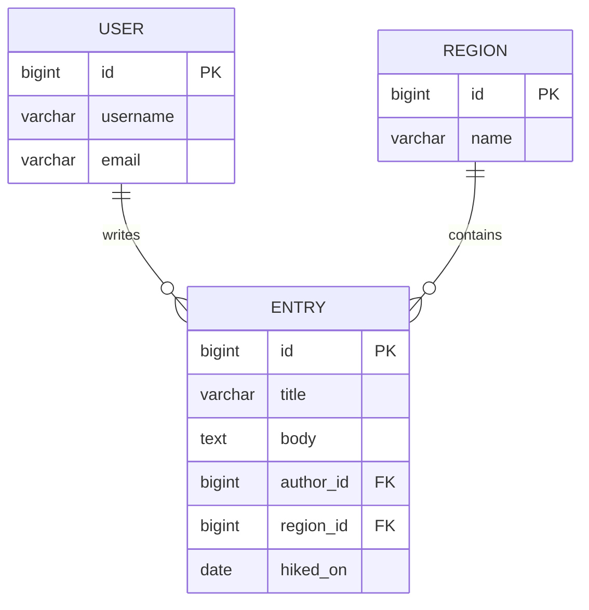

# Foreign keys, detail views and slugs

> **Before this lesson:** you can define a model, run migrations, register it in the admin and list rows with `ListView` ([Models, migrations and the admin](#/lesson/django/models-migrations-admin), [ListView, querysets and tests with a database](#/lesson/django/listview-querysets)). You know path converters from [The request/response cycle, views, URLs and first tests](#/lesson/django/request-response).

## In plain words

A blog has posts, and every post has an author. The author's name, e-mail and biography should be stored **once**, not copied into each post; otherwise changing the e-mail means editing a hundred rows and missing three. So the post row stores only a pointer: "my author is user number 4". That pointer is a **foreign key**: a column whose value is the primary key of a row in another table.

An everyday picture: a library card catalogue. A book's card does not contain the author's life story. It says "Author: see card A-117". Follow the reference and you find everything about the author, and every book by that author points to the same card.

This lesson adds two more ideas a blog needs. A **detail page** shows one record on its own address. And a **slug** makes that address readable: `/journal/first-frost-on-the-ridge/` instead of `/journal/17/`.

Why it matters for a job: relationships between tables are what makes a database "relational", and nearly every interview includes modelling a one-to-many relationship and explaining `on_delete`. Readable, stable URLs matter for search engines and for users who share links.

## The example: a trail journal

Create a new project for this module (virtual environment active):

```bash
django-admin startproject config .
python manage.py startapp journal
```

Add `"journal"` to `INSTALLED_APPS`, set `"DIRS": [BASE_DIR / "templates"]` in `TEMPLATES`, and create `templates/base.html` with a `content` block as in the lesson on template inheritance.

## Step 1: two tables, one pointer

```python
# journal/models.py
from django.conf import settings
from django.db import models


class Region(models.Model):
    name = models.CharField(max_length=60, unique=True)

    def __str__(self):
        return self.name


class Entry(models.Model):
    title = models.CharField(max_length=150)
    body = models.TextField()
    author = models.ForeignKey(settings.AUTH_USER_MODEL, on_delete=models.CASCADE, related_name="entries")
    region = models.ForeignKey(Region, on_delete=models.PROTECT, related_name="entries")
    hiked_on = models.DateField()
    created = models.DateTimeField(auto_now_add=True)

    class Meta:
        ordering = ["-hiked_on"]
        verbose_name_plural = "entries"

    def __str__(self):
        return self.title
```

The two `ForeignKey` lines carry the new ideas. Take them slowly.

- `models.ForeignKey(Region, ...)` says: each entry points to exactly one region; many entries may point to the same region. This is a **one-to-many** relationship (one region, many entries), also described from the other side as many-to-one.
- `settings.AUTH_USER_MODEL` is the text name of the project's user model (by default `"auth.User"`, Django's built-in user table). Writing the setting instead of importing the class keeps the code working if the project later swaps in its own user model, which a later module does.
- `on_delete` is **required**. It answers: "the row I point to is being deleted; what should happen to me?"
- `related_name="entries"` names the reverse direction: from a region (or user) to its entries.
- `verbose_name_plural` fixes the admin's label, which would otherwise read "Entrys".

In the database, Django creates columns named `author_id` and `region_id` holding the numeric keys.



Read `||--o{` as "one on the left, zero or many on the right".

### Choosing `on_delete`

| Option | When the target row is deleted | Typical use |
|---|---|---|
| `CASCADE` | delete the pointing rows too | comments when their post is deleted |
| `PROTECT` | refuse the deletion with `ProtectedError` | a category that still has products |
| `SET_NULL` (needs `null=True`) | keep the row, empty the pointer | a ticket whose assignee left the company |
| `SET_DEFAULT` | point to the field's default | fall back to a "General" category |
| `RESTRICT` | like `PROTECT`, but allowed when the deletion comes from a cascade of a shared parent | advanced schemas |
| `DO_NOTHING` | Django does nothing; the database may raise an error | rarely correct |

There is no universally right answer; the choice is a business decision. Above, deleting a user deletes their journal entries, while a region cannot be deleted as long as entries refer to it.

Run `python manage.py makemigrations` and `python manage.py migrate`, create a superuser, and register both models:

```python
# journal/admin.py
from django.contrib import admin

from .models import Entry, Region

admin.site.register(Region)


@admin.register(Entry)
class EntryAdmin(admin.ModelAdmin):
    list_display = ["title", "author", "region", "hiked_on"]
    list_filter = ["region"]
```

In the admin's entry form, `author` and `region` appear as drop-down lists of existing rows.

## Step 2: following the pointer in both directions

Open `python manage.py shell` after adding a region and two entries in the admin.

```python
from journal.models import Entry, Region

entry = Entry.objects.first()
entry.region            # <Region: North Ridge>   forward: from entry to its one region
entry.region.name       # 'North Ridge'
entry.author.username   # 'imani'
entry.region_id         # 3   the raw number, no extra query

ridge = Region.objects.get(name="North Ridge")
ridge.entries.all()     # reverse: every entry pointing at this region
ridge.entries.count()
ridge.entries.filter(hiked_on__year=2026)
```

The forward attribute (`entry.region`) is a single object. The reverse attribute (`ridge.entries`) is a manager, so you call `.all()`, `.filter()` and friends on it. Without `related_name`, the reverse name would be `entry_set`.

Lookups can **cross the relationship** with a double underscore:

```python
Entry.objects.filter(region__name="North Ridge")
Entry.objects.filter(author__username__startswith="im")
Region.objects.filter(entries__hiked_on__year=2026).distinct()
```

The database joins the tables for you. `distinct()` removes the duplicates that appear when one region matches through several entries.

The model below shows what happens underneath with plain SQL in an in-memory SQLite database: the foreign-key column, a join in each direction, and the two deletion behaviours.

```python-run
import sqlite3

db = sqlite3.connect(":memory:")
db.execute("PRAGMA foreign_keys = ON")          # SQLite enforces foreign keys only when asked
db.executescript("""
CREATE TABLE user   (id INTEGER PRIMARY KEY, username TEXT);
CREATE TABLE region (id INTEGER PRIMARY KEY, name TEXT);
CREATE TABLE entry  (id INTEGER PRIMARY KEY, title TEXT,
                     author_id INTEGER REFERENCES user(id)   ON DELETE CASCADE,
                     region_id INTEGER REFERENCES region(id) ON DELETE RESTRICT);
INSERT INTO user   VALUES (1, 'imani'), (2, 'tomas');
INSERT INTO region VALUES (1, 'North Ridge'), (2, 'Salt Marsh');
INSERT INTO entry  VALUES (1, 'First frost', 1, 1), (2, 'Heron count', 2, 2), (3, 'Scree slope', 1, 1);
""")

print("forward (entry -> region):")
for row in db.execute("SELECT entry.title, region.name FROM entry JOIN region ON entry.region_id = region.id"):
    print("  ", row)

print("reverse (region -> entries):")
for row in db.execute("SELECT title FROM entry WHERE region_id = 1"):
    print("  ", row)

try:
    db.execute("DELETE FROM region WHERE id = 1")      # PROTECT-like behaviour
except sqlite3.IntegrityError as error:
    print("cannot delete region:", error)

db.execute("DELETE FROM user WHERE id = 1")            # CASCADE
print("entries left after deleting imani:", db.execute("SELECT title FROM entry").fetchall())
```

The region could not be deleted because entries still referred to it; deleting the user removed her two entries with her. Django emulates these rules in Python before issuing the SQL, which is why `on_delete` is an argument of the field.

## Step 3: a detail page by primary key

`DetailView` shows one object. It finds the object from a URL capture named `pk` (or `slug`) and renders `<app>/<model>_detail.html` with the object available as `object` and under the model's lower-case name, here `entry`.

```python
# journal/views.py
from django.views.generic import DetailView, ListView

from .models import Entry


class EntryListView(ListView):
    model = Entry
    context_object_name = "entries"


class EntryDetailView(DetailView):
    model = Entry
```

```python
# journal/urls.py
from django.urls import path

from .views import EntryDetailView, EntryListView

urlpatterns = [
    path("", EntryListView.as_view(), name="entry-list"),
    path("<int:pk>/", EntryDetailView.as_view(), name="entry-detail"),
]
```

Include it from `config/urls.py` with `path("journal/", include("journal.urls"))`.

```html
<!-- journal/templates/journal/entry_detail.html -->

{{ entry.title }}

  <article>
    <h1>{{ entry.title }}</h1>
    <p>{{ entry.hiked_on|date:"j F Y" }} in {{ entry.region.name }}, by {{ entry.author.username }}</p>
    {{ entry.body|linebreaks }}
  </article>
  <p><a href="">All entries</a></p>

```

Request `/journal/1/` and the entry appears; request `/journal/999/` and Django answers 404 by itself. The function-view equivalent shows what the class does for you:

```python
from django.shortcuts import get_object_or_404, render


def entry_detail(request, pk):
    entry = get_object_or_404(Entry, pk=pk)     # fetch or raise Http404
    return render(request, "journal/entry_detail.html", {"entry": entry})
```

## Step 4: readable addresses with slugs

A **slug** is a short label made of lower-case letters, digits and hyphens, derived from a title and used in a URL. Add a field:

```python
# journal/models.py  (inside Entry)
from django.urls import reverse
from django.utils.text import slugify

    slug = models.SlugField(max_length=160, unique=True)

    def save(self, *args, **kwargs):
        if not self.slug:
            self.slug = slugify(self.title)
        super().save(*args, **kwargs)

    def get_absolute_url(self):
        return reverse("entry-detail", kwargs={"slug": self.slug})
```

- `SlugField` is a `CharField` that only accepts slug characters. `unique=True` guarantees that one slug identifies one entry.
- `save()` is the method Django calls to write an object to the database. Overriding it lets you fill the slug from the title when none was given. `slugify("First frost on the Ridge!")` returns `"first-frost-on-the-ridge"`. The call to `super().save(...)` performs the real saving and must not be forgotten.
- The slug is set only when empty. A slug should not change when the title is edited later, because the old address is already bookmarked and linked.
- `get_absolute_url()` returns the address of this object's own page. It is a Django convention with real effects: the admin shows a "View on site" button, generic editing views redirect to it after saving, and templates can write `{{ entry.get_absolute_url }}`.

Create and apply the migration. If rows already exist, the migration prompt will ask for a default for the new unique column; in a learning project the quickest route is to delete the existing entries first, and the ORM module explains the proper three-step migration.

Switch the URL from primary key to slug:

```python
# journal/urls.py
path("<slug:slug>/", EntryDetailView.as_view(), name="entry-detail"),
```

`DetailView` looks at the captured `slug` and queries `Entry.objects.get(slug=...)`. No change to the view is needed. In the admin, let JavaScript fill the slug while the title is typed:

```python
# journal/admin.py
@admin.register(Entry)
class EntryAdmin(admin.ModelAdmin):
    list_display = ["title", "author", "region", "hiked_on"]
    list_filter = ["region"]
    prepopulated_fields = {"slug": ["title"]}
```

And link from the list page using the model's own knowledge of its address:

```html
<!-- journal/templates/journal/entry_list.html -->


  <h1>Trail journal</h1>
  
    <h2><a href="{{ entry.get_absolute_url }}">{{ entry.title }}</a></h2>
    <p>{{ entry.region }} · {{ entry.hiked_on|date:"j M Y" }}</p>
    <p>{{ entry.body|truncatewords:30 }}</p>
  
    <p>No entries yet.</p>
  

```

### Two titles, one slug?

Two entries titled "Morning walk" would both slugify to `morning-walk`, and the second save would fail the uniqueness rule with `IntegrityError`. Common strategies: append a counter (`morning-walk-2`), include the date in the URL (`/2026/11/morning-walk/`), or include the primary key (`/17-morning-walk/`). A counter version of `save`:

```python
    def save(self, *args, **kwargs):
        if not self.slug:
            base = slugify(self.title) or "entry"
            candidate, n = base, 2
            while Entry.objects.filter(slug=candidate).exclude(pk=self.pk).exists():
                candidate = f"{base}-{n}"
                n += 1
            self.slug = candidate
        super().save(*args, **kwargs)
```

The `or "entry"` covers titles such as "???" that slugify to an empty string.

## Step 5: tests

```python
# journal/tests.py
from datetime import date

from django.contrib.auth import get_user_model
from django.db.models import ProtectedError
from django.test import TestCase
from django.urls import reverse

from .models import Entry, Region


class EntryTests(TestCase):
    @classmethod
    def setUpTestData(cls):
        cls.user = get_user_model().objects.create_user(username="imani", password="pine-cone-42")
        cls.region = Region.objects.create(name="North Ridge")
        cls.entry = Entry.objects.create(title="First frost on the Ridge!", body="Cold.", author=cls.user,
                                         region=cls.region, hiked_on=date(2026, 11, 20))

    def test_slug_and_absolute_url(self):
        self.assertEqual(self.entry.slug, "first-frost-on-the-ridge")
        self.assertEqual(self.entry.get_absolute_url(), "/journal/first-frost-on-the-ridge/")

    def test_detail_page(self):
        response = self.client.get(self.entry.get_absolute_url())
        self.assertContains(response, "North Ridge")
        self.assertTemplateUsed(response, "journal/entry_detail.html")

    def test_unknown_slug_is_404(self):
        self.assertEqual(self.client.get(reverse("entry-detail", kwargs={"slug": "nope"})).status_code, 404)

    def test_reverse_relation(self):
        self.assertEqual(list(self.region.entries.all()), [self.entry])

    def test_region_is_protected(self):
        with self.assertRaises(ProtectedError):
            self.region.delete()

    def test_deleting_author_cascades(self):
        self.user.delete()
        self.assertEqual(Entry.objects.count(), 0)
```

`get_user_model()` returns the active user class; `create_user` stores the password properly hashed.

> [!INTERVIEW]
> **"Explain `on_delete` and name three options."** A foreign key must say what happens to referring rows when the referenced row is deleted. `CASCADE` deletes them, `PROTECT` blocks the deletion, `SET_NULL` keeps them with an empty reference (the field needs `null=True`). Django enforces this in Python by collecting related objects before deleting, which also lets it send `pre_delete`/`post_delete` signals. Mention `related_name` for the reverse accessor and that the column in the table is named `<field>_id`.

> [!TIP]
> Use `entry.region_id` when you only need the number, for example to compare with another id. Accessing `entry.region` loads the whole region row with an extra query unless it was fetched in advance with `select_related`, covered in the ORM module.

> [!NOTE]
> **What changed since the book.** `on_delete` became a required argument in Django 2.0, so older tutorials that omit it no longer run. The book's blog links posts by primary key only; slugs and `get_absolute_url` are added here because they are standard practice. `reverse` now lives in `django.urls` (the old `django.core.urlresolvers` import was removed in 2.0).

## Pitfalls

- **Forgetting `on_delete`.** `TypeError: __init__() missing 1 required positional argument: 'on_delete'`.
- **Importing `User` directly.** `from django.contrib.auth.models import User` breaks when the project adopts a custom user model. Use `settings.AUTH_USER_MODEL` in models and `get_user_model()` elsewhere.
- **`SET_NULL` without `null=True`.** Django's system check reports `fields.E320`.
- **Regenerating the slug on every save.** Editing a title would change the address and break existing links.
- **Not calling `super().save()`.** The object silently never reaches the database.
- **Slug route above more specific routes.** `<slug:slug>/` also matches `new/`; list fixed routes first.
- **Reverse accessor without `.all()`.** `{{ region.entries }}` prints a manager's name; loop over `region.entries.all`.

## Cheat sheet

| Need | Code |
|---|---|
| Many-to-one link | `models.ForeignKey(Region, on_delete=models.PROTECT, related_name="entries")` |
| Link to the user table | `models.ForeignKey(settings.AUTH_USER_MODEL, on_delete=models.CASCADE)` |
| Forward access | `entry.region`, `entry.region_id` |
| Reverse access | `region.entries.all()` |
| Filter across the link | `Entry.objects.filter(region__name="North Ridge")` |
| One object page | `class EntryDetailView(DetailView): model = Entry` |
| Fetch or 404 | `get_object_or_404(Entry, slug=slug)` |
| Slug column | `models.SlugField(unique=True)` |
| Make a slug | `slugify("First frost!")` → `"first-frost"` |
| Canonical address | `def get_absolute_url(self): return reverse("entry-detail", kwargs={"slug": self.slug})` |
| Admin auto-fill | `prepopulated_fields = {"slug": ["title"]}` |

## Summary

- A `ForeignKey` stores the primary key of a row in another table and models a one-to-many relationship; `on_delete` decides what deletion of the target means.
- Follow the link forwards as an attribute and backwards through `related_name`; filter across it with double underscores.
- `DetailView` fetches one object from a `pk` or `slug` URL capture and returns 404 when it does not exist.
- A slug is a unique, URL-safe label; generate it once with `slugify`, and handle collisions.
- `get_absolute_url` gives each object one canonical address used by templates, the admin and editing views.

## Glossary

- **Foreign key**: a column holding the primary key of a row in another table.
- **One-to-many**: a relationship in which one row (a region) is referred to by many rows (entries).
- **`on_delete`**: the rule applied to referring rows when the referenced row is deleted.
- **Cascade**: deletion that propagates to dependent rows.
- **`related_name`**: the attribute name for following a relationship in reverse.
- **Join**: a database operation combining rows from two tables through matching keys.
- **Detail view**: a page showing a single object.
- **Slug**: a URL-friendly identifier built from letters, digits, hyphens and underscores.
- **Canonical URL**: the one official address of a page.
- **`get_user_model()`**: the function returning the project's active user class.
- **`IntegrityError`**: the exception raised when the database rejects data that breaks a rule such as uniqueness.

```quiz
[
  {"q": "Entry has `region = models.ForeignKey(Region, on_delete=models.PROTECT)`. What happens when you delete a region that has entries?",
   "options": ["The entries are deleted as well", "The deletion is refused with ProtectedError", "The entries' region becomes NULL", "Nothing happens and no error is raised"],
   "answer": 1,
   "explain": "PROTECT blocks deleting a referenced row. CASCADE would delete the entries; SET_NULL would empty the pointer."},
  {"q": "Which column does Django create in the entry table for the field `author = models.ForeignKey(...)`?",
   "options": ["author", "author_id", "user", "author_fk"],
   "answer": 1,
   "explain": "The database column is the field name plus _id and stores the referenced primary key."},
  {"q": "With `related_name='entries'` on Entry.region, how do you get all entries of a region object `r`?",
   "options": ["r.entry_set.all()", "r.entries.all()", "Entry.region(r)", "r.entries"],
   "answer": 1,
   "explain": "related_name replaces the default <model>_set accessor. The accessor is a manager, so call .all() or filter on it."},
  {"q": "Why reference the user model as settings.AUTH_USER_MODEL in a ForeignKey?",
   "options": ["It is shorter", "It keeps the model correct if the project uses a custom user model", "It makes queries faster", "It is required by SQLite"],
   "answer": 1,
   "explain": "The setting names whichever user model is active. Importing auth.User directly breaks once a custom model is introduced."},
  {"q": "What does `slugify('Rain & Fog: Day 2')` return?",
   "options": ["rain-&-fog:-day-2", "rain-fog-day-2", "Rain-Fog-Day-2", "rain_fog_day_2"],
   "answer": 1,
   "explain": "slugify lower-cases, removes characters that are not letters, digits, underscores, hyphens or spaces, and turns runs of spaces and hyphens into single hyphens."},
  {"q": "Why should the overridden save() set the slug only when it is empty?",
   "options": ["slugify is slow", "Changing the slug on later edits would break existing links to the page", "Django forbids changing slugs", "To avoid migrations"],
   "answer": 1,
   "explain": "Addresses are shared and indexed. A stable slug keeps old links working when the title is corrected."},
  {"q": "What does DetailView do when no object matches the slug in the URL?",
   "options": ["Renders the template with object set to None", "Raises Http404, producing a 404 response", "Redirects to the list view", "Returns a 500 error"],
   "answer": 1,
   "explain": "get_object() turns the model's DoesNotExist into Http404."},
  {"q": "What is get_absolute_url() used for?",
   "options": ["Building the database table name", "Returning the canonical URL of an object for templates, the admin and redirects after edits", "Validating the slug", "Listing all URLs of the project"],
   "answer": 1,
   "explain": "It gives each object one authoritative address; CreateView and UpdateView redirect to it by default."}
]
```

> **Source:** Vincent, *Django for Beginners*, ch. 5 (Blog app: models, URLs, views, templates). Docs: https://docs.djangoproject.com/en/5.2/topics/db/examples/many_to_one/ · https://docs.djangoproject.com/en/5.2/ref/models/fields/#foreignkey · https://docs.djangoproject.com/en/5.2/ref/class-based-views/generic-display/#detailview · https://docs.djangoproject.com/en/5.2/ref/utils/#django.utils.text.slugify · https://docs.djangoproject.com/en/5.2/ref/models/instances/#get-absolute-url
