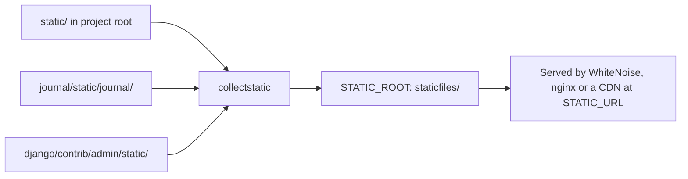

# Static files and CSS

> **Before this lesson:** the `trailbook` project shows journal entries with list and detail pages built on `base.html` ([Foreign keys, detail views and slugs](#/lesson/django/fk-detail-slugs)). You should have seen CSS rules such as `h1 { color: green; }`; no depth is required.

## In plain words

A web page is rarely one file. The HTML document refers to other files: a stylesheet that says how things look, images, fonts, JavaScript. The browser downloads each with a separate request.

Django divides the files of a site into two families:

- **Static files** are files *you* ship with the code and that are the same for every visitor: CSS, JavaScript, the logo. "Static" means "not produced by running Python for each request".
- **Media files** are files *users* upload while the site runs: profile photos, attachments.

An everyday picture: a restaurant's printed menus and tablecloths are static, chosen by the owner and identical on every table. The guests' coats in the cloakroom are media: brought in by visitors, different every day, and never to be mixed up with the restaurant's own property.

**CSS** (Cascading Style Sheets) is the language that describes presentation: colours, spacing, fonts, layout. HTML says "this is a heading"; CSS says "headings are dark green and 2 rem tall".

Why it matters for a job: "the styles work on my machine but disappear in production" is the most common first-deployment problem in Django, and it comes entirely from not knowing how static files are found and served. Interviewers ask what `collectstatic` does and why it exists.

## Step 1: the simplest stylesheet

By convention, project-wide static files live in a folder called `static` next to `manage.py`. Create `static/css/site.css`:

```css
/* static/css/site.css */
body {
  font-family: system-ui, sans-serif;
  max-width: 44rem;
  margin: 2rem auto;
  padding: 0 1rem;
  line-height: 1.6;
  color: #1f2933;
}

h1, h2 { color: #14532d; }

a { color: #166534; }

.meta { color: #6b7280; font-size: 0.9rem; }
```

Each rule has a **selector** (which elements) and **declarations** (what to change). `.meta` selects elements with `class="meta"`.

Tell Django about the folder:

```python
# config/settings.py
STATIC_URL = "static/"                      # already present
STATICFILES_DIRS = [BASE_DIR / "static"]    # add this line
```

- `STATIC_URL` is the address prefix under which static files are published: the stylesheet will be reachable at `/static/css/site.css`.
- `STATICFILES_DIRS` lists extra folders, beyond those inside apps, where Django should look for static files.

Reference the file from the base template:

```html
<!-- templates/base.html -->

<!DOCTYPE html>
<html lang="en">
<head>
  <meta charset="utf-8">
  <meta name="viewport" content="width=device-width, initial-scale=1">
  <title>Trailbook</title>
  <link rel="stylesheet" href="">
</head>
<body>
  <header><a href="">Trailbook</a></header>
  <main></main>
</body>
</html>
```

Two new pieces:

- `` makes the `static` tag available in this template. It must appear in **every template that uses the tag**; it is not inherited from a parent template.
- `` outputs the public address of that file, here `/static/css/site.css`. Never type `/static/...` by hand: the tag is what allows production to serve the file from a different address or under a different name, as you will see below.

Reload the page with the development server running and the styles apply.

## Step 2: files that belong to one app

Static files used by a single app live inside the app, in a doubled folder exactly like templates:

```
journal/
└── static/
    └── journal/
        ├── entry.css
        └── img/
            └── compass.svg
```

They need no setting: the **app directories finder** looks in the `static/` folder of every installed app. Use them with the app prefix:

```html

<link rel="stylesheet" href="">

```

A child template can add its own stylesheet through a block. Put `` inside `<head>` in `base.html`, then:

```html
<!-- journal/templates/journal/entry_detail.html -->


<link rel="stylesheet" href="">
```

## Step 3: how Django finds a static file

The name `css/site.css` is not a disk path. Django resolves it with **finders**, tried in order:

1. `FileSystemFinder` searches each folder in `STATICFILES_DIRS`.
2. `AppDirectoriesFinder` searches `static/` inside each app, in `INSTALLED_APPS` order.

The first match wins, which is why app files carry the app name as a prefix. Ask Django where a name resolves:

```bash
python manage.py findstatic css/site.css
```

## Step 4: development versus production

Here is the part that surprises everyone.

**In development** (`DEBUG = True`), `runserver` together with the `django.contrib.staticfiles` app serves static files directly from wherever the finders locate them. Convenient, slow, and unsuitable for real traffic.

**In production** (`DEBUG = False`), Django does **not** serve static files at all. Serving files is work for a web server or a file-delivery network, which do it far faster than Python. Before deployment you run one command that copies every static file from every location into a single folder:

```python
# config/settings.py
STATIC_ROOT = BASE_DIR / "staticfiles"
```

```bash
python manage.py collectstatic
```

```
132 static files copied to '/home/imani/trailbook/staticfiles'.
```

`STATIC_ROOT` is the destination folder. It is an output, like a compiled program: never edit files in it, never put it in `STATICFILES_DIRS`, and keep it out of Git. The count is large because the admin's own CSS and JavaScript are collected too.



Three settings with similar names, one job each:

| Setting | Question it answers | Example |
|---|---|---|
| `STATIC_URL` | under which address are static files published? | `"static/"` |
| `STATICFILES_DIRS` | where, besides app folders, are my source files? | `[BASE_DIR / "static"]` |
| `STATIC_ROOT` | into which folder does `collectstatic` gather everything? | `BASE_DIR / "staticfiles"` |

The simplest way to serve the collected folder is the **WhiteNoise** package, which lets the Python application itself serve static files efficiently. The deployment module configures it in full; the essential lines are the middleware entry right after `SecurityMiddleware` and the storage setting shown next.

## Step 5: cache-busting with hashed names

Browsers keep copies of static files so that repeat visits are fast. That creates a problem: after you change `site.css`, visitors may keep seeing the old copy for days.

The standard solution is to put a fingerprint of the file's content into its name. `site.css` becomes `site.3f2a9c1b.css`. When the content changes, the name changes, so the browser must fetch the new file; while it stays the same, the browser may cache it for a year. Django does this when you select a **manifest storage**:

```python
# config/settings.py
STORAGES = {
    "default": {"BACKEND": "django.core.files.storage.FileSystemStorage"},
    "staticfiles": {"BACKEND": "whitenoise.storage.CompressedManifestStaticFilesStorage"},
}
```

During `collectstatic` this storage writes each file under a hashed name and records the mapping in a file called `staticfiles.json`, the **manifest**. From then on `` outputs the hashed address. This is the reason for always using the tag.

The model below performs the two halves, finder lookup and manifest creation, on files held in dictionaries. Run it, then edit the CSS text and observe that only that file's published name changes.

```python-run
import hashlib

# Source locations, in finder order: STATICFILES_DIRS first, then each app.
locations = [
    ("static/",                 {"css/site.css": "body { color: #1f2933; }"}),
    ("journal/static/",         {"journal/entry.css": "article { margin: 2rem 0; }",
                                 "css/site.css": "/* an app file with a clashing name */"}),
    ("admin/static/",           {"admin/css/base.css": "/* admin styles */"}),
]

def find(name):
    for folder, files in locations:            # first match wins
        if name in files:
            return folder, files[name]
    raise FileNotFoundError(name)

def collectstatic():
    manifest = {}
    names = {name for _, files in locations for name in files}
    for name in sorted(names):
        folder, content = find(name)
        digest = hashlib.md5(content.encode()).hexdigest()[:8]
        stem, ext = name.rsplit(".", 1)
        manifest[name] = f"{stem}.{digest}.{ext}"
        print(f"copy {folder}{name:22} -> staticfiles/{manifest[name]}")
    return manifest

manifest = collectstatic()

def static(name, static_url="/static/"):       # what the  tag does
    return static_url + manifest[name]

print()
print('<link rel="stylesheet" href="%s">' % static("css/site.css"))
```

Note which `css/site.css` was collected: the one from the project folder, because `STATICFILES_DIRS` is searched first. The clashing file inside the app was silently ignored, which is the argument for app-name prefixes.

## Step 6: styling the journal

With the mechanics in place, give the pages some structure. Add to `static/css/site.css`:

```css
header {
  border-bottom: 2px solid #14532d;
  margin-bottom: 2rem;
  padding-bottom: 0.5rem;
}

header a { font-weight: 700; font-size: 1.25rem; text-decoration: none; }

.entry-card {
  border: 1px solid #d1d5db;
  border-radius: 8px;
  padding: 1rem 1.25rem;
  margin-bottom: 1rem;
}

.entry-card h2 { margin: 0 0 0.25rem; }

@media (max-width: 30rem) {
  body { margin: 1rem auto; }
  .entry-card { padding: 0.75rem; }
}
```

```html
<!-- journal/templates/journal/entry_list.html -->


  <h1>Trail journal</h1>
  
    <section class="entry-card">
      <h2><a href="{{ entry.get_absolute_url }}">{{ entry.title }}</a></h2>
      <p class="meta">{{ entry.region }} · {{ entry.hiked_on|date:"j M Y" }} · {{ entry.author.username }}</p>
      <p>{{ entry.body|truncatewords:30 }}</p>
    </section>
  
    <p>No entries yet.</p>
  

```

The `@media` block is a **media query**: rules that apply only when the screen is narrower than 30 rem, so the page stays comfortable on phones. The `<meta name="viewport">` line added to `base.html` earlier tells phones to use their real width instead of pretending to be a desktop screen.

## Media files in brief

User uploads are configured separately, because they are data created at run time:

```python
# config/settings.py
MEDIA_URL = "media/"
MEDIA_ROOT = BASE_DIR / "media"
```

A model field such as `photo = models.ImageField(upload_to="entry_photos/", blank=True)` stores the file under `MEDIA_ROOT` and only its path in the database (the `Pillow` package is required for `ImageField`). In templates use `{{ entry.photo.url }}`. During development you add one line to `config/urls.py` to serve uploads:

```python
from django.conf import settings
from django.conf.urls.static import static

urlpatterns += static(settings.MEDIA_URL, document_root=settings.MEDIA_ROOT)
```

That helper does nothing when `DEBUG` is off. In production uploads normally go to an object-storage service through the `django-storages` package, because an application server's disk is often temporary and never shared between several servers.

> [!WARNING]
> Never serve user uploads from the same place and with the same trust as your static files. An uploaded file named `evil.html` or `evil.svg` containing a script would run with your site's authority. See [Path traversal and file upload risks](#/lesson/web-security/path-traversal-uploads).

## Testing static configuration

```python
# journal/test_static.py
from django.contrib.staticfiles import finders
from django.test import SimpleTestCase
from django.templatetags.static import static


class StaticFilesTests(SimpleTestCase):
    def test_site_css_is_found(self):
        self.assertIsNotNone(finders.find("css/site.css"))

    def test_static_helper_builds_url(self):
        self.assertEqual(static("css/site.css"), "/static/css/site.css")
```

`finders.find` returns the absolute path of the first match or `None`. Test settings use plain storage, so the second test sees the un-hashed address.

> [!NOTE]
> **What changed since the book.** Django 2.1 projects selected storage with the `STATICFILES_STORAGE` setting. Django 4.2 introduced the `STORAGES` dictionary and 5.1 removed the old setting, so tutorials containing `STATICFILES_STORAGE = "whitenoise.storage..."` raise an error today. The source book also writes ``, which was removed in 3.0; the tag library is `static`.

> [!INTERVIEW]
> **"What does `collectstatic` do, and why is it needed?"** Static files live in many places: project folders listed in `STATICFILES_DIRS` and a `static/` folder in each installed app, including third-party ones such as the admin. `collectstatic` runs the finders over all of them and copies the results into the single folder `STATIC_ROOT`, optionally post-processing them (hashed file names plus a manifest, compression). Production then serves that one folder with a web server, WhiteNoise or a CDN, because Django does not serve static files when `DEBUG` is `False`. Distinguish the three settings and mention that the `` tag consults the manifest.

> [!TIP]
> If a style change does not show up during development, do a hard reload (Ctrl+Shift+R) before debugging anything else. The browser cache is the usual culprit.

## Pitfalls

- **Missing ``** in a child template: `TemplateSyntaxError: Invalid block tag 'static'`. Loading is per file.
- **Styles vanish when `DEBUG = False`.** `collectstatic` was not run, or nothing serves `STATIC_ROOT`. Add WhiteNoise.
- **Hard-coded `/static/css/site.css`.** Works until hashed names or a CDN are introduced.
- **`STATIC_ROOT` inside `STATICFILES_DIRS`.** Django raises `ImproperlyConfigured`; source and destination must differ.
- **`ValueError: Missing staticfiles manifest entry`.** With manifest storage, a template references a file that was not collected: a typo in the name, or `collectstatic` not rerun after adding the file.
- **Name clashes between apps.** Always nest app static files under a folder named after the app.
- **Committing `staticfiles/` or `media/`.** Both belong in `.gitignore`.

## Cheat sheet

| Need | Code or command |
|---|---|
| Project static folder | `STATICFILES_DIRS = [BASE_DIR / "static"]` |
| App static folder | `journal/static/journal/...` (found automatically) |
| Use a file in a template | `` then `` |
| Where does a name resolve? | `python manage.py findstatic css/site.css` |
| Gather for production | `STATIC_ROOT = BASE_DIR / "staticfiles"`; `python manage.py collectstatic` |
| Hashed names | `STORAGES["staticfiles"]` with a manifest storage |
| Uploads | `MEDIA_URL`, `MEDIA_ROOT`, `{{ obj.file.url }}` |
| URL in Python | `from django.templatetags.static import static` |

## Summary

- Static files ship with the code; media files are uploaded by users. They are configured and served separately.
- In templates, `` and `` produce the correct public address.
- Finders locate files in `STATICFILES_DIRS` and each app's `static/` folder; `collectstatic` copies them all into `STATIC_ROOT`.
- Django serves static files only in development. Production needs WhiteNoise, a web server or a CDN.
- Manifest storage adds content hashes to file names so browsers can cache aggressively and still get updates.

## Glossary

- **Static file**: a fixed asset distributed with the application (CSS, JavaScript, images, fonts).
- **Media file**: a file uploaded by a user at run time.
- **CSS**: the language describing how HTML elements are presented.
- **Selector / declaration**: the part of a CSS rule choosing elements / the property and value applied to them.
- **Finder**: the component that locates a static file from its relative name.
- **`collectstatic`**: the command that copies all static files into `STATIC_ROOT`.
- **Manifest**: the file mapping original static names to their hashed names.
- **Cache busting**: changing a file's name when its content changes so that browsers fetch the new version.
- **CDN (content delivery network)**: servers around the world that deliver files from a location near the visitor.
- **WhiteNoise**: a package that serves collected static files from the Python application.
- **Media query**: a CSS condition applying rules only for certain screen sizes.

```quiz
[
  {"q": "What is the difference between static files and media files?",
   "options": ["Static files are images, media files are videos", "Static files ship with the code; media files are uploaded by users at run time", "Static files are cached, media files are not", "There is no difference"],
   "answer": 1,
   "explain": "The distinction is origin and trust: developers provide static files, users provide media. They have separate settings and serving strategies."},
  {"q": "What does `python manage.py collectstatic` do?",
   "options": ["Compiles Python to CSS", "Copies static files from all apps and STATICFILES_DIRS into STATIC_ROOT", "Uploads files to the browser", "Deletes unused CSS"],
   "answer": 1,
   "explain": "It gathers every static file into one folder so a production server can serve them, applying post-processing such as hashing if the storage does it."},
  {"q": "A page loses its styling as soon as DEBUG is set to False. Why?",
   "options": ["CSS is disabled without DEBUG", "Django stops serving static files itself when DEBUG is False", "The browser blocks CSS on production sites", "STATIC_URL changes automatically"],
   "answer": 1,
   "explain": "The development helper only works in debug mode. Production must serve STATIC_ROOT with WhiteNoise, a web server or a CDN."},
  {"q": "Why use `` instead of writing /static/css/site.css?",
   "options": ["The tag compresses the file", "The tag returns the correct address even when names are hashed or files are hosted elsewhere", "Hard-coded paths are a syntax error", "The tag loads the file faster"],
   "answer": 1,
   "explain": "The tag asks the configured storage for the URL, so manifest hashes and CDN prefixes are applied automatically."},
  {"q": "Which setting names the folder that collectstatic writes into?",
   "options": ["STATIC_URL", "STATICFILES_DIRS", "STATIC_ROOT", "MEDIA_ROOT"],
   "answer": 2,
   "explain": "STATIC_ROOT is the destination. STATICFILES_DIRS lists extra source folders and STATIC_URL is the public prefix."},
  {"q": "A child template extends base.html, which has ``. The child uses `` and fails. Why?",
   "options": ["Child templates cannot use static files", "Tag libraries must be loaded in each template file that uses them", "The static tag only works in base templates", "The file name is wrong"],
   "answer": 1,
   "explain": " is not inherited through ; add it to the child as well."},
  {"q": "What problem do hashed file names such as site.3f2a9c1b.css solve?",
   "options": ["They hide the file from search engines", "They let browsers cache files for a long time while still fetching new versions after a change", "They encrypt the CSS", "They make files smaller"],
   "answer": 1,
   "explain": "The name changes whenever the content changes, so a stale cached copy can never be used for new content."},
  {"q": "Where should the stylesheet used only by the journal app be stored?",
   "options": ["journal/static/entry.css", "journal/static/journal/entry.css", "journal/templates/entry.css", "staticfiles/journal/entry.css"],
   "answer": 1,
   "explain": "Nesting under a folder named after the app namespaces the file and prevents clashes with other apps' files."}
]
```

> **Source:** Vincent, *Django for Beginners*, ch. 5 (Blog app: static files). Docs: https://docs.djangoproject.com/en/5.2/howto/static-files/ · https://docs.djangoproject.com/en/5.2/ref/contrib/staticfiles/ · https://docs.djangoproject.com/en/5.2/ref/settings/#storages · https://whitenoise.readthedocs.io/en/stable/django.html
