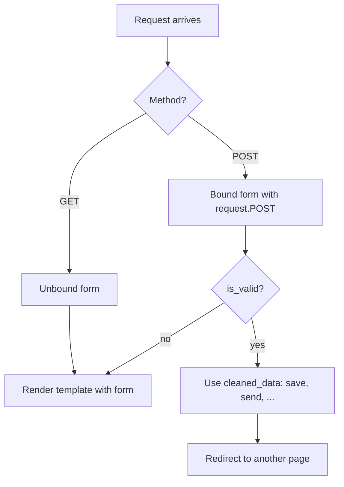
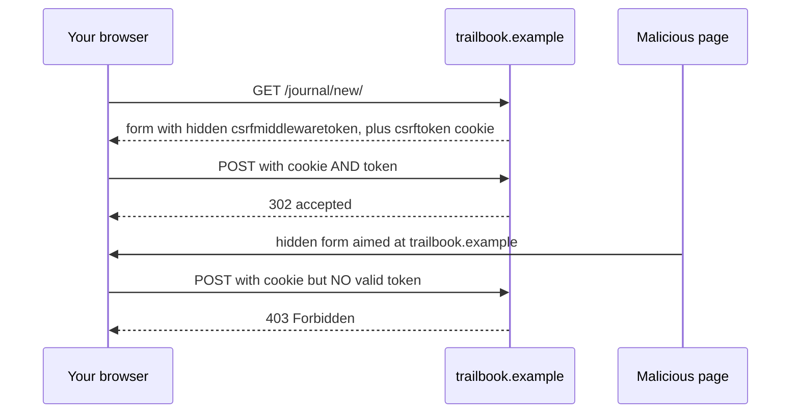

# Forms, ModelForm, validation and CSRF

> **Before this lesson:** you have the `trailbook` project with `Entry` and `Region` models and styled list and detail pages ([Foreign keys, detail views and slugs](#/lesson/django/fk-detail-slugs), [Static files and CSS](#/lesson/django/static-css)). You know that requests have a method, `GET` or `POST` ([The request/response cycle, views, URLs and first tests](#/lesson/django/request-response)).

## In plain words

So far visitors can only read. The moment they may *send* something, such as a new journal entry, a search or a message, three jobs appear:

1. **Show** input boxes in the page.
2. **Check** what came back. People leave boxes empty, type letters where a number belongs, and a few deliberately send harmful data.
3. **Report** problems next to the right box, keeping what was already typed, or **use** the cleaned data when everything is fine.

A Django **form** is a Python class that does all three for a set of fields.

An everyday picture: the counter at a passport office. You hand over a paper form. The clerk does not file it straight away; the clerk checks every box, circles what is wrong, hands it back for correction, and only stamps it when all is in order. Django's form class is that clerk. **Validation** is the checking.

There is one more character in the story: a forger who tricks you into signing a form you never read. Preventing that is the job of **CSRF protection**, explained in the second half.

Why it matters for a job: every business application is forms on top of a database. "Never trust user input" is the first rule of web security, and interviewers expect you to explain where validation happens and what the CSRF token is for.

## GET or POST?

An HTML form sends its fields with one of two methods:

| Method | Data travels | Use for | Example |
|---|---|---|---|
| `GET` | in the URL after `?` | requests that only **read**: search, filters | `/journal/?q=frost` |
| `POST` | in the request body | requests that **change** something: create, edit, delete, log in | new entry |

The rule to memorise: anything that modifies data uses `POST`. Links, browser pre-loading and search-engine crawlers issue `GET` requests freely; none of them should be able to delete a record by accident.

## Step 1: a plain form class

Start with a form that is not tied to a model: a "report trail conditions" message.

```python
# journal/forms.py  (new file)
from django import forms


class ConditionReportForm(forms.Form):
    trail = forms.CharField(max_length=80)
    email = forms.EmailField(required=False)
    severity = forms.IntegerField(min_value=1, max_value=5)
    details = forms.CharField(widget=forms.Textarea, min_length=10)
```

- `forms.Form` is the base class for forms.
- Each attribute is a **form field**: it knows how to turn submitted text into a Python value and which rules apply. Fields are required unless `required=False`.
- A **widget** is the HTML control used to display a field. `CharField` defaults to a one-line text box; `widget=forms.Textarea` selects a multi-line box.

Form fields resemble model fields, but they are different classes with different jobs: a model field describes a database column; a form field describes one input and its validation.

## Step 2: the life of a form

A form object is in one of two states:

- **Unbound**: created without data, `ConditionReportForm()`. It can render empty inputs.
- **Bound**: created with submitted data, `ConditionReportForm(request.POST)`. It can validate.

Try it in `python manage.py shell`:

```python
from journal.forms import ConditionReportForm

form = ConditionReportForm({"trail": "North Ridge", "severity": "9", "details": "mud"})
form.is_valid()        # False
form.errors
# {'severity': ['Ensure this value is less than or equal to 5.'],
#  'details': ['Ensure this value has at least 10 characters (it has 3).']}

form = ConditionReportForm({"trail": " North Ridge ", "severity": "4", "details": "Fallen tree at km 3."})
form.is_valid()        # True
form.cleaned_data
# {'trail': 'North Ridge', 'email': '', 'severity': 4, 'details': 'Fallen tree at km 3.'}
```

Three observations. Submitted values are always text (`"4"`); `cleaned_data` holds proper Python values (`4`, an `int`). Whitespace around text is stripped. And `cleaned_data` exists only after `is_valid()` has run.

## Step 3: the standard view pattern

Every form-handling view has the same shape. Learn it once.

```python
# journal/views.py
from django.contrib import messages
from django.shortcuts import redirect, render

from .forms import ConditionReportForm


def report_conditions(request):
    if request.method == "POST":
        form = ConditionReportForm(request.POST)       # bound: holds what the visitor sent
        if form.is_valid():
            data = form.cleaned_data
            print("REPORT:", data["trail"], data["severity"])   # a real site would save or e-mail it
            messages.success(request, "Thank you, the report was sent.")
            return redirect("entry-list")              # success: redirect
    else:
        form = ConditionReportForm()                   # GET: an empty form
    return render(request, "journal/report.html", {"form": form})
```

Trace the three paths:

1. **GET**: build an unbound form, render the page.
2. **POST with errors**: `is_valid()` is `False`; execution falls through to the last line, which renders the *bound* form. It carries the visitor's input and the error messages, so nothing has to be retyped.
3. **POST without errors**: act on `cleaned_data`, then **redirect**.

The redirect is deliberate and has a name: **Post/Redirect/Get**. If the view rendered a page directly after a successful POST, pressing the browser's reload button would resend the form and create a duplicate. After a redirect, reload merely repeats a harmless GET.



The template:

```html
<!-- journal/templates/journal/report.html -->


  <h1>Report trail conditions</h1>
  <form method="post">
    
    {{ form.as_div }}
    <button type="submit">Send report</button>
  </form>

```

- `method="post"` sends the fields in the request body. With no `action` attribute the form submits to the address it was loaded from.
- `` inserts a hidden field explained below. Every POST form needs it.
- `{{ form.as_div }}` renders each field as a `<div>` containing its label, any errors, the input and help text. The form does not print the `<form>` tag or the button; those are yours.

For full control over the markup, loop over the fields:

```html
{{ form.non_field_errors }}

  <p>
    {{ field.label_tag }} {{ field }}
    <small>{{ field.help_text }}</small>
    {{ field.errors }}
  </p>

```

Add `path("report/", views.report_conditions, name="report")` to `journal/urls.py` above the slug route.

## Step 4: your own validation rules

Built-in field arguments cover length, range and format. For anything else there are two hooks.

```python
# journal/forms.py
class ConditionReportForm(forms.Form):
    trail = forms.CharField(max_length=80)
    email = forms.EmailField(required=False)
    severity = forms.IntegerField(min_value=1, max_value=5)
    details = forms.CharField(widget=forms.Textarea, min_length=10)
    wants_reply = forms.BooleanField(required=False)

    def clean_trail(self):
        trail = self.cleaned_data["trail"]
        if trail.isdigit():
            raise forms.ValidationError("Please give the trail's name, not a number.")
        return trail.title()

    def clean(self):
        cleaned = super().clean()
        if cleaned.get("wants_reply") and not cleaned.get("email"):
            self.add_error("email", "Enter an e-mail address so that we can reply.")
        return cleaned
```

- `clean_<fieldname>()` validates **one** field. It reads the value from `cleaned_data`, raises `ValidationError` to reject it, and must **return** the value (possibly modified, as with `.title()`).
- `clean()` validates **several fields together**. Use `.get()` there because a field that already failed is missing from the dictionary. `add_error("email", ...)` attaches the message to a specific field; raising `ValidationError` in `clean()` creates a non-field error shown at the top.

The order Django follows for each field is: convert the text to a Python value, apply the built-in rules, run `clean_<fieldname>`; then, after all fields, run `clean()`. The model below reproduces that pipeline. Run it and then change the submitted values.

```python-run
class ValidationError(Exception):
    pass

def char(max_length=None, min_length=0, required=True):
    def to_python(raw):
        value = raw.strip()
        if not value:
            if required:
                raise ValidationError("This field is required.")
            return ""
        if len(value) < min_length:
            raise ValidationError(f"Ensure this value has at least {min_length} characters (it has {len(value)}).")
        if max_length and len(value) > max_length:
            raise ValidationError(f"Ensure this value has at most {max_length} characters (it has {len(value)}).")
        return value
    return to_python

def integer(min_value, max_value):
    def to_python(raw):
        if not raw.strip().lstrip("-").isdigit():
            raise ValidationError("Enter a whole number.")
        number = int(raw)
        if not min_value <= number <= max_value:
            raise ValidationError(f"Enter a number between {min_value} and {max_value}.")
        return number
    return to_python

FIELDS = {"trail": char(max_length=80), "email": char(required=False),
          "severity": integer(1, 5), "details": char(min_length=10)}

def clean_trail(value):                       # per-field hook
    if value.isdigit():
        raise ValidationError("Please give the trail's name, not a number.")
    return value.title()

def validate(post):
    cleaned, errors = {}, {}
    for name, to_python in FIELDS.items():
        try:
            value = to_python(post.get(name, ""))          # 1. convert and apply built-in rules
            if name == "trail":
                value = clean_trail(value)                 # 2. clean_<field>
            cleaned[name] = value
        except ValidationError as error:
            errors[name] = [str(error)]
    if post.get("wants_reply") and not cleaned.get("email") and "email" not in errors:
        errors["email"] = ["Enter an e-mail address so that we can reply."]   # 3. clean()
        cleaned.pop("email", None)
    return (not errors), cleaned, errors

for post in [
    {"trail": "north ridge", "severity": "4", "details": "Fallen tree at km 3."},
    {"trail": "17", "severity": "nine", "details": "mud", "wants_reply": "on"},
]:
    ok, cleaned, errors = validate(post)
    print("valid:", ok, "\n  cleaned:", cleaned, "\n  errors:", errors)
```

## Step 5: ModelForm, a form generated from a model

Most forms exist to create or edit a model instance, and repeating every field of the model in a form class would be duplication. A **ModelForm** builds its fields from a model.

```python
# journal/forms.py
from .models import Entry


class EntryForm(forms.ModelForm):
    class Meta:
        model = Entry
        fields = ["title", "region", "hiked_on", "body"]
        widgets = {"hiked_on": forms.DateInput(attrs={"type": "date"})}
        help_texts = {"title": "A short headline for the day."}

    def clean_title(self):
        title = self.cleaned_data["title"]
        if len(title.split()) < 2:
            raise forms.ValidationError("Use at least two words.")
        return title
```

- `Meta.model` names the model; `Meta.fields` lists the fields the form may edit, in display order.
- Field types, `max_length`, `required` (from `blank`) and choices are derived from the model. The `region` foreign key becomes a drop-down of existing regions.
- `widgets` swaps the control for one field; here a native date picker.
- All validation hooks from the previous step work unchanged.

A ModelForm adds one method, `save()`, which creates or updates the row:

```python
# journal/views.py
from django.contrib.auth.decorators import login_required

from .forms import EntryForm


@login_required
def entry_create(request):
    if request.method == "POST":
        form = EntryForm(request.POST)
        if form.is_valid():
            entry = form.save(commit=False)      # build the object, do not write it yet
            entry.author = request.user          # fill the field the form does not show
            entry.save()                         # now write it
            return redirect(entry)               # redirect() calls entry.get_absolute_url()
    else:
        form = EntryForm()
    return render(request, "journal/entry_form.html", {"form": form})
```

`commit=False` is the standard technique for fields that must come from the server and not from the visitor. `@login_required` sends anonymous visitors to the login page; the accounts module covers it. To **edit** an existing row, pass it in: `EntryForm(request.POST or None, instance=entry)`. The next lesson replaces this boilerplate with generic views.

> [!WARNING]
> List fields explicitly. `fields = "__all__"` or an `exclude` list means that every field added to the model later is silently exposed in the form. Had `author` been included, a visitor could post an entry under someone else's name. This class of bug is called **mass assignment**.

## CSRF: the forged form

**Cross-site request forgery (CSRF)** works like this. You are logged in to `trailbook.example`; your browser holds a cookie that proves it. You then visit a malicious page. That page contains a hidden form addressed to `trailbook.example/journal/7/delete/` and submits it automatically. Your browser attaches your cookie, as it does for every request to that site, so the request looks exactly like one you made on purpose.

The defence: every form the real site renders contains a secret value, the **CSRF token**. The attacker's page cannot read it, because browsers do not let one site read another site's pages. When a POST arrives, Django compares the token in the form with the secret stored in a cookie; a request without the matching token is rejected with status 403.



In practice this costs you one line. `CsrfViewMiddleware` is enabled in new projects and checks every `POST`, `PUT`, `PATCH` and `DELETE` request. You write `` inside each `<form method="post">`. The hidden field it prints is a *masked* copy of the secret that looks different on every page load, a measure against a compression-based attack; the problem "Check a masked CSRF token" in this module has you implement the comparison.

A deeper treatment, including why `GET` requests must never change data, is in [Cross-site request forgery (CSRF)](#/lesson/web-security/csrf).

## Testing forms

Forms can be tested without any HTTP, and views through the test client.

```python
# journal/test_forms.py
from django.test import SimpleTestCase, TestCase
from django.urls import reverse

from .forms import ConditionReportForm


class ConditionReportFormTests(SimpleTestCase):
    def test_valid_data(self):
        form = ConditionReportForm({"trail": "north ridge", "severity": "4", "details": "Fallen tree at km 3."})
        self.assertTrue(form.is_valid())
        self.assertEqual(form.cleaned_data["trail"], "North Ridge")
        self.assertEqual(form.cleaned_data["severity"], 4)

    def test_reply_requires_email(self):
        form = ConditionReportForm({"trail": "Marsh loop", "severity": "2",
                                    "details": "Boardwalk flooded.", "wants_reply": "on"})
        self.assertFalse(form.is_valid())
        self.assertIn("email", form.errors)


class ReportViewTests(TestCase):
    def test_invalid_post_redisplays_form(self):
        response = self.client.post(reverse("report"), {"trail": "", "severity": "9", "details": "x"})
        self.assertEqual(response.status_code, 200)
        self.assertFormError(response.context["form"], "trail", "This field is required.")

    def test_valid_post_redirects(self):
        response = self.client.post(reverse("report"),
                                    {"trail": "Marsh loop", "severity": "2", "details": "Boardwalk flooded."})
        self.assertRedirects(response, reverse("entry-list"))
```

Status 200 after a POST means "the form was shown again", which is the error path; success is a 302 redirect. The test client skips CSRF checks by default so that tests need no tokens.

> [!NOTE]
> **What changed since the book.** Django 2.1 offered `{{ form.as_p }}`, `as_table` and `as_ul`; `as_div` arrived in 4.1 and is now the recommended quick rendering, and 5.0 added `{{ field.as_field_group }}` for rendering one field completely. `assertFormError` takes the form object (not the response and a context name) since 4.1. `CSRF_TRUSTED_ORIGINS` entries need a scheme since 4.0.

> [!INTERVIEW]
> **"What does `is_valid()` do?"** It runs full cleaning: for each field, convert the raw string to a Python value, run the field's validators and then the form's `clean_<field>` method; afterwards the form-wide `clean()` for cross-field rules. For a ModelForm it additionally validates the model instance, including uniqueness. Errors are collected in `form.errors`, valid values in `form.cleaned_data`, and the method returns whether there were no errors. A good candidate adds: validation in the browser is a convenience only; the server-side form is the security boundary.

> [!TIP]
> Seeing "CSRF verification failed" during development nearly always means the template lacks `` inside the form, or the page was rendered without `render()` and a request. Do not reach for `@csrf_exempt`; fix the form.

## Pitfalls

- **Missing ``.** Every POST form answers 403.
- **Reading `request.POST["title"]` directly.** You bypass conversion and validation. Use `form.cleaned_data`.
- **Accessing `cleaned_data` before `is_valid()`.** `AttributeError`.
- **Not returning the value from `clean_<field>`.** The field becomes `None`.
- **Creating a fresh unbound form after a failed POST.** The visitor's input and all error messages disappear.
- **Rendering instead of redirecting after success.** Reload creates duplicates.
- **Forgetting `request.FILES`.** File uploads need `Form(request.POST, request.FILES)` and `enctype="multipart/form-data"` on the form tag.
- **`fields = "__all__"`** on forms that the public can submit.

## Cheat sheet

| Need | Code |
|---|---|
| Plain form | `class F(forms.Form): name = forms.CharField(max_length=80)` |
| Form from a model | `class F(forms.ModelForm): class Meta: model = Entry; fields = [...]` |
| Empty / filled | `F()` / `F(request.POST)` |
| Validate | `form.is_valid()` → `form.cleaned_data`, `form.errors` |
| One-field rule | `def clean_title(self): ...; return value` |
| Cross-field rule | `def clean(self): cleaned = super().clean(); self.add_error(field, msg)` |
| Save a ModelForm | `obj = form.save()`; or `form.save(commit=False)` then set fields and `obj.save()` |
| Edit existing | `F(request.POST or None, instance=obj)` |
| Render | `{{ form.as_div }}` inside `<form method="post"> ... </form>` |
| After success | `return redirect(...)` |

## Summary

- A form class renders inputs, validates submissions and reports errors; `ModelForm` derives its fields from a model and can save.
- The view pattern is: GET shows an unbound form; POST binds, validates, and either re-renders with errors or acts and redirects.
- Validation runs field by field (conversion, built-in rules, `clean_<field>`) and then `clean()` for rules spanning fields.
- Use `commit=False` to set server-controlled fields, and list form fields explicitly.
- CSRF protection ties each POST to a token only your own pages can contain; add `` to every POST form.

## Glossary

- **Form**: a class describing a set of inputs and their validation.
- **Form field**: one input's type and rules (`CharField`, `IntegerField`, ...).
- **Widget**: the HTML control that displays a field.
- **Bound / unbound form**: a form with / without submitted data.
- **Validation**: checking submitted data against rules.
- **`cleaned_data`**: the dictionary of validated, converted values.
- **`ValidationError`**: the exception that signals invalid input.
- **ModelForm**: a form built from a model, with a `save()` method.
- **Post/Redirect/Get**: answering a successful POST with a redirect to prevent resubmission.
- **Mass assignment**: letting a client set fields it should not control.
- **CSRF**: cross-site request forgery, tricking a logged-in browser into sending an unwanted request.
- **CSRF token**: the secret value that proves a form came from your own site.

```quiz
[
  {"q": "Which HTTP method should a form that creates a journal entry use, and why?",
   "options": ["GET, because it is faster", "POST, because the request changes data", "GET, so the link can be bookmarked", "Either; there is no difference"],
   "answer": 1,
   "explain": "State-changing requests use POST. GET must be safe to repeat, since browsers, crawlers and caches issue GETs freely."},
  {"q": "After a POST with invalid data, what should the view do?",
   "options": ["Redirect to the same page", "Render the template with the bound form so that input and errors are shown", "Create a new empty form and render it", "Return a 500 error"],
   "answer": 1,
   "explain": "The bound form carries the submitted values and error messages. Replacing it with an empty form throws both away."},
  {"q": "Why redirect after a successful POST?",
   "options": ["Redirects are required by HTTP", "So that reloading the result page does not resubmit the form", "To validate the data again", "To clear cookies"],
   "answer": 1,
   "explain": "Post/Redirect/Get turns the final request into a GET, which is harmless to repeat."},
  {"q": "What must a clean_<fieldname> method do when the value is acceptable?",
   "options": ["Return True", "Return the cleaned value", "Return nothing", "Call form.save()"],
   "answer": 1,
   "explain": "Its return value replaces the entry in cleaned_data. Forgetting to return stores None."},
  {"q": "Where do you validate a rule involving two fields, such as 'e-mail is required if a reply is wanted'?",
   "options": ["In clean_email only", "In the form's clean() method", "In the template", "In the URL configuration"],
   "answer": 1,
   "explain": "clean() runs after all individual fields and can see them together. Use add_error to attach the message to a field."},
  {"q": "What is `form.save(commit=False)` used for?",
   "options": ["Validating without saving", "Getting the unsaved model instance so that extra fields can be set before saving", "Deleting the instance", "Skipping validation"],
   "answer": 1,
   "explain": "It returns the instance without writing to the database, so fields such as author can be filled from the request before obj.save()."},
  {"q": "Why can an attacker's site not include a valid CSRF token in its forged form?",
   "options": ["The token is encrypted with the user's password", "Browsers do not allow one site to read pages or cookies of another, so the token is unknown to the attacker", "Tokens are only sent over GET", "The attacker can, but Django ignores it"],
   "answer": 1,
   "explain": "The same-origin policy keeps the token secret from other sites, while the victim's own pages contain it."},
  {"q": "Why is `fields = '__all__'` risky on a public ModelForm?",
   "options": ["It is slower", "Fields added to the model later become editable by visitors without anyone noticing", "It disables validation", "It prevents saving"],
   "answer": 1,
   "explain": "Explicit field lists are an allow-list. With __all__, sensitive fields such as author or is_approved can be set by the client."}
]
```

> **Source:** Vincent, *Django for Beginners*, ch. 6 (Forms). Docs: https://docs.djangoproject.com/en/5.2/topics/forms/ · https://docs.djangoproject.com/en/5.2/ref/forms/validation/ · https://docs.djangoproject.com/en/5.2/topics/forms/modelforms/ · https://docs.djangoproject.com/en/5.2/ref/csrf/ · https://docs.djangoproject.com/en/5.2/howto/csrf/
