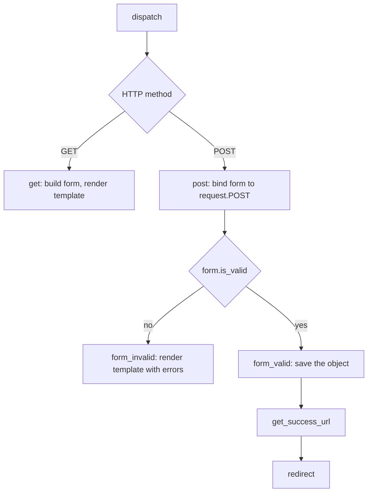

# CreateView, UpdateView and DeleteView

> **Before this lesson:** you can write a ModelForm and the GET/POST view pattern by hand ([Forms, ModelForm, validation and CSRF](#/lesson/django/forms-validation-csrf)), and you know how class-based views work: `as_view()`, `dispatch()` and overriding methods with `super()` ([Class-based views, template inheritance, page tests and a first deployment](#/lesson/django/cbv-inheritance)).

## In plain words

Almost everything a business application does with a record falls into four operations: **create** it, **read** it, **update** it, **delete** it. The initials give the nickname **CRUD**. You have built the "read" half (list and detail pages). This lesson adds the other three.

In the previous lesson, the view that creates an entry was twelve lines: check the method, bind the form, validate, save, redirect, or show the form again. The view for editing would be the same twelve lines with one difference, and deleting would be a shorter variation. Django has already written those views. `CreateView`, `UpdateView` and `DeleteView` are the **generic editing views**: you say which model and which fields, and inherit the rest.

An everyday picture: a notary's standard contracts. For a house sale the notary does not write a contract from a blank page; there is a template in which the names, the address and the price are filled in. Unusual clauses can be added, but the default text covers the normal case.

Why it matters for a job: these three classes appear in almost every Django codebase, and knowing which method to override (`form_valid`, `get_queryset`, `get_success_url`) is the practical skill interviewers look for when they ask you to "add an edit page that only the author may use".

## The address plan

Decide the URLs first. A conventional plan for a resource called "entries":

| Address | Purpose | View | Methods |
|---|---|---|---|
| `/journal/` | list | `EntryListView` | GET |
| `/journal/new/` | create | `EntryCreateView` | GET shows the form, POST saves |
| `/journal/<slug>/` | detail | `EntryDetailView` | GET |
| `/journal/<slug>/edit/` | update | `EntryUpdateView` | GET, POST |
| `/journal/<slug>/delete/` | delete | `EntryDeleteView` | GET asks for confirmation, POST deletes |

```python
# journal/urls.py
from django.urls import path

from . import views

urlpatterns = [
    path("", views.EntryListView.as_view(), name="entry-list"),
    path("new/", views.EntryCreateView.as_view(), name="entry-create"),
    path("<slug:slug>/", views.EntryDetailView.as_view(), name="entry-detail"),
    path("<slug:slug>/edit/", views.EntryUpdateView.as_view(), name="entry-update"),
    path("<slug:slug>/delete/", views.EntryDeleteView.as_view(), name="entry-delete"),
]
```

`new/` is listed **before** `<slug:slug>/`. Patterns are tried top to bottom, and the word "new" is itself a valid slug; in the other order the detail view would look for an entry whose slug is `new` and answer 404.

## Step 1: the smallest CreateView

```python
# journal/views.py
from django.views.generic.edit import CreateView

from .models import Entry


class EntryCreateView(CreateView):
    model = Entry
    fields = ["title", "region", "hiked_on", "body"]
```

- `model` names the table to insert into.
- `fields` lists the fields for an automatically generated ModelForm. The explicit list is an allow-list, as discussed in the previous lesson.

By convention the view renders `journal/entry_form.html` (`<app>/<model>_form.html`) and gives it a `form` variable:

```html
<!-- journal/templates/journal/entry_form.html -->


  <h1>Edit "{{ object.title }}"New entry</h1>
  <form method="post">
    
    {{ form.as_div }}
    <button type="submit">Save</button>
    <a href="">Cancel</a>
  </form>

```

The same template will serve the update view, which is why the heading tests `object`: it exists when editing and is absent when creating.

Open `/journal/new/`, submit the form, and you get an error: `NOT NULL constraint failed: journal_entry.author_id`. The form has no `author` field (correct: visitors must not choose the author), so nobody set it.

## Step 2: `form_valid`, the hook that runs right before saving

The editing views call the method `form_valid(form)` when validation succeeded. Its default implementation saves the form and redirects. Override it to add what the form does not contain:

```python
# journal/views.py
from django.contrib.auth.mixins import LoginRequiredMixin
from django.views.generic.edit import CreateView

from .models import Entry


class EntryCreateView(LoginRequiredMixin, CreateView):
    model = Entry
    fields = ["title", "region", "hiked_on", "body"]

    def form_valid(self, form):
        form.instance.author = self.request.user
        return super().form_valid(form)
```

- `form.instance` is the model object the ModelForm is building. Setting `author` on it before the save is the class-based equivalent of `commit=False`.
- `super().form_valid(form)` performs the save and returns the redirect response. Return its result.
- `LoginRequiredMixin` redirects anonymous visitors to the login page before any other code runs. A **mixin** is a small class that adds one behaviour through inheritance; it is listed **first** so that its check happens first. The accounts module sets up the login page it redirects to.

**Where does the view redirect after saving?** It looks, in order, for a `success_url` attribute, then for `get_absolute_url()` on the saved object. The `Entry` model defines `get_absolute_url`, so after saving you land on the new entry's detail page with no further code.

## Step 3: UpdateView

Editing differs from creating in one respect: the form starts filled with an existing object, found from the URL.

```python
# journal/views.py
from django.views.generic.edit import CreateView, UpdateView


class EntryUpdateView(LoginRequiredMixin, UpdateView):
    model = Entry
    fields = ["title", "region", "hiked_on", "body"]

    def get_queryset(self):
        return Entry.objects.filter(author=self.request.user)
```

`UpdateView` fetches the object with the `slug` (or `pk`) from the URL, exactly as `DetailView` does, binds the form to it (`instance=object`), and reuses `journal/entry_form.html`.

The `get_queryset` override is the important line. The object is looked up **inside this queryset**, so an entry written by someone else is not found, and the visitor receives a 404. Without it, any logged-in user could edit any entry by typing its address. Restricting the queryset is the simplest reliable form of ownership check; a later lesson on permissions shows alternatives.

## Step 4: DeleteView

Deleting must never happen on a GET request (a crawler following links would empty your database), so `DeleteView` works in two steps: GET shows a confirmation page; POST deletes.

```python
# journal/views.py
from django.urls import reverse_lazy
from django.views.generic.edit import CreateView, DeleteView, UpdateView


class EntryDeleteView(LoginRequiredMixin, DeleteView):
    model = Entry
    success_url = reverse_lazy("entry-list")

    def get_queryset(self):
        return Entry.objects.filter(author=self.request.user)
```

```html
<!-- journal/templates/journal/entry_confirm_delete.html -->


  <h1>Delete "{{ object.title }}"?</h1>
  <p>This cannot be undone.</p>
  <form method="post">
    
    <button type="submit">Yes, delete it</button>
    <a href="{{ object.get_absolute_url }}">No, keep it</a>
  </form>

```

Two details:

- After deletion the object has no page any more, so `success_url` is mandatory.
- **`reverse_lazy`, not `reverse`.** The class body runs when Python imports `views.py`, which happens *while* the URL configuration is still being loaded. Calling `reverse()` at that moment fails with a circular import. `reverse_lazy` returns a placeholder that performs the lookup later, when the value is first used. Inside methods, which run during requests, plain `reverse()` is fine.

## Step 5: links between the pages

```html
<!-- journal/templates/journal/entry_detail.html (additions) -->

  <p>
    <a href="">Edit</a> ·
    <a href="">Delete</a>
  </p>

```

```html
<!-- journal/templates/journal/entry_list.html (addition) -->
<p><a href="">Write a new entry</a></p>
```

Hiding a link is a courtesy to the user, **not** security. The `get_queryset` filter in the views is what protects the data: an attacker types addresses directly and never sees your links.

## What the generic views do inside

All three editing views share one flow. The model below is a faithful miniature: `get` shows the form; `post` validates and branches to `form_valid` or `form_invalid`; the redirect target comes from `get_success_url`. Run it, then make the title empty.

```python-run
DATABASE = []

class Form:
    def __init__(self, data=None, instance=None):
        self.data, self.instance, self.errors = data, instance or {}, {}

    def is_valid(self):
        if self.data is None:
            return False
        if not self.data.get("title", "").strip():
            self.errors["title"] = ["This field is required."]
        return not self.errors

    def save(self):
        self.instance.update(self.data)
        if self.instance not in DATABASE:
            DATABASE.append(self.instance)
        return self.instance


class CreateView:
    success_url = None

    def __init__(self, request):
        self.request, self.object = request, None

    def dispatch(self):
        return self.post() if self.request["method"] == "POST" else self.get()

    def get(self):
        return "200 render form (empty)"

    def post(self):
        form = Form(self.request["POST"], instance=self.object)
        return self.form_valid(form) if form.is_valid() else self.form_invalid(form)

    def form_valid(self, form):
        self.object = form.save()
        return "302 redirect to " + self.get_success_url()

    def form_invalid(self, form):
        return f"200 render form again with errors {form.errors}"

    def get_success_url(self):
        return self.success_url or f"/journal/{self.object['title'].lower().replace(' ', '-')}/"


class EntryCreateView(CreateView):
    def form_valid(self, form):                      # our override
        form.instance["author"] = self.request["user"]
        return super().form_valid(form)


print(EntryCreateView({"method": "GET", "user": "imani"}).dispatch())
print(EntryCreateView({"method": "POST", "user": "imani", "POST": {"title": ""}}).dispatch())
print(EntryCreateView({"method": "POST", "user": "imani", "POST": {"title": "First frost"}}).dispatch())
print("database:", DATABASE)
```

The saved row contains `author`, although the posted data did not: the override injected it between validation and saving.



The methods worth knowing by name:

| Method or attribute | Override it to |
|---|---|
| `fields` / `form_class` | choose fields, or supply your own ModelForm with custom validation |
| `get_queryset()` | limit which objects may be edited or deleted |
| `get_form_kwargs()` | pass extra arguments (such as `request.user`) to the form |
| `get_initial()` | pre-fill the form |
| `form_valid(form)` | set fields before saving, send a notification, add a message |
| `form_invalid(form)` | log failures |
| `success_url` / `get_success_url()` | decide where to go afterwards |
| `template_name` | use a template other than the conventional one |

## Feedback with the messages framework

After a redirect the visitor lands on another page and sees no confirmation. The **messages framework**, enabled in new projects, stores a one-time notice in the session and shows it on the next page.

```python
# journal/views.py
from django.contrib.messages.views import SuccessMessageMixin


class EntryUpdateView(LoginRequiredMixin, SuccessMessageMixin, UpdateView):
    model = Entry
    fields = ["title", "region", "hiked_on", "body"]
    success_message = "Saved: %(title)s"

    def get_queryset(self):
        return Entry.objects.filter(author=self.request.user)
```

```html
<!-- templates/base.html, inside <main> above the content block -->

  <ul class="messages">
    <li class="{{ message.tags }}">{{ message }}</li>
  </ul>

```

`%(title)s` is filled from the form's cleaned data. Iterating over `messages` marks them as shown, so each appears once.

## Tests

```python
# journal/test_edit_views.py
from datetime import date

from django.contrib.auth import get_user_model
from django.test import TestCase
from django.urls import reverse

from .models import Entry, Region


class EntryEditTests(TestCase):
    @classmethod
    def setUpTestData(cls):
        User = get_user_model()
        cls.imani = User.objects.create_user("imani", password="pine-cone-42")
        cls.tomas = User.objects.create_user("tomas", password="pine-cone-43")
        cls.region = Region.objects.create(name="North Ridge")
        cls.entry = Entry.objects.create(title="First frost", body="Cold.", author=cls.imani,
                                         region=cls.region, hiked_on=date(2026, 11, 20))

    def test_create_requires_login(self):
        response = self.client.get(reverse("entry-create"))
        self.assertEqual(response.status_code, 302)
        self.assertIn("/login/", response.url)

    def test_create_sets_author(self):
        self.client.force_login(self.tomas)
        response = self.client.post(reverse("entry-create"), {
            "title": "Heron count", "region": self.region.pk, "hiked_on": "2026-11-21", "body": "Seven herons."})
        created = Entry.objects.get(title="Heron count")
        self.assertEqual(created.author, self.tomas)
        self.assertRedirects(response, created.get_absolute_url())

    def test_invalid_create_shows_errors(self):
        self.client.force_login(self.tomas)
        response = self.client.post(reverse("entry-create"), {"title": ""})
        self.assertEqual(response.status_code, 200)
        self.assertFalse(response.context["form"].is_valid())

    def test_only_author_can_update(self):
        self.client.force_login(self.tomas)
        url = reverse("entry-update", kwargs={"slug": self.entry.slug})
        self.assertEqual(self.client.get(url).status_code, 404)

    def test_get_does_not_delete(self):
        self.client.force_login(self.imani)
        url = reverse("entry-delete", kwargs={"slug": self.entry.slug})
        self.assertEqual(self.client.get(url).status_code, 200)
        self.assertTrue(Entry.objects.filter(pk=self.entry.pk).exists())

    def test_post_deletes(self):
        self.client.force_login(self.imani)
        response = self.client.post(reverse("entry-delete", kwargs={"slug": self.entry.slug}))
        self.assertRedirects(response, reverse("entry-list"))
        self.assertFalse(Entry.objects.filter(pk=self.entry.pk).exists())
```

`force_login` logs a user in for the test client without going through the login form. Foreign keys are posted as primary-key values, dates as ISO text. The tests cover the permission boundaries on purpose: those are the lines an attacker probes.

> [!NOTE]
> **What changed since the book.** Since Django 4.0 `DeleteView` is built on the form machinery: custom deletion logic belongs in `form_valid()`, not in an overridden `delete()` method as older tutorials show, and `SuccessMessageMixin` now works with it. The book's blog lets any visitor edit any post at this stage; restricting the queryset to the author, as here, is the minimum a real project needs.

> [!INTERVIEW]
> **"How would you make sure only the author can edit an object in an UpdateView?"** Override `get_queryset()` to return `Model.objects.filter(author=self.request.user)`; the object lookup then raises 404 for anyone else, which also avoids revealing that the object exists. Alternative: `UserPassesTestMixin` with a `test_func` comparing `self.get_object().author` to the user, which yields 403. Add `LoginRequiredMixin` first in the base-class list, and mention that hiding the edit link in the template is cosmetic.

> [!WARNING]
> Never let a link or a GET request delete data. Browser extensions that pre-load links, crawlers and e-mail scanners all follow GET links. Deletion belongs behind a POST form with a CSRF token.

## Pitfalls

- **`ImproperlyConfigured: Using ModelFormMixin ... without the 'fields' attribute is prohibited.`** Set `fields` or `form_class`.
- **`reverse()` in a class attribute.** Use `reverse_lazy()` for `success_url`.
- **Fixed route below the slug route.** `/journal/new/` returns 404; move it up.
- **No `success_url` and no `get_absolute_url`.** `ImproperlyConfigured: No URL to redirect to`.
- **Forgetting to return `super().form_valid(form)`.** The view returns `None` and Django raises `ValueError`.
- **Mixin order.** `class V(UpdateView, LoginRequiredMixin)` checks nothing useful; access mixins go on the left.
- **Trusting hidden links.** Protect in the view.
- **Wrong template name.** Create and update share `<model>_form.html`; delete uses `<model>_confirm_delete.html`.

## Cheat sheet

| Need | Code |
|---|---|
| Create page | `class EntryCreateView(CreateView): model = Entry; fields = [...]` |
| Edit page | `class EntryUpdateView(UpdateView): model = Entry; fields = [...]` |
| Delete page | `class EntryDeleteView(DeleteView): model = Entry; success_url = reverse_lazy("entry-list")` |
| Set a field from the request | `form.instance.author = self.request.user` in `form_valid` |
| Only own objects | `def get_queryset(self): return Entry.objects.filter(author=self.request.user)` |
| Custom form | `form_class = EntryForm` |
| Redirect target | `success_url`, `get_success_url()`, or the model's `get_absolute_url()` |
| Flash message | `SuccessMessageMixin` + `success_message` |
| Templates | `entry_form.html`, `entry_confirm_delete.html` |
| Log in within a test | `self.client.force_login(user)` |

## Summary

- CRUD is create, read, update, delete; Django's generic views cover each with a few attributes.
- `CreateView` and `UpdateView` generate a ModelForm from `model` and `fields`, share `<model>_form.html`, and redirect to `get_absolute_url()` by default.
- `form_valid()` is the hook for setting server-controlled fields; `get_queryset()` is the hook for limiting which objects a user may touch.
- `DeleteView` confirms on GET and deletes on POST; it needs `success_url`, written with `reverse_lazy`.
- Test the boundaries: anonymous access, another user's object, GET on the delete page.

## Glossary

- **CRUD**: create, read, update, delete: the four basic operations on stored records.
- **Generic editing view**: `CreateView`, `UpdateView`, `DeleteView` and their shared base classes.
- **Mixin**: a small class adding one behaviour to another class through multiple inheritance.
- **`form.instance`**: the model object a ModelForm is creating or editing.
- **`form_valid` / `form_invalid`**: methods called after validation succeeds or fails.
- **`success_url`**: the address to redirect to after a successful operation.
- **`reverse_lazy`**: a version of `reverse` evaluated only when its value is needed.
- **Messages framework**: Django's mechanism for one-time notifications shown on the next page.
- **Ownership check**: verifying that the current user is allowed to act on a particular object.
- **Confirmation page**: the intermediate page asking the user to confirm a destructive action.

```quiz
[
  {"q": "In urls.py, why must `new/` be listed before `<slug:slug>/`?",
   "options": ["Alphabetical order is required", "The slug pattern would match the word 'new' first and the create view would never be reached", "Class-based views must come last", "It makes the site faster"],
   "answer": 1,
   "explain": "Patterns are tried top to bottom and 'new' is a valid slug, so the detail view would capture it and return 404."},
  {"q": "Where do you set `author` to the logged-in user in a CreateView?",
   "options": ["In the template with a hidden input", "In form_valid, by assigning form.instance.author before calling super()", "In get_queryset", "In the URL pattern"],
   "answer": 1,
   "explain": "form_valid runs after validation and before saving. A hidden input could be changed by the visitor."},
  {"q": "Why does `success_url = reverse('entry-list')` in a class body fail?",
   "options": ["reverse only works in templates", "The class body runs at import time, before the URL configuration has finished loading", "success_url must be a function", "DeleteView does not support success_url"],
   "answer": 1,
   "explain": "reverse_lazy postpones the lookup until the value is used during a request."},
  {"q": "What does overriding get_queryset to filter by `author=self.request.user` achieve in an UpdateView?",
   "options": ["It sorts the entries", "Objects belonging to other users are not found, so they get a 404", "It hides the edit link", "It speeds up the query"],
   "answer": 1,
   "explain": "The object is fetched from this queryset. Anything outside it does not exist as far as the view is concerned."},
  {"q": "What does DeleteView do on a GET request?",
   "options": ["Deletes the object immediately", "Renders a confirmation template; deletion happens on POST", "Returns 405", "Redirects to success_url"],
   "answer": 1,
   "explain": "Destructive actions require POST. GET only displays <model>_confirm_delete.html."},
  {"q": "Which template do CreateView and UpdateView for the model Entry in the app journal use by default?",
   "options": ["journal/entry_create.html and journal/entry_update.html", "journal/entry_form.html for both", "journal/form.html", "journal/entry_detail.html"],
   "answer": 1,
   "explain": "Both use <app>/<model>_form.html. In the template, `object` is set only when updating."},
  {"q": "A CreateView has no success_url. Where does it redirect after saving?",
   "options": ["To the home page", "To the saved object's get_absolute_url()", "Back to the form", "It raises an error in all cases"],
   "answer": 1,
   "explain": "ModelFormMixin falls back to get_absolute_url(); if the model lacks it too, ImproperlyConfigured is raised."},
  {"q": "The edit link is hidden for non-authors with ``. Is the edit view now secure?",
   "options": ["Yes, the link cannot be found", "No, anyone can type the address; the view must enforce the rule", "Yes, if DEBUG is False", "Only for anonymous users"],
   "answer": 1,
   "explain": "Templates control what is shown, not what is allowed. Authorisation must be enforced server-side in the view."}
]
```

> **Source:** Vincent, *Django for Beginners*, ch. 6 (Forms: CreateView, UpdateView, DeleteView). Docs: https://docs.djangoproject.com/en/5.2/ref/class-based-views/generic-editing/ · https://docs.djangoproject.com/en/5.2/topics/class-based-views/generic-editing/ · https://docs.djangoproject.com/en/5.2/ref/contrib/messages/ · https://docs.djangoproject.com/en/5.2/ref/urlresolvers/#reverse-lazy
