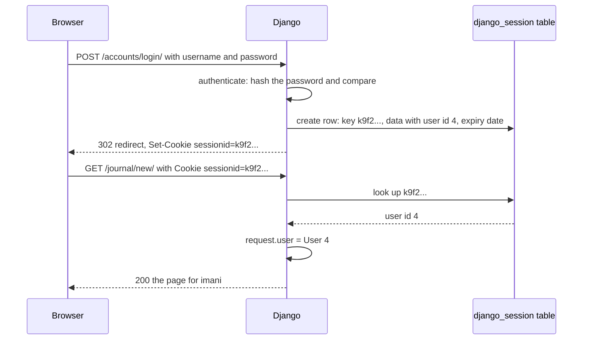

# The auth app: users, passwords and sessions

> **Before this lesson:** you can build forms and editing views ([CreateView, UpdateView and DeleteView](#/lesson/django/edit-views)) and you know that middleware runs around every view ([The request/response cycle, views, URLs and first tests](#/lesson/django/request-response)). The term "cookie" is explained here; for more depth see [Cookies and sessions](#/lesson/web-security/cookies-sessions).

## In plain words

A website that lets people write things must know **who** is writing. That involves three separate questions, and mixing them up causes both bugs and security holes.

- **Authentication**: *who are you?* Proving identity, usually with a username and password.
- **Authorisation**: *what may you do?* Deciding whether that person may edit this entry.
- **Session**: *are you still the person who logged in two minutes ago?* The web forgets everything between requests, so the server needs a way to recognise a returning browser.

An everyday picture: a concert. At the entrance you show your ticket and an identity card (authentication). You receive a wristband. For the rest of the evening nobody asks for your identity card again; staff look at the wristband (the session). The colour of the wristband decides whether you may go backstage (authorisation).

Django ships all of this in the app `django.contrib.auth`, with help from `django.contrib.sessions`. Both are in `INSTALLED_APPS` from the first minute; the superuser you created for the admin is one of its users.

Why it matters for a job: authentication code is where mistakes become headlines, so the first rule is "use the framework's implementation, do not write your own". To use it well, and to answer interview questions such as "how are passwords stored?" and "how does Django know who is logged in?", you need the model in this lesson.

## The User model

The auth app defines a model called `User`, stored in the table `auth_user`. Its main fields:

| Field | Meaning |
|---|---|
| `username` | unique login name |
| `password` | **not** the password: a one-way fingerprint of it (see below) |
| `email`, `first_name`, `last_name` | optional personal details |
| `is_active` | `False` disables the account without deleting it |
| `is_staff` | may log in to the admin site |
| `is_superuser` | has every permission without being given them one by one |
| `last_login`, `date_joined` | timestamps |

Users relate to two more models: `Group` (a named set of users, such as "editors") and `Permission` (a named right, such as "can change entry"). Those belong to authorisation, covered in the newspaper module.

Always obtain the user class through a function, never by importing it directly, because a project may replace the model (the next module does):

```python
from django.contrib.auth import get_user_model

User = get_user_model()
```

## Creating users correctly

Open `python manage.py shell`:

```python
from django.contrib.auth import get_user_model

User = get_user_model()

imani = User.objects.create_user(username="imani", email="imani@example.com", password="pine-cone-42")
imani.password
# 'pbkdf2_sha256$1000000$Zq3...$wJt8...'

imani.check_password("pine-cone-42")    # True
imani.check_password("wrong")           # False
imani.set_password("larch-needle-77")   # change it
imani.save()
```

`create_user` is a special manager method that hashes the password before saving. The ordinary `User.objects.create(username="x", password="secret")` would store the literal text `secret` in the password column. Such an account can never log in, because the login check hashes what the visitor types and compares it with the stored value, and it would also be a plain-text password in your database. Use `create_user`, `create_superuser` or `set_password`; nothing else.

## How passwords are stored

A site must be able to *check* a password without *knowing* it. If the database is ever copied by an attacker, the copy should not reveal anyone's password. The tool is a **hash function**: a calculation that turns any text into a fixed-length fingerprint and cannot practically be run backwards.

Three refinements make hashing safe for passwords:

1. **Salt.** A random string, different for every user, mixed into the calculation. Two users with the same password get different fingerprints, and an attacker cannot use a pre-computed table of common-password hashes.
2. **Many iterations.** The hash is applied hundreds of thousands of times. A legitimate login waits a fraction of a second; an attacker guessing billions of passwords is slowed by the same factor.
3. **A self-describing format.** The stored value records the algorithm and the iteration count, so they can be strengthened later.

The stored text has four parts separated by dollar signs: `algorithm$iterations$salt$hash`. Django's default algorithm is **PBKDF2** (Password-Based Key Derivation Function 2) with SHA-256; Django 5.2 uses 1,000,000 iterations, and the number rises with each release.

The model below is Django's scheme in miniature, using the same standard-library function. Run it twice: the stored value differs each time because the salt is random, yet checking still works.

```python-run
import base64, hashlib, hmac, secrets

ITERATIONS = 50_000          # small so that the demo is quick; Django 5.2 uses 1,000,000

def make_password(password, salt=None, iterations=ITERATIONS):
    salt = salt or secrets.token_urlsafe(12)
    digest = hashlib.pbkdf2_hmac("sha256", password.encode(), salt.encode(), iterations)
    return f"pbkdf2_sha256${iterations}${salt}${base64.b64encode(digest).decode()}"

def check_password(password, stored):
    algorithm, iterations, salt, _ = stored.split("$")
    candidate = make_password(password, salt, int(iterations))   # same salt, same iterations
    return hmac.compare_digest(candidate, stored)               # constant-time comparison

stored_a = make_password("pine-cone-42")
stored_b = make_password("pine-cone-42")       # same password, another user

print(stored_a)
print(stored_b)
print("same fingerprint for the same password?", stored_a == stored_b)
print("correct password:", check_password("pine-cone-42", stored_a))
print("wrong password  :", check_password("pine-cone-43", stored_a))
```

Because the iteration count is stored with each hash, Django can upgrade quietly: when a user logs in and their stored hash uses fewer iterations than the current default, the password is re-hashed with the new count at that moment.

> [!WARNING]
> Never store, log, e-mail or print passwords, and never compare them yourself with `==`. Never "encrypt" them either: encryption is reversible by design, which is exactly what you do not want. Hash with the framework.

### Password validators

`settings.py` contains `AUTH_PASSWORD_VALIDATORS`, four rules applied whenever a password is set through a form: not too similar to the user's other attributes, at least 8 characters, not in a list of about 20,000 common passwords, not entirely numeric. They run in forms such as sign-up and password change, and in `createsuperuser`; they do **not** run inside `create_user`, which is why tests can use short passwords.

## Cookies and sessions

**HTTP is stateless**: each request arrives with no memory of earlier ones. To recognise a returning browser, the server asks the browser to carry a small labelled value. A **cookie** is that value: the server sends it in a response header, the browser stores it and sends it back with every later request to the same site.

Django does not put user data into the cookie. It stores the data on the server, in the table `django_session`, and puts only a long random key in a cookie named `sessionid`. This arrangement is a **session**.



Two middleware classes, both in the default `MIDDLEWARE` list, do the work on every request:

1. `SessionMiddleware` reads the `sessionid` cookie and makes `request.session` available, a dictionary-like object you can also use for your own small pieces of per-visitor data.
2. `AuthenticationMiddleware` reads the user's id from the session and sets `request.user`.

`AuthenticationMiddleware` must come after `SessionMiddleware`, since it depends on it.

The model below is the session mechanism reduced to two dictionaries. Run it and note what the browser holds: only the key.

```python-run
import secrets

USERS = {4: "imani", 7: "tomas"}
SESSION_TABLE = {}                         # server side: session key -> data

def login(user_id):
    key = secrets.token_urlsafe(24)        # unguessable random key
    SESSION_TABLE[key] = {"_auth_user_id": user_id}
    return {"sessionid": key}              # this becomes the browser's cookie

def user_for(cookies):                     # what the two middleware classes do
    data = SESSION_TABLE.get(cookies.get("sessionid"))
    if data is None:
        return "AnonymousUser"
    return USERS[data["_auth_user_id"]]

def logout(cookies):
    SESSION_TABLE.pop(cookies.get("sessionid"), None)   # delete the server-side record

browser_cookies = {}
print("before login :", user_for(browser_cookies))
browser_cookies = login(4)
print("cookie held by the browser:", browser_cookies)
print("after login  :", user_for(browser_cookies))
print("forged cookie:", user_for({"sessionid": "guess-123"}))
logout(browser_cookies)
print("after logout :", user_for(browser_cookies), "(the old cookie is now worthless)")
```

Logging out deletes the server's record, so a copied cookie stops working immediately. This property, instant revocation, is the main practical difference from token schemes in which the token itself contains the data; the interview module compares the two.

## `request.user` everywhere

Every request has a `request.user`. It is either a real `User` or an `AnonymousUser`, a stand-in object so that your code never has to check for `None`.

```python
def greeting(request):
    if request.user.is_authenticated:
        name = request.user.get_username()
    else:
        name = "guest"
    return HttpResponse(f"Hello, {name}")
```

In templates the same object is available as `user`, thanks to a context processor:

```html

  Signed in as {{ user.username }}

  <a href="">Log in</a>

```

`is_authenticated` is an attribute, not a method: write it without parentheses.

## The three functions behind every login

The ready-made login view of the next lesson is a thin wrapper around three functions. Seeing them once in a hand-written view removes the mystery.

```python
# a hand-written login view, for understanding only
from django.contrib.auth import authenticate, login, logout
from django.shortcuts import redirect, render


def manual_login(request):
    error = ""
    if request.method == "POST":
        user = authenticate(request, username=request.POST.get("username", ""),
                            password=request.POST.get("password", ""))
        if user is not None:
            login(request, user)
            return redirect("entry-list")
        error = "Please enter a correct username and password."
    return render(request, "manual_login.html", {"error": error})


def manual_logout(request):
    if request.method == "POST":
        logout(request)
    return redirect("entry-list")
```

- `authenticate(request, username=..., password=...)` checks the credentials against each configured **authentication backend** and returns a `User`, or `None`. It returns `None` for inactive accounts too.
- `login(request, user)` stores the user's id in the session and **rotates the session key**: the visitor receives a fresh `sessionid`. That defeats **session fixation**, an attack in which the attacker plants a known session key in the victim's browser before the victim logs in.
- `logout(request)` deletes the session data and the cookie.

The error message is deliberately vague. Saying "no such user" versus "wrong password" would tell an attacker which usernames exist.

## Session settings that matter

| Setting | Default | Meaning |
|---|---|---|
| `SESSION_COOKIE_AGE` | `1209600` (two weeks, in seconds) | lifetime of a session |
| `SESSION_SAVE_EVERY_REQUEST` | `False` | if `True`, every request renews the lifetime (a sliding window) |
| `SESSION_EXPIRE_AT_BROWSER_CLOSE` | `False` | if `True`, the cookie disappears when the browser closes |
| `SESSION_COOKIE_SECURE` | `False` | send the cookie only over HTTPS; set `True` in production |
| `SESSION_COOKIE_HTTPONLY` | `True` | JavaScript cannot read the cookie |
| `SESSION_COOKIE_SAMESITE` | `"Lax"` | the cookie is not sent on most cross-site requests |
| `SESSION_ENGINE` | database | where session data lives; alternatives: cache, file, signed cookie |

By default the session's expiry is refreshed only when the session is **modified**, not on every page view. A user who only reads pages is logged out two weeks after logging in. Expired rows remain in the table until you run `python manage.py clearsessions`, typically from a daily scheduled job.

## Tests

```python
# journal/test_auth_basics.py
from django.contrib.auth import authenticate, get_user_model
from django.test import TestCase


class AuthBasicsTests(TestCase):
    @classmethod
    def setUpTestData(cls):
        cls.user = get_user_model().objects.create_user("imani", password="pine-cone-42")

    def test_password_is_hashed(self):
        self.assertNotEqual(self.user.password, "pine-cone-42")
        self.assertTrue(self.user.password.startswith("pbkdf2_sha256$"))
        self.assertTrue(self.user.check_password("pine-cone-42"))

    def test_authenticate(self):
        self.assertEqual(authenticate(username="imani", password="pine-cone-42"), self.user)
        self.assertIsNone(authenticate(username="imani", password="nope"))

    def test_inactive_user_cannot_authenticate(self):
        self.user.is_active = False
        self.user.save()
        self.assertIsNone(authenticate(username="imani", password="pine-cone-42"))

    def test_login_creates_session(self):
        self.assertTrue(self.client.login(username="imani", password="pine-cone-42"))
        self.assertIn("_auth_user_id", self.client.session)
        self.client.logout()
        self.assertNotIn("_auth_user_id", self.client.session)
```

`self.client.login(...)` performs a real authentication for the test client; `force_login(user)` skips the password check and is faster when the password is not what you are testing.

> [!NOTE]
> **What changed since the book.** In Django 2.1 `is_authenticated` could still be called like a method in old code paths; it has been attribute-only since 2.0, so `user.is_authenticated()` raises an error. The default PBKDF2 iteration count has risen from 120,000 (2.1) to 1,000,000 (5.2). Session and CSRF cookies have defaulted to `SameSite=Lax` since 2.1. Django 5.0 added asynchronous versions (`aauthenticate`, `alogin`, `request.auser()`).

> [!INTERVIEW]
> **"How does Django store passwords?"** As a salted, iterated hash, never as text. The default hasher is PBKDF2 with SHA-256 and a per-user random salt; the column stores `algorithm$iterations$salt$hash`. Verification re-computes the hash with the stored salt and iteration count and compares in constant time. `PASSWORD_HASHERS` lists the accepted algorithms (Argon2, bcrypt and scrypt are supported); the first entry is used for new passwords, and older hashes are upgraded transparently when the user next logs in. Mention that `create_user` or `set_password` must be used, and that password validators run in forms.

> [!TIP]
> `request.session` is yours to use for small per-visitor state: `request.session["recent_region"] = region.pk`. Store identifiers and simple values, not whole objects, and remember that anonymous visitors get a session too as soon as you write to it.

## Pitfalls

- **`User.objects.create(password="...")`.** Stores plain text and produces an account that cannot log in. Use `create_user`.
- **`from django.contrib.auth.models import User` in app code.** Breaks under a custom user model. Use `get_user_model()` or `settings.AUTH_USER_MODEL`.
- **`if request.user:`** is always true, because `AnonymousUser` is an object. Test `request.user.is_authenticated`.
- **Calling `is_authenticated()`.** It is a property.
- **Logging request data that includes passwords.** Log files become a second, unprotected password store.
- **Middleware order.** `AuthenticationMiddleware` before `SessionMiddleware` raises an error at start-up.
- **Specific login errors.** Do not reveal whether the username exists.
- **Never clearing sessions.** The `django_session` table grows without bound.

## Cheat sheet

| Need | Code |
|---|---|
| The user class | `get_user_model()` |
| Create a user | `User.objects.create_user("imani", password="...")` |
| Change a password | `user.set_password("..."); user.save()` |
| Check a password | `user.check_password("...")` |
| Verify credentials | `authenticate(request, username=..., password=...)` |
| Start / end a session | `login(request, user)` / `logout(request)` |
| Current user | `request.user`, `request.user.is_authenticated` |
| Per-visitor data | `request.session["key"] = value` |
| Session lifetime | `SESSION_COOKIE_AGE` |
| Remove expired sessions | `python manage.py clearsessions` |
| Log in within a test | `self.client.login(...)` or `self.client.force_login(user)` |

## Summary

- Authentication proves identity, authorisation decides rights, and a session remembers an authenticated browser.
- Passwords are stored as salted, iterated PBKDF2 hashes in a self-describing format; always go through `create_user` or `set_password`.
- A session is server-side data found through a random key in the `sessionid` cookie; `SessionMiddleware` and `AuthenticationMiddleware` turn it into `request.user`.
- `authenticate`, `login` and `logout` are the functions beneath every login feature; `login` rotates the session key.
- `request.user` is always present: a `User` or an `AnonymousUser`; check `is_authenticated`.

## Glossary

- **Authentication**: verifying who someone is.
- **Authorisation**: deciding what an authenticated identity may do.
- **Hash function**: a one-way calculation producing a fixed-length fingerprint of its input.
- **Salt**: random data added to each password before hashing.
- **PBKDF2**: the iterated hashing algorithm Django uses for passwords by default.
- **Stateless**: keeping no memory between requests, a property of HTTP.
- **Cookie**: a small value a site asks the browser to store and send back.
- **Session**: server-side data tied to one browser through a session key.
- **`sessionid`**: the name of Django's session cookie.
- **`AnonymousUser`**: the object representing a visitor who is not logged in.
- **Authentication backend**: a class that knows one way to verify credentials.
- **Session fixation**: an attack that makes a victim log in under a session key the attacker already knows.

```quiz
[
  {"q": "What is the difference between authentication and authorisation?",
   "options": ["They are the same", "Authentication proves who you are; authorisation decides what you may do", "Authentication is for staff, authorisation for visitors", "Authorisation happens before authentication"],
   "answer": 1,
   "explain": "Identity first, rights second. A logged-in user (authenticated) may still be forbidden to edit someone else's entry (not authorised)."},
  {"q": "What is wrong with `User.objects.create(username='ana', password='secret123')`?",
   "options": ["Nothing", "The password is stored as plain text and the user cannot log in", "create does not accept a username", "It creates a superuser"],
   "answer": 1,
   "explain": "Only create_user, create_superuser and set_password hash the password. Login compares hashes, so a plain-text value never matches."},
  {"q": "Two users choose the same password. Why are their stored values different?",
   "options": ["Django encrypts with the username", "Each password is hashed with its own random salt", "The iteration count differs per user", "They are identical"],
   "answer": 1,
   "explain": "The salt makes identical passwords produce different hashes and defeats pre-computed tables."},
  {"q": "What does the browser hold after a successful login with the default session engine?",
   "options": ["The username and password", "The user's id in readable form", "A random session key in the sessionid cookie", "The password hash"],
   "answer": 2,
   "explain": "The data lives in the django_session table on the server. The cookie contains only the key that finds it."},
  {"q": "Which statement about `request.user` for a visitor who is not logged in is true?",
   "options": ["It is None", "It is an AnonymousUser whose is_authenticated is False", "Accessing it raises an exception", "It is the superuser"],
   "answer": 1,
   "explain": "AnonymousUser lets code check request.user.is_authenticated without testing for None."},
  {"q": "Why does login() give the visitor a new session key?",
   "options": ["To save database space", "To prevent session fixation, where an attacker pre-sets a known key", "Because cookies expire at login", "To log the user out elsewhere"],
   "answer": 1,
   "explain": "Rotating the key at the moment of authentication makes any key planted beforehand useless."},
  {"q": "With default settings, when does a session expire for a user who only reads pages?",
   "options": ["When the browser closes", "Two weeks after the session was last modified, typically the login", "After 30 minutes", "Never"],
   "answer": 1,
   "explain": "SESSION_COOKIE_AGE is two weeks, and the expiry is only refreshed when the session is saved, which by default happens only when it is modified."},
  {"q": "Why should a failed login show the same message for an unknown username and for a wrong password?",
   "options": ["To save translation work", "So that attackers cannot learn which usernames exist", "Because Django cannot tell the difference", "To make the page load faster"],
   "answer": 1,
   "explain": "Different messages allow user enumeration, which makes targeted password guessing easier."}
]
```

> **Source:** Vincent, *Django for Beginners*, ch. 7 (User Accounts: the auth app). Docs: https://docs.djangoproject.com/en/5.2/topics/auth/default/ · https://docs.djangoproject.com/en/5.2/topics/auth/passwords/ · https://docs.djangoproject.com/en/5.2/topics/http/sessions/ · https://docs.djangoproject.com/en/5.2/ref/contrib/auth/
