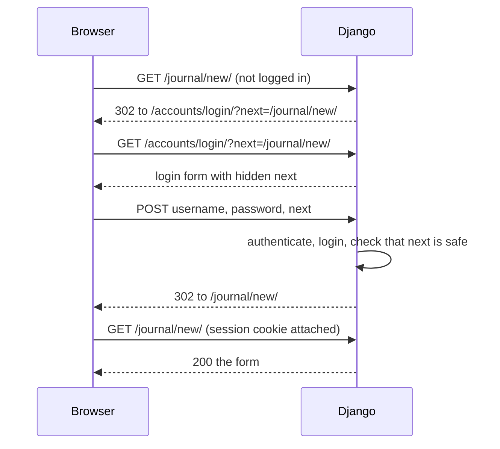

# Login, logout and sign-up views

> **Before this lesson:** you understand users, password hashing, sessions and `request.user` ([The auth app: users, passwords and sessions](#/lesson/django/auth-app)), and you can write generic editing views and form templates ([CreateView, UpdateView and DeleteView](#/lesson/django/edit-views)). The project is still `trailbook`.

## In plain words

The previous lesson explained the machinery: hashed passwords, a session cookie, `request.user`. This lesson builds the three pages a visitor actually sees:

- a **login** page, where a returning user types a username and password;
- a **logout** button, which ends the session;
- a **sign-up** page, where a newcomer creates an account.

Django supplies finished views for the first two. You provide only the templates and three settings. Sign-up is left to you, because sites differ on who may register, but Django supplies the form.

An everyday picture: moving into a furnished flat. The plumbing and wiring exist (the views). You bring curtains and decide where the sofa goes (templates and settings). Only the guest-book at the door is yours to design (sign-up).

Why it matters for a job: adding "log in with an account" is among the first tasks on any real project, and interviewers like the follow-ups: "what happens to the page the user originally wanted?", "why is logout a POST?", "what is an open redirect?".

## Step 1: switch on the built-in views

One line in the project's URL configuration:

```python
# config/urls.py
from django.contrib import admin
from django.urls import include, path

urlpatterns = [
    path("admin/", admin.site.urls),
    path("accounts/", include("django.contrib.auth.urls")),
    path("journal/", include("journal.urls")),
]
```

`django.contrib.auth.urls` is a URL module that ships with Django. Under the prefix `accounts/` it adds eight named routes:

| Address | Name | Purpose |
|---|---|---|
| `accounts/login/` | `login` | log in |
| `accounts/logout/` | `logout` | log out (POST only) |
| `accounts/password_change/` | `password_change` | change password while logged in |
| `accounts/password_change/done/` | `password_change_done` | confirmation |
| `accounts/password_reset/` | `password_reset` | ask for a reset e-mail |
| `accounts/password_reset/done/` | `password_reset_done` | "check your inbox" |
| `accounts/reset/<uidb64>/<token>/` | `password_reset_confirm` | choose a new password |
| `accounts/reset/done/` | `password_reset_complete` | confirmation |

The password routes get their own lesson. Visit `/accounts/login/` now and you will see `TemplateDoesNotExist: registration/login.html`. The view exists; the page design is your job.

## Step 2: the login template

The built-in views look for their templates in a folder named `registration`. Create `templates/registration/login.html` in the project-level templates folder:

```html
<!-- templates/registration/login.html -->

Log in

  <h1>Log in</h1>
  <form method="post">
    
    {{ form.as_div }}
    <input type="hidden" name="next" value="{{ next }}">
    <button type="submit">Log in</button>
  </form>
  <p>No account yet? <a href="">Sign up</a>.</p>

```

- `form` is an `AuthenticationForm` supplied by the view, with `username` and `password` fields. On failure it carries the deliberately vague error "Please enter a correct username and password."
- The hidden `next` input is explained in step 4.
- The link to `signup` will work after step 6; comment it out until then if you test now.

## Step 3: where to go afterwards

After a successful login Django redirects to `/accounts/profile/` by default, a page that does not exist. Three settings control the journeys:

```python
# config/settings.py
LOGIN_URL = "login"                  # where to send visitors who must log in first
LOGIN_REDIRECT_URL = "entry-list"    # where to go after logging in
LOGOUT_REDIRECT_URL = "entry-list"   # where to go after logging out
```

All three accept either a path or, as here, the **name** of a URL pattern.

### Logout is a form, not a link

Logging out changes state on the server, so it must be a POST request. Add the control to the shared header:

```html
<!-- templates/base.html, inside <header> -->
<nav>
  <a href="">Trailbook</a>
  
    <span>Hello, {{ user.username }}</span>
    <a href="">New entry</a>
    <form method="post" action="" style="display:inline">
      
      <button type="submit">Log out</button>
    </form>
  
    <a href="">Log in</a>
    <a href="">Sign up</a>
  
</nav>
```

`action=""` sends the form to the logout address instead of the current page. If logout were a plain link, any page on the internet could log your users out by embedding ``, and browsers that pre-load links would do it by accident.

> [!NOTE]
> **What changed since the book.** In Django 2.1 the logout view answered GET requests, and the book's templates use `<a href="">`. That behaviour was deprecated in 4.1 and **removed in 5.0**: a GET to `/accounts/logout/` now returns 405 Method Not Allowed. Any tutorial with a logout link needs the small form shown above.

## Step 4: the `next` parameter

An anonymous visitor clicks "New entry". The view is protected by `LoginRequiredMixin`, so Django redirects to the login page, and it remembers the original destination in the query string:

```
/accounts/login/?next=/journal/new/
```

The login view passes that value to the template as `next`; the hidden input sends it back with the form; after a successful login the view redirects there instead of to `LOGIN_REDIRECT_URL`. The user ends up where they intended to go.



### Why "check that next is safe"?

`next` comes from the URL, so anyone can write anything into it. An attacker could e-mail a victim this link:

```
https://trailbook.example/accounts/login/?next=https://trailbook-login.evil.example/
```

The link really points to your site, so it looks trustworthy. If your site redirected blindly after login, the victim would land on the attacker's look-alike page saying "session expired, please log in again" and hand over the password. This is an **open redirect**. Django's login view refuses any `next` that leads to another host and falls back to `LOGIN_REDIRECT_URL`.

The model below implements both halves: building the login address with an encoded `next`, and deciding whether a received `next` may be followed. Run it and add your own test addresses.

```python-run
from urllib.parse import quote, urlsplit

LOGIN_URL = "/accounts/login/"
SITE_HOST = "trailbook.example"

def redirect_to_login(requested_path):
    """What LoginRequiredMixin does for an anonymous visitor."""
    return f"{LOGIN_URL}?next={quote(requested_path, safe='/')}"

def is_safe(url):
    """A simplified url_has_allowed_host_and_scheme."""
    if not url or "\\" in url or url.startswith("///"):
        return False
    parts = urlsplit(url)
    if parts.scheme not in ("", "http", "https"):
        return False
    if parts.netloc:                       # the URL names a host: it must be ours
        return parts.netloc.lower() == SITE_HOST
    return not parts.scheme and url.startswith("/")

print(redirect_to_login("/journal/new/"))
print(redirect_to_login("/journal/?q=frost&page=2"))    # ? = & must be encoded
print()
for candidate in ["/journal/new/", "https://trailbook.example/journal/", "https://evil.example/",
                  "//evil.example/journal/", "javascript:alert(1)", "/\\evil.example"]:
    target = candidate if is_safe(candidate) else "/journal/   (fallback)"
    print(f"{candidate:40} -> {target}")
```

Two details deserve attention. In the second line the query string of the original page is percent-encoded (`%3F`, `%3D`, `%26`), otherwise `page=2` would be read as a parameter of the login page. And `//evil.example/journal/` is rejected even though it starts with a slash: browsers read a double slash as "same scheme, different host". In your own views, use Django's helper `url_has_allowed_host_and_scheme` from `django.utils.http`; never write this check by hand in production code.

## Step 5: protecting views

Two equivalent tools mark a view as "members only":

```python
# function views: a decorator
from django.contrib.auth.decorators import login_required


@login_required
def report_conditions(request):
    ...
```

```python
# class-based views: a mixin, listed first
from django.contrib.auth.mixins import LoginRequiredMixin


class EntryCreateView(LoginRequiredMixin, CreateView):
    ...
```

Both redirect anonymous visitors to `LOGIN_URL` with `?next=`. Since Django 5.1 there is a third option for sites where *almost everything* is private: add `"django.contrib.auth.middleware.LoginRequiredMiddleware"` to `MIDDLEWARE` (after `AuthenticationMiddleware`) and every view requires login unless it is marked with the `@login_not_required` decorator. The built-in login view is already exempt.

## Step 6: sign-up

Registration is not part of `django.contrib.auth.urls`, so it needs an app of its own. Keeping account-related code in an `accounts` app is a widespread convention.

```bash
python manage.py startapp accounts
```

Add `"accounts"` to `INSTALLED_APPS`. Django provides the form, `UserCreationForm`: a ModelForm with `username`, `password1` and `password2`. It checks that the two passwords match, runs the password validators and hashes the password when saving. A `CreateView` does the rest:

```python
# accounts/views.py
from django.contrib.auth import login
from django.contrib.auth.forms import UserCreationForm
from django.urls import reverse_lazy
from django.views.generic import CreateView


class SignUpView(CreateView):
    form_class = UserCreationForm
    template_name = "registration/signup.html"
    success_url = reverse_lazy("entry-list")

    def form_valid(self, form):
        response = super().form_valid(form)     # saves the new user as self.object
        login(self.request, self.object)        # log the newcomer in straight away
        return response
```

- `form_class` supplies a ready-made form in place of `model` + `fields`.
- `template_name` is set explicitly; storing the template beside `login.html` keeps the account pages together.
- The `form_valid` override logs the new user in so they do not have to type the password a third time. If you prefer newcomers to log in themselves, delete the method and set `success_url = reverse_lazy("login")`.

```python
# accounts/urls.py  (new file)
from django.urls import path

from .views import SignUpView

urlpatterns = [
    path("signup/", SignUpView.as_view(), name="signup"),
]
```

```python
# config/urls.py
urlpatterns = [
    path("admin/", admin.site.urls),
    path("accounts/", include("accounts.urls")),               # ours first
    path("accounts/", include("django.contrib.auth.urls")),    # then the built-in routes
    path("journal/", include("journal.urls")),
]
```

Two `include` lines may share a prefix; Django tries them in order. Listing your own first lets you override a built-in route later by defining one with the same path.

```html
<!-- templates/registration/signup.html -->

Sign up

  <h1>Create an account</h1>
  <form method="post">
    
    {{ form.as_div }}
    <button type="submit">Sign up</button>
  </form>
  <p>Already registered? <a href="">Log in</a>.</p>

```

Try it with the password `12345678`. The form refuses with two messages, "This password is too common." and "This password is entirely numeric.": the validators from `AUTH_PASSWORD_VALIDATORS` at work.

> [!WARNING]
> `UserCreationForm` is tied to Django's default `User` model. Once a project defines a custom user model (the next module), the form must be subclassed to point at it. Starting every project with a custom user model, before the first `migrate`, avoids a painful change later.

## Step 7: tests

```python
# accounts/tests.py
from django.contrib.auth import get_user_model
from django.test import TestCase
from django.urls import reverse


class AccountFlowTests(TestCase):
    @classmethod
    def setUpTestData(cls):
        cls.user = get_user_model().objects.create_user("imani", password="pine-cone-42")

    def test_login_page_renders(self):
        response = self.client.get(reverse("login"))
        self.assertTemplateUsed(response, "registration/login.html")

    def test_login_success_redirects(self):
        response = self.client.post(reverse("login"), {"username": "imani", "password": "pine-cone-42"})
        self.assertRedirects(response, reverse("entry-list"))

    def test_login_failure_redisplays_form(self):
        response = self.client.post(reverse("login"), {"username": "imani", "password": "wrong"})
        self.assertEqual(response.status_code, 200)
        self.assertContains(response, "Please enter a correct username and password")

    def test_next_is_followed_when_safe(self):
        url = reverse("login") + "?next=/journal/new/"
        response = self.client.post(url, {"username": "imani", "password": "pine-cone-42", "next": "/journal/new/"})
        self.assertRedirects(response, "/journal/new/")

    def test_external_next_is_ignored(self):
        response = self.client.post(reverse("login"), {"username": "imani", "password": "pine-cone-42",
                                                       "next": "https://evil.example/"})
        self.assertRedirects(response, reverse("entry-list"))

    def test_logout_requires_post(self):
        self.client.force_login(self.user)
        self.assertEqual(self.client.get(reverse("logout")).status_code, 405)
        self.assertRedirects(self.client.post(reverse("logout")), reverse("entry-list"))

    def test_signup_creates_and_logs_in(self):
        response = self.client.post(reverse("signup"), {
            "username": "tomas", "password1": "larch-needle-77", "password2": "larch-needle-77"})
        self.assertRedirects(response, reverse("entry-list"))
        self.assertTrue(get_user_model().objects.filter(username="tomas").exists())
        self.assertIn("_auth_user_id", self.client.session)

    def test_signup_rejects_mismatched_passwords(self):
        response = self.client.post(reverse("signup"), {
            "username": "tomas", "password1": "larch-needle-77", "password2": "larch-needle-78"})
        self.assertEqual(response.status_code, 200)
        self.assertFalse(get_user_model().objects.filter(username="tomas").exists())
```

> [!INTERVIEW]
> **"What is the `next` parameter and what is the risk?"** When an anonymous user requests a protected view, `login_required` redirects to `LOGIN_URL` with the original path in `?next=`. After authentication the login view redirects to it. Because the value is attacker-controllable, following it blindly creates an open redirect usable for phishing. Django validates it with `url_has_allowed_host_and_scheme` against the current host (and `require_https` on secure requests) and falls back to `LOGIN_REDIRECT_URL`. Name the edge cases: scheme-relative `//host`, backslashes, and `javascript:` URLs.

> [!TIP]
> To customise the built-in login view without rewriting it, subclass it: `class SiteLoginView(LoginView): redirect_authenticated_user = True` sends users who are already logged in away from the login page. Route it at `accounts/login/` in your own `accounts/urls.py`, above the built-in include.

## Pitfalls

- **`TemplateDoesNotExist: registration/login.html`.** The folder must be called `registration` and be findable (project `templates/` in `DIRS`, or an app's `templates/`).
- **The admin's templates win.** `django.contrib.admin` ships `registration/logged_out.html` and password templates. If your version does not appear, make sure the project-level `templates` folder is in `DIRS` (searched first), or list your app above `django.contrib.admin`.
- **Logout as a link.** 405 since Django 5.0. Use a POST form.
- **Landing on `/accounts/profile/`.** Set `LOGIN_REDIRECT_URL`.
- **Dropping the hidden `next` field.** Users return to the default page instead of the one they wanted.
- **Mixin on the right.** `class V(CreateView, LoginRequiredMixin)` does not protect the view.
- **Plain `reverse` in `success_url`.** Use `reverse_lazy`.
- **Hand-made sign-up form saving `password` directly.** Stores plain text; build on `UserCreationForm`.

## Cheat sheet

| Need | Code |
|---|---|
| All built-in auth routes | `path("accounts/", include("django.contrib.auth.urls"))` |
| Login template | `templates/registration/login.html` with `{{ form }}` and hidden `next` |
| After login / logout | `LOGIN_REDIRECT_URL`, `LOGOUT_REDIRECT_URL` |
| Login page for protected views | `LOGIN_URL` |
| Logout control | `<form method="post" action=""><button>Log out</button></form>` |
| Protect a function view | `@login_required` |
| Protect a class view | `LoginRequiredMixin` as the first base class |
| Protect everything (5.1+) | `LoginRequiredMiddleware` + `@login_not_required` |
| Sign-up | `CreateView` with `form_class = UserCreationForm` |
| Log in after sign-up | `login(self.request, self.object)` in `form_valid` |
| Safe redirect check | `url_has_allowed_host_and_scheme(url, allowed_hosts={request.get_host()})` |

## Summary

- `include("django.contrib.auth.urls")` adds login, logout and the password views; you supply templates in `registration/`.
- `LOGIN_REDIRECT_URL`, `LOGOUT_REDIRECT_URL` and `LOGIN_URL` define the journeys; all accept URL names.
- Logout is a POST with a CSRF token.
- Protected views redirect to the login page with `?next=`; Django follows `next` only when it stays on your own host.
- Sign-up is a `CreateView` around `UserCreationForm`, which validates and hashes the password for you.

## Glossary

- **`LoginView` / `LogoutView`**: Django's ready-made class-based views for logging in and out.
- **`AuthenticationForm`**: the form with username and password used by `LoginView`.
- **`UserCreationForm`**: the ModelForm that creates a user with a confirmed, validated, hashed password.
- **`next` parameter**: the query-string value recording where to return after login.
- **Open redirect**: a flaw that lets an attacker make your site redirect visitors to an address of the attacker's choice.
- **Percent-encoding**: writing special characters in a URL as `%` followed by two hexadecimal digits.
- **`login_required`**: the decorator restricting a function view to authenticated users.
- **`LoginRequiredMixin`**: the equivalent for class-based views.
- **`LOGIN_REDIRECT_URL`**: the default destination after logging in.
- **Phishing**: tricking someone into entering credentials on a fake page.

```quiz
[
  {"q": "After adding `path('accounts/', include('django.contrib.auth.urls'))`, visiting /accounts/login/ raises TemplateDoesNotExist. Why?",
   "options": ["The auth app is not installed", "The view exists but you must provide registration/login.html", "The URL name is wrong", "A migration is missing"],
   "answer": 1,
   "explain": "Django ships the views but not the page templates. LoginView looks for registration/login.html."},
  {"q": "Why does a plain link to the logout URL fail in Django 5?",
   "options": ["The URL was renamed", "LogoutView only accepts POST; a GET returns 405", "Links cannot use the url tag", "Logout was removed"],
   "answer": 1,
   "explain": "Logging out changes server state, so it must be a POST with a CSRF token. GET support was removed in 5.0."},
  {"q": "An anonymous visitor opens /journal/new/, which uses LoginRequiredMixin. Where are they sent?",
   "options": ["To a 403 page", "To LOGIN_URL with ?next=/journal/new/", "To the home page", "To the sign-up page"],
   "answer": 1,
   "explain": "The mixin redirects to the login page and records the requested path in the next parameter."},
  {"q": "A login link contains ?next=https://evil.example/. What does Django's login view do after a successful login?",
   "options": ["Redirects to evil.example", "Ignores next because the host is not allowed and uses LOGIN_REDIRECT_URL", "Shows an error page", "Logs the user out"],
   "answer": 1,
   "explain": "The view validates next with url_has_allowed_host_and_scheme, preventing an open redirect."},
  {"q": "Why is `//evil.example/path` not a safe redirect target, although it starts with a slash?",
   "options": ["It is safe", "Browsers treat it as a scheme-relative URL pointing to another host", "Double slashes are a syntax error", "It is too short"],
   "answer": 1,
   "explain": "A leading double slash keeps the scheme and switches the host, so it leaves your site."},
  {"q": "What does UserCreationForm do that a hand-written ModelForm with a password field would not?",
   "options": ["Sends a confirmation e-mail", "Confirms the password twice, runs the validators and stores a hash via set_password", "Creates a superuser", "Logs the user in"],
   "answer": 1,
   "explain": "It handles password confirmation, validation and hashing. Saving a raw password field would store plain text."},
  {"q": "Which setting decides where a user lands after logging in when no next parameter is present?",
   "options": ["LOGIN_URL", "LOGIN_REDIRECT_URL", "LOGOUT_REDIRECT_URL", "ROOT_URLCONF"],
   "answer": 1,
   "explain": "LOGIN_URL is where anonymous users are sent to log in; LOGIN_REDIRECT_URL is the default destination afterwards."},
  {"q": "In the SignUpView, why is `login(self.request, self.object)` called after `super().form_valid(form)`?",
   "options": ["To validate the form again", "Because the user object exists only after the parent method has saved it", "To hash the password", "To send the redirect"],
   "answer": 1,
   "explain": "super().form_valid saves the form and sets self.object; only then is there a user to log in."}
]
```

> **Source:** Vincent, *Django for Beginners*, ch. 7 (User Accounts: login, logout, sign up). Docs: https://docs.djangoproject.com/en/5.2/topics/auth/default/#module-django.contrib.auth.views · https://docs.djangoproject.com/en/5.2/topics/auth/default/#the-loginrequiredmixin-mixin · https://docs.djangoproject.com/en/5.2/ref/settings/#login-redirect-url · https://docs.djangoproject.com/en/5.2/releases/5.0/
