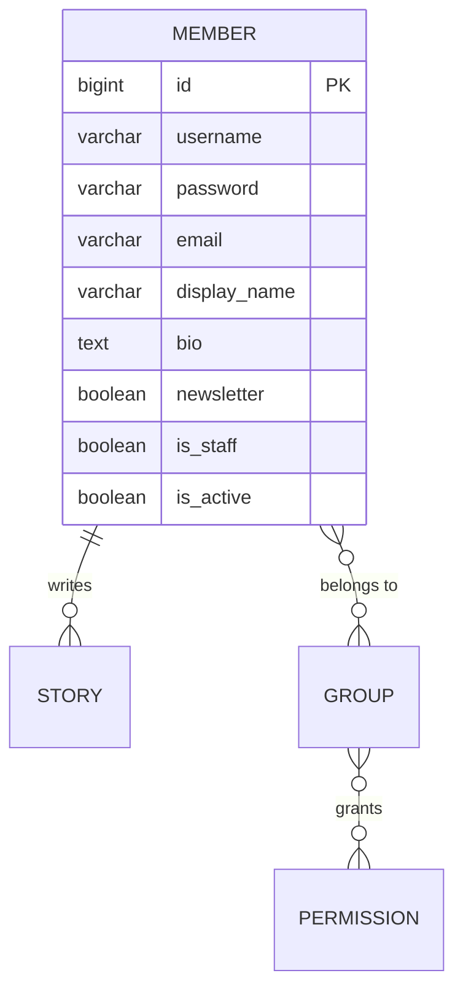

# A custom user model: why and how

> **Before this lesson:** you know the built-in `User` model, `get_user_model()` and how login works ([The auth app: users, passwords and sessions](#/lesson/django/auth-app), [Login, logout and sign-up views](#/lesson/django/login-logout-signup)), and you can define models with foreign keys and run migrations ([Foreign keys, detail views and slugs](#/lesson/django/fk-detail-slugs)).

## In plain words

Django's built-in `User` has a fixed set of columns: username, e-mail, first and last name, password, a few flags. Sooner or later every real project wants something else: a display name, a newsletter preference, logging in with an e-mail address instead of a username.

A **custom user model** is your own user class, which Django then uses everywhere in place of the built-in one. You declare it once in the settings, and the admin, the login views, permissions and foreign keys all follow.

The awkward part is timing. The user table sits at the centre of the database: many other tables point at it. Replacing it after those tables exist is like replacing a building's foundation once the walls are up. Possible, but nobody enjoys it. Declaring your own user model **before the very first migration** costs ten lines and five minutes, even if the class is empty to begin with.

An everyday picture: laying empty cable conduits while the house is being built. You may not need them now. Opening the walls later costs a hundred times more.

Why it matters for a job: Django's own documentation says that starting a project with a custom user model is "highly recommended", and experienced reviewers check for it. "Why would you use a custom user model, and when must it be set up?" is a standard interview question with a crisp expected answer.

## The example for the next modules

This and the following modules build one project: a small online newspaper called the *Harbour Gazette*, where members write stories and reply to them. Begin with an empty folder, an active virtual environment and Django installed:

```bash
django-admin startproject config .
python manage.py startapp accounts
```

**Do not run `migrate` yet.** That is the whole point of this lesson.

## Three ways to extend users

| Approach | What it is | Choose it when |
|---|---|---|
| Subclass `AbstractUser` | your model = the built-in user's fields and behaviour + your additions | almost always; the default recommendation |
| Subclass `AbstractBaseUser` | only password and last-login handling; you define every other field and a manager | the built-in fields do not suit you at all (for example no username, no names) |
| A profile model with `OneToOneField` | a second table holding extra data, one row per user | the data is optional, belongs to one app, or the project already has users and cannot switch |

An **abstract** model is a model class that has no table of its own; it exists only to be inherited from. `AbstractUser` is the complete built-in user in abstract form, and the built-in `User` is nothing more than an empty subclass of it. Subclassing it therefore gives you an exact copy that you own.

## Step 1: the smallest custom user

```python
# accounts/models.py
from django.contrib.auth.models import AbstractUser


class Member(AbstractUser):
    pass
```

`pass` means "nothing to add yet". This model already has every field and method of the built-in user. Its value is that the table now belongs to *your* app (`accounts_member`), so adding a column next month is an ordinary migration.

## Step 2: tell Django

```python
# config/settings.py
INSTALLED_APPS = [
    "django.contrib.admin",
    "django.contrib.auth",
    "django.contrib.contenttypes",
    "django.contrib.sessions",
    "django.contrib.messages",
    "django.contrib.staticfiles",
    "accounts",
]

AUTH_USER_MODEL = "accounts.Member"
```

`AUTH_USER_MODEL` is written as `"<app label>.<ModelName>"`, a string, not an import. From now on `get_user_model()` returns `Member`, and the built-in `auth.User` model is **swapped out**: Django does not create a table for it.

Now, and only now, create the database:

```bash
python manage.py makemigrations accounts
python manage.py migrate
python manage.py createsuperuser
```

The first migration of `accounts` creates the member table, and the built-in apps' migrations (admin log entries, sessions, permissions) are created pointing at it.

## Why the order matters: how the swap works

Other models refer to the user by the setting's *name*. When Django builds migrations, it resolves that name to a concrete table. Once a migration has run with one answer, the database contains foreign keys to that table, and changing the setting afterwards leaves those keys pointing at the old table. The model below shows the resolution step and what goes wrong when the setting changes midway.

```python-run
# A toy model of a "swappable" user model.
settings = {"AUTH_USER_MODEL": "auth.User"}

database = {"tables": [], "foreign_keys": []}

def get_user_model_name():
    return settings["AUTH_USER_MODEL"]

def table_for(model_name):
    app, model = model_name.split(".")
    return f"{app}_{model.lower()}"

def migrate(app, models_with_user_fk):
    """Create the user table (once) and tables whose foreign keys point at it."""
    user_table = table_for(get_user_model_name())
    if user_table not in database["tables"]:
        database["tables"].append(user_table)
    for model in models_with_user_fk:
        database["tables"].append(f"{app}_{model}")
        database["foreign_keys"].append((f"{app}_{model}.author_id", "->", user_table))

# Scenario: a team migrates first and changes its mind later.
migrate("stories", ["story"])                       # built with the default user
settings["AUTH_USER_MODEL"] = "accounts.Member"     # the late decision
migrate("replies", ["reply"])

for fk in database["foreign_keys"]:
    print(*fk)
print("user tables in the database:", [t for t in database["tables"] if t in ("auth_user", "accounts_member")])
```

The output shows two user tables and foreign keys pointing at different ones: stories belong to rows in `auth_user`, replies to rows in `accounts_member`. Real Django refuses to get this far and stops with errors such as `InconsistentMigrationHistory`, but the repair (moving the data and rewriting migration history) is real work. Setting `AUTH_USER_MODEL` first makes the problem impossible.

> [!WARNING]
> If a project has already run `migrate` with the default user and contains data you need, do not change `AUTH_USER_MODEL` casually. On a brand-new learning project with nothing to lose, the pragmatic fix is to delete `db.sqlite3` and the numbered files in each of your own apps' `migrations` folders (keep `__init__.py`), then run `makemigrations` and `migrate` again. On a project with real data, follow the documented multi-step procedure or add a profile model instead.

## Step 3: add your own fields

```python
# accounts/models.py
from django.contrib.auth.models import AbstractUser
from django.db import models


class Member(AbstractUser):
    display_name = models.CharField(max_length=60, blank=True)
    bio = models.TextField(blank=True)
    newsletter = models.BooleanField(default=False)
    email = models.EmailField("email address", unique=True)

    def __str__(self):
        return self.display_name or self.username

    @property
    def is_columnist(self):
        return self.groups.filter(name="columnists").exists()
```

- `display_name`, `bio` and `newsletter` are new columns. The text fields use `blank=True` so that existing forms keep working, and the boolean has a default.
- `email` **re-declares** an inherited field in order to add `unique=True`. The first argument is the human-readable label. A unique e-mail is required for password reset to be unambiguous and for e-mail login.
- `__str__` decides how a member appears in drop-downs and the admin.
- `is_columnist` is a **property**: a method that is read like an attribute (`member.is_columnist`). It asks whether the member belongs to a group, a first taste of authorisation.

```bash
python manage.py makemigrations accounts
python manage.py migrate
```

Because the table belongs to your app, this is a normal, small migration.



## Step 4: refer to the user model correctly

Three situations, three spellings. Getting them right is what makes the swap invisible to the rest of the code.

```python
# 1. In model fields: the setting, as a string
from django.conf import settings
from django.db import models


class Story(models.Model):
    author = models.ForeignKey(settings.AUTH_USER_MODEL, on_delete=models.CASCADE, related_name="stories")
```

```python
# 2. In code that runs after start-up (views, forms, tests): the function
from django.contrib.auth import get_user_model

Member = get_user_model()
Member.objects.filter(newsletter=True)
```

```python
# 3. Inside the accounts app itself you may import the class directly
from accounts.models import Member
```

Why two forms? A model field is evaluated while Django is still loading models, when the user class may not exist yet; a string is resolved later. `get_user_model()` returns the real class and is safe once all apps are loaded, which is always the case inside a view or test.

## Optional: logging in with an e-mail address

Many sites have no usernames. With `AbstractUser` this needs three changes and a small manager, because the built-in `create_user` insists on a username.

```python
# accounts/models.py  (alternative design)
from django.contrib.auth.models import AbstractUser, BaseUserManager
from django.db import models


class MemberManager(BaseUserManager):
    use_in_migrations = True

    def create_user(self, email, password=None, **extra):
        if not email:
            raise ValueError("An e-mail address is required")
        user = self.model(email=self.normalize_email(email), **extra)
        user.set_password(password)
        user.save(using=self._db)
        return user

    def create_superuser(self, email, password=None, **extra):
        extra.setdefault("is_staff", True)
        extra.setdefault("is_superuser", True)
        return self.create_user(email, password, **extra)


class Member(AbstractUser):
    username = None                                  # remove the inherited column
    email = models.EmailField("email address", unique=True)

    USERNAME_FIELD = "email"                         # the field used to log in
    REQUIRED_FIELDS = []                             # extra prompts for createsuperuser

    objects = MemberManager()
```

- A **manager** is the object behind `Member.objects`. `BaseUserManager` supplies helpers such as `normalize_email`, which lower-cases the domain part of an address.
- `username = None` deletes the inherited field.
- `USERNAME_FIELD` names the unique field that identifies a user at login. The login form's first box still posts a value called `username`; Django matches it against this field.
- `REQUIRED_FIELDS` lists additional fields `createsuperuser` must ask for; the username field and password are always asked.

Decide between username login and e-mail login at the start, for the same reason as everything else in this lesson. The rest of this track keeps usernames, with a unique e-mail, to stay close to the built-in forms.

## The profile alternative

When a project already has users, or when extra data belongs to one feature only, a separate table linked one-to-one is the safer tool:

```python
# profiles/models.py
from django.conf import settings
from django.db import models


class Profile(models.Model):
    user = models.OneToOneField(settings.AUTH_USER_MODEL, on_delete=models.CASCADE, related_name="profile")
    hometown = models.CharField(max_length=80, blank=True)
    avatar = models.ImageField(upload_to="avatars/", blank=True)
```

A `OneToOneField` is a foreign key with a uniqueness rule: each user has at most one profile, reached as `user.profile`. The costs: an extra query (or join) whenever profile data is needed, and you must create the profile row yourself, typically when the user signs up. Both approaches can coexist: a custom user for identity data, profiles for feature data.

## Tests

```python
# accounts/tests.py
from django.contrib.auth import get_user_model
from django.db import IntegrityError
from django.test import TestCase


class MemberModelTests(TestCase):
    def test_user_model_is_member(self):
        self.assertEqual(get_user_model()._meta.label, "accounts.Member")

    def test_create_user(self):
        member = get_user_model().objects.create_user(
            username="marisol", email="marisol@gazette.example", password="tide-chart-88")
        self.assertTrue(member.check_password("tide-chart-88"))
        self.assertFalse(member.is_staff)
        self.assertFalse(member.newsletter)
        self.assertEqual(str(member), "marisol")

    def test_display_name_is_preferred(self):
        member = get_user_model().objects.create_user(
            username="marisol", email="m@gazette.example", password="x", display_name="Marisol R.")
        self.assertEqual(str(member), "Marisol R.")

    def test_email_must_be_unique(self):
        Member = get_user_model()
        Member.objects.create_user(username="a", email="same@gazette.example", password="x")
        with self.assertRaises(IntegrityError):
            Member.objects.create_user(username="b", email="same@gazette.example", password="x")

    def test_create_superuser(self):
        admin = get_user_model().objects.create_superuser(
            username="chief", email="chief@gazette.example", password="tide-chart-89")
        self.assertTrue(admin.is_staff and admin.is_superuser)
```

`_meta.label` is the `"app.Model"` name of a model class; the first test fails loudly if someone removes the setting.

> [!NOTE]
> **What changed since the book.** The book's custom user is called `CustomUser` and adds an `age` field, the classic tutorial example; the mechanics are identical. Since Django 3.2 automatic keys are 64-bit, so the member table's `id` is a `BigAutoField`. The advice itself has not changed in a decade: the official documentation still recommends a custom user model for every new project.

> [!INTERVIEW]
> **"Why and when would you define a custom user model?"** Why: requirements for the user table always change (extra fields, e-mail as the login identifier), and owning the model turns those changes into ordinary migrations. When: before the first `migrate`, because `AUTH_USER_MODEL` is baked into the initial migrations and foreign keys of other apps; changing it later requires a manual data and schema migration. How: subclass `AbstractUser` for "built-in plus extras", `AbstractBaseUser` (with `USERNAME_FIELD`, `REQUIRED_FIELDS` and a manager) for full control, or use a `OneToOneField` profile when the user table cannot be replaced. Refer to it as `settings.AUTH_USER_MODEL` in models and `get_user_model()` in code.

> [!TIP]
> Keep the user model small. It is loaded on every authenticated request. Columns that most pages never use, such as long biographies, preferences or statistics, are better placed in a profile or a dedicated model.

## Pitfalls

- **Running `migrate` before setting `AUTH_USER_MODEL`.** The most expensive beginner mistake in Django.
- **`AUTH_USER_MODEL = "accounts.models.Member"`.** The format is `app_label.ModelName`, without `models`.
- **App not in `INSTALLED_APPS`.** `ImproperlyConfigured: AUTH_USER_MODEL refers to model 'accounts.Member' that has not been installed`.
- **`from django.contrib.auth.models import User` anywhere.** With a swapped model, using it raises `AttributeError: Manager isn't available; 'auth.User' has been swapped`.
- **Adding a required field without a default.** `createsuperuser` and existing forms break; use `blank=True`, a default, or add it to `REQUIRED_FIELDS`.
- **Forgetting the admin and forms.** The custom model does not appear in the admin, and `UserCreationForm` still points at the old model. The next lesson fixes both.
- **Calling `get_user_model()` at import time in `models.py`.** Use the setting string in fields.

## Cheat sheet

| Need | Code |
|---|---|
| Custom user, built-in fields | `class Member(AbstractUser): pass` |
| Activate it | `AUTH_USER_MODEL = "accounts.Member"` before the first `migrate` |
| Foreign key to users | `models.ForeignKey(settings.AUTH_USER_MODEL, on_delete=...)` |
| The class in code | `get_user_model()` |
| Unique e-mail | re-declare `email = models.EmailField(unique=True)` |
| E-mail login | `username = None`, `USERNAME_FIELD = "email"`, custom manager |
| Extra data, existing project | `OneToOneField` profile model |
| Check which model is active | `get_user_model()._meta.label` |

## Summary

- A custom user model is your own class used wherever Django needs "the user"; subclassing `AbstractUser` gives the built-in behaviour plus room to grow.
- Set `AUTH_USER_MODEL = "accounts.Member"` and create the model **before the first migration**; other tables' foreign keys are built from it.
- Refer to users with `settings.AUTH_USER_MODEL` in model fields and `get_user_model()` elsewhere; never import `auth.User`.
- E-mail login needs `USERNAME_FIELD` and a manager; a `OneToOneField` profile is the alternative when the user table cannot change.
- The admin and the sign-up forms still need to be pointed at the new model, which is the next lesson.

## Glossary

- **Custom user model**: a project-defined model that replaces Django's built-in `User`.
- **Abstract model**: a model class without a table, meant to be inherited from.
- **`AbstractUser`**: the full built-in user as an abstract class.
- **`AbstractBaseUser`**: a minimal abstract user with only password and last-login logic.
- **`AUTH_USER_MODEL`**: the setting naming the active user model as `"app.Model"`.
- **Swappable model**: a model that a setting can replace with another.
- **Manager**: the object (`Model.objects`) providing query and creation methods.
- **`USERNAME_FIELD`**: the unique field used as the login identifier.
- **`OneToOneField`**: a relationship in which each row matches at most one row of another table.
- **Profile model**: a separate table holding extra per-user data.
- **Property**: a method accessed like an attribute.

```quiz
[
  {"q": "When must AUTH_USER_MODEL be set?",
   "options": ["Any time; it has no effect on the database", "Before the first migrate, because other tables' foreign keys are created from it", "Only after creating a superuser", "After deploying to production"],
   "answer": 1,
   "explain": "Initial migrations of admin, auth-related tables and your own apps reference the user table. Changing the setting afterwards leaves them pointing at the wrong table."},
  {"q": "What is the correct value for a model Member in the app accounts?",
   "options": ["'accounts.models.Member'", "'accounts.Member'", "'Member'", "accounts.models.Member (the class itself)"],
   "answer": 1,
   "explain": "The setting is a string in the form app_label.ModelName."},
  {"q": "Why subclass AbstractUser with an empty body (`pass`)?",
   "options": ["It makes logins faster", "It gives you a user table you own, so later changes are ordinary migrations", "It removes the password field", "It disables the admin"],
   "answer": 1,
   "explain": "The class is identical to the built-in user today, but it lives in your app and can gain fields at any time."},
  {"q": "How should a ForeignKey to the user model be declared?",
   "options": ["ForeignKey(User, ...) after importing auth.User", "ForeignKey(settings.AUTH_USER_MODEL, ...)", "ForeignKey(get_user_model(), ...) is the only valid form", "ForeignKey('User', ...)"],
   "answer": 1,
   "explain": "The setting string is resolved lazily, which works while models are still loading and follows whichever model is active."},
  {"q": "When is AbstractBaseUser a better base class than AbstractUser?",
   "options": ["Always", "When you want to design every field yourself, for example a user without username and name fields", "When you only add one field", "When the project has no admin"],
   "answer": 1,
   "explain": "AbstractBaseUser provides only password and last-login handling; you add the identifier field, USERNAME_FIELD and a manager."},
  {"q": "What does USERNAME_FIELD = 'email' change?",
   "options": ["It renames the database table", "The unique field used to identify the user at login becomes email", "It sends an e-mail at login", "It makes e-mail optional"],
   "answer": 1,
   "explain": "authenticate() matches the submitted identifier against USERNAME_FIELD."},
  {"q": "A project with real users on the default User model needs a 'hometown' field. What is the safest approach?",
   "options": ["Change AUTH_USER_MODEL and migrate", "Add a Profile model with a OneToOneField to the user", "Edit Django's source code", "Delete the database"],
   "answer": 1,
   "explain": "A profile adds data without replacing the user table. Swapping the user model mid-project is a complex migration."},
  {"q": "What happens if code imports django.contrib.auth.models.User and queries it in a project with a custom user model?",
   "options": ["It works and returns members", "It raises an error because auth.User has been swapped out", "It creates a second user table silently", "It returns an empty list"],
   "answer": 1,
   "explain": "The swapped model has no usable manager: \"Manager isn't available; 'auth.User' has been swapped\". Use get_user_model()."}
]
```

> **Source:** Vincent, *Django for Beginners*, ch. 8 (Custom User Model). Docs: https://docs.djangoproject.com/en/5.2/topics/auth/customizing/#substituting-a-custom-user-model · https://docs.djangoproject.com/en/5.2/topics/auth/customizing/#using-a-custom-user-model-when-starting-a-project · https://docs.djangoproject.com/en/5.2/ref/settings/#auth-user-model
