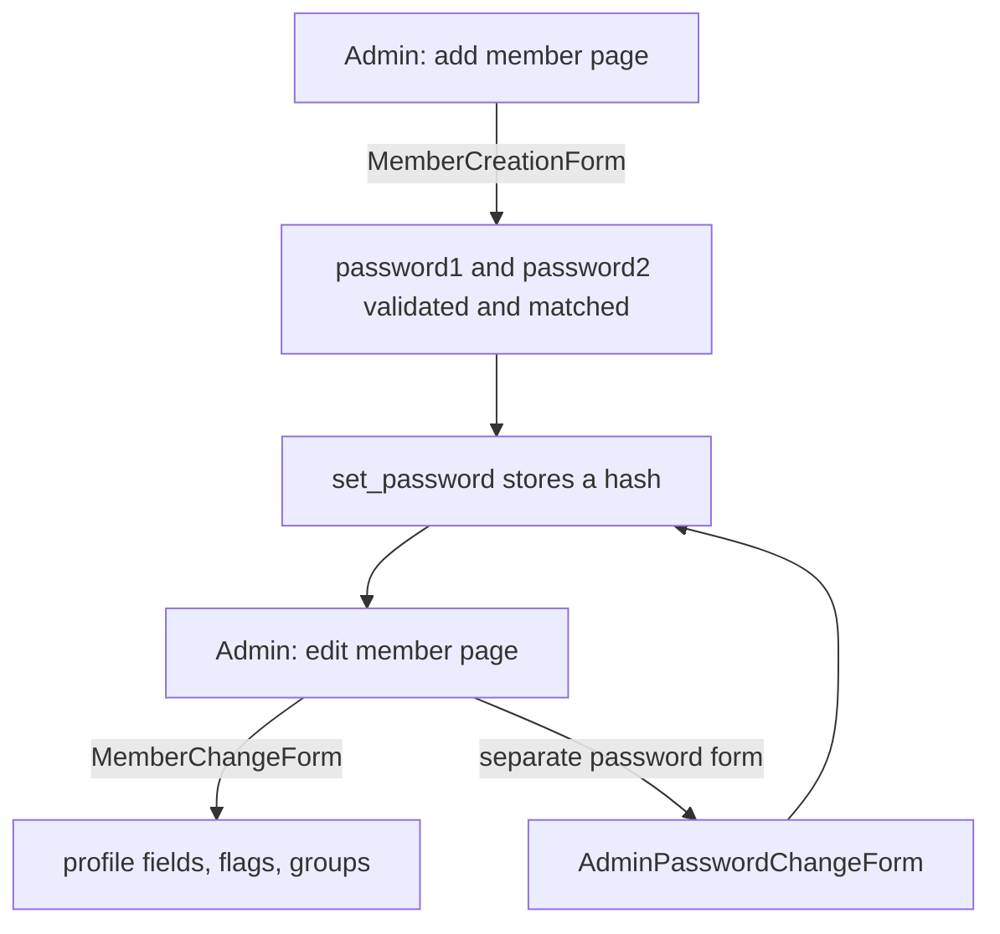

# Custom user forms and admin integration

> **Before this lesson:** the `gazette` project has a custom user model `accounts.Member` with `display_name`, `bio`, `newsletter` and a unique `email`, activated through `AUTH_USER_MODEL` ([A custom user model: why and how](#/lesson/django/custom-user-why-how)). You know ModelForms ([Forms, ModelForm, validation and CSRF](#/lesson/django/forms-validation-csrf)) and the `ModelAdmin` class ([Models, migrations and the admin](#/lesson/django/models-migrations-admin)).

## In plain words

Replacing the user model is like changing the standard paper size in an office. The paper is the easy part. Afterwards every printer tray and every pre-printed form has to be adjusted to the new size, or things jam.

In Django, the "printer trays" are:

- the **forms** that create and edit users (used by sign-up pages and by the admin), which are still wired to the old built-in model;
- the **admin screen** for users, which does not know your model exists, and would mishandle passwords if you registered it the naive way.

This lesson adjusts both. It is short on new theory and long on getting details right, because these details decide whether passwords end up hashed or in plain text.

Why it matters for a job: staff members manage accounts through the admin every day, so a broken or unsafe user admin is noticed at once. In interviews, "how do you register a custom user model in the admin?" separates people who have done it from people who have read about it.

## What goes wrong without this lesson

Open the admin of the `gazette` project now: there is no "Members" section at all. Suppose you register the model the way you would register any other:

```python
# accounts/admin.py  (the naive version; do NOT keep this)
from django.contrib import admin

from .models import Member

admin.site.register(Member)
```

The members appear, and the edit form shows a text box labelled "Password" containing the stored hash. If a staff member types a new password into that box and saves, the literal text is written into the column. It is not hashed, so the account can no longer log in, and a plain-text password now sits in your database. A plain `ModelAdmin` treats `password` as an ordinary text column.

Django's built-in `UserAdmin` class exists to prevent exactly this: it uses special forms, a read-only display of the hash, and a separate "change password" page. The task is to reuse `UserAdmin` and teach it about the new fields.

## Step 1: forms that point at the new model

Django's two user forms are `UserCreationForm` (username plus a password typed twice) and `UserChangeForm` (all editable fields, with the password shown as a read-only summary). Both are ModelForms whose `Meta.model` is the built-in `User`. Subclass them and redirect `Meta`:

```python
# accounts/forms.py  (new file)
from django.contrib.auth import get_user_model
from django.contrib.auth.forms import UserChangeForm, UserCreationForm


class MemberCreationForm(UserCreationForm):
    class Meta(UserCreationForm.Meta):
        model = get_user_model()
        fields = ("username", "email", "display_name")


class MemberChangeForm(UserChangeForm):
    class Meta(UserChangeForm.Meta):
        model = get_user_model()
        fields = ("username", "email", "display_name", "bio", "newsletter")
```

Line by line:

- `class Meta(UserCreationForm.Meta):` makes the inner class **inherit** from the parent form's `Meta`, so everything not overridden (such as special field classes) is kept.
- `model = get_user_model()` points the form at `Member`.
- `fields` lists the model fields shown. The two password boxes of the creation form (`password1`, `password2`) are declared on the form class itself, not on the model, so they are always present and are **not** listed here. Never add `"password"` to `fields`; that is the raw hash column.

What you get for free from the parent classes: the two passwords must match, they pass through `AUTH_PASSWORD_VALIDATORS`, and `save()` calls `set_password`, so only a hash is stored.

### The sign-up page with the new form

```python
# accounts/views.py
from django.contrib.auth import login
from django.urls import reverse_lazy
from django.views.generic import CreateView

from .forms import MemberCreationForm


class SignUpView(CreateView):
    form_class = MemberCreationForm
    template_name = "registration/signup.html"
    success_url = reverse_lazy("home")

    def form_valid(self, form):
        response = super().form_valid(form)
        login(self.request, self.object)
        return response
```

This is the view from the lesson on sign-up with one line changed: `form_class`. The sign-up page now asks for an e-mail address and a display name as well, and refuses an e-mail that is already registered, because the model field is unique.

## Step 2: the admin class

```python
# accounts/admin.py
from django.contrib import admin
from django.contrib.auth.admin import UserAdmin

from .forms import MemberChangeForm, MemberCreationForm
from .models import Member


@admin.register(Member)
class MemberAdmin(UserAdmin):
    add_form = MemberCreationForm
    form = MemberChangeForm
    model = Member

    list_display = ["username", "email", "display_name", "newsletter", "is_staff"]
    list_filter = ["is_staff", "is_active", "newsletter", "groups"]
    search_fields = ["username", "email", "display_name"]
    ordering = ["username"]

    fieldsets = UserAdmin.fieldsets + (
        ("Gazette profile", {"fields": ("display_name", "bio", "newsletter")}),
    )
    add_fieldsets = UserAdmin.add_fieldsets + (
        ("Gazette profile", {"fields": ("email", "display_name")}),
    )
```

- `class MemberAdmin(UserAdmin)` inherits the complete, safe user administration.
- `add_form` is the form on the "add member" page; `form` is the form on the edit page. The user admin uses two different forms because creating needs two password boxes while editing must not expose the password.
- `list_display`, `list_filter`, `search_fields` and `ordering` configure the list page, as for any `ModelAdmin`.
- `fieldsets` and `add_fieldsets` need a longer explanation.

### Fieldsets

A **fieldset** is a titled group of fields on an admin form. `fieldsets` is a tuple of pairs `(title, options)`, where `options` is a dictionary with a `"fields"` entry. `UserAdmin.fieldsets` already contains four groups:

```python
(
    (None, {"fields": ("username", "password")}),
    ("Personal info", {"fields": ("first_name", "last_name", "email")}),
    ("Permissions", {"fields": ("is_active", "is_staff", "is_superuser", "groups", "user_permissions")}),
    ("Important dates", {"fields": ("last_login", "date_joined")}),
)
```

`UserAdmin.fieldsets + (...)` joins the inherited tuple with a new tuple containing one more group. This is the reason for the odd-looking trailing comma: `(x,)` is a one-element tuple, whereas `(x)` is `x` in parentheses, and adding that to a tuple of groups would be an error.

`add_fieldsets` is the same idea for the "add" page, which by default shows only `username` and the two password boxes.

The model below performs that tuple arithmetic and prints the resulting page layout, including the classic mistake of listing a field twice.

```python-run
BASE_FIELDSETS = (
    (None, {"fields": ("username", "password")}),
    ("Personal info", {"fields": ("first_name", "last_name", "email")}),
    ("Permissions", {"fields": ("is_active", "is_staff", "is_superuser", "groups")}),
)

def describe(fieldsets):
    seen, problems = set(), []
    for title, options in fieldsets:
        print(f"[{title or 'main'}]")
        for field in options["fields"]:
            print("   -", field)
            if field in seen:
                problems.append(field)
            seen.add(field)
    return problems

good = BASE_FIELDSETS + (
    ("Gazette profile", {"fields": ("display_name", "bio", "newsletter")}),
)
print("duplicates:", describe(good))

print()
bad = BASE_FIELDSETS + (
    ("Gazette profile", {"fields": ("email", "display_name")}),   # email is already in "Personal info"
)
print("duplicates:", describe(bad))

one_element_tuple = (("Gazette profile", {"fields": ("bio",)}),)
not_a_tuple_of_groups = (("Gazette profile", {"fields": ("bio",)}))
print(len(one_element_tuple), "group  vs ", len(not_a_tuple_of_groups), "items (title and options) without the comma")
```

Django rejects the second layout at start-up with the system check `admin.E012` ("There are duplicate field(s) in 'fieldsets'"). That is why `email` is added to `add_fieldsets` (where it is not yet present) but not to `fieldsets` (where "Personal info" already has it).

## Step 3: try it

Run the server and open `/admin/`:

1. **Members list.** Columns show username, e-mail, display name, newsletter flag and staff flag; the sidebar filters by staff status and group; the search box searches three columns.
2. **Add member.** Username, two password boxes, then the "Gazette profile" group with e-mail and display name. Saving takes you to the full edit page.
3. **Edit member.** The password line reads something like "algorithm: pbkdf2_sha256 iterations: 1000000 salt: Zq3********* hash: wJt8*********" together with a link or button to a separate form for setting a new password. Nobody, not even a superuser, can read a member's password; they can only replace it.



## Staff, superuser, active: the three flags

The edit page has three checkboxes that are often confused:

| Flag | Meaning | Typical holder |
|---|---|---|
| `is_active` | the account may log in at all; untick to disable an account without deleting its content | everyone, until they leave |
| `is_staff` | may log in to the admin site (and sees only what their permissions allow) | editors, support staff |
| `is_superuser` | passes every permission check automatically | one or two administrators |

A staff member with no permissions can log in to the admin and sees an empty page saying they have no permission to view or edit anything. Permissions are assigned individually or, better, through **groups**: create a group "editors", give the group its permissions once, and add members to it. The lesson on permissions builds on this.

> [!WARNING]
> Prefer `is_active = False` over deleting a member. Deletion triggers every `on_delete` rule: with `CASCADE` on `Story.author`, removing a spam account would also remove everything they wrote, and anything pointing at that. Deactivation blocks login and keeps the history intact.

## A profile page for members themselves

Members should not need the admin to edit their own profile. An `UpdateView` over the logged-in user needs no primary key in the URL:

```python
# accounts/views.py
from django.contrib.auth.mixins import LoginRequiredMixin
from django.contrib.messages.views import SuccessMessageMixin
from django.views.generic import UpdateView

from .models import Member


class ProfileUpdateView(LoginRequiredMixin, SuccessMessageMixin, UpdateView):
    model = Member
    fields = ["display_name", "bio", "newsletter"]
    template_name = "accounts/profile_form.html"
    success_url = reverse_lazy("profile")
    success_message = "Profile saved."

    def get_object(self, queryset=None):
        return self.request.user
```

`get_object` normally reads a `pk` or `slug` from the URL. Overriding it to return `self.request.user` means "the object being edited is always the person asking". There is no identifier in the address for anyone to tamper with, which removes a whole category of access-control bugs. Route it with `path("profile/", ProfileUpdateView.as_view(), name="profile")`.

The `fields` list is the security boundary here. It names three harmless fields. Had it been `"__all__"`, any member could tick `is_superuser` on their own account by adding a field to the posted form.

## Tests

```python
# accounts/test_admin_forms.py
from django.contrib.auth import get_user_model
from django.test import TestCase
from django.urls import reverse

from .forms import MemberCreationForm


class MemberCreationFormTests(TestCase):
    def test_valid_form_hashes_password(self):
        form = MemberCreationForm({"username": "marisol", "email": "marisol@gazette.example",
                                   "display_name": "Marisol", "password1": "tide-chart-88",
                                   "password2": "tide-chart-88"})
        self.assertTrue(form.is_valid(), form.errors)
        member = form.save()
        self.assertNotEqual(member.password, "tide-chart-88")
        self.assertTrue(member.check_password("tide-chart-88"))

    def test_mismatched_passwords(self):
        form = MemberCreationForm({"username": "marisol", "email": "m@gazette.example",
                                   "password1": "tide-chart-88", "password2": "tide-chart-89"})
        self.assertFalse(form.is_valid())
        self.assertIn("password2", form.errors)

    def test_duplicate_email_rejected(self):
        get_user_model().objects.create_user("first", email="same@gazette.example", password="x")
        form = MemberCreationForm({"username": "second", "email": "same@gazette.example",
                                   "password1": "tide-chart-88", "password2": "tide-chart-88"})
        self.assertFalse(form.is_valid())
        self.assertIn("email", form.errors)


class MemberAdminTests(TestCase):
    @classmethod
    def setUpTestData(cls):
        cls.chief = get_user_model().objects.create_superuser("chief", "chief@gazette.example", "tide-chart-89")

    def setUp(self):
        self.client.force_login(self.chief)

    def test_changelist_loads(self):
        response = self.client.get(reverse("admin:accounts_member_changelist"))
        self.assertContains(response, "chief@gazette.example")

    def test_add_page_has_profile_fields(self):
        response = self.client.get(reverse("admin:accounts_member_add"))
        self.assertContains(response, 'name="display_name"')
        self.assertContains(response, 'name="password2"')

    def test_change_page_does_not_offer_raw_password_input(self):
        response = self.client.get(reverse("admin:accounts_member_change", args=[self.chief.pk]))
        self.assertEqual(response.status_code, 200)
        self.assertNotContains(response, 'type="password" name="password"')


class ProfileTests(TestCase):
    def test_member_cannot_promote_themselves(self):
        member = get_user_model().objects.create_user("marisol", email="m@gazette.example", password="x")
        self.client.force_login(member)
        self.client.post(reverse("profile"), {"display_name": "M", "bio": "", "is_superuser": "on"})
        member.refresh_from_db()
        self.assertFalse(member.is_superuser)
        self.assertEqual(member.display_name, "M")
```

Admin pages have URL names of the form `admin:<app>_<model>_<action>`, where the action is `changelist`, `add`, `change` or `delete`. The final test documents the mass-assignment defence: an extra posted field that is not in the form's `fields` is ignored. `refresh_from_db()` reloads the object so the assertion sees what the database holds.

> [!NOTE]
> **What changed since the book.** The book's version of this chapter subclasses the two forms exactly as shown here; that pattern is unchanged. Details differ: Django 4.2 introduced `BaseUserCreationForm` (the old form without the case-insensitive username uniqueness check), the edit page's password display became a button to the password form in 5.1, and since 5.1 the admin's "add user" form has an option to create accounts with an unusable password for single sign-on setups.

> [!INTERVIEW]
> **"How do you integrate a custom user model with the admin?"** Subclass `UserAdmin`, not `ModelAdmin`, so that password handling stays correct (creation form with confirmation and validators, read-only hash display, separate password-change form). Set `add_form` and `form` to subclasses of `UserCreationForm` and `UserChangeForm` whose `Meta.model` is the custom model, and extend `fieldsets` and `add_fieldsets` with the new fields. If the model was built on `AbstractBaseUser` without the standard fields, the fieldsets, `list_display`, `ordering` and `search_fields` must be rewritten to avoid referring to fields that no longer exist.

> [!TIP]
> Harden the admin of a deployed site in three cheap steps: serve it under a less guessable path than `/admin/` (change the `path()` in `config/urls.py`), give `is_staff` only to people who need it, and add a second login factor with a package such as `django-otp`.

## Pitfalls

- **`admin.site.register(Member)` without `UserAdmin`.** Staff can overwrite the hash with plain text.
- **Missing trailing comma in `fieldsets` additions.** `TypeError` or a garbled layout; `((title, options),)` is a one-element tuple.
- **Listing a field in two fieldsets.** System check `admin.E012`.
- **Adding `"password"` to a form's `fields`.** Exposes the raw column.
- **Forgetting `add_fieldsets`.** New required fields (such as a unique e-mail) are absent from the add page, and saving fails or stores blanks.
- **Referring to removed fields.** With `username = None`, the inherited `ordering = ("username",)` and fieldsets break; redefine them.
- **Using the stock `UserCreationForm` on the sign-up page.** It is bound to `auth.User` and raises an error with a swapped model.
- **`fields = "__all__"` on a self-service profile form.** Privilege escalation through `is_staff` or `is_superuser`.

## Cheat sheet

| Need | Code |
|---|---|
| Creation form | `class MemberCreationForm(UserCreationForm): class Meta(UserCreationForm.Meta): model = get_user_model(); fields = (...)` |
| Change form | same pattern with `UserChangeForm` |
| Admin class | `@admin.register(Member) class MemberAdmin(UserAdmin): add_form = ...; form = ...` |
| Extra fields on edit page | `fieldsets = UserAdmin.fieldsets + ((title, {"fields": (...)}),)` |
| Extra fields on add page | `add_fieldsets = UserAdmin.add_fieldsets + (...)` |
| Edit own profile | `UpdateView` with `get_object` returning `self.request.user` |
| Admin URL names | `admin:accounts_member_changelist`, `_add`, `_change`, `_delete` |
| Disable an account | `member.is_active = False; member.save()` |

## Summary

- After swapping the user model, point the user forms at it by subclassing `UserCreationForm` and `UserChangeForm` with a `Meta` that names the new model.
- Register the model with a subclass of `UserAdmin`; a plain `ModelAdmin` mishandles passwords.
- Extend `fieldsets` and `add_fieldsets` by tuple concatenation, without duplicating fields.
- `is_active`, `is_staff` and `is_superuser` control login, admin access and blanket permission respectively; deactivate instead of deleting.
- Self-service profile editing is an `UpdateView` on `request.user` with an explicit, minimal field list.

## Glossary

- **`UserAdmin`**: Django's admin class for user models, with safe password handling.
- **`add_form` / `form`**: the forms used by the admin's add page and change page.
- **Fieldset**: a titled group of fields on an admin form.
- **`add_fieldsets`**: the fieldsets used when creating a user in the admin.
- **`UserChangeForm`**: the ModelForm for editing a user, showing the password as read-only information.
- **System check**: an automatic start-up validation that reports configuration mistakes with identifiers such as `admin.E012`.
- **Staff**: users allowed to log in to the admin site.
- **Group**: a named collection of users that share permissions.
- **Privilege escalation**: gaining rights one should not have.
- **`refresh_from_db()`**: reload a model instance's fields from the database.

```quiz
[
  {"q": "Why is `admin.site.register(Member)` with a plain ModelAdmin unsafe for a user model?",
   "options": ["The model will not appear", "The password column is shown as an editable text box, so saving writes plain text instead of a hash", "It deletes existing users", "It disables login"],
   "answer": 1,
   "explain": "Only UserAdmin and its forms know that passwords must go through set_password and must not be editable as text."},
  {"q": "In `class Meta(UserCreationForm.Meta):`, why inherit from the parent's Meta?",
   "options": ["It is required syntax for all forms", "To keep the parent's Meta options and override only model and fields", "To create a new database table", "To skip validation"],
   "answer": 1,
   "explain": "Inheriting keeps settings such as field_classes for the username; you change only what differs."},
  {"q": "Why are password1 and password2 not listed in MemberCreationForm.Meta.fields?",
   "options": ["They are optional", "They are declared on the form class and are not model fields", "Django hides passwords automatically from all forms", "They are added by the template"],
   "answer": 1,
   "explain": "Meta.fields selects model fields. The two password inputs are extra form fields defined by UserCreationForm."},
  {"q": "What does `fieldsets = UserAdmin.fieldsets + ((\"Profile\", {\"fields\": (\"bio\",)}),)` do?",
   "options": ["Replaces all fieldsets with one", "Appends one new titled group to the inherited groups on the edit page", "Adds a database column", "Creates a new admin site"],
   "answer": 1,
   "explain": "Tuple concatenation keeps the built-in groups and adds a group containing bio."},
  {"q": "A staff user with is_staff=True and no permissions logs in to the admin. What do they see?",
   "options": ["Everything", "A page stating they have no permission to view or edit anything", "A 500 error", "The public home page"],
   "answer": 1,
   "explain": "is_staff only opens the door. What is visible is decided by model permissions, usually granted through groups."},
  {"q": "Why prefer setting is_active to False over deleting a member?",
   "options": ["Deleting is impossible", "Deletion triggers on_delete rules and may remove the member's content; deactivation blocks login and keeps history", "Inactive users use less storage", "It is faster"],
   "answer": 1,
   "explain": "With CASCADE foreign keys, deleting a user deletes what they authored. Deactivation is reversible and non-destructive."},
  {"q": "In ProfileUpdateView, what is the benefit of `get_object` returning self.request.user?",
   "options": ["It avoids a database query", "No identifier appears in the URL, so a user cannot edit someone else's profile by changing an id", "It makes the form load faster", "It logs the user in"],
   "answer": 1,
   "explain": "The edited object is derived from the session, not from user-controllable input."},
  {"q": "A member posts `is_superuser=on` to a profile form whose fields are display_name, bio and newsletter. What happens?",
   "options": ["They become a superuser", "The extra value is ignored because the field is not part of the form", "Django raises a 500 error", "The form is invalid"],
   "answer": 1,
   "explain": "A ModelForm only reads and saves the fields it declares. The explicit field list is the allow-list that prevents mass assignment."}
]
```

> **Source:** Vincent, *Django for Beginners*, ch. 8 (Custom User Model: forms and admin). Docs: https://docs.djangoproject.com/en/5.2/topics/auth/customizing/#custom-users-and-the-built-in-auth-forms · https://docs.djangoproject.com/en/5.2/topics/auth/customizing/#a-full-example · https://docs.djangoproject.com/en/5.2/ref/contrib/admin/#django.contrib.admin.ModelAdmin.fieldsets
