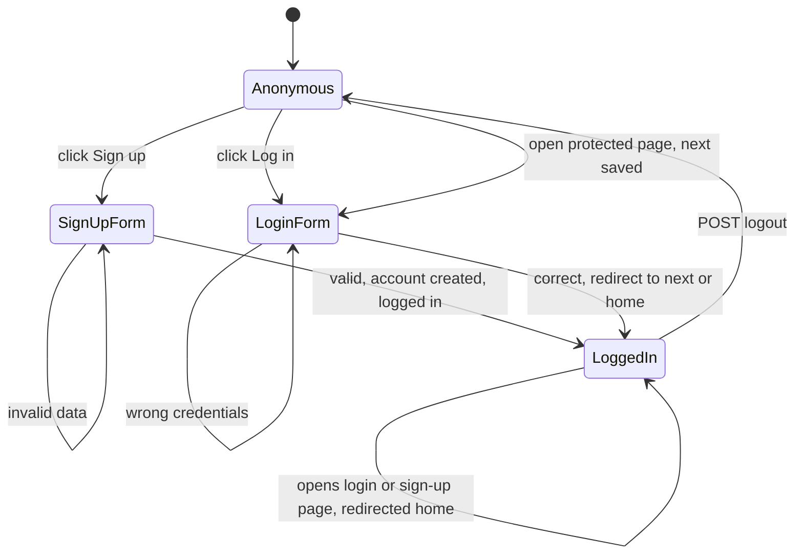

# Authentication flows end to end

> **Before this lesson:** the `gazette` project has the `Member` user model, its forms and its admin ([Custom user forms and admin integration](#/lesson/django/custom-user-admin)). You have already wired login, logout and sign-up once in another project ([Login, logout and sign-up views](#/lesson/django/login-logout-signup)) and understand sessions ([The auth app: users, passwords and sessions](#/lesson/django/auth-app)).

## In plain words

A **flow** is the sequence of pages and decisions a person passes through to get something done. "Sign up", "log in", "log out" and "I was sent to the login page, now take me back" are flows. Each is a small story with a beginning, some branches and an end.

Individual views are easy. Bugs live in the connections between them: the user who logs in and lands on a 404, the logged-in user who can still open the sign-up form, the login link that forgets where the user was going.

An everyday picture: an airport. Check-in, security and the gate each work on their own. The traveller's experience depends on the signs between them, and on what happens in the unusual cases: no boarding pass, wrong terminal, already through security.

This lesson assembles the complete set of account flows for the Gazette with the custom user model, then opens the box that sits underneath them all: **authentication backends**, the pluggable components that decide whether a username and password are correct. With that knowledge you add "log in with e-mail or username" and a "remember me" checkbox.

Why it matters for a job: account flows are the front door of every product, and their quality is what users and security reviewers judge first. Interview questions go straight to the internals: "what does `authenticate()` do?", "how would you let users log in with their e-mail address?".

## The flows as a map



Read it as a checklist. Every arrow is a behaviour you must implement **and** test. The last arrow is the one most sites forget.

## Step 1: a home for the flows to return to

The Gazette needs a landing page. A tiny `pages` app serves it:

```bash
python manage.py startapp pages
```

```python
# pages/views.py
from django.views.generic import TemplateView


class HomeView(TemplateView):
    template_name = "home.html"
```

```python
# pages/urls.py
from django.urls import path

from .views import HomeView

urlpatterns = [path("", HomeView.as_view(), name="home")]
```

Add `"pages"` to `INSTALLED_APPS`, and point `TEMPLATES["DIRS"]` at `BASE_DIR / "templates"`. Then the project URL table, in the order that lets your own account routes take precedence over the built-in ones:

```python
# config/urls.py
from django.contrib import admin
from django.urls import include, path

urlpatterns = [
    path("admin/", admin.site.urls),
    path("accounts/", include("accounts.urls")),
    path("accounts/", include("django.contrib.auth.urls")),
    path("", include("pages.urls")),
]
```

```python
# config/settings.py
LOGIN_URL = "login"
LOGIN_REDIRECT_URL = "home"
LOGOUT_REDIRECT_URL = "home"
```

## Step 2: views for each flow

```python
# accounts/views.py
from django.contrib.auth import login
from django.contrib.auth.views import LoginView
from django.shortcuts import redirect
from django.urls import reverse_lazy
from django.views.generic import CreateView

from .forms import MemberCreationForm


class SiteLoginView(LoginView):
    redirect_authenticated_user = True


class SignUpView(CreateView):
    form_class = MemberCreationForm
    template_name = "registration/signup.html"
    success_url = reverse_lazy("home")

    def dispatch(self, request, *args, **kwargs):
        if request.user.is_authenticated:
            return redirect("home")                  # members have no business signing up again
        return super().dispatch(request, *args, **kwargs)

    def form_valid(self, form):
        response = super().form_valid(form)
        login(self.request, self.object, backend="django.contrib.auth.backends.ModelBackend")
        return response
```

Three points:

- `SiteLoginView` subclasses the built-in view to change one attribute. `redirect_authenticated_user = True` sends someone who is already logged in to `LOGIN_REDIRECT_URL` instead of showing them a login form again.
- `dispatch` is the first method that runs for every request to a class-based view. Overriding it is the place for a check that applies to all HTTP methods. Here it implements the "already logged in" arrow for sign-up.
- `login(..., backend=...)` names the backend explicitly. When a project configures more than one authentication backend (step 5 does), `login()` must be told which one vouches for a user that did not come from `authenticate()`.

```python
# accounts/urls.py
from django.urls import path

from .views import SignUpView, SiteLoginView

urlpatterns = [
    path("login/", SiteLoginView.as_view(), name="login"),
    path("signup/", SignUpView.as_view(), name="signup"),
]
```

Because `accounts.urls` is included first, `accounts/login/` now resolves to `SiteLoginView`; logout and the password routes still come from Django's own module.

## Step 3: the templates

Three small templates complete the visible part. All extend a `base.html` with `title` and `content` blocks.

```html
<!-- templates/home.html -->


  <h1>Harbour Gazette</h1>
  
    <p>Welcome back, {{ user }}.</p>
  
    <p><a href="">Log in</a> or <a href="">become a member</a> to write stories.</p>
  

```

`{{ user }}` prints the member's `__str__`, which is the display name when set and the username otherwise.

```html
<!-- templates/registration/login.html -->

Log in

  <h1>Log in</h1>
  
    <p>Please log in to continue.</p>
  
  <form method="post">
    
    {{ form.as_div }}
    <input type="hidden" name="next" value="{{ next }}">
    <button type="submit">Log in</button>
  </form>
  <p><a href="">Forgotten your password?</a></p>

```

```html
<!-- templates/registration/signup.html -->

Become a member

  <h1>Become a member</h1>
  <form method="post">
    
    {{ form.as_div }}
    <button type="submit">Create account</button>
  </form>

```

The small `` message answers the visitor's unspoken question: "why am I suddenly on a login page?".

## Step 4: what `authenticate()` really does

Every login ends in one call: `authenticate(request, username=..., password=...)`. That function does not check anything itself. It walks the list in the `AUTHENTICATION_BACKENDS` setting and asks each **backend** in turn. A backend is a class with an `authenticate` method that returns a user object when it accepts the credentials and `None` when it does not. The first user returned wins; if all return `None`, the login fails.

The default list has one entry, `django.contrib.auth.backends.ModelBackend`, which looks up the row by `USERNAME_FIELD` and checks the password hash and `is_active`.

The model below is that loop, with two backends. Run it, then swap the order of the list, or try a wrong password.

```python-run
import hashlib

def hash_password(raw):                       # stand-in for Django's real hasher
    return hashlib.sha256(raw.encode()).hexdigest()

USERS = [
    {"id": 1, "username": "marisol", "email": "marisol@gazette.example",
     "password": hash_password("tide-chart-88"), "is_active": True},
    {"id": 2, "username": "old_account", "email": "old@gazette.example",
     "password": hash_password("tide-chart-89"), "is_active": False},
]

class ModelBackend:
    def authenticate(self, username, password):
        for user in USERS:
            if user["username"] == username and user["password"] == hash_password(password):
                return user if user["is_active"] else None
        return None

class EmailBackend:
    def authenticate(self, username, password):
        for user in USERS:
            if user["email"].lower() == username.lower() and user["password"] == hash_password(password):
                return user if user["is_active"] else None
        return None

AUTHENTICATION_BACKENDS = [ModelBackend(), EmailBackend()]

def authenticate(username, password):
    for backend in AUTHENTICATION_BACKENDS:            # ask each backend in order
        user = backend.authenticate(username, password)
        if user is not None:
            return user["username"], type(backend).__name__
    return None

print(authenticate("marisol", "tide-chart-88"))
print(authenticate("Marisol@Gazette.example", "tide-chart-88"))
print(authenticate("marisol", "wrong"))
print(authenticate("old_account", "tide-chart-89"), "<- inactive accounts are refused")
```

The second call succeeds through the e-mail backend after the first backend declined. That is the whole extension mechanism: to support a new way of proving identity (e-mail address, a company directory, a one-time code), write a backend and add it to the list.

## Step 5: log in with e-mail or username

A real backend for Django subclasses `ModelBackend`, which keeps all permission-related behaviour, and overrides the one method:

```python
# accounts/backends.py  (new file)
from django.contrib.auth import get_user_model
from django.contrib.auth.backends import ModelBackend


class EmailBackend(ModelBackend):
    """Accept the e-mail address in the username box."""

    def authenticate(self, request, username=None, password=None, **kwargs):
        if username is None or password is None:
            return None
        Member = get_user_model()
        try:
            member = Member.objects.get(email__iexact=username)
        except Member.DoesNotExist:
            Member().set_password(password)      # spend the same time as a real check
            return None
        if member.check_password(password) and self.user_can_authenticate(member):
            return member
        return None
```

```python
# config/settings.py
AUTHENTICATION_BACKENDS = [
    "django.contrib.auth.backends.ModelBackend",   # username + password
    "accounts.backends.EmailBackend",              # e-mail + password
]
```

Line by line:

- `email__iexact` matches the address regardless of letter case. `get()` is safe because the model declares `email` unique.
- `user_can_authenticate(member)` is inherited and returns `False` for inactive accounts.
- The odd line in the `except` branch hashes the password even though no account matched. Hashing is deliberately slow; without this line, a login attempt for a non-existent address would answer measurably faster than one for an existing address, and an attacker could use the difference to learn which addresses are registered. That is a **timing attack**. Django's own `ModelBackend` does the same.

Change the label of the first box so the form tells the truth:

```python
# accounts/forms.py
from django.contrib.auth.forms import AuthenticationForm


class SiteLoginForm(AuthenticationForm):
    def __init__(self, *args, **kwargs):
        super().__init__(*args, **kwargs)
        self.fields["username"].label = "Username or e-mail"
```

`__init__` is the method that runs when the form object is created; after the parent has built its fields, the label is replaced.

## Step 6: "Remember me"

By default a session lasts two weeks (`SESSION_COOKIE_AGE`). A common requirement: without a ticked "remember me" box, the login should end when the browser closes.

```python
# accounts/forms.py
from django import forms


class SiteLoginForm(AuthenticationForm):
    remember_me = forms.BooleanField(required=False, initial=True, label="Keep me logged in on this device")

    def __init__(self, *args, **kwargs):
        super().__init__(*args, **kwargs)
        self.fields["username"].label = "Username or e-mail"
```

```python
# accounts/views.py
from .forms import MemberCreationForm, SiteLoginForm


class SiteLoginView(LoginView):
    redirect_authenticated_user = True
    authentication_form = SiteLoginForm

    def form_valid(self, form):
        response = super().form_valid(form)            # performs login()
        if not form.cleaned_data.get("remember_me"):
            self.request.session.set_expiry(0)         # 0 = until the browser closes
        return response
```

`request.session.set_expiry(value)` overrides the lifetime for this one session: `0` means "expire when the browser closes", a positive number is a count of seconds, and `None` returns to the global setting. Call it **after** `super().form_valid(form)`, because `login()` replaces the session.

## Step 7: test every arrow of the map

```python
# accounts/test_flows.py
from django.contrib.auth import get_user_model
from django.test import TestCase
from django.urls import reverse


class AuthFlowTests(TestCase):
    @classmethod
    def setUpTestData(cls):
        cls.member = get_user_model().objects.create_user(
            "marisol", email="marisol@gazette.example", password="tide-chart-88")

    def test_signup_then_logged_in(self):
        response = self.client.post(reverse("signup"), {
            "username": "tomas", "email": "tomas@gazette.example", "display_name": "",
            "password1": "larch-needle-77", "password2": "larch-needle-77"}, follow=True)
        self.assertRedirects(response, reverse("home"))
        self.assertTrue(response.context["user"].is_authenticated)

    def test_login_with_username(self):
        response = self.client.post(reverse("login"), {"username": "marisol", "password": "tide-chart-88"})
        self.assertRedirects(response, reverse("home"))

    def test_login_with_email_any_case(self):
        response = self.client.post(reverse("login"), {"username": "Marisol@Gazette.Example",
                                                       "password": "tide-chart-88"})
        self.assertRedirects(response, reverse("home"))

    def test_wrong_password_stays_on_form(self):
        response = self.client.post(reverse("login"), {"username": "marisol", "password": "nope"})
        self.assertEqual(response.status_code, 200)
        self.assertFalse(response.context["user"].is_authenticated)

    def test_inactive_member_cannot_log_in(self):
        self.member.is_active = False
        self.member.save()
        response = self.client.post(reverse("login"), {"username": "marisol", "password": "tide-chart-88"})
        self.assertEqual(response.status_code, 200)

    def test_logged_in_member_is_redirected_from_login_and_signup(self):
        self.client.force_login(self.member)
        self.assertRedirects(self.client.get(reverse("login")), reverse("home"))
        self.assertRedirects(self.client.get(reverse("signup")), reverse("home"))

    def test_session_ends_with_browser_without_remember_me(self):
        self.client.post(reverse("login"), {"username": "marisol", "password": "tide-chart-88"})
        self.assertTrue(self.client.session.get_expire_at_browser_close())

    def test_remember_me_keeps_default_lifetime(self):
        self.client.post(reverse("login"), {"username": "marisol", "password": "tide-chart-88", "remember_me": "on"})
        self.assertFalse(self.client.session.get_expire_at_browser_close())

    def test_logout(self):
        self.client.force_login(self.member)
        response = self.client.post(reverse("logout"), follow=True)
        self.assertFalse(response.context["user"].is_authenticated)
```

`follow=True` makes the test client follow redirects and return the final page, so the test can inspect who the page thinks is logged in. An unticked checkbox is not sent by browsers at all, which is why the test without `remember_me` omits the key.

> [!NOTE]
> **What changed since the book.** The book wires the stock login view and stops there. Details that differ today: logout requires POST (5.0); `redirect_authenticated_user` exists since 1.10 but is still off by default; `LoginRequiredMiddleware` (5.1) can make login the default for the whole site; and asynchronous variants `aauthenticate()` and `alogin()` (5.0) exist for async views.

> [!INTERVIEW]
> **"How would you allow login by e-mail address?"** Two designs. (1) Make e-mail the identifier in the model: custom user with `USERNAME_FIELD = "email"` and a custom manager, decided at project start. (2) Keep usernames and add an authentication backend that looks up `email__iexact` and checks the password, listed in `AUTHENTICATION_BACKENDS` after `ModelBackend`. Explain the backend contract (`authenticate` returns a user or `None`, `get_user` reloads by primary key), require a unique e-mail, call `user_can_authenticate` to respect `is_active`, and run the hasher for unknown users to avoid a timing side channel.

> [!WARNING]
> Login forms attract automated password guessing. Django does not limit attempts by itself. On a public site add throttling: a package such as `django-axes` locks out an address or account after repeated failures, and a reverse proxy or firewall can limit request rates. See [Denial of service and rate limiting](#/lesson/web-security/dos-rate-limiting).

## Pitfalls

- **Forgetting the "already logged in" arrows.** Set `redirect_authenticated_user` and guard the sign-up view.
- **`login()` without `backend` when several backends are configured.** `ValueError: You have multiple authentication backends configured...`.
- **Replacing instead of extending `AUTHENTICATION_BACKENDS`.** Listing only your backend removes username login and, if you did not subclass `ModelBackend`, all permission checks.
- **E-mail login with non-unique e-mails.** `MultipleObjectsReturned` on `get()`.
- **Case-sensitive lookup.** Users type `Name@Example.com`; use `iexact`.
- **Calling `set_expiry` before `login()`.** The login rotates the session and your value is lost.
- **Different error messages or timings for unknown users.** Enables account enumeration.
- **Built-in include listed before your own URLs.** Your `login/` route is never reached.

## Cheat sheet

| Need | Code |
|---|---|
| Send logged-in users away from the login page | `redirect_authenticated_user = True` on a `LoginView` subclass |
| Check before any HTTP method | override `dispatch` |
| Custom login form | `authentication_form = SiteLoginForm` |
| Extra way to authenticate | subclass `ModelBackend`, override `authenticate`, add to `AUTHENTICATION_BACKENDS` |
| Log in a user created in code | `login(request, user, backend="django.contrib.auth.backends.ModelBackend")` |
| Session until browser closes | `request.session.set_expiry(0)` |
| Follow redirects in a test | `self.client.post(url, data, follow=True)` |
| Who does the page see? | `response.context["user"]` |

## Summary

- Draw the account flows as a map and implement and test every arrow, including what logged-in users see on anonymous-only pages.
- Subclass `LoginView` for small changes (`redirect_authenticated_user`, `authentication_form`, `form_valid`) instead of rewriting it.
- `authenticate()` asks each class in `AUTHENTICATION_BACKENDS` in order; the first user returned is logged in.
- An e-mail backend is a dozen lines on top of `ModelBackend`; keep lookups case-insensitive, e-mails unique and timing uniform.
- "Remember me" is `session.set_expiry(0)` when the box is not ticked.

## Glossary

- **Flow**: the sequence of pages and decisions that accomplishes a user task.
- **Authentication backend**: a class that verifies credentials and returns a user or `None`.
- **`AUTHENTICATION_BACKENDS`**: the ordered list of backends consulted by `authenticate()`.
- **`ModelBackend`**: the default backend, checking username and password against the user table.
- **`dispatch`**: the entry method of a class-based view, run for every HTTP method.
- **`redirect_authenticated_user`**: the `LoginView` option that redirects users who are already logged in.
- **Timing attack**: learning secret information from how long an operation takes.
- **Account enumeration**: discovering which usernames or e-mail addresses are registered.
- **`set_expiry`**: the session method that sets the lifetime of the current session.
- **Throttling**: limiting how often an action may be attempted.

```quiz
[
  {"q": "What does authenticate() do when several backends are listed in AUTHENTICATION_BACKENDS?",
   "options": ["Uses only the first", "Asks each in order and returns the first user object any backend returns", "Requires all backends to agree", "Picks one at random"],
   "answer": 1,
   "explain": "Backends are tried in order; None means 'not mine', and the first non-None user wins."},
  {"q": "Why does SignUpView override dispatch?",
   "options": ["To hash the password", "To redirect members who are already logged in, for every HTTP method", "To send an e-mail", "To skip CSRF checks"],
   "answer": 1,
   "explain": "dispatch runs before get or post, so one check there covers all request methods."},
  {"q": "With two backends configured, why must SignUpView pass `backend=` to login()?",
   "options": ["To choose the template", "Because the user did not come from authenticate(), so Django cannot tell which backend to record in the session", "To skip password hashing", "It is optional and has no effect"],
   "answer": 1,
   "explain": "login() stores the backend path in the session. authenticate() annotates the user with it; a user created directly has no such annotation."},
  {"q": "In the EmailBackend, why is a password hashed even when no member matches the address?",
   "options": ["To create the account", "So that responses take similar time whether or not the address exists, preventing a timing attack", "To cache the hash", "It is a bug"],
   "answer": 1,
   "explain": "Hashing is slow by design. Skipping it for unknown addresses would reveal, through response time, which addresses are registered."},
  {"q": "Why look up the member with `email__iexact`?",
   "options": ["It is faster than exact", "People type addresses with different capitalisation; the match should ignore case", "It allows partial matches", "It bypasses the unique constraint"],
   "answer": 1,
   "explain": "iexact is a case-insensitive equality test, so Name@Example.com matches name@example.com."},
  {"q": "What does `request.session.set_expiry(0)` mean?",
   "options": ["The session expires immediately", "The session cookie lasts until the browser is closed", "The session never expires", "The session lasts zero days, i.e. two weeks by default"],
   "answer": 1,
   "explain": "0 selects a browser-session cookie. A positive integer is seconds; None restores the global policy."},
  {"q": "What does `redirect_authenticated_user = True` on a LoginView do?",
   "options": ["Logs users in automatically", "Redirects a visitor who is already logged in to the success URL instead of showing the form", "Redirects failed logins", "Disables the next parameter"],
   "answer": 1,
   "explain": "It closes the loop for logged-in users who open the login page."},
  {"q": "An unticked checkbox named remember_me is submitted. What does the server receive for it?",
   "options": ["remember_me=off", "remember_me=false", "Nothing; the key is absent from the POST data", "An empty string"],
   "answer": 2,
   "explain": "Browsers omit unchecked checkboxes. BooleanField(required=False) treats the missing value as False."}
]
```

> **Source:** Vincent, *Django for Beginners*, ch. 9 (User Authentication). Docs: https://docs.djangoproject.com/en/5.2/topics/auth/default/#django.contrib.auth.views.LoginView · https://docs.djangoproject.com/en/5.2/topics/auth/customizing/#writing-an-authentication-backend · https://docs.djangoproject.com/en/5.2/topics/http/sessions/#django.contrib.sessions.backends.base.SessionBase.set_expiry
