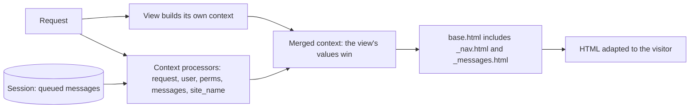

# Auth-aware templates, messages and navigation

> **Before this lesson:** the Gazette's login, logout and sign-up flows work ([Authentication flows end to end](#/lesson/django/auth-flows)). You know template inheritance, `` and context processors ([Templates and the Django template language](#/lesson/django/templates-dtl), [Class-based views, template inheritance, page tests and a first deployment](#/lesson/django/cbv-inheritance)).

## In plain words

Once a site has accounts, the same address shows different things to different people. An anonymous visitor sees "Log in". A member sees their name and "Write a story". An editor also sees "Review queue". The page has to *adapt* to whoever is looking.

Three tools make that possible in templates:

1. **Who is looking?** Every template can read `user` (the person) and `perms` (what they may do).
2. **What happened a moment ago?** After logging in or saving something, the next page should say so once: "Welcome back", "Story saved". That is the **messages framework**.
3. **Shared pieces without copy-paste.** A navigation bar that appears on every page is written once, as a partial template or a custom template tag.

An everyday picture: a hotel reception. The desk is the same for everybody, but the receptionist greets a returning guest by name, hands over a note that was left for them (once, not every time they pass), and offers the staff door only to staff.

One warning runs through the whole lesson: **what a template hides is not thereby protected.** Hiding the "Delete" button is courtesy. The view must refuse the request regardless.

Why it matters for a job: this is the polish that separates a demo from a product, and the place where beginners introduce both usability bugs (stale messages, wrong menus) and security bugs (believing a hidden link is a lock). Interviewers ask "what is a context processor?" and "how do you show a one-time notification after a redirect?".

## Step 1: `user` in every template

The setting `TEMPLATES[0]["OPTIONS"]["context_processors"]` lists functions that add variables to **every** template rendered with a request. A fresh project has four:

```python
# config/settings.py (generated)
"context_processors": [
    "django.template.context_processors.request",          # request
    "django.contrib.auth.context_processors.auth",         # user, perms
    "django.contrib.messages.context_processors.messages", # messages
    # plus django.template.context_processors.debug in some versions
],
```

So without any work in your views:

```html

  Signed in as <strong>{{ user }}</strong>
  <a href="">Admin</a>

  You are browsing as a guest.

```

`user` is the `request.user` object: a `Member` or an `AnonymousUser`. `{{ user }}` calls its `__str__`.

### Asking about permissions with `perms`

`perms` lets a template ask whether the current user holds a permission, using the pattern `perms.<app label>.<codename>`:

```html

  <a href="">Write a story</a>



  {# true if the user has ANY permission in the stories app #}
  <a href="">Newsroom</a>

```

Django creates four permissions for every model automatically: `add_`, `change_`, `delete_` and `view_` followed by the lower-case model name. The lesson on permissions covers assigning them; here it is enough to know that templates can ask.

## Step 2: how context processors work

A context processor is an ordinary function that takes the request and returns a dictionary. Django calls each one and merges the results with the view's own context. If a key appears twice, the view's context wins over context processors.

The model below shows the merge, including a processor of your own that supplies the site's name and the current year to every page. Run it and note which value of `site_name` survives.

```python-run
from datetime import date

def request_processor(request):
    return {"request": request}

def auth_processor(request):
    return {"user": request["user"], "perms": sorted(request["user"].get("perms", []))}

def site_processor(request):                 # our own
    return {"site_name": "Harbour Gazette", "current_year": date(2026, 11, 21).year}

CONTEXT_PROCESSORS = [request_processor, auth_processor, site_processor]

def build_context(request, view_context):
    context = {}
    for processor in CONTEXT_PROCESSORS:      # every processor runs for every render
        context.update(processor(request))
    context.update(view_context)              # the view's own values are applied last and win
    return context

request = {"path": "/stories/", "user": {"username": "marisol", "perms": ["stories.add_story"]}}

page = build_context(request, {"stories": ["Harbour reopens", "Tide tables"], "site_name": "Special edition"})
for key in ["site_name", "current_year", "user", "perms", "stories"]:
    print(f"{key:13} = {page[key]}")
```

Writing the real one takes two steps:

```python
# pages/context_processors.py  (new file)
from datetime import date


def site(request):
    return {"site_name": "Harbour Gazette", "current_year": date.today().year}
```

```python
# config/settings.py: add one line to the context_processors list
"pages.context_processors.site",
```

Now `{{ site_name }}` and `{{ current_year }}` work in every template. Because processors run on **every** render, keep them cheap: no database queries unless every page needs the result.

## Step 3: a navigation partial

Move the navigation into its own file so that `base.html` stays readable:

```html
<!-- templates/_nav.html -->
<nav>
  <a href="" aria-current="page">
    {{ site_name }}
  </a>

  
    <a href=""
       aria-current="page">{{ user }}</a>
    <a href="">Change password</a>
    <form method="post" action="" class="inline">
      
      <button type="submit">Log out</button>
    </form>
  
    <a href="?next={{ request.get_full_path|urlencode }}">Log in</a>
    <a href="">Become a member</a>
  
</nav>
```

```html
<!-- templates/base.html -->
<!DOCTYPE html>
<html lang="en">
<head>
  <meta charset="utf-8">
  <meta name="viewport" content="width=device-width, initial-scale=1">
  <title>{{ site_name }}</title>
</head>
<body>
  
  
  <main></main>
  <footer>&copy; {{ current_year }} {{ site_name }}</footer>
</body>
</html>
```

New pieces, one at a time:

- `request.resolver_match.url_name` is the **name** of the URL pattern that matched the current request. Comparing it marks the current page's link.
- `aria-current="page"` is the accessible way to mark that link: screen readers announce it, and CSS can style it with the selector `a[aria-current="page"]`.
- The login link carries `?next=` built from `request.get_full_path` (path plus query string), passed through the `urlencode` filter so that `?` and `&` inside it are escaped. After logging in from any page, the visitor returns to that page.
- `` inserts another template in place, sharing the current context.

## Step 4: one-time messages

After a successful POST the view redirects. The page that follows is produced by a different request, so how can it know to say "Story saved"? The **messages framework** stores a notice during one request and hands it to the template of the next one, then discards it.

```python
# anywhere you have the request
from django.contrib import messages

messages.success(request, "Your profile was saved.")
messages.info(request, "The newsroom closes at 18:00 today.")
messages.warning(request, "Your story has no headline image.")
messages.error(request, "The story could not be published.")
```

Each call has a **level**. The level's name is exposed to templates as `message.tags`, which is convenient for CSS classes:

| Function | Level | `message.tags` |
|---|---|---|
| `messages.debug` | 10 | `debug` (hidden unless the minimum level is lowered) |
| `messages.info` | 20 | `info` |
| `messages.success` | 25 | `success` |
| `messages.warning` | 30 | `warning` |
| `messages.error` | 40 | `error` |

```html
<!-- templates/_messages.html -->

  <ul class="messages" role="status">
    
      <li class="message {{ message.tags }}">{{ message }}</li>
    
  </ul>

```

Iterating over `messages` marks them as displayed, and they are deleted from storage. `role="status"` makes assistive technology announce the notice.

The mechanism in miniature: messages wait in per-visitor storage (by default the session, falling back from a cookie) until some template reads them.

```python-run
session = {}                                   # one visitor's server-side session

def add_message(level, text):
    session.setdefault("_messages", []).append((level, text))

def render_page(name):
    pending = session.pop("_messages", [])     # reading removes them: shown exactly once
    shown = ", ".join(f"[{level}] {text}" for level, text in pending) or "(no messages)"
    return f"{name}: {shown}"

# Request 1: POST /profile/  -> the view saves, queues a message and redirects (renders nothing)
add_message("success", "Your profile was saved.")
print("POST /profile/ -> 302 redirect, message waits in storage:", session)

# Request 2: GET /  -> the template loops over messages
print(render_page("GET /"))

# Request 3: reload
print(render_page("GET / (reload)"))
```

The message survives the redirect and disappears after one display. If a page that does not render `messages` comes in between, the notice waits for the next page that does.

### Messages on login and logout

The built-in views do not add messages, but the auth app announces these events through **signals**: notifications that Django sends when something happens, to which any function may subscribe.

```python
# accounts/signals.py  (new file)
from django.contrib import messages
from django.contrib.auth.signals import user_logged_in, user_logged_out
from django.dispatch import receiver


@receiver(user_logged_in)
def greet(sender, request, user, **kwargs):
    messages.success(request, f"Welcome back, {user}.")


@receiver(user_logged_out)
def farewell(sender, request, user, **kwargs):
    if request is not None:
        messages.info(request, "You have been logged out.")
```

```python
# accounts/apps.py
from django.apps import AppConfig


class AccountsConfig(AppConfig):
    default_auto_field = "django.db.models.BigAutoField"
    name = "accounts"

    def ready(self):
        from . import signals  # noqa: F401  (importing registers the receivers)
```

- `@receiver(user_logged_in)` subscribes the function to the signal.
- A receiver takes `sender` plus the signal's keyword arguments and must accept `**kwargs`, so that Django can add arguments in future versions.
- The functions must be **imported** somewhere or they are never registered. The `ready()` method of the app's configuration class is the designated place; it runs once when Django starts.

## How the pieces reach a template



## Step 5: a custom template tag for a reusable widget

When a fragment needs its own data, such as "the five newest members" in a sidebar, an include is not enough: every view would have to supply the data. A custom **inclusion tag** bundles the query with the fragment.

Template tags live in a package named `templatetags` inside an app:

```
accounts/
└── templatetags/
    ├── __init__.py        (empty)
    └── member_tags.py
```

```python
# accounts/templatetags/member_tags.py
from django import template
from django.contrib.auth import get_user_model

register = template.Library()


@register.inclusion_tag("accounts/_newest_members.html")
def newest_members(count=5):
    members = get_user_model().objects.filter(is_active=True).order_by("-date_joined")[:count]
    return {"members": members}


@register.filter
def initials(member):
    name = str(member)
    return "".join(part[0].upper() for part in name.split()[:2])
```

```html
<!-- accounts/templates/accounts/_newest_members.html -->
<aside>
  <h2>New members</h2>
  <ul><li>{{ m|initials }} · {{ m }}</li><li>Nobody yet.</li></ul>
</aside>
```

```html
<!-- any template -->


```

- `register = template.Library()` creates the registry that `` reads; the file's name is the name you load.
- `@register.inclusion_tag(template)` turns a function into a tag: the function returns a context dictionary and the named template is rendered with it.
- `@register.filter` turns a function into a filter used as `{{ value|initials }}`.

Restart the development server after creating a `templatetags` package; new tag libraries are discovered at start-up.

## Step 6: tests

```python
# pages/tests.py
from django.contrib.auth import get_user_model
from django.contrib.messages import get_messages
from django.test import TestCase
from django.urls import reverse


class NavigationTests(TestCase):
    @classmethod
    def setUpTestData(cls):
        cls.member = get_user_model().objects.create_user(
            "marisol", email="m@gazette.example", password="tide-chart-88", display_name="Marisol R.")

    def test_anonymous_navigation(self):
        response = self.client.get(reverse("home"))
        self.assertContains(response, "Log in")
        self.assertContains(response, "Become a member")
        self.assertNotContains(response, "Log out")

    def test_member_navigation(self):
        self.client.force_login(self.member)
        response = self.client.get(reverse("home"))
        self.assertContains(response, "Marisol R.")
        self.assertContains(response, "Log out")
        self.assertNotContains(response, "Become a member")

    def test_login_link_remembers_current_page(self):
        response = self.client.get(reverse("home") + "?edition=evening")
        self.assertContains(response, "next=/%3Fedition%3Devening")

    def test_site_context_processor(self):
        response = self.client.get(reverse("home"))
        self.assertEqual(response.context["site_name"], "Harbour Gazette")

    def test_welcome_message_shown_once(self):
        response = self.client.post(reverse("login"), {"username": "marisol", "password": "tide-chart-88"},
                                    follow=True)
        self.assertEqual([str(m) for m in get_messages(response.wsgi_request)], [])
        self.assertContains(response, "Welcome back, Marisol R.")
        self.assertNotContains(self.client.get(reverse("home")), "Welcome back")
```

The last test follows the login redirect, confirms that the final page displayed the greeting and emptied the storage, and that a later page no longer shows it.

> [!NOTE]
> **What changed since the book.** The book's templates test `user.is_authenticated` exactly as here and use a logout link, which no longer works (POST since 5.0). Django 4.2+ sites should prefer `aria-current` over an `active` CSS class alone for accessibility, and Django 5.1 added the `` tag for building links that modify the current query string. The messages framework and context processors are unchanged.

> [!INTERVIEW]
> **"What is a context processor?"** A callable that takes the `HttpRequest` and returns a dictionary merged into the context of every template rendered with a `RequestContext` (which `render()` and class-based views always use). They are listed in `TEMPLATES["OPTIONS"]["context_processors"]`; the defaults provide `request`, `user`, `perms` and `messages`. Because they run for each rendered template response, they must be cheap, and values from the view override them. Contrast with a custom template tag, which runs only where it is used and is the better home for an occasional query.

> [!WARNING]
> Per-user content and caching do not mix by accident. If a whole page is cached and served to everyone, the navigation bar will show the first visitor's name to all later visitors. Cache only anonymous pages, vary the cache by cookie, or cache fragments that are the same for everyone. The lesson on caching returns to this.

> [!TIP]
> Avoid long `` chains that repeat a rule in several templates. Put the rule in one place, as a model method or property such as `story.can_be_edited_by(user)` computed in the view, and let templates ask a single question.

## Pitfalls

- **Treating hidden links as security.** Enforce in views with mixins, decorators or queryset filters.
- **`user` missing in a template.** The template was rendered without a request (for example with `render_to_string(name, context)` and no `request` argument), so context processors did not run.
- **Messages that never appear.** The page after the redirect does not include the messages partial, or `MessageMiddleware` was removed.
- **Messages that appear late.** They wait until some page iterates over them; an unrelated page then shows a stale notice. Render messages in the base template.
- **Signals never firing.** The module defining receivers is not imported; use `AppConfig.ready()`.
- **`'member_tags' is not a registered tag library`.** Missing `__init__.py`, app not installed, or the server was not restarted.
- **Heavy context processors.** A query there runs on every page of the site.
- **Forgetting `` in a child template.** Tag libraries are loaded per file.

## Cheat sheet

| Need | Code |
|---|---|
| Is the visitor logged in? | `` |
| Has a permission? | `` |
| Current URL name | `{{ request.resolver_match.url_name }}` |
| Mark the current link | `aria-current="page"` |
| Login link that returns here | `?next={{ request.get_full_path\|urlencode }}` |
| Queue a notice | `messages.success(request, "Saved.")` |
| Show notices | loop over `messages` in the base template; CSS class from `message.tags` |
| Site-wide variable | a context processor listed in `TEMPLATES` |
| Fragment with its own data | `@register.inclusion_tag("template.html")` |
| Custom filter | `@register.filter` |
| React to login | `@receiver(user_logged_in)`, imported in `AppConfig.ready()` |

## Summary

- Templates receive `user`, `perms`, `request` and `messages` from context processors; use them to adapt navigation to the visitor.
- Hiding an element is presentation. Authorisation happens in the view.
- A context processor adds variables to every template and must stay cheap; inclusion tags suit fragments that need data only where they are used.
- The messages framework carries one-time notices across a redirect; render them in the base template.
- Signals such as `user_logged_in` let you attach behaviour to built-in views without rewriting them; register receivers in `AppConfig.ready()`.

## Glossary

- **Context processor**: a function adding variables to every request-based template context.
- **`perms`**: the template variable for checking the current user's permissions.
- **`resolver_match`**: the request attribute describing which URL pattern matched.
- **Partial**: a template fragment intended for ``.
- **Messages framework**: Django's one-time notification system.
- **Message level / tags**: the severity of a message and its name as exposed to templates.
- **Signal**: a notification that code can subscribe to, sent when an event occurs.
- **Receiver**: a function subscribed to a signal.
- **`AppConfig.ready()`**: the hook that runs once at start-up, used for registering signal receivers.
- **Inclusion tag**: a custom tag that renders a template with data computed by a Python function.
- **`aria-current`**: an accessibility attribute marking the current item in a set of links.

```quiz
[
  {"q": "Where does the `user` variable in templates come from?",
   "options": ["Every view must pass it explicitly", "The auth context processor adds it to every request-based context", "It is a built-in template keyword", "The session middleware writes it into the HTML"],
   "answer": 1,
   "explain": "django.contrib.auth.context_processors.auth supplies user and perms whenever a template is rendered with a request."},
  {"q": "A template hides the Delete link with ``. Is the delete view protected?",
   "options": ["Yes", "No; anyone who knows the address can still request it unless the view checks permission", "Only for anonymous visitors", "Only if DEBUG is off"],
   "answer": 1,
   "explain": "Templates decide what is displayed. Access must be enforced on the server in the view."},
  {"q": "A view and a context processor both define `site_name`. Which value does the template see?",
   "options": ["The context processor's", "The view's", "Both, joined", "An error is raised"],
   "answer": 1,
   "explain": "The view's context takes precedence over values from context processors."},
  {"q": "How does a message added before a redirect reach the next page?",
   "options": ["It is appended to the URL", "It is stored per visitor (session or cookie) and removed once a template iterates over it", "It is kept in a global variable", "It cannot; messages only work without redirects"],
   "answer": 1,
   "explain": "Message storage persists across requests for that visitor and is cleared when the messages are displayed."},
  {"q": "Signal receivers are defined in accounts/signals.py but never run. What is the usual cause?",
   "options": ["Signals are disabled in DEBUG mode", "The module is never imported; import it in AppConfig.ready()", "Receivers must be class methods", "The signal name is misspelled in settings"],
   "answer": 1,
   "explain": "The @receiver decorator registers a function only when its module is executed. ready() is the standard place to import it."},
  {"q": "When is an inclusion tag preferable to a context processor for 'newest members'?",
   "options": ["Never", "When the data is needed only on some pages, so the query should run only where the tag is used", "When the data is needed on every page", "When no template is involved"],
   "answer": 1,
   "explain": "Context processors run for every rendered page; a tag runs only where it appears."},
  {"q": "What does `request.resolver_match.url_name` contain?",
   "options": ["The full URL", "The name of the URL pattern that matched the current request", "The view's class name", "The template name"],
   "answer": 1,
   "explain": "It is useful for highlighting the current navigation link without comparing path strings."},
  {"q": "Why is caching a full page that contains the member's name risky?",
   "options": ["Names cannot be cached", "The cached copy would be served to other visitors, showing them someone else's details", "It slows the site", "It breaks CSRF tokens only"],
   "answer": 1,
   "explain": "A shared cache key for personalised content leaks one user's page to another. Vary by user or cache only shared fragments."}
]
```

> **Source:** Vincent, *Django for Beginners*, ch. 9 (User Authentication: templates). Docs: https://docs.djangoproject.com/en/5.2/ref/templates/api/#built-in-template-context-processors · https://docs.djangoproject.com/en/5.2/ref/contrib/messages/ · https://docs.djangoproject.com/en/5.2/howto/custom-template-tags/ · https://docs.djangoproject.com/en/5.2/ref/contrib/auth/#module-django.contrib.auth.signals
