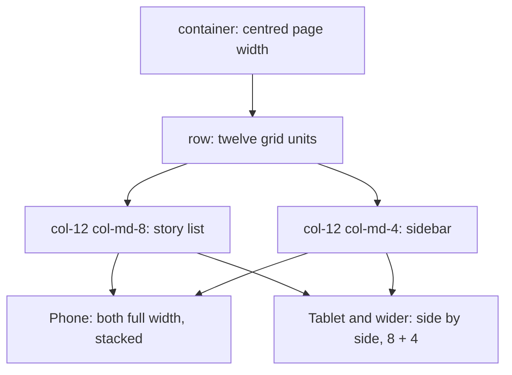

# Styling with Bootstrap 5 and crispy forms

> **Before this lesson:** the Gazette has working account pages, a shared `base.html`, a navigation partial and a messages partial ([Auth-aware templates, messages and navigation](#/lesson/django/auth-templates)). You know how static files and CSS selectors work ([Static files and CSS](#/lesson/django/static-css)).

## In plain words

The Gazette works, and it looks like 1995: black text, blue links, form boxes stacked against the left edge. Writing all the CSS for a pleasant, consistent, phone-friendly site by hand takes weeks and a designer's eye.

A **CSS framework** is a large, ready-made stylesheet. It defines hundreds of named **classes**, each a bundle of style rules. You do not write CSS; you put class names on your HTML elements. `class="btn btn-primary"` turns a plain button into a coloured, padded, rounded one with hover and focus states.

**Bootstrap** is the most widely used CSS framework. Version 5 is current.

An everyday picture: flat-pack furniture. You do not saw planks; you pick standard parts from a catalogue and assemble them. The result looks like many other people's furniture, and for an internal tool or a first product that is a fair price for being finished this afternoon.

One part needs extra help: Django renders form fields itself, without Bootstrap's classes. The package **django-crispy-forms** makes Django forms come out in Bootstrap's markup.

Why it matters for a job: many Django roles are "full stack", meaning you are expected to produce presentable pages without a front-end team. Bootstrap is the lingua franca of admin panels and internal tools, and take-home assignments are judged partly on looking finished.

## Step 1: load Bootstrap

The quickest way is a **CDN** (content delivery network), a public server that hosts popular libraries. Add two lines to the base template:

```html
<!-- templates/base.html -->
<!DOCTYPE html>
<html lang="en">
<head>
  <meta charset="utf-8">
  <meta name="viewport" content="width=device-width, initial-scale=1">
  <title>{{ site_name }}</title>
  <link href="https://cdn.jsdelivr.net/npm/bootstrap@5.3.3/dist/css/bootstrap.min.css" rel="stylesheet">
  
</head>
<body>
  
  <main class="container py-4">
    
    
  </main>
  <footer class="container text-body-secondary small py-3 border-top">
    &copy; {{ current_year }} {{ site_name }}
  </footer>
  <script src="https://cdn.jsdelivr.net/npm/bootstrap@5.3.3/dist/js/bootstrap.bundle.min.js"></script>
</body>
</html>
```

- The `<link>` loads Bootstrap's stylesheet. Pin an exact version (`5.3.3`) so that the site does not change when a new release appears.
- The `<script>` at the end loads Bootstrap's JavaScript, needed only for interactive parts such as the collapsing mobile menu and dismissible alerts. Bootstrap 5 does not need jQuery.
- The viewport `<meta>` line is required for the layout to adapt to phones.
- `class="container py-4"` is your first use of Bootstrap classes: `container` centres the content with a sensible maximum width; `py-4` adds vertical padding.

Reload any page: fonts, spacing and link colours already look different, because Bootstrap restyles plain elements.

> [!TIP]
> For production, copy the two files into your own `static/` folder and reference them with ``, or keep the CDN but add the `integrity` and `crossorigin` attributes shown on Bootstrap's download page. The `integrity` value is a fingerprint; the browser refuses the file if a compromised CDN serves something else. Self-hosting also keeps the site working if the CDN is unreachable and avoids sending your visitors' addresses to a third party.

## Step 2: the vocabulary of classes

Bootstrap's classes fall into three families.

| Family | What it gives | Examples |
|---|---|---|
| **Layout** | page structure | `container`, `row`, `col-md-8` |
| **Components** | ready-made widgets | `navbar`, `card`, `alert`, `btn`, `badge` |
| **Utilities** | one small style each | `mt-3` (margin top), `text-center`, `d-flex`, `fw-bold` |

Spacing utilities follow a pattern worth learning once: a property letter (`m` margin, `p` padding), an optional side (`t` top, `b` bottom, `s` start, `e` end, `x` horizontal, `y` vertical), and a size from `0` to `5`. So `mb-3` is "margin bottom, size 3" and `px-2` is "horizontal padding, size 2".

### The grid

Layout is built on a **12-column grid**. A `row` is divided into twelve equal units; each child says how many units it takes: `col-8` and `col-4` sit side by side as two thirds and one third.

The grid is **responsive**: it changes with the width of the screen. A **breakpoint** is a width at which rules switch on. `col-md-8` means "eight units wide from the `md` breakpoint (768 pixels) upwards; below that, full width". Bootstrap is mobile-first: an element is full-width unless a class for the current or a smaller breakpoint says otherwise.

| Infix | Applies from width | Typical device |
|---|---|---|
| (none) | 0 | phones |
| `sm` | 576px | large phones |
| `md` | 768px | tablets |
| `lg` | 992px | laptops |
| `xl` | 1200px | desktops |
| `xxl` | 1400px | large desktops |

The model below computes how wide a column is at different screen widths from its class list, which is the rule the browser applies. Run it and try your own class combinations.

```python-run
BREAKPOINTS = {"": 0, "sm": 576, "md": 768, "lg": 992, "xl": 1200, "xxl": 1400}

def column_units(classes, viewport):
    """Return how many of the 12 grid units a column occupies at this viewport width."""
    units, best = 12, -1                               # default: full width (stacked)
    for name in classes.split():
        parts = name.split("-")
        if parts[0] != "col" or not parts[-1].isdigit():
            continue
        infix = parts[1] if len(parts) == 3 else ""
        minimum = BREAKPOINTS[infix]
        if viewport >= minimum and minimum > best:     # the largest matching breakpoint wins
            units, best = int(parts[-1]), minimum
    return units

layout = {"story list": "col-12 col-md-8", "sidebar": "col-12 col-md-4 col-xl-3"}

for viewport in (375, 800, 1280):
    row = ", ".join(f"{name}: {column_units(classes, viewport)}/12" for name, classes in layout.items())
    total = sum(column_units(c, viewport) for c in layout.values())
    arrangement = "side by side" if total <= 12 else "stacked"
    print(f"{viewport:>5}px  {row}  -> {arrangement}")
```

On a phone both blocks take twelve units and stack; on a tablet they sit side by side as 8 + 4; on a wide screen the sidebar shrinks to 3. The same HTML serves all three.

```html
<div class="row g-4">
  <div class="col-12 col-md-8">... story list ...</div>
  <aside class="col-12 col-md-4 col-xl-3">... sidebar ...</aside>
</div>
```

`g-4` sets the **gutter**, the space between columns.



## Step 3: a navigation bar

Replace the plain partial with Bootstrap's navbar component. The classes do the work; the Django logic is unchanged from the previous lesson.

```html
<!-- templates/_nav.html -->
<nav class="navbar navbar-expand-md bg-body-tertiary border-bottom">
  <div class="container">
    <a class="navbar-brand fw-bold" href="">{{ site_name }}</a>
    <button class="navbar-toggler" type="button" data-bs-toggle="collapse" data-bs-target="#mainnav"
            aria-controls="mainnav" aria-expanded="false" aria-label="Toggle navigation">
      <span class="navbar-toggler-icon"></span>
    </button>

    <div class="collapse navbar-collapse" id="mainnav">
      <ul class="navbar-nav me-auto">
        <li class="nav-item">
          <a class="nav-link active"
             aria-current="page"
             href="">Front page</a>
        </li>
      </ul>

      <ul class="navbar-nav align-items-md-center gap-md-2">
        
          <li class="nav-item"><a class="nav-link" href="">{{ user }}</a></li>
          <li class="nav-item">
            <form method="post" action="">
              
              <button type="submit" class="btn btn-outline-secondary btn-sm">Log out</button>
            </form>
          </li>
        
          <li class="nav-item"><a class="nav-link" href="">Log in</a></li>
          <li class="nav-item"><a class="btn btn-primary btn-sm" href="">Become a member</a></li>
        
      </ul>
    </div>
  </div>
</nav>
```

- `navbar-expand-md`: show the links in a row from the `md` breakpoint upwards; below it, hide them behind the toggle button.
- The `data-bs-toggle` and `data-bs-target` attributes connect the button to the collapsible block through Bootstrap's JavaScript. No JavaScript of your own is written.
- `me-auto` (margin end: automatic) pushes the account links to the far side.
- `btn btn-outline-secondary btn-sm` styles the logout **button**, which remains a real POST form.

## Step 4: messages as alerts

Bootstrap's alert component has colour variants: `alert-success`, `alert-info`, `alert-warning`, `alert-danger`. Django's message tags match the first three. The fourth differs: Django says `error`, Bootstrap says `danger`. One setting remaps it:

```python
# config/settings.py
from django.contrib.messages import constants as message_constants

MESSAGE_TAGS = {message_constants.ERROR: "danger"}
```

```html
<!-- templates/_messages.html -->

  <div class="alert alert-{{ message.tags }} alert-dismissible fade show" role="alert">
    {{ message }}
    <button type="button" class="btn-close" data-bs-dismiss="alert" aria-label="Close"></button>
  </div>

```

`MESSAGE_TAGS` maps a message level to the text exposed as `message.tags`. Without it, error messages would get the non-existent class `alert-error` and appear unstyled.

## Step 5: forms with crispy-forms

`{{ form.as_div }}` produces correct but unstyled inputs, because Bootstrap styles only elements that carry its classes (`form-control`, `form-label`, `invalid-feedback`). Adding those through widget attributes on every field is tedious. Two packages solve it:

```bash
python -m pip install django-crispy-forms crispy-bootstrap5
python -m pip freeze > requirements.txt
```

```python
# config/settings.py
INSTALLED_APPS = [
    # ... Django apps ...
    "crispy_forms",
    "crispy_bootstrap5",
    "accounts",
    "pages",
]

CRISPY_ALLOWED_TEMPLATE_PACKS = "bootstrap5"
CRISPY_TEMPLATE_PACK = "bootstrap5"
```

- `django-crispy-forms` is the engine; `crispy-bootstrap5` is the **template pack**, the set of HTML snippets for Bootstrap 5. Other packs exist for other frameworks.
- The two settings select the pack.

In templates, load the tag library and apply the `crispy` filter:

```html
<!-- templates/registration/signup.html -->


Become a member

  <div class="row justify-content-center">
    <div class="col-12 col-md-8 col-lg-6">
      <div class="card shadow-sm">
        <div class="card-body p-4">
          <h1 class="h3 mb-3">Become a member</h1>
          <form method="post" novalidate>
            
            {{ form|crispy }}
            <button type="submit" class="btn btn-primary w-100">Create account</button>
          </form>
        </div>
      </div>
      <p class="text-center mt-3">Already a member? <a href="">Log in</a></p>
    </div>
  </div>

```

`{{ form|crispy }}` renders every field with a label, the Bootstrap input classes, help text in muted small print, and errors in red below the field with the field outlined in red. The `<form>` tag, the CSRF token and the button stay yours. `novalidate` switches off the browser's own pop-up validation so that you see Django's messages while developing; the server validates either way.

The login page is the same structure with `{{ form|crispy }}` and the hidden `next` field.

### Controlling layout from Python

For forms that need columns or a different order, crispy-forms offers a **helper** object attached to the form class:

```python
# accounts/forms.py
from crispy_forms.helper import FormHelper
from crispy_forms.layout import Column, Layout, Row, Submit


class MemberCreationForm(UserCreationForm):
    class Meta(UserCreationForm.Meta):
        model = get_user_model()
        fields = ("username", "email", "display_name")

    def __init__(self, *args, **kwargs):
        super().__init__(*args, **kwargs)
        self.helper = FormHelper()
        self.helper.layout = Layout(
            Row(Column("username", css_class="col-md-6"), Column("display_name", css_class="col-md-6")),
            "email",
            Row(Column("password1", css_class="col-md-6"), Column("password2", css_class="col-md-6")),
            Submit("submit", "Create account", css_class="btn-primary w-100"),
        )
```

With a helper, the template uses the **tag** form, which also writes the `<form>` element and the CSRF token: ``.

### Without an extra package

If you prefer no dependency, set classes on widgets:

```python
class SiteLoginForm(AuthenticationForm):
    def __init__(self, *args, **kwargs):
        super().__init__(*args, **kwargs)
        for field in self.fields.values():
            field.widget.attrs["class"] = "form-control"
```

and render fields in a loop with your own markup. It is more typing and gives full control; both approaches are common in real projects.

## Step 6: content components

Cards suit lists of stories, which the next module builds:

```html
<div class="row row-cols-1 row-cols-md-2 g-4">
  
    <div class="col">
      <article class="card h-100">
        <div class="card-body">
          <span class="badge text-bg-secondary mb-2">{{ story.get_section_display }}</span>
          <h2 class="card-title h5"><a class="stretched-link text-decoration-none" href="{{ story.get_absolute_url }}">{{ story.headline }}</a></h2>
          <p class="card-text">{{ story.body|truncatewords:25 }}</p>
        </div>
        <div class="card-footer text-body-secondary small">{{ story.author }} · {{ story.published|date:"j M Y" }}</div>
      </article>
    </div>
  
</div>
```

`row-cols-1 row-cols-md-2` means one card per row on phones, two from tablets up. `h-100` makes cards in a row equally tall. `stretched-link` makes the whole card clickable.

## Step 7: tests

Styling is mostly checked by eye, but two things can be automated cheaply: that the framework is loaded, and that forms carry the classes that make errors visible.

```python
# pages/test_styling.py
from django.test import TestCase
from django.urls import reverse


class StylingTests(TestCase):
    def test_bootstrap_is_loaded(self):
        self.assertContains(self.client.get(reverse("home")), "bootstrap.min.css")

    def test_signup_fields_have_bootstrap_classes(self):
        self.assertContains(self.client.get(reverse("signup")), "form-control")

    def test_errors_are_marked_invalid(self):
        response = self.client.post(reverse("signup"), {"username": "", "password1": "a", "password2": "b"})
        self.assertContains(response, "is-invalid")

    def test_error_messages_use_danger_class(self):
        from django.conf import settings
        from django.contrib.messages import constants
        self.assertEqual(settings.MESSAGE_TAGS[constants.ERROR], "danger")
```

> [!NOTE]
> **What changed since the book.** The book uses Bootstrap 4, which required jQuery and Popper scripts and used different class names (`ml-auto`, `badge-secondary`, `form-group`). Bootstrap 5 dropped jQuery, renamed left/right to start/end (`ms-auto`, `me-auto`), and added the utility API and a built-in dark mode. `django-crispy-forms` 2.0 (2023) moved every template pack into its own package, so `crispy-bootstrap5` must be installed and both settings shown above are needed; the old `CRISPY_TEMPLATE_PACK = "bootstrap4"` alone no longer works.

> [!INTERVIEW]
> **"How do you style Django forms?"** Name the options with their trade-offs: widget `attrs` in the form class (no dependency, repetitive); looping over fields in the template with custom markup (full control); a form-rendering package such as `django-crispy-forms` with a template pack (least effort, consistent error display, layout defined in Python through `FormHelper`); or, since Django 4.0, a project-wide custom form renderer and per-form `template_name` using Django's own form templates. Mention accessibility: every input needs an associated label, and error text must be linked to its field, which the packs do for you.

> [!WARNING]
> Do not let a framework's class names leak into Python business logic. A model method that returns `"badge text-bg-danger"` ties your data layer to one CSS library. Return a meaning (`"urgent"`) and translate it to classes in the template.

## Pitfalls

- **Layout does not adapt on phones.** The viewport `<meta>` tag is missing.
- **The mobile menu button does nothing.** Bootstrap's JavaScript bundle is not loaded, or `data-bs-target` does not match the block's `id`.
- **`TemplateDoesNotExist: bootstrap5/uni_form.html`.** `crispy_bootstrap5` is not installed or not in `INSTALLED_APPS`.
- **`'crispy_forms_tags' is not a registered tag library`.** `crispy_forms` is missing from `INSTALLED_APPS`, or `` is missing in this template.
- **Columns outside a `row`, or rows outside a `container`.** Spacing and alignment go wrong in subtle ways.
- **Bootstrap 4 snippets pasted into a Bootstrap 5 page.** `ml-3`, `float-right` and `data-toggle` are silently ignored.
- **Unstyled error messages.** `MESSAGE_TAGS` does not map `ERROR` to `danger`.
- **Mixing `{{ form|crispy }}` and ``.** The filter renders fields only; the tag renders the whole form and needs a helper for buttons.

## Cheat sheet

| Need | Classes or code |
|---|---|
| Centred page width | `container` |
| Two columns from tablet up | `row` > `col-md-8` + `col-md-4` |
| Space between columns | `g-3` on the row |
| Margin / padding | `mt-3`, `mb-0`, `px-2`, `py-4` |
| Button | `btn btn-primary`, `btn-outline-secondary`, `btn-sm`, `w-100` |
| Notice | `alert alert-success` |
| Card | `card` > `card-body` > `card-title`, `card-text` |
| Map Django error level | `MESSAGE_TAGS = {message_constants.ERROR: "danger"}` |
| Bootstrap forms | `` then `{{ form\|crispy }}` |
| Whole form from a helper | `` with `FormHelper` and `Layout` |
| Settings | `CRISPY_ALLOWED_TEMPLATE_PACKS = "bootstrap5"`, `CRISPY_TEMPLATE_PACK = "bootstrap5"` |

## Summary

- A CSS framework supplies named classes; you style by adding class names to HTML.
- Bootstrap's grid divides a row into twelve units and switches layouts at breakpoints; classes without an infix apply from the smallest screens upwards.
- Components such as `navbar`, `alert` and `card` wrap your existing Django template logic without changing it.
- Map Django's `error` message level to Bootstrap's `danger`.
- `django-crispy-forms` with `crispy-bootstrap5` renders Django forms in Bootstrap markup with one filter; a `FormHelper` controls layout from Python.

## Glossary

- **CSS framework**: a pre-written stylesheet offering reusable classes and components.
- **Class (HTML/CSS)**: a label on an element that stylesheet rules can target.
- **CDN**: a network of servers that hosts and delivers files such as popular libraries.
- **Grid**: a layout system dividing the page width into columns.
- **Breakpoint**: a screen width at which a responsive layout changes.
- **Responsive design**: layouts that adapt to the size of the screen.
- **Mobile-first**: designing for small screens by default and adding rules for larger ones.
- **Component**: a ready-made interface element such as a navbar, card or alert.
- **Utility class**: a class that applies one small style, such as a margin.
- **Template pack**: the set of templates crispy-forms uses for one CSS framework.
- **`FormHelper`**: the crispy-forms object describing a form's layout and attributes in Python.
- **Subresource integrity**: the `integrity` attribute with which a browser verifies a file from a third party.

```quiz
[
  {"q": "What does the class `col-md-8` mean?",
   "options": ["Always 8 pixels wide", "8 of 12 grid units from the md breakpoint (768px) upwards, full width below", "8 of 12 units only on medium screens, full width on larger ones", "A margin of size 8"],
   "answer": 1,
   "explain": "Breakpoint classes apply from that width upwards. Below it the column falls back to full width unless another class applies."},
  {"q": "A column has `col-12 col-md-4 col-xl-3`. How many units does it take at 1000px?",
   "options": ["12", "4", "3", "6"],
   "answer": 1,
   "explain": "1000px is above md (768) but below xl (1200), so col-md-4 is the largest matching rule."},
  {"q": "Why set `MESSAGE_TAGS = {ERROR: 'danger'}`?",
   "options": ["To hide error messages", "Django names the level 'error' but Bootstrap's alert class is 'alert-danger'", "To log errors to a file", "Bootstrap cannot display errors otherwise for security reasons"],
   "answer": 1,
   "explain": "The mapping changes message.tags for that level so the template's alert-{{ message.tags }} produces a class that exists."},
  {"q": "Which two packages are needed to render Django forms as Bootstrap 5 forms with crispy?",
   "options": ["bootstrap and jquery", "django-crispy-forms and crispy-bootstrap5", "django-bootstrap and django-forms", "Only django-crispy-forms"],
   "answer": 1,
   "explain": "Since crispy-forms 2.0 the template packs are separate packages; both must be installed and listed in INSTALLED_APPS."},
  {"q": "What does `{{ form|crispy }}` NOT render?",
   "options": ["Labels", "Error messages", "The <form> tag, the CSRF token and the submit button", "Help text"],
   "answer": 2,
   "explain": "The filter renders the fields only. You write the form element,  and the button yourself."},
  {"q": "The collapsed mobile menu does not open when the toggle button is clicked. What is the most likely cause?",
   "options": ["The CSS file is missing", "Bootstrap's JavaScript bundle is not loaded or data-bs-target does not match the id", "Django's CSRF protection blocks it", "The viewport meta tag is missing"],
   "answer": 1,
   "explain": "Interactive components need bootstrap.bundle.min.js and a target selector matching the collapsible element."},
  {"q": "Why pin an exact Bootstrap version in the CDN URL?",
   "options": ["It loads faster", "So the site's appearance does not change unexpectedly when a new version is published", "It is required by Django", "To enable dark mode"],
   "answer": 1,
   "explain": "An unpinned URL may start serving a newer release with different styles or class names."},
  {"q": "Why should a model method not return a string such as 'badge text-bg-danger'?",
   "options": ["Strings are slow", "It couples the data layer to one CSS framework; return a meaning and map it to classes in the template", "Bootstrap forbids it", "Templates cannot read model methods"],
   "answer": 1,
   "explain": "Presentation belongs in templates. Changing or upgrading the CSS framework should not require editing models."}
]
```

> **Source:** Vincent, *Django for Beginners*, ch. 10 (Bootstrap), rewritten for Bootstrap 5. Docs: https://getbootstrap.com/docs/5.3/getting-started/introduction/ · https://getbootstrap.com/docs/5.3/layout/grid/ · https://django-crispy-forms.readthedocs.io/en/latest/ · https://docs.djangoproject.com/en/5.2/ref/settings/#message-tags
