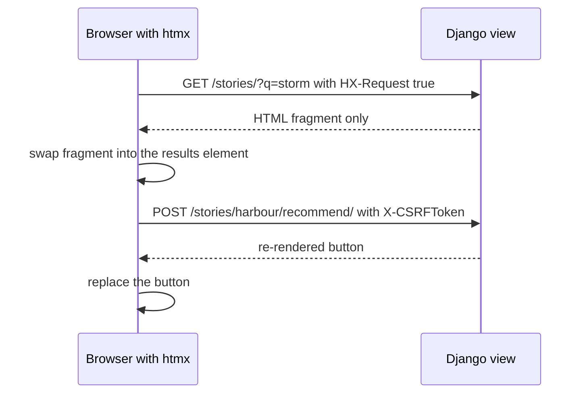

# Tailwind, Pico and htmx: modern alternatives

> **Before this lesson:** you have styled the Gazette with Bootstrap classes and crispy forms ([Styling with Bootstrap 5 and crispy forms](#/lesson/django/bootstrap)), and you understand static files, `collectstatic` and template partials ([Static files and CSS](#/lesson/django/static-css), [Auth-aware templates, messages and navigation](#/lesson/django/auth-templates)).

## In plain words

Bootstrap is one answer to "how do I make this look good without being a designer?". It is not the only one, and job adverts mention others. This lesson explains three tools you will meet in current Django projects and, more importantly, the *idea* behind each, so that you can choose and so that the next new tool looks familiar.

- **Pico CSS** follows the idea "write plain, meaningful HTML and it already looks good". There are almost no classes to learn. This style is called **classless**.
- **Tailwind CSS** follows the idea "give me thousands of tiny single-purpose classes and I will compose every design myself". This style is called **utility-first**.
- **htmx** is not about looks. It makes parts of a page update without a full reload, and without you writing JavaScript, by adding attributes to HTML. The server keeps sending HTML, which suits Django's templates perfectly.

An everyday picture, with clothes. Pico is a well-cut uniform: put it on, done. Bootstrap is a department store of ready-made garments. Tailwind is a fabric shop with every colour and a sewing machine: more work, but the result is yours alone. htmx is not clothing at all; it is a butler who fetches the one thing you asked for instead of making you leave the room and come back in.

Why it matters for a job: teams choose different stacks, and "what would you use for the front end of a Django app, and why?" is a common discussion question. Being able to name the trade-offs calmly is worth more than loyalty to one tool.

## Three philosophies side by side

Here is the same small piece of interface, a notice with a button, in each style.

**Component framework (Bootstrap).** You pick named components.

```html
<div class="alert alert-info">
  Edition closes at 18:00.
  <button class="btn btn-primary btn-sm">Submit story</button>
</div>
```

**Classless (Pico).** You write semantic HTML; the stylesheet styles elements by their tag.

```html
<article>
  Edition closes at 18:00.
  <button>Submit story</button>
</article>
```

**Utility-first (Tailwind).** You compose the look from single-purpose classes.

```html
<div class="rounded-lg border border-sky-200 bg-sky-50 p-4 text-sky-900">
  Edition closes at 18:00.
  <button class="ml-2 rounded bg-sky-600 px-3 py-1 text-sm font-medium text-white hover:bg-sky-700">Submit story</button>
</div>
```

| | Bootstrap | Pico | Tailwind |
|---|---|---|---|
| You write | component classes | plain HTML tags | many small utility classes |
| Learning effort | medium | very low | medium to high |
| Looks like | "a Bootstrap site" unless themed | clean, uniform | whatever you design |
| Build step needed | no | no | yes (a tool generates the CSS) |
| Size sent to the browser | large fixed file | small fixed file | only the classes you used |
| Best for | admin panels, internal tools | prototypes, documentation, small sites | products with their own visual identity |

## Pico: styling by writing good HTML

**Semantic HTML** means choosing tags for their meaning: `<nav>` for navigation, `<main>` for the main content, `<article>` for a self-contained piece, `<button>` for an action. Pico styles those tags directly.

```html
<!-- templates/base.html (Pico variant) -->
<!DOCTYPE html>
<html lang="en">
<head>
  <meta charset="utf-8">
  <meta name="viewport" content="width=device-width, initial-scale=1">
  <title>{{ site_name }}</title>
  <link rel="stylesheet" href="https://cdn.jsdelivr.net/npm/@picocss/pico@2/css/pico.min.css">
</head>
<body>
  <header class="container">
    <nav>
      <ul><li><strong>{{ site_name }}</strong></li></ul>
      <ul>
        
          <li><a href="">{{ user }}</a></li>
        
          <li><a href="">Log in</a></li>
        
      </ul>
    </nav>
  </header>
  <main class="container"></main>
</body>
</html>
```

The only class used is `container`. Two lists inside `<nav>` become a left and a right group; a `<form>` rendered with `{{ form.as_div }}` gets full-width inputs with proper spacing; a `<table>` gets rules and padding. For a Django project this has a pleasant consequence: **the default form rendering needs no extra package.** Light and dark themes follow the visitor's system setting automatically.

The limit is reached when you want something Pico has no opinion about, such as a multi-column dashboard. Then you write your own CSS on top.

## Tailwind: utility-first with a build step

Tailwind's catalogue of possible classes is effectively unlimited (`p-1`, `p-2`, ... `text-sky-600`, `md:grid-cols-3`, `hover:bg-sky-700`). Shipping all of them would be enormous. Instead a command-line tool **scans your templates**, finds the class names you used, and generates a stylesheet containing only those. This is the **build step**.

The model below shows that scan-and-generate idea in a few lines: read templates, collect class names, emit rules only for the ones found.

```python-run
import re

# A tiny "catalogue" of utilities: class name -> CSS declaration.
CATALOGUE = {f"p-{n}": f"padding: {n * 0.25}rem" for n in range(0, 9)}
CATALOGUE.update({f"mt-{n}": f"margin-top: {n * 0.25}rem" for n in range(0, 9)})
CATALOGUE.update({"rounded": "border-radius: 0.25rem", "font-bold": "font-weight: 700",
                  "text-white": "color: #fff", "bg-sky-600": "background-color: #0284c7",
                  "bg-sky-50": "background-color: #f0f9ff", "text-sm": "font-size: 0.875rem"})

templates = {
    "story_list.html": '<article class="p-4 mt-2 rounded bg-sky-50"><h2 class="font-bold">{{ story.headline }}</h2></article>',
    "_button.html": '<button class="p-2 rounded bg-sky-600 text-white text-sm">Save</button>',
}

def build(sources):
    used = set()
    for html in sources.values():                         # 1. scan every template for class names
        for attribute in re.findall(r'class="([^"]*)"', html):
            used.update(attribute.split())
    rules = [f".{name} {{ {CATALOGUE[name]} }}" for name in sorted(used) if name in CATALOGUE]
    return rules                                          # 2. emit only what was used

css = build(templates)
print(f"catalogue: {len(CATALOGUE)} utilities, generated: {len(css)} rules\n")
print("\n".join(css))

# A class name assembled in Python is invisible to the scanner:
dynamic = {"badge.html": '<span class="bg-sky-{{ shade }}">new</span>'}
print("\ndynamic class found:", build(dynamic))
```

The last line prints an empty list, and it demonstrates Tailwind's best-known trap: the scanner reads text, it does not run templates. A class written as `bg-sky-{{ shade }}` never appears as a complete name, so no CSS is generated for it. Always write complete class names, choosing between them with ``.

### Using Tailwind with Django

Tailwind version 4 offers a standalone command-line program that needs no JavaScript tooling. The workflow:

```css
/* static_src/input.css */
@import "tailwindcss";
@source "../templates";
@source "../**/templates";
```

```bash
# during development: rebuild whenever a template changes
tailwindcss -i static_src/input.css -o static/css/site.css --watch

# before deployment: one optimised build
tailwindcss -i static_src/input.css -o static/css/site.css --minify
python manage.py collectstatic
```

- `@import "tailwindcss";` pulls in the framework.
- `@source` lines tell the scanner where your templates are.
- The output file lands in `static/`, so from Django's point of view it is an ordinary stylesheet: `<link rel="stylesheet" href="">`.

The generated file must exist before `collectstatic` runs, which adds a step to deployment. Packages such as `django-tailwind-cli` wrap the download and the two commands as `manage.py` commands.

To keep templates readable, extract repeated groups of classes into partials (``) instead of copying twenty class names around.

## htmx: updating part of a page with HTML

In a classic Django site every click loads a whole new page. Often only a small region needs to change: search results under a search box, a "like" count, one row of a table. The usual modern answer is a JavaScript application that fetches data as **JSON** (JavaScript Object Notation, a text format for data) and builds HTML in the browser. That means writing a second application in another language.

**htmx** is a small JavaScript library (you include one file, you write none) built on a different idea: *any element may issue an HTTP request, and the HTML that comes back replaces some part of the page.* The server answers with a **fragment** of HTML, rendered by an ordinary Django template.

Four attributes cover most uses:

| Attribute | Meaning |
|---|---|
| `hx-get="/url/"`, `hx-post="/url/"` | which request to send |
| `hx-trigger="..."` | when to send it (default: click for buttons, submit for forms, change for inputs) |
| `hx-target="#id"` | which element receives the response |
| `hx-swap="innerHTML"` | how to insert it (`innerHTML`, `outerHTML`, `beforeend`, ...) |

### Example: live search

```html
<!-- stories/templates/stories/story_list.html -->


  <h1>Stories</h1>
  <input type="search" name="q" placeholder="Search headlines"
         hx-get=""
         hx-trigger="input changed delay:300ms, search"
         hx-target="#results"
         hx-push-url="true">
  <div id="results">
    
  </div>

```

```html
<!-- stories/templates/stories/_story_results.html -->

  <article><h2><a href="{{ story.get_absolute_url }}">{{ story.headline }}</a></h2></article>

  <p>No stories match.</p>

```

Reading the input's attributes: "when the text changes, wait 300 milliseconds for the typing to pause, then GET the list URL with `?q=...`, and put the response inside `#results`". `hx-push-url` updates the address bar so that the search can be bookmarked.

The view serves **both** cases: a full page for a normal visit, and the fragment alone for an htmx request. htmx marks its requests with the header `HX-Request: true`.

```python
# stories/views.py
from django.views.generic import ListView

from .models import Story


class StoryListView(ListView):
    model = Story
    context_object_name = "stories"
    paginate_by = 20

    def get_queryset(self):
        queryset = Story.objects.all()
        query = self.request.GET.get("q", "").strip()
        if query:
            queryset = queryset.filter(headline__icontains=query)
        return queryset

    def get_template_names(self):
        if self.request.headers.get("HX-Request") == "true":
            return ["stories/_story_results.html"]      # fragment only
        return ["stories/story_list.html"]              # full page
```

`get_template_names` is the method a generic view calls to decide which template to render. Because the full page *includes* the same partial, there is one source of truth for how results look.

The decision is small enough to model. Run it and compare the two responses.

```python-run
STORIES = ["Harbour reopens after storm", "New tide tables published", "Storm damage assessed", "Ferry timetable"]

def render_results(stories):
    items = "".join(f"<li>{s}</li>" for s in stories) or "<li>No stories match.</li>"
    return f"<ul>{items}</ul>"

def render_page(results_html):
    return f"<html><body><nav>Gazette</nav><input name='q'><div id='results'>{results_html}</div></body></html>"

def story_list(request):
    query = request["GET"].get("q", "").lower()
    stories = [s for s in STORIES if query in s.lower()]
    fragment = render_results(stories)
    if request["headers"].get("HX-Request") == "true":
        return fragment                     # htmx swaps this into #results
    return render_page(fragment)            # a normal visit gets the whole document

full = story_list({"GET": {}, "headers": {}})
partial = story_list({"GET": {"q": "storm"}, "headers": {"HX-Request": "true"}})
print("full page :", len(full), "characters")
print("fragment  :", len(partial), "characters ->", partial)
```

### POST requests and CSRF

htmx requests are ordinary requests, so Django's CSRF protection applies to them. The simplest arrangement sends the token as a header from the `<body>` tag, which all htmx requests on the page inherit:

```html
<body hx-headers='{"X-CSRFToken": "{{ csrf_token }}"}'>
```

Then a button can post without a form:

```html
<button hx-post="" hx-target="this" hx-swap="outerHTML">
  Recommend ({{ story.recommendations }})
</button>
```

```python
# stories/views.py
from django.contrib.auth.decorators import login_required
from django.db.models import F
from django.shortcuts import get_object_or_404, render
from django.views.decorators.http import require_POST


@login_required
@require_POST
def recommend(request, slug):
    story = get_object_or_404(Story, slug=slug)
    Story.objects.filter(pk=story.pk).update(recommendations=F("recommendations") + 1)
    story.refresh_from_db()
    return render(request, "stories/_recommend_button.html", {"story": story})
```

`@require_POST` rejects other methods with 405. The `F("recommendations") + 1` expression lets the database do the increment in one statement, which stays correct when two people click at the same moment; the ORM module explains it. The response is the re-rendered button, which replaces the old one.

The package `django-htmx` adds a middleware that sets `request.htmx` (so you can write `if request.htmx:`) and helpers for htmx's response headers.



## Django's own form templates

One more alternative to crispy-forms deserves a mention because it needs no package. Since Django 4.0, forms are rendered through templates you can override, and since 5.0 each field can render itself as a complete group:

```html
<form method="post">
  
  
    <div class="field">{{ field.as_field_group }}</div>
  
  <button type="submit">Save</button>
</form>
```

`as_field_group` outputs label, help text, errors and widget for one field using the template `django/forms/field.html`, which you may replace project-wide to emit the markup your CSS framework expects.

## Tests

```python
# stories/test_htmx.py
from django.contrib.auth import get_user_model
from django.test import TestCase
from django.urls import reverse

from .models import Story


class HtmxViewTests(TestCase):
    @classmethod
    def setUpTestData(cls):
        cls.author = get_user_model().objects.create_user("marisol", email="m@gazette.example", password="x")
        Story.objects.create(headline="Harbour reopens after storm", body="...", author=cls.author)
        Story.objects.create(headline="Ferry timetable", body="...", author=cls.author)

    def test_normal_request_gets_full_page(self):
        response = self.client.get(reverse("story-list"))
        self.assertTemplateUsed(response, "stories/story_list.html")
        self.assertContains(response, "<html")

    def test_htmx_request_gets_fragment(self):
        response = self.client.get(reverse("story-list"), {"q": "storm"}, headers={"HX-Request": "true"})
        self.assertTemplateUsed(response, "stories/_story_results.html")
        self.assertTemplateNotUsed(response, "base.html")
        self.assertContains(response, "Harbour reopens")
        self.assertNotContains(response, "Ferry timetable")

    def test_recommend_requires_post(self):
        self.client.force_login(self.author)
        story = Story.objects.first()
        self.assertEqual(self.client.get(reverse("story-recommend", args=[story.slug])).status_code, 405)
```

The `headers=` argument of the test client (Django 4.2+) sets request headers by their real names.

> [!NOTE]
> **What changed since the book.** None of these tools appear in the source book, which stops at Bootstrap 4. They are included because current job descriptions mention them. Version notes: Pico is at major version 2; Tailwind 4 (2025) moved configuration into the CSS file (`@import`, `@source`) and ships a standalone binary; htmx 2 is current and has no dependencies.

> [!INTERVIEW]
> **"Would you build this Django front end as a single-page application or with server-rendered templates?"** A balanced answer: server-rendered templates plus htmx (or a little vanilla JavaScript) give one codebase, one language, built-in CSRF and session authentication, and far less state to synchronise, which fits forms-and-tables applications and small teams. A JavaScript single-page application talking to a JSON API (Django REST framework) is justified by rich client-side interaction, offline use, or a separate mobile client sharing the API. Mention the middle path: mostly server-rendered pages with a few interactive "islands".

> [!WARNING]
> A fragment endpoint is a normal view and needs the same protection as the full page: login checks, permission checks and queryset filtering. Do not assume that "only htmx calls this URL". Anyone can request it directly.

> [!TIP]
> Whatever you choose, keep one rule: fragments used by htmx are the *same* partial templates the full page includes. Two copies of the markup drift apart within a week.

## Pitfalls

- **Tailwind classes built from variables** (`text-{{ colour }}-600`). The scanner never sees the full name; no CSS is generated.
- **Forgetting the Tailwind build in deployment.** The stylesheet is missing or stale; run the build before `collectstatic`.
- **Templates outside the scanner's paths.** Add every templates folder with `@source`.
- **htmx POST returns 403.** The CSRF token is not sent; add `hx-headers` on `<body>` or include `` in the form.
- **Returning a full page to an htmx request.** The whole layout is inserted inside the target, nested within itself. Branch on `HX-Request`.
- **Redirects after htmx POSTs.** The browser follows the redirect and swaps the target page's HTML into the target element; return a fragment, or use the `HX-Redirect` response header for a real navigation.
- **Breaking the page without JavaScript.** Give forms a normal `action` and links a normal `href`, so the site still works when the script fails to load.
- **Mixing two CSS frameworks.** Their base styles fight each other; pick one per project.

## Cheat sheet

| Need | Tool and code |
|---|---|
| Good looks with no classes | Pico: one `<link>`, semantic HTML, `class="container"` |
| Custom design system | Tailwind: `@import "tailwindcss";`, build to `static/css/site.css` |
| Scan templates | `@source "../templates";` |
| Production CSS | `tailwindcss -i in.css -o static/css/site.css --minify` |
| Update part of a page | htmx: `hx-get`, `hx-target`, `hx-swap` |
| Trigger while typing | `hx-trigger="input changed delay:300ms"` |
| Detect htmx on the server | `request.headers.get("HX-Request") == "true"` (or `request.htmx` with `django-htmx`) |
| CSRF for htmx | `<body hx-headers='{"X-CSRFToken": "{{ csrf_token }}"}'>` |
| Fragment or page | override `get_template_names()` |
| POST-only function view | `@require_POST` |
| Package-free field markup | `{{ field.as_field_group }}` |

## Summary

- Classless frameworks (Pico) style semantic HTML; component frameworks (Bootstrap) offer named widgets; utility-first frameworks (Tailwind) offer small building blocks and need a build step that scans templates.
- Tailwind generates CSS only for complete class names found as text in your templates.
- htmx lets HTML elements make requests and swap in HTML fragments, keeping rendering in Django templates.
- A view can serve the page or the fragment by checking the `HX-Request` header; fragments reuse the partials the page includes.
- htmx requests are ordinary requests: CSRF, authentication and permissions all still apply.

## Glossary

- **Classless CSS**: a stylesheet that styles HTML tags directly, without requiring classes.
- **Utility-first CSS**: styling by combining many single-purpose classes.
- **Semantic HTML**: choosing tags according to the meaning of the content.
- **Build step**: a command that generates files (here CSS) before the site is served or deployed.
- **Purge / tree-shaking**: removing unused styles from the generated stylesheet.
- **htmx**: a library that issues HTTP requests from HTML attributes and swaps the returned HTML into the page.
- **Fragment (partial response)**: a piece of HTML that is not a complete document.
- **JSON**: a text format for structured data, common in web APIs.
- **Single-page application (SPA)**: a site whose interface is built by JavaScript in the browser from data fetched in the background.
- **`HX-Request`**: the request header htmx adds to its requests.
- **Progressive enhancement**: making a page work with plain HTML first, then improving it with scripts.

```quiz
[
  {"q": "What distinguishes a utility-first framework such as Tailwind from a component framework such as Bootstrap?",
   "options": ["Tailwind has no CSS", "Tailwind offers many single-purpose classes you compose; Bootstrap offers ready-made named components", "Bootstrap needs a build step and Tailwind does not", "Tailwind only works with JavaScript frameworks"],
   "answer": 1,
   "explain": "Utilities are small building blocks (padding, colour, radius). Components bundle a whole design (btn, card, navbar)."},
  {"q": "Why does `class=\"bg-sky-{{ shade }}\"` produce no styling with Tailwind?",
   "options": ["Django escapes the braces", "The build tool scans template text for complete class names and never sees the final name", "Tailwind forbids sky colours", "The class attribute cannot contain variables"],
   "answer": 1,
   "explain": "The scanner does not render templates. Write full class names and choose between them with template logic."},
  {"q": "What does a classless framework such as Pico rely on?",
   "options": ["JavaScript to add classes", "Semantic HTML tags, which it styles directly", "A build step", "Inline styles"],
   "answer": 1,
   "explain": "nav, article, button, form and table elements are styled by tag, so default Django form output already looks finished."},
  {"q": "With htmx, what does the server return for `hx-get` requests?",
   "options": ["JSON that htmx converts to HTML", "An HTML fragment that htmx swaps into the target element", "A JavaScript file", "Nothing; htmx renders on the client"],
   "answer": 1,
   "explain": "htmx is HTML over the wire: the response is markup rendered by a normal template."},
  {"q": "How can a Django view tell that a request came from htmx?",
   "options": ["request.is_ajax()", "The HX-Request header equals 'true'", "The URL ends with .htmx", "The session contains an htmx flag"],
   "answer": 1,
   "explain": "htmx adds HX-Request: true. django-htmx exposes it as request.htmx."},
  {"q": "An `hx-post` button returns 403 Forbidden. What is the likely cause?",
   "options": ["htmx cannot send POST requests", "The CSRF token was not sent with the request", "The view lacks a template", "DEBUG is off"],
   "answer": 1,
   "explain": "CSRF protection applies to htmx requests. Send the token in the X-CSRFToken header or a hidden form field."},
  {"q": "Why should the full page include the same partial template that the htmx response renders?",
   "options": ["It is faster", "So there is one definition of the markup and the two paths cannot drift apart", "htmx requires it", "To avoid CSRF checks"],
   "answer": 1,
   "explain": "Reusing the partial guarantees that initial render and later updates look identical."},
  {"q": "Which statement about fragment endpoints is correct?",
   "options": ["They are private because only htmx knows them", "They are ordinary views and need the same authentication and permission checks", "They bypass middleware", "They cannot be tested"],
   "answer": 1,
   "explain": "Any client can request the URL directly, so all server-side protections must apply."}
]
```

> **Source:** Vincent, *Django for Beginners*, ch. 10 (Bootstrap) for the topic of styling; the tools here post-date the book. Docs: https://picocss.com/docs · https://tailwindcss.com/docs/installation/tailwind-cli · https://htmx.org/docs/ · https://django-htmx.readthedocs.io/ · https://docs.djangoproject.com/en/5.2/ref/forms/api/#django.forms.BoundField.as_field_group
