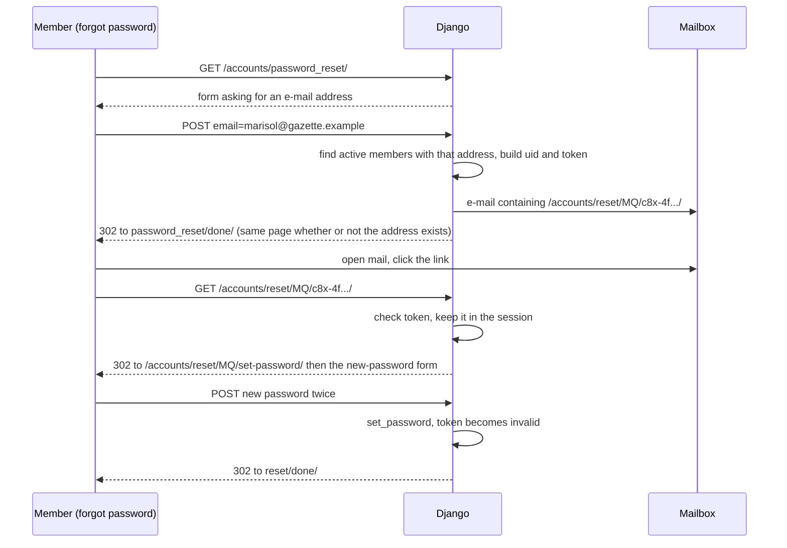

# Password change and reset

> **Before this lesson:** the Gazette has login, logout and sign-up with the custom `Member` model, and `django.contrib.auth.urls` is included under `accounts/` ([Authentication flows end to end](#/lesson/django/auth-flows)). You know how passwords are hashed and how sessions work ([The auth app: users, passwords and sessions](#/lesson/django/auth-app)).

## In plain words

Two situations look alike and are handled very differently.

**Password change**: you are logged in and know your current password; you want a new one. The site asks for the old password once more (to be sure it is really you at the keyboard and not someone who found your laptop open) and then for the new one twice.

**Password reset**: you have *forgotten* your password, so you cannot log in at all. The site cannot tell you the old password, because it never stored it; it only has a one-way fingerprint. Instead it lets you prove your identity another way: it sends a special single-use link to the e-mail address on your account. Whoever can open that mailbox may set a new password.

An everyday picture: changing the lock while you hold the key, versus being locked out. Locked out, you call a locksmith, who asks for proof that you live there before opening the door. The e-mailed link is that proof.

Django ships both features complete: views, forms, the secure link. They are already switched on by the `include("django.contrib.auth.urls")` line. Your job is templates and, for reset, a way to send e-mail.

Why it matters for a job: a home-made password reset is one of the classic sources of account-takeover vulnerabilities. Knowing that the framework's version exists, how its token works and what it deliberately does *not* reveal is exactly what a security-minded interviewer checks.

## The six routes you already have

| Address | URL name | View | Template it looks for |
|---|---|---|---|
| `accounts/password_change/` | `password_change` | `PasswordChangeView` | `registration/password_change_form.html` |
| `accounts/password_change/done/` | `password_change_done` | `PasswordChangeDoneView` | `registration/password_change_done.html` |
| `accounts/password_reset/` | `password_reset` | `PasswordResetView` | `registration/password_reset_form.html` |
| `accounts/password_reset/done/` | `password_reset_done` | `PasswordResetDoneView` | `registration/password_reset_done.html` |
| `accounts/reset/<uidb64>/<token>/` | `password_reset_confirm` | `PasswordResetConfirmView` | `registration/password_reset_confirm.html` |
| `accounts/reset/done/` | `password_reset_complete` | `PasswordResetCompleteView` | `registration/password_reset_complete.html` |

Open `/accounts/password_change/` while logged in. Surprisingly, a page appears, styled like the admin. The admin app ships templates with exactly these names for its own use, and Django found those. You will replace them with your own.

> [!WARNING]
> Your templates must be found **before** the admin's. A project-level `templates` folder listed in `TEMPLATES["DIRS"]` is always searched first, so putting them in `templates/registration/` works. If you keep them inside an app instead, that app must be listed **above** `django.contrib.admin` in `INSTALLED_APPS`, or the admin-styled pages keep appearing.

## Part 1: password change

Two templates.

```html
<!-- templates/registration/password_change_form.html -->

Change password

  <h1>Change your password</h1>
  <form method="post">
    
    {{ form.as_div }}
    <button type="submit">Change password</button>
  </form>

```

```html
<!-- templates/registration/password_change_done.html -->

Password changed

  <h1>Password changed</h1>
  <p>Your new password is active. <a href="">Back to the front page</a></p>

```

The form supplied by the view, `PasswordChangeForm`, has three fields: `old_password`, `new_password1`, `new_password2`. It verifies the old password, checks that the two new entries match, and runs the password validators.

Two behaviours are built in and worth knowing:

- The view requires login. An anonymous visitor is redirected to the login page with `?next=`.
- Changing a password **logs out every other session** of that user: sessions on other devices stop working. The session that performed the change stays logged in. This is the right behaviour if the reason for the change is "someone else may know my password". The mechanism is explained under "How other sessions are invalidated" below.

## Part 2: e-mail during development

Password reset sends an e-mail, and a development machine has no mail server. Django's answer is a setting that chooses *what "sending" means*:

```python
# config/settings.py
EMAIL_BACKEND = "django.core.mail.backends.console.EmailBackend"
DEFAULT_FROM_EMAIL = "Harbour Gazette <newsroom@gazette.example>"
```

The **console backend** prints each e-mail into the terminal where `runserver` is running, instead of sending it. You copy the link from the terminal. The next lesson configures real delivery; nothing in this lesson changes when you do.

## Part 3: password reset, the four pages

The flow has four screens and one e-mail:



### 1. The request form

```html
<!-- templates/registration/password_reset_form.html -->

Reset password

  <h1>Forgotten your password?</h1>
  <p>Enter the e-mail address of your account and we will send you a link to choose a new one.</p>
  <form method="post">
    
    {{ form.as_div }}
    <button type="submit">Send the link</button>
  </form>

```

### 2. "Check your inbox"

```html
<!-- templates/registration/password_reset_done.html -->

Check your inbox

  <h1>Check your inbox</h1>
  <p>If an account exists for the address you entered, we have sent instructions for choosing a new password.
     The message should arrive within a few minutes; look in your spam folder too.</p>

```

Read the wording again: "**If** an account exists". Django shows this page whether or not the address belongs to a member, and sends mail only when it does. Saying "no account with that address" would let anyone test which e-mail addresses are registered, a privacy leak and a gift to attackers.

### 3. The e-mail

Two more templates define the message: a subject and a body.

```
{# templates/registration/password_reset_subject.txt #}
Choose a new password for {{ site_name }}
```

```
{# templates/registration/password_reset_email.html #}
Hello {{ user.get_username }},

Someone asked to reset the password of your {{ site_name }} account.
If that was you, open this link to choose a new password:

{{ protocol }}://{{ domain }}

The link works once and expires in 3 days.
If you did not ask for this, ignore this message; your password stays unchanged.
```

Despite its `.html` name, the body template is sent as plain text by default. The view supplies the variables `user`, `uid`, `token`, `protocol` (`http` or `https`), `domain` and `site_name`. The subject must be a single line.

### 4. Choosing the new password

```html
<!-- templates/registration/password_reset_confirm.html -->

Choose a new password

  
    <h1>Choose a new password</h1>
    <form method="post">
      
      {{ form.as_div }}
      <button type="submit">Save new password</button>
    </form>
  
    <h1>This link no longer works</h1>
    <p>It was already used or it has expired. <a href="">Request a new link</a>.</p>
  

```

The view sets `validlink`. Always handle the `else` branch: people click old e-mails.

### 5. Done

```html
<!-- templates/registration/password_reset_complete.html -->

Password saved

  <h1>Password saved</h1>
  <p>You can now <a href="">log in</a> with your new password.</p>

```

Try the flow: request a reset for the superuser's address, copy the link from the terminal, and set a new password.

## How the reset link is secured

The link has two variable parts: `/accounts/reset/<uidb64>/<token>/`.

- **`uidb64`** is the member's primary key, written in URL-safe **base64** (an encoding that spells bytes with letters and digits; `MQ` is the text `1`). It is not secret. It tells Django *which* account the link is for.
- **`token`** proves that the link was issued by this site for this account, recently, and has not been used.

The clever part: the token is **not stored anywhere**. It is computed. Django takes a timestamp and calculates a keyed fingerprint (an **HMAC**, a hash that also depends on a secret key) over several values:

`primary key + current password hash + last login time + timestamp + e-mail address`, keyed with the project's `SECRET_KEY`.

The token is the timestamp followed by that fingerprint. To check a link, Django recomputes the fingerprint from the current state of the account and compares. This design gives four properties for free:

| Property | Why it holds |
|---|---|
| Cannot be forged | computing the fingerprint requires `SECRET_KEY` |
| Expires | the timestamp is part of the token; older than `PASSWORD_RESET_TIMEOUT` (default 259200 seconds = 3 days) is refused |
| Single use | setting a new password changes the password hash, so the old fingerprint no longer matches |
| Invalid after any login | logging in changes `last_login`, with the same effect |

The model below is the scheme in miniature with the standard library. Run it and follow the four checks at the bottom.

```python-run
import hashlib, hmac

SECRET_KEY = "keep-this-out-of-the-repository"
PASSWORD_RESET_TIMEOUT = 3 * 24 * 3600            # seconds

def fingerprint(user, timestamp):
    state = f"{user['pk']}{user['password']}{user['last_login']}{timestamp}{user['email']}"
    return hmac.new(SECRET_KEY.encode(), state.encode(), hashlib.sha256).hexdigest()[:32]

def make_token(user, now):
    return f"{now}-{fingerprint(user, now)}"

def check_token(user, token, now):
    try:
        timestamp_text, digest = token.split("-")
        timestamp = int(timestamp_text)
    except ValueError:
        return False
    if not hmac.compare_digest(digest, fingerprint(user, timestamp)):
        return False                                  # forged, or the account changed since
    return now - timestamp <= PASSWORD_RESET_TIMEOUT  # not too old

member = {"pk": 1, "password": "pbkdf2$OLDHASH", "last_login": 1000, "email": "marisol@gazette.example"}
issued_at = 5000
token = make_token(member, issued_at)
print("token:", token)

print("fresh link            :", check_token(member, token, issued_at + 600))
print("after four days       :", check_token(member, token, issued_at + 4 * 24 * 3600))
print("tampered token        :", check_token(member, token[:-1] + "0", issued_at + 600))

member["password"] = "pbkdf2$NEWHASH"                 # the member used the link and set a new password
print("same link used again  :", check_token(member, token, issued_at + 900))
```

Nothing was written to a database, and yet the link became useless the moment the password changed. One consequence follows for operations: if `SECRET_KEY` is replaced, all outstanding reset links stop working (as do all sessions). Django's `SECRET_KEY_FALLBACKS` setting lists old keys that are still accepted for verification, which allows a key to be rotated without that disruption.

A second protection concerns the address bar. The token would otherwise sit in the URL of the new-password page and could leak through the browser history or the `Referer` header sent to other sites. `PasswordResetConfirmView` therefore stores the token in the session on first arrival and immediately redirects to an address in which the token is replaced by the fixed text `set-password`.

## How other sessions are invalidated

When you log in, Django stores in the session not only your user id but also a fingerprint derived from your password hash, the **session auth hash**. On every request the authentication middleware recomputes that fingerprint from the current password hash and compares. After a password change the stored value no longer matches, and the session is treated as logged out.

`PasswordChangeView` refreshes the fingerprint in the *current* session by calling `update_session_auth_hash(request, user)`, which is why you stay logged in on the device where you changed the password. If you ever write your own password-changing view, call that function yourself, or the user is logged out at the very moment of success.

## Customising without rewriting

The views accept options through `as_view()` or a subclass. To send people to a friendlier place after a change, and to add a message:

```python
# accounts/views.py
from django.contrib.auth.views import PasswordChangeView
from django.contrib.messages.views import SuccessMessageMixin
from django.urls import reverse_lazy


class SitePasswordChangeView(SuccessMessageMixin, PasswordChangeView):
    success_url = reverse_lazy("profile")
    success_message = "Your password was changed. Other devices have been logged out."
```

```python
# accounts/urls.py (above the built-in include)
path("password_change/", SitePasswordChangeView.as_view(), name="password_change"),
```

`PasswordResetView` similarly accepts `email_template_name`, `subject_template_name`, `html_email_template_name` (for a formatted version), `from_email` and `extra_email_context`.

## Tests

Django's test runner replaces the e-mail backend with an in-memory one automatically. Sent messages appear in the list `mail.outbox`.

```python
# accounts/test_passwords.py
import re

from django.contrib.auth import get_user_model
from django.core import mail
from django.test import TestCase
from django.urls import reverse


class PasswordChangeTests(TestCase):
    @classmethod
    def setUpTestData(cls):
        cls.member = get_user_model().objects.create_user(
            "marisol", email="marisol@gazette.example", password="tide-chart-88")

    def test_requires_login(self):
        response = self.client.get(reverse("password_change"))
        self.assertRedirects(response, f"{reverse('login')}?next={reverse('password_change')}")

    def test_change_keeps_session_and_updates_password(self):
        self.client.force_login(self.member)
        response = self.client.post(reverse("password_change"), {
            "old_password": "tide-chart-88", "new_password1": "kelp-forest-51", "new_password2": "kelp-forest-51"})
        self.assertEqual(response.status_code, 302)
        self.member.refresh_from_db()
        self.assertTrue(self.member.check_password("kelp-forest-51"))
        self.assertIn("_auth_user_id", self.client.session)

    def test_wrong_old_password(self):
        self.client.force_login(self.member)
        response = self.client.post(reverse("password_change"), {
            "old_password": "nope", "new_password1": "kelp-forest-51", "new_password2": "kelp-forest-51"})
        self.assertEqual(response.status_code, 200)
        self.assertIn("old_password", response.context["form"].errors)


class PasswordResetTests(TestCase):
    @classmethod
    def setUpTestData(cls):
        cls.member = get_user_model().objects.create_user(
            "marisol", email="marisol@gazette.example", password="tide-chart-88")

    def test_unknown_address_sends_nothing_but_looks_the_same(self):
        response = self.client.post(reverse("password_reset"), {"email": "nobody@gazette.example"})
        self.assertRedirects(response, reverse("password_reset_done"))
        self.assertEqual(len(mail.outbox), 0)

    def test_full_reset_flow(self):
        self.client.post(reverse("password_reset"), {"email": "marisol@gazette.example"})
        self.assertEqual(len(mail.outbox), 1)
        message = mail.outbox[0]
        self.assertEqual(message.to, ["marisol@gazette.example"])
        link = re.search(r"/accounts/reset/[^\s]+", message.body).group(0)

        response = self.client.get(link, follow=True)             # redirects to .../set-password/
        self.assertTrue(response.context["validlink"])
        confirm_url = response.redirect_chain[-1][0]

        response = self.client.post(confirm_url, {"new_password1": "kelp-forest-51", "new_password2": "kelp-forest-51"})
        self.assertRedirects(response, reverse("password_reset_complete"))
        self.member.refresh_from_db()
        self.assertTrue(self.member.check_password("kelp-forest-51"))

        response = self.client.get(link, follow=True)             # the same link a second time
        self.assertFalse(response.context["validlink"])
```

The second test walks the whole journey, including the detail that a used link is dead.

> [!NOTE]
> **What changed since the book.** The book builds the same four reset templates. Changes since Django 2.1: the reset-link lifetime setting is `PASSWORD_RESET_TIMEOUT` in seconds (the old `PASSWORD_RESET_TIMEOUT_DAYS` was removed in 4.0); tokens use SHA-256 and include the e-mail address (3.1), so changing the address also invalidates links; `SECRET_KEY_FALLBACKS` (4.1) supports key rotation; and the redirect that hides the token from the address bar was added in 1.11.

> [!INTERVIEW]
> **"How does Django's password reset token work, and why is it safe?"** The link carries the base64-encoded user id and a token consisting of a timestamp plus an HMAC, keyed with `SECRET_KEY`, over the user's primary key, password hash, last-login time, e-mail and the timestamp. Nothing is stored server-side; validation recomputes the HMAC. It cannot be forged without the key, expires after `PASSWORD_RESET_TIMEOUT`, and invalidates itself after use because the password hash changes. The flow avoids user enumeration by showing the same confirmation for unknown addresses, and keeps the token out of the URL after the first hit by moving it to the session. Mention that only users with a usable password and `is_active` receive mail.

> [!TIP]
> Members whose e-mail field is empty can never reset their password. If e-mail is your recovery channel, require it at sign-up (the Gazette's unique `email` field does) and let members confirm changes to it.

## Pitfalls

- **Admin-styled pages keep showing.** Your `registration/` templates are found after the admin's; use the project-level folder or reorder `INSTALLED_APPS`.
- **No e-mail arrives in development.** Look in the `runserver` terminal (console backend), and check that the address belongs to an **active** member with a usable password.
- **"Connection refused" on reset.** No `EMAIL_BACKEND` is configured, so Django tries a mail server on localhost.
- **Revealing whether an address exists.** Keep the neutral wording on the "done" page.
- **Links pointing to `example.com`.** The domain comes from the request's host, or from the `Site` object if `django.contrib.sites` is installed; set it correctly in production.
- **Multi-line subject template.** Newlines are stripped; keep it to one line.
- **Hand-written password change without `update_session_auth_hash`.** The user is logged out immediately after succeeding.
- **Shortening the token lifetime to minutes.** Mail can be slow; hours are reasonable, not seconds.

## Cheat sheet

| Need | Code |
|---|---|
| Enable all password routes | `path("accounts/", include("django.contrib.auth.urls"))` |
| Change-password templates | `registration/password_change_form.html`, `password_change_done.html` |
| Reset templates | `password_reset_form.html`, `password_reset_done.html`, `password_reset_confirm.html`, `password_reset_complete.html` |
| E-mail templates | `password_reset_subject.txt`, `password_reset_email.html` |
| Link in the e-mail | `{{ protocol }}://{{ domain }}` |
| See mail in development | `EMAIL_BACKEND = "django.core.mail.backends.console.EmailBackend"` |
| Link lifetime | `PASSWORD_RESET_TIMEOUT = 259200` (seconds) |
| Stay logged in after a manual change | `update_session_auth_hash(request, user)` |
| Inspect mail in tests | `django.core.mail.outbox` |

## Summary

- Password change is for logged-in users who know the current password; password reset proves identity through a link sent to the account's e-mail address.
- Both are provided by `django.contrib.auth.urls`; you write eight small templates and choose an e-mail backend.
- The reset token is a timestamp plus an HMAC over account state: unforgeable, expiring and single-use without any database row.
- The reset pages never reveal whether an address is registered.
- A password change invalidates the user's other sessions through the session auth hash.

## Glossary

- **Password change**: replacing a known password while logged in.
- **Password reset**: setting a new password after proving identity by e-mail.
- **Console e-mail backend**: a backend that prints messages to the terminal.
- **`uidb64`**: the user's primary key in URL-safe base64.
- **Base64**: an encoding that represents bytes with letters, digits and two symbols.
- **Token**: a value that proves a link is genuine, recent and unused.
- **HMAC**: a hash computed with a secret key, used to detect forgery.
- **`PASSWORD_RESET_TIMEOUT`**: the lifetime of reset links in seconds.
- **User enumeration**: discovering which accounts exist from differences in responses.
- **Session auth hash**: a fingerprint of the password hash stored in the session, used to invalidate sessions after a password change.
- **`mail.outbox`**: the list of messages "sent" during tests.

```quiz
[
  {"q": "Why can a site not e-mail you your forgotten password?",
   "options": ["E-mail is too slow", "Only a one-way hash is stored, so the original password cannot be recovered", "It is against the law everywhere", "Passwords are too long for e-mail"],
   "answer": 1,
   "explain": "Hashing is irreversible by design. The only safe option is to let the user set a new password after proving identity."},
  {"q": "The reset form is submitted with an address that has no account. What does the visitor see?",
   "options": ["An error: no such account", "The same 'check your inbox' page as for a real account", "A 404 page", "The sign-up form"],
   "answer": 1,
   "explain": "Identical responses prevent user enumeration; mail is sent only when an active account matches."},
  {"q": "Why does a reset link stop working after it has been used once?",
   "options": ["Django deletes a token row from the database", "The token is an HMAC over the password hash, which changes when the new password is set", "The e-mail is recalled", "The session is destroyed"],
   "answer": 1,
   "explain": "No token is stored. Validation recomputes the fingerprint from current account state, and that state has changed."},
  {"q": "What does `uidb64` in the reset URL contain?",
   "options": ["The encrypted password", "The user's primary key in base64, which is not secret", "A random number", "The session key"],
   "answer": 1,
   "explain": "It identifies the account. Security comes from the token, not from hiding the id."},
  {"q": "Your custom password_change_form.html is ignored and an admin-styled page appears. Why?",
   "options": ["The view is broken", "The admin app ships a template with the same name that is found first", "DEBUG is off", "The URL name is wrong"],
   "answer": 1,
   "explain": "Template lookup takes the first match. Put yours in a DIRS folder or in an app listed before django.contrib.admin."},
  {"q": "After a successful password change, what happens to the member's sessions on other devices?",
   "options": ["Nothing", "They are logged out, because the session auth hash no longer matches", "They are extended by two weeks", "They receive an e-mail"],
   "answer": 1,
   "explain": "Each session stores a fingerprint of the password hash; a change invalidates all sessions except the one refreshed by update_session_auth_hash."},
  {"q": "What does the console e-mail backend do?",
   "options": ["Sends mail through the terminal's mail program", "Prints each message to the terminal instead of sending it", "Stores mail in the database", "Discards all mail silently"],
   "answer": 1,
   "explain": "It is a development convenience: you read the message and copy links from the runserver output."},
  {"q": "Why does PasswordResetConfirmView redirect to an address ending in set-password?",
   "options": ["To shorten the URL", "To remove the token from the address bar so it cannot leak through history or the Referer header", "To log the user in", "To validate the e-mail"],
   "answer": 1,
   "explain": "The token is moved into the session on first access and replaced by a fixed placeholder in the URL."}
]
```

> **Source:** Vincent, *Django for Beginners*, ch. 11 (Password Change and Reset). Docs: https://docs.djangoproject.com/en/5.2/topics/auth/default/#django.contrib.auth.views.PasswordChangeView · https://docs.djangoproject.com/en/5.2/topics/auth/default/#django.contrib.auth.views.PasswordResetView · https://docs.djangoproject.com/en/5.2/ref/settings/#password-reset-timeout · https://docs.djangoproject.com/en/5.2/topics/auth/default/#session-invalidation-on-password-change
