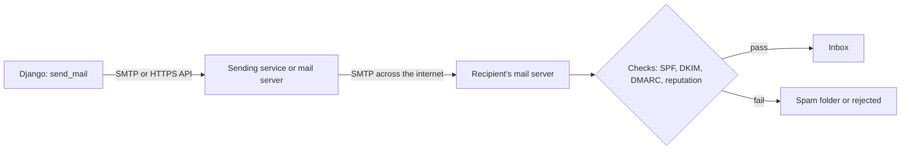

# Sending email

> **Before this lesson:** the Gazette's password reset works with the console e-mail backend ([Password change and reset](#/lesson/django/password-change-reset)), and you can load secrets from environment variables ([Deploying with environment variables](#/lesson/django/env-config-deploy)).

## In plain words

Websites send e-mail constantly: "confirm your address", "here is your reset link", "someone replied to your story". These are called **transactional** e-mails: one message to one person, triggered by something that person did. (Newsletters to many people are a different job with different tools.)

Sending e-mail has two halves:

1. **Composing** the message: who it is from, who it is to, the subject, the text. Django makes this a function call.
2. **Delivering** it: handing the message to a mail server that passes it across the internet to the recipient's mailbox. Your Django process does not do this itself; it hands the message to a **mail server** using a protocol called **SMTP** (Simple Mail Transfer Protocol), or to a delivery company through their web interface.

An everyday picture: writing a letter versus posting it. You write the letter at your desk. Then you choose how it travels: your own courier, the national post, or, while you are only rehearsing, a tray on your desk where the letters pile up unread. In Django that choice is one setting, the **e-mail backend**, and your letter-writing code does not change when you switch.

Why it matters for a job: e-mail is the recovery channel for accounts, so a site that cannot send it reliably is broken in a way users notice immediately. Getting messages *into the inbox* instead of the spam folder involves a few named mechanisms that interviewers and operations colleagues expect you to recognise.

## Step 1: the simplest e-mail

With the console backend still active (`EMAIL_BACKEND = "django.core.mail.backends.console.EmailBackend"`), open `python manage.py shell`:

```python
from django.core.mail import send_mail

send_mail(
    subject="Your story was published",
    message="Good news: 'Harbour reopens' is now on the front page.",
    from_email=None,
    recipient_list=["marisol@gazette.example"],
)
```

The call returns `1` (the number of messages sent) and the terminal shows the complete message with its headers. Argument by argument:

- `subject`: one line.
- `message`: the plain-text body.
- `from_email`: the sender; `None` means "use the `DEFAULT_FROM_EMAIL` setting".
- `recipient_list`: **a list**, even for one address. Each recipient sees the others in the "To" line.

## Step 2: backends, the delivery switch

| Backend (under `django.core.mail.backends.`) | What "send" does | Use |
|---|---|---|
| `smtp.EmailBackend` | connects to a mail server over SMTP | production; this is the default |
| `console.EmailBackend` | prints the message to the terminal | development |
| `filebased.EmailBackend` | writes each message to a file in `EMAIL_FILE_PATH` | development, to inspect HTML |
| `locmem.EmailBackend` | stores messages in the list `mail.outbox` | tests (selected automatically by the test runner) |
| `dummy.EmailBackend` | discards everything | switching mail off |

Because the default is SMTP to `localhost`, a project with no e-mail settings fails with "connection refused" the first time it tries to send. Choose the backend from the environment so that each place the code runs gets the right behaviour:

```python
# config/settings.py
EMAIL_BACKEND = os.environ.get("DJANGO_EMAIL_BACKEND", "django.core.mail.backends.console.EmailBackend")
DEFAULT_FROM_EMAIL = os.environ.get("DJANGO_DEFAULT_FROM_EMAIL", "Harbour Gazette <newsroom@gazette.example>")
SERVER_EMAIL = os.environ.get("DJANGO_SERVER_EMAIL", "errors@gazette.example")
```

`DEFAULT_FROM_EMAIL` is the sender of ordinary messages. `SERVER_EMAIL` is the sender of the automatic error reports Django can mail to the people listed in the `ADMINS` setting when a request crashes in production.

The model below shows why your code never changes: `send_mail` hands the message to whichever backend the setting names.

```python-run
outbox = []

class ConsoleBackend:
    def send(self, message):
        print("--- printed to terminal ---")
        print(f"From: {message['from']}\nTo: {', '.join(message['to'])}\nSubject: {message['subject']}\n\n{message['body']}")
        return 1

class LocMemBackend:                         # what the test runner uses
    def send(self, message):
        outbox.append(message)
        return 1

class DummyBackend:
    def send(self, message):
        return 0

BACKENDS = {"console": ConsoleBackend, "locmem": LocMemBackend, "dummy": DummyBackend}
settings = {"EMAIL_BACKEND": "console", "DEFAULT_FROM_EMAIL": "newsroom@gazette.example"}

def send_mail(subject, message, from_email, recipient_list):
    if "\n" in subject or "\r" in subject:
        raise ValueError("Header values can't contain newlines")      # header-injection guard
    backend = BACKENDS[settings["EMAIL_BACKEND"]]()
    return backend.send({"subject": subject, "body": message,
                         "from": from_email or settings["DEFAULT_FROM_EMAIL"], "to": recipient_list})

send_mail("Welcome to the Gazette", "Glad to have you.", None, ["tomas@gazette.example"])

settings["EMAIL_BACKEND"] = "locmem"          # same calling code, different delivery
send_mail("Welcome to the Gazette", "Glad to have you.", None, ["tomas@gazette.example"])
print("\noutbox now holds", len(outbox), "message for", outbox[0]["to"])

try:
    send_mail("Hello\nBcc: victims@example.com", "spam", None, ["x@example.com"])
except ValueError as error:
    print("rejected:", error)
```

The last call models a real defence. If a subject taken from user input could contain a line break, an attacker could append their own header lines (for example a `Bcc:` with thousands of addresses) and turn your contact form into a spam relay. This is **header injection**; Django's mail functions raise `BadHeaderError` when a header contains a newline.

## Step 3: real delivery

### How a message travels



You will almost never run your own mail server. Sites use a **transactional e-mail provider**, a company whose servers have a good sending reputation and which gives you SMTP credentials or a web API. Common choices include Amazon SES, Postmark, Mailgun, SendGrid, Brevo and Resend. All offer SMTP, so Django's built-in backend works with every one of them.

### SMTP settings

```python
# config/settings.py
EMAIL_HOST = os.environ.get("DJANGO_EMAIL_HOST", "")
EMAIL_PORT = int(os.environ.get("DJANGO_EMAIL_PORT", "587"))
EMAIL_HOST_USER = os.environ.get("DJANGO_EMAIL_HOST_USER", "")
EMAIL_HOST_PASSWORD = os.environ.get("DJANGO_EMAIL_HOST_PASSWORD", "")
EMAIL_USE_TLS = True
EMAIL_TIMEOUT = 10
```

On the server, set `DJANGO_EMAIL_BACKEND=django.core.mail.backends.smtp.EmailBackend` and the four connection values from the provider's dashboard.

- Port **587** with `EMAIL_USE_TLS = True` is the standard combination: the connection starts plain and is upgraded to encrypted (**TLS**, Transport Layer Security, is the encryption used by HTTPS as well). Port 465 with `EMAIL_USE_SSL = True` is the older "encrypted from the first byte" variant. Set one of the two flags, never both.
- `EMAIL_TIMEOUT` stops a request from hanging forever when the mail server does not answer.
- The password is a secret and comes from the environment, never from the repository.

For provider-specific features (tracking bounces, templates stored at the provider, sending through the HTTPS API instead of SMTP), the package `django-anymail` supplies backends for most providers behind Django's normal `send_mail` interface.

### Reaching the inbox: SPF, DKIM, DMARC

Receiving servers are suspicious, because anyone can write any address in the "From" line. Three mechanisms let a domain owner declare which mail is genuine. All three are published as **DNS records**, entries in the internet's directory for your domain; your provider tells you the exact values to add.

| Name | What it declares |
|---|---|
| **SPF** (Sender Policy Framework) | which servers are allowed to send mail for this domain |
| **DKIM** (DomainKeys Identified Mail) | a public key; each message carries a signature that proves it was not altered and came from an authorised sender |
| **DMARC** | what receivers should do when SPF and DKIM fail (nothing, quarantine, reject) and where to send reports |

Without them, messages from your domain land in spam or are refused. Large mailbox providers require them for anyone sending in volume. This is configuration at your domain registrar, not Python, but it is the usual reason behind "the reset e-mail never arrives".

## Step 4: e-mails from templates

Real messages are written as templates, exactly like pages. `render_to_string` fills a template and returns text.

```
{# accounts/templates/accounts/email/welcome.txt #}
Hello {{ member }},

Welcome to the {{ site_name }}. Your account "{{ member.username }}" is ready.

Write your first story: {{ write_url }}

The newsroom
```

```python
# accounts/emails.py  (new file)
from django.conf import settings
from django.core.mail import send_mail
from django.template.loader import render_to_string
from django.urls import reverse


def send_welcome(member, request):
    context = {
        "member": member,
        "site_name": "Harbour Gazette",
        "write_url": request.build_absolute_uri(reverse("home")),
    }
    send_mail(
        subject="Welcome to the Harbour Gazette",
        message=render_to_string("accounts/email/welcome.txt", context),
        from_email=settings.DEFAULT_FROM_EMAIL,
        recipient_list=[member.email],
        fail_silently=False,
    )
```

- `request.build_absolute_uri(path)` turns `/` into `https://gazette.example/`. Links in e-mails must be **absolute**, with scheme and domain; a bare `/stories/` means nothing in a mail program.
- `fail_silently=False` (the default) raises an exception if delivery fails. `True` swallows errors, which hides problems; prefer catching and logging explicitly where failure is acceptable.

Call it when a member signs up:

```python
# accounts/views.py  (inside SignUpView)
    def form_valid(self, form):
        response = super().form_valid(form)
        login(self.request, self.object, backend="django.contrib.auth.backends.ModelBackend")
        send_welcome(self.object, self.request)
        return response
```

### HTML with a plain-text alternative

Formatted e-mails are sent as a message with two versions of the body: plain text for mail programs and people who prefer it, HTML for the rest. The class for this is `EmailMultiAlternatives`.

```python
# accounts/emails.py
from django.core.mail import EmailMultiAlternatives


def send_reply_notice(story, reply, request):
    context = {"story": story, "reply": reply, "url": request.build_absolute_uri(story.get_absolute_url())}
    text_body = render_to_string("stories/email/reply.txt", context)
    html_body = render_to_string("stories/email/reply.html", context)

    message = EmailMultiAlternatives(
        subject=f"New reply to '{story.headline}'",
        body=text_body,
        to=[story.author.email],
        reply_to=["newsroom@gazette.example"],
    )
    message.attach_alternative(html_body, "text/html")
    message.send()
```

`body` is the plain-text version; `attach_alternative` adds the HTML version. `reply_to` sets where answers go, which is useful when the sender is an unattended address. The same class has `cc`, `bcc`, `headers` and `attach(filename, content, mimetype)` for attachments.

What "two versions in one message" means on the wire can be seen with Python's standard `email` library, which Django uses underneath:

```python-run
from email.message import EmailMessage

message = EmailMessage()
message["Subject"] = "New reply to 'Harbour reopens'"
message["From"] = "Harbour Gazette <newsroom@gazette.example>"
message["To"] = "marisol@gazette.example"
message.set_content("Tomas replied: 'Great news for the ferry crews.'\nRead it: https://gazette.example/stories/harbour-reopens/")
message.add_alternative(
    "<p><strong>Tomas</strong> replied: <em>Great news for the ferry crews.</em></p>"
    '<p><a href="https://gazette.example/stories/harbour-reopens/">Read it</a></p>',
    subtype="html",
)

print("content type:", message.get_content_type())
for part in message.iter_parts():
    print(" part:", part.get_content_type(), "|", part.get_content().strip()[:60])
print()
print(message.as_string()[:420])
```

The message is of type `multipart/alternative` with two parts. A mail program picks the richest version it can show. Notice the generated boundary line that separates the parts.

> [!WARNING]
> HTML in e-mail is a much older, stricter dialect than HTML on the web: no external stylesheets, no JavaScript, limited CSS. Keep layouts simple, write styles inline, and always include the plain-text alternative. A missing text part is itself a spam signal.

## Step 5: do not make the visitor wait

`send_mail` blocks until the mail server has accepted the message, typically a few hundred milliseconds and sometimes several seconds. During that time the visitor stares at a loading page, and if the mail server is down, a successful sign-up turns into an error page.

The remedy is to send mail **outside the request**. The view records "send this" and answers immediately; a separate **worker** process delivers it and retries on failure. This is a **background task**.

- The long-standing tool is **Celery** with a message broker such as Redis; lighter alternatives are `django-rq`, Huey and `django-q2`.
- Django 6.0 introduced a built-in **Tasks framework** (`django.tasks`): you decorate a function with `@task` and call `.enqueue(...)`. Django defines the interface; an actual worker comes from a backend package.

```python
# accounts/tasks.py  (Django 6.0+ Tasks framework, sketch)
from django.core.mail import send_mail
from django.tasks import task


@task
def send_welcome_task(member_id):
    from django.contrib.auth import get_user_model
    member = get_user_model().objects.get(pk=member_id)
    send_mail("Welcome to the Harbour Gazette", "Your account is ready.", None, [member.email])


# in the view:  send_welcome_task.enqueue(member_id=self.object.pk)
```

Pass identifiers such as `member_id` to tasks, not whole objects: the task runs later, in another process, and should load fresh data. For a small site, sending inside the request is acceptable as long as `EMAIL_TIMEOUT` is set and failures are caught and logged.

## Step 6: tests

```python
# accounts/test_email.py
from django.contrib.auth import get_user_model
from django.core import mail
from django.core.mail import BadHeaderError, send_mail
from django.test import TestCase, override_settings
from django.urls import reverse


class WelcomeEmailTests(TestCase):
    def test_signup_sends_welcome(self):
        self.client.post(reverse("signup"), {
            "username": "tomas", "email": "tomas@gazette.example", "display_name": "Tomas",
            "password1": "larch-needle-77", "password2": "larch-needle-77"})
        self.assertEqual(len(mail.outbox), 1)
        message = mail.outbox[0]
        self.assertEqual(message.to, ["tomas@gazette.example"])
        self.assertIn("Welcome", message.subject)
        self.assertIn("http://testserver/", message.body)          # absolute link

    @override_settings(DEFAULT_FROM_EMAIL="Gazette <news@gazette.example>")
    def test_default_sender(self):
        send_mail("Subject", "Body", None, ["a@gazette.example"])
        self.assertEqual(mail.outbox[0].from_email, "Gazette <news@gazette.example>")

    def test_header_injection_is_blocked(self):
        with self.assertRaises(BadHeaderError):
            send_mail("Hi\nBcc: everyone@example.com", "Body", None, ["a@gazette.example"])

    def test_html_alternative(self):
        from django.core.mail import EmailMultiAlternatives
        message = EmailMultiAlternatives("S", "plain", to=["a@gazette.example"])
        message.attach_alternative("<p>rich</p>", "text/html")
        message.send()
        sent = mail.outbox[0]
        self.assertEqual(sent.body, "plain")
        self.assertEqual(sent.alternatives[0][1], "text/html")
```

`mail.outbox` is emptied before every test. `override_settings` changes a setting for one test. `http://testserver/` is the host name the test client uses.

> [!NOTE]
> **What changed since the book.** The book configures SendGrid's SMTP relay with a username and password typed into `settings.py`. Today credentials belong in environment variables, providers issue API keys, and SPF/DKIM/DMARC records are effectively mandatory. Django 6.0 modernised the mail internals to Python's current `email` API (the model above) and added the Tasks framework for background sending; `send_mail`, `EmailMultiAlternatives` and the backend setting work as before.

> [!INTERVIEW]
> **"How do you send e-mail from Django in production, and what can go wrong?"** Compose with `send_mail` or `EmailMultiAlternatives` (text plus HTML), templates rendered with `render_to_string`, absolute URLs. Deliver through a transactional provider via the SMTP backend or `django-anymail`, credentials from the environment, TLS on port 587, a timeout. Send from a background task so that requests are fast and failures are retried. For deliverability publish SPF, DKIM and DMARC for the sending domain. In tests assert on `mail.outbox`. Risks to name: header injection (Django raises `BadHeaderError`), blocking the request, silent failures with `fail_silently=True`, and leaking addresses by putting many recipients in `to` instead of sending individually.

> [!TIP]
> To preview HTML e-mails during development, use the file backend (`filebased.EmailBackend` with `EMAIL_FILE_PATH = BASE_DIR / "sent_emails"`) or run a local mail catcher such as Mailpit, which shows every message in a web page.

## Pitfalls

- **"Connection refused" on the first e-mail.** No backend configured; the default SMTP backend tries `localhost:25`.
- **`recipient_list="a@example.com"`** (a string). Django raises `TypeError`; pass a list.
- **Relative links.** Use `request.build_absolute_uri()` or a configured site domain.
- **Both `EMAIL_USE_TLS` and `EMAIL_USE_SSL` set.** They are mutually exclusive.
- **Mail lands in spam.** Missing SPF/DKIM/DMARC, or a "From" address on a domain you do not control (such as a free mailbox provider).
- **Sending to many people in one `to` list.** Everyone sees everyone's address. Send separate messages, or use `send_mass_mail`.
- **`fail_silently=True` everywhere.** Problems go unnoticed for weeks.
- **Real e-mails from a staging server.** Staging should use the console or file backend, or a provider's sandbox, so that test data never mails real people.

## Cheat sheet

| Need | Code |
|---|---|
| One plain message | `send_mail(subject, message, from_email, [to])` |
| Text + HTML | `EmailMultiAlternatives(subject, text, to=[...])` then `.attach_alternative(html, "text/html")` and `.send()` |
| Body from a template | `render_to_string("app/email/name.txt", context)` |
| Absolute link | `request.build_absolute_uri(reverse("name"))` |
| Development | `EMAIL_BACKEND = "django.core.mail.backends.console.EmailBackend"` |
| Production (SMTP) | `EMAIL_HOST`, `EMAIL_PORT = 587`, `EMAIL_HOST_USER`, `EMAIL_HOST_PASSWORD`, `EMAIL_USE_TLS = True` |
| Default sender | `DEFAULT_FROM_EMAIL` |
| Many separate messages, one connection | `send_mass_mail(datatuple)` |
| Tests | `django.core.mail.outbox` |
| Change a setting in a test | `@override_settings(NAME=value)` |

## Summary

- Composing and delivering are separate: your code calls `send_mail`; the `EMAIL_BACKEND` setting decides what happens to the message.
- Use the console or file backend in development, the in-memory backend in tests (automatic), and SMTP or a provider backend in production, with credentials from the environment.
- Write bodies as templates, use absolute links, and send HTML only together with a plain-text alternative.
- Deliverability depends on SPF, DKIM and DMARC records for your domain.
- Send from background tasks when you can, set a timeout, and test with `mail.outbox`.

## Glossary

- **Transactional e-mail**: a message to one user triggered by their action.
- **SMTP**: the protocol used to hand e-mail to a mail server.
- **E-mail backend**: the Django class that performs (or simulates) delivery.
- **TLS**: the encryption protocol protecting the connection to the mail server.
- **Transactional e-mail provider**: a service that delivers application e-mail with good reputation.
- **DNS record**: an entry in the internet's directory for a domain.
- **SPF / DKIM / DMARC**: the three DNS-based mechanisms that authenticate a domain's e-mail.
- **Header injection**: adding forged header lines to a message through unsanitised input.
- **Multipart message**: an e-mail containing several parts, such as text and HTML versions.
- **Absolute URL**: an address including scheme and domain.
- **Background task**: work performed by a separate worker process after the request has been answered.
- **Deliverability**: the likelihood that a message reaches the inbox.

```quiz
[
  {"q": "What does the EMAIL_BACKEND setting decide?",
   "options": ["The wording of e-mails", "How messages are delivered: SMTP, console, file, memory or not at all", "Who may receive e-mail", "The template folder"],
   "answer": 1,
   "explain": "The backend is the delivery mechanism. Calling code is identical for all backends."},
  {"q": "A fresh project calls send_mail and gets 'connection refused'. Why?",
   "options": ["The recipient does not exist", "The default backend is SMTP to localhost, where no mail server is running", "DEBUG is True", "The subject is too long"],
   "answer": 1,
   "explain": "Without configuration Django tries to reach a mail server on the same machine. Set the console backend for development."},
  {"q": "Why must links inside e-mails be absolute URLs?",
   "options": ["Relative links are slower", "A mail program has no site to resolve a path such as /stories/ against", "Django forbids relative links", "For search engines"],
   "answer": 1,
   "explain": "Outside the browser there is no current host. Build links with build_absolute_uri or a configured domain."},
  {"q": "What does EmailMultiAlternatives provide?",
   "options": ["Sending to several recipients", "One message with a plain-text body and an HTML alternative", "Encryption of the message", "Automatic retries"],
   "answer": 1,
   "explain": "The message is multipart/alternative; the mail program shows the richest version it supports."},
  {"q": "What is the risk of putting user input containing a newline into an e-mail subject?",
   "options": ["The subject is truncated", "Header injection: extra headers such as Bcc could be added", "The e-mail becomes HTML", "Nothing"],
   "answer": 1,
   "explain": "Headers are separated by line breaks. Django raises BadHeaderError when a header value contains one."},
  {"q": "Which records help receiving servers trust mail from your domain?",
   "options": ["HTTP and HTTPS", "SPF, DKIM and DMARC", "CSRF and CORS", "A and AAAA only"],
   "answer": 1,
   "explain": "SPF lists permitted senders, DKIM signs messages, and DMARC states the policy when checks fail."},
  {"q": "Why send e-mail from a background task instead of inside the view?",
   "options": ["Background tasks are free", "The request returns quickly and a slow or failing mail server does not break the page; delivery can be retried", "Views are not allowed to send mail", "It avoids the need for a backend"],
   "answer": 1,
   "explain": "SMTP delivery is slow and unreliable compared with a page response. A worker isolates and retries it."},
  {"q": "In tests, where do sent messages go?",
   "options": ["To the real recipients", "To the console", "Into django.core.mail.outbox, an in-memory list", "Nowhere; sending raises an error"],
   "answer": 2,
   "explain": "The test runner switches to the locmem backend, and the outbox is reset before each test."}
]
```

> **Source:** Vincent, *Django for Beginners*, ch. 12 (Email). Docs: https://docs.djangoproject.com/en/5.2/topics/email/ · https://docs.djangoproject.com/en/5.2/ref/settings/#email-backend · https://anymail.dev/ · https://docs.djangoproject.com/en/6.0/topics/tasks/
