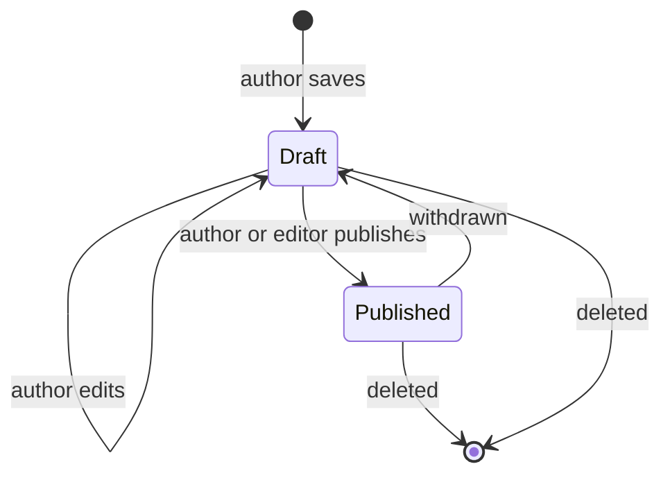

# The Gazette: the stories app end to end

> **Before this lesson:** the Gazette has the `Member` user model, account flows and styled templates ([Authentication flows end to end](#/lesson/django/auth-flows), [Styling with Bootstrap 5 and crispy forms](#/lesson/django/bootstrap)). You have built each piece used here before, in other projects: models with foreign keys and slugs ([Foreign keys, detail views and slugs](#/lesson/django/fk-detail-slugs)), and the editing views ([CreateView, UpdateView and DeleteView](#/lesson/django/edit-views)).

## In plain words

This lesson is a rehearsal with the whole orchestra. Earlier lessons introduced one instrument at a time. Now you assemble a complete feature for the newspaper site: members write **stories**, save them as drafts, publish them, and the public reads them.

Nothing here is new in kind, but two things are new in practice:

1. **A record with a life cycle.** A story is not merely "there": it starts as a private draft and later becomes public. The same table holds both, so every page must be careful about *which* stories it shows to *whom*. Forgetting that once is how unpublished articles leak.
2. **Putting the rule in one place.** The sentence "published stories only" will be needed on the front page, in search, in feeds. Writing the filter by hand each time guarantees one forgotten place. You will give the model its own vocabulary: `Story.objects.published()`.

An everyday picture: a newsroom's noticeboard and the printed paper. Reporters pin drafts on the board for themselves and their editor; only pieces marked "approved" go to print. The danger is a tired typesetter grabbing everything on the board. The cure is a rule everyone uses: "take pages from the approved tray", not "take pages and remember to check each one".

Why it matters for a job: this is the shape of real feature work: model, admin, URLs, views, templates and tests, delivered together. Take-home assignments for Django roles are almost always "build a small CRUD app with some access rule", and reviewers look at structure and tests as much as at whether it runs.

## The plan



| Address | Name | Who | What |
|---|---|---|---|
| `/stories/` | `story-list` | everyone | published stories, newest first |
| `/stories/mine/` | `story-mine` | members | my drafts and published stories |
| `/stories/new/` | `story-create` | members | write a story |
| `/stories/<slug>/` | `story-detail` | everyone if published; the author if draft | read |
| `/stories/<slug>/edit/` | `story-update` | the author | edit |
| `/stories/<slug>/delete/` | `story-delete` | the author | confirm and delete |

```bash
python manage.py startapp stories
```

Add `"stories"` to `INSTALLED_APPS` and `path("stories/", include("stories.urls"))` to `config/urls.py`.

## Step 1: the model and its vocabulary

```python
# stories/models.py
from django.conf import settings
from django.db import models
from django.urls import reverse
from django.utils import timezone
from django.utils.text import slugify


class StoryQuerySet(models.QuerySet):
    def published(self):
        return self.filter(status=Story.Status.PUBLISHED, published_at__lte=timezone.now())

    def drafts(self):
        return self.filter(status=Story.Status.DRAFT)

    def by(self, member):
        return self.filter(author=member)

    def visible_to(self, user):
        if user.is_authenticated:
            return self.filter(models.Q(pk__in=self.published()) | models.Q(author=user))
        return self.published()


class Story(models.Model):
    class Section(models.TextChoices):
        HARBOUR = "harbour", "Harbour"
        COUNCIL = "council", "Council"
        SPORT = "sport", "Sport"
        CULTURE = "culture", "Culture"

    class Status(models.TextChoices):
        DRAFT = "draft", "Draft"
        PUBLISHED = "published", "Published"

    headline = models.CharField(max_length=140)
    slug = models.SlugField(max_length=160, unique=True)
    summary = models.CharField(max_length=280, blank=True)
    body = models.TextField()
    section = models.CharField(max_length=20, choices=Section.choices, default=Section.HARBOUR)
    status = models.CharField(max_length=10, choices=Status.choices, default=Status.DRAFT)
    author = models.ForeignKey(settings.AUTH_USER_MODEL, on_delete=models.PROTECT, related_name="stories")
    created_at = models.DateTimeField(auto_now_add=True)
    updated_at = models.DateTimeField(auto_now=True)
    published_at = models.DateTimeField(null=True, blank=True)
    recommendations = models.PositiveIntegerField(default=0)

    objects = StoryQuerySet.as_manager()

    class Meta:
        ordering = ["-published_at", "-created_at"]
        verbose_name_plural = "stories"
        indexes = [models.Index(fields=["status", "-published_at"])]

    def __str__(self):
        return self.headline

    def get_absolute_url(self):
        return reverse("story-detail", kwargs={"slug": self.slug})

    @property
    def is_published(self):
        return self.status == self.Status.PUBLISHED

    def publish(self):
        self.status = self.Status.PUBLISHED
        if self.published_at is None:
            self.published_at = timezone.now()

    def save(self, *args, **kwargs):
        if not self.slug:
            base = slugify(self.headline) or "story"
            candidate, n = base, 2
            while Story.objects.filter(slug=candidate).exclude(pk=self.pk).exists():
                candidate, n = f"{base}-{n}", n + 1
            self.slug = candidate
        super().save(*args, **kwargs)
```

The familiar parts: choices, a slug filled once, `get_absolute_url`, timestamps (`auto_now` refreshes on every save). The new parts:

- **`StoryQuerySet`** is a subclass of Django's `QuerySet` with extra methods. Each returns `self.filter(...)`, which is itself a `StoryQuerySet`, so they chain: `Story.objects.published().by(member)`.
- **`objects = StoryQuerySet.as_manager()`** makes those methods available from `Story.objects`.
- **`published()`** encodes the rule once, including a subtlety: `published_at__lte=timezone.now()` means a story given a future date stays hidden until then, which gives scheduled publishing for free.
- **`visible_to(user)`** answers "which stories may this person read?": published ones, plus their own. `Q` objects with `|` express OR; the ORM module treats them in depth.
- **`on_delete=models.PROTECT`** on the author: a newspaper should not lose its archive because an account was removed.
- **`indexes`** asks the database to keep a lookup structure for the most frequent question, "published stories, newest first", so it stays fast as the table grows.
- **`publish()`** is a model method holding the state change. It does not call `save()`; the caller decides when to write.

`timezone.now()` returns the current moment with time-zone information, which Django requires when `USE_TZ` is on. Never use `datetime.now()` in a Django project.

```bash
python manage.py makemigrations stories
python manage.py migrate
```

### Why the queryset methods matter

The model below shows the idea with plain lists: a class whose filter methods return new instances of itself, so that the rule "published" is written once and composes with others. Run it and build your own chains.

```python-run
NOW = 100

STORIES = [
    {"headline": "Harbour reopens", "status": "published", "published_at": 90, "author": "marisol"},
    {"headline": "Ferry strike looms", "status": "draft", "published_at": None, "author": "marisol"},
    {"headline": "Regatta results", "status": "published", "published_at": 95, "author": "tomas"},
    {"headline": "Budget preview", "status": "published", "published_at": 250, "author": "tomas"},   # scheduled
    {"headline": "Lighthouse notes", "status": "draft", "published_at": None, "author": "tomas"},
]

class StoryQuerySet:
    def __init__(self, rows):
        self.rows = rows

    def filter(self, test):
        return StoryQuerySet([r for r in self.rows if test(r)])     # always a new StoryQuerySet

    def published(self):
        return self.filter(lambda r: r["status"] == "published" and r["published_at"] <= NOW)

    def by(self, author):
        return self.filter(lambda r: r["author"] == author)

    def visible_to(self, user):
        if user is None:
            return self.published()
        public = {r["headline"] for r in self.published().rows}
        return self.filter(lambda r: r["headline"] in public or r["author"] == user)

    def headlines(self):
        return [r["headline"] for r in self.rows]

objects = StoryQuerySet(STORIES)

print("front page        :", objects.published().headlines())
print("tomas, published  :", objects.published().by("tomas").headlines())
print("anonymous may read:", objects.visible_to(None).headlines())
print("marisol may read  :", objects.visible_to("marisol").headlines())
```

The scheduled "Budget preview" is absent from the front page although its status is "published", and Marisol sees her own draft but not Tomas's. Each view will now state its intent in one word.

## Step 2: the admin, with an action

```python
# stories/admin.py
from django.contrib import admin, messages
from django.utils import timezone

from .models import Story


@admin.register(Story)
class StoryAdmin(admin.ModelAdmin):
    list_display = ["headline", "section", "status", "author", "published_at"]
    list_filter = ["status", "section"]
    search_fields = ["headline", "summary", "body"]
    prepopulated_fields = {"slug": ["headline"]}
    autocomplete_fields = ["author"]
    date_hierarchy = "published_at"
    actions = ["make_published"]

    @admin.action(description="Publish selected stories")
    def make_published(self, request, queryset):
        updated = queryset.filter(status=Story.Status.DRAFT).update(
            status=Story.Status.PUBLISHED, published_at=timezone.now())
        self.message_user(request, f"{updated} stories published.", messages.SUCCESS)
```

An **admin action** is a function offered in the drop-down above the list; it receives the queryset of ticked rows. `queryset.update(...)` changes all of them with a single SQL statement and returns how many rows changed. `autocomplete_fields` replaces a drop-down containing every member with a search box; it works because `MemberAdmin` defines `search_fields`.

## Step 3: a form and the views

```python
# stories/forms.py
from django import forms

from .models import Story


class StoryForm(forms.ModelForm):
    publish_now = forms.BooleanField(required=False, label="Publish immediately")

    class Meta:
        model = Story
        fields = ["headline", "section", "summary", "body"]
        widgets = {"body": forms.Textarea(attrs={"rows": 14})}

    def clean_headline(self):
        headline = self.cleaned_data["headline"].strip()
        if headline.isupper():
            raise forms.ValidationError("Please do not write the headline in capitals.")
        return headline
```

`status`, `author`, `slug` and `published_at` are deliberately absent from `fields`: the server controls them. The extra `publish_now` checkbox is a form-only field that the view interprets.

```python
# stories/views.py
from django.contrib import messages
from django.contrib.auth.mixins import LoginRequiredMixin
from django.urls import reverse_lazy
from django.views.generic import CreateView, DeleteView, DetailView, ListView, UpdateView

from .forms import StoryForm
from .models import Story


class StoryListView(ListView):
    context_object_name = "stories"
    paginate_by = 10

    def get_queryset(self):
        queryset = Story.objects.published().select_related("author")
        section = self.request.GET.get("section", "")
        if section in Story.Section.values:
            queryset = queryset.filter(section=section)
        return queryset

    def get_context_data(self, **kwargs):
        return super().get_context_data(sections=Story.Section.choices, **kwargs)


class MyStoriesView(LoginRequiredMixin, ListView):
    context_object_name = "stories"
    template_name = "stories/story_mine.html"

    def get_queryset(self):
        return Story.objects.by(self.request.user)


class StoryDetailView(DetailView):
    context_object_name = "story"

    def get_queryset(self):
        return Story.objects.visible_to(self.request.user).select_related("author")


class AuthorQuerysetMixin(LoginRequiredMixin):
    """Limit editing views to the logged-in member's own stories."""

    def get_queryset(self):
        return Story.objects.by(self.request.user)


class StoryCreateView(LoginRequiredMixin, CreateView):
    model = Story
    form_class = StoryForm

    def form_valid(self, form):
        form.instance.author = self.request.user
        if form.cleaned_data["publish_now"]:
            form.instance.publish()
        messages.success(self.request, "Story saved.")
        return super().form_valid(form)


class StoryUpdateView(AuthorQuerysetMixin, UpdateView):
    form_class = StoryForm

    def get_initial(self):
        return {"publish_now": self.object.is_published}

    def form_valid(self, form):
        if form.cleaned_data["publish_now"]:
            form.instance.publish()
        else:
            form.instance.status = Story.Status.DRAFT
        messages.success(self.request, "Changes saved.")
        return super().form_valid(form)


class StoryDeleteView(AuthorQuerysetMixin, DeleteView):
    success_url = reverse_lazy("story-mine")
```

Reading notes:

- None of the list or detail views sets `model`; `get_queryset` supplies the rows and Django derives template names from the queryset's model (`stories/story_list.html`, `stories/story_detail.html`, `stories/story_form.html`, `stories/story_confirm_delete.html`).
- `StoryDetailView` uses `visible_to`: a draft requested by anyone but its author is not in the queryset, so the answer is 404. The response does not even confirm that such a draft exists.
- `AuthorQuerysetMixin` is a mixin of your own: three lines that two views share. Writing small mixins like this is how class-based code stays free of repetition.
- `select_related("author")` tells the ORM to fetch each story's author in the same query. Without it, a list of ten stories showing author names would issue eleven queries. The ORM module explains this "N+1" effect.
- `get_context_data(sections=..., **kwargs)` is a compact way to add one item: keyword arguments passed to `super()` end up in the context.
- `get_initial` pre-ticks the checkbox when editing a published story.

```python
# stories/urls.py
from django.urls import path

from . import views

urlpatterns = [
    path("", views.StoryListView.as_view(), name="story-list"),
    path("mine/", views.MyStoriesView.as_view(), name="story-mine"),
    path("new/", views.StoryCreateView.as_view(), name="story-create"),
    path("<slug:slug>/", views.StoryDetailView.as_view(), name="story-detail"),
    path("<slug:slug>/edit/", views.StoryUpdateView.as_view(), name="story-update"),
    path("<slug:slug>/delete/", views.StoryDeleteView.as_view(), name="story-delete"),
]
```

The fixed words `mine/` and `new/` precede the slug route.

## Step 4: templates

```html
<!-- stories/templates/stories/story_list.html -->

Stories | {{ block.super }}

  <h1>Latest stories</h1>
  <p>
    <a href="">All</a>
     · <a href="?section={{ value }}">{{ label }}</a>
  </p>
  
    <article class="card mb-3">
      <div class="card-body">
        <span class="badge text-bg-secondary">{{ story.get_section_display }}</span>
        <h2 class="h4"><a href="{{ story.get_absolute_url }}">{{ story.headline }}</a></h2>
        <p>{{ story.summary|default:story.body|truncatewords:30 }}</p>
        <p class="small text-body-secondary">{{ story.author }} · {{ story.published_at|date:"j M Y, H:i" }}</p>
      </div>
    </article>
  
    <p>No stories in this section yet.</p>
  
  

```

```html
<!-- stories/templates/stories/story_detail.html -->

{{ story.headline }} | {{ block.super }}

  
    <div class="alert alert-warning">Draft: only you can see this page.</div>
  
  <article>
    <h1>{{ story.headline }}</h1>
    <p class="text-body-secondary">{{ story.author }} · {{ story.get_section_display }}
       · {{ story.published_at|date:"j F Y" }}</p>
    <p class="lead">{{ story.summary }}</p>
    {{ story.body|linebreaks }}
  </article>
  
    <p><a class="btn btn-outline-primary btn-sm" href="">Edit</a>
       <a class="btn btn-outline-danger btn-sm" href="">Delete</a></p>
  

```

`{{ story.body|linebreaks }}` turns blank lines into paragraphs **after** escaping the text, so a body containing `<script>` is displayed, not executed. The form and confirmation templates follow the pattern of the lesson on editing views, using `{{ form|crispy }}`.

## Step 5: tests that pin down the rules

```python
# stories/tests.py
from datetime import timedelta

from django.contrib.auth import get_user_model
from django.test import TestCase
from django.urls import reverse
from django.utils import timezone

from .models import Story


class StoryRulesTests(TestCase):
    @classmethod
    def setUpTestData(cls):
        Member = get_user_model()
        cls.marisol = Member.objects.create_user("marisol", email="m@gazette.example", password="x")
        cls.tomas = Member.objects.create_user("tomas", email="t@gazette.example", password="x")
        now = timezone.now()
        cls.live = Story.objects.create(headline="Harbour reopens", body="...", author=cls.marisol,
                                        status="published", published_at=now - timedelta(hours=1))
        cls.draft = Story.objects.create(headline="Ferry strike looms", body="...", author=cls.marisol)
        cls.scheduled = Story.objects.create(headline="Budget preview", body="...", author=cls.tomas,
                                             status="published", published_at=now + timedelta(days=1))

    def test_queryset_vocabulary(self):
        self.assertQuerySetEqual(Story.objects.published(), [self.live])
        self.assertEqual(set(Story.objects.visible_to(self.marisol)), {self.live, self.draft})
        self.assertEqual(set(Story.objects.visible_to(self.tomas)), {self.live, self.scheduled})

    def test_unique_slugs(self):
        twin = Story.objects.create(headline="Harbour reopens", body="again", author=self.tomas)
        self.assertEqual(self.live.slug, "harbour-reopens")
        self.assertEqual(twin.slug, "harbour-reopens-2")

    def test_list_shows_only_published(self):
        response = self.client.get(reverse("story-list"))
        self.assertContains(response, "Harbour reopens")
        self.assertNotContains(response, "Ferry strike looms")
        self.assertNotContains(response, "Budget preview")

    def test_draft_is_404_for_others_and_200_for_author(self):
        url = self.draft.get_absolute_url()
        self.assertEqual(self.client.get(url).status_code, 404)
        self.client.force_login(self.tomas)
        self.assertEqual(self.client.get(url).status_code, 404)
        self.client.force_login(self.marisol)
        self.assertContains(self.client.get(url), "only you can see this page")

    def test_create_as_draft_then_publish_by_edit(self):
        self.client.force_login(self.tomas)
        self.client.post(reverse("story-create"), {"headline": "Regatta results", "section": "sport",
                                                   "summary": "", "body": "Close finish."})
        story = Story.objects.get(headline="Regatta results")
        self.assertEqual((story.author, story.status, story.published_at), (self.tomas, "draft", None))
        self.client.post(reverse("story-update", args=[story.slug]),
                         {"headline": "Regatta results", "section": "sport", "summary": "",
                          "body": "Close finish.", "publish_now": "on"})
        story.refresh_from_db()
        self.assertTrue(story.is_published)
        self.assertIsNotNone(story.published_at)

    def test_cannot_set_status_or_author_through_the_form(self):
        self.client.force_login(self.tomas)
        self.client.post(reverse("story-create"), {"headline": "Sneaky post", "section": "sport", "body": "x",
                                                   "status": "published", "author": self.marisol.pk})
        story = Story.objects.get(headline="Sneaky post")
        self.assertEqual((story.author, story.status), (self.tomas, "draft"))

    def test_only_author_can_edit_or_delete(self):
        self.client.force_login(self.tomas)
        self.assertEqual(self.client.get(reverse("story-update", args=[self.live.slug])).status_code, 404)
        self.assertEqual(self.client.post(reverse("story-delete", args=[self.live.slug])).status_code, 404)
        self.assertTrue(Story.objects.filter(pk=self.live.pk).exists())

    def test_list_uses_two_queries(self):
        with self.assertNumQueries(2):          # count for pagination + one joined select
            self.client.get(reverse("story-list"))
```

Each test states a business rule in its name. Together they are a specification that fails loudly if someone later "simplifies" a queryset.

> [!NOTE]
> **What changed since the book.** The book's newspaper app has an `Article` with title, body, date and author, and every logged-in user may edit every article until the following chapter. The Gazette's stories add a draft/published life cycle and custom queryset methods because that is where real projects immediately go. `QuerySet.as_manager()`, `TextChoices` (3.0), `@admin.action` (3.2) and `Meta.indexes` (which replaced `index_together`, removed in 5.1) are the current idioms.

> [!INTERVIEW]
> **"Where should business rules such as 'only published stories are public' live?"** As close to the data as possible and in one place: custom `QuerySet` methods exposed through the manager (`Story.objects.published()`), and model methods for state changes (`story.publish()`). Views then compose these (`get_queryset` returning `Story.objects.visible_to(request.user)`), templates only display, and tests target the queryset methods directly. Be ready to contrast with alternatives: logic in views (repetition, leaks), in templates (untestable), or in a separate service layer (reasonable when operations span several models).

> [!WARNING]
> `queryset.update(...)` and `bulk_create` write straight to the database. They do **not** call the model's `save()` method and do not send `pre_save`/`post_save` signals. Logic placed in `save()`, such as slug generation, is skipped. The admin action above is safe because it changes only status and date.

> [!TIP]
> Returning 404 instead of 403 for another member's draft is a deliberate choice: it avoids confirming that a hidden resource exists. Use 403 when the user already knows the object exists and only the action is forbidden.

## Pitfalls

- **Filtering by status in each view by hand.** One forgotten view publishes drafts. Use the queryset method.
- **`Story.objects.all()` in a detail view.** Drafts become readable by anyone who guesses the slug.
- **Exposing `status` or `author` in the form.** Members could publish or impersonate by editing the POST.
- **`datetime.now()`** with `USE_TZ = True`: warnings about naive datetimes and wrong comparisons. Use `timezone.now()`.
- **Model methods that save implicitly.** Callers lose control over when and how often the database is written.
- **Default manager that hides rows.** Replacing `objects` with a manager that returns only published stories breaks the admin and related lookups; keep the default manager unfiltered and add methods.
- **Forgetting `select_related`** on lists that show the author.
- **Slug route before fixed routes.**

## Cheat sheet

| Need | Code |
|---|---|
| Reusable filters | `class StoryQuerySet(models.QuerySet): def published(self): return self.filter(...)` |
| Attach to the model | `objects = StoryQuerySet.as_manager()` |
| Chain | `Story.objects.published().by(member)` |
| OR conditions | `models.Q(a=1) \| models.Q(b=2)` |
| State change on the model | `def publish(self): ...` then `story.save()` |
| Current time | `timezone.now()` |
| Database index | `class Meta: indexes = [models.Index(fields=["status", "-published_at"])]` |
| Admin bulk action | `@admin.action(description="...") def f(self, request, queryset): queryset.update(...)` |
| Shared view rule | a small mixin overriding `get_queryset` |
| Fetch the author with the story | `.select_related("author")` |

## Summary

- A feature is a vertical slice: model, admin, form, views, URLs, templates and tests that agree with each other.
- Records with a life cycle need visibility rules; encode them once as custom queryset methods and state-changing model methods.
- Views express intent by choosing a queryset: `published()` for the public list, `visible_to(user)` for detail, `by(user)` for editing.
- Keep server-controlled fields out of forms and set them in `form_valid`.
- Tests named after business rules protect those rules from later changes.

## Glossary

- **Life cycle (workflow)**: the states a record passes through, such as draft and published.
- **Custom QuerySet**: a subclass of `QuerySet` with domain-specific filter methods.
- **`as_manager()`**: creates a manager that exposes a custom queryset's methods.
- **Model method**: a method on a model class implementing behaviour of one record.
- **`Q` object**: an object representing a query condition that can be combined with `|` and `&`.
- **Index**: a database structure that speeds up lookups on chosen columns.
- **Admin action**: a bulk operation offered on the admin's list page.
- **`select_related`**: a queryset method that joins related single objects into the same query.
- **Naive / aware datetime**: a datetime without / with time-zone information.
- **Vertical slice**: a feature implemented through all layers of the application.

```quiz
[
  {"q": "Why define `published()` on a custom QuerySet instead of writing `.filter(status='published')` in each view?",
   "options": ["It is required by Django", "The rule lives in one place, so no view can forget part of it and it can be tested directly", "Filters in views are slower", "QuerySet methods bypass the database"],
   "answer": 1,
   "explain": "A single definition prevents inconsistent copies and makes later changes, such as the scheduled-publishing condition, apply everywhere."},
  {"q": "What does `objects = StoryQuerySet.as_manager()` do?",
   "options": ["Creates a second database table", "Makes the queryset's custom methods callable on Story.objects and chainable", "Hides drafts from the admin", "Caches all stories"],
   "answer": 1,
   "explain": "The manager proxies methods to a StoryQuerySet, and each method returns a StoryQuerySet again."},
  {"q": "A story has status 'published' and published_at tomorrow. Does it appear in `Story.objects.published()` today?",
   "options": ["Yes", "No, because published_at__lte=now excludes future dates", "Only for staff", "It raises an error"],
   "answer": 1,
   "explain": "The date condition implements scheduled publishing: the story becomes visible when its time arrives."},
  {"q": "StoryDetailView uses `Story.objects.visible_to(request.user)`. What does another member get when requesting someone's draft?",
   "options": ["The draft", "403 Forbidden", "404 Not Found", "A redirect to login"],
   "answer": 2,
   "explain": "The draft is not in the queryset, so the lookup fails with 404, which also avoids revealing that it exists."},
  {"q": "Why are `status` and `author` not in StoryForm.Meta.fields?",
   "options": ["They are not model fields", "So that clients cannot set them by adding values to the POST; the view sets them", "To make the form shorter only", "ModelForms cannot handle choices"],
   "answer": 1,
   "explain": "Only listed fields are read from submitted data. Server-controlled fields are assigned in form_valid."},
  {"q": "What is true about `queryset.update(status='published')`?",
   "options": ["It calls save() on each object", "It runs one SQL UPDATE and does not call save() or send save signals", "It only works in the admin", "It returns the updated objects"],
   "answer": 1,
   "explain": "update is a bulk operation at SQL level and returns the number of rows matched. Per-object logic in save() is skipped."},
  {"q": "Why does the list view call `.select_related('author')`?",
   "options": ["To sort by author", "To fetch each story's author in the same query and avoid one extra query per story", "To filter by author", "To check permissions"],
   "answer": 1,
   "explain": "Without it, printing story.author in a loop triggers a query per row, the N+1 problem."},
  {"q": "Which function gives the current time correctly in a project with USE_TZ = True?",
   "options": ["datetime.now()", "time.time()", "timezone.now()", "date.today()"],
   "answer": 2,
   "explain": "django.utils.timezone.now() returns an aware datetime in UTC, comparable with DateTimeField values."}
]
```

> **Source:** Vincent, *Django for Beginners*, ch. 13 (Newspaper app). Docs: https://docs.djangoproject.com/en/5.2/topics/db/managers/#creating-a-manager-with-queryset-methods · https://docs.djangoproject.com/en/5.2/ref/contrib/admin/actions/ · https://docs.djangoproject.com/en/5.2/ref/models/options/#indexes · https://docs.djangoproject.com/en/5.2/topics/i18n/timezones/
