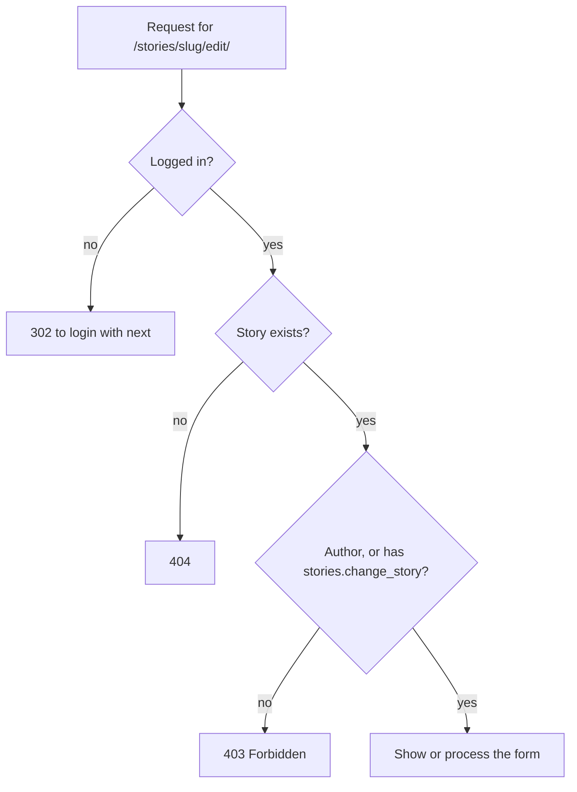

# Permissions, authorisation and mixins

> **Before this lesson:** the Gazette's `stories` app lets members write, publish, edit and delete their own stories, with ownership enforced through querysets ([The Gazette: the stories app end to end](#/lesson/django/gazette-stories)). You know the difference between authentication and authorisation, and the flags `is_staff` and `is_superuser` ([The auth app: users, passwords and sessions](#/lesson/django/auth-app), [Custom user forms and admin integration](#/lesson/django/custom-user-admin)). You should be comfortable with class inheritance ([Classes: modelling things with objects](#/lesson/python/py-start-classes)).

## In plain words

Logging in answers "who are you?". **Authorisation** answers the next question: "are *you* allowed to do *this*?". A newspaper has many answers to it. Anyone may read. Members may write. Only the author may edit a draft. Editors may edit and publish anyone's story. Nobody but the chief may delete a published piece.

Rules like these come at three levels, from coarse to fine:

1. **Logged in or not.** "Members only."
2. **A permission on a kind of thing.** "May change stories." Django calls these **model permissions** and stores them in the database, so that administrators can grant them without a programmer.
3. **A rule about one particular thing.** "May change *this* story, because they wrote it." These are **object-level** rules, and you write them in code.

An everyday picture: a theatre. A ticket gets you into the building (level 1). A "crew" badge opens backstage doors (level 2). The key to dressing room 4 belongs to the actor assigned to it (level 3).

The second half of the title, **mixins**, is the mechanism Django's class-based views use to attach such rules: small classes you add to a view's list of parent classes. Their order matters, and this lesson shows why.

Why it matters for a job: "broken access control" has topped the industry's list of most common web vulnerabilities for years. The bugs are rarely exotic: a view that forgot the check. Interviewers ask you to add a rule to a view and watch whether you enforce it on the server, where it belongs.

## Level 2: model permissions

For every model, Django creates four permissions when you run `migrate`:

| Codename | Meaning |
|---|---|
| `add_story` | may create stories |
| `change_story` | may edit stories |
| `delete_story` | may delete stories |
| `view_story` | may view stories (used mainly by the admin for read-only access) |

A permission is referred to by the string `"<app label>.<codename>"`, for example `"stories.change_story"`. Permissions are rows in a table; they are granted to a user directly or, far better, to a **group** the user belongs to.

In `python manage.py shell`:

```python
from django.contrib.auth import get_user_model
from django.contrib.auth.models import Group, Permission

editors = Group.objects.create(name="editors")
editors.permissions.add(
    Permission.objects.get(codename="change_story"),
    Permission.objects.get(codename="delete_story"),
)

tomas = get_user_model().objects.get(username="tomas")
tomas.groups.add(editors)

tomas = get_user_model().objects.get(username="tomas")   # reload: permissions are cached per object
tomas.has_perm("stories.change_story")     # True
tomas.has_perm("stories.add_story")        # False
tomas.has_perms(["stories.change_story", "stories.delete_story"])   # True
```

`has_perm` is the one question to ask. Its rules, in order:

1. An **inactive** user has no permissions at all.
2. An active **superuser** has every permission, without any rows.
3. Otherwise the answer is yes if the permission was granted to the user or to any of their groups.

The model below implements exactly that. Run it and change the data.

```python-run
GROUPS = {
    "members": {"stories.add_story"},
    "editors": {"stories.change_story", "stories.delete_story", "stories.publish_story"},
}

def has_perm(user, perm):
    if not user["is_active"]:
        return False                                   # rule 1
    if user["is_superuser"]:
        return True                                    # rule 2
    granted = set(user["perms"])
    for group in user["groups"]:
        granted |= GROUPS.get(group, set())            # rule 3: union of own and group permissions
    return perm in granted

marisol = {"is_active": True, "is_superuser": False, "perms": [], "groups": ["members"]}
tomas   = {"is_active": True, "is_superuser": False, "perms": [], "groups": ["members", "editors"]}
chief   = {"is_active": True, "is_superuser": True,  "perms": [], "groups": []}
former  = {"is_active": False, "is_superuser": True, "perms": [], "groups": ["editors"]}

for name, user in [("marisol", marisol), ("tomas", tomas), ("chief", chief), ("former", former)]:
    answers = {p.split(".")[1]: has_perm(user, p) for p in
               ["stories.add_story", "stories.change_story", "stories.publish_story"]}
    print(f"{name:8}", answers)
```

The deactivated account answers `False` to everything even though it is a superuser. Grant to **groups**, not to individuals: when a new editor joins you add one membership instead of remembering six permissions, and you can audit who may do what by reading the group list.

### A permission of your own

The four automatic permissions rarely cover business actions. Declare extra ones in the model's `Meta`:

```python
# stories/models.py
class Story(models.Model):
    # ... fields as before ...

    class Meta:
        ordering = ["-published_at", "-created_at"]
        verbose_name_plural = "stories"
        permissions = [("publish_story", "Can publish and withdraw any story")]
```

Run `makemigrations` and `migrate`; the permission `stories.publish_story` now exists and appears in the admin's permission list.

### Creating groups reproducibly

Groups created in the shell exist only in your database. To make them part of the project, create them in a **data migration**: a migration that changes rows instead of tables.

```bash
python manage.py makemigrations stories --empty --name create_editor_group
```

```python
# stories/migrations/0003_create_editor_group.py
from django.db import migrations


def create_groups(apps, schema_editor):
    from django.contrib.auth.management import create_permissions

    for app_config in apps.get_app_configs():           # make sure permission rows exist already
        app_config.models_module = True
        create_permissions(app_config, verbosity=0)

    Group = apps.get_model("auth", "Group")
    Permission = apps.get_model("auth", "Permission")
    editors, _ = Group.objects.get_or_create(name="editors")
    editors.permissions.set(Permission.objects.filter(
        codename__in=["change_story", "delete_story", "publish_story"]))


def remove_groups(apps, schema_editor):
    apps.get_model("auth", "Group").objects.filter(name="editors").delete()


class Migration(migrations.Migration):
    dependencies = [("stories", "0002_alter_story_options"), ("auth", "0012_alter_user_first_name_max_length")]
    operations = [migrations.RunPython(create_groups, remove_groups)]
```

`RunPython` takes a forward function and a reverse function. Inside a migration you must obtain models with `apps.get_model(...)`, which returns the model as it looked at that point in history, instead of importing them. The first block exists because permission rows are normally created only after all migrations have finished; calling `create_permissions` early makes them available. The dependency names must match the files in your project (`python manage.py showmigrations` lists them).

## Enforcing rules in views

### Function views: decorators

```python
from django.contrib.auth.decorators import login_required, permission_required


@login_required
@permission_required("stories.publish_story", raise_exception=True)
def review_queue(request):
    ...
```

A **decorator** wraps a function with a check that runs first. They apply bottom-up, but for these two the outcome is the same: anonymous visitors go to the login page, and logged-in users without the permission receive **403 Forbidden**. Without `raise_exception=True`, a logged-in user lacking the permission would be redirected to the login page, which is confusing: logging in again does not help.

### Class-based views: mixins

| Mixin | Rule | When the rule fails |
|---|---|---|
| `LoginRequiredMixin` | user is authenticated | redirect to login |
| `PermissionRequiredMixin` | user has `permission_required` (a string or a list) | anonymous: redirect to login; logged in: 403 |
| `UserPassesTestMixin` | your `test_func()` returns true | anonymous: redirect to login; logged in: 403 |

```python
# stories/views.py
from django.contrib.auth.mixins import LoginRequiredMixin, PermissionRequiredMixin, UserPassesTestMixin


class ReviewQueueView(PermissionRequiredMixin, ListView):
    permission_required = "stories.publish_story"
    template_name = "stories/review_queue.html"
    context_object_name = "stories"

    def get_queryset(self):
        return Story.objects.drafts().select_related("author")
```

All three share a base class, `AccessMixin`, which provides the `raise_exception`, `login_url` and `permission_denied_message` attributes.

## Level 3: rules about one object

The Gazette's rule for editing: *the author may edit their own story; an editor (someone with `stories.change_story`) may edit any story.* That is a permission **or** ownership. Put the rule on the model, where it can be tested without HTTP:

```python
# stories/models.py  (methods of Story)
    def can_be_edited_by(self, user):
        if not user.is_authenticated:
            return False
        return user == self.author or user.has_perm("stories.change_story")

    def can_be_deleted_by(self, user):
        if not user.is_authenticated:
            return False
        if self.is_published:
            return user.has_perm("stories.delete_story")
        return user == self.author or user.has_perm("stories.delete_story")
```

Then use `UserPassesTestMixin` in the views:

```python
# stories/views.py
class StoryUpdateView(LoginRequiredMixin, UserPassesTestMixin, UpdateView):
    model = Story
    form_class = StoryForm

    def test_func(self):
        return self.get_object().can_be_edited_by(self.request.user)


class StoryDeleteView(LoginRequiredMixin, UserPassesTestMixin, DeleteView):
    model = Story
    success_url = reverse_lazy("story-mine")

    def test_func(self):
        return self.get_object().can_be_deleted_by(self.request.user)
```

`test_func` is called before the view's own handler runs. It returns `True` to let the request through. `self.get_object()` fetches the story named in the URL (and raises 404 if there is none).

Two ways of enforcing an object rule now sit side by side, and both are legitimate:

| Technique | Outcome for other users | Good when |
|---|---|---|
| Restrict `get_queryset()` | 404 | the rule is expressible as a filter; you prefer not to reveal existence |
| `UserPassesTestMixin` + model method | 403 | the rule is a calculation, or combines roles and ownership |



### A friendly 403 page

When `DEBUG` is `False`, Django renders the template `403.html` for forbidden requests if you provide one (likewise `404.html` and `500.html`):

```html
<!-- templates/403.html -->

Not allowed

  <h1>You do not have access to this page</h1>
  <p>If you think this is a mistake, contact the newsroom.</p>

```

## Why mixin order matters

A class may inherit from several parents. When a method is called, Python searches the classes in a fixed sequence called the **method resolution order (MRO)**: the class itself, then its parents from left to right, each followed by its own parents. `super()` means "continue with the next class in that sequence".

Every access mixin overrides `dispatch`, the first method of a view to run, performs its check, and then calls `super().dispatch()`. A mixin on the **left** therefore runs **before** the view. On the right, the view's `dispatch` runs first and the mixin's check comes too late or never. The model below prints the order in each case.

```python-run
class View:
    def dispatch(self, user):
        return f"view runs for {user['name']}"

class LoginRequiredMixin:
    def dispatch(self, user):
        if not user["authenticated"]:
            return "302 redirect to login"
        return super().dispatch(user)            # next class in the MRO

class PermissionRequiredMixin:
    def dispatch(self, user):
        if not user["can_edit"]:
            return "403 forbidden"
        return super().dispatch(user)

class UpdateView(View):
    pass

class Correct(LoginRequiredMixin, PermissionRequiredMixin, UpdateView):
    pass

class Wrong(UpdateView, LoginRequiredMixin, PermissionRequiredMixin):
    pass

anonymous = {"name": "guest", "authenticated": False, "can_edit": False}
member = {"name": "marisol", "authenticated": True, "can_edit": False}
editor = {"name": "tomas", "authenticated": True, "can_edit": True}

print("MRO correct:", [c.__name__ for c in Correct.__mro__][:4])
print("MRO wrong  :", [c.__name__ for c in Wrong.__mro__][:4])
for user in (anonymous, member, editor):
    print(f"{user['name']:8} correct -> {Correct().dispatch(user):24} wrong -> {Wrong().dispatch(user)}")
```

In the wrong order, the guest reaches the view. No error is raised anywhere: the class never asks. This is why the rule is drilled so hard: **access mixins first, the generic view last.**

## Templates: show what is allowed

Templates may use the same rules to decide what to display. Permissions come through `perms`; object rules are computed in the view, because templates cannot pass arguments to methods:

```python
# stories/views.py
class StoryDetailView(DetailView):
    context_object_name = "story"

    def get_queryset(self):
        return Story.objects.visible_to(self.request.user).select_related("author")

    def get_context_data(self, **kwargs):
        context = super().get_context_data(**kwargs)
        context["can_edit"] = self.object.can_be_edited_by(self.request.user)
        context["can_delete"] = self.object.can_be_deleted_by(self.request.user)
        return context
```

```html
<a href="">Edit</a>
<a href="">Delete</a>
<a href="">Review queue</a>
```

One rule, defined once on the model, used by the view to **enforce** and by the template to **display**.

Editors also need to see other members' drafts. Extend the vocabulary from the previous lesson:

```python
# stories/models.py  (StoryQuerySet)
    def visible_to(self, user):
        if user.is_authenticated and user.has_perm("stories.change_story"):
            return self
        if user.is_authenticated:
            return self.filter(models.Q(pk__in=self.published()) | models.Q(author=user))
        return self.published()
```

## Tests

```python
# stories/test_permissions.py
from django.contrib.auth import get_user_model
from django.contrib.auth.models import Group, Permission
from django.test import TestCase
from django.urls import reverse

from .models import Story


class StoryPermissionTests(TestCase):
    @classmethod
    def setUpTestData(cls):
        Member = get_user_model()
        cls.author = Member.objects.create_user("marisol", email="m@gazette.example", password="x")
        cls.other = Member.objects.create_user("ana", email="a@gazette.example", password="x")
        cls.editor = Member.objects.create_user("tomas", email="t@gazette.example", password="x")
        editors, _ = Group.objects.get_or_create(name="editors")
        editors.permissions.set(Permission.objects.filter(
            codename__in=["change_story", "delete_story", "publish_story"]))
        cls.editor.groups.add(editors)
        cls.story = Story.objects.create(headline="Ferry strike looms", body="...", author=cls.author)
        cls.edit_url = reverse("story-update", args=[cls.story.slug])

    def test_model_rules(self):
        self.assertTrue(self.story.can_be_edited_by(self.author))
        self.assertTrue(self.story.can_be_edited_by(self.editor))
        self.assertFalse(self.story.can_be_edited_by(self.other))

    def test_anonymous_is_sent_to_login(self):
        response = self.client.get(self.edit_url)
        self.assertRedirects(response, f"{reverse('login')}?next={self.edit_url}")

    def test_other_member_gets_403(self):
        self.client.force_login(self.other)
        self.assertEqual(self.client.get(self.edit_url).status_code, 403)
        self.assertEqual(self.client.post(self.edit_url, {"headline": "Hacked"}).status_code, 403)
        self.story.refresh_from_db()
        self.assertEqual(self.story.headline, "Ferry strike looms")

    def test_author_and_editor_may_edit(self):
        for user in (self.author, self.editor):
            self.client.force_login(user)
            self.assertEqual(self.client.get(self.edit_url).status_code, 200)

    def test_published_story_can_only_be_deleted_with_permission(self):
        self.story.publish()
        self.story.save()
        delete_url = reverse("story-delete", args=[self.story.slug])
        self.client.force_login(self.author)
        self.assertEqual(self.client.post(delete_url).status_code, 403)
        self.client.force_login(self.editor)
        self.assertEqual(self.client.post(delete_url).status_code, 302)

    def test_review_queue_requires_permission(self):
        url = reverse("review-queue")
        self.client.force_login(self.author)
        self.assertEqual(self.client.get(url).status_code, 403)
        self.client.force_login(self.editor)
        self.assertEqual(self.client.get(url).status_code, 200)

    def test_inactive_superuser_has_no_permissions(self):
        ghost = get_user_model().objects.create_superuser("ghost", "g@gazette.example", "x")
        ghost.is_active = False
        self.assertFalse(ghost.has_perm("stories.change_story"))
```

Every protected view gets tests for all three audiences: anonymous, logged in without the right, logged in with it. The POST in the 403 test matters: a view that hides its form but still accepts submissions is a real and common bug.

> [!NOTE]
> **What changed since the book.** The book introduces `LoginRequiredMixin` and then overrides `dispatch` by hand to compare `obj.author` with `request.user`, raising `PermissionDenied`. `UserPassesTestMixin` expresses the same intent with less code. The `view_` permission was added in Django 2.1, the same version the book targets. Django still has no built-in object-level permission storage; packages such as `django-guardian` and `django-rules` fill that gap when rules must be data rather than code.

> [!INTERVIEW]
> **"How does Django's permission system work, and how do you handle per-object permissions?"** Each model gets add/change/delete/view permissions as rows in `auth_permission`; custom ones come from `Meta.permissions`. They are granted to users or, preferably, groups. `user.has_perm("app.codename")` returns false for inactive users, true for active superusers, otherwise checks the union of user and group permissions through the authentication backends (cached per request on the user object). Views enforce with `permission_required` / `PermissionRequiredMixin`. Django's default backend ignores the optional `obj` argument, so object-level rules are implemented by filtering querysets (404), by `UserPassesTestMixin` with a model method (403), or with a library that stores per-object grants. Mention mixin order and that templates only mirror the rules.

> [!WARNING]
> `user.has_perm()` results are cached on the user object. After changing a user's groups or permissions in a test or a shell session, fetch the user again from the database before asking; otherwise you read the old answer and chase a bug that does not exist.

## Pitfalls

- **Mixin on the right of the generic view.** The check never runs; nothing warns you.
- **Protecting GET but not POST.** With mixins on `dispatch`, both are covered; hand-written checks inside `get()` leave `post()` open.
- **`permission_required` without `raise_exception`** in function views: logged-in users are bounced to the login page in a loop.
- **Checking `is_staff` as "is an editor".** `is_staff` means "may enter the admin". Model roles with groups and permissions.
- **Granting permissions to individuals.** Unmaintainable after the third person; use groups.
- **Stale permission cache** after changing groups.
- **Forgetting `LoginRequiredMixin` before `UserPassesTestMixin`** when `test_func` uses attributes that `AnonymousUser` lacks. (`has_perm` is safe; `user.email` is not.)
- **Groups created only in the shell.** They are missing on the next machine; create them in a data migration.

## Cheat sheet

| Need | Code |
|---|---|
| Ask about a permission | `user.has_perm("stories.change_story")` |
| Custom permission | `class Meta: permissions = [("publish_story", "Can publish any story")]` |
| Group with permissions | `group.permissions.set(...)`, `user.groups.add(group)` |
| Function view | `@permission_required("stories.publish_story", raise_exception=True)` |
| Class view, model permission | `PermissionRequiredMixin` + `permission_required = "..."` |
| Class view, custom rule | `UserPassesTestMixin` + `def test_func(self): ...` |
| Raise 403 yourself | `raise PermissionDenied` (from `django.core.exceptions`) |
| Object rule as 404 | filter in `get_queryset()` |
| In templates | ``; object rules via context |
| Custom forbidden page | `templates/403.html` |
| Data in a migration | `migrations.RunPython(forward, reverse)` with `apps.get_model` |

## Summary

- Authorisation has three levels: authenticated or not, model permissions, and rules about individual objects.
- Model permissions are database rows granted to groups; `has_perm` returns false for inactive users and true for active superusers.
- Enforce in views with decorators or with access mixins placed to the left of the generic view; the method resolution order makes left-most `dispatch` run first.
- Object-level rules live in model methods and are enforced with `UserPassesTestMixin` (403) or by restricting the queryset (404).
- Templates mirror the rules for display; tests cover anonymous, unauthorised and authorised users, for GET and POST.

## Glossary

- **Authorisation**: deciding whether an identified user may perform an action.
- **Permission**: a named right stored in the database, written `app_label.codename`.
- **Group**: a named set of permissions that users can be members of.
- **Model permission**: a permission about all objects of a model.
- **Object-level permission**: a rule about one specific object.
- **Mixin**: a small class that adds one behaviour to others through multiple inheritance.
- **Method resolution order (MRO)**: the sequence in which Python searches classes for a method.
- **`dispatch`**: the first method a class-based view runs for a request.
- **`test_func`**: the method of `UserPassesTestMixin` that returns whether access is allowed.
- **403 Forbidden**: the status meaning "I know who you are, and you may not do this".
- **Data migration**: a migration that changes data instead of structure.
- **Decorator**: a function that wraps another function to add behaviour.

```quiz
[
  {"q": "What does `user.has_perm('stories.change_story')` return for an inactive superuser?",
   "options": ["True, superusers have all permissions", "False, inactive users have no permissions", "It raises an exception", "It depends on group membership"],
   "answer": 1,
   "explain": "The is_active check comes first. Only active superusers pass every permission check."},
  {"q": "Why should permissions be granted to groups and not to individual users?",
   "options": ["Groups are faster", "Roles can be assigned and audited in one place; adding a person is a single membership", "Users cannot hold permissions", "Groups bypass the cache"],
   "answer": 1,
   "explain": "A group models a role. Individual grants drift and are hard to review."},
  {"q": "Given `class V(UpdateView, LoginRequiredMixin)`, what happens when an anonymous user requests it?",
   "options": ["Redirect to login", "The view runs; the mixin's dispatch is never reached first", "403", "Python raises a TypeError"],
   "answer": 1,
   "explain": "UpdateView.dispatch comes first in the MRO and does not call the mixin's check. Access mixins must be listed to the left."},
  {"q": "A logged-in member without the permission requests a view using PermissionRequiredMixin. What do they receive?",
   "options": ["A redirect to the login page", "403 Forbidden", "404 Not Found", "The page"],
   "answer": 1,
   "explain": "For authenticated users the access mixins raise PermissionDenied, producing 403. Anonymous users are redirected to log in."},
  {"q": "Which technique returns 404 instead of 403 for objects the user may not touch?",
   "options": ["UserPassesTestMixin", "Restricting get_queryset() to permitted objects", "permission_required", "A 403.html template"],
   "answer": 1,
   "explain": "If the object is outside the queryset the lookup fails as 'not found', which also hides its existence."},
  {"q": "How do you add a permission `publish_story` that Django does not create automatically?",
   "options": ["Insert a row by hand only", "List it in the model's Meta.permissions and migrate", "Add it to INSTALLED_APPS", "Define a method called publish_story"],
   "answer": 1,
   "explain": "Meta.permissions declares custom permissions; migrate creates the rows."},
  {"q": "Why should object rules such as can_be_edited_by live on the model?",
   "options": ["Templates require it", "One definition can be enforced by views, mirrored in templates and tested without HTTP", "Models run faster", "Views cannot access the user"],
   "answer": 1,
   "explain": "Centralising the rule prevents the view and the template from disagreeing and makes it unit-testable."},
  {"q": "Why does the test post to the edit URL as an unauthorised user, not only GET it?",
   "options": ["POST is faster", "A view may hide the form yet still accept submissions; the write path must be refused too", "GET requests are not tested by Django", "To create test data"],
   "answer": 1,
   "explain": "Attackers send POSTs directly. Authorisation must cover every method that changes data."}
]
```

> **Source:** Vincent, *Django for Beginners*, ch. 14 (Permissions and Authorization). Docs: https://docs.djangoproject.com/en/5.2/topics/auth/default/#permissions-and-authorization · https://docs.djangoproject.com/en/5.2/topics/auth/default/#limiting-access-to-logged-in-users-that-pass-a-test · https://docs.djangoproject.com/en/5.2/topics/auth/customizing/#custom-permissions · https://docs.djangoproject.com/en/5.2/topics/migrations/#data-migrations
