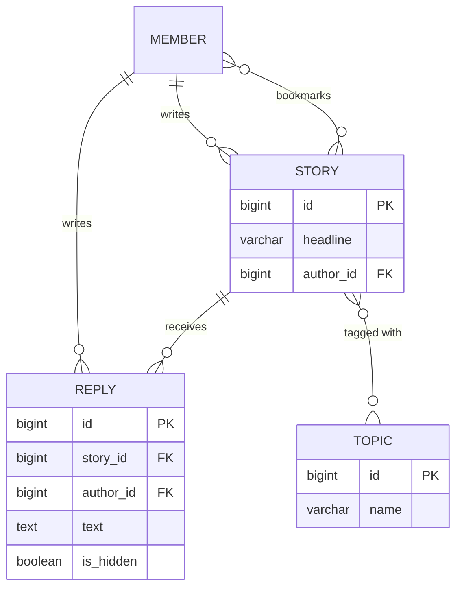

# Replies: comments and model relationships

> **Before this lesson:** the Gazette has stories with a draft/published life cycle and permission rules ([The Gazette: the stories app end to end](#/lesson/django/gazette-stories), [Permissions, authorisation and mixins](#/lesson/django/permissions-mixins)). You know foreign keys, `related_name` and `on_delete` ([Foreign keys, detail views and slugs](#/lesson/django/fk-detail-slugs)) and ModelForms ([Forms, ModelForm, validation and CSRF](#/lesson/django/forms-validation-csrf)).

## In plain words

Readers want to respond to a story. Each response, here called a **reply**, belongs to exactly one story and was written by exactly one member. A story may have many replies; a member may write many replies. That sentence is a description of **relationships** between three kinds of records, and turning such sentences into tables is the central skill of database design.

There are only three shapes of relationship, and every data model you will ever meet is built from them:

| Shape | Sentence | Everyday example | Django field |
|---|---|---|---|
| **One-to-many** | one A has many Bs; each B has one A | a mother and her children | `ForeignKey` on B |
| **Many-to-many** | an A has many Bs and a B has many As | students and courses | `ManyToManyField` on either side |
| **One-to-one** | an A has at most one B and vice versa | a person and their passport | `OneToOneField` |

An everyday picture for the trickiest one, many-to-many: a sign-up sheet for clubs. A student may join several clubs; a club has several students. Neither the student's card nor the club's card has room for an open-ended list. The solution is a third thing: the sign-up sheet itself, each line of which names one student and one club. Databases do the same with a **join table**.

Why it matters for a job: "design the models for X" is the most common practical interview task for Django roles. The interviewer watches whether you pick the right relationship shape, name the reverse direction, choose `on_delete` deliberately, and avoid loading the related rows one query at a time.

## Step 1: the Reply model (one-to-many, twice)

```python
# stories/models.py
class Reply(models.Model):
    story = models.ForeignKey(Story, on_delete=models.CASCADE, related_name="replies")
    author = models.ForeignKey(settings.AUTH_USER_MODEL, on_delete=models.CASCADE, related_name="replies")
    text = models.TextField(max_length=2000)
    created_at = models.DateTimeField(auto_now_add=True)
    is_hidden = models.BooleanField(default=False)

    class Meta:
        ordering = ["created_at"]
        verbose_name_plural = "replies"

    def __str__(self):
        return f"{self.author} on {self.story}: {self.text[:40]}"
```

Two foreign keys, each a deliberate decision:

- `story`: `CASCADE`, because replies have no meaning without their story. `related_name="replies"` lets you write `story.replies.all()`.
- `author`: `CASCADE` here; a site that wants to keep discussions readable after an account is removed would choose `SET_NULL` with `null=True` and display "former member".
- `is_hidden` supports moderation without destroying evidence: staff hide a reply instead of deleting it.
- `ordering = ["created_at"]`: oldest first, the natural order of a conversation.

```bash
python manage.py makemigrations stories
python manage.py migrate
```



### Using the relationship

```python
story = Story.objects.get(slug="harbour-reopens")

story.replies.all()                         # every reply to this story
story.replies.filter(is_hidden=False).count()
story.replies.create(author=member, text="Great news for the ferry crews.")   # sets story automatically

member.replies.select_related("story")     # all replies by a member, with their stories

Story.objects.filter(replies__author=member).distinct()   # stories the member replied to
Reply.objects.filter(story__section="harbour")            # replies in one section
```

`story.replies` is a **related manager**: it behaves like `Reply.objects` already filtered to this story, and its `create()` fills in the foreign key for you.

## Step 2: replies in the admin

Editing replies on a separate admin page, away from their story, is awkward. An **inline** shows related rows inside the parent's edit page:

```python
# stories/admin.py
from .models import Reply, Story


class ReplyInline(admin.TabularInline):
    model = Reply
    extra = 0
    fields = ["author", "text", "is_hidden", "created_at"]
    readonly_fields = ["created_at"]
    autocomplete_fields = ["author"]


@admin.register(Story)
class StoryAdmin(admin.ModelAdmin):
    # ... options from before ...
    inlines = [ReplyInline]


@admin.register(Reply)
class ReplyAdmin(admin.ModelAdmin):
    list_display = ["story", "author", "created_at", "is_hidden"]
    list_filter = ["is_hidden"]
    search_fields = ["text"]
    actions = ["hide"]

    @admin.action(description="Hide selected replies")
    def hide(self, request, queryset):
        queryset.update(is_hidden=True)
```

`TabularInline` lays replies out as table rows under the story; `extra = 0` suppresses empty extra rows. `auto_now_add` fields are not editable, so `created_at` must be listed as read-only to be shown.

## Step 3: showing and posting replies

The story's detail page should show replies and, for members, a form. A detail page that also accepts a form submission is a frequent requirement and a frequent source of tangled code. The clean arrangement uses **two views**: the detail view displays (GET); a separate small view accepts the form (POST) and redirects back.

```python
# stories/forms.py
class ReplyForm(forms.ModelForm):
    class Meta:
        model = Reply
        fields = ["text"]
        widgets = {"text": forms.Textarea(attrs={"rows": 3, "placeholder": "Add to the discussion"})}
        labels = {"text": ""}

    def clean_text(self):
        text = self.cleaned_data["text"].strip()
        if len(text) < 3:
            raise forms.ValidationError("A reply needs at least a few words.")
        return text
```

```python
# stories/views.py
from django.shortcuts import get_object_or_404

from .forms import ReplyForm, StoryForm
from .models import Reply, Story


class StoryDetailView(DetailView):
    context_object_name = "story"

    def get_queryset(self):
        return Story.objects.visible_to(self.request.user).select_related("author")

    def get_context_data(self, **kwargs):
        context = super().get_context_data(**kwargs)
        context["replies"] = self.object.replies.filter(is_hidden=False).select_related("author")
        context["reply_form"] = kwargs.get("reply_form") or ReplyForm()
        context["can_edit"] = self.object.can_be_edited_by(self.request.user)
        return context


class ReplyCreateView(LoginRequiredMixin, CreateView):
    model = Reply
    form_class = ReplyForm
    http_method_names = ["post"]

    def dispatch(self, request, *args, **kwargs):
        self.story = get_object_or_404(Story.objects.published(), slug=kwargs["slug"])
        return super().dispatch(request, *args, **kwargs)

    def form_valid(self, form):
        form.instance.story = self.story
        form.instance.author = self.request.user
        messages.success(self.request, "Your reply was posted.")
        return super().form_valid(form)

    def form_invalid(self, form):
        messages.error(self.request, "Your reply could not be posted: " + " ".join(form.errors["text"]))
        return redirect(self.story)

    def get_success_url(self):
        return f"{self.story.get_absolute_url()}#reply-{self.object.pk}"
```

(Add `from django.shortcuts import redirect` to the imports.) What each piece does:

- `http_method_names = ["post"]` makes the view refuse GET with 405: it has no page of its own.
- `dispatch` loads the story once, **from the URL**, restricted to published stories. Nobody can reply to a draft, and the story is never taken from a hidden form field that a visitor could alter.
- `form_valid` assigns the two server-controlled fields.
- `get_success_url` returns to the story with a **fragment** (`#reply-17`), so the browser scrolls to the new reply.
- `form_invalid` redirects back with an error message. This keeps the code short; the price is that the typed text is lost on error, acceptable for a three-line reply box.

```python
# stories/urls.py
path("<slug:slug>/replies/", views.ReplyCreateView.as_view(), name="reply-create"),
```

```html
<!-- stories/templates/stories/story_detail.html (addition below the article) -->
<section id="replies">
  <h2>{{ replies|length }} repl{{ replies|length|pluralize:"y,ies" }}</h2>

  
    <div class="border-start ps-3 mb-3" id="reply-{{ reply.pk }}">
      <p class="mb-1">{{ reply.text|linebreaksbr }}</p>
      <p class="small text-body-secondary">{{ reply.author }} · {{ reply.created_at|timesince }} ago</p>
    </div>
  
    <p>No replies yet.</p>
  

  
    <form method="post" action="">
      
      {{ reply_form.as_div }}
      <button type="submit" class="btn btn-primary btn-sm">Post reply</button>
    </form>
  
    <p><a href="?next={{ request.path }}%23replies">Log in</a> to reply.</p>
  
</section>
```

`pluralize:"y,ies"` picks the ending by number ("1 reply", "2 replies"). `timesince` prints "3 hours". `linebreaksbr` converts line breaks to `<br>` after escaping the text. `{{ replies|length }}` evaluates the queryset once; the loop then reuses the cached rows, so the section costs one query. `%23` is the encoded `#`.

## Step 4: counting replies in the list without N+1

The front page should show "5 replies" under each story. The obvious template code, `{{ story.replies.count }}`, runs one `COUNT` query **per story**: ten stories, ten extra queries. Ask the database to compute all counts in the main query instead, with `annotate`:

```python
# stories/views.py  (StoryListView.get_queryset)
from django.db.models import Count, Q

    def get_queryset(self):
        queryset = (Story.objects.published()
                    .select_related("author")
                    .annotate(reply_count=Count("replies", filter=Q(replies__is_hidden=False))))
        # ... section filter as before ...
        return queryset
```

`annotate` adds a computed attribute to every object in the result. `Count("replies", filter=...)` counts related replies that satisfy the condition. In the template: `{{ story.reply_count }}`. Still two queries for the whole page.

## Step 5: many-to-many

Two features need the second shape.

**Topics.** A story may carry several topics ("ferry", "weather"); a topic labels many stories.

**Bookmarks.** A member may save many stories; a story may be saved by many members.

```python
# stories/models.py
class Topic(models.Model):
    name = models.CharField(max_length=40, unique=True)
    slug = models.SlugField(unique=True)

    def __str__(self):
        return self.name


class Story(models.Model):
    # ... existing fields ...
    topics = models.ManyToManyField(Topic, blank=True, related_name="stories")
    bookmarked_by = models.ManyToManyField(settings.AUTH_USER_MODEL, blank=True, related_name="bookmarks")
```

A `ManyToManyField` adds **no column** to either table. Django creates a third table, the join table, with one row per link: `stories_story_topics(id, story_id, topic_id)`. The API hides it:

```python
story.topics.add(ferry, weather)       # insert two join rows
story.topics.remove(weather)           # delete one join row
story.topics.set([ferry])              # make the links exactly this list
story.topics.clear()
story.topics.all()

ferry.stories.all()                    # reverse direction
member.bookmarks.all()                 # stories this member saved
story.bookmarked_by.filter(pk=member.pk).exists()

Story.objects.filter(topics__slug="ferry")
```

`add`, `remove`, `set` and `clear` write immediately; no `save()` is needed. The object itself must already have been saved, because the join row needs its id.

The model below builds the three tables by hand in SQLite so that you can see the join table and the two-step query behind `story.topics.all()` and `topic.stories.all()`.

```python-run
import sqlite3

db = sqlite3.connect(":memory:")
db.executescript("""
CREATE TABLE story (id INTEGER PRIMARY KEY, headline TEXT);
CREATE TABLE topic (id INTEGER PRIMARY KEY, name TEXT);
CREATE TABLE story_topics (id INTEGER PRIMARY KEY,
                           story_id INTEGER REFERENCES story(id),
                           topic_id INTEGER REFERENCES topic(id),
                           UNIQUE (story_id, topic_id));          -- the same link cannot exist twice
INSERT INTO story VALUES (1, 'Harbour reopens'), (2, 'Ferry strike looms'), (3, 'Regatta results');
INSERT INTO topic VALUES (1, 'ferry'), (2, 'weather'), (3, 'sport');
INSERT INTO story_topics (story_id, topic_id) VALUES (1, 1), (1, 2), (2, 1), (3, 3);
""")

print("join table rows:", db.execute("SELECT story_id, topic_id FROM story_topics").fetchall())

print("story.topics.all() for story 1:")
print("  ", db.execute("""SELECT topic.name FROM topic
                          JOIN story_topics ON story_topics.topic_id = topic.id
                          WHERE story_topics.story_id = 1""").fetchall())

print("topic.stories.all() for 'ferry':")
print("  ", db.execute("""SELECT story.headline FROM story
                          JOIN story_topics ON story_topics.story_id = story.id
                          WHERE story_topics.topic_id = 1""").fetchall())

try:
    db.execute("INSERT INTO story_topics (story_id, topic_id) VALUES (1, 1)")
except sqlite3.IntegrityError as error:
    print("duplicate link refused:", error)
```

Each link is one row holding two foreign keys. In other words, a many-to-many relationship is two one-to-many relationships meeting in the middle.

### When the link itself has data: `through`

Suppose a bookmark should remember *when* it was made and a private note. That information belongs to neither the member nor the story, but to the link. Define the join table yourself:

```python
class Bookmark(models.Model):
    member = models.ForeignKey(settings.AUTH_USER_MODEL, on_delete=models.CASCADE)
    story = models.ForeignKey(Story, on_delete=models.CASCADE)
    saved_at = models.DateTimeField(auto_now_add=True)
    note = models.CharField(max_length=200, blank=True)

    class Meta:
        constraints = [models.UniqueConstraint(fields=["member", "story"], name="one_bookmark_per_member_and_story")]


class Story(models.Model):
    bookmarked_by = models.ManyToManyField(settings.AUTH_USER_MODEL, through="Bookmark",
                                           blank=True, related_name="bookmarks")
```

`through="Bookmark"` tells Django to use your model as the join table. `UniqueConstraint` makes the database refuse a second bookmark for the same pair, which protects against double clicks and concurrent requests better than a check in Python.

A toggle view:

```python
# stories/views.py
from django.views.decorators.http import require_POST


@login_required
@require_POST
def toggle_bookmark(request, slug):
    story = get_object_or_404(Story.objects.published(), slug=slug)
    bookmark, created = Bookmark.objects.get_or_create(member=request.user, story=story)
    if not created:
        bookmark.delete()
    messages.info(request, "Saved to your bookmarks." if created else "Removed from your bookmarks.")
    return redirect(story)
```

`get_or_create` returns the object and a flag telling whether it was created now.

## Step 6: one-to-one and self-reference, briefly

**One-to-one** is a foreign key that is also unique. The usual use is splitting rarely needed data from a busy table:

```python
class StoryStats(models.Model):
    story = models.OneToOneField(Story, on_delete=models.CASCADE, related_name="stats", primary_key=True)
    views = models.PositiveIntegerField(default=0)
    last_viewed = models.DateTimeField(null=True, blank=True)
```

`story.stats` returns the single related object (or raises `StoryStats.DoesNotExist` when there is none).

**Self-reference** relates a model to itself. Threaded discussions, where a reply answers another reply, need it:

```python
class Reply(models.Model):
    # ... existing fields ...
    parent = models.ForeignKey("self", null=True, blank=True, on_delete=models.CASCADE, related_name="children")
```

`"self"` is the model's own name. A top-level reply has `parent=None`; `reply.children.all()` lists answers to it. One level of nesting is easy to display; arbitrary depth requires recursive queries or a tree library and is rarely worth it.

## Step 7: loading related rows efficiently

For a "my bookmarks" page listing each story with its topics, there are two tools, chosen by the shape of the relationship:

```python
stories = (request.user.bookmarks
           .select_related("author")           # one author per story: JOIN in the same query
           .prefetch_related("topics"))        # many topics per story: one extra query for all of them
```

- `select_related` follows single-valued relations (`ForeignKey`, `OneToOneField`) with an SQL JOIN.
- `prefetch_related` handles multi-valued relations (reverse foreign keys, many-to-many) with one additional query, then matches rows in Python.

The page costs two queries however many bookmarks there are. The ORM module returns to this in detail.

## Step 8: tests

```python
# stories/test_replies.py
from django.contrib.auth import get_user_model
from django.db import IntegrityError, transaction
from django.test import TestCase
from django.urls import reverse
from django.utils import timezone

from .models import Bookmark, Reply, Story, Topic


class ReplyTests(TestCase):
    @classmethod
    def setUpTestData(cls):
        Member = get_user_model()
        cls.marisol = Member.objects.create_user("marisol", email="m@gazette.example", password="x")
        cls.tomas = Member.objects.create_user("tomas", email="t@gazette.example", password="x")
        cls.story = Story.objects.create(headline="Harbour reopens", body="...", author=cls.marisol,
                                         status="published", published_at=timezone.now())
        cls.draft = Story.objects.create(headline="Ferry strike looms", body="...", author=cls.marisol)
        cls.url = reverse("reply-create", args=[cls.story.slug])

    def test_anonymous_cannot_reply(self):
        self.client.post(self.url, {"text": "Hello there"})
        self.assertEqual(Reply.objects.count(), 0)

    def test_member_replies(self):
        self.client.force_login(self.tomas)
        response = self.client.post(self.url, {"text": "Great news for the ferry crews."})
        reply = Reply.objects.get()
        self.assertEqual((reply.story, reply.author), (self.story, self.tomas))
        self.assertRedirects(response, f"{self.story.get_absolute_url()}#reply-{reply.pk}",
                             fetch_redirect_response=False)

    def test_cannot_reply_to_draft(self):
        self.client.force_login(self.tomas)
        response = self.client.post(reverse("reply-create", args=[self.draft.slug]), {"text": "Sneaky reply"})
        self.assertEqual(response.status_code, 404)

    def test_get_is_not_allowed(self):
        self.client.force_login(self.tomas)
        self.assertEqual(self.client.get(self.url).status_code, 405)

    def test_hidden_replies_are_not_shown_or_counted(self):
        self.story.replies.create(author=self.tomas, text="Visible reply")
        self.story.replies.create(author=self.tomas, text="Rude reply", is_hidden=True)
        response = self.client.get(self.story.get_absolute_url())
        self.assertContains(response, "Visible reply")
        self.assertNotContains(response, "Rude reply")
        listed = self.client.get(reverse("story-list")).context["stories"][0]
        self.assertEqual(listed.reply_count, 1)

    def test_deleting_story_deletes_replies(self):
        self.story.replies.create(author=self.tomas, text="Soon gone")
        self.story.delete()
        self.assertEqual(Reply.objects.count(), 0)

    def test_topics_many_to_many(self):
        ferry = Topic.objects.create(name="ferry", slug="ferry")
        self.story.topics.add(ferry)
        self.assertEqual(list(ferry.stories.all()), [self.story])
        self.assertEqual(list(Story.objects.filter(topics__slug="ferry")), [self.story])

    def test_bookmark_is_unique_per_member_and_story(self):
        Bookmark.objects.create(member=self.tomas, story=self.story)
        with self.assertRaises(IntegrityError), transaction.atomic():
            Bookmark.objects.create(member=self.tomas, story=self.story)

    def test_list_page_query_count_does_not_grow(self):
        for n in range(5):
            story = Story.objects.create(headline=f"Story {n}", body="...", author=self.marisol,
                                         status="published", published_at=timezone.now())
            story.replies.create(author=self.tomas, text="A reply")
        with self.assertNumQueries(2):
            self.client.get(reverse("story-list"))
```

The `transaction.atomic()` wrapper around the expected `IntegrityError` keeps the test's surrounding transaction usable after the database error. The last test is the N+1 guard: six stories, still two queries.

> [!NOTE]
> **What changed since the book.** The book's comments chapter adds a `Comment` model with two foreign keys and shows comments on the article page, entered through the admin only. Here members post replies through a form, with moderation and counts. Idioms that postdate the book: `UniqueConstraint` (2.2) replaces `unique_together`; `Count(..., filter=Q(...))` (2.0) makes conditional counts simple; `TextChoices` and the `@admin.action` decorator are newer conveniences.

> [!INTERVIEW]
> **"Design the models for a blog with posts, comments and tags."** Say the relationships out loud first: a post has one author (FK to the user model, `on_delete` chosen on purpose); a comment belongs to one post and one author (two FKs, `related_name="comments"`, `CASCADE` from post); posts and tags are many-to-many (`ManyToManyField`, a join table underneath; use `through` if the link needs its own data). Add uniqueness where the domain demands it (slug; one like per user and post via `UniqueConstraint`), indexes for the main list query, and mention how you would list posts with comment counts (`annotate(Count(...))`) and avoid N+1 (`select_related` for the author, `prefetch_related` for tags).

> [!WARNING]
> Never take the parent object's id from a hidden form field. A member could change `<input type="hidden" name="story" value="12">` and attach their reply to a draft or to a story they cannot see. Take the parent from the URL and look it up with the same visibility rules as the page itself.

> [!TIP]
> Name both directions of every relationship when you design: "a story has *replies*; a reply has a *story*". If the reverse name sounds odd (`story.reply_set`), set `related_name`. If you can say the sentence both ways and both sides are "many", it is a many-to-many.

## Pitfalls

- **`{{ story.replies.count }}` in a loop.** One query per row. Annotate in the view.
- **`{{ story.replies }}`** prints a manager's description. Use `story.replies.all` in templates.
- **Adding to a many-to-many before saving the object.** `ValueError`: the object needs a primary key first.
- **`Count` over two multi-valued relations at once.** Joining both multiplies rows and inflates both counts; use `Count(..., distinct=True)`.
- **Uniqueness checked only in Python.** Two simultaneous requests both pass the check. Add a database constraint.
- **Forgetting moderation in every query.** Hidden replies leak through an unfiltered path; give `Reply` a queryset method `visible()`.
- **Catching `IntegrityError` without a nested `atomic()` inside a transaction.** The outer transaction is broken and later queries fail.
- **Deep threads rendered with recursive template includes.** Each level issues queries; limit depth or prefetch.

## Cheat sheet

| Need | Code |
|---|---|
| One-to-many | `models.ForeignKey(Story, on_delete=models.CASCADE, related_name="replies")` |
| Children of a parent | `story.replies.all()`, `story.replies.create(...)` |
| Many-to-many | `models.ManyToManyField(Topic, blank=True, related_name="stories")` |
| Link / unlink | `.add(obj)`, `.remove(obj)`, `.set([...])`, `.clear()` |
| Data on the link | `ManyToManyField(..., through="Bookmark")` |
| One-to-one | `models.OneToOneField(Story, on_delete=models.CASCADE, related_name="stats")` |
| Self-reference | `models.ForeignKey("self", null=True, blank=True, on_delete=models.CASCADE)` |
| No duplicates | `UniqueConstraint(fields=["member", "story"], name="...")` |
| Count related rows | `.annotate(reply_count=Count("replies", filter=Q(replies__is_hidden=False)))` |
| Load related efficiently | `select_related("author")`, `prefetch_related("topics")` |
| Related rows in the admin | `class ReplyInline(admin.TabularInline)` + `inlines = [ReplyInline]` |
| Get or create | `obj, created = Model.objects.get_or_create(...)` |

## Summary

- Relationships come in three shapes: one-to-many (`ForeignKey`), many-to-many (`ManyToManyField`, backed by a join table) and one-to-one (`OneToOneField`).
- Replies are two one-to-many relationships; `related_name` gives `story.replies`, and the related manager's `create()` fills the foreign key.
- Accept a form on a detail page with a separate POST-only view that takes the parent from the URL and redirects back.
- Use `annotate(Count(...))` for counts in lists, `select_related` and `prefetch_related` for related rows, and database constraints for uniqueness.
- Use a `through` model when the link itself carries data.

## Glossary

- **Relationship**: a link between rows of two tables (or of one table with itself).
- **One-to-many**: one parent row related to many child rows through a foreign key on the child.
- **Many-to-many**: rows on both sides related to many on the other, through a join table.
- **Join table**: a table whose rows each link one row of one table to one row of another.
- **One-to-one**: a unique foreign key, relating each row to at most one row of another table.
- **Related manager**: the object returned by a reverse accessor such as `story.replies`.
- **Inline**: an admin component editing related rows on the parent's page.
- **`annotate`**: a queryset method that adds computed values to each returned object.
- **`through` model**: an explicitly defined join table with extra fields.
- **`UniqueConstraint`**: a database rule forbidding duplicate combinations of values.
- **Self-referential key**: a foreign key from a model to itself.
- **Fragment**: the `#name` part of a URL pointing to a place within a page.

```quiz
[
  {"q": "A story has many replies and each reply belongs to one story. On which model does the ForeignKey go?",
   "options": ["On Story, pointing to Reply", "On Reply, pointing to Story", "On both", "On a third model"],
   "answer": 1,
   "explain": "The foreign key lives on the 'many' side: each reply stores the id of its one story."},
  {"q": "What does a ManyToManyField add to the database?",
   "options": ["A column on each of the two tables", "A separate join table with one row per link", "A list column on one table", "Nothing; it is computed in Python"],
   "answer": 1,
   "explain": "Neither table can hold an open-ended list, so links are stored as rows of (story_id, topic_id) in a third table."},
  {"q": "When should you define a `through` model?",
   "options": ["Always", "When the link itself needs data, such as the time a bookmark was created", "Only for one-to-one relations", "When there are more than 100 rows"],
   "answer": 1,
   "explain": "A through model is the join table written out explicitly so it can carry extra fields and constraints."},
  {"q": "Why does ReplyCreateView read the story from the URL and not from a hidden form field?",
   "options": ["Hidden fields are slower", "Form values are user-controllable; the URL lookup applies the visibility rule on the server", "Django forbids hidden fields", "URLs are encrypted"],
   "answer": 1,
   "explain": "A hidden input can be edited to target another object. Looking up the parent server-side with published() prevents replying to drafts."},
  {"q": "Ten stories are listed and the template prints `{{ story.replies.count }}` for each. How many extra queries run?",
   "options": ["0", "1", "10", "100"],
   "answer": 2,
   "explain": "Each .count on a related manager is its own COUNT query. annotate(Count('replies')) computes them all in the main query."},
  {"q": "Which tool loads the many topics of each story in a list efficiently?",
   "options": ["select_related('topics')", "prefetch_related('topics')", "annotate('topics')", "values('topics')"],
   "answer": 1,
   "explain": "select_related only follows single-valued relations. prefetch_related fetches multi-valued relations with one extra query."},
  {"q": "Why add a UniqueConstraint on (member, story) for bookmarks when the view already checks for an existing bookmark?",
   "options": ["It speeds up inserts", "Two simultaneous requests can both pass the Python check; only the database can guarantee uniqueness", "Django requires constraints on all models", "It hides bookmarks from other users"],
   "answer": 1,
   "explain": "Check-then-insert has a race condition. A database constraint rejects the second insert regardless of timing."},
  {"q": "What does `story.replies.create(author=member, text='Hi')` do?",
   "options": ["Creates a reply without a story", "Creates and saves a reply with its story foreign key set to this story", "Returns an unsaved object", "Raises an error because story is missing"],
   "answer": 1,
   "explain": "A related manager fills in the foreign key of its parent automatically and saves the new object."}
]
```

> **Source:** Vincent, *Django for Beginners*, ch. 15 (Comments). Docs: https://docs.djangoproject.com/en/5.2/topics/db/models/#relationships · https://docs.djangoproject.com/en/5.2/topics/db/examples/many_to_many/ · https://docs.djangoproject.com/en/5.2/ref/models/constraints/ · https://docs.djangoproject.com/en/5.2/ref/contrib/admin/#inlinemodeladmin-objects · https://docs.djangoproject.com/en/5.2/topics/db/aggregation/
