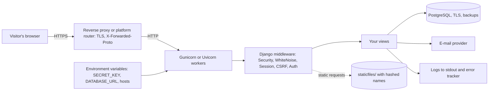

# Production settings and the security checklist

> **Before this lesson:** you can read settings from environment variables and have deployed once in outline ([Deploying with environment variables](#/lesson/django/env-config-deploy)); you know how static files are collected ([Static files and CSS](#/lesson/django/static-css)) and how sessions and CSRF tokens use cookies ([The auth app: users, passwords and sessions](#/lesson/django/auth-app), [Forms, ModelForm, validation and CSRF](#/lesson/django/forms-validation-csrf)).

## In plain words

A site on your laptop and a site on the public internet run the same code in very different surroundings. On the laptop there is one user, you, and you are friendly. On the internet there are thousands of users, and some of the visitors are automated programs that probe every site for the same handful of mistakes, all day.

**Production** is the name for the environment in which real users use the site. **Production settings** are the configuration that makes the same code safe and reliable there. Django's defaults are chosen for comfortable development, so several must be changed before going live.

An everyday picture: a food stall at a private party versus a restaurant open to the public. The recipes are identical. The restaurant additionally needs locks, a fire exit, hand-washing rules and an inspection. Django provides the inspector: one command that lists what is still missing.

This lesson walks through that inspection item by item: what each setting does, what attack or failure it prevents, and the value to use. It also completes two production essentials introduced earlier: serving static files with WhiteNoise and connecting to a real database.

Why it matters for a job: most Django security incidents are configuration mistakes, not clever attacks: debug mode left on, a secret key in a public repository, cookies sent over plain HTTP. "What do you change before deploying a Django project?" is a standard interview question, and the expected answer is this checklist.

## Development and production side by side

| Concern | Development | Production |
|---|---|---|
| `DEBUG` | `True`: detailed error pages | `False` |
| `SECRET_KEY` | any value | long, random, secret, from the environment |
| `ALLOWED_HOSTS` | localhost | the site's real domain names |
| Transport | plain HTTP | HTTPS only |
| Cookies | sent over HTTP | marked secure, sent over HTTPS only |
| Database | SQLite file | PostgreSQL (or another server database) with backups |
| Static files | served by `runserver` | collected, hashed, served by WhiteNoise or a web server |
| Web server | `runserver` | Gunicorn or Uvicorn (next lesson) |
| E-mail | console | a real provider |
| Errors | shown in the browser | logged and reported to the team |

## One settings file or several?

Two layouts are common.

**One file driven by the environment.** Every value that differs is read from an environment variable with a safe default. This is the approach of this track; it keeps a single source of truth and makes it impossible to forget a setting in one of several files.

**A settings package.** `config/settings/base.py` holds what is shared; `local.py` and `production.py` start with `from .base import *` and override. The active file is chosen with the `DJANGO_SETTINGS_MODULE` environment variable. It suits projects whose environments differ in many structural ways (extra apps, extra middleware).

Either is fine. What is not fine is a production value that lives only in someone's head.

## The inspection: `check --deploy`

```bash
python manage.py check --deploy
```

The command runs Django's **system checks** tagged for deployment against the *current* settings, so run it with production-like variables set. A fresh project prints warnings such as:

```
?: (security.W004) You have not set a value for the SECURE_HSTS_SECONDS setting. ...
?: (security.W008) Your SECURE_SSL_REDIRECT setting is not set to True. ...
?: (security.W009) Your SECRET_KEY has less than 50 characters, less than 5 unique characters, or it's prefixed with 'django-insecure-' ...
?: (security.W012) SESSION_COOKIE_SECURE is not set to True. ...
?: (security.W016) You have 'django.middleware.csrf.CsrfViewMiddleware' in your MIDDLEWARE, but you have not set CSRF_COOKIE_SECURE to True. ...
?: (security.W018) You should not have DEBUG set to True in deployment.
```

Each identifier is documented. The model below is a small version of that inspector over a dictionary of settings; it shows the logic behind the six most important warnings. Run it, then fix the settings one by one until it prints "ready".

```python-run
def check_deploy(settings):
    problems = []
    key = settings.get("SECRET_KEY", "")
    if len(key) < 50 or len(set(key)) < 5 or key.startswith("django-insecure-"):
        problems.append("W009 SECRET_KEY is short, low-entropy or the generated insecure key")
    if settings.get("DEBUG", False):
        problems.append("W018 DEBUG must be False")
    if not settings.get("ALLOWED_HOSTS"):
        problems.append("W020 ALLOWED_HOSTS must not be empty")
    if "*" in settings.get("ALLOWED_HOSTS", []):
        problems.append("note  ALLOWED_HOSTS contains a wildcard")
    if not settings.get("SECURE_SSL_REDIRECT", False):
        problems.append("W008 SECURE_SSL_REDIRECT is not True")
    if not settings.get("SESSION_COOKIE_SECURE", False):
        problems.append("W012 SESSION_COOKIE_SECURE is not True")
    if not settings.get("CSRF_COOKIE_SECURE", False):
        problems.append("W016 CSRF_COOKIE_SECURE is not True")
    if settings.get("SECURE_HSTS_SECONDS", 0) <= 0:
        problems.append("W004 SECURE_HSTS_SECONDS is not set")
    return problems

fresh_project = {"SECRET_KEY": "django-insecure-abc123", "DEBUG": True, "ALLOWED_HOSTS": []}

hardened = {
    "SECRET_KEY": "q7#vK2mX9pL4wZ8rT1yN6bH3jF5dS0aGcEuIoQxVnMkBzRtYhWl",
    "DEBUG": False,
    "ALLOWED_HOSTS": ["gazette.example"],
    "SECURE_SSL_REDIRECT": True,
    "SESSION_COOKIE_SECURE": True,
    "CSRF_COOKIE_SECURE": True,
    "SECURE_HSTS_SECONDS": 3600,
}

for name, settings in [("fresh project", fresh_project), ("hardened", hardened)]:
    problems = check_deploy(settings)
    print(f"{name}: {len(problems)} issue(s)" if problems else f"{name}: ready")
    for p in problems:
        print("   ", p)
```

## Item by item

### 1. `DEBUG = False`

With debug on, any error shows a page containing source code, local variables, the list of settings and the SQL that ran. With debug off, visitors see a plain "Server Error (500)" page (your `500.html` template, if you provide one). Two side effects surprise people: Django stops serving static files, and `ALLOWED_HOSTS` is enforced strictly.

### 2. `SECRET_KEY`

The key signs session data, password-reset tokens, CSRF tokens and the messages cookie. Anyone who knows it can forge them. Requirements: at least 50 random characters, never committed, different per environment. To rotate a key without logging everybody out, put the new key in `SECRET_KEY` and the old one in `SECRET_KEY_FALLBACKS` for a transition period.

### 3. `ALLOWED_HOSTS`

Every HTTP request carries a `Host` header naming the site it wants. An attacker can send any value. Django builds absolute links, including the ones in password-reset e-mails, from that header, so a forged value could make your site mail links pointing to the attacker's domain. `ALLOWED_HOSTS` is the list of names Django accepts; anything else gets a 400 response. Use exact names (`"gazette.example"`, `"www.gazette.example"`); a leading dot (`".gazette.example"`) covers all subdomains.

### 4. HTTPS everywhere

**HTTPS** is HTTP inside an encrypted **TLS** connection. Without it, anyone on the path between visitor and server (a café's wireless network, for example) can read and alter everything, including session cookies. Four settings enforce it:

```python
# config/settings.py
if not DEBUG:
    SECURE_SSL_REDIRECT = True
    SECURE_PROXY_SSL_HEADER = ("HTTP_X_FORWARDED_PROTO", "https")
    SESSION_COOKIE_SECURE = True
    CSRF_COOKIE_SECURE = True
    SECURE_HSTS_SECONDS = 3600
    SECURE_HSTS_INCLUDE_SUBDOMAINS = True
    SECURE_HSTS_PRELOAD = False
```

- `SECURE_SSL_REDIRECT` answers every plain-HTTP request with a redirect to the HTTPS address.
- `SECURE_PROXY_SSL_HEADER` is needed on almost every hosting platform. There, a **reverse proxy** (a server in front of yours) handles the encryption and forwards requests to Django over plain HTTP, adding the header `X-Forwarded-Proto: https`. This setting tells Django to trust that header when deciding whether the original request was secure. Without it, `SECURE_SSL_REDIRECT` causes an endless redirect loop. Set it **only** when a proxy you control always sets or strips that header, because a visitor could otherwise send it themselves.
- `SESSION_COOKIE_SECURE` and `CSRF_COOKIE_SECURE` add the `Secure` attribute to the cookies: browsers will then send them over HTTPS only, so a single accidental `http://` request cannot leak a session.
- **HSTS** (HTTP Strict Transport Security) is a response header telling browsers: "for the next N seconds, never contact this site over plain HTTP, even if a link says so". It closes the gap of the very first, unencrypted request. Start with a small value such as 3600 (one hour); once everything works, raise it to 31536000 (one year). A long value is a commitment: if HTTPS breaks, browsers will refuse to connect until the time has elapsed. `SECURE_HSTS_PRELOAD` opts into browsers' built-in lists and is close to irreversible; leave it off until you are certain.

### 5. Headers that are already on

`SecurityMiddleware` and `XFrameOptionsMiddleware`, both in the default list, send protective headers with sensible defaults:

| Header | Setting and default | Protects against |
|---|---|---|
| `X-Content-Type-Options: nosniff` | `SECURE_CONTENT_TYPE_NOSNIFF = True` | browsers guessing that an uploaded text file is a script |
| `X-Frame-Options: DENY` | `X_FRAME_OPTIONS = "DENY"` | clickjacking: your pages embedded invisibly in another site |
| `Referrer-Policy: same-origin` | `SECURE_REFERRER_POLICY` | leaking your URLs to other sites |
| `Cross-Origin-Opener-Policy: same-origin` | `SECURE_CROSS_ORIGIN_OPENER_POLICY` | other windows manipulating yours |

One powerful header needs deliberate setup: a **Content Security Policy (CSP)**, which tells the browser which sources of scripts and styles are legitimate, so that an injected script does not run. Django 6.0 added built-in support (`ContentSecurityPolicyMiddleware` with the `SECURE_CSP` setting); on 5.x the `django-csp` package provides it. The lesson on the security middleware explores it.

### 6. Cross-origin form posts

When the site is served under a domain different from the one Django sees internally, or under several domains, list the public origins, with their scheme:

```python
CSRF_TRUSTED_ORIGINS = env_list("DJANGO_CSRF_TRUSTED_ORIGINS")   # e.g. https://gazette.example
```

### 7. The admin

Reduce its exposure: change its path from the universally guessed `admin/`, give `is_staff` sparingly, require strong passwords, and consider two-factor authentication (`django-otp`). The admin is powerful by design; treat its login page as the most attacked URL of the site.

## Static files with WhiteNoise, complete

```bash
python -m pip install whitenoise
```

```python
# config/settings.py
MIDDLEWARE = [
    "django.middleware.security.SecurityMiddleware",
    "whitenoise.middleware.WhiteNoiseMiddleware",        # directly after SecurityMiddleware
    "django.contrib.sessions.middleware.SessionMiddleware",
    # ...
]

STATIC_URL = "static/"
STATICFILES_DIRS = [BASE_DIR / "static"]
STATIC_ROOT = BASE_DIR / "staticfiles"

STORAGES = {
    "default": {"BACKEND": "django.core.files.storage.FileSystemStorage"},
    "staticfiles": {"BACKEND": "whitenoise.storage.CompressedManifestStaticFilesStorage"},
}
```

What this arrangement does:

- `collectstatic` (run during each deployment) copies all static files to `STATIC_ROOT`, renames them with a content hash, writes the manifest, and stores compressed copies.
- The middleware answers requests for `/static/...` straight from that folder before the rest of Django is involved, with far-future caching headers for the hashed names and compressed bodies for browsers that accept them.
- Its position matters: after `SecurityMiddleware` (so that HTTPS redirects and security headers still apply) and before everything else (so that static requests skip sessions and authentication).

For busy sites, put a **CDN** in front; it fetches each file from your application once and serves later requests itself.

To develop with the same behaviour as production, add `"whitenoise.runserver_nostatic"` at the top of `INSTALLED_APPS`; it disables `runserver`'s own static handling.

## A production database

SQLite keeps everything in one file and permits one writer at a time, which is excellent for development and unsuitable for most web deployments, where several server processes write concurrently and the application's disk may be temporary. **PostgreSQL** is the usual choice.

```python
# config/settings.py
import dj_database_url

DATABASES = {
    "default": dj_database_url.config(
        default=f"sqlite:///{BASE_DIR / 'db.sqlite3'}",
        conn_max_age=600,
        conn_health_checks=True,
        ssl_require=not DEBUG,
    )
}
```

- `conn_max_age=600` reuses a database connection for up to ten minutes instead of opening one per request; opening a connection is slow.
- `conn_health_checks=True` tests a reused connection before each request, so that a connection the server closed is replaced instead of causing an error.
- `ssl_require` encrypts the link between application and database.

Django 5.1 added built-in **connection pooling** for PostgreSQL with the `psycopg` driver: a shared set of open connections handed out to requests. It is enabled with `"OPTIONS": {"pool": True}` in the database settings and should not be combined with persistent connections (`conn_max_age` must be 0).

Two operational duties come with a real database:

1. **Backups.** Enable the provider's automatic backups and, at least once, practise restoring one. A backup that has never been restored is a hope, not a backup.
2. **Migrations at release time.** Run `python manage.py migrate` as part of every deployment, before the new code starts receiving requests.

Use the same database engine in development as in production once the project matters. SQLite and PostgreSQL differ in details (case-sensitivity of text matching, strictness of types, available field types), and such differences surface as bugs that appear only in production.

## Logging and error reporting

With `DEBUG = False`, errors no longer appear in the browser. They must go somewhere a person will see them. On hosting platforms the convention is to write log lines to the **standard output streams**, which the platform collects.

```python
# config/settings.py
LOGGING = {
    "version": 1,
    "disable_existing_loggers": False,
    "formatters": {
        "plain": {"format": "{asctime} {levelname} {name} {message}", "style": "{"},
    },
    "handlers": {
        "console": {"class": "logging.StreamHandler", "formatter": "plain"},
    },
    "root": {"handlers": ["console"], "level": "INFO"},
    "loggers": {
        "django.request": {"handlers": ["console"], "level": "ERROR", "propagate": False},
        "django.security": {"handlers": ["console"], "level": "WARNING", "propagate": False},
    },
}
```

A **logger** is a named channel your code writes to; a **handler** decides where messages go; a **level** (`DEBUG`, `INFO`, `WARNING`, `ERROR`) is the minimum severity that passes. In your own code:

```python
import logging

logger = logging.getLogger(__name__)
logger.info("Story %s published by %s", story.pk, request.user.pk)
```

Log identifiers, not personal data, and never passwords or tokens. For errors, most teams add an **error-tracking service** (Sentry is the best known): it groups exceptions, shows the traceback and the request, and alerts the team. Django can also e-mail tracebacks to the addresses in `ADMINS`, a workable minimum for a small site.

Provide friendly error pages as templates in the project-level folder: `404.html`, `403.html`, `400.html` and `500.html`. Keep `500.html` free of template logic that could itself fail.

## Where everything sits



## Tests for configuration

```python
# pages/test_production_settings.py
from django.test import SimpleTestCase, override_settings


class SecuritySettingsTests(SimpleTestCase):
    @override_settings(SECURE_SSL_REDIRECT=True)
    def test_http_is_redirected_to_https(self):
        response = self.client.get("/", secure=False)
        self.assertEqual(response.status_code, 301)
        self.assertTrue(response["Location"].startswith("https://"))

    @override_settings(SECURE_HSTS_SECONDS=3600)
    def test_hsts_header_on_secure_responses(self):
        response = self.client.get("/", secure=True)
        self.assertEqual(response["Strict-Transport-Security"], "max-age=3600")

    def test_default_protective_headers(self):
        response = self.client.get("/")
        self.assertEqual(response["X-Content-Type-Options"], "nosniff")
        self.assertEqual(response["X-Frame-Options"], "DENY")

    @override_settings(ALLOWED_HOSTS=["gazette.example"])
    def test_unknown_host_is_rejected(self):
        response = self.client.get("/", headers={"host": "evil.example"})
        self.assertEqual(response.status_code, 400)
```

`secure=True` makes the test client simulate an HTTPS request. Add `python manage.py check --deploy --fail-level WARNING` to your continuous-integration pipeline, with production-like variables, so that a regression in these settings fails the build.

> [!NOTE]
> **What changed since the book.** The book's deployment sets `ALLOWED_HOSTS = ['*']` and stops. Since then: `SECURE_REFERRER_POLICY` (3.0) and `SECURE_CROSS_ORIGIN_OPENER_POLICY` (4.0) were added with safe defaults; `X_FRAME_OPTIONS` defaults to `DENY` (3.0); `SECURE_BROWSER_XSS_FILTER` was removed (4.0) because browsers dropped the feature; `CSRF_TRUSTED_ORIGINS` requires schemes (4.0); `SECRET_KEY_FALLBACKS` (4.1) allows rotation; `STORAGES` replaced `STATICFILES_STORAGE` (4.2, removed 5.1); PostgreSQL connection pooling arrived in 5.1; and built-in CSP support in 6.0.

> [!INTERVIEW]
> **"What do you check before deploying a Django application?"** Run `manage.py check --deploy` and walk the list: `DEBUG` off; `SECRET_KEY` and all credentials from the environment; exact `ALLOWED_HOSTS`; HTTPS enforced with `SECURE_SSL_REDIRECT`, secure session and CSRF cookies, HSTS, and `SECURE_PROXY_SSL_HEADER` when behind a proxy; `CSRF_TRUSTED_ORIGINS`; static files collected and served by WhiteNoise or a web server; a server database with persistent connections and backups; migrations in the release step; logging to stdout plus error tracking; custom error templates; a production WSGI/ASGI server; dependencies pinned and scanned. Explain *why* for two or three of them, such as host-header attacks or cookie theft over HTTP.

> [!WARNING]
> Never debug a production problem by setting `DEBUG = True` "for a minute". The debug page exposes settings and code to every visitor who triggers an error during that minute, and automated scanners are among them. Reproduce the problem locally or read the logs.

## Pitfalls

- **Endless redirects after enabling `SECURE_SSL_REDIRECT`.** The proxy terminates TLS and `SECURE_PROXY_SSL_HEADER` is missing.
- **"Bad Request (400)" for every page.** The domain is not in `ALLOWED_HOSTS`.
- **Unstyled pages or `Missing staticfiles manifest entry`.** `collectstatic` did not run in the build, or a template names a file that does not exist.
- **Logins "do not stick" on HTTP.** Secure cookies are not sent over plain HTTP; use HTTPS everywhere, including health checks if they need sessions.
- **A year-long HSTS value on the first day.** Start small.
- **Wildcard hosts or trusted origins.** They disable the protection they configure.
- **SQLite on an ephemeral disk.** Data disappears on redeploy.
- **Secrets in logs.** Review what you log; scrub request bodies.
- **Trusting `X-Forwarded-*` headers without a proxy that sets them.** Visitors can then spoof HTTPS or their address.

## Cheat sheet

| Setting | Production value |
|---|---|
| `DEBUG` | `False` |
| `SECRET_KEY` | 50+ random characters from the environment |
| `ALLOWED_HOSTS` | exact domain names |
| `CSRF_TRUSTED_ORIGINS` | `["https://gazette.example"]` |
| `SECURE_SSL_REDIRECT` | `True` |
| `SECURE_PROXY_SSL_HEADER` | `("HTTP_X_FORWARDED_PROTO", "https")` behind a trusted proxy |
| `SESSION_COOKIE_SECURE`, `CSRF_COOKIE_SECURE` | `True` |
| `SECURE_HSTS_SECONDS` | start at `3600`, later `31536000` |
| `STORAGES["staticfiles"]` | `whitenoise.storage.CompressedManifestStaticFilesStorage` |
| `DATABASES` | PostgreSQL via `DATABASE_URL`, `conn_max_age`, health checks |
| `LOGGING` | console handler, `INFO` level |
| Audit | `python manage.py check --deploy` |

## Summary

- Production differs from development in trust and scale; Django's development-friendly defaults must be tightened.
- `check --deploy` is the checklist: debug off, a secret key from the environment, exact hosts, HTTPS with secure cookies and HSTS.
- Behind a proxy, `SECURE_PROXY_SSL_HEADER` tells Django which requests were secure.
- WhiteNoise serves collected, hashed, compressed static files from the application; a server database with persistent connections and tested backups replaces SQLite.
- With debug off, logging and error tracking are how you learn that something broke.

## Glossary

- **Production**: the environment serving real users.
- **System check**: an automated validation of project configuration, run by `manage.py check`.
- **HTTPS / TLS**: HTTP carried over an encrypted connection / the encryption protocol.
- **Reverse proxy**: a server that receives requests on behalf of the application and forwards them.
- **`Secure` cookie attribute**: an instruction to send the cookie over HTTPS only.
- **HSTS**: a header instructing browsers to use only HTTPS for a site for a set time.
- **Host header attack**: abusing a forged `Host` header to poison links or caches.
- **Clickjacking**: tricking users into clicking on your site while it is hidden inside another page.
- **Content Security Policy (CSP)**: a header restricting where scripts and other resources may come from.
- **Connection pooling**: reusing a set of open database connections across requests.
- **Logger / handler / level**: the channel, destination and severity threshold of log messages.
- **Error tracking**: a service that collects and groups application exceptions.

```quiz
[
  {"q": "Which command reports production-readiness problems in settings?",
   "options": ["python manage.py runserver --prod", "python manage.py check --deploy", "python manage.py migrate --check", "python manage.py collectstatic"],
   "answer": 1,
   "explain": "check --deploy runs the deployment-tagged system checks and prints warnings with identifiers such as security.W018."},
  {"q": "Why is ALLOWED_HOSTS important?",
   "options": ["It speeds up routing", "It rejects requests with forged Host headers, which could otherwise poison generated links such as password-reset URLs", "It lists permitted database servers", "It enables HTTPS"],
   "answer": 1,
   "explain": "Django uses the Host header to build absolute URLs. Accepting any host lets attackers inject their own domain."},
  {"q": "After enabling SECURE_SSL_REDIRECT on a hosting platform, the site loops with redirects. What is missing?",
   "options": ["DEBUG = True", "SECURE_PROXY_SSL_HEADER, so Django recognises requests that were HTTPS at the proxy", "A larger HSTS value", "CSRF_TRUSTED_ORIGINS"],
   "answer": 1,
   "explain": "The proxy forwards plain HTTP with X-Forwarded-Proto: https. Without the setting, Django thinks every request is insecure and redirects again."},
  {"q": "What does SESSION_COOKIE_SECURE = True do?",
   "options": ["Encrypts the session data", "Tells browsers to send the session cookie only over HTTPS", "Hides the cookie from JavaScript", "Shortens the session lifetime"],
   "answer": 1,
   "explain": "It adds the Secure attribute. Hiding from JavaScript is HttpOnly, which is on by default for the session cookie."},
  {"q": "Why start SECURE_HSTS_SECONDS with a small value?",
   "options": ["Large values are slower", "Browsers remember the policy for that long; if HTTPS breaks, visitors are locked out until it expires", "Django rejects large values", "Search engines dislike HSTS"],
   "answer": 1,
   "explain": "HSTS is a commitment cached in browsers. Test with an hour, then raise to a year."},
  {"q": "Where must WhiteNoiseMiddleware be placed?",
   "options": ["Last in the list", "Directly after SecurityMiddleware", "Before SecurityMiddleware", "After AuthenticationMiddleware"],
   "answer": 1,
   "explain": "After SecurityMiddleware so security handling still applies, and before the rest so static requests skip sessions and authentication."},
  {"q": "What does conn_max_age=600 change?",
   "options": ["Queries time out after 600 ms", "Database connections are reused for up to 600 seconds instead of being opened per request", "The database is backed up every 10 minutes", "Sessions last 10 minutes"],
   "answer": 1,
   "explain": "Persistent connections avoid the cost of connecting to the database on every request."},
  {"q": "With DEBUG = False, how does the team learn about an unhandled exception?",
   "options": ["The visitor sees the traceback", "From logs and error reporting: log handlers, ADMINS e-mails or an error-tracking service", "Django restarts automatically and hides it", "It cannot be known"],
   "answer": 1,
   "explain": "Errors are no longer displayed. They must be logged and reported somewhere the team looks."}
]
```

> **Source:** Vincent, *Django for Beginners*, deployment sections of ch. 3–7, expanded to the current deployment checklist. Docs: https://docs.djangoproject.com/en/5.2/howto/deployment/checklist/ · https://docs.djangoproject.com/en/5.2/ref/middleware/#module-django.middleware.security · https://docs.djangoproject.com/en/5.2/ref/checks/#security · https://whitenoise.readthedocs.io/en/stable/django.html · https://docs.djangoproject.com/en/5.2/ref/databases/#persistent-connections · https://docs.djangoproject.com/en/5.2/topics/logging/
