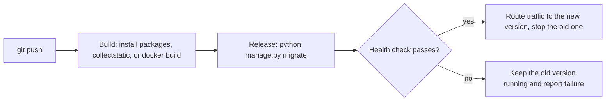

# Gunicorn, Uvicorn, Docker and deploying to a PaaS

> **Before this lesson:** your settings are production-ready and pass `check --deploy` ([Production settings and the security checklist](#/lesson/django/production-settings)). You know that a project has two entry points, `config/wsgi.py` and `config/asgi.py` ([Projects, apps and the settings file](#/lesson/django/project-vs-app)). For background on containers see [What is a container](#/lesson/docker/what-is-a-container); this lesson explains what it needs.

## In plain words

Your Django code is a set of functions that turn a request into a response. Something else must do the work around it: listen on the network, accept thousands of connections, hand each request to your code, send the answer back, and keep going if one request crashes. That something is an **application server**. `runserver` is a toy version for your desk; **Gunicorn** and **Uvicorn** are the real ones.

Then the server and your code have to run *somewhere*, with the right Python version and the right packages, identically every time. A **container** packages the code together with everything it needs into one sealed unit that runs the same on any machine. **Docker** is the standard tool for building and running containers.

Finally, someone must own the machines, the network, the certificates and the restarts. A **PaaS** (Platform as a Service) does that: you hand over the code or the container, and the platform runs it.

An everyday picture: a food truck business. Your recipes are the Django code. The serving hatch with staff taking orders in parallel is the application server. The truck itself, kitchen bolted in, identical wherever it parks, is the container. The festival organiser who provides the pitch, the electricity and the queue barriers is the platform.

Why it matters for a job: "how is this deployed?" is asked in every backend interview, and on a small team the Django developer *is* the deployer. Knowing what a worker is, why migrations run before the new code, and what belongs in a Dockerfile makes you useful on day one.

## Part 1: the application server

### WSGI and ASGI

Two standards define how a Python web application and a server talk to each other.

| | WSGI | ASGI |
|---|---|---|
| Stands for | Web Server Gateway Interface | Asynchronous Server Gateway Interface |
| Model | one request is handled from start to finish by one worker, synchronously | an event loop can juggle many requests that are waiting on the network |
| Handles | ordinary HTTP requests | HTTP, plus long-lived connections such as WebSockets |
| Django entry point | `config/wsgi.py` | `config/asgi.py` |
| Typical server | Gunicorn | Uvicorn, Daphne, Hypercorn |

Ordinary Django views are synchronous, and a WSGI server is the simple, robust default. Choose ASGI when the project uses `async def` views in earnest, WebSockets, or streaming responses. The lesson on async views goes deeper; see also [WSGI vs ASGI, Starlette and Uvicorn](#/lesson/fastapi/asgi-stack).

### Gunicorn

```bash
python -m pip install gunicorn
gunicorn config.wsgi:application --bind 0.0.0.0:8000 --workers 3
```

- `config.wsgi:application` reads as "the object named `application` in the module `config.wsgi`".
- `--bind 0.0.0.0:8000` listens on port 8000 on all network interfaces. (`127.0.0.1` would accept connections only from the same machine, which is wrong inside a container.)
- `--workers 3` starts three **worker processes**.

A **worker** is a separate copy of your application that handles one request at a time. A master process supervises them and replaces any that die. With three synchronous workers, the site handles three requests simultaneously; a fourth waits in a queue.

How many workers? Each one uses memory (often 100 to 200 MB for a Django project). The usual starting point is `2 × CPU cores + 1`, adjusted to the memory you have. If requests spend most of their time waiting for a database or an external API, add **threads** (`--threads 4`), which let one worker serve several waiting requests.

The simulation below shows why worker count matters and where it stops helping. Twelve requests arrive at once; each takes 200 ms of server time.

```python-run
import heapq

def simulate(n_requests, work_ms, workers):
    """Requests all arrive at t=0. Return (time last one finishes, average wait in the queue)."""
    free_at = [0] * workers                      # when each worker becomes free
    heapq.heapify(free_at)
    waits = []
    for _ in range(n_requests):
        start = heapq.heappop(free_at)           # the earliest free worker takes the next request
        waits.append(start)
        heapq.heappush(free_at, start + work_ms)
    return max(free_at), sum(waits) / len(waits)

print("workers | all done after | average wait")
for workers in (1, 2, 3, 6, 12, 24):
    done, wait = simulate(12, 200, workers)
    print(f"{workers:7} | {done:11} ms | {wait:7.0f} ms")
```

Going from one worker to six cuts the waiting dramatically. Beyond twelve there is nothing left to gain: no request is queueing any more. On a real machine, extra workers beyond the available CPU and memory make things *slower*. The lesson: size workers to the hardware, and make requests fast (the ORM and caching lessons) instead of throwing processes at slow ones.

Put the options in a file so the start command stays short:

```python
# gunicorn.conf.py  (project root; loaded automatically)
import multiprocessing
import os

bind = "0.0.0.0:" + os.environ.get("PORT", "8000")
workers = int(os.environ.get("WEB_CONCURRENCY", multiprocessing.cpu_count() * 2 + 1))
threads = int(os.environ.get("GUNICORN_THREADS", "2"))
timeout = 30
max_requests = 1000
max_requests_jitter = 100
accesslog = "-"
errorlog = "-"
```

- Platforms tell the container which port to use through the `PORT` variable, and many set `WEB_CONCURRENCY`.
- `timeout = 30`: a worker that has been silent for 30 seconds is killed and replaced, so one stuck request cannot hold a worker for ever.
- `max_requests` recycles each worker after about a thousand requests, which contains slow memory leaks; the jitter stops all workers restarting at the same moment.
- `"-"` sends logs to the standard streams, where the platform collects them.

### Uvicorn

For an ASGI deployment:

```bash
python -m pip install uvicorn
uvicorn config.asgi:application --host 0.0.0.0 --port 8000 --workers 3
```

Uvicorn can manage several worker processes itself, as shown. A common alternative keeps Gunicorn as the process manager with Uvicorn workers inside it (`gunicorn config.asgi:application -k uvicorn_worker.UvicornWorker`, from the `uvicorn-worker` package). Under ASGI, synchronous Django views still work: Django runs them in a thread pool.

### A health check

Platforms need a cheap way to ask "are you alive?". Provide a tiny endpoint that also confirms the database is reachable:

```python
# pages/views.py
from django.db import connection
from django.http import JsonResponse


def healthz(request):
    with connection.cursor() as cursor:
        cursor.execute("SELECT 1")
    return JsonResponse({"status": "ok"})
```

Route it at `healthz/`. If the platform probes over plain HTTP from inside its network, exempt the path from the HTTPS redirect: `SECURE_REDIRECT_EXEMPT = [r"^healthz/$"]`.

## Part 2: a container image

A **Dockerfile** is a recipe for building an **image**: a read-only snapshot of a file system containing the operating system libraries, Python, your packages and your code. A **container** is a running instance of an image.

```dockerfile
# Dockerfile
FROM python:3.13-slim

ENV PYTHONDONTWRITEBYTECODE=1 \
    PYTHONUNBUFFERED=1 \
    PIP_NO_CACHE_DIR=1

WORKDIR /app

COPY requirements.txt .
RUN pip install -r requirements.txt

COPY . .

RUN DJANGO_SECRET_KEY=build-time-placeholder-not-used-at-runtime-0123456789 \
    DJANGO_DEBUG=false \
    python manage.py collectstatic --noinput

RUN useradd --create-home appuser
USER appuser

EXPOSE 8000
CMD ["gunicorn", "config.wsgi:application"]
```

Instruction by instruction:

- `FROM python:3.13-slim` starts from an official image with Python installed on a minimal Linux. Pin the version so that builds are repeatable.
- The `ENV` lines stop Python writing `.pyc` files, make log output appear immediately instead of being buffered, and keep pip's download cache out of the image.
- `WORKDIR /app` sets the working directory inside the image.
- `COPY requirements.txt .` then `RUN pip install ...` **before** copying the rest of the code. Docker caches each step and reuses the cache when its inputs are unchanged. Since requirements change rarely and code changes constantly, this order means most builds skip the slow install.
- `COPY . .` adds your project.
- `collectstatic` runs at **build time**, so the image contains the finished static files. Settings insist on a secret key, so a throw-away value is supplied for this one command; it is not stored for run time.
- `useradd` and `USER` make the process run as an unprivileged user. If the application is compromised, the attacker is not root inside the container.
- `CMD` is the default start command. Gunicorn reads `gunicorn.conf.py` from the working directory.

Tell Docker what **not** to copy, for the same reasons as `.gitignore` plus image size and secrecy:

```
# .dockerignore
.git
.venv
__pycache__
*.pyc
db.sqlite3
.env
staticfiles
media
```

Build and run locally:

```bash
docker build -t gazette .
docker run --rm -p 8000:8000 --env-file .env.production.local gazette
```

`-p 8000:8000` connects port 8000 of your machine to port 8000 of the container. `--env-file` supplies configuration from a file of `NAME=value` lines; the image itself contains **no secrets**, and the same image can run in staging and in production with different variables.

### Compose: the app and its database together

For local work that mirrors production, **Docker Compose** starts several containers from one file:

```yaml
# compose.yaml
services:
  db:
    image: postgres:17
    environment:
      POSTGRES_DB: gazette
      POSTGRES_USER: gazette
      POSTGRES_PASSWORD: local-only-password
    volumes:
      - pgdata:/var/lib/postgresql/data
    healthcheck:
      test: ["CMD-SHELL", "pg_isready -U gazette"]
      interval: 5s
      retries: 10

  web:
    build: .
    command: sh -c "python manage.py migrate && gunicorn config.wsgi:application"
    ports:
      - "8000:8000"
    environment:
      DJANGO_DEBUG: "false"
      DJANGO_SECRET_KEY: local-compose-key-that-is-long-enough-to-pass-the-check-0123
      DJANGO_ALLOWED_HOSTS: localhost,127.0.0.1
      DATABASE_URL: postgres://gazette:local-only-password@db:5432/gazette
    depends_on:
      db:
        condition: service_healthy

volumes:
  pgdata:
```

Inside the Compose network, the database is reachable under the host name `db`, the service's name. The **volume** `pgdata` keeps the database's files outside the container, so data survives `docker compose down`. Start everything with `docker compose up --build`.

## Part 3: a platform

Platforms differ in buttons and file names, and agree on the life cycle of a release:



What you provide:

1. **How to build.** Either a Dockerfile, or `requirements.txt` plus a Python version file, from which the platform builds an image itself.
2. **How to start.** A start command (`gunicorn config.wsgi:application`), in a `Procfile` or the platform's configuration file.
3. **A release command.** `python manage.py migrate`, run once per deployment before traffic switches.
4. **Configuration.** Environment variables in the platform's secret store: `DJANGO_SECRET_KEY`, `DJANGO_ALLOWED_HOSTS`, `DJANGO_CSRF_TRUSTED_ORIGINS`, e-mail credentials. `DATABASE_URL` is set when you attach a managed PostgreSQL database.
5. **A health-check path.** `/healthz/`.

The platform provides the public address with an HTTPS certificate, the router that terminates TLS and sets `X-Forwarded-Proto`, log collection, restarts and the option to run several instances.

After the first deployment, run one-off commands through the platform's console or command-line tool: `python manage.py createsuperuser`.

### Changing the database without downtime

During a deployment, old and new code overlap for a moment: the release step migrates the database while the *old* version is still serving requests. A migration must therefore be compatible with the code that is running. The safe pattern is **expand, then contract**, in separate deployments:

| Change | Deployment 1 | Deployment 2 | Deployment 3 |
|---|---|---|---|
| Add a column | add it as nullable or with a default; code starts using it | | |
| Remove a column | code stops using it | drop the column | |
| Rename a column | add the new column, write to both | copy old data, read from the new one | drop the old column |

A single deployment that drops a column the old code still selects will produce errors until the switch completes.

### Running more than one instance

To handle more traffic, platforms run several copies of your container behind a load balancer. That works only if the application is **stateless**: any instance can answer any request, because nothing important lives in one instance's memory or on its disk.

| State | Where it must live |
|---|---|
| Sessions | the database or a shared cache (Django's defaults are fine), never per-process memory |
| Uploaded media | object storage via `django-storages`, not the container's disk |
| Cache | a shared service such as Redis, not `LocMemCache` |
| Scheduled and background jobs | a separate worker process, not a thread inside a web worker |

### An automated pipeline

Teams do not deploy from laptops. A **continuous integration** service runs on every push: install dependencies, run `python manage.py check --deploy`, run `python manage.py makemigrations --check` (fails if a model change lacks its migration), run the tests, and only on success build and deploy. See [CI practices](#/lesson/cicd/ci-practices) for the mechanics.

## Tests

```python
# pages/test_deploy.py
from django.core.management import call_command
from django.test import TestCase


class DeployReadinessTests(TestCase):
    def test_health_endpoint(self):
        response = self.client.get("/healthz/")
        self.assertEqual(response.status_code, 200)
        self.assertEqual(response.json(), {"status": "ok"})

    def test_no_missing_migrations(self):
        call_command("makemigrations", "--check", "--dry-run", verbosity=0)

    def test_wsgi_and_asgi_entry_points_import(self):
        from config.asgi import application as asgi_app
        from config.wsgi import application as wsgi_app
        self.assertTrue(callable(wsgi_app))
        self.assertTrue(callable(asgi_app))
```

`call_command` runs a management command from Python; with `--check`, `makemigrations` exits with an error when changes are pending, which fails the test.

> [!NOTE]
> **What changed since the book.** The book deploys with `git push heroku master` on Heroku's free tier, a `Procfile` and Pipenv, with no containers. The free tier ended in 2022, default branches are named `main`, and container images have become the common currency between platforms. Django added ASGI support in 3.0, async views in 3.1 and an async ORM interface in 4.1, which is why Uvicorn now appears beside Gunicorn.

> [!INTERVIEW]
> **"Describe how you would deploy a Django application."** Give the path of a request and the path of a release. Request: browser → HTTPS at the platform's router or a reverse proxy → Gunicorn (WSGI) or Uvicorn (ASGI) workers → Django → PostgreSQL; static files from WhiteNoise or a CDN; media in object storage. Release: CI runs checks and tests → build an image (dependencies layer cached, `collectstatic` at build) → run `migrate` as a release step with backward-compatible migrations → health check → switch traffic. Configuration through environment variables, logs to stdout, the process runs as a non-root user. Mention sizing workers (`2 × cores + 1`, threads for I/O-bound work) and statelessness for horizontal scaling.

> [!WARNING]
> Do not bake secrets into an image with `ENV` or `COPY .env`. Anyone who can pull the image can read every layer of it, including layers "deleted" by later instructions. Supply secrets at run time through the platform.

> [!TIP]
> Run `python manage.py migrate` in a **release** step, not inside the web start command, once you run more than one instance. Several containers starting at once would otherwise race to apply the same migration. Django takes a lock on some databases, but a single release step is simpler and reports failures clearly.

## Pitfalls

- **Binding to `127.0.0.1` in a container.** The platform cannot reach the server; bind to `0.0.0.0` and the given `PORT`.
- **`runserver` as the container command.** Single-threaded, unaudited, not for production.
- **Too many workers.** The container exceeds its memory limit and is killed, which looks like random restarts.
- **Worker timeouts on slow requests.** Move long work (reports, e-mail, image processing) to background tasks.
- **`collectstatic` failing in the build** because settings demand variables that exist only at run time; pass placeholders for that step.
- **Copying the whole project before installing requirements.** Every code change reinstalls all packages.
- **Files written to the container's disk.** They vanish on the next deployment and are invisible to other instances.
- **Destructive migrations deployed together with the code change.** The old version breaks during the overlap.
- **`latest` image tags.** Builds stop being repeatable; pin versions.

## Cheat sheet

| Need | Command or setting |
|---|---|
| WSGI server | `gunicorn config.wsgi:application --bind 0.0.0.0:8000 --workers 3` |
| ASGI server | `uvicorn config.asgi:application --host 0.0.0.0 --port 8000 --workers 3` |
| Worker count | start at `2 × cores + 1`; add `--threads` for I/O-bound apps |
| Kill stuck requests | `timeout = 30` in `gunicorn.conf.py` |
| Build an image | `docker build -t gazette .` |
| Run it | `docker run --rm -p 8000:8000 --env-file FILE gazette` |
| App + database locally | `docker compose up --build` |
| Release step | `python manage.py migrate` |
| Detect missing migrations | `python manage.py makemigrations --check` |
| Health check | a view running `SELECT 1`, routed at `healthz/` |
| Static files in the image | `RUN python manage.py collectstatic --noinput` |

## Summary

- An application server runs your Django code in worker processes; Gunicorn serves WSGI, Uvicorn serves ASGI.
- Size workers to CPU and memory, set a timeout, and log to the standard streams.
- A Dockerfile builds an image containing Python, dependencies, code and collected static files; configuration and secrets arrive as environment variables at run time.
- A platform builds, runs a release command (`migrate`), health-checks and routes traffic; you supply the start command and the variables.
- Keep the application stateless and migrations backward-compatible so that several instances and zero-downtime releases are possible.

## Glossary

- **Application server**: the program that accepts requests and calls your web application (Gunicorn, Uvicorn).
- **WSGI / ASGI**: the synchronous / asynchronous interface standards between Python applications and servers.
- **Worker**: a server process (or thread) that handles requests.
- **Event loop**: the scheduler at the heart of asynchronous code, switching between tasks that are waiting.
- **Container**: an isolated process running from an image.
- **Image**: a packaged file system with everything needed to run an application.
- **Dockerfile**: the text recipe from which an image is built.
- **Layer cache**: Docker's reuse of unchanged build steps.
- **Volume**: storage that outlives a container.
- **PaaS**: a platform that builds, runs and routes traffic to your application.
- **Release command**: a command run once per deployment, typically migrations.
- **Health check**: an endpoint a platform polls to decide whether an instance is working.
- **Stateless**: keeping no essential data in the process or on its local disk.
- **Continuous integration (CI)**: automatically checking every change before it is merged or deployed.

```quiz
[
  {"q": "What is the role of Gunicorn in a Django deployment?",
   "options": ["It is the database", "It is the application server that runs worker processes calling your WSGI application", "It compiles templates", "It replaces Django's URL routing"],
   "answer": 1,
   "explain": "Gunicorn listens for requests and dispatches them to workers that execute your Django code."},
  {"q": "A site runs 3 synchronous workers with no threads. A fourth request arrives while all are busy. What happens?",
   "options": ["It is rejected with 500", "It waits in a queue until a worker is free", "A fourth worker is created automatically", "The oldest request is cancelled"],
   "answer": 1,
   "explain": "Each sync worker handles one request at a time. Additional requests queue, which is why slow requests hurt everyone."},
  {"q": "Why does the Dockerfile copy requirements.txt and install packages before copying the rest of the code?",
   "options": ["Docker requires alphabetical order", "So the slow install layer is cached and reused when only application code changes", "To hide the code", "Because pip cannot run after COPY"],
   "answer": 1,
   "explain": "Layers are rebuilt only when their inputs change. Requirements change rarely; code changes often."},
  {"q": "Why must the server bind to 0.0.0.0 inside a container?",
   "options": ["It is faster", "127.0.0.1 accepts connections only from inside the container, so the platform could not reach it", "0.0.0.0 enables HTTPS", "Docker forbids 127.0.0.1"],
   "answer": 1,
   "explain": "0.0.0.0 means all interfaces. The platform's router connects from outside the container."},
  {"q": "Where should secrets such as DJANGO_SECRET_KEY come from in a containerised deployment?",
   "options": ["An ENV line in the Dockerfile", "A .env file copied into the image", "Environment variables supplied at run time by the platform", "The Git repository"],
   "answer": 2,
   "explain": "Image layers can be read by anyone with the image. Run-time injection keeps one image usable for all environments."},
  {"q": "Why is `python manage.py migrate` run as a release step before traffic switches to the new version?",
   "options": ["To clear the cache", "The new code expects the new schema, and running it once avoids several instances racing to migrate", "Migrations start the web server", "It installs dependencies"],
   "answer": 1,
   "explain": "The schema must be ready when the new code starts, and a single release step runs it exactly once."},
  {"q": "You must remove a column that the current code still reads. What is the safe sequence?",
   "options": ["Drop the column and deploy the code together", "First deploy code that no longer uses the column, then drop it in a later deployment", "Drop the column first, fix the code later", "Rename it to deleted_ and never drop it"],
   "answer": 1,
   "explain": "During a rollout old code still runs. Contract (drop) only after no running code depends on the column."},
  {"q": "What does 'stateless' require for user-uploaded files when several instances run?",
   "options": ["Store them on each container's disk", "Store them in shared object storage, not on an instance's local disk", "Store them in the session", "Disable uploads"],
   "answer": 1,
   "explain": "A file saved on one instance is invisible to the others and disappears on redeploy. Shared storage keeps instances interchangeable."}
]
```

> **Source:** Vincent, *Django for Beginners*, deployment sections of ch. 3–7 (Heroku, Gunicorn, Procfile), rewritten for containers and current platforms. Docs: https://docs.djangoproject.com/en/5.2/howto/deployment/ · https://docs.gunicorn.org/en/stable/settings.html · https://www.uvicorn.org/deployment/ · https://docs.docker.com/reference/dockerfile/ · https://docs.docker.com/compose/
