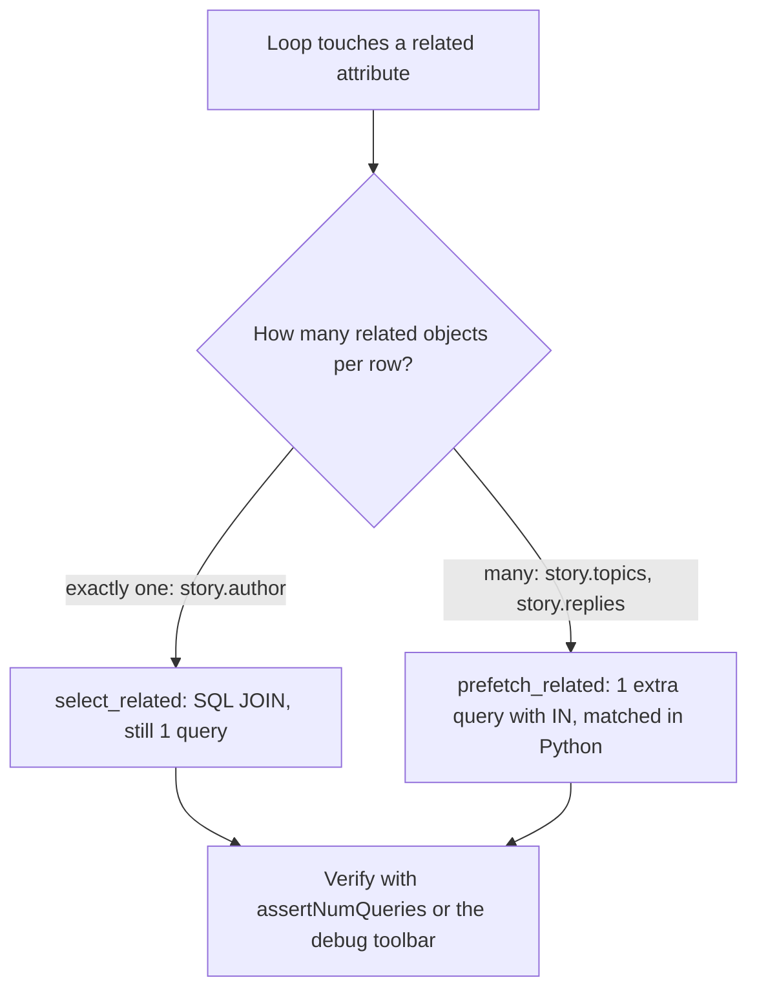

# Aggregation, joins and the N+1 problem

> **Before this lesson:** you understand lazy querysets, `Q` and `F` ([Querysets in depth: laziness, lookups, Q and F](#/lesson/django/orm-querysets)) and the three relationship shapes with their reverse accessors ([Replies: comments and model relationships](#/lesson/django/comments-relationships)). For the SQL underneath, see [GROUP BY](#/lesson/sql/group-by) and [inner joins](#/lesson/sql/inner-joins).

## In plain words

Two kinds of question come up on almost every real page.

**Summary questions.** "How many replies does each story have?" "What is the average number of recommendations per section?" You do not want the rows; you want numbers computed *from* the rows. Computing a number from many rows is called **aggregation**, and the database is extremely good at it.

**Questions that span tables.** "List the stories with their authors' names and their topics." The data lives in three tables. How you fetch it decides whether the page needs 3 queries or 300.

The second kind hides the most common performance bug in all of web development. It has a name: the **N+1 problem**. You run **1** query for a list of N things, then, without noticing, **N** more queries, one per thing, to fetch something related.

An everyday picture: you are cooking for ten guests and need each guest's dietary notes. The N+1 way: look at the guest list, then phone each guest separately, ten calls. The sensible way: send one group message and get all ten answers. Same information; one trip instead of ten. On a web page the "calls" are round trips to the database, each costing about a millisecond or more, and they add up to slow pages and overloaded databases.

Why it matters for a job: N+1 is the first thing a reviewer looks for in Django code and the most frequent Django interview topic after the request cycle. "What is the difference between `select_related` and `prefetch_related`?" is asked almost verbatim.

## Part 1: aggregation

The examples use the Gazette's models: `Story` (with `section`, `recommendations`, `author`), `Reply` (with `story`, `author`, `is_hidden`) and `Topic` (many-to-many with stories).

### `aggregate`: one answer for the whole queryset

```python
from django.db.models import Avg, Count, Max, Min, Sum

Story.objects.published().aggregate(
    total=Count("id"),
    most=Max("recommendations"),
    average=Avg("recommendations"),
    all_recs=Sum("recommendations"),
)
# {'total': 42, 'most': 311, 'average': 17.4, 'all_recs': 731}
```

`aggregate` evaluates immediately and returns a **dictionary**. The keys are the names you chose. The five standard functions: `Count`, `Sum`, `Avg`, `Min`, `Max`. On an empty queryset `Count` gives 0 and the others give `None`; supply a fallback with `Sum("recommendations", default=0)`.

### `annotate`: one answer per object

```python
stories = Story.objects.published().annotate(reply_count=Count("replies"))
for story in stories:
    print(story.headline, story.reply_count)
```

`annotate` returns a **queryset**: each story gains an extra attribute computed by the database. In SQL this is a `GROUP BY` on the story with a join to replies. The annotation can be used in later steps:

```python
(Story.objects.published()
      .annotate(reply_count=Count("replies"))
      .filter(reply_count__gte=5)             # only much-discussed stories
      .order_by("-reply_count")[:10])
```

### `values` + `annotate`: group by something else

To group by a column instead of by object, name the column in `values()` **before** `annotate()`:

```python
Story.objects.published().values("section").annotate(
    stories=Count("id"),
    recommendations=Sum("recommendations"),
).order_by("-stories")
# <QuerySet [{'section': 'harbour', 'stories': 17, 'recommendations': 402}, {'section': 'sport', ...}]>
```

```sql
SELECT section, COUNT(id) AS stories, SUM(recommendations) AS recommendations
FROM stories_story WHERE ... GROUP BY section ORDER BY stories DESC
```

The order of the calls is the meaning: `values(...)` then `annotate(...)` groups by those values; `annotate(...)` then `values(...)` computes per object and then merely selects columns.

The model below performs a `GROUP BY` by hand so that the mechanics are visible, including how missing values are treated.

```python-run
stories = [
    {"headline": "Harbour reopens", "section": "harbour", "recommendations": 40},
    {"headline": "Ferry strike looms", "section": "harbour", "recommendations": 12},
    {"headline": "Regatta results", "section": "sport", "recommendations": 60},
    {"headline": "Choir tour", "section": "culture", "recommendations": None},   # not yet counted
    {"headline": "Rowing trials", "section": "sport", "recommendations": 8},
]

def group_by(rows, key, field):
    groups = {}
    for row in rows:                                   # 1. put each row into its group's bucket
        groups.setdefault(row[key], []).append(row)
    result = []
    for value, members in groups.items():              # 2. reduce each bucket to one summary row
        numbers = [m[field] for m in members if m[field] is not None]    # aggregates skip NULL
        result.append({
            key: value,
            "stories": len(members),                                     # Count("id")
            "counted": len(numbers),                                     # Count(field)
            "total": sum(numbers) if numbers else None,                  # Sum(field)
            "average": round(sum(numbers) / len(numbers), 1) if numbers else None,   # Avg(field)
        })
    return result

for row in group_by(stories, "section", "recommendations"):
    print(row)
```

Look at the `culture` row: one story, zero counted values, and a total of `None`, not 0. Databases ignore `NULL` in aggregates, and the sum of nothing is unknown. That behaviour matters in reports.

### Conditions inside and around aggregates

```python
from django.db.models import Count, Q

# count only visible replies (a condition INSIDE the aggregate)
Story.objects.annotate(visible_replies=Count("replies", filter=Q(replies__is_hidden=False)))

# filter BEFORE annotate: restricts which rows are counted  (SQL WHERE)
Story.objects.filter(replies__is_hidden=False).annotate(n=Count("replies"))

# filter AFTER annotate: restricts which groups are returned (SQL HAVING)
Story.objects.annotate(n=Count("replies")).filter(n__gte=5)
```

The second form has a side effect the first does not: stories with **no** visible replies disappear from the result entirely, because the `WHERE` removed all their joined rows. The `filter=` argument keeps them, with a count of 0.

### The double-join trap

```python
# WRONG: both counts are inflated
Story.objects.annotate(replies_n=Count("replies"), topics_n=Count("topics"))
```

Joining a story to its 3 replies **and** its 2 topics produces 3 × 2 = 6 combined rows, so both counts report 6. Fix it by counting distinct ids:

```python
Story.objects.annotate(replies_n=Count("replies", distinct=True), topics_n=Count("topics", distinct=True))
```

`distinct=True` does not help `Sum` or `Avg`, which would add the same value several times; for those use a subquery (shown near the end).

## Part 2: the N+1 problem

### Seeing it

A view and a template that look innocent:

```python
# stories/views.py
class StoryListView(ListView):
    queryset = Story.objects.published()
    context_object_name = "stories"
```

```html

  <h2>{{ story.headline }}</h2>
  <p>by {{ story.author.display_name }} · topics:
     {{ topic.name }} </p>

```

With 20 stories this page sends **41** queries: 1 for the stories, 20 for the authors (each `story.author` is fetched the first time it is touched) and 20 for the topics. The cause is the ORM's convenience: related objects are loaded **lazily**, on first access, one at a time.

The model below counts queries for the three ways of loading the same page. Run it and change `N`.

```python-run
N = 20
queries = []

AUTHORS = {i: {"id": i, "name": f"author{i}"} for i in range(1, 6)}
STORIES = [{"id": i, "headline": f"Story {i}", "author_id": (i % 5) + 1} for i in range(1, N + 1)]
STORY_TOPICS = [(s["id"], t) for s in STORIES for t in (1, 2)]          # every story has two topics
TOPICS = {1: "ferry", 2: "weather"}

def sql(text):
    queries.append(text)

def lazy_page():
    sql("SELECT * FROM story")
    for story in STORIES:
        sql(f"SELECT * FROM member WHERE id = {story['author_id']}")            # story.author
        sql(f"SELECT topic.* FROM topic JOIN story_topics ... WHERE story_id = {story['id']}")   # story.topics.all()

def select_related_page():
    sql("SELECT story.*, member.* FROM story JOIN member ON story.author_id = member.id")
    for story in STORIES:
        sql(f"SELECT topic.* FROM topic JOIN story_topics ... WHERE story_id = {story['id']}")

def optimised_page():
    sql("SELECT story.*, member.* FROM story JOIN member ON story.author_id = member.id")
    ids = ", ".join(str(s["id"]) for s in STORIES)
    sql(f"SELECT topic.*, story_id FROM topic JOIN story_topics ... WHERE story_id IN ({ids[:20]}...)")
    by_story = {}                                         # prefetch: stitch rows together in Python
    for story_id, topic_id in STORY_TOPICS:
        by_story.setdefault(story_id, []).append(TOPICS[topic_id])

for name, page in [("lazy", lazy_page), ("select_related(author)", select_related_page),
                   ("select_related + prefetch_related", optimised_page)]:
    queries.clear()
    page()
    print(f"{name:36} {len(queries):3} queries")
```

The lazy page grows with N: 41 queries for 20 stories, 2,001 for 1,000. The optimised page is always 2.

### The two cures

```python
class StoryListView(ListView):
    context_object_name = "stories"

    def get_queryset(self):
        return (Story.objects.published()
                .select_related("author")
                .prefetch_related("topics"))
```

| | `select_related` | `prefetch_related` |
|---|---|---|
| Works for | **single-valued** relations: `ForeignKey`, `OneToOneField` (forward, and reverse one-to-one) | **multi-valued** relations: reverse foreign keys, `ManyToManyField` (and also single-valued ones) |
| How | one SQL query with a `JOIN`; related columns come along in each row | one extra query per relation (`WHERE ... IN (ids)`), joined to the parents **in Python** |
| Queries | the same 1 | 1 + one per prefetched relation |
| Why not use the other? | a JOIN across a multi-valued relation would repeat each parent row once per child | a JOIN is more economical for a single related row |



Both follow chains with double underscores:

```python
Reply.objects.select_related("story__author")                 # reply -> story -> author, one query
Story.objects.prefetch_related("replies__author")             # stories, their replies, the replies' authors: 3 queries
```

### Customising a prefetch

`prefetch_related("replies")` loads **all** replies. To load a filtered, ordered subset, with its own optimisations, use a `Prefetch` object:

```python
from django.db.models import Prefetch

visible = Reply.objects.filter(is_hidden=False).select_related("author").order_by("-created_at")

stories = Story.objects.published().prefetch_related(
    Prefetch("replies", queryset=visible, to_attr="visible_replies")
)

for story in stories:
    for reply in story.visible_replies:          # a plain list; no further queries
        print(reply.author, reply.text)
```

`to_attr` stores the result as a list under a new attribute name, leaving `story.replies` untouched.

### How a prefetch is silently defeated

A prefetch fills the cache of `story.replies.all()`. Any **different** queryset built from the related manager goes back to the database:

```python
stories = Story.objects.prefetch_related("replies")

for story in stories:
    story.replies.all()                          # uses the prefetched rows
    story.replies.filter(is_hidden=False)        # NEW query per story: N+1 is back
    story.replies.count()                        # uses the cache (prefetched)
    story.replies.order_by("-created_at")        # NEW query per story
```

The remedies: filter in Python over `story.replies.all()`, or prefetch exactly what you need with `Prefetch(..., queryset=...)`.

### Prefer a number? Annotate

If the page only shows a count, do not load the replies at all:

```python
Story.objects.published().annotate(reply_count=Count("replies", filter=Q(replies__is_hidden=False)))
```

### Subqueries for "the latest one of each"

"Each story with the text of its most recent reply" needs neither a join nor a prefetch; a correlated **subquery** computes it per row inside the same statement:

```python
from django.db.models import Exists, OuterRef, Subquery

latest = Reply.objects.filter(story=OuterRef("pk"), is_hidden=False).order_by("-created_at")

Story.objects.published().annotate(
    latest_reply=Subquery(latest.values("text")[:1]),
    has_replies=Exists(latest),
)
```

`OuterRef("pk")` refers to the primary key of the outer query's current story. `Exists` produces a boolean and is the efficient way to ask "is there at least one?".

## Finding N+1 problems

1. **In tests:** `assertNumQueries`. Create a few objects, assert the number, then create more and assert that it did not grow.
2. **In the browser:** the Django Debug Toolbar's SQL panel lists every query of a page and marks groups as "similar" and "duplicated". (Set up in the lesson on caching.)
3. **Automatically:** packages such as `django-zeal` raise an error or log a warning whenever a lazy load happens inside a loop, during development and tests.
4. **In production:** your database's slow-query log and an application-performance monitor show which endpoints issue many queries.

## Tests

```python
# stories/test_nplus1.py
from django.contrib.auth import get_user_model
from django.db.models import Count, Prefetch
from django.test import TestCase
from django.utils import timezone

from .models import Reply, Story, Topic


class QueryCountTests(TestCase):
    @classmethod
    def setUpTestData(cls):
        Member = get_user_model()
        cls.members = [Member.objects.create_user(f"m{i}", email=f"m{i}@gazette.example", password="x")
                       for i in range(3)]
        ferry = Topic.objects.create(name="ferry", slug="ferry")
        weather = Topic.objects.create(name="weather", slug="weather")
        for i in range(6):
            story = Story.objects.create(headline=f"Story {i}", body="...", author=cls.members[i % 3],
                                         section="harbour" if i < 4 else "sport",
                                         status="published", published_at=timezone.now(), recommendations=i)
            story.topics.add(ferry, weather)
            for j in range(3):
                Reply.objects.create(story=story, author=cls.members[j], text="reply", is_hidden=(j == 2))

    def render(self, queryset):
        return [(s.headline, s.author.username, [t.name for t in s.topics.all()]) for s in queryset]

    def test_lazy_loading_is_n_plus_one(self):
        with self.assertNumQueries(1 + 6 + 6):
            self.render(Story.objects.all())

    def test_optimised_loading_is_constant(self):
        with self.assertNumQueries(2):
            self.render(Story.objects.select_related("author").prefetch_related("topics"))

    def test_filtering_a_prefetched_relation_requeries(self):
        stories = Story.objects.prefetch_related("replies")
        with self.assertNumQueries(2 + 6):
            for story in stories:
                list(story.replies.filter(is_hidden=False))

    def test_prefetch_object_with_to_attr(self):
        visible = Reply.objects.filter(is_hidden=False).select_related("author")
        stories = Story.objects.prefetch_related(Prefetch("replies", queryset=visible, to_attr="visible_replies"))
        with self.assertNumQueries(2):
            counts = [len(story.visible_replies) for story in stories]
        self.assertEqual(counts, [2] * 6)

    def test_double_join_needs_distinct(self):
        wrong = Story.objects.annotate(r=Count("replies"), t=Count("topics")).first()
        right = Story.objects.annotate(r=Count("replies", distinct=True), t=Count("topics", distinct=True)).first()
        self.assertEqual((wrong.r, wrong.t), (6, 6))
        self.assertEqual((right.r, right.t), (3, 2))

    def test_group_by_section(self):
        rows = list(Story.objects.values("section").annotate(n=Count("id")).order_by("section"))
        self.assertEqual(rows, [{"section": "harbour", "n": 4}, {"section": "sport", "n": 2}])
```

The first test documents the problem with real numbers; the others pin the fixes.

> [!NOTE]
> **What changed since the book.** The book never meets this topic: its apps list a few rows. Relevant additions since Django 2.1: the `filter=` argument of aggregates (2.0), `default=` for aggregates (4.0), `Prefetch` on sliced querysets (4.2), asynchronous iteration with `async for` (4.1) and `aprefetch_related_objects` (5.0). `GeneratedField` (5.0) can replace some annotations with a column the database keeps up to date.

> [!INTERVIEW]
> **"What is the N+1 problem and how do you fix it in Django?"** Loading N objects with one query and then triggering one additional query per object by accessing a lazily loaded relation in a loop: 1 + N queries. Fix with `select_related` for forward `ForeignKey`/`OneToOne` relations (SQL JOIN, same query) and `prefetch_related` for reverse and many-to-many relations (one extra `IN` query, joined in Python), using `Prefetch` objects for filtered or ordered children, and `annotate(Count(...))` when only a number is needed. Detect with `assertNumQueries`, the debug toolbar or a tool like `django-zeal`. Mention the gotcha that `.filter()` on a prefetched manager re-queries, and that N+1 often hides in templates and serializers, not in views.

> [!WARNING]
> Do not add `select_related()` with no arguments, or prefetch everything "to be safe". Unneeded joins widen every row and unneeded prefetches are extra queries and memory. Optimise for what the page reads, and let a query-count test tell you when that changes.

> [!TIP]
> Put the optimisation where the knowledge is. The view (or serializer) knows which related data the page shows, so it should own `select_related` and `prefetch_related`. A custom queryset method such as `Story.objects.for_list()` gives the combination a name and keeps templates and views in agreement.

## Pitfalls

- **Related access in a template loop without optimisation.** The classic N+1.
- **`select_related` on a many-to-many or reverse relation.** Raises `FieldError`; use `prefetch_related`.
- **Filtering, ordering or slicing a prefetched manager in the loop.** Bypasses the prefetch.
- **Two `Count`s over different multi-valued relations without `distinct=True`.** Inflated numbers that look plausible.
- **`filter()` before `annotate()` dropping parents with no matching children.** Use `filter=` inside the aggregate.
- **`values()` and `annotate()` in the wrong order.** Per-object numbers instead of groups.
- **A default `Meta.ordering` on a grouped query.** The ordering columns join the `GROUP BY` and split groups; add `.order_by()` to clear it.
- **`len(story.replies.all())` versus `story.replies.count()` after a prefetch.** Both are free once prefetched; without a prefetch each is a query per story.

## Cheat sheet

| Need | Code |
|---|---|
| One summary | `qs.aggregate(total=Count("id"), avg=Avg("recommendations"))` |
| A number per object | `qs.annotate(reply_count=Count("replies"))` |
| Group by a column | `qs.values("section").annotate(n=Count("id"))` |
| Conditional count | `Count("replies", filter=Q(replies__is_hidden=False))` |
| Several multi-valued counts | `Count("replies", distinct=True)` |
| Keep groups by size | `.annotate(n=Count("replies")).filter(n__gte=5)` |
| Single related object | `.select_related("author")`, `.select_related("story__author")` |
| Many related objects | `.prefetch_related("topics")`, `.prefetch_related("replies__author")` |
| Filtered children | `Prefetch("replies", queryset=..., to_attr="visible_replies")` |
| Latest child's value | `Subquery(child_qs.filter(story=OuterRef("pk")).values("text")[:1])` |
| Has any child | `Exists(child_qs.filter(story=OuterRef("pk")))` |
| Guard in tests | `with self.assertNumQueries(2):` |

## Summary

- `aggregate` returns one dictionary for a whole queryset; `annotate` attaches a computed value to each object; `values().annotate()` groups by columns.
- Aggregates skip `NULL`; conditions can go inside an aggregate (`filter=`), before it (WHERE) or after it (HAVING), with different results.
- The N+1 problem is one query for a list plus one per item for a lazily loaded relation.
- `select_related` joins single-valued relations into the main query; `prefetch_related` loads multi-valued relations with one extra query each.
- Changing a prefetched queryset in the loop re-queries; use `Prefetch` objects, annotations or subqueries, and pin the query count in tests.

## Glossary

- **Aggregation**: computing a summary value (count, sum, average, minimum, maximum) from many rows.
- **`GROUP BY`**: the SQL clause that forms groups of rows to aggregate separately.
- **`WHERE` / `HAVING`**: conditions applied to rows before grouping / to groups after aggregation.
- **Annotation**: a computed value attached to each object of a queryset.
- **Join**: combining rows of two tables on matching keys.
- **Lazy loading**: fetching related data only at the moment it is first accessed.
- **N+1 problem**: one list query followed by one additional query per listed item.
- **Eager loading**: fetching related data in advance (`select_related`, `prefetch_related`).
- **`Prefetch` object**: a description of how to prefetch one relation, with a custom queryset.
- **Correlated subquery**: an inner query that refers to the current row of the outer query (`OuterRef`).
- **`NULL`**: the database's marker for "no value".

```quiz
[
  {"q": "What does `Story.objects.aggregate(n=Count('id'))` return?",
   "options": ["A queryset of stories", "A dictionary such as {'n': 42}", "A list of counts", "An integer"],
   "answer": 1,
   "explain": "aggregate evaluates immediately and returns a dict keyed by the names you provide."},
  {"q": "Which expression produces one row per section with the number of stories in it?",
   "options": ["Story.objects.annotate(n=Count('id')).values('section')", "Story.objects.values('section').annotate(n=Count('id'))", "Story.objects.aggregate(Count('section'))", "Story.objects.filter(section=Count('id'))"],
   "answer": 1,
   "explain": "values() before annotate() defines the GROUP BY columns. The reverse order annotates each story individually."},
  {"q": "A template loops over 50 stories and prints `story.author.display_name`. The view used `Story.objects.all()`. How many queries run?",
   "options": ["1", "2", "51", "50"],
   "answer": 2,
   "explain": "One query for the stories plus one lazy query per story for its author: 1 + 50."},
  {"q": "Which tool fixes N+1 for `story.author` (a ForeignKey)?",
   "options": ["prefetch_related only", "select_related('author'), which adds a JOIN to the same query", "values('author')", "defer('author')"],
   "answer": 1,
   "explain": "select_related follows single-valued relations with a JOIN, so no extra query is needed."},
  {"q": "Why can select_related not be used for `story.topics` (many-to-many)?",
   "options": ["It is not implemented yet", "A JOIN would return one row per story-topic pair, duplicating stories; Django uses a separate query instead", "Topics have no primary key", "It can be used"],
   "answer": 1,
   "explain": "Multi-valued relations are loaded by prefetch_related with one extra IN query and matched in Python."},
  {"q": "Stories were loaded with `prefetch_related('replies')`. Inside the loop the code calls `story.replies.filter(is_hidden=False)`. What happens?",
   "options": ["The prefetched rows are filtered in memory", "A new query runs for each story, bringing N+1 back", "An exception is raised", "The filter is ignored"],
   "answer": 1,
   "explain": "Any new queryset derived from the related manager ignores the prefetch cache. Use Prefetch with a queryset, or filter the list from .all() in Python."},
  {"q": "`Story.objects.annotate(r=Count('replies'), t=Count('topics'))` gives r=6 and t=6 for a story with 3 replies and 2 topics. Why?",
   "options": ["A database bug", "The two joins multiply rows (3 x 2); add distinct=True to each Count", "Count ignores NULL", "annotate cannot take two arguments"],
   "answer": 1,
   "explain": "Joining both relations yields the cross product per story. Counting distinct ids restores the true numbers."},
  {"q": "What is the difference between `Count('replies', filter=Q(replies__is_hidden=False))` and filtering before annotating?",
   "options": ["None", "The filter= form keeps stories with zero matching replies (count 0); a prior filter() removes them from the result", "The filter= form is slower", "A prior filter counts hidden replies"],
   "answer": 1,
   "explain": "A WHERE on the joined table drops parents with no matching child rows. A conditional aggregate does not."}
]
```

> **Source:** beyond the book (Vincent, *Django for Beginners*, does not cover query optimisation). Docs: https://docs.djangoproject.com/en/5.2/topics/db/aggregation/ · https://docs.djangoproject.com/en/5.2/ref/models/querysets/#select-related · https://docs.djangoproject.com/en/5.2/ref/models/querysets/#prefetch-related · https://docs.djangoproject.com/en/5.2/topics/db/optimization/
