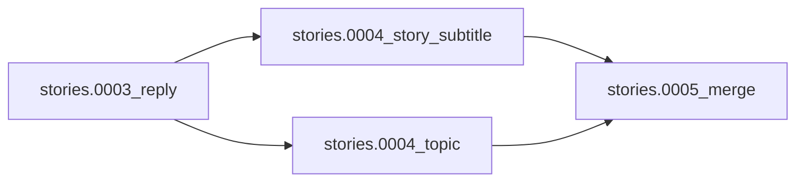

# Transactions, indexes, migrations in teams and raw SQL

> **Before this lesson:** you know querysets, `F` expressions and race conditions ([Querysets in depth: laziness, lookups, Q and F](#/lesson/django/orm-querysets)), the N+1 problem ([Aggregation, joins and the N+1 problem](#/lesson/django/orm-aggregation-nplus1)) and the two migration commands ([Models, migrations and the admin](#/lesson/django/models-migrations-admin)). Background reading: [ACID and isolation](#/lesson/sql/acid-isolation) and [indexes](#/lesson/sql/indexes).

## In plain words

This lesson gathers four topics that decide whether a database-backed application is merely working or actually trustworthy and fast. Each has a simple core idea.

- A **transaction** groups several changes so that they happen **all together or not at all**. Picture a bank transfer: take 50 from one account, add 50 to another. If the power fails between the two steps, the money must not vanish. Either both steps count, or neither.
- An **index** is to a table what the alphabetical index is to a thick book. Without it, finding every mention of "ferry" means reading every page. With it, you look up the word and jump to the pages. The price: the index takes space and must be updated whenever the book changes.
- **Migrations in a team** are about several people changing the database structure at the same time without tripping over each other, and about applying those changes to a live site safely.
- **Raw SQL** is the escape hatch for the rare question the ORM cannot express well, and it must be used without opening the door to injection attacks.

Why it matters for a job: these are the topics that distinguish someone who has run Django in production from someone who has followed tutorials. Interviewers ask "what does `atomic` do?", "when would you add an index?", "two developers created migration 0005; what now?" and "how do you avoid SQL injection in raw queries?".

## Part 1: transactions

### Django's default: autocommit

Unless you say otherwise, every ORM call that writes (`save()`, `create()`, `update()`, `delete()`) is committed to the database immediately. **Commit** means "make permanent". That is called **autocommit**. It is fine for single writes and wrong for operations made of several writes that belong together.

### `atomic`: all or nothing

The Gazette lets a member transfer authorship of a story and logs the event. Two writes; half of them is worse than none.

```python
# stories/services.py
from django.db import transaction

from .models import Story, TransferLog


def transfer_story(story_id, new_author, actor):
    with transaction.atomic():
        story = Story.objects.get(pk=story_id)
        old_author = story.author
        story.author = new_author
        story.save(update_fields=["author"])
        TransferLog.objects.create(story=story, from_member=old_author, to_member=new_author, by=actor)
    return story
```

Everything inside the `with transaction.atomic():` block forms one transaction. If the block finishes normally, the changes are committed together. If **any exception** leaves the block, all changes made inside it are undone; undoing is called a **rollback**. `atomic` also works as a decorator: `@transaction.atomic` above a function makes the whole function one transaction.

The model below demonstrates the guarantee with SQLite: a transfer that fails midway leaves both accounts untouched.

```python-run
import sqlite3

db = sqlite3.connect(":memory:", isolation_level=None)       # we control transactions ourselves
db.execute("CREATE TABLE account (name TEXT PRIMARY KEY, balance INTEGER CHECK (balance >= 0))")
db.executemany("INSERT INTO account VALUES (?, ?)", [("marisol", 80), ("tomas", 20)])

def balances():
    return dict(db.execute("SELECT name, balance FROM account ORDER BY name"))

def transfer(sender, receiver, amount, atomic):
    if atomic:
        db.execute("BEGIN")
    try:
        db.execute("UPDATE account SET balance = balance + ? WHERE name = ?", (amount, receiver))
        db.execute("UPDATE account SET balance = balance - ? WHERE name = ?", (amount, sender))   # may violate CHECK
        if atomic:
            db.execute("COMMIT")
    except sqlite3.IntegrityError as error:
        if atomic:
            db.execute("ROLLBACK")
        print(f"   failed: {error}")

print("start                    :", balances())
transfer("tomas", "marisol", 50, atomic=False)       # tomas has only 20
print("without a transaction    :", balances(), "<- money created from nothing")

db.execute("UPDATE account SET balance = 80 WHERE name = 'marisol'")     # reset
transfer("tomas", "marisol", 50, atomic=True)
print("with BEGIN ... ROLLBACK  :", balances(), "<- nothing changed")
```

Without a transaction, the first update stayed although the second failed: 50 appeared from nowhere. With one, the failure undid both.

### Rules for using `atomic` well

**Catch exceptions outside the block, not inside.** If you swallow a database error inside an atomic block, Django still marks the transaction as broken, and the next query raises `TransactionManagementError`. Wrap the risky statement in its own nested block, which creates a **savepoint**: a marker inside a transaction to which a partial rollback can return.

```python
from django.db import IntegrityError, transaction


def add_topics(story, names):
    with transaction.atomic():                        # outer transaction
        for name in names:
            try:
                with transaction.atomic():            # savepoint
                    story.topics.create(name=name, slug=name.lower())
            except IntegrityError:
                continue                              # this one topic is skipped; the rest survive
```

**Do not send e-mail or call other services inside a transaction as if they were part of it.** A rollback cannot un-send a message. Register such side effects to run only after a successful commit:

```python
def publish(story):
    with transaction.atomic():
        story.publish()
        story.save()
        transaction.on_commit(lambda: notify_subscribers(story.pk))
```

`transaction.on_commit(function)` calls the function after the outermost transaction commits, and never if it rolls back. This is also the correct place to enqueue background tasks: a task started inside the transaction might run before the row it needs is visible.

**Keep transactions short.** While a transaction is open it may hold locks that make other requests wait. Do slow work (network calls, image processing) outside.

### One transaction per request?

The setting `"ATOMIC_REQUESTS": True` inside a database's configuration wraps every view in a transaction: a view that raises leaves no trace in the database. It is convenient and popular; the costs are a little overhead on read-only pages and transactions that stay open for the whole view. Explicit `atomic` blocks around the operations that need them are the leaner alternative.

### Locking rows: `select_for_update`

`F` expressions solve "increment a counter". Sometimes Python logic must run between reading and writing: "publish only if the edition is not yet full". Two requests could both read "not full" and both publish. Lock the row for the duration of the transaction:

```python
def claim_last_seat(edition_id, story):
    with transaction.atomic():
        edition = Edition.objects.select_for_update().get(pk=edition_id)   # other transactions wait here
        if edition.stories.count() >= edition.capacity:
            raise ValueError("This edition is full.")
        story.edition = edition
        story.save(update_fields=["edition"])
```

`select_for_update()` makes the database lock the selected rows until the transaction ends; a second request executing the same line waits, then sees the updated state. It must be used inside `atomic`. SQLite ignores it (it locks the whole database for writes anyway), one more reason to develop against PostgreSQL.

## Part 2: indexes

Without an index, `Story.objects.filter(slug="harbour-reopens")` makes the database read the table row by row: a **full table scan**, taking time proportional to the number of rows. An index is a sorted structure (usually a **B-tree**) that lets the database find matching rows in a number of steps proportional to the *logarithm* of the row count: about 20 steps for a million rows.

### What is indexed already

Django creates indexes automatically for: primary keys, `unique=True` fields, `ForeignKey` columns, and `SlugField` (which sets `db_index=True` by default).

### Adding your own

```python
class Story(models.Model):
    # ...
    class Meta:
        indexes = [
            models.Index(fields=["status", "-published_at"], name="story_status_pub_idx"),
            models.Index(fields=["section"], name="story_section_idx"),
        ]
```

A **composite index** on `(status, published_at)` serves the front-page query "published stories, newest first" in one go. Column order matters: such an index helps queries that filter on `status`, or on `status` and `published_at`, but not queries that filter on `published_at` alone, in the same way that a phone book sorted by surname then first name does not help you find everyone called "Ana".

The model below asks SQLite for its **query plan**, its description of how it will execute a query, before and after creating an index.

```python-run
import sqlite3

db = sqlite3.connect(":memory:")
db.execute("CREATE TABLE story (id INTEGER PRIMARY KEY, headline TEXT, status TEXT, published_at INTEGER)")
db.executemany("INSERT INTO story (headline, status, published_at) VALUES (?, ?, ?)",
               [(f"Story {i}", "published" if i % 4 else "draft", i) for i in range(20000)])

QUERY = "SELECT headline FROM story WHERE status = 'published' ORDER BY published_at DESC LIMIT 10"

def plan(label):
    steps = [row[3] for row in db.execute("EXPLAIN QUERY PLAN " + QUERY)]
    print(f"{label:15}", " | ".join(steps))

plan("no index:")
db.execute("CREATE INDEX story_status_pub_idx ON story (status, published_at DESC)")
plan("with index:")
db.execute("DROP INDEX story_status_pub_idx")
db.execute("CREATE INDEX story_headline_idx ON story (headline)")
plan("wrong column:")
```

The first plan says `SCAN story` and needs a temporary sort: every row is read. The second says `SEARCH story USING INDEX`: the database jumps to the published rows, already in date order. The third index is on a column the query never filters or sorts by, so the plan falls back to a scan: an index helps only the queries it matches. In Django, `queryset.explain()` prints the same information for your database.

### When to add one, and when not

Add an index for columns that appear in `filter`, `order_by` or joins of **frequent** queries on **large** tables, guided by measurements (slow-query logs, `explain`). Do not index everything: each index slows down every insert and update and uses disk space, and an index on a column with very few distinct values (a boolean) rarely helps by itself.

Two refinements worth knowing by name: a **partial index** covers only some rows (`models.Index(fields=["published_at"], condition=Q(status="published"), name=...)`), and a `UniqueConstraint` with a `condition` enforces uniqueness among a subset (one *active* subscription per member).

## Part 3: migrations in teams

### The dependency graph

Each migration names the migrations that must run before it. Together they form a graph, not merely a numbered list:

```python
class Migration(migrations.Migration):
    dependencies = [
        ("stories", "0003_reply"),
        ("accounts", "0002_member_bio"),
    ]
```

`migrate` sorts the graph so that every migration runs after its dependencies. The numbers in file names are only a naming convention; the `dependencies` lists are what counts.

### Two developers, two 0004s

Ana adds a `subtitle` field on her branch; Bo adds a `Topic` model on his. Both run `makemigrations` and both get `0004_...py` depending on `0003`. After both branches are merged, the graph has two **leaf nodes**:



Django refuses to migrate: `CommandError: Conflicting migrations detected; multiple leaf nodes in the migration graph`. If the two changes are independent, as here, generate a **merge migration**:

```bash
python manage.py makemigrations --merge
```

It creates an empty migration that depends on both 0004s, joining the branches into one line again. If both changed the *same* field, resolve it like any code conflict: decide the intended final state and regenerate one of the migrations on top of the other.

To catch this before it reaches the main branch, run in continuous integration:

```bash
python manage.py makemigrations --check --dry-run    # fails if models changed without a migration
python manage.py migrate --plan                      # shows what would run
```

### Team rules that prevent pain

1. **Migrations are code.** Review them, commit them with the model change, never edit one that has been applied elsewhere.
2. **Never delete or rewrite shared history** to "tidy up". Use squashing (below).
3. **Small and frequent.** A migration per logical change merges more easily than one giant file.
4. **Reversible where possible.** Give `RunPython` a reverse function (or `migrations.RunPython.noop`), so that `migrate stories 0003` can step back.
5. **Backward compatible** with the code currently running, as described in the deployment lesson: add first, remove later.

### Data migrations

Changing **rows** as part of a schema change is done with `RunPython`. A standard three-step example: introduce a required, unique `slug` on a table that already has rows.

```python
# 0006: add the column as nullable
migrations.AddField("story", "slug", models.SlugField(max_length=160, null=True))
```

```python
# 0007: fill it
from django.db import migrations
from django.utils.text import slugify


def fill_slugs(apps, schema_editor):
    Story = apps.get_model("stories", "Story")        # the historical model, not an import
    seen = set()
    for story in Story.objects.order_by("pk").iterator():
        base = slugify(story.headline) or "story"
        slug, n = base, 2
        while slug in seen:
            slug, n = f"{base}-{n}", n + 1
        seen.add(slug)
        story.slug = slug
        story.save(update_fields=["slug"])


class Migration(migrations.Migration):
    dependencies = [("stories", "0006_story_slug")]
    operations = [migrations.RunPython(fill_slugs, migrations.RunPython.noop)]
```

```python
# 0008: now make it required and unique
migrations.AlterField("story", "slug", models.SlugField(max_length=160, unique=True))
```

Inside `RunPython`, always fetch models with `apps.get_model`. It returns the model as it was at that point in history, with exactly the fields that exist in the database then. The real class from `models.py` may have fields that this old schema lacks; custom methods and managers are not available on historical models either.

### Squashing

After two years an app may have 150 migrations, and creating a test database replays all of them. `squashmigrations` combines a range into one optimised migration:

```bash
python manage.py squashmigrations stories 0001 0040
```

The new file carries a `replaces = [...]` list. Databases that already applied the originals treat it as applied; fresh databases run only the squashed one. Once every environment is past the squashed range, delete the originals and the `replaces` line. The optimiser merges operations where it safely can (`CreateModel` + `AddField` becomes one `CreateModel`; an added and later removed field vanishes), which is the subject of one of this module's problems.

### Useful commands

| Command | Purpose |
|---|---|
| `showmigrations` | list migrations and which are applied (`[X]`) |
| `migrate stories 0003` | migrate forwards or **backwards** to that point |
| `migrate stories zero` | unapply all of an app's migrations |
| `sqlmigrate stories 0004` | print the SQL of one migration |
| `migrate --fake stories 0004` | record as applied without running it (repair tool; use with great care) |
| `makemigrations --empty stories --name fill_slugs` | start a data migration |

## Part 4: raw SQL

The ORM covers the great majority of queries. Reasons to drop to SQL: a database feature the ORM does not expose, a report with complex window functions already written and tuned as SQL, or a bulk operation that is much faster as one statement. Two ways:

```python
# 1. Raw query returning model instances
stories = Story.objects.raw(
    "SELECT * FROM stories_story WHERE section = %s ORDER BY published_at DESC LIMIT %s",
    ["harbour", 10],
)

# 2. A cursor for anything at all
from django.db import connection

with connection.cursor() as cursor:
    cursor.execute(
        "SELECT section, COUNT(*) FROM stories_story WHERE status = %s GROUP BY section",
        ["published"],
    )
    rows = cursor.fetchall()            # [("harbour", 17), ("sport", 9)]
```

The one rule that must never be broken: **values go in the parameter list, never into the SQL string.**

```python
# VULNERABLE: the visitor controls the SQL text
cursor.execute(f"SELECT * FROM stories_story WHERE section = '{section}'")

# SAFE: the driver sends the value separately
cursor.execute("SELECT * FROM stories_story WHERE section = %s", [section])
```

With the first form, a `section` value of `x' OR '1'='1` returns every row, and worse variants delete or reveal data. That is **SQL injection**. The placeholder is always `%s` (without quotes), whatever the database. Identifiers such as table and column names cannot be parameters; never build them from user input. See [SQL injection and parameterised queries](#/lesson/web-security/sql-injection).

A middle path keeps the ORM's safety: `RawSQL`, `Func` and custom lookups let you embed a small SQL fragment inside an otherwise normal queryset.

## Tests

```python
# stories/test_transactions.py
from django.contrib.auth import get_user_model
from django.core.management import call_command
from django.db import IntegrityError, connection, transaction
from django.test import TestCase

from .models import Story, Topic


class TransactionTests(TestCase):
    @classmethod
    def setUpTestData(cls):
        cls.member = get_user_model().objects.create_user("marisol", email="m@gazette.example", password="x")

    def test_atomic_rolls_back_everything(self):
        with self.assertRaises(ValueError):
            with transaction.atomic():
                Story.objects.create(headline="Half done", body="...", author=self.member)
                raise ValueError("something failed")
        self.assertFalse(Story.objects.filter(headline="Half done").exists())

    def test_savepoint_isolates_one_failure(self):
        Topic.objects.create(name="ferry", slug="ferry")
        with transaction.atomic():
            for name in ["weather", "ferry", "sport"]:           # "ferry" violates uniqueness
                try:
                    with transaction.atomic():
                        Topic.objects.create(name=name, slug=name)
                except IntegrityError:
                    pass
        self.assertEqual(Topic.objects.count(), 3)

    def test_on_commit_runs_after_success_only(self):
        calls = []
        with self.captureOnCommitCallbacks(execute=True):
            with transaction.atomic():
                transaction.on_commit(lambda: calls.append("notified"))
                self.assertEqual(calls, [])                      # not yet
        self.assertEqual(calls, ["notified"])

    def test_raw_sql_with_parameters(self):
        Story.objects.create(headline="It's back", body="...", author=self.member, section="harbour")
        with connection.cursor() as cursor:
            cursor.execute("SELECT COUNT(*) FROM stories_story WHERE section = %s", ["x' OR '1'='1"])
            self.assertEqual(cursor.fetchone()[0], 0)            # the attack string is treated as plain text

    def test_models_and_migrations_agree(self):
        call_command("makemigrations", "--check", "--dry-run", verbosity=0)
```

`TestCase` itself runs each test inside a transaction, so `on_commit` callbacks would never fire; `captureOnCommitCallbacks(execute=True)` runs them when the block ends.

> [!NOTE]
> **What changed since the book.** None of this appears in the source book. Version notes: `Meta.indexes` (1.11) replaced `index_together`, which was removed in 5.1; functional indexes (`Index(Lower("headline"), name=...)`) arrived in 3.2; `captureOnCommitCallbacks` in 3.2; `transaction.on_commit(..., robust=True)` in 4.2; `db_default` and `GeneratedField` in 5.0; composite primary keys in 5.2. The async ORM cannot yet run code inside `transaction.atomic()` directly; wrap such blocks with `sync_to_async`.

> [!INTERVIEW]
> **"What does `transaction.atomic()` do, and what are the pitfalls?"** It runs a block as one database transaction: commit if the block exits normally, rollback if an exception propagates. Nested blocks become savepoints, allowing partial rollback. Pitfalls: catching a database error inside the block leaves the transaction unusable (catch outside or use a nested block); side effects such as e-mails or task enqueues are not undone by rollback, so schedule them with `transaction.on_commit`; long transactions hold locks; and `select_for_update` must be used inside `atomic` to serialise read-check-write logic. A strong answer also names autocommit as the default and `ATOMIC_REQUESTS` as the per-request option.

> [!WARNING]
> `migrate --fake` and hand-editing the `django_migrations` table change what Django *believes* about the database without changing the database. They are repair tools for a known mismatch. Used to silence an error you do not understand, they turn one problem into several.

> [!TIP]
> Before adding an index because a page "feels slow", look at the query count first. Ninety queries that each use an index perfectly are still slower than two. Fix N+1, then measure, then index.

## Pitfalls

- **Multi-step writes without `atomic`.** A failure in the middle leaves inconsistent data.
- **Swallowing `IntegrityError` inside an atomic block.** Use a nested `atomic()` as a savepoint.
- **Side effects inside transactions.** Use `on_commit`.
- **`select_for_update()` outside a transaction.** `TransactionManagementError`.
- **Indexing every column.** Slower writes, larger database, little gain.
- **Composite index with the wrong column order** for the query it is meant to serve.
- **Importing real models in a data migration.** Works today, breaks when the model changes; use `apps.get_model`.
- **Editing an applied migration.** Other environments never see the change.
- **Resolving a migration conflict by renumbering files by hand** without fixing `dependencies`.
- **String formatting in raw SQL.** Always pass parameters.

## Cheat sheet

| Need | Code |
|---|---|
| All-or-nothing block | `with transaction.atomic(): ...` or `@transaction.atomic` |
| Partial rollback | a nested `with transaction.atomic():` inside `try` |
| Run after commit | `transaction.on_commit(lambda: task(pk))` |
| Lock rows | `Model.objects.select_for_update().get(pk=...)` inside `atomic` |
| Transaction per request | `DATABASES["default"]["ATOMIC_REQUESTS"] = True` |
| Composite index | `models.Index(fields=["status", "-published_at"], name="...")` |
| Partial index | `models.Index(fields=[...], condition=Q(...), name="...")` |
| See the plan | `queryset.explain()` |
| Merge migration branches | `python manage.py makemigrations --merge` |
| Detect missing migrations in CI | `python manage.py makemigrations --check --dry-run` |
| Data migration | `migrations.RunPython(forward, reverse)` with `apps.get_model` |
| Squash | `python manage.py squashmigrations app 0001 0040` |
| Step back | `python manage.py migrate app 0003` |
| Raw SQL, safely | `cursor.execute("... WHERE x = %s", [value])` |

## Summary

- A transaction makes a group of writes all-or-nothing; `transaction.atomic()` commits on success and rolls back on any exception, with nested blocks acting as savepoints.
- Schedule external side effects with `on_commit`, keep transactions short, and use `select_for_update` when Python logic sits between a read and a write.
- Indexes turn scans into searches at the cost of slower writes; add them for measured, frequent queries, and mind column order in composite indexes.
- Migrations form a dependency graph; parallel work creates multiple leaves that `makemigrations --merge` joins; data migrations use historical models; squashing shortens long histories.
- Raw SQL is available through `raw()` and cursors; always pass values as parameters.

## Glossary

- **Transaction**: a group of database operations treated as a single unit.
- **Commit / rollback**: making a transaction's changes permanent / undoing them.
- **Autocommit**: committing each statement immediately, Django's default.
- **Atomicity**: the all-or-nothing property of a transaction.
- **Savepoint**: a marker inside a transaction that a partial rollback can return to.
- **Lock**: a database mechanism making other transactions wait for a row or table.
- **Index**: a sorted auxiliary structure that speeds up lookups on chosen columns.
- **Full table scan**: reading every row to answer a query.
- **Composite index**: an index over several columns in a fixed order.
- **Query plan**: the database's chosen strategy for executing a query.
- **Leaf node (migrations)**: a migration on which no other migration depends.
- **Merge migration**: an empty migration that depends on several leaves to rejoin them.
- **Data migration**: a migration that modifies rows.
- **Squashing**: replacing many migrations with one equivalent migration.
- **SQL injection**: making an application execute attacker-supplied SQL through unsanitised input.

```quiz
[
  {"q": "An exception is raised inside `with transaction.atomic():` after two rows were created. What is in the database afterwards?",
   "options": ["Both rows", "The first row only", "Neither row; the block is rolled back", "It depends on the exception type"],
   "answer": 2,
   "explain": "Any exception leaving the block rolls back every change made inside it."},
  {"q": "Why should an e-mail be sent with transaction.on_commit instead of directly inside an atomic block?",
   "options": ["E-mail is slow", "A rollback cannot un-send it; on_commit runs only if the transaction actually commits", "Django forbids e-mail in transactions", "To avoid CSRF"],
   "answer": 1,
   "explain": "Side effects outside the database are not transactional. Deferring them to after commit keeps them consistent with the data."},
  {"q": "How do you tolerate one failing insert inside a larger atomic block?",
   "options": ["Catch the IntegrityError directly in the outer block", "Wrap that insert in a nested atomic block and catch the error outside the nested block", "Disable autocommit", "Use bulk_create with no options"],
   "answer": 1,
   "explain": "The nested block is a savepoint. Its rollback leaves the outer transaction usable."},
  {"q": "What does select_for_update() do?",
   "options": ["Updates all selected rows", "Locks the selected rows until the transaction ends, so concurrent transactions wait", "Selects rows that were recently updated", "Refreshes instances from the database"],
   "answer": 1,
   "explain": "It issues SELECT ... FOR UPDATE and must run inside atomic. It serialises read-check-write sequences."},
  {"q": "A composite index exists on (status, published_at). Which query benefits least?",
   "options": ["filter(status='published').order_by('-published_at')", "filter(status='draft')", "filter(published_at__gte=yesterday) with no status condition", "filter(status='published', published_at__gte=yesterday)"],
   "answer": 2,
   "explain": "A composite index is ordered by its first column. Queries that do not constrain the leading column cannot use it efficiently."},
  {"q": "After merging two branches, Django reports 'multiple leaf nodes in the migration graph'. What is the usual fix for independent changes?",
   "options": ["Delete one of the migrations", "python manage.py makemigrations --merge", "python manage.py migrate --fake", "Rename the files so the numbers differ"],
   "answer": 1,
   "explain": "A merge migration depends on both leaves and restores a single line of history. Renaming files does not change the dependency graph."},
  {"q": "Inside a RunPython function, why use apps.get_model('stories', 'Story') instead of importing Story?",
   "options": ["Imports are slower", "It returns the model as it existed at that migration, matching the database schema at that point", "Imports are forbidden in migrations", "To avoid circular imports only"],
   "answer": 1,
   "explain": "The current model class may have fields that do not yet exist (or no longer exist) in the schema this migration runs against."},
  {"q": "Which call is safe against SQL injection?",
   "options": ["cursor.execute(f\"... WHERE section = '{section}'\")", "cursor.execute(\"... WHERE section = '%s'\" % section)", "cursor.execute(\"... WHERE section = %s\", [section])", "cursor.execute(\"... WHERE section = \" + section)"],
   "answer": 2,
   "explain": "Only the parameterised form sends the value separately from the SQL text. The others build the statement from user input."}
]
```

> **Source:** beyond the book (Vincent, *Django for Beginners*, covers migrations only at the two-command level). Docs: https://docs.djangoproject.com/en/5.2/topics/db/transactions/ · https://docs.djangoproject.com/en/5.2/ref/models/indexes/ · https://docs.djangoproject.com/en/5.2/topics/migrations/ · https://docs.djangoproject.com/en/5.2/howto/writing-migrations/ · https://docs.djangoproject.com/en/5.2/topics/db/sql/
