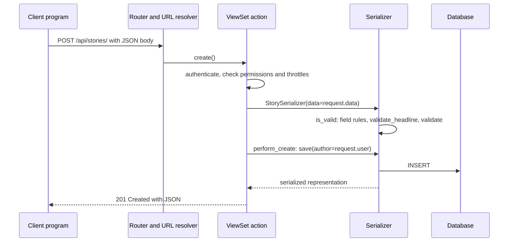

# Django REST framework: serializers, viewsets and routers

> **Before this lesson:** you know models, querysets and the N+1 problem ([Aggregation, joins and the N+1 problem](#/lesson/django/orm-aggregation-nplus1)), ModelForms and validation ([Forms, ModelForm, validation and CSRF](#/lesson/django/forms-validation-csrf)), and class-based views with mixins ([Permissions, authorisation and mixins](#/lesson/django/permissions-mixins)). If HTTP methods, status codes or JSON are hazy, read [HTTP: methods, status codes and headers](#/lesson/fastapi/http-basics) and [REST design and JSON](#/lesson/fastapi/rest-json).

## In plain words

Everything built so far answers a browser with **HTML**, a page meant for human eyes. Other programs want to use your site too: a mobile app, a JavaScript front end, a partner's script. They do not want a page with menus and colours. They want the **data**, in a format that is easy for code to read.

An **API** (application programming interface) is a set of URLs designed for programs. The usual data format is **JSON** (JavaScript Object Notation), which looks like Python dictionaries and lists written as text:

```json
{"id": 7, "headline": "Harbour reopens", "section": "harbour", "author": "marisol"}
```

**Django REST framework**, shortened to **DRF**, is the standard package for building such APIs with Django. It mirrors what you already know:

| For browsers (Django) | For programs (DRF) | Job |
|---|---|---|
| Template | **Serializer** output as JSON | present data |
| ModelForm | **Serializer** | validate input and save |
| Generic class-based view | Generic API view / **ViewSet** | handle the request |
| `urls.py` entries | **Router** | map URLs to views |

An everyday picture: a restaurant with a dining room and a wholesale counter. The kitchen (models, database) is the same. The dining room serves plated meals to guests (HTML). The wholesale counter hands the same food in standard labelled boxes to other businesses (JSON), with a price list that follows a fixed format so that ordering can be automated.

Why it matters for a job: a large share of Django work today is API work, and "Django + DRF" appears together in job adverts. Interviewers ask what a serializer is, how `ModelViewSet` differs from `APIView`, and where you would put validation.

## REST in one table

**REST** is a style of API design in which URLs name **resources** (things, as plural nouns) and HTTP methods say what to do with them.

| Method and URL | Meaning | Success status |
|---|---|---|
| `GET /api/stories/` | list stories | 200 OK |
| `POST /api/stories/` | create a story | 201 Created |
| `GET /api/stories/7/` | retrieve story 7 | 200 OK |
| `PUT /api/stories/7/` | replace story 7 entirely | 200 OK |
| `PATCH /api/stories/7/` | change some fields of story 7 | 200 OK |
| `DELETE /api/stories/7/` | delete story 7 | 204 No Content |

Errors use status codes as well: 400 for invalid input, 401 for "not authenticated", 403 for "not allowed", 404 for "no such thing".

## Setup

```bash
python -m pip install djangorestframework
python -m pip freeze > requirements.txt
```

```python
# config/settings.py
INSTALLED_APPS = [
    # ...
    "rest_framework",
    "stories",
]
```

## Step 1: a serializer

A **serializer** converts in both directions: model instance → plain Python data (which DRF then writes as JSON), and incoming JSON → validated data → model instance. Converting an object to a transferable format is called **serialising**; the reverse is **deserialising**.

```python
# stories/serializers.py  (new file)
from rest_framework import serializers

from .models import Story


class StorySerializer(serializers.ModelSerializer):
    class Meta:
        model = Story
        fields = ["id", "headline", "slug", "summary", "body", "section", "status", "author", "published_at"]
        read_only_fields = ["slug", "status", "author", "published_at"]
```

It reads like a ModelForm on purpose. `fields` is the explicit allow-list of what the API exposes. `read_only_fields` appear in output but are ignored in input: clients cannot set the author or publish by sending `"status": "published"`.

Try it in `python manage.py shell`:

```python
from stories.models import Story
from stories.serializers import StorySerializer

story = Story.objects.first()
StorySerializer(story).data
# {'id': 1, 'headline': 'Harbour reopens', 'slug': 'harbour-reopens', ..., 'author': 3, ...}

StorySerializer(Story.objects.all()[:3], many=True).data      # a list of such dictionaries

incoming = StorySerializer(data={"headline": "", "body": "Short.", "section": "space"})
incoming.is_valid()        # False
incoming.errors
# {'headline': ['This field may not be blank.'], 'section': ['"space" is not a valid choice.']}
```

The pattern is the form pattern: pass `data=`, call `is_valid()`, read `errors` or `validated_data`, call `save()`.

### Presenting related objects

By default a foreign key is shown as the related object's primary key (`"author": 3`). Other representations are one line each:

```python
class StorySerializer(serializers.ModelSerializer):
    author = serializers.StringRelatedField()                                 # "Marisol R." (uses __str__), read-only
    section_label = serializers.CharField(source="get_section_display", read_only=True)
    topics = serializers.SlugRelatedField(many=True, slug_field="slug", queryset=Topic.objects.all(), required=False)
    reply_count = serializers.IntegerField(read_only=True)                    # filled by an annotation in the view
    url = serializers.HyperlinkedIdentityField(view_name="story-api-detail", lookup_field="slug")

    class Meta:
        model = Story
        fields = ["id", "url", "headline", "slug", "summary", "body", "section", "section_label",
                  "status", "author", "topics", "reply_count", "published_at"]
        read_only_fields = ["slug", "status", "published_at"]
```

- `source` reads the value from another attribute or method.
- `SlugRelatedField` represents each topic by its slug in both directions: output `["ferry", "weather"]`, and input in the same form is resolved to `Topic` objects.
- `HyperlinkedIdentityField` adds the full URL of the object itself, a convenience for clients.

A serializer can also **nest** another serializer (`author = MemberSerializer(read_only=True)`) to embed a whole object.

### Validation

The hooks have the same shape as on forms, with different names:

```python
class StorySerializer(serializers.ModelSerializer):
    # ... fields ...

    def validate_headline(self, value):                 # one field
        if value.isupper():
            raise serializers.ValidationError("Please do not write the headline in capitals.")
        return value.strip()

    def validate(self, attrs):                          # several fields together
        if attrs.get("section") == "sport" and len(attrs.get("body", "")) < 20:
            raise serializers.ValidationError({"body": "Sport reports need at least a sentence."})
        return attrs
```

The model below is a serializer reduced to its two directions, so that nothing about it is magic. Run it and send your own input.

```python-run
class ValidationError(Exception):
    pass

class StorySerializer:
    fields = ["id", "headline", "section", "status", "author"]
    read_only = {"id", "status", "author"}
    SECTIONS = {"harbour", "council", "sport", "culture"}

    def to_representation(self, story):                   # model object -> plain data (output)
        return {name: story[name] for name in self.fields}

    def to_internal_value(self, data):                    # plain data -> validated data (input)
        errors, validated = {}, {}
        for name in self.fields:
            if name in self.read_only:
                continue                                  # read-only fields are ignored in input
            value = data.get(name)
            if value is None or value == "":
                errors[name] = ["This field is required."]
            else:
                validated[name] = value
        if "section" in validated and validated["section"] not in self.SECTIONS:
            errors["section"] = [f'"{validated["section"]}" is not a valid choice.']
        if errors:
            raise ValidationError(errors)
        return validated

serializer = StorySerializer()
stored = {"id": 7, "headline": "Harbour reopens", "section": "harbour", "status": "published",
          "author": "marisol", "body": "internal draft notes"}
print("output:", serializer.to_representation(stored))          # 'body' is not exposed

request_body = {"headline": "Ferry strike looms", "section": "harbour", "status": "published", "author": "attacker"}
print("input :", serializer.to_internal_value(request_body))    # status and author were dropped

try:
    serializer.to_internal_value({"headline": "", "section": "space"})
except ValidationError as error:
    print("errors:", error.args[0])
```

Two security properties are visible in the output: a field not listed is never exposed, and a read-only field sent by the client is ignored.

## Step 2: views, from explicit to compact

DRF offers several levels of abstraction. Seeing them in order shows what the shortest version does for you.

### Level 1: a function view

```python
# stories/api.py  (new file)
from rest_framework import status
from rest_framework.decorators import api_view
from rest_framework.response import Response

from .models import Story
from .serializers import StorySerializer


@api_view(["GET", "POST"])
def story_list(request):
    if request.method == "GET":
        stories = Story.objects.published()
        return Response(StorySerializer(stories, many=True, context={"request": request}).data)

    serializer = StorySerializer(data=request.data, context={"request": request})
    serializer.is_valid(raise_exception=True)
    serializer.save(author=request.user)
    return Response(serializer.data, status=status.HTTP_201_CREATED)
```

- `@api_view` turns the function into a DRF view: it restricts methods, parses the request body and chooses the output format.
- `request.data` is the parsed body, whether it arrived as JSON or as form data.
- `Response(data)` takes plain Python data; DRF **renders** it as JSON.
- `is_valid(raise_exception=True)` raises an exception that DRF turns into a 400 response containing the errors.
- `serializer.save(author=request.user)` passes extra values that are not in the input.

### Level 2: generic class-based views

```python
from rest_framework import generics


class StoryListCreate(generics.ListCreateAPIView):
    queryset = Story.objects.published()
    serializer_class = StorySerializer

    def perform_create(self, serializer):
        serializer.save(author=self.request.user)


class StoryDetail(generics.RetrieveUpdateDestroyAPIView):
    queryset = Story.objects.published()
    serializer_class = StorySerializer
    lookup_field = "slug"
```

Two classes cover all six rows of the REST table. `perform_create` is DRF's counterpart to `form_valid`: the hook between validation and saving.

### Level 3: a ViewSet

The two classes share a queryset and a serializer. A **ViewSet** merges them into one class whose methods are named after **actions**: `list`, `create`, `retrieve`, `update`, `partial_update`, `destroy`.

```python
# stories/api.py
from django.db.models import Count, Q
from rest_framework import viewsets
from rest_framework.decorators import action
from rest_framework.response import Response

from .models import Story
from .serializers import StorySerializer


class StoryViewSet(viewsets.ModelViewSet):
    serializer_class = StorySerializer
    lookup_field = "slug"

    def get_queryset(self):
        return (Story.objects.visible_to(self.request.user)
                .select_related("author")
                .prefetch_related("topics")
                .annotate(reply_count=Count("replies", filter=Q(replies__is_hidden=False))))

    def perform_create(self, serializer):
        serializer.save(author=self.request.user)

    @action(detail=True, methods=["post"])
    def recommend(self, request, slug=None):
        story = self.get_object()
        Story.objects.filter(pk=story.pk).update(recommendations=F("recommendations") + 1)
        story.refresh_from_db()
        return Response({"recommendations": story.recommendations})
```

(Add `from django.db.models import F`.) Points to notice:

- `ModelViewSet` supplies all six actions. `ReadOnlyModelViewSet` supplies only `list` and `retrieve`.
- `get_queryset` reuses the visibility rule from the HTML site, and loads related data eagerly. **Serializers trigger N+1 exactly as templates do**: every `author` and every `topics` list would otherwise be a query per story.
- `@action` adds a custom endpoint beyond CRUD. `detail=True` means it acts on one object: `POST /api/stories/<slug>/recommend/`.

## Step 3: a router

A ViewSet is not routed with `as_view()` by hand. A **router** generates the URL patterns:

```python
# config/urls.py
from django.urls import include, path
from rest_framework.routers import DefaultRouter

from stories.api import StoryViewSet

router = DefaultRouter()
router.register("stories", StoryViewSet, basename="story-api")

urlpatterns = [
    # ... HTML routes ...
    path("api/", include(router.urls)),
]
```

`basename` is the prefix of the generated URL names. It is required here because the ViewSet has no `queryset` attribute from which to derive it. One `register` call produces:

| URL | Methods → action | URL name |
|---|---|---|
| `/api/stories/` | GET → `list`, POST → `create` | `story-api-list` |
| `/api/stories/<slug>/` | GET → `retrieve`, PUT → `update`, PATCH → `partial_update`, DELETE → `destroy` | `story-api-detail` |
| `/api/stories/<slug>/recommend/` | POST → `recommend` | `story-api-recommend` |
| `/api/` | GET → an index of all registered resources | `api-root` |

The model below is a router in miniature: from a class's method names it derives the routing table.

```python-run
class Router:
    LIST_ACTIONS = {"list": "GET", "create": "POST"}
    DETAIL_ACTIONS = {"retrieve": "GET", "update": "PUT", "partial_update": "PATCH", "destroy": "DELETE"}

    def __init__(self):
        self.routes = []

    def register(self, prefix, viewset, basename):
        present = set(dir(viewset))
        list_map = {m: a for a, m in self.LIST_ACTIONS.items() if a in present}
        detail_map = {m: a for a, m in self.DETAIL_ACTIONS.items() if a in present}
        if list_map:
            self.routes.append((f"{prefix}/", list_map, f"{basename}-list"))
        if detail_map:
            self.routes.append((f"{prefix}/<lookup>/", detail_map, f"{basename}-detail"))
        for name in getattr(viewset, "extra_actions", []):
            self.routes.append((f"{prefix}/<lookup>/{name}/", {"POST": name}, f"{basename}-{name}"))

class ReadOnlyStoryViewSet:
    def list(self): ...
    def retrieve(self): ...

class StoryViewSet(ReadOnlyStoryViewSet):
    extra_actions = ["recommend"]
    def create(self): ...
    def update(self): ...
    def partial_update(self): ...
    def destroy(self): ...
    def recommend(self): ...

router = Router()
router.register("stories", StoryViewSet, "story-api")
router.register("archive", ReadOnlyStoryViewSet, "archive-api")
for path, mapping, name in router.routes:
    print(f"/api/{path:32} {str(mapping):78} {name}")
```

The read-only class yields GET routes only, so `POST /api/archive/` is answered with 405 without any code from you.

## What happens to a request



Open `/api/stories/` in a browser and DRF shows the **browsable API**: an HTML page presenting the JSON with a form for trying requests. The same URL returns bare JSON to a program, because DRF chooses the format from the request's `Accept` header. This behaviour is called **content negotiation**.

## Step 4: tests

DRF provides `APITestCase` and a client that speaks JSON.

```python
# stories/test_api.py
from django.contrib.auth import get_user_model
from django.urls import reverse
from django.utils import timezone
from rest_framework import status
from rest_framework.test import APITestCase

from .models import Story


class StoryApiTests(APITestCase):
    @classmethod
    def setUpTestData(cls):
        Member = get_user_model()
        cls.marisol = Member.objects.create_user("marisol", email="m@gazette.example", password="x")
        cls.tomas = Member.objects.create_user("tomas", email="t@gazette.example", password="x")
        cls.live = Story.objects.create(headline="Harbour reopens", body="The harbour is open again.",
                                        author=cls.marisol, status="published", published_at=timezone.now())
        cls.draft = Story.objects.create(headline="Ferry strike looms", body="Talks continue.", author=cls.marisol)

    def test_list_shows_published_only_for_anonymous(self):
        response = self.client.get(reverse("story-api-list"))
        self.assertEqual(response.status_code, status.HTTP_200_OK)
        headlines = [item["headline"] for item in response.data]
        self.assertEqual(headlines, ["Harbour reopens"])

    def test_detail_fields(self):
        response = self.client.get(reverse("story-api-detail", args=[self.live.slug]))
        self.assertEqual(response.data["author"], "marisol")
        self.assertEqual(response.data["section_label"], "Harbour")
        self.assertEqual(response.data["reply_count"], 0)

    def test_create_sets_author_and_ignores_read_only_input(self):
        self.client.force_authenticate(self.tomas)
        response = self.client.post(reverse("story-api-list"), {
            "headline": "Regatta results", "body": "A close finish at the harbour wall today.",
            "section": "sport", "status": "published", "author": self.marisol.pk}, format="json")
        self.assertEqual(response.status_code, status.HTTP_201_CREATED)
        story = Story.objects.get(headline="Regatta results")
        self.assertEqual((story.author, story.status), (self.tomas, "draft"))

    def test_invalid_input_returns_400_with_field_errors(self):
        self.client.force_authenticate(self.tomas)
        response = self.client.post(reverse("story-api-list"), {"headline": "", "body": "x", "section": "space"},
                                    format="json")
        self.assertEqual(response.status_code, status.HTTP_400_BAD_REQUEST)
        self.assertEqual(set(response.data), {"headline", "section"})

    def test_draft_is_404_for_other_members(self):
        self.client.force_authenticate(self.tomas)
        response = self.client.get(reverse("story-api-detail", args=[self.draft.slug]))
        self.assertEqual(response.status_code, status.HTTP_404_NOT_FOUND)

    def test_list_query_count_is_constant(self):
        for n in range(5):
            Story.objects.create(headline=f"Story {n}", body="...", author=self.tomas,
                                 status="published", published_at=timezone.now())
        with self.assertNumQueries(2):          # stories with authors and counts; topics prefetch
            self.client.get(reverse("story-api-list"))
```

`force_authenticate` logs a user in for the test client without credentials. `format="json"` sends the body as JSON. `response.data` is the Python data before rendering.

As written, an *anonymous* `POST` would crash on `author=request.user`, and any logged-in member could edit anyone's story through `PUT`. Closing those holes with authentication and permission classes is the subject of the next lesson.

> [!NOTE]
> **What changed since the book.** DRF is not part of the source book; the author treats it in a separate title. Current DRF (3.15 and later) supports Django 5.x, generates OpenAPI schemas (most projects use the `drf-spectacular` package for documentation pages), and `ModelSerializer` understands newer model features such as `UniqueConstraint`. The lesson after next compares this stack with FastAPI.

> [!INTERVIEW]
> **"What is a serializer in DRF, and how does it differ from a Django form?"** A serializer converts model instances (or any objects) to primitive data for rendering as JSON, and validates and converts incoming data back, optionally saving through `create()`/`update()`. It plays the role a ModelForm plays for HTML: declared fields, per-field `validate_<name>`, object-level `validate`, `is_valid()`, `errors`, `save()`. Differences: it handles nested and related representations, has read-only and write-only fields, and has no notion of widgets or HTML. Mention that `fields` is the security boundary for both directions and that serializers cause N+1 queries unless the view's queryset uses `select_related`/`prefetch_related`.

> [!WARNING]
> `fields = "__all__"` in a serializer exposes every column, including ones added later: internal notes, flags, e-mail addresses. On a public API that is a data leak waiting for the next migration. List fields explicitly.

> [!TIP]
> Reuse your model layer. The API in this lesson calls the same `visible_to()` queryset method as the HTML views. When the rule changes, both interfaces change together, and neither can be forgotten.

## Pitfalls

- **Forgetting `many=True`** when serialising a queryset: `AttributeError` about a missing field on the queryset.
- **Using `request.POST`.** It is empty for JSON bodies; use `request.data`.
- **Returning `HttpResponse(json.dumps(...))`.** Works, but bypasses content negotiation and the browsable API; use `Response`.
- **Missing `basename`** when the ViewSet defines `get_queryset` but no `queryset`.
- **`HyperlinkedIdentityField` without the request in the serializer context.** Generic views and ViewSets pass it automatically; hand-written code must pass `context={"request": request}`.
- **Trusting client-sent ownership.** Set `author` in `perform_create`, and make it read-only in the serializer.
- **N+1 in serializers.** Related and nested fields query per object; optimise the queryset.
- **Using `PUT` for partial changes.** `PUT` requires all writable fields; `PATCH` is for partial updates.

## Cheat sheet

| Need | Code |
|---|---|
| Serializer from a model | `class S(serializers.ModelSerializer): class Meta: model = M; fields = [...]` |
| Output | `S(obj).data`, `S(queryset, many=True).data` |
| Input | `s = S(data=request.data); s.is_valid(raise_exception=True); s.save()` |
| Field not settable by clients | `read_only_fields = [...]` or `read_only=True` |
| Related as text / slug | `StringRelatedField()`, `SlugRelatedField(slug_field="slug", queryset=...)` |
| Value from a method | `CharField(source="get_section_display", read_only=True)` |
| Field / object validation | `validate_<field>(self, value)`, `validate(self, attrs)` |
| Function view | `@api_view(["GET", "POST"])` returning `Response(data, status=...)` |
| Generic views | `ListCreateAPIView`, `RetrieveUpdateDestroyAPIView` |
| Full CRUD in one class | `viewsets.ModelViewSet` |
| Hook before saving | `perform_create(self, serializer)` |
| Extra endpoint | `@action(detail=True, methods=["post"])` |
| Generate URLs | `router = DefaultRouter(); router.register("stories", StoryViewSet, basename="story-api")` |
| Tests | `APITestCase`, `self.client.force_authenticate(user)`, `format="json"` |

## Summary

- An API serves data to programs, usually as JSON, with URLs naming resources and HTTP methods naming actions.
- A serializer is the API's counterpart to both template and ModelForm: it shapes output, validates input and saves.
- DRF views range from `@api_view` functions through generic classes to `ModelViewSet`, which implements the six standard actions.
- A router turns a registered ViewSet into list, detail and custom-action URL patterns.
- Keep the field list explicit, set server-controlled values in `perform_create`, reuse model-layer rules and optimise querysets for serializers.

## Glossary

- **API**: an interface through which programs use a service.
- **JSON**: a text format for structured data built from objects, arrays, strings, numbers, booleans and null.
- **REST**: an API style using resource URLs and HTTP methods.
- **Resource**: a kind of thing exposed by an API, such as stories.
- **Serializer**: a DRF class converting between objects and primitive data, with validation.
- **Serialise / deserialise**: convert an object to transferable data / convert data back into an object.
- **`Response`**: DRF's response class taking Python data and rendering it in the negotiated format.
- **ViewSet**: a class grouping the actions on one resource.
- **Action**: a ViewSet method such as `list`, `create` or a custom one.
- **Router**: a DRF object that generates URL patterns from registered ViewSets.
- **Content negotiation**: choosing the response format from the request's headers.
- **Browsable API**: DRF's HTML presentation of an API for exploration in a browser.

```quiz
[
  {"q": "What are the two directions in which a serializer works?",
   "options": ["HTML to CSS and back", "Model instances to primitive data for output, and validated input data back to model instances", "SQL to Python only", "Requests to responses only"],
   "answer": 1,
   "explain": "Serialisation produces JSON-ready data; deserialisation validates incoming data and can save it."},
  {"q": "A client sends `\"status\": \"published\"` when creating a story, but status is in read_only_fields. What happens?",
   "options": ["The story is published", "The value is ignored and the model default is used", "A 400 error is returned", "A 500 error is returned"],
   "answer": 1,
   "explain": "Read-only fields are included in output and silently ignored in input."},
  {"q": "Which HTTP method and status code correspond to successfully creating a resource?",
   "options": ["GET, 200", "POST, 201", "PUT, 204", "PATCH, 202"],
   "answer": 1,
   "explain": "POST to the collection URL creates; 201 Created is the conventional success status."},
  {"q": "What does `router.register('stories', StoryViewSet, basename='story-api')` produce?",
   "options": ["One URL for the list only", "URL patterns for the list and detail routes (and custom actions), named story-api-list, story-api-detail, ...", "A database table", "A serializer"],
   "answer": 1,
   "explain": "The router inspects the ViewSet's actions and generates the corresponding patterns and names."},
  {"q": "Where should the author of a new story be set in a ModelViewSet?",
   "options": ["From a hidden JSON field sent by the client", "In perform_create with serializer.save(author=self.request.user)", "In the URL", "In the router"],
   "answer": 1,
   "explain": "perform_create runs after validation; values taken from the request on the server cannot be forged by the client."},
  {"q": "Why does the ViewSet's get_queryset call select_related and prefetch_related?",
   "options": ["DRF requires them", "Serializer fields for related objects would otherwise issue a query per object (N+1)", "To enable pagination", "To make fields read-only"],
   "answer": 1,
   "explain": "Serialising each story touches author and topics, just as a template would."},
  {"q": "What is the difference between PUT and PATCH?",
   "options": ["None", "PUT replaces the resource and expects all writable fields; PATCH updates only the fields sent", "PATCH creates, PUT deletes", "PUT is for JSON, PATCH for forms"],
   "answer": 1,
   "explain": "DRF maps PUT to update and PATCH to partial_update, which validates with partial=True."},
  {"q": "In a DRF view, where is the parsed request body found, whatever its format?",
   "options": ["request.POST", "request.body", "request.data", "request.GET"],
   "answer": 2,
   "explain": "request.data holds parsed JSON, form or multipart content. request.POST is only populated for form-encoded bodies."}
]
```

> **Source:** beyond the book (Vincent, *Django for Beginners*, does not cover APIs). Docs: https://www.django-rest-framework.org/tutorial/quickstart/ · https://www.django-rest-framework.org/api-guide/serializers/ · https://www.django-rest-framework.org/api-guide/viewsets/ · https://www.django-rest-framework.org/api-guide/routers/ · https://www.django-rest-framework.org/api-guide/testing/
