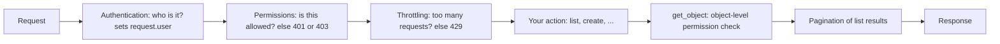

# API authentication, permissions, pagination and throttling

> **Before this lesson:** you have a working `StoryViewSet` with a serializer and router ([Django REST framework: serializers, viewsets and routers](#/lesson/django/drf-serializers-viewsets)). You know sessions and cookies ([The auth app: users, passwords and sessions](#/lesson/django/auth-app)) and the three levels of authorisation ([Permissions, authorisation and mixins](#/lesson/django/permissions-mixins)).

## In plain words

The API from the previous lesson is an open door: anyone may list, and any logged-in member may change anything. A real API needs four guards at that door. Each answers a different question about an incoming request.

| Guard | Question | Everyday counterpart at a library |
|---|---|---|
| **Authentication** | who is this? | showing a library card |
| **Permissions** | may they do this, to this object? | members may borrow; only staff may remove books |
| **Throttling** | are they asking too often? | "five requests to the archive per hour, please" |
| **Pagination** | how much do we hand over at once? | you receive one shelf's worth of the catalogue, not the whole building |

The first two are about safety, the last two about keeping the service healthy and fair. Django REST framework (DRF) implements each as a small class that you list in settings or on a view.

Why it matters for a job: "the API returned every user's data" and "one script took the site down" are the two classic API incidents, and these four mechanisms are the standard defences. Interviewers ask for the difference between 401 and 403, how token authentication works, why cursor pagination exists, and how you would rate-limit an endpoint.

## The order of checks

For every request, before your view code runs, DRF does three things in a fixed order:



Sensible project-wide defaults go in one settings dictionary:

```python
# config/settings.py
REST_FRAMEWORK = {
    "DEFAULT_AUTHENTICATION_CLASSES": [
        "rest_framework.authentication.SessionAuthentication",
        "rest_framework.authentication.TokenAuthentication",
    ],
    "DEFAULT_PERMISSION_CLASSES": [
        "rest_framework.permissions.IsAuthenticatedOrReadOnly",
    ],
    "DEFAULT_PAGINATION_CLASS": "rest_framework.pagination.PageNumberPagination",
    "PAGE_SIZE": 20,
    "DEFAULT_THROTTLE_CLASSES": [
        "rest_framework.throttling.AnonRateThrottle",
        "rest_framework.throttling.UserRateThrottle",
    ],
    "DEFAULT_THROTTLE_RATES": {"anon": "60/min", "user": "600/min"},
}
```

Any view can override a default with an attribute of the same kind, such as `permission_classes = [...]`.

> [!WARNING]
> DRF's own default permission is `AllowAny`: with no configuration, every endpoint is open to everyone. Set `DEFAULT_PERMISSION_CLASSES` to something restrictive in every project and open individual views deliberately.

## Part 1: authentication

Authentication classes are tried in the listed order. The first that recognises the request's credentials sets `request.user`; if none does, the user is anonymous.

| Class | Credentials | Typical client |
|---|---|---|
| `SessionAuthentication` | Django's session cookie | your own website's JavaScript, the browsable API |
| `TokenAuthentication` | header `Authorization: Token <key>` | scripts, mobile apps |
| `BasicAuthentication` | username and password with every request | testing only |
| JWT (package `djangorestframework-simplejwt`) | header `Authorization: Bearer <signed token>` | single-page and mobile apps |

### Session authentication and CSRF

When your own pages call the API with the browser's `fetch`, the session cookie goes along automatically and the visitor is authenticated as on the HTML site. Because cookies are sent automatically, the CSRF risk applies, and `SessionAuthentication` enforces a CSRF token on unsafe methods for authenticated users. JavaScript must send it in the `X-CSRFToken` header:

```javascript
fetch("/api/stories/", {
  method: "POST",
  headers: {"Content-Type": "application/json", "X-CSRFToken": csrfToken},
  body: JSON.stringify({headline: "Regatta results", body: "A close finish.", section: "sport"}),
});
```

### Token authentication

A **token** is a long random string that stands for a user. The client stores it and sends it in a header with every request. No cookie is involved, so there is no CSRF risk; the price is that the client must keep the token safe.

```python
# config/settings.py
INSTALLED_APPS += ["rest_framework.authtoken"]      # then: python manage.py migrate
```

```python
# config/urls.py
from rest_framework.authtoken.views import obtain_auth_token

urlpatterns += [path("api/token/", obtain_auth_token, name="api-token")]
```

A client posts a username and password once to `/api/token/` and receives `{"token": "9944b09199c6..."}`. From then on:

```bash
curl -H "Authorization: Token 9944b09199c6..." https://gazette.example/api/stories/
```

DRF's built-in tokens are deliberately basic: one per user, stored in a table, valid until deleted. For expiry and refresh, projects add JWT; the interview module compares sessions with tokens in detail.

The model below shows the chain of authentication classes and what each one looks at.

```python-run
SESSIONS = {"k9f2": "marisol"}
TOKENS = {"9944b0": "deploy-script"}

def session_auth(request):
    user = SESSIONS.get(request.get("cookies", {}).get("sessionid"))
    if user and request["method"] not in ("GET", "HEAD", "OPTIONS") and not request.get("csrf_ok"):
        raise PermissionError("403 CSRF token missing")      # cookies need CSRF protection
    return user

def token_auth(request):
    header = request.get("headers", {}).get("Authorization", "")
    scheme, _, key = header.partition(" ")
    if scheme != "Token":
        return None                                          # not my kind of credential: next class
    if key not in TOKENS:
        raise PermissionError("401 Invalid token")           # my kind, but wrong: stop here
    return TOKENS[key]

def authenticate(request):
    for authenticator in (session_auth, token_auth):
        user = authenticator(request)
        if user is not None:
            return user
    return "AnonymousUser"

requests = {
    "no credentials": {"method": "GET"},
    "session, GET": {"method": "GET", "cookies": {"sessionid": "k9f2"}},
    "session, POST without CSRF": {"method": "POST", "cookies": {"sessionid": "k9f2"}},
    "valid token, POST": {"method": "POST", "headers": {"Authorization": "Token 9944b0"}},
    "wrong token": {"method": "GET", "headers": {"Authorization": "Token nope"}},
}
for label, request in requests.items():
    try:
        print(f"{label:28} -> {authenticate(request)}")
    except PermissionError as error:
        print(f"{label:28} -> rejected: {error}")
```

Note the difference between "no credentials" (anonymous, perhaps still allowed to read) and "wrong credentials" (rejected outright).

### 401 or 403?

| Status | Meaning | Client should |
|---|---|---|
| **401 Unauthorized** | "I do not know who you are" (despite the name, it is about authentication) | log in / send credentials |
| **403 Forbidden** | "I know who you are, and you may not do this" | not retry; ask for access |

DRF picks between them automatically: an unauthenticated request that fails a permission check gets 401 if the first authentication class defines a `WWW-Authenticate` header (token authentication does), otherwise 403.

## Part 2: permissions

A permission class has up to two methods, called at two different moments:

- `has_permission(request, view)` runs **before** the action, for every request. It can look at the user and the method.
- `has_object_permission(request, view, obj)` runs when the view calls `get_object()`, for single-object actions. It can also look at the object.

Built-in classes:

| Class | Allows |
|---|---|
| `AllowAny` | everyone |
| `IsAuthenticated` | logged-in users |
| `IsAuthenticatedOrReadOnly` | everyone for safe methods; logged-in users for the rest |
| `IsAdminUser` | users with `is_staff` |
| `DjangoModelPermissions` | users holding the model's `add`/`change`/`delete` permission for the method used |

**Safe methods** are `GET`, `HEAD` and `OPTIONS`: methods that only read.

The Gazette's rule from the HTML site, "authors and editors may change a story; everyone may read published ones", as a permission class:

```python
# stories/permissions.py  (new file)
from rest_framework import permissions


class IsAuthorOrEditorOrReadOnly(permissions.BasePermission):
    message = "Only the author or an editor may change this story."

    def has_permission(self, request, view):
        if request.method in permissions.SAFE_METHODS:
            return True
        return request.user.is_authenticated

    def has_object_permission(self, request, view, obj):
        if request.method in permissions.SAFE_METHODS:
            return True
        if request.method == "DELETE":
            return obj.can_be_deleted_by(request.user)
        return obj.can_be_edited_by(request.user)
```

```python
# stories/api.py
from .permissions import IsAuthorOrEditorOrReadOnly


class StoryViewSet(viewsets.ModelViewSet):
    serializer_class = StorySerializer
    lookup_field = "slug"
    permission_classes = [IsAuthorOrEditorOrReadOnly]
    # get_queryset and perform_create as before

    @action(detail=True, methods=["post"], permission_classes=[permissions.IsAuthenticated])
    def recommend(self, request, slug=None):
        ...
```

The class delegates to the model methods `can_be_edited_by` and `can_be_deleted_by` written in the lesson on permissions: one rule, two interfaces. Permission classes combine with `&`, `|` and `~`, for example `permission_classes = [IsAuthenticated & (IsAuthor | IsEditor)]`.

Two layers now protect objects, and they work together:

1. `get_queryset()` decides which objects **exist** for this user (other people's drafts: 404).
2. `has_object_permission` decides what may be **done** to a visible object (someone else's published story: readable, but 403 on `PATCH`).

> [!WARNING]
> Object-level permissions are checked only when the view calls `get_object()`. They are **not** applied to the rows of a `list` response, and not in custom actions that fetch objects by other means. Lists must be restricted through the queryset. Assuming otherwise is the most common DRF authorisation bug.

## Part 3: pagination

Without pagination, `GET /api/stories/` returns every story ever published: slow to produce, slow to transfer, and able to exhaust memory on both ends. Pagination returns a slice plus the means to fetch the next one.

| Style | Request | Strengths | Weaknesses |
|---|---|---|---|
| `PageNumberPagination` | `?page=3` | simple; can show "page 3 of 12" | slow for deep pages; items shift when rows are added |
| `LimitOffsetPagination` | `?limit=20&offset=40` | flexible window | the same two weaknesses |
| `CursorPagination` | `?cursor=cD0yMDI2...` (opaque) | stable under inserts; fast at any depth | no page numbers, no jumping; needs a fixed ordering |

With page-number pagination, a list response changes shape from a bare list to an envelope:

```json
{
  "count": 231,
  "next": "https://gazette.example/api/stories/?page=3",
  "previous": "https://gazette.example/api/stories/?page=1",
  "results": [ {"id": 41, "headline": "..."}, "..." ]
}
```

Clients follow `next` until it is `null`.

### Why cursors exist

Offset-based paging says "skip 20 rows, give me 20". Two problems appear on a busy, growing table. First, the database must still walk over all the skipped rows, so page 5,000 is slow. Second, if a new story is published while a reader is between page 1 and page 2, everything shifts down by one, and the reader sees the last item of page 1 **again** at the top of page 2.

A **cursor** says instead "give me 20 rows that come after *this particular row*". The database jumps there through an index, and new rows at the top do not disturb what comes after the bookmark. The simulation makes the difference concrete.

```python-run
stories = [f"story-{n:02d}" for n in range(10, 0, -1)]          # newest first: story-10 ... story-01
PAGE = 4

def offset_page(rows, page):
    start = (page - 1) * PAGE
    return rows[start:start + PAGE]

def cursor_page(rows, after=None):
    start = rows.index(after) + 1 if after else 0               # "rows after this bookmark"
    page = rows[start:start + PAGE]
    return page, (page[-1] if page else None)

# The reader loads page 1 with each method.
first_offset = offset_page(stories, 1)
first_cursor, bookmark = cursor_page(stories)
print("page 1          :", first_offset)

stories.insert(0, "story-11")                                   # a new story is published meanwhile
stories.insert(0, "story-12")

print("offset, page 2  :", offset_page(stories, 2), "<- repeats", [s for s in offset_page(stories, 2) if s in first_offset])
print("cursor, page 2  :", cursor_page(stories, after=bookmark)[0], "<- continues exactly where page 1 ended")
```

Feeds, timelines and infinite scroll use cursors for this reason. A cursor class for the Gazette:

```python
# stories/pagination.py  (new file)
from rest_framework.pagination import CursorPagination, PageNumberPagination


class StoryCursorPagination(CursorPagination):
    page_size = 20
    ordering = ("-published_at", "-id")          # must be a stable, unique ordering


class SmallPages(PageNumberPagination):
    page_size = 10
    page_size_query_param = "page_size"
    max_page_size = 100
```

`max_page_size` matters: without a cap, a client-chosen `page_size=1000000` defeats the purpose. Assign a class per view with `pagination_class = StoryCursorPagination`.

## Part 4: throttling

**Throttling** (rate limiting) restricts how many requests a client may make in a period. It protects against runaway scripts, crude scraping and password guessing, and shares capacity fairly.

| Class | Counts requests per | Rate name |
|---|---|---|
| `AnonRateThrottle` | client IP address, for anonymous requests | `anon` |
| `UserRateThrottle` | authenticated user | `user` |
| `ScopedRateThrottle` | view-specific scope name | whatever `throttle_scope` the view sets |

Rates are written `"number/period"` with period `sec`, `min`, `hour` or `day`. A stricter limit for one sensitive endpoint:

```python
# config/settings.py
REST_FRAMEWORK["DEFAULT_THROTTLE_RATES"] = {"anon": "60/min", "user": "600/min", "token": "5/min", "recommend": "30/hour"}
```

```python
# stories/api.py
from rest_framework.throttling import ScopedRateThrottle

    @action(detail=True, methods=["post"], permission_classes=[permissions.IsAuthenticated],
            throttle_classes=[ScopedRateThrottle], throttle_scope="recommend")
    def recommend(self, request, slug=None):
        ...
```

A throttled request receives **429 Too Many Requests** with a `Retry-After` header stating how many seconds to wait.

The mechanism is a list of recent request times per client, kept in Django's cache. The model below implements it with explicit timestamps.

```python-run
class Throttle:
    def __init__(self, rate):
        number, period = rate.split("/")
        self.limit = int(number)
        self.window = {"sec": 1, "min": 60, "hour": 3600, "day": 86400}[period]
        self.history = {}                              # client key -> list of request times

    def allow(self, key, now):
        recent = [t for t in self.history.get(key, []) if t > now - self.window]   # forget old requests
        if len(recent) >= self.limit:
            self.history[key] = recent
            retry_after = recent[0] + self.window - now
            return False, retry_after
        recent.append(now)
        self.history[key] = recent
        return True, 0

throttle = Throttle("3/min")
for second in (0, 10, 20, 30, 59, 61, 62):
    allowed, wait = throttle.allow("203.0.113.9", second)
    print(f"t={second:>2}s  {'200 OK' if allowed else f'429, Retry-After: {wait}'}")
print("another client at t=30:", throttle.allow("198.51.100.7", 30)[0])
```

Three requests pass; the fourth and fifth inside the minute are refused; at 61 seconds the first request has left the window and one slot is free.

Because counters live in the cache, a deployment with several server processes needs a **shared** cache (Redis or Memcached); the default per-process memory cache would give every worker its own counters. And behind a proxy, DRF must be able to see the real client address (`NUM_PROXIES` setting), or all visitors share one counter.

## Filtering, searching and ordering

List endpoints usually need query parameters. DRF's filter backends add them declaratively:

```python
from rest_framework import filters


class StoryViewSet(viewsets.ModelViewSet):
    filter_backends = [filters.SearchFilter, filters.OrderingFilter]
    search_fields = ["headline", "summary"]
    ordering_fields = ["published_at", "recommendations"]
    ordering = ["-published_at"]
```

This enables `?search=ferry` and `?ordering=-recommendations`. `ordering_fields` is an allow-list; without it clients could sort by any model field, including ones you do not expose. For filters on exact fields (`?section=sport`), the `django-filter` package integrates as another backend.

## Calls from other websites: CORS

A browser refuses to let JavaScript on `https://app.gazette.example` read responses from `https://api.gazette.example` unless the API says it is welcome, through **CORS** (cross-origin resource sharing) response headers. The package `django-cors-headers` adds them from a setting:

```python
CORS_ALLOWED_ORIGINS = ["https://app.gazette.example"]
```

List exact origins. `CORS_ALLOW_ALL_ORIGINS = True` together with cookie authentication lets any website act with your users' sessions. See [Security headers, CSP and CORS](#/lesson/web-security/headers-csp-cors).

## Tests

```python
# stories/test_api_guards.py
from django.contrib.auth import get_user_model
from django.core.cache import cache
from django.test import override_settings
from django.urls import reverse
from django.utils import timezone
from rest_framework import status
from rest_framework.authtoken.models import Token
from rest_framework.test import APITestCase

from .models import Story


class ApiGuardTests(APITestCase):
    @classmethod
    def setUpTestData(cls):
        Member = get_user_model()
        cls.marisol = Member.objects.create_user("marisol", email="m@gazette.example", password="tide-chart-88")
        cls.tomas = Member.objects.create_user("tomas", email="t@gazette.example", password="x")
        cls.story = Story.objects.create(headline="Harbour reopens", body="Open again.", author=cls.marisol,
                                         status="published", published_at=timezone.now())
        cls.detail = reverse("story-api-detail", args=[cls.story.slug])

    def setUp(self):
        cache.clear()                                   # throttle counters live in the cache

    def test_anonymous_may_read_but_not_write(self):
        self.assertEqual(self.client.get(self.detail).status_code, status.HTTP_200_OK)
        response = self.client.patch(self.detail, {"headline": "Hacked"}, format="json")
        self.assertIn(response.status_code, (status.HTTP_401_UNAUTHORIZED, status.HTTP_403_FORBIDDEN))

    def test_other_member_gets_403_on_write(self):
        self.client.force_authenticate(self.tomas)
        response = self.client.patch(self.detail, {"headline": "Hacked"}, format="json")
        self.assertEqual(response.status_code, status.HTTP_403_FORBIDDEN)

    def test_author_may_edit(self):
        self.client.force_authenticate(self.marisol)
        response = self.client.patch(self.detail, {"headline": "Harbour reopens today"}, format="json")
        self.assertEqual(response.status_code, status.HTTP_200_OK)

    def test_token_flow(self):
        response = self.client.post(reverse("api-token"), {"username": "marisol", "password": "tide-chart-88"})
        key = response.data["token"]
        self.assertEqual(key, Token.objects.get(user=self.marisol).key)
        self.client.credentials(HTTP_AUTHORIZATION=f"Token {key}")
        response = self.client.patch(self.detail, {"summary": "Updated by token."}, format="json")
        self.assertEqual(response.status_code, status.HTTP_200_OK)

    def test_invalid_token_is_401(self):
        self.client.credentials(HTTP_AUTHORIZATION="Token not-a-real-token")
        self.assertEqual(self.client.get(self.detail).status_code, status.HTTP_401_UNAUTHORIZED)

    def test_list_is_paginated(self):
        response = self.client.get(reverse("story-api-list"))
        self.assertEqual(set(response.data), {"count", "next", "previous", "results"})

    @override_settings(REST_FRAMEWORK={"DEFAULT_THROTTLE_CLASSES": ["rest_framework.throttling.AnonRateThrottle"],
                                       "DEFAULT_THROTTLE_RATES": {"anon": "2/min"}})
    def test_throttle_returns_429(self):
        from rest_framework.settings import api_settings
        from rest_framework.views import APIView
        APIView.throttle_classes = api_settings.DEFAULT_THROTTLE_CLASSES     # re-read the overridden default
        try:
            codes = [self.client.get(self.detail).status_code for _ in range(3)]
        finally:
            del APIView.throttle_classes
        self.assertEqual(codes[-1], status.HTTP_429_TOO_MANY_REQUESTS)
```

Each guard has its test: who may read, who may write, both credentials paths, the response envelope and the limit. Throttle tests need care because DRF reads its settings into class attributes at import time; many teams instead set a throttle class with a tiny rate directly on a test-only view.

> [!NOTE]
> **What changed since the book.** Not covered by the source book. Current practice notes: JWT support lives in the third-party `djangorestframework-simplejwt`; API documentation is generated with `drf-spectacular` (OpenAPI 3); and `SessionAuthentication` remains the simplest and safest choice when the API is consumed only by pages served from the same site.

> [!INTERVIEW]
> **"How do you secure a DRF API?"** Layer by layer. Authentication: session for same-site browsers (with CSRF), tokens or JWT for other clients, always over HTTPS. Permissions: a restrictive `DEFAULT_PERMISSION_CLASSES`, per-view classes, and custom classes with `has_permission` and `has_object_permission`; restrict lists through `get_queryset` because object checks do not apply to them. Serializers: explicit `fields`, read-only server-controlled fields. Throttling: anonymous and per-user rates, scoped rates for sensitive endpoints, counters in a shared cache. Pagination with a maximum page size. Add CORS with an explicit origin list. Know 401 (unknown caller) versus 403 (known, not allowed) versus 429 (too many requests).

> [!TIP]
> Give every list endpoint an explicit, deterministic ordering that ends in a unique column (such as `-published_at, -id`). Pagination over an ordering with ties can return the same row on two pages or skip one.

## Pitfalls

- **Leaving the default `AllowAny`.** Set a restrictive project default.
- **Relying on `has_object_permission` for list views.** It is not called for lists; filter the queryset.
- **Custom actions that bypass `get_object()`.** Object permissions are skipped; call `self.check_object_permissions(request, obj)` yourself.
- **Tokens over plain HTTP, in URLs or in logs.** Anyone who sees a token is that user.
- **Unlimited `page_size`.** Set `max_page_size`.
- **Cursor pagination without a unique, indexed ordering.** Duplicates or slow queries.
- **Throttling with the per-process memory cache** in a multi-worker deployment: each worker counts separately.
- **`CORS_ALLOW_ALL_ORIGINS = True` with credentials.**
- **Confusing 401 and 403** in clients: retrying a 403 with the same credentials never helps.

## Cheat sheet

| Need | Code |
|---|---|
| Project defaults | `REST_FRAMEWORK = {"DEFAULT_PERMISSION_CLASSES": [...], ...}` |
| Per-view override | `permission_classes`, `authentication_classes`, `throttle_classes`, `pagination_class` |
| Cookie-based API calls | `SessionAuthentication` + `X-CSRFToken` header |
| Token auth | `"rest_framework.authtoken"` app, `obtain_auth_token`, header `Authorization: Token <key>` |
| Read for all, write for members | `IsAuthenticatedOrReadOnly` |
| Custom rule | subclass `BasePermission`: `has_permission`, `has_object_permission` |
| Read-only methods | `request.method in permissions.SAFE_METHODS` |
| Page numbers | `PageNumberPagination`, `PAGE_SIZE`, `max_page_size` |
| Stable feed | `CursorPagination` with `ordering = ("-published_at", "-id")` |
| Rate limits | `DEFAULT_THROTTLE_RATES = {"anon": "60/min", "user": "600/min"}` |
| Endpoint-specific limit | `ScopedRateThrottle` + `throttle_scope = "recommend"` |
| Search and ordering | `filters.SearchFilter`, `filters.OrderingFilter` with allow-lists |
| Cross-origin browsers | `django-cors-headers` with `CORS_ALLOWED_ORIGINS` |

## Summary

- DRF checks authentication, then permissions, then throttles before running your action; object permissions run in `get_object()` and pagination shapes list responses.
- Sessions suit same-site browser clients and need CSRF tokens; tokens suit other clients and must be protected like passwords.
- 401 means the caller is unknown, 403 means known but not allowed, 429 means too many requests.
- Permission classes implement request-level and object-level rules; lists are protected by the queryset.
- Paginate every list (cursors for feeds), cap page sizes, and throttle by client with counters in a shared cache.

## Glossary

- **Authentication class**: a DRF class that identifies the caller from a request.
- **Token**: a secret string sent with each request to identify a user.
- **JWT (JSON Web Token)**: a signed token that carries its own data and expiry.
- **Permission class**: a DRF class deciding whether a request, or an action on an object, is allowed.
- **Safe method**: an HTTP method that only reads (`GET`, `HEAD`, `OPTIONS`).
- **401 / 403 / 429**: not authenticated / forbidden / too many requests.
- **Pagination**: returning a list in limited slices with links to the next one.
- **Offset pagination**: paging by skipping a number of rows.
- **Cursor pagination**: paging by continuing after a bookmarked row.
- **Throttling (rate limiting)**: restricting the number of requests per client and period.
- **Scope (throttling)**: a named limit applied to particular endpoints.
- **CORS**: the browser mechanism by which a server permits pages from other origins to read its responses.

```quiz
[
  {"q": "In which order does DRF apply its checks before running a view's action?",
   "options": ["Permissions, authentication, throttling", "Authentication, permissions, throttling", "Throttling, pagination, authentication", "Pagination, permissions, authentication"],
   "answer": 1,
   "explain": "DRF first identifies the caller, then decides whether the request is allowed, then checks rate limits."},
  {"q": "What is the difference between 401 and 403?",
   "options": ["They are interchangeable", "401: the server does not know who you are; 403: it knows and you are not allowed", "401 is for GET, 403 for POST", "403 means the resource does not exist"],
   "answer": 1,
   "explain": "401 asks for (valid) credentials. 403 says the authenticated identity lacks permission."},
  {"q": "Why does SessionAuthentication require a CSRF token on POST requests while TokenAuthentication does not?",
   "options": ["Tokens are longer", "Cookies are attached by the browser automatically, so another site could trigger the request; a token header must be added deliberately by the client", "CSRF only applies to GET", "DRF has a bug"],
   "answer": 1,
   "explain": "CSRF abuses automatically sent credentials. An Authorization header is never sent automatically by a browser."},
  {"q": "A ViewSet uses a permission class whose has_object_permission restricts edits to the author. Does this hide other users' drafts in the list endpoint?",
   "options": ["Yes", "No; object-level checks are not applied to list results, so the queryset must be filtered", "Only with pagination", "Only for anonymous users"],
   "answer": 1,
   "explain": "has_object_permission runs in get_object() for single-object actions. Lists are controlled by get_queryset()."},
  {"q": "A reader loads page 1 of an offset-paginated feed; two new items are published; the reader loads page 2. What is the effect?",
   "options": ["Page 2 is empty", "The last two items of page 1 appear again at the top of page 2", "Two items are lost forever", "An error is raised"],
   "answer": 1,
   "explain": "New rows shift everything down, so the offset now points two rows earlier. Cursor pagination avoids this."},
  {"q": "What does CursorPagination require?",
   "options": ["Page numbers", "A stable, unique ordering, ideally indexed", "A shared cache", "Token authentication"],
   "answer": 1,
   "explain": "The cursor is a position in a fixed ordering. Ties or changing sort keys would make positions ambiguous."},
  {"q": "With the rate '3/min', a client makes requests at seconds 0, 10, 20 and 30. What happens to the fourth?",
   "options": ["Allowed", "Rejected with 429 and a Retry-After of 30 seconds", "Rejected with 403", "Delayed by the server until second 60"],
   "answer": 1,
   "explain": "Three requests are within the last 60 seconds. The earliest leaves the window at second 60, so the client must wait 30 seconds."},
  {"q": "Why must throttle counters be stored in a shared cache when several server processes run?",
   "options": ["For encryption", "Otherwise each process counts separately and the effective limit is multiplied", "DRF refuses to start otherwise", "To paginate results"],
   "answer": 1,
   "explain": "Requests are spread across workers. Per-process memory would give each worker its own allowance."}
]
```

> **Source:** beyond the book. Docs: https://www.django-rest-framework.org/api-guide/authentication/ · https://www.django-rest-framework.org/api-guide/permissions/ · https://www.django-rest-framework.org/api-guide/pagination/ · https://www.django-rest-framework.org/api-guide/throttling/ · https://www.django-rest-framework.org/api-guide/filtering/
