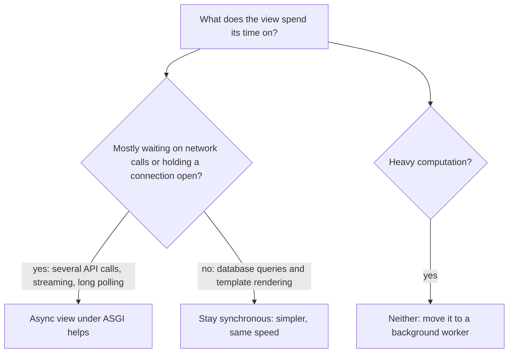
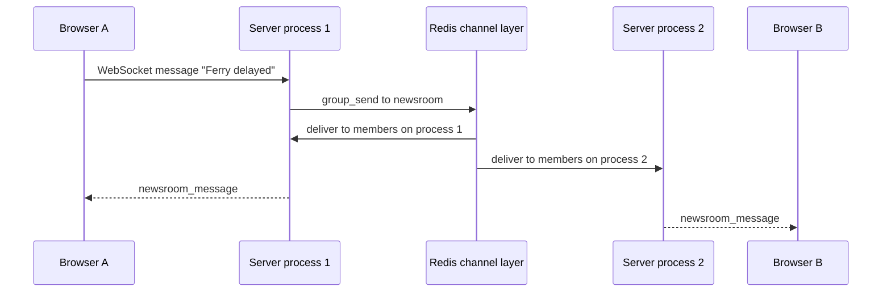

# Async views, Channels and Django compared with FastAPI

> **Before this lesson:** you know WSGI, ASGI, workers and Uvicorn at the level of [Gunicorn, Uvicorn, Docker and deploying to a PaaS](#/lesson/django/servers-docker-paas), and have built an API with Django REST framework ([Django REST framework: serializers, viewsets and routers](#/lesson/django/drf-serializers-viewsets)). The Python keywords `async` and `await` are explained here from zero; a longer treatment is in [async def, await and the event loop](#/lesson/fastapi/async-fundamentals).

## In plain words

A web server spends most of its time **waiting**: for the database to answer, for another company's API to respond, for a file to be read. During that wait the processor is idle.

In ordinary (**synchronous**) Django, a worker that is waiting can do nothing else. If each request waits two seconds for a slow external service and you have four workers, the fifth visitor queues, although nobody is using the processor.

**Asynchronous** code changes the deal. A function marks the places where it waits, and while it waits, the same worker starts or continues other requests. One worker can keep hundreds of waiting requests in the air.

An everyday picture: a waiter. The synchronous waiter takes an order, walks to the kitchen and **stands there** until the dish is ready. The asynchronous waiter hands the order in, serves other tables, and returns when the kitchen rings the bell. The cook is no faster; the waiter stops wasting the waiting time. Notice the limit of the picture too: if the *waiter* must do slow work personally (carving a roast at the table), everyone else waits again.

This lesson covers three things: async views in Django itself; **Channels**, the package that adds long-lived two-way connections such as chat; and an honest comparison with **FastAPI**, the framework built around async from the start, which has its own track on this site.

Why it matters for a job: "sync or async?" and "Django or FastAPI?" are two of the most common architecture questions put to Python backend candidates. A good answer explains *when* async helps, not merely how to type it.

## The vocabulary

- A **coroutine** is a function defined with `async def`. Calling it does not run it; it creates a task that can be paused and resumed.
- `await` marks a point where the coroutine pauses until something finishes, letting other tasks run meanwhile.
- The **event loop** is the scheduler that runs coroutines, switching between them at their `await` points.
- **I/O-bound** work is mostly waiting for input and output (network, disk). **CPU-bound** work is mostly computing. Async helps the first kind only.
- **Blocking** means occupying the worker without yielding: a normal database call, `time.sleep`, a heavy calculation.

### See the difference

The model below simulates three calls to slow external services, first one after another and then concurrently on one event loop. `asyncio.sleep` stands in for waiting on the network.

```python-run
import asyncio, time

async def fetch(service, seconds):
    await asyncio.sleep(seconds)              # waiting: the event loop is free to run other tasks
    return f"{service} ok"

async def sequential():
    return [await fetch("weather", 0.3), await fetch("tides", 0.2), await fetch("ferries", 0.25)]

async def concurrent():
    return await asyncio.gather(fetch("weather", 0.3), fetch("tides", 0.2), fetch("ferries", 0.25))

async def main():
    for name, job in [("one after another", sequential), ("concurrently", concurrent)]:
        start = time.perf_counter()
        results = await job()
        print(f"{name:18} {time.perf_counter() - start:.2f}s  {results}")

asyncio.run(main())
```

Sequentially the waits add up (about 0.75 s). With `asyncio.gather` they overlap, and the total is the longest single wait (about 0.3 s). Nothing was computed faster; waiting was shared.

## Async views in Django

Django has supported `async def` views since 3.1, and they sit beside ordinary views in the same project.

```python
# pages/views.py
import asyncio

import httpx
from django.http import JsonResponse


async def harbour_dashboard(request):
    async with httpx.AsyncClient(timeout=5) as client:
        weather, tides, ferries = await asyncio.gather(
            client.get("https://weather.example/api/today"),
            client.get("https://tides.example/api/next"),
            client.get("https://ferries.example/api/status"),
        )
    return JsonResponse({
        "weather": weather.json(),
        "tides": tides.json(),
        "ferries": ferries.json(),
    })
```

- `async def` makes the view a coroutine; Django detects this and awaits it.
- `httpx` is an HTTP client library with an async interface (`python -m pip install httpx`). The widely used `requests` library is synchronous and would block.
- `async with` opens and closes the client around the block.
- `asyncio.gather(...)` starts the three requests together and waits for all of them.

Route it exactly like any other view: `path("dashboard/", views.harbour_dashboard)`.

### The server decides whether it pays off

| Server | Sync view | Async view |
|---|---|---|
| WSGI (Gunicorn default workers) | runs normally | runs, but inside a private event loop per request: **no concurrency benefit** across requests |
| ASGI (Uvicorn, Daphne) | runs in a thread pool | runs on the shared event loop: one worker serves many waiting requests |

To benefit from async views, deploy under ASGI. Under ASGI your existing synchronous views keep working unchanged, because Django runs them in threads.

### The ORM from async code

Database drivers used by Django are synchronous at heart, and calling a blocking function on the event loop would freeze every other request on that worker. Django guards against the mistake: calling the normal ORM from a coroutine raises `SynchronousOnlyOperation`.

Since Django 4.1, querysets offer async variants, named with an `a` prefix, and support `async for`:

```python
from django.http import JsonResponse

from stories.models import Story


async def latest_stories(request):
    stories = [
        {"headline": story.headline, "slug": story.slug}
        async for story in Story.objects.published()[:10]
    ]
    total = await Story.objects.published().acount()
    newest = await Story.objects.published().afirst()
    return JsonResponse({"total": total, "newest": newest.headline if newest else None, "stories": stories})
```

| Sync | Async |
|---|---|
| `for obj in qs` | `async for obj in qs` |
| `qs.get()`, `qs.first()`, `qs.count()`, `qs.exists()` | `await qs.aget()`, `afirst()`, `acount()`, `aexists()` |
| `Model.objects.create(...)` | `await Model.objects.acreate(...)` |
| `obj.save()`, `obj.delete()` | `await obj.asave()`, `await obj.adelete()` |
| `request.user` | `await request.auser()` |

Two limits to remember. Lazy relation access (`story.author`) is a hidden synchronous query and raises the error above, so load relations in advance with `select_related`. And `transaction.atomic()` does not work directly in a coroutine; put the transactional block in a synchronous function and call it through the adapter below.

### Crossing between the two worlds

The `asgiref` package (installed with Django) provides two adapters:

```python
from asgiref.sync import async_to_sync, sync_to_async

# call blocking code from async code: runs it in a thread and awaits the result
story = await sync_to_async(transfer_story)(story_id, new_author, actor)

# call async code from sync code: runs it on an event loop and waits
result = async_to_sync(fetch_weather)("harbour")
```

`sync_to_async` is the escape hatch for any blocking library inside an async view. Every crossing has a small cost (about a millisecond for the thread switch), which leads to a practical rule about middleware: if one middleware in the stack is sync-only, Django must switch contexts around it on every async request. All of Django's built-in middleware supports both modes.

### When async is worth it



For the typical Django view (a few queries, a template), async gives no speed-up and costs clarity. The honest summary: **async raises the number of requests that can wait at the same time; it does not make any single request faster.**

## Streaming and server-sent events

Sometimes the server should push updates as they happen: a live score, the progress of an export. The lightest technique is **server-sent events (SSE)**: one long HTTP response on which the server writes messages over time. Browsers read it with the built-in `EventSource` object.

```python
# pages/views.py
import asyncio
import json

from django.http import StreamingHttpResponse


async def tide_stream(request):
    async def events():
        for minute in range(5):
            payload = {"minute": minute, "level_cm": 240 + 3 * minute}
            yield f"data: {json.dumps(payload)}\n\n"        # the SSE wire format: "data: ...", blank line
            await asyncio.sleep(1)

    return StreamingHttpResponse(events(), content_type="text/event-stream")
```

`events` is an **async generator**: an `async def` function that produces values with `yield`. Under ASGI, each open stream costs almost nothing while it sleeps. SSE is one-way (server to browser) and passes through ordinary proxies, which makes it the first tool to consider before WebSockets.

## Channels: two-way, long-lived connections

A chat room, collaborative editing or a multiplayer game needs both sides to send at any time. The protocol for that is the **WebSocket**: a connection that starts as an HTTP request and is then kept open for messages in both directions.

Django's request/response machinery has no place for a connection that lasts an hour. The official extension **Channels** adds it.

```bash
python -m pip install "channels[daphne]" channels-redis
```

Three new concepts:

- A **consumer** is to a WebSocket what a view is to a request: a class with methods for "connected", "message received" and "disconnected".
- **Routing** maps WebSocket paths to consumers, like `urls.py`.
- The **channel layer** lets different connections, possibly on different server processes, send messages to each other, usually through Redis. A **group** is a named set of connections that receive the same broadcasts.

```python
# stories/consumers.py
from channels.generic.websocket import AsyncJsonWebsocketConsumer


class NewsroomConsumer(AsyncJsonWebsocketConsumer):
    async def connect(self):
        if not self.scope["user"].is_authenticated:
            await self.close()
            return
        await self.channel_layer.group_add("newsroom", self.channel_name)
        await self.accept()

    async def disconnect(self, code):
        await self.channel_layer.group_discard("newsroom", self.channel_name)

    async def receive_json(self, content):
        await self.channel_layer.group_send("newsroom", {
            "type": "newsroom.message",                 # calls the method newsroom_message on each member
            "from": str(self.scope["user"]),
            "text": str(content.get("text", ""))[:500],
        })

    async def newsroom_message(self, event):
        await self.send_json({"from": event["from"], "text": event["text"]})
```

`self.scope` is the WebSocket counterpart of `request`: connection information including the user (from the session cookie). The `type` of a group message, with dots replaced by underscores, names the method called on every consumer in the group.

```python
# stories/routing.py
from django.urls import path

from .consumers import NewsroomConsumer

websocket_urlpatterns = [path("ws/newsroom/", NewsroomConsumer.as_asgi())]
```

```python
# config/asgi.py
import os

from channels.auth import AuthMiddlewareStack
from channels.routing import ProtocolTypeRouter, URLRouter
from channels.security.websocket import AllowedHostsOriginValidator
from django.core.asgi import get_asgi_application

os.environ.setdefault("DJANGO_SETTINGS_MODULE", "config.settings")
django_asgi_app = get_asgi_application()          # must run before importing code that touches models

from stories.routing import websocket_urlpatterns  # noqa: E402

application = ProtocolTypeRouter({
    "http": django_asgi_app,
    "websocket": AllowedHostsOriginValidator(AuthMiddlewareStack(URLRouter(websocket_urlpatterns))),
})
```

```python
# config/settings.py
INSTALLED_APPS = ["daphne", *INSTALLED_APPS, "channels"]
ASGI_APPLICATION = "config.asgi.application"
CHANNEL_LAYERS = {
    "default": {
        "BACKEND": "channels_redis.core.RedisChannelLayer",
        "CONFIG": {"hosts": [os.environ.get("REDIS_URL", "redis://localhost:6379/0")]},
    }
}
```

`ProtocolTypeRouter` sends ordinary HTTP to Django and WebSocket connections to your consumers. `AllowedHostsOriginValidator` rejects connections opened by pages on other sites, the WebSocket counterpart of CSRF protection. Any code can broadcast to a group, including a normal synchronous view:

```python
from asgiref.sync import async_to_sync
from channels.layers import get_channel_layer

async_to_sync(get_channel_layer().group_send)("newsroom", {
    "type": "newsroom.message", "from": "system", "text": f"Published: {story.headline}"})
```



Choose the lightest tool that meets the need: occasional updates → reload or **polling** (asking again every few seconds); server-to-browser stream → SSE; true two-way real time → Channels.

## Django and FastAPI

**FastAPI** is a Python web framework focused on APIs. It is async-first, uses Python **type hints** to validate input and to generate interactive documentation automatically, and leaves the choice of database layer, authentication and project layout to you. This site's FastAPI track starts at [Your first FastAPI app](#/lesson/fastapi/first-app).

The same endpoint in both:

```python
# FastAPI
from fastapi import FastAPI, HTTPException
from pydantic import BaseModel

app = FastAPI()


class StoryOut(BaseModel):
    id: int
    headline: str
    section: str


@app.get("/api/stories/{story_id}", response_model=StoryOut)
async def get_story(story_id: int):
    story = await fetch_story(story_id)               # your own data layer
    if story is None:
        raise HTTPException(status_code=404, detail="Not found")
    return story
```

```python
# Django REST framework
class StorySerializer(serializers.ModelSerializer):
    class Meta:
        model = Story
        fields = ["id", "headline", "section"]


class StoryDetail(generics.RetrieveAPIView):
    queryset = Story.objects.published()
    serializer_class = StorySerializer
```

| Aspect | Django (+ DRF) | FastAPI |
|---|---|---|
| Philosophy | batteries included: one coherent stack | small core: assemble the stack you want |
| Best at | full products: HTML pages, admin, accounts, plus APIs | API-only services and microservices |
| Data layer | built-in ORM and migrations | bring your own (SQLAlchemy + Alembic, SQLModel, ...) |
| Admin interface | built in | none (third-party options) |
| Authentication, sessions, permissions | built in | you compose them from utilities and dependencies |
| Input validation | forms and serializers | Pydantic models from type hints |
| API documentation | add `drf-spectacular` | automatic OpenAPI and interactive docs |
| Async | supported, added later; ORM partly async | native throughout |
| Raw request throughput | adequate | higher for I/O-bound endpoints |
| Structure | prescribed (apps, settings, conventions) | free; consistency is the team's job |
| Typical first hour | project, model, admin, CRUD pages | one file, one endpoint with docs |

How to choose, in sentences you can say in an interview:

- A product with users, an admin back office, HTML pages, e-mails and an API on the side: **Django**. Rebuilding the admin, authentication and migrations by hand costs months.
- A service that exposes a machine-learning model, aggregates other APIs, or holds many concurrent connections: **FastAPI**. Its async core and typed contracts fit that shape.
- Many organisations use both: Django for the core product and its data, FastAPI for specialised services.
- Performance is rarely the deciding factor. For most applications the database dominates response time, and both frameworks wait for it equally.

A middle path inside the Django world is **Django Ninja**, which offers FastAPI-style typed endpoints and automatic documentation on top of Django's ORM.

## Tests

```python
# pages/test_async.py
from unittest import mock

from django.test import AsyncClient, TestCase
from django.utils import timezone

from stories.models import Story


class AsyncViewTests(TestCase):
    @classmethod
    def setUpTestData(cls):
        from django.contrib.auth import get_user_model
        author = get_user_model().objects.create_user("marisol", email="m@gazette.example", password="x")
        Story.objects.create(headline="Harbour reopens", body="...", author=author,
                             status="published", published_at=timezone.now())

    async def test_latest_stories(self):
        response = await self.async_client.get("/api/latest/")
        self.assertEqual(response.status_code, 200)
        self.assertEqual(response.json()["total"], 1)

    async def test_async_orm_methods(self):
        self.assertEqual(await Story.objects.acount(), 1)
        story = await Story.objects.select_related("author").afirst()
        self.assertEqual(story.author.username, "marisol")       # safe: loaded by select_related

    async def test_dashboard_calls_services_concurrently(self):
        fake = mock.AsyncMock()
        fake.get.return_value = mock.Mock(json=lambda: {"ok": True})
        with mock.patch("pages.views.httpx.AsyncClient") as client_class:
            client_class.return_value.__aenter__.return_value = fake
            response = await self.async_client.get("/dashboard/")
        self.assertEqual(fake.get.await_count, 3)
        self.assertEqual(response.json()["tides"], {"ok": True})
```

Test methods written as `async def` are run on an event loop by Django's test runner, and `self.async_client` is the asynchronous test client. External services are replaced with mocks, so the test never touches the network. For consumers, Channels supplies `WebsocketCommunicator`.

> [!NOTE]
> **What changed since the book.** In Django 2.1 none of this existed. ASGI support arrived in 3.0, async views and middleware in 3.1, the async ORM interface in 4.1, `StreamingHttpResponse` with async iterators in 4.2, async authentication helpers and signals (`asend`) in 5.0. Channels 4 separated the Daphne server into its own package. The async story is still being completed release by release: transactions remain synchronous, for example.

> [!INTERVIEW]
> **"When would you use async views in Django?"** When the view is I/O-bound in a way that benefits from concurrency: several outbound HTTP calls that can run in parallel with `asyncio.gather`, long-lived responses (streaming, server-sent events), or high numbers of mostly idle connections, and when the app is served by an ASGI server. Not for CPU-bound work, and not for ordinary query-and-render views, where it adds complexity without speed. Name the rules: no blocking calls on the event loop (`sync_to_async` for sync libraries), use the `a`-prefixed ORM methods and `async for`, prefetch relations to avoid lazy sync queries, wrap transactions in a sync function. Then be ready for the follow-up comparing Django with FastAPI by fit, not by benchmark.

> [!WARNING]
> One blocking call in an async view stalls **every** request handled by that worker's event loop, not only the offending one. `time.sleep`, `requests.get`, a slow synchronous SDK or a big computation inside `async def` can turn a fast service into one that freezes under load. When in doubt, wrap it in `sync_to_async` or keep the view synchronous.

> [!TIP]
> Start synchronous. Convert individual views to async when measurements show they are waiting on external services. Django lets both kinds live side by side, so this is a change to one function, not a rewrite.

## Pitfalls

- **Async views on a WSGI server.** They work, with no concurrency benefit.
- **`SynchronousOnlyOperation`.** Using the normal ORM, or lazy relation access, in a coroutine. Use `a`-methods, `async for`, `select_related`, or `sync_to_async`.
- **Forgetting `await`.** You get a coroutine object instead of a result, and a "coroutine was never awaited" warning.
- **Sequential awaits for independent calls.** Use `asyncio.gather` to overlap them.
- **Blocking libraries on the event loop.**
- **`transaction.atomic()` inside `async def`.** Not supported; move the block into a sync function.
- **Channels with the in-memory channel layer in production.** Messages do not cross processes; use Redis.
- **WebSockets without origin validation or authentication.** Any site could connect with the visitor's cookies.
- **Choosing a framework by benchmark.** Compare what you would have to build yourself.

## Cheat sheet

| Need | Code |
|---|---|
| Async view | `async def view(request): ...` |
| Run things concurrently | `await asyncio.gather(a(), b(), c())` |
| Async HTTP client | `async with httpx.AsyncClient() as client: await client.get(url)` |
| Async ORM | `await qs.aget()`, `afirst()`, `acount()`, `aexists()`, `acreate()`, `async for obj in qs` |
| Current user in async code | `await request.auser()` |
| Sync code from async | `await sync_to_async(func)(args)` |
| Async code from sync | `async_to_sync(coro_func)(args)` |
| Server-sent events | `StreamingHttpResponse(async_generator(), content_type="text/event-stream")` |
| ASGI server | `uvicorn config.asgi:application` |
| WebSocket handler | `AsyncJsonWebsocketConsumer` with `connect`, `receive_json`, `disconnect` |
| Broadcast | `await channel_layer.group_send("group", {"type": "x.y", ...})` |
| Async test | `async def test_...(self): response = await self.async_client.get(url)` |

## Summary

- Async lets one worker handle many requests that are waiting on I/O; it does not speed up computation or a single query.
- Django supports `async def` views beside synchronous ones; the benefit appears under an ASGI server.
- Use the `a`-prefixed ORM methods and `async for`, preload relations, and bridge to blocking code with `sync_to_async`.
- Server-sent events cover one-way live updates; Channels adds WebSockets with consumers, routing and a Redis-backed channel layer for two-way real time.
- Django offers a complete product stack; FastAPI offers a lean, typed, async-native API toolkit. Choose by what the project needs built in.

## Glossary

- **Synchronous / asynchronous**: executing step by step and waiting in place / pausing at waits so that other work can proceed.
- **Coroutine**: a function defined with `async def` that can be paused and resumed.
- **`await`**: the keyword marking a pause until an asynchronous operation completes.
- **Event loop**: the scheduler that runs and switches between coroutines.
- **I/O-bound / CPU-bound**: limited by waiting for input and output / limited by computation.
- **Blocking**: occupying the thread without yielding control.
- **ASGI**: the interface standard for asynchronous Python web servers and applications.
- **`sync_to_async` / `async_to_sync`**: adapters for calling across the sync/async boundary.
- **Server-sent events (SSE)**: a one-way stream of messages from server to browser over HTTP.
- **WebSocket**: a persistent two-way connection between browser and server.
- **Consumer**: a Channels class handling the events of a connection.
- **Channel layer / group**: the messaging backend connecting consumers / a named set of connections receiving the same messages.
- **Type hints**: annotations stating the expected types of values, which FastAPI uses for validation and documentation.

```quiz
[
  {"q": "What kind of workload benefits from an async view?",
   "options": ["Heavy number crunching", "Waiting on several network calls or keeping connections open", "Rendering a large template", "Any view; async is always faster"],
   "answer": 1,
   "explain": "Async shares waiting time. It does not speed up CPU work or individual queries."},
  {"q": "Three independent external calls take 0.3 s, 0.2 s and 0.25 s. Roughly how long does `await asyncio.gather(...)` over all three take?",
   "options": ["0.75 s", "0.3 s", "0.2 s", "0.1 s"],
   "answer": 1,
   "explain": "The waits overlap, so the total is about the longest single call."},
  {"q": "An async view is deployed under a WSGI server. What happens?",
   "options": ["It crashes", "It works, but gains no concurrency across requests", "It becomes synchronous code automatically and faster", "Django refuses to start"],
   "answer": 1,
   "explain": "Under WSGI each request still occupies a worker; the view runs in a one-off event loop."},
  {"q": "In an async view, `Story.objects.get(pk=1)` raises SynchronousOnlyOperation. What is the correct replacement?",
   "options": ["Story.objects.get_async(pk=1)", "await Story.objects.aget(pk=1)", "async Story.objects.get(pk=1)", "Story.objects.get(pk=1).wait()"],
   "answer": 1,
   "explain": "Async ORM methods carry an a prefix and must be awaited."},
  {"q": "Why is `time.sleep(2)` inside an async view harmful?",
   "options": ["It raises an exception", "It blocks the event loop, freezing every request on that worker for two seconds", "It is ignored", "It only delays that one request"],
   "answer": 1,
   "explain": "Blocking calls do not yield control. Use await asyncio.sleep or move blocking work to a thread."},
  {"q": "Which tool is appropriate for a live, one-way progress feed from server to browser?",
   "options": ["A WebSocket with Channels, always", "Server-sent events via StreamingHttpResponse", "A database trigger", "A cron job"],
   "answer": 1,
   "explain": "SSE is the lightest option for server-to-client streams. WebSockets are for two-way communication."},
  {"q": "What is the role of the channel layer in Channels?",
   "options": ["It stores templates", "It passes messages between consumers, across server processes, and implements groups", "It replaces the database", "It authenticates users"],
   "answer": 1,
   "explain": "Connections may live on different processes; the layer (usually Redis) routes messages to them."},
  {"q": "Which project is the clearest fit for Django over FastAPI?",
   "options": ["A single endpoint serving an ML model", "A product with user accounts, an admin back office, HTML pages and an API", "A WebSocket-only gateway", "A script that calls three APIs"],
   "answer": 1,
   "explain": "Django's built-in ORM, migrations, auth and admin cover most of such a product. FastAPI would require assembling those parts."}
]
```

> **Source:** beyond the book. Docs: https://docs.djangoproject.com/en/5.2/topics/async/ · https://docs.djangoproject.com/en/5.2/howto/deployment/asgi/ · https://channels.readthedocs.io/en/latest/ · https://fastapi.tiangolo.com/ · https://django-ninja.dev/
