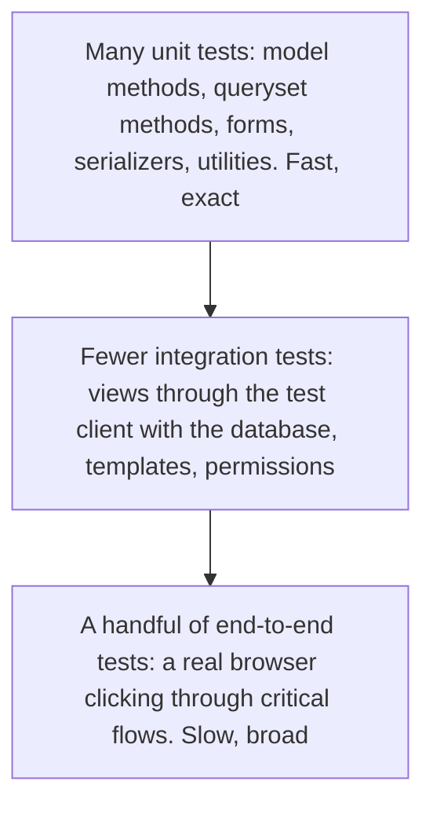

# Testing with pytest-django and factories

> **Before this lesson:** you have written tests with Django's built-in tools throughout this track: `SimpleTestCase`, `TestCase`, the test client, `assertContains`, `assertNumQueries` ([The request/response cycle, views, URLs and first tests](#/lesson/django/request-response), [ListView, querysets and tests with a database](#/lesson/django/listview-querysets)). You should know Python functions, decorators and `assert`; see [Files, errors and tests: programs you can rely on](#/lesson/python/py-start-files-tests).

## In plain words

A **test** is a small program that runs your program and complains when the result is not what you expected. A collection of tests is a safety net: you change something, run the net, and learn within seconds whether you broke anything.

Django's built-in testing works well. Most professional teams nevertheless use **pytest**, a general Python testing tool, together with the **pytest-django** plugin. The reasons are comfort and speed of writing: tests are plain functions with plain `assert` statements, failures are explained in detail, and shared set-up is handled by a neat mechanism called **fixtures**.

The second tool in this lesson solves a different annoyance. Every test needs some objects: a member, a story, a few replies. Writing `Story.objects.create(headline=..., body=..., author=..., status=..., published_at=...)` in every test is tedious and brittle. A **factory** is a recipe that knows how to make a valid object with sensible defaults, so that each test states only what matters to it.

An everyday picture: a theatre rehearsal. Fixtures are the stagehands who set the scene before each run and clear it afterwards. Factories are the props department: "one generic chair, please" delivers a perfectly good chair, and you say more only when the play needs a particular chair with a broken leg.

Why it matters for a job: test-writing is a daily task and a standard part of take-home assignments. A pull request without tests is usually not merged. "How do you test a Django view?" and "what is a fixture?" are common interview questions, and `pytest` with `factory_boy` is the stack most teams expect you to know.

## Setup

```bash
python -m pip install pytest pytest-django factory-boy
python -m pip freeze > requirements.txt
```

Tell pytest where the settings are. Configuration lives in `pyproject.toml` in the project root:

```toml
# pyproject.toml
[tool.pytest.ini_options]
DJANGO_SETTINGS_MODULE = "config.settings"
python_files = ["tests.py", "test_*.py"]
addopts = "-ra --strict-markers"
```

- `DJANGO_SETTINGS_MODULE` lets the plugin set Django up before tests are collected.
- `python_files` lists the file-name patterns in which pytest looks for tests.
- `-ra` prints a short summary of everything that did not pass; `--strict-markers` turns a mistyped marker name into an error.

Run everything with one word:

```bash
pytest
```

Useful variations: `pytest stories/` (one app), `pytest stories/test_models.py::test_slug_is_unique` (one test), `pytest -k "draft and not api"` (by name), `pytest -x` (stop at the first failure), `pytest --lf` (rerun only the last failures).

Your existing `TestCase` classes keep working: pytest runs them unchanged, so a project can migrate gradually.

## Step 1: the simplest pytest test

```python
# stories/test_text.py
from django.utils.text import slugify


def test_slugify_removes_punctuation():
    assert slugify("Harbour reopens!") == "harbour-reopens"
```

No class, no `self`, no special assertion method. A test is any function whose name starts with `test_`; it passes if it returns without an exception. When an `assert` fails, pytest shows both sides of the comparison and, for strings and collections, the exact difference.

## Step 2: tests that need the database

By default pytest-django **forbids** database access, so that a test cannot touch the database by accident. A **marker**, a label attached with a decorator, opts in:

```python
# stories/test_models.py
import pytest

from stories.models import Story


@pytest.mark.django_db
def test_new_story_is_a_draft(django_user_model):
    author = django_user_model.objects.create_user("marisol", email="m@gazette.example", password="x")
    story = Story.objects.create(headline="Ferry strike looms", body="...", author=author)

    assert story.status == Story.Status.DRAFT
    assert story.slug == "ferry-strike-looms"
    assert not story.is_published
```

`@pytest.mark.django_db` gives the test the same isolation as `TestCase`: it runs inside a transaction that is rolled back afterwards. To mark every test in a file, write one line at the top: `pytestmark = pytest.mark.django_db`.

Where did `django_user_model` come from? It was not imported. It is a **fixture**.

## Step 3: fixtures

A fixture is a function that prepares something a test needs. A test asks for a fixture by **naming it as a parameter**; pytest sees the name, runs the fixture and passes in the result. This is a form of **dependency injection**: the test declares what it needs and does not build it.

pytest-django ships fixtures for everything Django's `TestCase` offered:

| Fixture | Gives you |
|---|---|
| `client` | the Django test client |
| `admin_client` | a client already logged in as a superuser |
| `rf` | a `RequestFactory`, for building request objects to call a view function directly |
| `django_user_model` | the active user model |
| `admin_user` | a superuser object |
| `settings` | the settings, modifiable for this test only and restored afterwards |
| `mailoutbox` | the list of e-mails sent during the test |
| `django_assert_num_queries` | a context manager asserting a query count |
| `django_capture_on_commit_callbacks` | captures and runs `transaction.on_commit` callbacks |
| `db` | database access (what the marker requests behind the scenes) |

```python
# pages/test_home.py
import pytest
from django.urls import reverse


@pytest.mark.django_db
def test_home_page(client, django_assert_num_queries):
    with django_assert_num_queries(0):
        response = client.get(reverse("home"))
    assert response.status_code == 200
    assert "Harbour Gazette" in response.content.decode()


def test_secure_cookie_setting_can_be_overridden(settings):
    settings.SESSION_COOKIE_SECURE = True
    assert settings.SESSION_COOKIE_SECURE is True       # restored automatically after the test
```

### Your own fixtures

Define a fixture with the `@pytest.fixture` decorator. Fixtures placed in a file named `conftest.py` are available to every test in that folder and below, with no import.

```python
# conftest.py  (project root)
import pytest
from django.utils import timezone

from stories.models import Story


@pytest.fixture
def member(django_user_model):
    return django_user_model.objects.create_user("marisol", email="marisol@gazette.example", password="tide-chart-88")


@pytest.fixture
def other_member(django_user_model):
    return django_user_model.objects.create_user("tomas", email="tomas@gazette.example", password="tide-chart-89")


@pytest.fixture
def published_story(member):
    return Story.objects.create(headline="Harbour reopens", body="Open again.", author=member,
                                status=Story.Status.PUBLISHED, published_at=timezone.now())


@pytest.fixture
def member_client(client, member):
    client.force_login(member)
    return client
```

Fixtures may request other fixtures (`published_story` asks for `member`), and pytest resolves the whole chain. A fixture that uses a database fixture brings database access with it, so tests using `member` need no marker.

Set-up **and** tear-down in one place: code before `yield` prepares, code after `yield` cleans up, even when the test fails.

```python
@pytest.fixture
def media_folder(tmp_path, settings):
    settings.MEDIA_ROOT = tmp_path            # tmp_path: a built-in fixture providing a temporary directory
    yield tmp_path
    # anything here runs after the test, e.g. closing connections
```

The model below is a miniature of the mechanism: a registry of fixture functions and a runner that inspects each test's parameter names. Run it to see fixtures resolved recursively and created fresh for each test.

```python-run
import inspect

FIXTURES = {}

def fixture(function):
    FIXTURES[function.__name__] = function
    return function

def resolve(name, cache):
    if name not in cache:                                  # one instance per test
        function = FIXTURES[name]
        wanted = inspect.signature(function).parameters    # which fixtures does this fixture need?
        cache[name] = function(**{dep: resolve(dep, cache) for dep in wanted})
        print(f"    set up fixture: {name}")
    return cache[name]

def run(test):
    cache = {}
    wanted = inspect.signature(test).parameters            # read the test's parameter names
    try:
        test(**{name: resolve(name, cache) for name in wanted})
        print(f"PASSED {test.__name__}")
    except AssertionError as error:
        print(f"FAILED {test.__name__}: {error}")

@fixture
def member():
    return {"username": "marisol"}

@fixture
def story(member):
    return {"headline": "Harbour reopens", "author": member, "status": "draft"}

def test_story_has_author(story, member):
    assert story["author"] is member                       # the same member object within one test

def test_new_story_is_published(story):
    assert story["status"] == "published", f"status is {story['status']!r}"

for test in (test_story_has_author, test_new_story_is_published):
    run(test)
```

### One test, many inputs

`parametrize` runs the same test function once per data row, and reports each row separately:

```python
import pytest
from django.utils.text import slugify


@pytest.mark.parametrize(
    ("headline", "expected"),
    [
        ("Harbour reopens!", "harbour-reopens"),
        ("  Crème brûlée  ", "creme-brulee"),
        ("Rock & Roll", "rock-roll"),
        ("???", ""),
    ],
)
def test_slugify(headline, expected):
    assert slugify(headline) == expected
```

Four tests from one function. It is ideal for validation rules and permission matrices.

## Step 4: factories

The fixtures above build one specific member and one specific story. Tests need variations: a draft, three published stories by different authors, a story with five replies. Writing a fixture per variation does not scale. A **factory** is a class describing how to build an object, with a default for every field.

```python
# stories/factories.py  (new file)
import factory
from django.contrib.auth import get_user_model
from django.utils import timezone

from .models import Reply, Story, Topic


class MemberFactory(factory.django.DjangoModelFactory):
    class Meta:
        model = get_user_model()
        skip_postgeneration_save = True

    username = factory.Sequence(lambda n: f"member{n}")
    email = factory.LazyAttribute(lambda member: f"{member.username}@gazette.example")
    display_name = factory.Faker("name")
    password = factory.django.Password("tide-chart-88")


class TopicFactory(factory.django.DjangoModelFactory):
    class Meta:
        model = Topic
        django_get_or_create = ("slug",)

    name = factory.Sequence(lambda n: f"topic {n}")
    slug = factory.LazyAttribute(lambda topic: topic.name.replace(" ", "-"))


class StoryFactory(factory.django.DjangoModelFactory):
    class Meta:
        model = Story
        skip_postgeneration_save = True

    headline = factory.Sequence(lambda n: f"Story number {n}")
    body = factory.Faker("paragraph", nb_sentences=5)
    section = Story.Section.HARBOUR
    author = factory.SubFactory(MemberFactory)

    class Params:
        published = factory.Trait(
            status=Story.Status.PUBLISHED,
            published_at=factory.LazyFunction(timezone.now),
        )

    @factory.post_generation
    def topics(self, create, extracted, **kwargs):
        if create and extracted:
            self.topics.add(*extracted)


class ReplyFactory(factory.django.DjangoModelFactory):
    class Meta:
        model = Reply

    story = factory.SubFactory(StoryFactory, published=True)
    author = factory.SubFactory(MemberFactory)
    text = factory.Faker("sentence")
```

The building blocks:

| Declaration | Meaning |
|---|---|
| `factory.Sequence(lambda n: ...)` | a counter: `member0`, `member1`, ... so unique fields never collide |
| `factory.LazyAttribute(lambda obj: ...)` | computed from the object's other fields at build time |
| `factory.LazyFunction(func)` | call a function for each object (here: the current time) |
| `factory.Faker("name")` | realistic random data from the Faker library |
| `factory.SubFactory(Other)` | build the related object with another factory (foreign keys) |
| `factory.django.Password("...")` | store a properly hashed password |
| `factory.Trait(...)` in `Params` | a named bundle of overrides, switched on with a keyword |
| `@factory.post_generation` | run code after creation; the place for many-to-many links |

Using them:

```python
story = StoryFactory()                               # a valid draft with a new author
live = StoryFactory(published=True)                  # the trait
mine = StoryFactory(author=member, headline="Ferry strike looms")
batch = StoryFactory.create_batch(5, published=True, section="sport")
tagged = StoryFactory(topics=[TopicFactory(name="ferry")])
reply = ReplyFactory(story=live, is_hidden=True)

unsaved = StoryFactory.build()                       # an instance that is NOT saved: no database needed
```

Each call states only the facts the test cares about. `build()` creates the object in memory, useful for testing model methods quickly without the database (related sub-factories are built, not saved, as well).

The model below shows the three core ideas (a sequence, defaults that can be overridden, a sub-factory) in plain Python.

```python-run
import itertools

class Factory:
    defaults = {}
    _counter = itertools.count(1)

    @classmethod
    def build(cls, **overrides):
        n = next(cls._counter)
        obj = {}
        for name, default in cls.defaults.items():
            if name in overrides:
                obj[name] = overrides[name]                      # the test's own value wins
            elif isinstance(default, type) and issubclass(default, Factory):
                obj[name] = default.build()                      # SubFactory: build the related object
            elif callable(default):
                obj[name] = default(n)                           # Sequence: unique per call
            else:
                obj[name] = default
        return obj

class MemberFactory(Factory):
    _counter = itertools.count(1)
    defaults = {"username": lambda n: f"member{n}", "is_active": True}

class StoryFactory(Factory):
    _counter = itertools.count(1)
    defaults = {"headline": lambda n: f"Story number {n}", "status": "draft", "author": MemberFactory}

print(StoryFactory.build())
print(StoryFactory.build(status="published"))
print(StoryFactory.build(author={"username": "marisol", "is_active": True}, headline="Ferry strike looms"))
```

Every call produces a valid, distinct object; overrides change one detail and leave the rest to the recipe.

### Factories and fixtures together

```python
# stories/test_views.py
import pytest
from django.urls import reverse

from stories.factories import MemberFactory, ReplyFactory, StoryFactory

pytestmark = pytest.mark.django_db


def test_list_shows_only_published(client):
    StoryFactory(headline="Visible", published=True)
    StoryFactory(headline="Hidden draft")

    html = client.get(reverse("story-list")).content.decode()

    assert "Visible" in html
    assert "Hidden draft" not in html


def test_author_sees_own_draft(client):
    story = StoryFactory()
    client.force_login(story.author)
    assert client.get(story.get_absolute_url()).status_code == 200


@pytest.mark.parametrize(("role", "expected_status"), [("anonymous", 302), ("other", 403), ("author", 200)])
def test_edit_access_matrix(client, role, expected_status):
    story = StoryFactory(published=True)
    if role == "other":
        client.force_login(MemberFactory())
    elif role == "author":
        client.force_login(story.author)

    response = client.get(reverse("story-update", args=[story.slug]))

    assert response.status_code == expected_status


def test_list_query_count_is_constant(client, django_assert_num_queries):
    for story in StoryFactory.create_batch(8, published=True):
        ReplyFactory.create_batch(2, story=story)
    with django_assert_num_queries(2):
        client.get(reverse("story-list"))


def test_reply_notification_is_sent(client, mailoutbox):
    story = StoryFactory(published=True)
    replier = MemberFactory()
    client.force_login(replier)

    client.post(reverse("reply-create", args=[story.slug]), {"text": "Great news for the crews."})

    assert story.replies.count() == 1
    assert [message.to for message in mailoutbox] == [[story.author.email]]
```

Notice the shape shared by all of them: **arrange** (create the data), **act** (perform one action), **assert** (check the outcome). Keeping the three parts visually separate makes tests easy to read.

## What to test, and how much



This shape is called the **test pyramid**: a broad base of fast, narrow tests, fewer wide ones on top. For a Django application a sensible checklist per feature:

- Model and queryset methods: every business rule (`published()`, `can_be_edited_by`).
- Forms and serializers: valid data, each validation rule, server-controlled fields ignored.
- Views: status code and content for each audience (anonymous, unauthorised, authorised), for GET and for POST.
- Query counts for list pages.
- Side effects: e-mails, messages, files.

Do not test Django itself. You need not check that `CharField(max_length=140)` rejects 141 characters; test *your* rules.

### Coverage

**Coverage** measures which lines of your code ran during the tests.

```bash
python -m pip install pytest-cov
pytest --cov=stories --cov=accounts --cov-report=term-missing
```

The report lists uncovered line numbers. Treat it as a map of what was never exercised, not as a score to maximise: a line that ran is not necessarily a behaviour that was checked.

### Keeping the suite fast

A slow suite is not run, and a suite that is not run protects nothing.

```python
# config/settings_test.py
from .settings import *  # noqa: F401,F403

PASSWORD_HASHERS = ["django.contrib.auth.hashers.MD5PasswordHasher"]   # fast, for tests only
EMAIL_BACKEND = "django.core.mail.backends.locmem.EmailBackend"
STORAGES = {**STORAGES, "staticfiles": {"BACKEND": "django.contrib.staticfiles.storage.StaticFilesStorage"}}
```

Point `DJANGO_SETTINGS_MODULE` in `pyproject.toml` at `config.settings_test`. Password hashing is deliberately slow; the weak hasher above turns every `create_user` from a noticeable pause into microseconds, and must never be used outside tests. Further speed-ups: `pytest --reuse-db` keeps the test database between runs; the `pytest-xdist` plugin runs tests on several processor cores with `pytest -n auto`.

> [!NOTE]
> **What changed since the book.** The book tests with `SimpleTestCase` and `TestCase` only, which remains fully supported and is what Django's documentation teaches. pytest-django and factory_boy are community tools that became the common professional stack. Details: `factory.django.Password` (factory_boy 3.3) replaced the older `PostGenerationMethodCall("set_password", ...)` idiom, and `skip_postgeneration_save` reflects a behaviour change in the same release.

> [!INTERVIEW]
> **"How do you test a Django application?"** Describe layers and tools. Unit tests for models, queryset methods, forms and serializers; integration tests for views through the test client (status, template or JSON, context, redirects, permissions per audience); a few browser-level tests for critical flows. pytest with pytest-django: plain asserts, the `django_db` marker for transactional isolation, fixtures such as `client`, `settings`, `mailoutbox` and `django_assert_num_queries`, `parametrize` for input tables. factory_boy for data: `DjangoModelFactory`, `Sequence`, `SubFactory`, traits; prefer factories over JSON fixture files, which rot as models change. External services are mocked. In CI: run the suite, `makemigrations --check`, coverage as a guide. Mention the arrange-act-assert structure.

> [!WARNING]
> Tests that depend on each other (one creates data that another relies on, or they pass only in a certain order) are worse than no tests: they fail at random and teach the team to ignore failures. Each test must build everything it needs, which factories make cheap.

> [!TIP]
> Name tests as sentences about behaviour: `test_draft_is_hidden_from_other_members`, not `test_detail_2`. When the test fails in six months, the name is the first line of the bug report.

## Pitfalls

- **`Database access not allowed, use the "django_db" mark`.** Add the marker or a database-using fixture.
- **Fixtures in the wrong place.** Only `conftest.py` files are discovered automatically; a fixture in `fixtures.py` must be imported.
- **A fixture name mistyped in the test's parameters.** pytest reports `fixture 'membr' not found` and lists the available ones.
- **Factories with fixed values for unique fields.** The second object collides; use `Sequence`.
- **Random data in assertions.** Do not assert on a `Faker` value you did not set; pass the value you check explicitly.
- **Many-to-many fields as plain factory attributes.** They need `post_generation`, because the object must exist first.
- **Over-mocking.** A view test in which the ORM, the form and the template are all mocked verifies nothing about the application.
- **Using the weak password hasher outside tests.**
- **Checking implementation instead of behaviour** ("this method was called") where an outcome ("the story is published") can be asserted.

## Cheat sheet

| Need | Code |
|---|---|
| Configure | `[tool.pytest.ini_options] DJANGO_SETTINGS_MODULE = "config.settings"` |
| A test | `def test_x(): assert a == b` |
| Use the database | `@pytest.mark.django_db` or `pytestmark = pytest.mark.django_db` |
| Test client | parameter `client` (or `admin_client`) |
| Change a setting | parameter `settings`; `settings.NAME = value` |
| Sent e-mails | parameter `mailoutbox` |
| Query count | `with django_assert_num_queries(2): ...` |
| Own fixture | `@pytest.fixture def member(django_user_model): ...` in `conftest.py` |
| Set-up and tear-down | `yield` inside a fixture |
| Table of inputs | `@pytest.mark.parametrize(("a", "b"), [(1, 2), (3, 4)])` |
| Factory | `class StoryFactory(factory.django.DjangoModelFactory): class Meta: model = Story` |
| Unique values | `factory.Sequence(lambda n: f"member{n}")` |
| Related object | `factory.SubFactory(MemberFactory)` |
| Variant | `class Params: published = factory.Trait(...)` → `StoryFactory(published=True)` |
| Many at once | `StoryFactory.create_batch(5)` |
| Without the database | `StoryFactory.build()` |
| Coverage | `pytest --cov=stories --cov-report=term-missing` |

## Summary

- pytest tests are plain functions with plain `assert`; pytest-django adds Django set-up, database isolation through the `django_db` marker, and ready-made fixtures.
- A fixture is requested by naming it as a parameter; fixtures compose, live in `conftest.py`, and can clean up after `yield`.
- `parametrize` turns one test into a table of cases.
- Factories describe how to build valid objects with defaults, sequences, sub-factories and traits, so that each test states only what is relevant.
- Aim for many fast unit tests, fewer integration tests and very few end-to-end tests; keep the suite fast and every test independent.

## Glossary

- **pytest**: a Python testing framework based on plain functions and assertions.
- **pytest-django**: the plugin connecting pytest to Django's settings, database and client.
- **Marker**: a label on a test, such as `django_db`, that changes how it is run or selected.
- **Fixture**: a function providing a prepared value or resource to tests that name it as a parameter.
- **Dependency injection**: supplying a component with what it needs from outside instead of having it construct that itself.
- **`conftest.py`**: a file in which pytest automatically discovers fixtures for a directory tree.
- **Parametrisation**: running one test with several sets of inputs.
- **Factory**: a class that builds test objects with sensible defaults.
- **Trait**: a named group of factory overrides.
- **Mock**: a stand-in object replacing a real dependency in a test.
- **Coverage**: the proportion of code executed by the test suite.
- **Test pyramid**: the guideline of many unit tests, fewer integration tests, few end-to-end tests.
- **Arrange, act, assert**: the three-part structure of a readable test.

```quiz
[
  {"q": "How does a pytest test obtain a fixture?",
   "options": ["By importing it at the top of the file", "By naming it as a parameter of the test function", "By calling fixture.get('name')", "By inheriting from a base class"],
   "answer": 1,
   "explain": "pytest inspects the parameter names of the test and injects the matching fixtures."},
  {"q": "A pytest test calls Story.objects.create(...) and fails with 'Database access not allowed'. What is missing?",
   "options": ["A migration", "The @pytest.mark.django_db marker (or a fixture that requests the database)", "DEBUG = True", "A TestCase subclass"],
   "answer": 1,
   "explain": "pytest-django blocks database access unless a test opts in, which also provides transactional isolation."},
  {"q": "Where should fixtures shared by many test files be defined?",
   "options": ["In settings.py", "In a conftest.py file at or above the tests' directory", "In models.py", "In each test file separately"],
   "answer": 1,
   "explain": "pytest automatically discovers fixtures in conftest.py files for that directory and its subdirectories."},
  {"q": "Why does MemberFactory use `factory.Sequence` for username?",
   "options": ["To sort users", "So each created object gets a different value and unique constraints are not violated", "To make usernames random", "To hash the value"],
   "answer": 1,
   "explain": "A sequence yields member0, member1, ... so several objects can coexist."},
  {"q": "What does `factory.SubFactory(MemberFactory)` on StoryFactory.author do?",
   "options": ["Copies an existing member", "Creates a related member with MemberFactory unless the test passes an author", "Makes the field optional", "Creates the member after the story"],
   "answer": 1,
   "explain": "Sub-factories build required related objects automatically, and any explicit keyword overrides them."},
  {"q": "What is the difference between StoryFactory() and StoryFactory.build()?",
   "options": ["None", "The first saves to the database; build() returns an unsaved instance", "build() creates five objects", "build() only works for users"],
   "answer": 1,
   "explain": "build() is useful for fast tests of pure model logic that need no database."},
  {"q": "What does @pytest.mark.parametrize achieve?",
   "options": ["It runs a test in parallel", "It runs the same test once per set of arguments and reports each case separately", "It skips the test", "It creates fixtures"],
   "answer": 1,
   "explain": "One function becomes a table of cases, ideal for validation rules and access matrices."},
  {"q": "Why set PASSWORD_HASHERS to a fast hasher in test settings only?",
   "options": ["It is more secure", "Real hashers are deliberately slow, which makes every test that creates a user slow; the weak hasher must never be used in production", "Tests cannot use PBKDF2", "To skip migrations"],
   "answer": 1,
   "explain": "Slowness is a security feature in production and pure overhead in tests."}
]
```

> **Source:** Vincent, *Django for Beginners*, the Tests sections of ch. 2–6 (unittest-style), extended with pytest tooling. Docs: https://pytest-django.readthedocs.io/en/latest/ · https://docs.pytest.org/en/stable/how-to/fixtures.html · https://factoryboy.readthedocs.io/en/stable/orms.html#django · https://docs.djangoproject.com/en/5.2/topics/testing/
