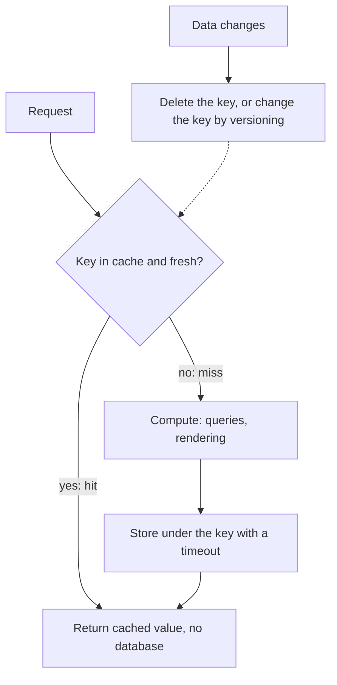

# Caching, the debug toolbar and the security middleware

> **Before this lesson:** you can find and fix N+1 queries ([Aggregation, joins and the N+1 problem](#/lesson/django/orm-aggregation-nplus1)), you know the production checklist ([Production settings and the security checklist](#/lesson/django/production-settings)) and how middleware wraps views ([The request/response cycle, views, URLs and first tests](#/lesson/django/request-response)). Template autoescaping and CSRF were introduced in [Templates and the Django template language](#/lesson/django/templates-dtl) and [Forms, ModelForm, validation and CSRF](#/lesson/django/forms-validation-csrf).

## In plain words

This lesson is about two qualities users notice without being able to name them: the site is **fast**, and the site is **safe**.

**Fast.** The cheapest work is the work you do not repeat. If the front page takes 200 milliseconds to assemble and looks the same for every visitor during the next minute, assemble it once and hand out copies. Keeping a ready-made result for reuse is called **caching**. A **cache** is the place where the copies are kept.

An everyday picture: a café that brews one pot of filter coffee and pours cups from it, instead of grinding beans for every customer. It works beautifully, with two obvious dangers. The pot goes stale (the copy is out of date), and you must not pour one customer's special order into the next customer's cup (one user's private page shown to another).

Before speeding anything up you must see where the time goes. The **Django Debug Toolbar** is a panel that appears beside your pages during development and shows every database query, every template and the time each took.

**Safe.** Browsers have built-in defences against common attacks, and most of them are switched on by **response headers**: instructions the server sends along with each page. Django's **security middleware** sends the important ones. The second half of this lesson explains what each header prevents and then walks through the mistakes that most often undo Django's protections.

Why it matters for a job: "the page is slow, what do you do?" and "name three common security mistakes in Django apps" are standard interview questions. The expected answers are a method (measure, fix queries, then cache) and a list you can explain, not a list you memorised.

## Part 1: measure first with the debug toolbar

```bash
python -m pip install django-debug-toolbar
```

```python
# config/settings.py
if DEBUG:
    INSTALLED_APPS += ["debug_toolbar"]
    MIDDLEWARE.insert(1, "debug_toolbar.middleware.DebugToolbarMiddleware")
    INTERNAL_IPS = ["127.0.0.1"]
```

```python
# config/urls.py
from django.conf import settings

if settings.DEBUG:
    from debug_toolbar.toolbar import debug_toolbar_urls
    urlpatterns += debug_toolbar_urls()
```

- The toolbar is added **only when `DEBUG` is on**. It reveals queries, settings and request data, so it must never reach production.
- Its middleware goes near the top, after `SecurityMiddleware`.
- `INTERNAL_IPS` lists the addresses allowed to see it; `127.0.0.1` is your own machine.

Reload a page and a panel appears at the side. The parts you will use most:

| Panel | Shows | Look for |
|---|---|---|
| **SQL** | every query, its duration, the line of code that caused it | "N similar queries" and "duplicated" labels: the N+1 fingerprint |
| **Time** | total time and time spent in the processor | a large gap means waiting on the database or network |
| **Templates** | templates rendered and the context passed | unexpected includes, heavy context values |
| **Cache** | cache calls with hits and misses | whether your caching is used at all |
| **Request** | view function, URL name, session and cookie data | which view really handled the request |

The working method: open the SQL panel, sort out the query count first (the ORM lessons), and only then consider caching what remains expensive.

## Part 2: caching

### Choosing a cache backend

The `CACHES` setting says where cached values live.

| Backend | Stores in | Use |
|---|---|---|
| `locmem.LocMemCache` (the default) | the memory of each server process | development; each worker has its own, unshared copy |
| `redis.RedisCache` | a Redis server | production: shared by all workers, fast |
| `memcached.PyMemcacheCache` | a Memcached server | production alternative |
| `db.DatabaseCache` | a database table | when you cannot run a cache server |
| `filebased.FileBasedCache` | files on disk | single-server sites |
| `dummy.DummyCache` | nowhere (never stores) | switching caching off, for example in some tests |

```python
# config/settings.py
if os.environ.get("REDIS_URL"):
    CACHES = {
        "default": {
            "BACKEND": "django.core.cache.backends.redis.RedisCache",
            "LOCATION": os.environ["REDIS_URL"],
            "KEY_PREFIX": "gazette",
            "TIMEOUT": 300,
        }
    }
```

**Redis** is an in-memory data store commonly used as a cache; Django has had a built-in backend for it since version 4.0 (`python -m pip install redis`). `KEY_PREFIX` keeps this project's keys apart from other projects on the same server. `TIMEOUT` is the default lifetime in seconds.

### The low-level API

Every other caching feature is built on four calls:

```python
from django.core.cache import cache

cache.set("front-page-count", 42, timeout=60)      # store for 60 seconds
cache.get("front-page-count")                      # 42, or None when absent or expired
cache.get("missing", default=0)                    # a fallback
cache.delete("front-page-count")
```

The everyday pattern is "use the cached value, or compute and store it", which has a shortcut:

```python
def section_counts():
    return cache.get_or_set(
        "stories:section-counts",
        lambda: dict(Story.objects.published().values_list("section").annotate(n=Count("id"))),
        timeout=120,
    )
```

The model below is a cache with expiry in a dozen lines, using an explicit clock so that you can watch a value be reused and then go stale.

```python-run
class Cache:
    def __init__(self):
        self.store, self.hits, self.misses = {}, 0, 0

    def get(self, key, now):
        entry = self.store.get(key)
        if entry and entry[1] > now:                 # present and not yet expired
            self.hits += 1
            return entry[0]
        self.misses += 1
        return None

    def set(self, key, value, timeout, now):
        self.store[key] = (value, now + timeout)

cache = Cache()
database_calls = 0

def count_published(now):
    global database_calls
    value = cache.get("published-count", now)
    if value is None:
        database_calls += 1                          # the expensive part
        value = 40 + database_calls                  # pretend the number grows over time
        cache.set("published-count", value, timeout=60, now=now)
    return value

for second in (0, 5, 30, 59, 61, 90, 125):
    print(f"t={second:>3}s  value={count_published(second)}")
print(f"requests: 7, database calls: {database_calls}, hits: {cache.hits}, misses: {cache.misses}")
```

Seven requests cost three computations. Between refreshes, visitors see a value up to 60 seconds old. That trade, **speed for freshness**, is the essence of caching, and choosing the timeout is choosing how stale is acceptable.

### Caching a whole view

```python
# stories/urls.py
from django.views.decorators.cache import cache_page

urlpatterns = [
    path("", cache_page(60)(views.StoryListView.as_view()), name="story-list"),
]
```

`cache_page(60)` stores the complete response for 60 seconds. The cache key is derived from the full URL including the query string, so `?page=2` and `?section=sport` are cached separately. It applies to `GET` and `HEAD` requests with a 200 status only.

Here the café's second danger appears. The story list contains the navigation bar with "Hello, Marisol". Cached naively, the next visitor sees Marisol's name. Django reduces this risk through the `Vary` header: session and authentication middleware mark responses that depended on the session with `Vary: Cookie`, and the cache then keeps a separate copy per cookie value. That is safe and nearly useless, since each logged-in user gets a private copy. The practical rules:

- Cache whole pages only when they are identical for everyone (public pages for anonymous visitors, API responses without personal data).
- For personalised pages, cache the shared **parts**.

### Caching a fragment of a template

```html



  <aside>
    <h2>Most recommended</h2>
    <p><a href="{{ story.get_absolute_url }}">{{ story.headline }}</a></p>
  </aside>

```

`` caches the enclosed output. Because querysets are lazy, the query for `most_recommended` does not even run while the fragment is cached. Add variables to the tag to keep separate copies: ``. Whatever the fragment's content depends on must be part of its key.

### Invalidation: removing stale copies

> There are only two hard things in computer science: cache invalidation and naming things. (attributed to Phil Karlton)

**Invalidation** means removing or replacing a cached value when the underlying data changes. Three strategies, from simplest to most precise:

1. **Let it expire.** Short timeouts; accept brief staleness. Often enough.
2. **Delete on change.** When a story is saved, delete the keys that include it:

   ```python
   # stories/signals.py
   from django.core.cache import cache
   from django.db.models.signals import post_delete, post_save
   from django.dispatch import receiver

   from .models import Story


   @receiver([post_save, post_delete], sender=Story)
   def clear_story_caches(sender, instance, **kwargs):
       cache.delete_many(["stories:section-counts", f"stories:detail:{instance.pk}"])
   ```

3. **Version the key.** Put something that changes with the data into the key, such as the object's `updated_at`: `f"story:{story.pk}:{story.updated_at.timestamp()}"`. When the story changes, the key changes, and the old entry is never read again and expires by itself. No deletion code is needed. A whole family of keys can be invalidated at once by bumping a version number stored in the cache.



### What else is cached

- **Browser and CDN caching** of static files, through hashed file names (the static files lesson).
- **Cached template loading**, on by default when `DEBUG` is off.
- **`cached_property`** (`from django.utils.functional import cached_property`): computes an attribute once per object instance.
- **HTTP conditional requests**: the `ConditionalGetMiddleware` and the `etag`/`last_modified` decorators let a browser ask "has this changed?" and receive a tiny "304 Not Modified" instead of the whole page.

## Part 3: the security middleware and its headers

`django.middleware.security.SecurityMiddleware` is first in the default `MIDDLEWARE` list. It does two jobs: redirecting HTTP to HTTPS when `SECURE_SSL_REDIRECT` is on, and adding protective headers to responses. Together with two sibling middleware classes, it produces:

| Header | Sent by | Tells the browser | Stops |
|---|---|---|---|
| `Strict-Transport-Security` | `SecurityMiddleware` (when `SECURE_HSTS_SECONDS` > 0) | use only HTTPS for this site for N seconds | downgrade to plain HTTP |
| `X-Content-Type-Options: nosniff` | `SecurityMiddleware` | do not guess a file's type from its content | an uploaded text file executed as a script |
| `Referrer-Policy: same-origin` | `SecurityMiddleware` | do not tell other sites which of our pages linked to them | leaking private URLs |
| `Cross-Origin-Opener-Policy: same-origin` | `SecurityMiddleware` | isolate our windows from other sites' windows | cross-window attacks |
| `X-Frame-Options: DENY` | `XFrameOptionsMiddleware` | never display this page inside a frame | clickjacking |
| CSRF cookie and token check | `CsrfViewMiddleware` | (server-side check) | cross-site request forgery |

### Content Security Policy

The strongest header is not sent by default because it must be tailored to each site. A **Content Security Policy (CSP)** lists the sources from which the browser may load scripts, styles, images and so on. Even if an attacker manages to inject `<script src="https://evil.example/x.js">` into a page, the browser refuses to load it, because that source is not on the list.

```python
# Django 6.0+: built in
from django.utils.csp import CSP

MIDDLEWARE += ["django.middleware.csp.ContentSecurityPolicyMiddleware"]
SECURE_CSP = {
    "default-src": [CSP.SELF],
    "script-src": [CSP.SELF, CSP.NONCE],
    "style-src": [CSP.SELF, "https://cdn.jsdelivr.net"],
    "img-src": [CSP.SELF, "data:"],
    "frame-ancestors": [CSP.NONE],
}
```

On Django 5.x the `django-csp` package offers the same through similar settings. `CSP.SELF` means "our own origin". A **nonce** is a random value generated for each response; only `<script>` tags carrying that value run, which permits your own inline scripts while blocking injected ones. Introduce a policy in report-only mode first (`SECURE_CSP_REPORT_ONLY`), so that violations are reported without breaking the page.

The model below assembles the headers for a response from a settings dictionary, as the middleware classes do.

```python-run
def security_headers(settings, request_is_secure):
    headers = {}
    if request_is_secure and settings.get("SECURE_HSTS_SECONDS"):
        value = f"max-age={settings['SECURE_HSTS_SECONDS']}"
        if settings.get("SECURE_HSTS_INCLUDE_SUBDOMAINS"):
            value += "; includeSubDomains"
        headers["Strict-Transport-Security"] = value
    if settings.get("SECURE_CONTENT_TYPE_NOSNIFF", True):
        headers["X-Content-Type-Options"] = "nosniff"
    headers["Referrer-Policy"] = settings.get("SECURE_REFERRER_POLICY", "same-origin")
    headers["Cross-Origin-Opener-Policy"] = settings.get("SECURE_CROSS_ORIGIN_OPENER_POLICY", "same-origin")
    headers["X-Frame-Options"] = settings.get("X_FRAME_OPTIONS", "DENY")
    if "SECURE_CSP" in settings:
        headers["Content-Security-Policy"] = "; ".join(
            f"{directive} {' '.join(sources)}" for directive, sources in settings["SECURE_CSP"].items())
    return headers

defaults = {}
hardened = {"SECURE_HSTS_SECONDS": 31536000, "SECURE_HSTS_INCLUDE_SUBDOMAINS": True,
            "SECURE_CSP": {"default-src": ["'self'"], "img-src": ["'self'", "data:"], "frame-ancestors": ["'none'"]}}

for name, settings in [("defaults, HTTPS request", defaults), ("hardened, HTTPS request", hardened)]:
    print(name)
    for header, value in security_headers(settings, request_is_secure=True).items():
        print(f"   {header}: {value}")
```

A fresh project already sends four protective headers. HSTS and CSP are the two you add deliberately.

## Part 4: common mistakes that undo the defaults

Django is secure by default against the classic attacks. Real incidents come from switching a default off or working around it. Each row below is a pattern to recognise in code review.

| Mistake | What it enables | Do instead |
|---|---|---|
| `{{ value\|safe }}` or `mark_safe()` on user-supplied text | cross-site scripting (XSS) | let autoescaping work; build HTML with `format_html()` |
| Putting data into a `<script>` block with `{{ }}` | XSS (HTML escaping is the wrong escaping there) | `{{ data\|json_script:"story-data" }}` and read it from JavaScript |
| `@csrf_exempt` to "fix" a 403 | cross-site request forgery | send the token; exempt only endpoints authenticated by other means, such as signed webhooks |
| State changes on `GET` | CSRF and accidental triggers by crawlers | `POST` plus `@require_POST` |
| String formatting in `raw()`, `extra()` or `cursor.execute()` | SQL injection | pass parameters separately |
| `fields = "__all__"` on public forms and serializers | mass assignment, data exposure | explicit field lists |
| Looking objects up by id without an ownership filter | reading or editing other users' data (**IDOR**, insecure direct object reference) | filter the queryset by the user; check object permissions |
| `redirect(request.GET["next"])` | open redirect, phishing | `url_has_allowed_host_and_scheme()` |
| `DEBUG = True` or a committed `SECRET_KEY` in production | information disclosure, forged sessions | environment variables; `check --deploy` |
| `ALLOWED_HOSTS = ["*"]` | host-header poisoning of links and caches | exact host names |
| Serving user uploads from the application's own origin without checks | uploaded HTML or SVG running scripts as your site | validate type and size; store outside the web root or on a separate domain; force download for unknown types |
| `pickle` for sessions or caches fed with untrusted data | remote code execution | the default JSON session serializer; never unpickle untrusted input |
| Leaving the admin at `/admin/` with weak passwords | credential guessing | a different path, strong passwords, two-factor authentication, rate limiting |
| Outdated dependencies | known, published vulnerabilities | automated update tooling; `pip-audit` in CI |

Three of these deserve code.

**Building HTML safely.** When Python code must produce markup, `format_html` escapes every argument and marks only the template text as safe:

```python
from django.utils.html import format_html

# WRONG: mark_safe(f"<a href='{url}'>{name}</a>")   (name or url may contain markup)
link = format_html('<a href="{}">{}</a>', url, name)
```

**Passing data to JavaScript.**

```html
{{ chart_data|json_script:"chart-data" }}
<script nonce="{{ csp_nonce }}">
  const chartData = JSON.parse(document.getElementById("chart-data").textContent);
</script>
```

`json_script` outputs the data inside a `<script type="application/json">` element with dangerous characters escaped, so that a value such as `</script><script>alert(1)` cannot break out.

**Insecure direct object reference.** The view fetches by id and trusts that the visitor would only know their own ids:

```python
# WRONG: any logged-in member can read any invoice by changing the number in the URL
invoice = get_object_or_404(Invoice, pk=pk)

# RIGHT: the lookup itself is limited to the member's own rows
invoice = get_object_or_404(Invoice, pk=pk, member=request.user)
```

A security review of a Django project is, to a first approximation, reading every view and asking: who may call this, with which method, and which rows can they reach?

## Tests

```python
# pages/test_cache_and_security.py
from django.core.cache import cache
from django.template import Context, Template
from django.test import TestCase, override_settings
from django.urls import reverse
from django.utils.html import format_html


@override_settings(CACHES={"default": {"BACKEND": "django.core.cache.backends.locmem.LocMemCache"}})
class CacheTests(TestCase):
    def setUp(self):
        cache.clear()

    def test_get_or_set_computes_once(self):
        calls = []
        def expensive():
            calls.append(1)
            return 42
        self.assertEqual(cache.get_or_set("answer", expensive, timeout=60), 42)
        self.assertEqual(cache.get_or_set("answer", expensive, timeout=60), 42)
        self.assertEqual(len(calls), 1)

    def test_delete_invalidates(self):
        cache.set("answer", 42, timeout=60)
        cache.delete("answer")
        self.assertIsNone(cache.get("answer"))

    def test_cached_page_skips_the_database_on_second_request(self):
        url = reverse("story-list")
        self.client.get(url)                         # fills the cache
        with self.assertNumQueries(0):
            self.client.get(url)


class SecurityTests(TestCase):
    def test_protective_headers_present(self):
        response = self.client.get(reverse("home"))
        self.assertEqual(response["X-Content-Type-Options"], "nosniff")
        self.assertEqual(response["X-Frame-Options"], "DENY")
        self.assertEqual(response["Referrer-Policy"], "same-origin")

    def test_autoescape_neutralises_script_tags(self):
        html = Template("<p>{{ text }}</p>").render(Context({"text": "<script>alert(1)</script>"}))
        self.assertNotIn("<script>", html)
        self.assertIn("&lt;script&gt;", html)

    def test_format_html_escapes_arguments(self):
        link = format_html('<a href="{}">{}</a>', "/stories/", "<b>bold</b>")
        self.assertEqual(link, '<a href="/stories/">&lt;b&gt;bold&lt;/b&gt;</a>')

    def test_post_without_csrf_token_is_rejected(self):
        from django.test import Client
        strict = Client(enforce_csrf_checks=True)
        self.assertEqual(strict.post(reverse("login"), {"username": "x", "password": "y"}).status_code, 403)
```

The ordinary test client skips CSRF checks; `Client(enforce_csrf_checks=True)` switches them on to prove that the protection is active.

> [!NOTE]
> **What changed since the book.** None of these topics is in the source book. Timeline: a built-in Redis cache backend arrived in Django 4.0; `X_FRAME_OPTIONS` defaults to `DENY` and `SECURE_REFERRER_POLICY` exists since 3.0; `Cross-Origin-Opener-Policy` since 4.0; the old `X-XSS-Protection` setting was removed in 4.0; `debug_toolbar_urls()` simplified toolbar set-up in toolbar version 4.4; and Django 6.0 added built-in Content Security Policy support.

> [!INTERVIEW]
> **"A page is slow. Walk me through what you do."** Measure before changing anything: the debug toolbar's SQL and time panels locally, an application-performance monitor and the database's slow-query log in production. Fix the query count first (N+1 with `select_related`/`prefetch_related`, counts with `annotate`), then the slow queries (indexes, `explain`, fetching fewer columns), then repeated computation with caching: low-level `cache.get_or_set` for expensive values, fragment caching for shared page parts, per-view caching for pages identical for everyone. State the invalidation plan (timeouts, delete on change, versioned keys) and the personalisation risk (`Vary: Cookie`). Move slow non-essential work (e-mail, reports) to background tasks. Finish by measuring again.

> [!WARNING]
> Caching can turn a correctness bug into a privacy incident. Before caching any response or fragment, ask: "is this output identical for every user who would get this cache key?" If the answer depends on the user, a permission, the language or a query parameter, that thing belongs in the key.

> [!TIP]
> Give cache keys a structure: `app:thing:identifier:version`, for example `stories:detail:17:v2`. Structured keys are easy to delete in groups, easy to bump when the cached format changes, and easy to recognise when you inspect the cache.

## Pitfalls

- **Caching before measuring.** You hide a query problem and gain a staleness problem.
- **The debug toolbar in production.** Guard every line of its set-up with `if DEBUG`.
- **`LocMemCache` with several workers.** Each process has its own cache; invalidation in one does not reach the others.
- **Personalised content in a shared cache entry.**
- **No invalidation plan.** "Why does the page still show the old headline?" is the classic caching bug report.
- **Caching mutable Python objects and changing them after `cache.get`.** With some backends you change your copy only; treat cached values as read-only.
- **`@csrf_exempt` and `|safe` as quick fixes.** Each one removes a defence for a whole endpoint or value.
- **A strict CSP switched on without report-only testing.** Inline scripts and third-party assets silently stop working.
- **Object lookups by primary key alone** in views that should be private.

## Cheat sheet

| Need | Code |
|---|---|
| See queries per page | `django-debug-toolbar`, SQL panel |
| Shared production cache | `"BACKEND": "django.core.cache.backends.redis.RedisCache"` |
| Store / read / delete | `cache.set(key, value, timeout)`, `cache.get(key)`, `cache.delete(key)` |
| Compute once | `cache.get_or_set(key, callable, timeout)` |
| Cache a view | `cache_page(60)(view)` or `@cache_page(60)` |
| Cache part of a template | `...` |
| Per-instance memo | `@cached_property` |
| Invalidate on change | `post_save`/`post_delete` receiver calling `cache.delete_many` |
| Versioned key | include `updated_at` or a version number in the key |
| HSTS | `SECURE_HSTS_SECONDS = 31536000` |
| Frame protection | `X_FRAME_OPTIONS = "DENY"` (default) |
| CSP | `SECURE_CSP = {...}` (6.0+) or `django-csp` |
| Safe HTML from Python | `format_html("<b>{}</b>", value)` |
| Data for JavaScript | `{{ data\|json_script:"id" }}` |
| Test CSRF enforcement | `Client(enforce_csrf_checks=True)` |

## Summary

- Measure first: the debug toolbar shows the queries, templates and time behind each page.
- Caching trades freshness for speed; the low-level API, fragment caching and per-view caching apply the same idea at different sizes.
- Every cached item needs a key that includes everything its content depends on, and a plan for invalidation.
- `SecurityMiddleware` and its siblings send headers that enable browser defences; HSTS and a Content Security Policy are the ones you configure deliberately.
- Most Django security bugs are disabled defaults: `|safe`, `csrf_exempt`, raw SQL built from strings, `__all__` field lists, and object lookups without an ownership filter.

## Glossary

- **Cache**: a store of computed results kept for reuse.
- **Cache hit / miss**: finding / not finding a usable value in the cache.
- **Timeout (TTL)**: how long a cached value is considered valid.
- **Invalidation**: removing or replacing cached data that is out of date.
- **Cache key**: the name under which a value is stored.
- **Fragment caching**: caching part of a rendered template.
- **`Vary` header**: a response header naming request headers that affect the response, used to keep separate cached copies.
- **Redis**: an in-memory data store often used as a cache.
- **Debug toolbar**: a development panel showing queries, timing and other details of each request.
- **Response header**: metadata sent with a response, such as security instructions for the browser.
- **Content Security Policy**: a header restricting the sources a page may load resources from.
- **Nonce**: a single-use random value that marks trusted inline scripts.
- **XSS**: cross-site scripting, running an attacker's script in a victim's browser on your site.
- **IDOR**: insecure direct object reference, accessing another user's object by changing an identifier.

```quiz
[
  {"q": "What should be done before adding caching to a slow page?",
   "options": ["Increase the worker count", "Measure where the time goes, usually starting with the number of SQL queries", "Switch to async views", "Disable middleware"],
   "answer": 1,
   "explain": "Caching hides problems. Query-count and slow-query fixes come first; the debug toolbar shows them."},
  {"q": "What is the fundamental trade-off of caching?",
   "options": ["Security for speed", "Freshness for speed", "Memory for disk", "Readability for speed"],
   "answer": 1,
   "explain": "A cached value may be out of date until it expires or is invalidated."},
  {"q": "A page containing 'Hello, Marisol' in its header is cached for everyone under one key. What happens?",
   "options": ["Nothing wrong", "Other visitors receive Marisol's personalised page", "The cache refuses to store it", "Django removes the name automatically"],
   "answer": 1,
   "explain": "Anything the output depends on must be part of the cache key. Personalised pages need per-user keys or only shared fragments cached."},
  {"q": "Which invalidation strategy needs no deletion code?",
   "options": ["Deleting keys in a post_save receiver", "Including a value that changes with the data, such as updated_at, in the cache key", "Clearing the whole cache hourly", "Restarting the server"],
   "answer": 1,
   "explain": "With versioned keys a change produces a new key; the old entry is never read again and expires by itself."},
  {"q": "Why is LocMemCache unsuitable for production with several worker processes?",
   "options": ["It is too slow", "Each process has its own separate cache, so values and invalidations are not shared", "It cannot store strings", "It writes to disk"],
   "answer": 1,
   "explain": "Use a shared backend such as Redis or Memcached so all workers see the same entries."},
  {"q": "What does `X-Frame-Options: DENY` prevent?",
   "options": ["SQL injection", "Clickjacking, by forbidding other sites to embed your pages in frames", "CSRF", "Slow pages"],
   "answer": 1,
   "explain": "An attacker cannot overlay your page invisibly and trick users into clicking."},
  {"q": "What does a Content Security Policy add beyond autoescaping?",
   "options": ["Nothing", "A second layer: even if markup is injected, the browser refuses scripts from sources not on the allow-list", "Faster page loads", "Password hashing"],
   "answer": 1,
   "explain": "CSP is defence in depth against XSS. It restricts where scripts, styles and other resources may come from."},
  {"q": "A view does `get_object_or_404(Invoice, pk=pk)` for any logged-in user. What is the vulnerability?",
   "options": ["SQL injection", "IDOR: a user can read another user's invoice by changing the id", "CSRF", "XSS"],
   "answer": 1,
   "explain": "Authentication is not authorisation. The lookup must also be restricted to rows the user may access."}
]
```

> **Source:** beyond the book. Docs: https://docs.djangoproject.com/en/5.2/topics/cache/ · https://django-debug-toolbar.readthedocs.io/en/latest/installation.html · https://docs.djangoproject.com/en/5.2/ref/middleware/#module-django.middleware.security · https://docs.djangoproject.com/en/5.2/topics/security/ · https://docs.djangoproject.com/en/6.0/howto/csp/
