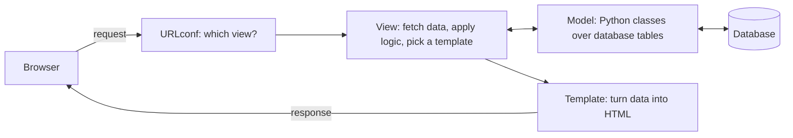
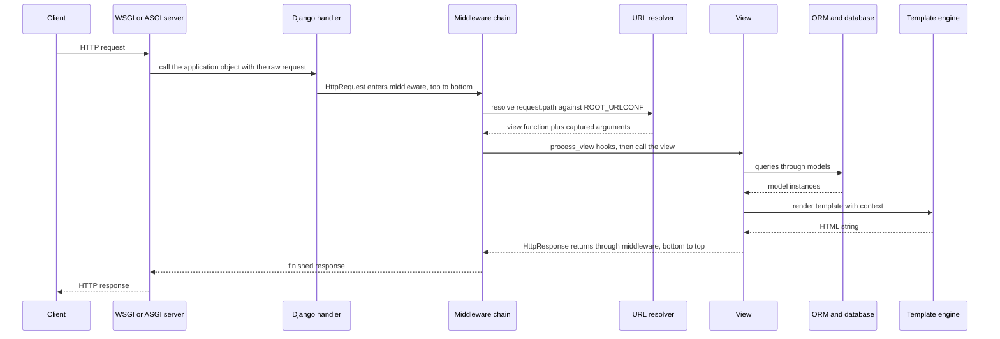

# Architecture questions: MTV, the request lifecycle, middleware order and signals

> **Before this lesson:** this is a review lesson. It assumes you have worked through the track, in particular [The request/response cycle, views, URLs and first tests](#/lesson/django/request-response), [Templates and the Django template language](#/lesson/django/templates-dtl), [Models, migrations and the admin](#/lesson/django/models-migrations-admin) and [Auth-aware templates, messages and navigation](#/lesson/django/auth-templates). Every term is defined again where it is used.

## In plain words

An interview about Django rarely asks you to recite syntax. It asks you to **explain how the machine works**: what its main parts are, what happens to a request on its way through, and why the parts are arranged as they are. Someone who can draw that picture can debug an unfamiliar codebase; someone who has only memorised commands cannot.

This lesson rehearses the four architecture questions that come up most, each as a question, the mechanism behind it, and a **worked answer** you could give aloud in about a minute:

1. What is MTV, and how does it relate to MVC?
2. What happens between a request arriving and a response leaving?
3. Why does the order of middleware matter?
4. What are signals, and when should you avoid them?

An everyday picture for the whole lesson: giving a visitor a tour of a factory. You do not read out the parts list. You follow one product from the loading dock to the shipping door and say what each station does and why it stands where it stands.

A method for any "explain X" question, worth practising: **one-sentence definition → the mechanism in order → one concrete example → one trade-off or pitfall.** Every worked answer below follows it.

## Question 1: MTV and MVC

### The idea

Large programs stay manageable when different jobs live in different places. **MVC** (Model, View, Controller) is the classic division for interactive software:

- the **Model** holds the data and the rules about it;
- the **View** is what the user sees;
- the **Controller** receives the user's input and decides what to do.

Django makes the same division with different names, **MTV** (Model, Template, View):

| Job | Classic MVC name | Django's name | Where in a project |
|---|---|---|---|
| Data and business rules | Model | **Model** | `models.py` |
| Presentation | View | **Template** | `templates/*.html` |
| Deciding what to do with a request | Controller | **View** (plus the URL configuration) | `views.py`, `urls.py` |

The confusing part is the word "view". In MVC a view is the screen. In Django a view is the function or class that handles a request, which is closer to a controller. Django's authors argue that their view decides *which* data is presented, the template decides *how*, and the "controller" is the framework itself: the machinery that reads `urls.py` and calls the right view.



### Worked answer

> "MTV is Django's version of the MVC separation of concerns. The Model is the same in both: Python classes that map to database tables and carry the business rules. Django's Template corresponds to MVC's View: it only presents data. Django's View corresponds mostly to MVC's Controller: it receives the request, talks to the models, and chooses a template; the URL configuration and the framework's dispatching do the rest of the controller's job. So the letters differ but the principle is identical: keep data, logic and presentation apart. In practice that means I put rules in models and custom querysets, keep views thin, and keep templates free of logic beyond loops and conditions, which makes each layer testable on its own."

### Follow-ups you should expect

- **"Where does business logic belong?"** Close to the data: model methods and custom queryset methods ("fat models, thin views"), or a separate service module when an operation spans several models. Not in templates, and not copied across views.
- **"What about an API?"** The template is replaced by a serializer and a renderer that produce JSON; models and the view layer stay.

## Question 2: the request lifecycle

This is the single most frequently asked Django question. Learn it as ten stations.



1. **Server.** A web server process (Gunicorn for WSGI, Uvicorn for ASGI) accepts the connection and calls Django's application object from `config/wsgi.py` or `config/asgi.py`.
2. **Handler.** Django's handler builds an `HttpRequest` object from the raw data and sends the `request_started` signal.
3. **Middleware, inbound.** The request passes through each class in the `MIDDLEWARE` setting from top to bottom. Each may read or modify the request, or answer immediately without going further.
4. **URL resolution.** The resolver loads the module named by `ROOT_URLCONF` and tries the `urlpatterns` in order. The first match yields a view and the arguments captured by path converters. No match raises `Http404`.
5. **View middleware.** `process_view` hooks run; the CSRF check happens here, because it needs to know whether the matched view is exempt.
6. **View.** The view function (or the function produced by `as_view()`) runs. It typically validates input, queries the database through the ORM, and builds a context.
7. **Template.** The template engine loads the template, renders it with the context and returns a string, which the view wraps in an `HttpResponse`.
8. **Exceptions.** If the view raises, `process_exception` hooks run in reverse order; if none handles it, Django converts the exception into a response: 404 for `Http404`, 403 for `PermissionDenied`, 400 for a suspicious request, otherwise 500 (the debug page when `DEBUG` is on).
9. **Middleware, outbound.** The response travels back through the middleware from bottom to top. Each may modify it: add headers, set cookies, compress.
10. **Server.** The handler sends `request_finished`, database connections are returned or closed, and the server writes the response to the client.

### Worked answer

> "The WSGI or ASGI server receives the request and calls Django's application object, which creates an `HttpRequest`. The request then goes through the middleware listed in settings, top to bottom: security redirects, loading the session, attaching `request.user`, and so on. After that the URL resolver matches the path against `urlpatterns` from `ROOT_URLCONF`; first match wins and path converters produce the view's keyword arguments, or we get a 404. The view runs: it usually uses the ORM to talk to the database and renders a template with a context, returning an `HttpResponse`. That response goes back through the same middleware in reverse order, where headers and cookies are added, and the server sends it to the client. If the view raises an exception, Django turns it into a 404, 403 or 500 response, which still passes through the outbound middleware."

### Follow-ups

- **"Where is the CSRF token checked?"** In `CsrfViewMiddleware.process_view`, after URL resolution and before the view.
- **"When is the database queried?"** When a queryset is evaluated, which is often during template rendering, because querysets are lazy.
- **"What changes with a class-based view?"** `as_view()` returns a function that creates an instance per request and calls `dispatch()`, which routes to `get()`, `post()` and so on.

## Question 3: middleware order

### The mechanism

A middleware is a callable that receives the next callable in the chain and wraps it:

```python
# pages/middleware.py
import time


class TimingMiddleware:
    def __init__(self, get_response):
        self.get_response = get_response            # the next layer (or the view)

    def __call__(self, request):
        start = time.perf_counter()                 # code here runs BEFORE the view (inbound)
        response = self.get_response(request)       # hand over to the inner layers
        duration_ms = (time.perf_counter() - start) * 1000
        response["Server-Timing"] = f"app;dur={duration_ms:.1f}"   # code here runs AFTER the view (outbound)
        return response
```

- `__init__` runs once when the server starts and stores `get_response`, the next layer.
- `__call__` runs for every request. Everything before `self.get_response(request)` is the inbound phase; everything after it is the outbound phase.
- Returning a response **without** calling `get_response` short-circuits: no inner middleware and no view run.

Django builds the chain from the `MIDDLEWARE` list so that the first entry is the outermost layer. Hence the two orders: inbound top to bottom, outbound bottom to top. The picture is an onion.

The model below builds a chain exactly as Django does and prints the order of events, including a short-circuit.

```python-run
def make_middleware(name, log, block=False):
    def middleware(get_response):
        def handler(request):
            log.append(f"{name}: in")
            if block:
                log.append(f"{name}: short-circuit")
                return f"403 from {name}"              # the inner layers and the view never run
            response = get_response(request)
            log.append(f"{name}: out")
            return response
        return handler
    return middleware

def view(request):
    return "200 from view"

def build_chain(middleware_list, view):
    handler = view
    for middleware in reversed(middleware_list):       # wrap from the inside out
        handler = middleware(handler)
    return handler                                     # the first in the list is the outermost layer

for blocked in (False, True):
    log = []
    chain = build_chain([
        make_middleware("Security", log),
        make_middleware("Session", log),
        make_middleware("Maintenance", log, block=blocked),
        make_middleware("Auth", log),
    ], view)
    print(chain({"path": "/"}), "|", " -> ".join(log))
```

In the second run "Maintenance" answers by itself. "Auth" and the view never execute, and "Maintenance" has no outbound step, but "Session" and "Security" still see the response on its way out.

### Why Django's default order is what it is

```python
MIDDLEWARE = [
    "django.middleware.security.SecurityMiddleware",
    "django.contrib.sessions.middleware.SessionMiddleware",
    "django.middleware.common.CommonMiddleware",
    "django.middleware.csrf.CsrfViewMiddleware",
    "django.contrib.auth.middleware.AuthenticationMiddleware",
    "django.contrib.messages.middleware.MessageMiddleware",
    "django.middleware.clickjacking.XFrameOptionsMiddleware",
]
```

| Position | Middleware | Why here |
|---|---|---|
| 1 | `SecurityMiddleware` | redirect to HTTPS before doing any other work; its headers apply to every response, including errors produced further in |
| (2) | `WhiteNoiseMiddleware`, if used | serve static files before sessions and authentication are loaded for nothing |
| 2 | `SessionMiddleware` | everything below that needs `request.session` depends on it |
| 3 | `CommonMiddleware` | URL normalisation such as adding the trailing slash |
| 4 | `CsrfViewMiddleware` | must run before any view that reads POST data; after sessions in case the token is stored in the session |
| 5 | `AuthenticationMiddleware` | sets `request.user` from the session, so it must come **after** `SessionMiddleware` |
| 6 | `MessageMiddleware` | stores messages in the session, so also after `SessionMiddleware` |
| 7 | `XFrameOptionsMiddleware` | only adds a response header; position is uncritical |

Two general rules explain most placements: **a middleware must come after the ones whose results it reads on the way in**, and **a middleware that rewrites the finished response body (compression, caching) must be near the top**, so that on the way out it runs last, after everyone else has finished changing the response.

### Worked answer

> "Middleware forms a chain of wrappers around the view. The request passes through the `MIDDLEWARE` list top to bottom and the response comes back bottom to top, like layers of an onion. Order matters because of dependencies: `AuthenticationMiddleware` reads the session, so it must be below `SessionMiddleware`; `SecurityMiddleware` is first so that HTTPS redirects happen before anything else and its headers cover all responses; a compression or cache middleware belongs near the top so that it sees the final response on the way out. Any middleware can short-circuit by returning a response without calling the next layer; then the inner layers and the view do not run, but the outer layers still process the response. I would write middleware for cross-cutting concerns that apply to every request, such as timing, request ids or tenant selection, and use decorators or mixins for behaviour specific to some views."

### Follow-ups

- **"What hooks exist besides `__call__`?"** `process_view(request, view_func, view_args, view_kwargs)` runs after URL resolution, before the view; `process_exception(request, exception)` runs when the view raises; `process_template_response(request, response)` runs for responses that have a `render()` method.
- **"Sync or async?"** A middleware can declare that it supports both; a sync-only middleware in an async request path forces a thread switch.

## Question 4: signals

### The mechanism

A **signal** is Django's implementation of the **observer pattern**: one piece of code announces that something happened, and any number of **receivers**, functions that subscribed earlier, are called. The sender does not know who is listening. This is **decoupling**: two parts of a system working together without depending on each other's code.

Built-in signals you will meet:

| Signal | Sent when |
|---|---|
| `pre_save`, `post_save` | before / after a model's `save()` |
| `pre_delete`, `post_delete` | before / after a model instance is deleted |
| `m2m_changed` | a many-to-many relation is changed |
| `request_started`, `request_finished` | a request begins / ends |
| `user_logged_in`, `user_logged_out`, `user_login_failed` | authentication events |
| `post_migrate` | after `migrate` has run for an app |

```python
# accounts/signals.py
from django.contrib.auth import get_user_model
from django.db.models.signals import post_save
from django.dispatch import receiver

from .models import Profile


@receiver(post_save, sender=get_user_model(), dispatch_uid="create_profile_for_new_member")
def create_profile(sender, instance, created, **kwargs):
    if created:
        Profile.objects.create(user=instance)
```

- `@receiver(post_save, sender=...)` subscribes the function for saves of that one model.
- `created` is `True` only for the first save, so the profile is made once.
- `dispatch_uid` is a unique label that prevents the same receiver being registered twice if the module is imported twice.
- `**kwargs` is required, because Django may add arguments in the future.
- The module must be imported for registration to happen, conventionally in `AppConfig.ready()`.

Your own signals are a single line plus a `send`:

```python
# stories/signals.py
from django.dispatch import Signal

story_published = Signal()

# where the event happens:
story_published.send(sender=Story, story=story, by=request.user)
```

The model below is a working dispatcher: connection order, sender filtering, duplicate protection, and the difference between `send` and `send_robust`.

```python-run
class Signal:
    def __init__(self):
        self.receivers = []                               # (key, function, sender filter), in connection order

    def connect(self, function, sender=None, dispatch_uid=None):
        key = (dispatch_uid or function.__name__, sender)
        if all(existing != key for existing, _, _ in self.receivers):
            self.receivers.append((key, function, sender))   # duplicates are ignored

    def _matching(self, sender):
        return [f for _, f, wanted in self.receivers if wanted is None or wanted == sender]

    def send(self, sender, **kwargs):
        return [(f.__name__, f(sender=sender, **kwargs)) for f in self._matching(sender)]   # an exception propagates

    def send_robust(self, sender, **kwargs):
        results = []
        for f in self._matching(sender):
            try:
                results.append((f.__name__, f(sender=sender, **kwargs)))
            except Exception as error:                    # caught, returned, and the rest still run
                results.append((f.__name__, f"ERROR {error}"))
        return results

post_save = Signal()

def update_search_index(sender, **kwargs): return "indexed"
def send_notification(sender, **kwargs): raise RuntimeError("mail server down")
def clear_cache(sender, **kwargs): return "cache cleared"

post_save.connect(update_search_index, sender="Story")
post_save.connect(send_notification, sender="Story")
post_save.connect(clear_cache)                            # no sender: listens to every model
post_save.connect(clear_cache)                            # second registration is ignored

print("Reply saved :", post_save.send("Reply"))
print("Story robust:", post_save.send_robust("Story"))
try:
    post_save.send("Story")
except RuntimeError as error:
    print("Story send  : exception propagated ->", error, "(clear_cache never ran)")
```

Receivers run **synchronously**, in the order they were connected, inside the caller's code path and database transaction. With `send`, one failing receiver stops the rest and the exception reaches the code that saved the story. `send_robust` isolates failures.

### When signals are the wrong tool

Signals are indirect: reading `story.save()` gives no hint that five other things will happen. Overused, they make behaviour hard to follow and tests hard to write. Guidelines:

- **Use a signal** to react to events in code you do not own (Django's auth app, a third-party package), or to let independent apps react without importing each other.
- **Do not use a signal** inside your own app when a direct function call would do. Override `save()`, or better, write an explicit function (`publish_story(story, by)`) that performs every step in plain sight.
- **Remember what does not send them:** `QuerySet.update()`, `bulk_create()`, `bulk_update()` and raw SQL bypass `pre_save`/`post_save`.
- **Side effects that leave the database** (e-mail, cache, search index) should be scheduled with `transaction.on_commit` inside the receiver, so that they do not fire for a transaction that later rolls back.

### Worked answer

> "Signals are Django's observer pattern: a sender announces an event and registered receivers are called, so the sender does not need to know about them. Django ships model signals such as `post_save` and `post_delete`, request signals and auth signals, and you can define your own with `Signal()`. Receivers are connected with the `@receiver` decorator, registered at start-up in `AppConfig.ready()`, and run synchronously in connection order, in the same transaction as the sender. I use them to hook into code I do not control, for example creating a profile when the user model is saved or reacting to `user_logged_in`. Inside my own code I prefer explicit function calls, because signals hide control flow, are skipped by bulk operations like `update()` and `bulk_create()`, and one failing receiver under `send()` breaks the save. For side effects such as e-mails I combine them with `transaction.on_commit`."

## Rapid-fire questions

Short answers worth being able to give without hesitation.

| Question | Answer |
|---|---|
| Project vs app? | A project is one site's configuration and root URLs; an app is a reusable package for one feature, activated in `INSTALLED_APPS`. |
| What is the ORM? | The layer mapping Python classes and querysets to tables and SQL. |
| `null` vs `blank`? | `null` allows `NULL` in the database; `blank` allows empty input in validation. |
| What does `as_view()` return? | A function that instantiates the class per request and calls `dispatch()`. |
| Function or class-based views? | Class-based for standard shapes and reuse through mixins; functions for unusual flows. Clarity decides. |
| What is a context processor? | A function adding variables to every request-based template context. |
| How does Django prevent XSS, CSRF, SQL injection, clickjacking? | Template autoescaping; a per-form token checked by middleware; parameterised queries in the ORM; the `X-Frame-Options` header. |
| What is `get_user_model()` for? | To obtain the active user model, so code works with a custom user model. |
| WSGI vs ASGI? | Synchronous one-request-per-worker interface vs asynchronous interface supporting many waiting connections and WebSockets. |
| What is `select_related` vs `prefetch_related`? | A JOIN for single-valued relations vs a second query for multi-valued relations. |
| What are generic views? | Ready-made class-based views for common tasks: list, detail, create, update, delete. |
| Where do static files come from in production? | `collectstatic` gathers them into `STATIC_ROOT`; WhiteNoise, a web server or a CDN serves them. |

> [!INTERVIEW]
> When you do not know an answer, say what you do know and reason from it: "I have not used `process_template_response`, but given that middleware wraps the view, I would expect it to run on the way out for responses that still need rendering." Interviewers grade reasoning far above recall, and a guessed mechanism presented as fact is the fastest way to lose their trust.

> [!TIP]
> Practise each worked answer aloud with a timer. One minute is the target. Then practise drawing the lifecycle diagram from memory on paper: boxes for server, middleware, URL resolver, view, model, template, with arrows there and back. A candidate who draws while talking is remembered.

> [!WARNING]
> Do not claim that Django "is MVC" or "is not MVC" as a slogan. Both statements have been defended by its authors' own FAQ. Explain the mapping and move on to what the separation is for.

## Pitfalls in interviews

- **Reciting names without order.** "There is middleware and views and templates" is not a lifecycle; say what happens first, next and last.
- **Forgetting the return path.** The response passes through middleware too, in reverse.
- **Describing signals as asynchronous.** They are synchronous unless the receiver itself hands work to a task queue.
- **Saying "Django views are controllers" and stopping.** Add what the template and the URLconf do.
- **Skipping the failure branches**: no URL match, an exception in the view, a middleware short-circuit.
- **Answering beyond the question.** Give the one-minute answer, then offer depth: "I can go into how `as_view` dispatches if that is useful."

## Cheat sheet

| Topic | The sentence to remember |
|---|---|
| MTV | Model = data and rules; Template = presentation; View = request logic; the framework and URLconf act as the controller. |
| Lifecycle | Server → handler → middleware in → URL resolver → view (ORM, template) → middleware out → server. |
| Errors | No match → 404; `PermissionDenied` → 403; unhandled exception → 500; all still pass outbound middleware. |
| Middleware shape | `__init__(get_response)` once; `__call__(request)` per request; code before/after `get_response`. |
| Middleware order | Inbound top to bottom, outbound bottom to top; dependants below what they depend on. |
| Key dependency | `AuthenticationMiddleware` after `SessionMiddleware`; `SecurityMiddleware` first. |
| Short-circuit | Return a response without calling `get_response`. |
| Signals | Observer pattern; synchronous; connection order; registered in `AppConfig.ready()`. |
| Signal caveats | Not sent by `update()` or bulk operations; hide control flow; prefer explicit calls in your own code. |
| `send` vs `send_robust` | Propagates the first exception vs catches and continues. |

## Summary

- MTV is MVC with different names: models for data and rules, templates for presentation, views for request logic, with the URL configuration and the framework dispatching.
- A request flows server → middleware (top down) → URL resolver → view → ORM and template → middleware (bottom up) → server; exceptions become error responses that still travel outward.
- Middleware are nested wrappers; order follows dependencies, and any layer may short-circuit.
- Signals decouple a sender from its receivers, run synchronously in connection order, and are best kept for reacting to code you do not own.
- Good interview answers are ordered, concrete and brief: definition, mechanism, example, trade-off.

## Glossary

- **MVC / MTV**: Model-View-Controller / Model-Template-View, two namings of the same separation of data, presentation and control.
- **Separation of concerns**: organising code so that each part has one responsibility.
- **Request lifecycle**: the sequence of steps from receiving a request to sending the response.
- **Handler**: Django's core object that turns a server call into an `HttpRequest` and runs the middleware chain.
- **URL resolver**: the component matching a path to a view.
- **Middleware**: a wrapper around the view that processes every request and response.
- **Short-circuit**: answering from a middleware without calling the inner layers.
- **Signal**: a named event to which functions can subscribe.
- **Receiver**: a function connected to a signal.
- **Observer pattern**: a design in which observers are notified of events without the source knowing them.
- **Decoupling**: reducing direct dependencies between parts of a system.
- **`dispatch_uid`**: an identifier preventing duplicate registration of a signal receiver.

```quiz
[
  {"q": "In the MTV naming, which part of Django corresponds most closely to the MVC controller?",
   "options": ["The Model", "The Template", "The View, together with the URL configuration and framework dispatch", "The database"],
   "answer": 2,
   "explain": "Django's view handles the request and chooses data and template; the URLconf and framework decide which view runs."},
  {"q": "In which order does a request pass through MIDDLEWARE, and the response?",
   "options": ["Both top to bottom", "Request top to bottom, response bottom to top", "Request bottom to top, response top to bottom", "The order is random"],
   "answer": 1,
   "explain": "The first entry is the outermost wrapper, so it is entered first and exited last."},
  {"q": "Why must AuthenticationMiddleware be listed after SessionMiddleware?",
   "options": ["Alphabetical order", "It reads the user's id from request.session, which SessionMiddleware provides", "It is slower", "It sets the session cookie"],
   "answer": 1,
   "explain": "A middleware must come after those whose inbound results it depends on."},
  {"q": "A middleware returns a response without calling get_response. What happens?",
   "options": ["Django raises an error", "Inner middleware and the view are skipped; outer middleware still process the response", "All middleware are skipped", "The view runs anyway"],
   "answer": 1,
   "explain": "This is a short-circuit. Layers already entered still run their outbound code."},
  {"q": "At which step is the path matched to a view?",
   "options": ["Before any middleware runs", "After the inbound middleware, by the URL resolver using ROOT_URLCONF", "Inside the template engine", "After the response is sent"],
   "answer": 1,
   "explain": "URL resolution follows the request phase of middleware and precedes process_view hooks and the view."},
  {"q": "Which statement about Django signals is correct?",
   "options": ["Receivers run asynchronously in a background worker", "Receivers run synchronously, in connection order, in the sender's call and transaction", "Signals are sent for queryset.update()", "Receivers are discovered automatically without importing their module"],
   "answer": 1,
   "explain": "Signals are plain synchronous calls. Bulk operations skip save signals, and receivers must be imported to register."},
  {"q": "What is the difference between Signal.send and Signal.send_robust?",
   "options": ["send is faster and otherwise identical", "send propagates a receiver's exception and stops; send_robust catches it and continues with the other receivers", "send_robust retries failures", "send only calls the first receiver"],
   "answer": 1,
   "explain": "With send, one failing receiver prevents the rest from running and the error reaches the sender."},
  {"q": "When is an explicit function call preferable to a signal?",
   "options": ["Never", "For logic inside your own app, where a direct call keeps the control flow visible and testable", "Only in tests", "When reacting to third-party code"],
   "answer": 1,
   "explain": "Signals are for decoupling from code you do not control. Within your own code they hide what happens on save."}
]
```

> **Source:** review of concepts introduced across Vincent, *Django for Beginners*, ch. 2–3 (request/response, MTV) with interview framing. Docs: https://docs.djangoproject.com/en/5.2/faq/general/#django-appears-to-be-a-mvc-framework-but-you-call-the-controller-the-view-and-the-view-the-template-how-come-you-don-t-use-the-standard-names · https://docs.djangoproject.com/en/5.2/topics/http/middleware/ · https://docs.djangoproject.com/en/5.2/ref/middleware/#middleware-ordering · https://docs.djangoproject.com/en/5.2/topics/signals/
