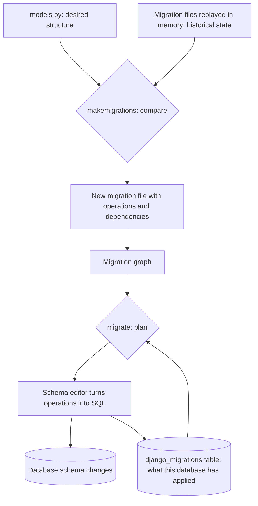
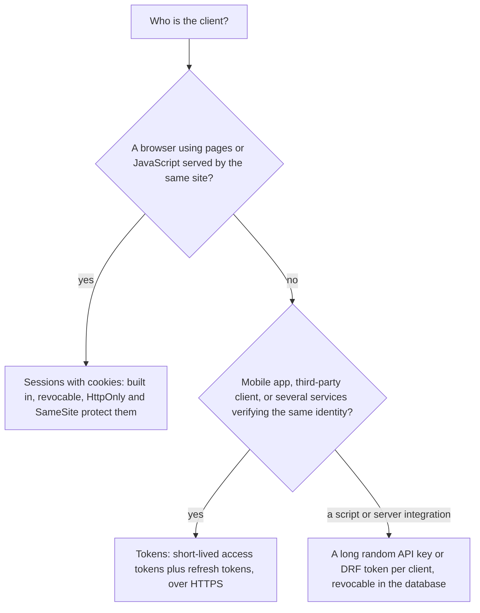

# Data and state questions: how migrations work, N+1 and sessions versus tokens

> **Before this lesson:** this is the second review lesson. It builds on [Models, migrations and the admin](#/lesson/django/models-migrations-admin), [Transactions, indexes, migrations in teams and raw SQL](#/lesson/django/orm-transactions-migrations), [Aggregation, joins and the N+1 problem](#/lesson/django/orm-aggregation-nplus1), [The auth app: users, passwords and sessions](#/lesson/django/auth-app) and [API authentication, permissions, pagination and throttling](#/lesson/django/drf-auth-pagination). Terms are defined again where they appear.

## In plain words

The previous lesson rehearsed questions about how a request travels. This one rehearses questions about what a web application **remembers**: the structure of its database, the rows it loads, and who is logged in. Interviewers favour these topics because mistakes here are the expensive ones: a broken migration stops a deployment, an N+1 query slows every page, and a badly chosen login scheme is a security problem.

Three questions, each with the mechanism and a one-minute **worked answer**:

1. How do Django migrations actually work?
2. What is the N+1 problem, and how do you find and fix it? (Asked in several disguises.)
3. Sessions or tokens: how does each keep a user logged in, and which would you choose?

An everyday picture for each. Migrations are a renovation logbook: every change to the building is written down in order, so any copy of the building can be brought to the same state. N+1 is phoning each guest separately instead of sending one group message. Sessions and tokens are two ways of running a cloakroom: a numbered ticket whose coat hangs behind the counter, versus a signed letter the guest carries that says what they own.

Use the same answering method as before: **definition → mechanism in order → example → trade-off.**

## Question 1: how do migrations work?

### The pieces

Four things are involved, and keeping them apart is the whole trick.

| Piece | What it is |
|---|---|
| **Your models** | the *desired* structure, in `models.py` |
| **Migration files** | an ordered history of changes, each a list of **operations** (`CreateModel`, `AddField`, ...) plus its dependencies |
| **The project state** | an in-memory picture of all models that Django computes by replaying the migration files, without touching any database |
| **The `django_migrations` table** | one row per migration that has been applied to *this* database |

### What `makemigrations` does

1. Load every migration file and replay their operations in memory. The result is the state "according to history".
2. Read the current model classes. This is the state "according to the code".
3. Compare the two. The **autodetector** produces the operations that would turn the first into the second.
4. Write those operations to a new migration file whose `dependencies` point at the latest existing migration (and at other apps' migrations when foreign keys require them).

No database is consulted. That is why `makemigrations` works on a machine with an empty database, and why it reports "No changes detected" when history and code already agree.

The model below is an autodetector in miniature: it diffs two states and prints the operations.

```python-run
def autodetect(from_state, to_state):
    """Return operations that turn from_state into to_state. A state is {model: {field: type}}."""
    operations = []
    for model in to_state:
        if model not in from_state:
            operations.append(("CreateModel", model, dict(to_state[model])))
    for model in from_state:
        if model not in to_state:
            operations.append(("DeleteModel", model))
    for model in to_state:
        if model not in from_state:
            continue
        old, new = from_state[model], to_state[model]
        for field in new:
            if field not in old:
                operations.append(("AddField", model, field, new[field]))
            elif old[field] != new[field]:
                operations.append(("AlterField", model, field, new[field]))
        for field in old:
            if field not in new:
                operations.append(("RemoveField", model, field))
    return operations

# State replayed from the existing migration files:
history = {"Story": {"headline": "CharField(140)", "body": "TextField", "views": "IntegerField"}}

# State read from models.py after today's edits:
code = {
    "Story": {"headline": "CharField(200)", "body": "TextField", "summary": "CharField(280)"},
    "Reply": {"story": "ForeignKey(Story)", "text": "TextField"},
}

for operation in autodetect(history, code):
    print(operation)
print("second run:", autodetect(code, code), "-> 'No changes detected'")
```

One limitation is visible here and worth mentioning in an interview: a field that disappears and another that appears could be a **rename** or a remove-plus-add. The real autodetector asks you ("Was story.title renamed to story.headline?") because the difference matters: a rename keeps the data, a remove-plus-add destroys it.

### What `migrate` does

1. Load all migration files into a **graph**, with an edge from each migration to each of its dependencies.
2. Read the `django_migrations` table to learn which nodes are already applied to this database.
3. Compute a **plan**: the unapplied migrations in an order that respects every dependency.
4. For each migration in the plan: hand its operations to the database's **schema editor**, which translates them into SQL (`CREATE TABLE`, `ALTER TABLE`, ...) and runs it; then insert a row into `django_migrations`. On databases that support it (PostgreSQL, SQLite), each migration runs inside a transaction, so a failure leaves nothing half-applied.



The same files therefore produce the same structure on your laptop, a colleague's laptop, the test database and production. Each database merely differs in how far along the history it is.

### Worked answer

> "Migrations are Django's version control for the database schema. `makemigrations` never looks at the database: it replays the existing migration files in memory to get the historical model state, compares that with the current model classes, and writes the difference as a new file of operations such as `AddField`, with dependencies on earlier migrations. `migrate` loads all migration files into a dependency graph, checks the `django_migrations` table to see which ones this database has already applied, and runs the rest in dependency order through the schema editor, which generates the SQL for the configured database, recording each one as applied. Because the files are code, they are reviewed and committed, and every environment reaches the same schema by replaying them. In a team, two branches can each add a migration on the same parent; Django then reports multiple leaf nodes and I resolve it with `makemigrations --merge`. For production I keep migrations backward compatible with the running code: add columns first, remove them in a later release."

### Follow-ups

| Question | Short answer |
|---|---|
| Can a migration be reversed? | Yes: `migrate app 0003` runs later migrations backwards. Schema operations reverse automatically; `RunPython` needs a reverse function. |
| What is a data migration? | A migration using `RunPython` (or `RunSQL`) to change rows, obtaining models through `apps.get_model` so they match the schema at that point in history. |
| What does `--fake` do? | Records a migration as applied without running it. A repair tool for a known mismatch, dangerous otherwise. |
| What is squashing? | `squashmigrations` replaces a range of migrations with one optimised migration carrying a `replaces` list. |
| How do you detect a forgotten migration? | `makemigrations --check --dry-run` in continuous integration. |
| A deployment adds a non-nullable column to a huge table. Risks? | A default must be supplied; on some databases the table is rewritten and locked. Add it nullable, backfill in batches, then add the constraint. |
| Why should you not edit an applied migration? | Other databases already recorded it as applied and will never run the edited version. |

## Question 2: the N+1 problem in its disguises

### The mechanism in three sentences

Related objects are loaded **lazily**: the first time code touches `story.author`, Django runs a query for that one author. In a loop over N stories that is N queries, on top of the 1 that fetched the stories. The page works, the tests pass with three rows, and production with three thousand rows crawls.

### Recognising it

The same problem is asked in several forms. Train yourself to see the pattern in each.

**Disguise 1: "What is wrong with this view?"**

```python
def story_list(request):
    stories = Story.objects.published()
    return render(request, "stories/list.html", {"stories": stories})
```

```html

  {{ story.headline }} by {{ story.author.display_name }} ({{ story.replies.count }} replies)

```

The view looks innocent; the queries are triggered **in the template**. `story.author` is one query per story, `story.replies.count` another.

```python
stories = (Story.objects.published()
           .select_related("author")
           .annotate(reply_count=Count("replies")))       # template: {{ story.reply_count }}
```

**Disguise 2: "This API endpoint is slow."** A DRF serializer with a nested or related field does to each object what the template did. The fix goes in the view's `get_queryset`, not in the serializer.

**Disguise 3: "We already use `prefetch_related`, and it is still slow."**

```python
for story in Story.objects.prefetch_related("replies"):
    visible = story.replies.filter(is_hidden=False)       # a new query per story
```

Filtering a prefetched relation builds a new queryset that ignores the prefetched rows. Use `Prefetch("replies", queryset=Reply.objects.filter(is_hidden=False), to_attr="visible_replies")`.

**Disguise 4: "How many queries does this code run?"**

```python
replies = Reply.objects.all()[:10]
for reply in replies:
    print(reply.story.author.username)
```

Twenty-one: 1 for the replies, 10 for the stories, 10 for the authors. With `select_related("story__author")`: one.

**Disguise 5: a property that queries.**

```python
class Story(models.Model):
    @property
    def reply_count(self):
        return self.replies.count()          # looks like an attribute, costs a query every time
```

Convenient, and a trap in any list. Prefer an annotation supplied by the queryset.

### The decision table

| What the loop needs | Tool | Queries |
|---|---|---|
| one related object (`ForeignKey`, `OneToOne`) | `select_related("author")` | still 1 |
| many related objects (reverse FK, many-to-many) | `prefetch_related("topics")` | 1 + 1 per relation |
| a filtered or ordered subset of many | `Prefetch(..., queryset=..., to_attr=...)` | 1 + 1 |
| only a number | `annotate(n=Count("replies"))` | still 1 |
| only "is there any?" | `annotate(has=Exists(...))` | still 1 |
| the latest child's value | `annotate(x=Subquery(...))` | still 1 |

### Finding it

The model below is the detector idea used by debugging tools: normalise each query by replacing its literal values with a placeholder, then count identical shapes.

```python-run
import re
from collections import Counter

query_log = (
    ["SELECT * FROM stories_story WHERE status = 'published' LIMIT 20"]
    + [f"SELECT * FROM accounts_member WHERE id = {i}" for i in (3, 7, 3, 9, 4, 7, 3, 8)]
    + [f"SELECT COUNT(*) FROM stories_reply WHERE story_id = {i}" for i in range(1, 9)]
    + ["SELECT * FROM django_session WHERE session_key = 'k9f2'"]
)

def shape(sql):
    sql = re.sub(r"'[^']*'", "?", sql)          # string literals
    return re.sub(r"\b\d+\b", "?", sql)         # numbers

counts = Counter(shape(q) for q in query_log)
print(f"{len(query_log)} queries, {len(counts)} distinct shapes\n")
for template, n in counts.most_common():
    flag = "  <-- repeated: N+1 suspect" if n >= 3 else ""
    print(f"{n:>2} x {template}{flag}")
```

Eighteen queries, four shapes, two of them repeated eight times: the author lookups (cure: `select_related`) and the reply counts (cure: `annotate`). In practice you read this from the debug toolbar's SQL panel ("8 similar queries"), pin it with `assertNumQueries` or `django_assert_num_queries` in a test, or let a tool such as `django-zeal` raise an error whenever a lazy load happens in a loop.

### Worked answer

> "N+1 means one query to load a list of N objects and then one more query per object, because a related attribute is lazily loaded inside a loop: for example printing `story.author` for each story. It often hides in templates and serializers, not in the view. I find it with the debug toolbar's SQL panel, which groups similar queries, or with a query-count assertion in a test, and in production from slow-endpoint metrics. The fix depends on the relation: `select_related` for foreign keys and one-to-one relations, which adds a JOIN to the same query; `prefetch_related` for reverse and many-to-many relations, which runs one extra query and joins in Python; a `Prefetch` object when I need a filtered or ordered subset; and `annotate` with `Count` when the page only shows a number. One gotcha: filtering a prefetched relation inside the loop creates a new query and brings the problem back. After fixing, I lock the query count in a test so it cannot regress."

## Question 3: sessions versus tokens

### The shared problem

HTTP is **stateless**: each request arrives without memory of the previous one. After a successful login, the server must hand the client *something* to present with later requests as proof. There are two designs, and they differ in **where the truth lives**.

### Sessions: the truth is on the server

1. After login, the server creates a **session** record ("key `k9f2...` belongs to user 4, expires on the 5th") in its own storage: a database table, a cache.
2. It sends the client only the random key, in a cookie.
3. On each request the browser returns the cookie automatically; the server looks the key up and learns the user.

The key means nothing by itself. This is the cloakroom ticket: the coat stays behind the counter.

### Tokens: the truth travels with the client

A **JSON Web Token (JWT)** is the best-known kind. It is a string with three parts separated by dots:

- a **header** saying which signing algorithm was used;
- a **payload** of **claims**: statements such as "subject: user 4" and "expires at 14:30";
- a **signature**: a keyed fingerprint of the first two parts, computed with a secret only the server knows.

The first two parts are base64-encoded, which is an encoding, **not encryption**: anyone holding the token can read the payload. What they cannot do is change it, because the signature would no longer match. On each request the client sends the token in a header (`Authorization: Bearer <token>`); the server recomputes the signature and, if it matches and the token has not expired, trusts the claims **without looking anything up**. This is the signed letter: the guest carries the facts, and the counter only checks the signature.

The model below implements both schemes with the standard library and then shows the decisive difference: what happens on logout.

```python-run
import base64, hashlib, hmac, json, secrets

SECRET = b"server-side-secret-key"

# ---- sessions: state on the server -------------------------------------------------
SESSION_STORE = {}

def session_login(user_id):
    key = secrets.token_urlsafe(16)
    SESSION_STORE[key] = {"user_id": user_id}
    return key                                    # goes into a cookie

def session_user(key):
    data = SESSION_STORE.get(key)                 # one lookup per request
    return data["user_id"] if data else None

# ---- tokens: state in the token ----------------------------------------------------
def b64(data):
    return base64.urlsafe_b64encode(data).rstrip(b"=").decode()

def token_login(user_id, now, lifetime=300):
    header = b64(json.dumps({"alg": "HS256", "typ": "JWT"}).encode())
    payload = b64(json.dumps({"sub": user_id, "exp": now + lifetime}).encode())
    signature = b64(hmac.new(SECRET, f"{header}.{payload}".encode(), hashlib.sha256).digest())
    return f"{header}.{payload}.{signature}"

def token_user(token, now):
    header, payload, signature = token.split(".")
    expected = b64(hmac.new(SECRET, f"{header}.{payload}".encode(), hashlib.sha256).digest())
    if not hmac.compare_digest(signature, expected):
        return None                               # forged or altered
    claims = json.loads(base64.urlsafe_b64decode(payload + "=" * (-len(payload) % 4)))
    return claims["sub"] if claims["exp"] > now else None    # no storage lookup at all

cookie = session_login(4)
token = token_login(4, now=1000)
print("session cookie :", cookie)
print("token          :", token[:54] + "...")
print("payload is readable by anyone:", base64.urlsafe_b64decode(token.split(".")[1] + "=="))

print("\nbefore logout  -> session:", session_user(cookie), "| token:", token_user(token, now=1100))

del SESSION_STORE[cookie]                         # logout: delete the server-side record
print("after logout   -> session:", session_user(cookie), "| token:", token_user(token, now=1100), "(still valid!)")
print("after expiry   -> token:", token_user(token, now=1400))

tampered = token.split(".")
tampered[1] = b64(json.dumps({"sub": 1, "exp": 99999}).encode())      # pretend to be user 1
print("tampered token ->", token_user(".".join(tampered), now=1100))
```

After logout the session is dead immediately, while the token keeps working until it expires. Nothing on the server can take it back, short of keeping a list of revoked tokens, which reintroduces the server-side lookup that tokens were meant to avoid. This is the central trade-off.

### The comparison

| | Server-side sessions | Stateless tokens (JWT) |
|---|---|---|
| Where the truth lives | server storage; the client holds a random key | inside the signed token held by the client |
| Per request | one lookup in the session store | signature check, no lookup |
| Logging out / revoking | immediate: delete the record | hard: valid until expiry unless a revocation list is kept |
| Changing a user's rights | effective at once | stale claims until the token is reissued |
| Transport | cookie, sent automatically by the browser | usually an `Authorization` header, attached by client code |
| Main web risk | CSRF, because cookies are sent automatically (mitigated by tokens in forms and `SameSite`) | theft through XSS when stored where scripts can read it |
| Scaling | needs storage shared by all servers (database, Redis) | any server with the key can verify |
| Across services and domains | awkward: cookies are tied to a site | natural: the token can be presented to several services |
| Size | a short key | hundreds of bytes on every request |
| In Django | built in and the default | `djangorestframework-simplejwt` and similar packages |

To soften the revocation problem, token systems use two tokens: a short-lived **access token** (minutes) sent with each request, and a long-lived **refresh token** used only to obtain new access tokens, which the server *can* track and revoke.

### Which to choose



### Worked answer

> "Both solve the same problem: HTTP is stateless, so after login the client needs a credential to present. With sessions the server keeps the state: it stores a session record and gives the browser a random session id in a cookie; each request looks that id up. With tokens such as JWT the state is in the credential: the server signs a payload containing the user id and an expiry, the client sends it in the `Authorization` header, and the server only verifies the signature, with no lookup. The trade-offs follow from that. Sessions are trivially revocable and reflect permission changes at once, but need shared storage and, being cookie-based, need CSRF protection. Tokens scale across servers and services without shared state and suit mobile and third-party clients, but cannot be revoked before expiry without adding server-side state back, so they should be short-lived with refresh tokens, and the payload is only signed, not encrypted. For a Django site whose front end is on the same domain I use sessions, which are built in, with `HttpOnly`, `Secure` and `SameSite` cookies. For a mobile app or a multi-service API I use short-lived JWTs with refresh tokens, or opaque tokens stored in the database when simple revocation matters more."

### Follow-ups

| Question | Short answer |
|---|---|
| Where should a browser store a JWT? | Preferably in an `HttpOnly` cookie (then CSRF defences apply again). `localStorage` is readable by any injected script. |
| Is a JWT encrypted? | No. It is signed. Do not put secrets in the payload. |
| What do `HttpOnly`, `Secure` and `SameSite` do? | Hide the cookie from JavaScript; send it over HTTPS only; withhold it on most cross-site requests. |
| How does Django log out other devices after a password change? | The session stores a hash derived from the password hash; a change invalidates sessions whose stored hash no longer matches. |
| Where can Django keep sessions? | Database (default), cache, cache with database fallback, files, or signed cookies. |
| What is the difference between DRF's `TokenAuthentication` and JWT? | DRF tokens are random strings looked up in a table (stateful, revocable); JWTs are self-contained and verified by signature. |
| What is OAuth, in one sentence? | A protocol by which a user lets one application access their data in another without sharing the password; see [OAuth2 and OpenID Connect](#/lesson/web-security/oauth-oidc). |

## More quick questions on data and state

| Question | Answer |
|---|---|
| When is a queryset evaluated? | On iteration, `list()`, `len()`, `bool()`, indexing, or printing; not when built. |
| `get()` vs `filter().first()`? | `get` raises on zero or several rows; `first` returns one object or `None`. |
| How do you avoid a lost update on a counter? | `update(n=F("n") + 1)`: one atomic SQL statement. |
| What does `transaction.atomic()` guarantee? | Everything in the block commits together, or nothing does if an exception escapes. |
| When does `select_for_update()` help? | When Python logic must run between reading a row and writing it; it locks the row for the transaction. |
| `update()` vs `save()`? | `update` is one SQL statement for many rows and skips `save()` and signals. |
| How do you change one field safely? | `obj.save(update_fields=["field"])`. |
| When would you add an index? | For frequent filters, orderings or joins on large tables, confirmed with `explain()`; not for every column. |
| How do you make a column unique for a subset of rows? | `UniqueConstraint(fields=[...], condition=Q(...))`. |
| How do you send an e-mail only if the transaction succeeds? | `transaction.on_commit(...)`. |
| What is a stale read after `update()`? | The in-memory instance still holds old values; call `refresh_from_db()`. |

> [!INTERVIEW]
> Many "data" questions are really asking whether you think about **concurrency**: what happens when two requests do this at the same moment? Before answering, ask it of your own design. If the honest answer is "it depends on timing", name the tool that removes the dependence: an `F` expression, a unique constraint, `select_for_update`, or a transaction.

> [!TIP]
> Prepare one true story for each topic: a migration that went wrong and how it was repaired, a slow page and the query count before and after, a login design you chose and why. Concrete numbers ("41 queries down to 3", "page time from 1.8 s to 120 ms") make an answer credible in a way no definition can.

> [!WARNING]
> Avoid absolute statements such as "JWTs are more secure than sessions" or "always use `prefetch_related`". Each tool removes one problem and introduces another. Interviewers listen for the trade-off; stating only the advantages suggests you have not used the tool in anger.

## Pitfalls in interviews

- **Saying `makemigrations` "looks at the database".** It compares models with the state replayed from migration files.
- **Confusing the two commands.** One writes files; the other applies them and records that it did.
- **Explaining N+1 without the fix, or the fix without how you would find it.**
- **Proposing `select_related` for a many-to-many relation.**
- **Calling JWTs "encrypted".** They are signed; the payload is readable.
- **Forgetting revocation** when praising stateless tokens.
- **Forgetting CSRF** when praising cookie sessions.
- **No mention of HTTPS.** Either credential travels in every request and must not be readable on the wire.

## Cheat sheet

| Topic | The sentence to remember |
|---|---|
| `makemigrations` | Diff between models and the state replayed from migration files; writes operations; never touches the database. |
| `migrate` | Builds the dependency graph, reads `django_migrations`, runs unapplied migrations in order through the schema editor, records them. |
| Why migrations are files | Reviewed, versioned, replayed identically everywhere. |
| Conflict | Two leaf nodes → `makemigrations --merge`. |
| Safe schema change | Expand first, contract in a later release. |
| N+1 | 1 query for a list + N lazy loads of a relation. |
| Fix, single-valued | `select_related` (JOIN). |
| Fix, multi-valued | `prefetch_related`, `Prefetch` for subsets. |
| Fix, a number | `annotate(Count(...))`. |
| Detect | debug toolbar, `assertNumQueries`, `django-zeal`. |
| Session | Random id in a cookie; state on the server; instantly revocable; needs CSRF protection and shared storage. |
| JWT | Signed claims held by the client; no lookup; hard to revoke; keep short-lived, add refresh tokens; not encrypted. |
| Choice | Same-site browser → sessions. Mobile, third parties, multiple services → tokens. |

## Summary

- `makemigrations` compares your models with the state replayed from existing migration files and writes the difference; `migrate` applies unapplied files in dependency order and records them in `django_migrations`.
- Migrations are code: reviewed, committed, merged when branches diverge, and kept compatible with the code that is running.
- N+1 is one list query plus one lazy query per item; it hides in templates, serializers and properties, and is cured with `select_related`, `prefetch_related`, `Prefetch` and annotations, then guarded by a query-count test.
- Sessions keep login state on the server behind a random cookie id; tokens carry signed state on the client. Sessions are easy to revoke and need CSRF protection; tokens scale across services and are hard to revoke.
- Strong answers name the mechanism, a concrete example and the trade-off, and consider what happens under concurrency.

## Glossary

- **Schema**: the structure of a database: tables, columns, indexes and constraints.
- **Operation (migration)**: one step of a migration, such as `CreateModel` or `AddField`.
- **Project state**: the in-memory model definitions obtained by replaying migrations.
- **Autodetector**: the component that derives migration operations from the difference between two states.
- **Schema editor**: the component that turns operations into SQL for a particular database.
- **Migration graph**: migrations linked by their dependencies.
- **Lazy loading**: fetching related data at first access.
- **Stateless**: retaining no memory of previous requests.
- **Session**: server-side data associated with one browser through an identifier in a cookie.
- **Token**: a credential presented with each request, often in a header.
- **JWT**: a JSON Web Token: header, payload and signature, verifiable without server-side storage.
- **Claim**: a statement in a token's payload, such as the subject or the expiry time.
- **Signature**: a keyed fingerprint proving that data was produced by the key's holder and not altered.
- **Revocation**: cancelling a credential before it would expire.
- **Refresh token**: a long-lived credential used only to obtain new short-lived access tokens.

```quiz
[
  {"q": "What does `makemigrations` compare?",
   "options": ["The models with the live database schema", "The models with the state obtained by replaying existing migration files", "Two databases", "The settings file with the models"],
   "answer": 1,
   "explain": "It never queries the database. It diffs the current model classes against the historical state reconstructed from migration files."},
  {"q": "How does `migrate` know which migrations still have to run on a given database?",
   "options": ["By inspecting table structures", "From the rows of the django_migrations table in that database", "From the file modification dates", "From settings.py"],
   "answer": 1,
   "explain": "Each applied migration is recorded as a row. Unrecorded migrations in the graph form the plan."},
  {"q": "Ten replies are loaded, then the loop prints `reply.story.author.username` with no optimisation. How many queries run?",
   "options": ["1", "11", "21", "100"],
   "answer": 2,
   "explain": "One for the replies, ten for their stories and ten for the authors. select_related('story__author') reduces it to one."},
  {"q": "Stories were loaded with prefetch_related('replies'), yet each loop iteration runs a query. What is the likely cause?",
   "options": ["prefetch_related does not work with foreign keys", "The loop calls story.replies.filter(...), which builds a new query and ignores the prefetched rows", "The cache is disabled", "DEBUG is on"],
   "answer": 1,
   "explain": "Only the unmodified related manager uses the prefetch cache. Use a Prefetch object with a filtered queryset."},
  {"q": "In a session-based login, what does the browser hold?",
   "options": ["The user's id and permissions in readable form", "A random session key in a cookie; the data stays on the server", "A signed payload with an expiry", "The password hash"],
   "answer": 1,
   "explain": "The cookie is only a reference. The server looks it up on each request."},
  {"q": "What is true of a JWT's payload?",
   "options": ["It is encrypted and unreadable", "It is base64-encoded and readable by anyone holding the token; the signature prevents modification", "It is stored on the server", "It contains the user's password"],
   "answer": 1,
   "explain": "Signing provides integrity, not confidentiality. Never place secrets in the payload."},
  {"q": "A user logs out. Why can a stateless JWT still be used afterwards?",
   "options": ["It cannot", "The server keeps no record to delete; the token stays valid until its expiry unless a revocation list is checked", "Because cookies are cached", "Because of CSRF"],
   "answer": 1,
   "explain": "Statelessness means no server-side handle to cancel. Short lifetimes and refresh tokens limit the exposure."},
  {"q": "For a Django site whose pages and JavaScript are served from the same domain, which login mechanism is the sensible default?",
   "options": ["JWT in localStorage", "Django's built-in sessions with HttpOnly, Secure, SameSite cookies and CSRF protection", "Basic authentication", "An API key in the URL"],
   "answer": 1,
   "explain": "Sessions are built in, revocable at once and well protected by cookie attributes and CSRF tokens. Tokens earn their complexity for other kinds of clients."}
]
```

> **Source:** review of concepts from Vincent, *Django for Beginners*, ch. 4 (migrations) and ch. 7 (sessions and authentication), with interview framing. Docs: https://docs.djangoproject.com/en/5.2/topics/migrations/ · https://docs.djangoproject.com/en/5.2/ref/migration-operations/ · https://docs.djangoproject.com/en/5.2/topics/db/optimization/ · https://docs.djangoproject.com/en/5.2/topics/http/sessions/ · https://django-rest-framework-simplejwt.readthedocs.io/en/latest/
