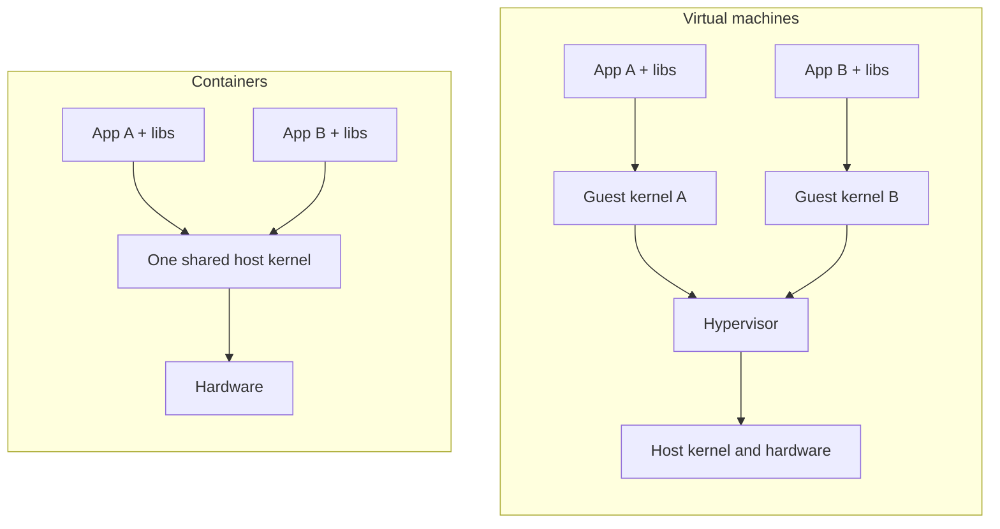
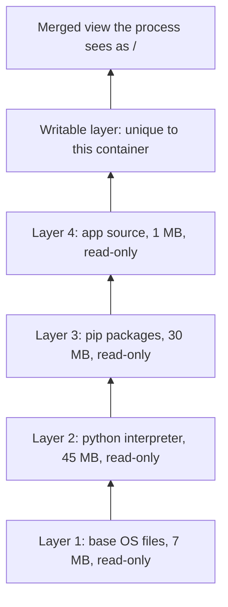
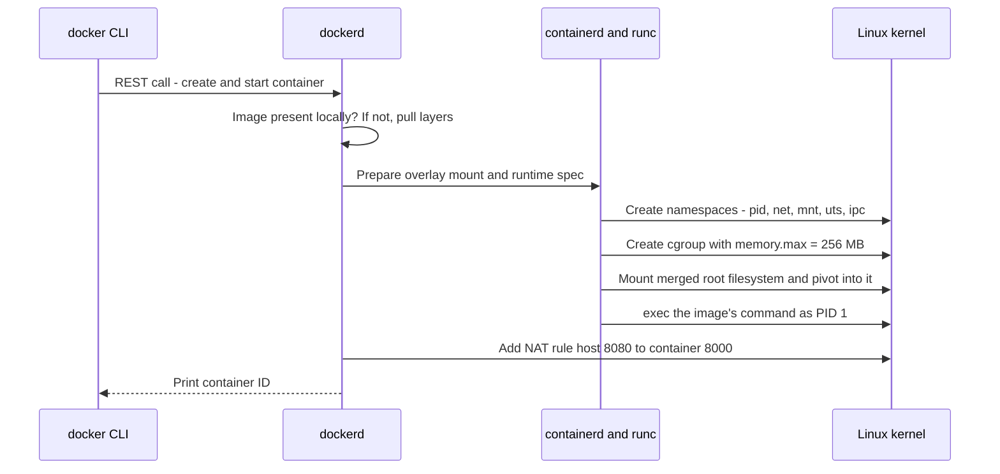

# What a container is: namespaces, cgroups and layered filesystems

## In plain words

A **program** is a set of instructions stored in a file. When you start it, the running copy is called a **process**. Your computer runs hundreds of processes at once, and the part of the operating system that manages them all, shares out memory and talks to the hardware is called the **kernel**.

Normally every process can see the same files, the same network and the same list of other processes. A **container** is an ordinary process that has been put in a room of its own. Think of a large open-plan office. Giving one team a meeting room with its own whiteboard, its own phone line and a limit on how many chairs they may take does not create a second building. It is the same building, with walls and a budget. A container is that meeting room: the same computer and the same kernel, with walls (the process can only see its own files, network and processes) and a budget (it may use only so much memory and processor time).

The files inside the room come from an **image**: a packed, read-only bundle containing an application and everything it needs to run. **Docker** is the tool that builds images and starts containers from them.

Why this matters for a job: containers are how most companies now ship software. The same image runs on a laptop, a test server and in production, which removes the classic "it works on my machine" problem. Interviewers almost always begin with "what is a container, and how is it different from a virtual machine?", and the answer is the picture above, stated precisely.

> **Before this lesson:** nothing beyond basic comfort with a terminal (a window where you type commands) is required. This is the first lesson of the track. Every command is explained when it first appears. To try the commands you need Docker installed (Docker Desktop on Windows or macOS, Docker Engine on Linux).

## Why this matters

Ask ten engineers what a container is and most will say "a lightweight virtual machine". That answer gets you through a first week with Docker and then starts to cost you. It cannot explain why a container starts in a fraction of a second, why `ps` on the host shows the processes that are "inside" the container, why a container that asks for 64 GB of memory on a 16 GB laptop is not refused at start-up, or why a kernel exploit inside one container is a problem for every other container on the machine.

The accurate answer is shorter and more useful: **a container is an ordinary process (or a small tree of processes) that the Linux kernel has been told to lie to and to limit.** The lying is done by *namespaces*: the process is shown its own private view of process IDs, network interfaces, mount points and hostnames. The limiting is done by *control groups* (cgroups): the process is given a budget of memory, CPU and I/O. The files it sees come from an *image*, a stack of read-only directory snapshots glued together by a *union filesystem*. Docker is the tool that sets those three things up for you, and gives the result a friendly name.

Once you hold that model, most of Docker stops being a list of commands to memorise and becomes a set of consequences you can derive. This lesson builds the model carefully, because every later lesson in the track leans on it.

## The problem containers solve

Two words used below: a **library** is ready-made code that a program relies on, and a **dependency** is anything a program needs in order to run, such as a library at a particular version.

Suppose you maintain a small service called `quotes-api`: a Python web app that returns a random quotation. It needs Python 3.12, a handful of libraries at particular versions, a CA certificate bundle and a config file. You want to run it on your laptop, on a colleague's laptop, on a CI runner and on three production servers.

Before containers you had three broad choices:

1. **Install everything directly on each machine.** Cheap, but each machine drifts. Server two has a slightly different OpenSSL; another app on the same box needs Python 3.9; an upgrade for one breaks the other.
2. **One virtual machine per app.** Strong isolation and a reproducible disk image, but each VM carries a full guest operating system: gigabytes of disk, hundreds of megabytes of RAM before your app has done anything, and a boot time measured in tens of seconds.
3. **Language-level isolation** such as a virtualenv. Helps with Python libraries, does nothing for system libraries, other languages, ports or resource limits.

Containers give you the packaging of option 2 (the app ships with its whole userland: libraries, interpreter, certificates) at close to the cost of option 1 (it is an ordinary process on the host kernel).

## Containers versus virtual machines

The defining difference is **where the kernel lives**.



A virtual machine virtualises **hardware**. The hypervisor presents fake CPUs, disks and network cards; a complete guest kernel boots on top and believes it owns a computer. A container virtualises the **operating system interface**. There is exactly one kernel, the host's, and every container makes system calls straight into it. The kernel answers each call according to which namespaces and cgroups the calling process belongs to.

| Property | Virtual machine | Container |
|---|---|---|
| What is virtualised | Hardware | The kernel's view of the system |
| Kernel | One per VM | One, shared with the host |
| Start time | Seconds to minutes (boot an OS) | Milliseconds to about a second (start a process) |
| Idle memory overhead | Hundreds of MB per guest | A few MB per container |
| Image size | GBs (full OS disk) | MBs to a few hundred MB (userland only) |
| Isolation boundary | Hypervisor (small, hardened) | Kernel system-call surface (large) |
| Can run a different OS kernel | Yes | No: Linux containers need a Linux kernel |
| Density on one host | Tens | Hundreds or thousands |

Two consequences are worth stating plainly.

**A Linux container needs a Linux kernel.** When you run Linux containers on macOS or Windows, Docker Desktop quietly runs a small Linux virtual machine and puts the containers inside it. The containers still share one kernel; it is the VM's kernel, not your laptop's.

**Containers are a weaker security boundary than VMs.** A VM escape needs a hypervisor bug. A container escape needs a kernel bug or a misconfiguration (for example running with `--privileged`), and the kernel is a much larger attack surface. This is why multi-tenant clouds run customers' containers inside per-customer VMs, and why the security lesson later in the track spends so long on least privilege.

> [!INTERVIEW]
> "What is the difference between a container and a VM?" A strong answer names the kernel: a VM has its own kernel on virtual hardware; a container is a host process isolated with namespaces and limited with cgroups, sharing the host kernel. Then give one consequence in each direction: containers start faster and pack denser; VMs isolate more strongly and can run a different operating system.

## Pillar one: namespaces (what the process can see)

A namespace wraps a global kernel resource so that the processes inside the namespace see their own private instance of it. Linux has several kinds; Docker gives each container a fresh one of most of them.

| Namespace | Isolates | What the container sees |
|---|---|---|
| `pid` | Process ID numbers | Its first process is PID 1; host processes are invisible |
| `net` | Network devices, IP addresses, routing tables, ports | Its own `eth0`, its own loopback, its own port space |
| `mnt` | The mount table | Its own root filesystem, built from the image |
| `uts` | Hostname and domain name | Its own hostname (by default the container ID) |
| `ipc` | Shared memory segments, message queues | Its own System V and POSIX IPC objects |
| `user` | User and group ID mappings | Optionally, UID 0 inside mapped to an unprivileged UID outside |
| `cgroup` | The view of the cgroup hierarchy | Its own cgroup appears as the root |

You can watch the PID namespace at work. Start a container that does nothing but sleep, then look at the same process from both sides:

```bash
docker run -d --name napper alpine:3.20 sleep 3600
docker exec napper ps
```

```text
PID   USER     TIME  COMMAND
    1 root      0:00 sleep 3600
    7 root      0:00 ps
```

What the two commands did:

- `docker run` creates and starts a container. `-d` runs it in the background. `--name napper` gives it a name to refer to later. `alpine:3.20` is the image (a very small Linux system). `sleep 3600` is the program to run inside: do nothing for 3600 seconds.
- `docker exec napper ps` runs one more program, `ps` (list processes), inside that running container.

Inside, `sleep` is PID 1 and there are only two processes in the world. Now ask the host (on Linux; on Docker Desktop you would have to look inside the helper VM):

```bash
ps -eo pid,user,cmd | grep "sleep 3600"
```

```text
  48213 root     sleep 3600
```

Same process, different number. It is not a copy and it is not running in an emulator. The kernel keeps two PIDs for it, one per namespace level, and reports whichever one matches the namespace of whoever is asking.

The network namespace explains another everyday fact: **two containers can both listen on port 8000 without a clash**, because each has its own port space. The clash only appears when you *publish* both to the same host port, because the host has a single port space of its own.

> [!TIP]
> `docker exec` does not start a new container. It starts a new process and asks the kernel to place it into the *existing* container's namespaces and cgroup. That is why an exec'd shell sees the container's files and processes, and why it dies when the container's PID 1 exits.

### PID 1 is special

Because the container's first process is PID 1 in its namespace, it inherits two responsibilities the kernel gives to PID 1: it must reap orphaned zombie processes, and signals such as `SIGTERM` are not delivered to it unless it has installed a handler. When PID 1 exits, the kernel kills everything else in that PID namespace and the container is over. The whole lifetime of a container is the lifetime of one process. Keep that sentence; it explains restart policies, health checks and why "the container exited immediately" is the most common beginner problem.

## Pillar two: cgroups (what the process can use)

Namespaces hide things but do not ration them. A process in its own PID namespace can still allocate all the RAM on the machine. Control groups add accounting and limits. Docker creates a cgroup per container and writes your limits into it.

```bash
docker run -d --name capped --memory 256m --cpus 1.5 --pids-limit 200 alpine:3.20 sleep 3600
docker exec capped cat /sys/fs/cgroup/memory.max /sys/fs/cgroup/cpu.max /sys/fs/cgroup/pids.max
```

```text
268435456
150000 100000
200
```

The three lines are the cgroup v2 files the kernel actually enforces:

- `memory.max` is 256 x 1024 x 1024 bytes. If the processes in the cgroup together exceed it and nothing can be reclaimed, the kernel's out-of-memory killer terminates a process in the group. Docker then reports exit code **137** (128 + signal 9) and `OOMKilled: true` in `docker inspect`.
- `cpu.max` reads "150000 microseconds of CPU time per 100000 microsecond period", which is one and a half cores' worth. Exceeding a CPU limit does not kill anything; the processes are *throttled*, paused until the next period.
- `pids.max` caps the number of processes and threads, a cheap defence against fork bombs.

| Limit | Flag | Behaviour when exceeded |
|---|---|---|
| Memory | `--memory 256m` | A process is OOM-killed, typically PID 1, container exits 137 |
| CPU quota | `--cpus 1.5` | Throttled; slower, never killed |
| CPU weight | `--cpu-shares 512` | Only matters under contention; a relative share |
| Process count | `--pids-limit 200` | `fork` fails with an error |

> [!WARNING]
> A container with no `--memory` flag has no memory limit at all. One leaking container can then push the whole host into swap or trigger the host's OOM killer, which may pick a completely unrelated process. In production, always set memory limits.

Limits and *reservations* are different things. A limit is a ceiling enforced by the kernel. A reservation (a "request" in Kubernetes) is a number the scheduler uses to decide whether a container fits on a node. A host can be overcommitted on limits but should not be overcommitted on reservations. The small simulation below does that accounting for a 4-core, 8 GB host.

```python-run
# Fit containers onto a host by reservation; report limit overcommit.
host = {"cpus": 4.0, "mem_mb": 8192}
containers = [
    ("web",     {"cpu_res": 0.5, "cpu_lim": 1.0, "mem_res": 256,  "mem_lim": 512}),
    ("api",     {"cpu_res": 1.0, "cpu_lim": 2.0, "mem_res": 1024, "mem_lim": 2048}),
    ("db",      {"cpu_res": 1.5, "cpu_lim": 2.0, "mem_res": 4096, "mem_lim": 4096}),
    ("worker",  {"cpu_res": 1.0, "cpu_lim": 4.0, "mem_res": 2048, "mem_lim": 4096}),
    ("cache",   {"cpu_res": 0.5, "cpu_lim": 0.5, "mem_res": 1024, "mem_lim": 1024}),
]
cpu_free, mem_free = host["cpus"], host["mem_mb"]
cpu_lim = mem_lim = 0
for name, c in containers:
    if c["cpu_res"] <= cpu_free and c["mem_res"] <= mem_free:
        cpu_free -= c["cpu_res"]; mem_free -= c["mem_res"]
        cpu_lim += c["cpu_lim"]; mem_lim += c["mem_lim"]
        print(f"{name:7s} scheduled  free now: {cpu_free:.1f} cpu, {mem_free} MB")
    else:
        print(f"{name:7s} REJECTED   needs {c['cpu_res']} cpu / {c['mem_res']} MB")
print(f"sum of limits: {cpu_lim} cpu ({cpu_lim/host['cpus']:.0%}), {mem_lim} MB ({mem_lim/host['mem_mb']:.0%})")
```

Run it and notice two things: `cache` is rejected even though the machine "has" the CPU when idle, because reservations are promises; and the sum of limits is well over 100 %, which is legal and normal because limits are ceilings, not promises.

## Pillar three: images and the union filesystem (what files exist)

A container needs a root filesystem: `/bin`, `/lib`, `/etc`, your application. That comes from an **image**. An image is not one big disk file. It is an ordered list of **layers**, each a tarball of file changes, plus a small JSON document saying how to run it (default command, environment variables, working directory, user).

To start a container, Docker stacks the image's layers using a union filesystem (the default driver is `overlay2`, built on the kernel's OverlayFS) and adds one extra, empty, **writable** layer on top. The process sees a single merged directory tree.



Three rules define the merged view:

1. **Lookups go top-down.** To open `/app/main.py` the filesystem checks the writable layer first, then layer 4, then 3, and so on. The first layer that has the path wins.
2. **Writes go to the top.** Modifying a file that lives in a read-only layer first copies it up into the writable layer (copy-on-write), then changes the copy. The lower layer is never touched.
3. **Deletes are recorded, not performed.** Removing a lower-layer file writes a *whiteout* marker in the upper layer. Lookups that hit a whiteout stop and report "no such file".

The simulation below implements those three rules in a dozen lines. It is worth running and editing, because the same logic explains why deleting a file in a later Dockerfile instruction does not shrink the image.

```python-run
WHITEOUT = object()

def lookup(layers, path):
    """layers[0] is the bottom. Return (content, layer index) or (None, None)."""
    for i in range(len(layers) - 1, -1, -1):
        if path in layers[i]:
            v = layers[i][path]
            return (None, None) if v is WHITEOUT else (v, i)
    return (None, None)

image = [
    {"/etc/os-release": "alpine 3.20", "/bin/sh": "busybox"},      # layer 0
    {"/usr/bin/python3": "cpython 3.12", "/tmp/build.log": "..."}, # layer 1
    {"/app/main.py": "v1", "/tmp/build.log": WHITEOUT},            # layer 2 deletes the log
]
container = image + [{}]            # add the writable layer

for p in ["/app/main.py", "/tmp/build.log", "/bin/sh"]:
    print(p, "->", lookup(container, p))

container[-1]["/app/main.py"] = "v1-hotfix"     # copy-up + modify
print("after write:", lookup(container, "/app/main.py"))
print("image layer still says:", image[2]["/app/main.py"])

size = sum(len(layer) for layer in image)
print("entries stored in image layers:", size, "(the deleted log is still stored in layer 1)")
```

### Why layering is worth the complexity

- **Sharing on disk.** If twenty images are built on the same base layer, that layer is stored once. `docker pull` skips layers it already has, printing `Already exists`.
- **Sharing in memory.** Twenty containers from the same image map the same read-only files, so the page cache holds one copy.
- **Fast start.** Creating a container does not copy the image. It creates one empty directory for the writable layer and mounts the stack. That is why a start takes milliseconds regardless of image size.
- **Fast rebuilds.** A build reuses every layer whose inputs have not changed. The lesson on the build cache makes that precise.

An image layer is identified by the SHA-256 hash of its content. Two layers with identical bytes have the same identifier wherever they were built, which is what makes the sharing safe: identical ID means identical content.

## Putting the three pillars together

Here is roughly what happens when you type `docker run -d -p 8080:8000 --memory 256m harbour/quotes-api:1.4`:



Notice the cast. The `docker` command is only a client. It talks over a local socket to the **Docker Engine** daemon (`dockerd`), which manages images, networks and volumes. The engine delegates the actual container lifecycle to **containerd**, which in turn calls a low-level runtime, **runc**, to do the namespace and cgroup system calls. The formats in play (image layout, runtime spec, registry protocol) are standardised by the Open Container Initiative, which is why an image built by Docker runs unchanged under Podman, containerd or a Kubernetes node that has no Docker installed at all.

> [!NOTE]
> "Docker container" is shorthand. The kernel has no object called a container. There are only processes, namespaces, cgroups and mounts; "container" is the name we give to the combination.

## Seeing it for yourself

A short session that confirms each pillar. Every command works on any machine with Docker installed.

```bash
# 1. A container is a process with its own hostname and PID 1
docker run --rm alpine:3.20 sh -c 'hostname; echo "my pid: $$"'
```

```text
3f9c2a1b7d44
my pid: 1
```

```bash
# 2. It shares the host kernel: the kernel version is the host's, not Alpine's
docker run --rm alpine:3.20 uname -r
docker run --rm ubuntu:24.04 uname -r
```

```text
6.8.0-45-generic
6.8.0-45-generic
```

Two different "operating systems" report the same kernel, because the image supplies only the userland (shell, C library, package manager). The kernel is borrowed.

```bash
# 3. The image is a stack of layers
docker image inspect python:3.12-slim --format '{{len .RootFS.Layers}} layers'
docker image history python:3.12-slim --format 'table {{.Size}}\t{{.CreatedBy}}' | head -5
```

```text
4 layers
SIZE      CREATED BY
0B        CMD ["python3"]
14.9MB    RUN /bin/sh -c set -eux; savedAptMark="$(apt-mark...
0B        ENV PYTHON_SHA256=...
3.5MB     RUN /bin/sh -c set -eux; apt-get update; apt-get ins...
```

`history` lists every build step; only the steps that changed files produced a layer with a size. Metadata steps such as `CMD` and `ENV` show `0B`.

```bash
# 4. Writes land in a per-container layer and vanish with the container
docker run --name scribble alpine:3.20 sh -c 'echo hello > /note.txt'
docker diff scribble
docker rm scribble
```

```text
A /note.txt
```

`docker diff` prints the contents of the writable layer: `A` for added, `C` for changed, `D` for deleted. After `docker rm`, that layer is gone. Data that must outlive a container belongs in a volume, the subject of the storage module.

## Pitfalls

**Treating a container like a small server.** Logging in, installing packages by hand and editing config in place all write to the writable layer, which is discarded when the container is replaced. Change the image and start a new container instead.

**Expecting kernel features the host does not have.** A container cannot load its own kernel module or use a newer system call than the host kernel provides. "Works on my laptop, fails on the old CI host" is sometimes a kernel version difference, not an image difference.

**Believing the container knows its limits.** Older runtimes and tools read `/proc/meminfo` and the host CPU count, both of which describe the *host*. A JVM or a worker pool sized from the host's 64 cores inside a container limited to 2 will thrash. Modern runtimes (recent JVMs, Go 1.25+, Python's `os.process_cpu_count`) are cgroup-aware to varying degrees; check yours, or pass the size explicitly.

**Running many unrelated processes in one container.** Possible, but you lose the mapping "one process, one lifetime, one log stream, one health status". The platform can only restart the whole container and only watches PID 1.

**Assuming root inside is harmless.** Without user-namespace remapping, UID 0 in the container *is* UID 0 on the host as far as the kernel is concerned; it is merely constrained by namespaces, a reduced capability set and a seccomp filter. A mounted host directory is writable as root. Run as a non-root user.

## Cheat sheet

| Concept | Kernel mechanism | Docker surface |
|---|---|---|
| Private process list | `pid` namespace | `docker top`, `docker exec ... ps` |
| Private network stack | `net` namespace | `--network`, `-p host:container` |
| Private root filesystem | `mnt` namespace + OverlayFS | Image layers + writable layer |
| Private hostname | `uts` namespace | `--hostname` |
| Memory ceiling | cgroup `memory.max` | `--memory`, exit code 137 on OOM |
| CPU ceiling | cgroup `cpu.max` | `--cpus` |
| Process-count ceiling | cgroup `pids.max` | `--pids-limit` |
| Layer sharing | Content-addressed tarballs | `Already exists` on pull, `docker image history` |
| Per-container changes | Upper overlay directory | `docker diff`, lost on `docker rm` |
| Standards | OCI image, runtime and distribution specs | Same image runs on Docker, Podman, Kubernetes |

## Summary

- A container is a normal host process whose view of the system is narrowed by **namespaces** and whose resource use is bounded by **cgroups**. There is no guest kernel.
- VMs virtualise hardware and carry their own kernel; containers share the host kernel. That makes containers smaller, faster and denser, and makes VMs the stronger isolation boundary.
- An **image** is an ordered stack of read-only, content-addressed layers plus run configuration. A container adds one writable layer; lookups go top-down, writes copy up, deletes leave whiteouts.
- Layers are shared between images on disk and between containers in memory, which is why pulls, starts and rebuilds are fast.
- A container lives exactly as long as its PID 1.
- The Docker CLI talks to the engine, which uses containerd and runc; the formats are OCI standards, so images are portable across runtimes.

## Glossary

| Term | Meaning |
|---|---|
| Program / process | Instructions stored in a file / a running copy of a program |
| Kernel | The core of the operating system that manages processes, memory and hardware |
| Container | A process isolated by namespaces and limited by cgroups, with its files supplied by an image |
| Image | A read-only package of an application and everything it needs, stored as layers |
| Virtual machine (VM) | A simulated computer with its own kernel, running on a hypervisor |
| Hypervisor | Software that runs virtual machines by presenting simulated hardware |
| Namespace | A kernel feature that gives a process its own private view of something, such as process IDs or the network |
| PID | Process ID: the number that identifies a process |
| cgroup (control group) | A kernel feature that measures and limits the resources a group of processes may use |
| OOM killer | The kernel mechanism that ends a process when memory runs out (out of memory) |
| Layer | One read-only set of file changes; an image is a stack of them |
| Union filesystem | A filesystem that shows several stacked layers as one folder tree |
| Copy-on-write | Copying a file into the writable layer the first time it is changed |
| Whiteout | A marker in an upper layer that hides a file in a lower layer |
| Docker Engine (daemon) | The background program that builds images and runs containers |
| OCI | Open Container Initiative: the standards for image and container formats |

## Check yourself

```quiz
[
  {"q": "Two containers started from different images both run `uname -r`. What do they print?",
   "options": ["Each prints the kernel version shipped in its image", "Both print the host's kernel version", "Both print the Docker Engine version", "The command fails because containers have no kernel"],
   "answer": 1,
   "explain": "Images contain userland files only. Every container makes system calls into the single host kernel (or the helper VM's kernel on Docker Desktop), so both report that kernel."},
  {"q": "Which kernel feature stops a container from seeing the host's other processes?",
   "options": ["The memory cgroup", "The pid namespace", "OverlayFS", "seccomp"],
   "answer": 1,
   "explain": "Namespaces control visibility. The pid namespace gives the container its own process-ID numbering starting at 1 and hides processes outside it. Cgroups limit usage; they do not hide anything."},
  {"q": "A container started with `--memory 256m` tries to use 400 MB. What happens?",
   "options": ["Allocation is throttled and the app slows down", "The kernel OOM-kills a process in the cgroup; the container usually exits with code 137", "Docker automatically raises the limit", "The host swaps other containers out to make room"],
   "answer": 1,
   "explain": "Memory is not compressible. When the cgroup exceeds memory.max the OOM killer sends SIGKILL (signal 9), giving exit code 128 + 9 = 137. CPU limits, by contrast, throttle."},
  {"q": "A file exists in image layer 2. A process in the container modifies it. Where is the modified file stored?",
   "options": ["In layer 2, replacing the original", "In a new image layer 5", "In the container's writable layer, after a copy-up", "In a volume created automatically"],
   "answer": 2,
   "explain": "Image layers are read-only. The union filesystem copies the file into the container's writable layer and applies the change there; other containers from the same image still see the original."},
  {"q": "Why does deleting a 500 MB file in a later layer not make the image 500 MB smaller?",
   "options": ["Docker compresses deleted files instead of removing them", "The delete is recorded as a whiteout in the upper layer; the lower layer still contains the bytes", "Deleted files are moved to a hidden trash layer", "It does make the image smaller"],
   "answer": 1,
   "explain": "Each layer is immutable. A later layer can only hide a file with a whiteout marker. The earlier layer, and its 500 MB, are still part of the image and still downloaded."},
  {"q": "Two containers each run a web server listening on port 8000, with no ports published. Is there a conflict?",
   "options": ["Yes, a port can only be bound once per machine", "No, each container has its own network namespace and therefore its own port space", "Only if they use the same image", "Only on Linux hosts"],
   "answer": 1,
   "explain": "Ports are scoped to a network namespace. A conflict arises only if you publish both to the same host port, because the host namespace has a single port space."},
  {"q": "What ends a container's life?",
   "options": ["Its writable layer filling up", "Its PID 1 process exiting", "The image being deleted", "The last `docker exec` session closing"],
   "answer": 1,
   "explain": "The container's lifetime is the lifetime of the first process in its pid namespace. When PID 1 exits, the kernel tears down the rest of the namespace and Docker marks the container as exited."},
  {"q": "Which statement about isolation strength is correct?",
   "options": ["Containers isolate more strongly than VMs because they have less code", "VMs isolate more strongly because the boundary is the hypervisor, not the shared kernel's system-call surface", "They are equivalent", "Containers isolate more strongly because of cgroups"],
   "answer": 1,
   "explain": "All containers on a host talk directly to one kernel, so a kernel vulnerability can cross container boundaries. A VM guest must break out through a much smaller hypervisor interface."}
]
```

> **Source:** Stoneman, *Learn Docker in a Month of Lunches*, ch. 1-2 (topic coverage). Facts checked against <https://docs.docker.com/get-started/docker-overview/>, <https://docs.docker.com/engine/containers/resource_constraints/> and <https://docs.docker.com/engine/storage/drivers/overlayfs-driver/>. All wording and examples are original.
