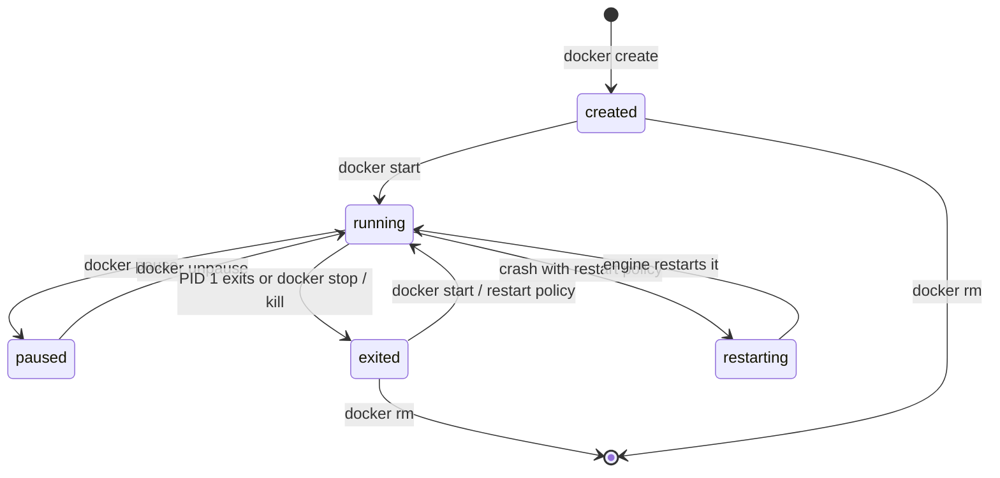
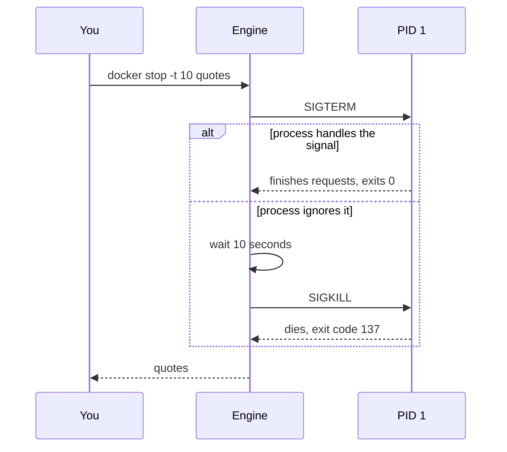

# Running, inspecting and stopping containers

## In plain words

The previous lesson explained what a container is. This one is about the daily handling of containers, and it is much like owning any appliance. You need to know how to switch it on, how to tell whether it is working, how to read its display when something is wrong, and how to switch it off properly instead of pulling the plug.

Docker gives you a small set of commands for exactly those jobs: start a container, list what is running, read what it printed, look inside it, stop it and throw it away. A container also moves through a few well-defined **states** (created, running, stopped), in the way a washing machine is either idle, running or finished. Knowing which state a container is in, and why, answers most everyday questions.

Why this matters for a job: these are the commands you will type dozens of times a day, and "my container exited straight away, why?" is the first real problem every newcomer meets. The four-step way of answering it at the end of this lesson is something you will use for years.

> **Before this lesson:** read [What a container is](#/lesson/docker/what-is-a-container) first, so that the words image, container, process and namespace are familiar. You need Docker installed and a terminal.

## Why this matters

Most of your time with Docker is not spent writing Dockerfiles. It is spent asking questions of running things: is it up, what did it print, what port is it on, why did it exit, how much memory is it using, can I get a shell in it. The engine answers all of those, but only if you know which of about a dozen commands to reach for and how to read what comes back.

This lesson is a tour of the container lifecycle from the operator's chair. We use one small image throughout, `harbour/quotes-api`, a web service listening on port 8000. Substitute any image that runs a server (for example `nginx:1.27-alpine`, which listens on 80) and every command behaves the same way.

## The lifecycle in one picture

A container is always in exactly one state. Commands move it between states; so does the process inside when it exits.



`docker run` is `docker create` followed by `docker start` (preceded by `docker pull` if the image is missing). The important, slightly surprising fact is that **an exited container still exists**. Its writable layer, its logs and its configuration stay on disk until you remove it. That is deliberate: it lets you read the logs of something that crashed.

## Three ways to run

### 1. Run a task and exit

```bash
docker run alpine:3.20 echo "tide is in"
```

```text
tide is in
```

Reading the command from left to right: `docker run` creates and starts a container; `alpine:3.20` is the image to start it from (name `alpine`, version tag `3.20`); everything after the image name, here `echo "tide is in"`, is the program to run inside the container. `echo` prints its arguments.

The container starts, PID 1 (`echo`) prints and exits with code 0, and the container moves to `exited`. Nothing is left running, but the stopped container remains. Add `--rm` to have the engine delete it automatically on exit, which is what you want for one-off tasks:

```bash
docker run --rm alpine:3.20 date -u
```

### 2. Run interactively

```bash
docker run --rm -it alpine:3.20 sh
```

```text
/ # cat /etc/os-release | head -2
NAME="Alpine Linux"
ID=alpine
/ # exit
```

Two flags do the work. `-i` (`--interactive`) keeps standard input open; `-t` (`--tty`) allocates a pseudo-terminal so the shell behaves as if attached to a real terminal (prompt, line editing, colours). Your shell *is* PID 1, so typing `exit` ends the container.

### 3. Run a long-lived service in the background

```bash
docker run -d --name quotes -p 8080:8000 harbour/quotes-api:1.4
```

```text
9b1f4e0c62a7d3f1c5e8a90b7d6e2f4c1a3b5d7e9f0a2c4e6b8d0f1a3c5e7b9d
```

`-d` (`--detach`) returns immediately and prints the full 64-character container ID. `--name` gives a stable handle; without it Docker invents one such as `brave_hopper`. `-p 8080:8000` publishes container port 8000 on host port 8080.

> [!TIP]
> Anywhere a command wants a container, you may give the name, the full ID, or any unique *prefix* of the ID. `docker logs 9b1` works as long as no other container's ID starts with `9b1`.

## Publishing ports

A container's network namespace is private. Nothing outside the Docker network can reach port 8000 inside it until you publish it. The `-p` flag takes several shapes:

| Flag | Meaning |
|---|---|
| `-p 8080:8000` | Host port 8080 on all interfaces to container port 8000/tcp |
| `-p 127.0.0.1:8080:8000` | Same, but only reachable from the host itself |
| `-p 8000` | Container port 8000 to a random free host port |
| `-p 5353:53/udp` | UDP instead of the default TCP |
| `-p 9000-9002:9000-9002` | A range, mapped one to one |
| `-P` | Publish every port the image declares with `EXPOSE` to random host ports |

Ask which host port was chosen:

```bash
docker port quotes
```

```text
8000/tcp -> 0.0.0.0:8080
8000/tcp -> [::]:8080
```

If the host port is taken, the container is created but fails to start:

```text
docker: Error response from daemon: driver failed programming external connectivity on endpoint quotes2:
Bind for 0.0.0.0:8080 failed: port is already allocated.
```

Two containers can both *listen* on 8000 internally; they cannot both be *published* on host 8080 with the same protocol and overlapping host address.

> [!WARNING]
> `-p 8080:8000` binds to `0.0.0.0`: every network interface, including the public one, and on Linux Docker's own firewall rules are evaluated before most host firewall tools such as `ufw`. For a database or an admin UI on a server, publish to `127.0.0.1` or do not publish at all and reach it over a Docker network.

## Listing and inspecting

```bash
docker ps
```

```text
CONTAINER ID   IMAGE                    COMMAND                  CREATED         STATUS         PORTS                    NAMES
9b1f4e0c62a7   harbour/quotes-api:1.4   "uvicorn app:api --h…"   2 minutes ago   Up 2 minutes   0.0.0.0:8080->8000/tcp   quotes
```

`docker ps` lists running containers only. `docker ps -a` includes created and exited ones, with the exit code in the status column:

```text
CONTAINER ID   IMAGE         COMMAND              CREATED          STATUS                      NAMES
1c7e9a0b3d52   alpine:3.20   "echo 'tide is in'"  10 minutes ago   Exited (0) 10 minutes ago   quirky_bell
```

Useful variations:

```bash
docker ps -q                                  # IDs only, for scripting
docker ps -a --filter status=exited           # only the stopped ones
docker ps --format 'table {{.Names}}\t{{.Status}}\t{{.Ports}}'
```

`docker inspect` dumps everything the engine knows about a container as JSON: hundreds of lines. Use `--format` with a Go template to pull out one fact.

```bash
docker inspect quotes --format '{{.State.Status}} pid={{.State.Pid}} started={{.State.StartedAt}}'
docker inspect quotes --format '{{range .NetworkSettings.Networks}}{{.IPAddress}}{{end}}'
docker inspect quotes --format '{{json .Config.Env}}'
```

```text
running pid=48213 started=2026-03-02T09:14:07.512Z
172.17.0.2
["PATH=/usr/local/bin:/usr/bin:/bin","QUOTES_LANG=en","PYTHONUNBUFFERED=1"]
```

The pieces of the inspect document you will use most:

| Path | Tells you |
|---|---|
| `.State.Status`, `.State.ExitCode`, `.State.OOMKilled`, `.State.Error` | Why it is or is not running |
| `.State.Health.Status` | `starting`, `healthy` or `unhealthy` if a health check is defined |
| `.Config.Cmd`, `.Config.Entrypoint`, `.Config.Env`, `.Config.User` | What was actually launched, as whom |
| `.HostConfig.Memory`, `.HostConfig.NanoCpus`, `.HostConfig.RestartPolicy` | Limits and restart policy |
| `.Mounts` | Volumes and bind mounts |
| `.NetworkSettings.Networks`, `.NetworkSettings.Ports` | IP addresses and published ports |

## Looking inside a running container

### Logs

Docker captures whatever PID 1 writes to standard output and standard error.

```bash
docker logs quotes --tail 3
```

```text
INFO:     Started server process [1]
INFO:     Uvicorn running on http://0.0.0.0:8000 (Press CTRL+C to quit)
INFO:     172.17.0.1:53122 - "GET /quote HTTP/1.1" 200 OK
```

```bash
docker logs -f quotes                 # follow, like tail -f
docker logs --since 10m -t quotes     # last ten minutes, with timestamps
```

Logs survive the container exiting and disappear when it is removed. If an app writes its log to a file inside the container instead of to stdout, `docker logs` shows nothing; the logging lesson covers the fixes.

### Processes and resource use

```bash
docker top quotes
```

```text
UID     PID     PPID    C   STIME   TTY   TIME       CMD
10001   48213   48190   0   09:14   ?     00:00:01   /usr/local/bin/python /usr/local/bin/uvicorn app:api --host 0.0.0.0
```

`top` shows the container's processes with their **host** PIDs and UIDs. Here the app runs as UID 10001, not root, which is what we want.

```bash
docker stats --no-stream
```

```text
CONTAINER ID   NAME     CPU %   MEM USAGE / LIMIT   MEM %   NET I/O         BLOCK I/O   PIDS
9b1f4e0c62a7   quotes   0.12%   41.3MiB / 256MiB    16.1%   3.1kB / 1.9kB   0B / 0B     3
```

`stats` reads the container's cgroup counters. The limit column shows the cgroup memory ceiling; with no `--memory` flag it shows the host's total RAM.

### A shell or a one-off command

```bash
docker exec quotes env | grep QUOTES
docker exec -it quotes sh
```

`exec` starts an additional process inside the existing container's namespaces. It only works while the container is running. Use it to look, not to fix: anything you change by hand is gone at the next deployment.

If the image has no shell at all (distroless and `scratch` images do not), `docker exec ... sh` fails with `executable file not found`. The debugging lesson shows the alternatives, such as `docker debug` or attaching a helper container to the same namespaces.

### Copying files

```bash
docker cp quotes:/app/quotes.json ./quotes.json    # out
docker cp ./patched.json quotes:/tmp/patched.json  # in
```

`docker cp` works on stopped containers too, which makes it a handy way to rescue a file from something that crashed.

## Stopping, killing and removing

```bash
docker stop quotes
```

`stop` is the polite shutdown. The engine sends the stop signal (by default `SIGTERM`, overridable in the image with `STOPSIGNAL`) to PID 1, waits a grace period (default 10 seconds, `-t 30` to change) and, if the process is still alive, sends `SIGKILL`.



A stop that always takes exactly ten seconds is a classic symptom: the application is not receiving or not handling `SIGTERM`. The usual cause is a shell-form `CMD` that makes `/bin/sh` PID 1 with your app as its child; the shell does not forward signals. The Dockerfile lesson covers the fix (exec form).

Exit codes tell you how the process ended:

| Exit code | Meaning |
|---|---|
| 0 | Clean exit |
| 1, 2, ... | Application-defined error |
| 125 | `docker run` itself failed (bad flag, daemon error) |
| 126 | Command found but not executable |
| 127 | Command not found in the image |
| 137 | Killed by `SIGKILL` (128 + 9): `docker kill`, stop timeout, or the OOM killer |
| 143 | Terminated by `SIGTERM` (128 + 15) without handling it gracefully |

```bash
docker inspect quotes --format 'exit={{.State.ExitCode}} oom={{.State.OOMKilled}}'
```

```text
exit=137 oom=true
```

That pair of facts, 137 with `oom=true`, is the unambiguous signature of a container that hit its memory limit.

The rest of the removal family:

```bash
docker kill quotes               # SIGKILL now, no grace period
docker kill -s HUP quotes        # send any signal, e.g. reload config
docker start quotes              # start an exited container again, same writable layer
docker restart quotes            # stop then start
docker rm quotes                 # delete a stopped container
docker rm -f quotes              # kill and delete in one step
docker container prune           # delete ALL stopped containers
```

> [!WARNING]
> `docker rm` deletes the writable layer. Any file the app wrote outside a volume is gone for good. `docker rm -v` additionally removes anonymous volumes attached to the container.

## Flags you will use every day

```bash
docker run -d \
  --name quotes \
  --restart unless-stopped \
  -p 127.0.0.1:8080:8000 \
  -e QUOTES_LANG=fr \
  --env-file ./quotes.env \
  --memory 256m --cpus 0.5 \
  -v quotes-data:/var/lib/quotes \
  --network harbour-net \
  --user 10001:10001 \
  --read-only --tmpfs /tmp \
  harbour/quotes-api:1.4 \
  --workers 2
```

Read it in three parts. Everything **before** the image name is an option to Docker. The image name selects what to run. Everything **after** the image name is passed to the container as its command or as arguments to its entrypoint (here `--workers 2` is handed to the server). Getting that order wrong is a very common mistake: `docker run harbour/quotes-api:1.4 -d` does not detach, it passes `-d` to your application.

| Flag | Effect |
|---|---|
| `-d` | Detach; run in the background |
| `-it` | Interactive terminal |
| `--rm` | Remove the container when it exits |
| `--name` | Stable name; also a DNS name on user-defined networks |
| `-p` | Publish a port |
| `-e`, `--env-file` | Set environment variables |
| `-v`, `--mount` | Attach a volume or bind mount |
| `--network` | Join a named network |
| `--memory`, `--cpus` | cgroup limits |
| `--restart` | Restart policy: `no`, `on-failure[:N]`, `always`, `unless-stopped` |
| `--user` | Run as this UID:GID instead of the image default |
| `--entrypoint` | Replace the image's entrypoint (useful for debugging) |
| `-w` | Working directory |

## Worked example: why did it exit?

You start a container and it is gone a second later.

```bash
docker run -d --name quotes -p 8080:8000 -e QUOTES_DB_URL= harbour/quotes-api:1.4
docker ps
```

```text
CONTAINER ID   IMAGE     COMMAND   CREATED   STATUS    PORTS     NAMES
```

Empty. The method is always the same four steps.

```bash
docker ps -a --filter name=quotes --format '{{.Status}}'      # 1. what state, what code?
```

```text
Exited (1) 4 seconds ago
```

```bash
docker logs quotes                                            # 2. what did it say?
```

```text
Traceback (most recent call last):
  File "/app/app.py", line 12, in <module>
    settings = Settings.from_env()
ValueError: QUOTES_DB_URL must not be empty
```

```bash
docker inspect quotes --format '{{json .Config.Env}}'         # 3. what was it given?
```

```text
["QUOTES_DB_URL=","PATH=/usr/local/bin:/usr/bin:/bin"]
```

```bash
docker rm quotes                                              # 4. fix the input and run again
docker run -d --name quotes -p 8080:8000 \
  -e QUOTES_DB_URL=postgresql://quotes@db/quotes harbour/quotes-api:1.4
```

State, logs, configuration, retry. If the logs are empty, the process probably never started: check `.State.Error` and whether the exit code is 126 or 127.

## Cleaning up

Stopped containers, unused images, networks and build cache accumulate.

```bash
docker system df
```

```text
TYPE            TOTAL     ACTIVE    SIZE      RECLAIMABLE
Images          14        3         4.21GB    3.02GB (71%)
Containers      9         2         118MB     117MB (99%)
Local Volumes   6         2         940MB     610MB (64%)
Build Cache     212       0         2.9GB     2.9GB
```

```bash
docker container prune          # stopped containers
docker image prune              # dangling images (untagged leftovers)
docker image prune -a           # every image not used by a container
docker builder prune            # build cache
docker system prune             # containers + networks + dangling images + cache
docker system prune -a --volumes   # everything unused, INCLUDING volumes
```

> [!WARNING]
> `--volumes` deletes named volumes that no container currently references. If your database container happens to be removed at that moment, its data goes too. Read the confirmation prompt.

## Pitfalls

- **"My container keeps exiting."** A container runs only while its main process runs. A command that finishes (`echo`, a script that returns, a server that daemonises itself into the background) ends the container. Servers must stay in the foreground.
- **Name already in use.** `docker run --name quotes` fails if a stopped container called `quotes` still exists. Remove it first, or use `--rm`.
- **Options after the image name.** They go to the app, not to Docker.
- **Publishing the wrong side.** `-p HOST:CONTAINER`. The container side must match the port the app really listens on; `EXPOSE` in the image is documentation, it does not change the app.
- **App bound to localhost inside the container.** If the server listens on `127.0.0.1`, connections arriving through the published port reach the container's `eth0` and are refused. Bind to `0.0.0.0` inside containers.
- **Debugging with `exec` on a dead container.** `exec` needs a running container. For a crashed one use `logs`, `inspect`, `cp`, or start a new container from the same image with `--entrypoint sh`.

## Cheat sheet

| Task | Command |
|---|---|
| Run a service | `docker run -d --name NAME -p H:C IMAGE` |
| One-off task | `docker run --rm IMAGE CMD` |
| Shell in a new container | `docker run --rm -it IMAGE sh` |
| Shell in a running container | `docker exec -it NAME sh` |
| List running / all | `docker ps` / `docker ps -a` |
| Logs | `docker logs -f --tail 100 NAME` |
| One fact from inspect | `docker inspect NAME --format '{{.State.ExitCode}}'` |
| Processes / usage | `docker top NAME` / `docker stats` |
| Published ports | `docker port NAME` |
| Filesystem changes | `docker diff NAME` |
| Copy files | `docker cp NAME:/path ./local` |
| Graceful stop | `docker stop -t 30 NAME` |
| Force remove | `docker rm -f NAME` |
| Disk usage / cleanup | `docker system df` / `docker system prune` |

## Summary

- `docker run` = pull if needed + create + start. Options precede the image; arguments after it go to the containerised process.
- A container is running only while PID 1 is alive. An exited container keeps its logs, config and writable layer until `docker rm`.
- Publish ports with `-p host:container`; prefer `127.0.0.1:` for anything that should not be public.
- `ps`, `logs`, `inspect --format`, `top`, `stats`, `exec`, `cp` and `diff` answer nearly every operational question.
- `docker stop` sends `SIGTERM`, waits, then `SIGKILL`. Exit code 137 means killed; with `OOMKilled=true` it means the memory limit.
- Diagnose an exit with state, logs, configuration, retry, in that order.

## Glossary

| Term | Meaning |
|---|---|
| Lifecycle | The states a container passes through: created, running, paused, exited, removed |
| Detached | Running in the background, started with `-d` |
| Interactive terminal | A session where you type into the container, started with `-it` |
| Publish a port | Connect a port on the host to a port in the container with `-p` |
| Port | A numbered endpoint on a machine that a program listens on |
| Exit code | The number a process returns when it ends; 0 means success |
| Signal | A message from the operating system to a process, such as SIGTERM (please stop) or SIGKILL (stop now) |
| Grace period | The time Docker waits after SIGTERM before sending SIGKILL |
| Environment variable | A named value given to a process when it starts |
| Go template | The `{{...}}` pattern language used by `--format` to pick fields from Docker's output |
| Prune | Delete unused containers, images, networks or cache |

## Check yourself

```quiz
[
  {"q": "What does `docker run -d -p 127.0.0.1:9000:8000 web:2` do with the port?",
   "options": ["Publishes container port 9000 on host port 8000", "Publishes container port 8000 on host port 9000, reachable only from the host itself", "Publishes container port 8000 on host port 9000 on every interface", "Exposes port 9000 to other containers only"],
   "answer": 1,
   "explain": "The form is IP:HOST_PORT:CONTAINER_PORT. Binding to 127.0.0.1 restricts the listener to the loopback interface of the host."},
  {"q": "A container shows `Exited (137)` and inspect reports `OOMKilled: false`. Which cause fits best?",
   "options": ["The app returned an error code 137", "It hit its memory limit", "It was killed with SIGKILL, for example by `docker kill` or a stop timeout", "The image could not be found"],
   "answer": 2,
   "explain": "137 = 128 + 9, death by SIGKILL. With OOMKilled false the kill did not come from the memory cgroup, so `docker kill` or `docker stop` escalating after the grace period is the likely source."},
  {"q": "`docker stop api` always takes exactly 10 seconds. What is the most likely reason?",
   "options": ["The engine always waits 10 seconds", "PID 1 is not handling SIGTERM, so the engine waits out the grace period and sends SIGKILL", "The container has too many open connections", "The image is large"],
   "answer": 1,
   "explain": "A process that handles SIGTERM exits promptly. Hitting the full default grace period every time means the signal is ignored or never reaches the app, commonly because a shell is PID 1."},
  {"q": "After `docker run --name job alpine:3.20 sh -c 'echo hi > /out.txt'` finishes, where is /out.txt?",
   "options": ["Nowhere; it was deleted when the process exited", "In the stopped container's writable layer until the container is removed", "In the alpine image", "In an automatically created volume"],
   "answer": 1,
   "explain": "Exited containers keep their writable layer. `docker cp job:/out.txt .` can still retrieve the file. `docker rm` (or `--rm`) discards it."},
  {"q": "Which command runs a new process inside an already running container?",
   "options": ["docker run", "docker start", "docker exec", "docker attach"],
   "answer": 2,
   "explain": "`exec` joins the existing container's namespaces and cgroup. `run` creates a new container; `attach` connects your terminal to the existing PID 1's streams without starting anything."},
  {"q": "In `docker run --rm img:1 -d`, what happens to `-d`?",
   "options": ["The container runs detached", "It is passed to the containerised program as an argument", "Docker reports a syntax error", "It is ignored"],
   "answer": 1,
   "explain": "Everything after the image name is the command or arguments for the container. Docker options must come before the image name."},
  {"q": "An app inside a container listens on 127.0.0.1:8000 and you run with `-p 8080:8000`. Requests to localhost:8080 on the host fail. Why?",
   "options": ["Port 8080 is reserved", "Traffic arrives on the container's external interface, where nothing is listening; the app must bind 0.0.0.0", "The -p flag needs /tcp", "Published ports require root"],
   "answer": 1,
   "explain": "The container has its own loopback. Forwarded traffic reaches eth0 inside the container, so a server bound only to the container's 127.0.0.1 never sees it."},
  {"q": "Which command is the most dangerous on a host that stores database data in named volumes?",
   "options": ["docker container prune", "docker image prune -a", "docker system prune -a --volumes", "docker builder prune"],
   "answer": 2,
   "explain": "Only the `--volumes` variant removes named volumes that are not referenced by an existing container, which can delete real data."}
]
```

> **Source:** Stoneman, *Learn Docker in a Month of Lunches*, ch. 2 (topic coverage). Syntax checked against <https://docs.docker.com/reference/cli/docker/container/run/>, <https://docs.docker.com/engine/network/port-publishing/> and <https://docs.docker.com/reference/cli/docker/system/prune/>. All wording and examples are original.
