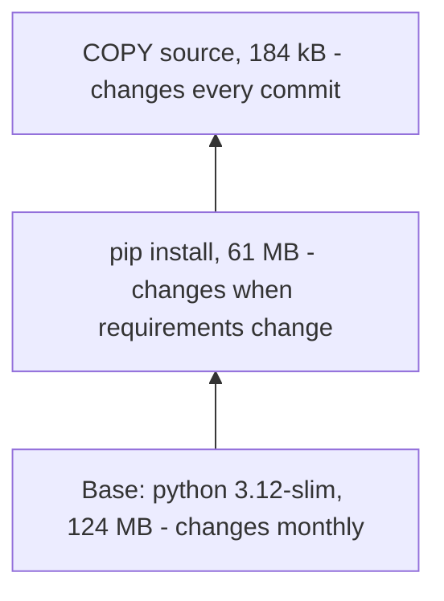
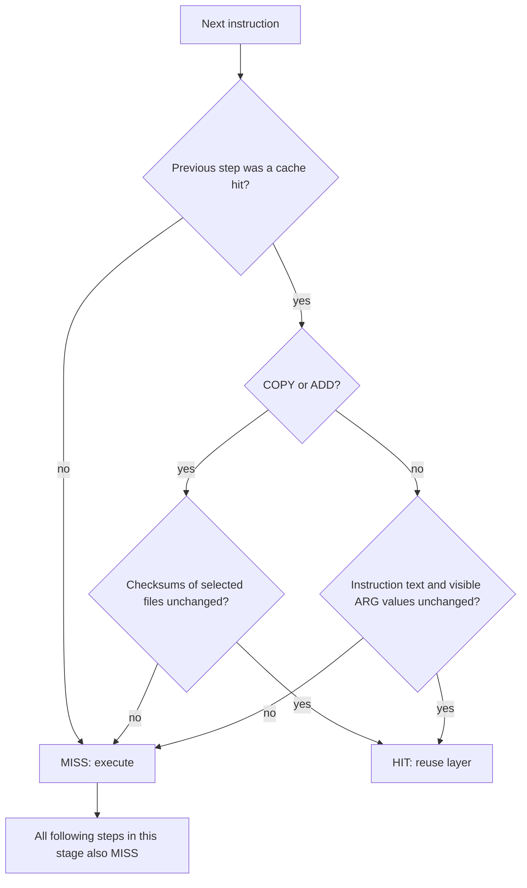

# Layers, the build cache, the context and .dockerignore

## In plain words

Imagine building a tower from Lego, floor by floor, following written steps. If you later change step 3, you must take off every floor above it and rebuild from there. If you only change the top floor, everything below stays in place.

Docker builds images the same way. Each instruction in a Dockerfile adds one **layer** (a floor: the set of files that instruction added or changed). Docker remembers the layers it has already built; this memory is called the **build cache**. When you build again, it reuses every remembered layer up to the first instruction whose inputs changed, and rebuilds from that point on.

So the order of the lines in your Dockerfile decides whether the next build takes two seconds or five minutes. Two further ideas complete the picture: the **build context** (the folder of files you hand to the builder) and the **.dockerignore** file (a list of things to leave out of that folder).

Why this matters for a job: slow builds waste the whole team's time on every change, and "how does the Docker build cache work?" is among the most common interview questions on this topic.

> **Before this lesson:** read [Dockerfile instructions, one by one](#/lesson/docker/dockerfile-instructions) first. You should recognise `FROM`, `COPY`, `RUN` and `CMD`, and know from [What a container is](#/lesson/docker/what-is-a-container) that an image is a stack of layers.

## Why this matters

The first build of an image is slow because everything is new: the base is downloaded, packages are installed, dependencies are fetched. The second build, after you change one line of source, should take a second or two. Whether it does depends almost entirely on the **order of instructions in your Dockerfile** and on **what you send to the builder**.

A team that gets this wrong pays for it on every commit: a five-minute dependency install repeated in CI hundreds of times a day, a 900 MB build context uploaded before the first instruction runs, and images that are entirely new layers on every push so nothing is ever shared. A team that gets it right has builds that are mostly cache hits and pushes that upload a few kilobytes.

The rules are mechanical. This lesson states them precisely, then gives you a simulator to test your understanding.

## From instructions to layers

A quick reminder of the four instructions used in the examples: `FROM` chooses the image to start from, `COPY` copies files from your project into the image, `RUN` executes a command while building, and `CMD` sets the command a container will run. Each is explained in the previous lesson.

Each instruction produces a new image state on top of the previous one. Instructions that touch the filesystem (`RUN`, `COPY`, `ADD`, and `WORKDIR` when it creates a directory) produce a **layer**, a tarball of what changed. Metadata instructions produce no layer but still count as build steps for caching.

```dockerfile
FROM python:3.12-slim                 # base layers (shared with every other image on this base)
WORKDIR /srv/ledger                   # tiny layer: creates the directory
COPY requirements.txt .               # layer: one small file
RUN pip install -r requirements.txt   # layer: tens of MB of packages
COPY . .                              # layer: your source code
CMD ["python", "-m", "ledger"]        # metadata only
```

```bash
docker image history harbour/ledger:dev --format 'table {{.CreatedBy}}\t{{.Size}}'
```

```text
CREATED BY                                      SIZE
CMD ["python" "-m" "ledger"]                    0B
COPY . . # buildkit                             184kB
RUN /bin/sh -c pip install -r requirements.txt  61.3MB
COPY requirements.txt . # buildkit              212B
WORKDIR /srv/ledger                             0B
... 4 base layers ...                           124MB
```

Read `history` bottom-up: it is the stack. The cheap, frequently changing layer (source, 184 kB) sits on top of the expensive, rarely changing one (dependencies, 61 MB). That shape is the whole game.



## The cache rules, stated precisely

Before executing an instruction the builder asks: *have I already built this exact step on top of this exact parent?* If yes, it reuses the stored result. The check is:

1. **The parent must be a cache hit.** A step can only be reused if the step before it was reused (or is the same base image).
2. **For `RUN`, `ENV`, `WORKDIR`, `USER` and other non-file instructions, the instruction text must be identical.** The builder compares the string, not the outcome. `RUN apt-get update` is a cache hit forever, even though running it again would fetch newer package lists.
3. **For `COPY` and `ADD`, the checksum of the source files must be identical.** The builder hashes the content and metadata (path, permissions) of every file the instruction would copy. Modification times are not part of the hash. A `COPY` is invalidated only by changes to files it actually selects.
4. **`ARG` values count from the point of first use.** Changing `--build-arg X=...` invalidates the first instruction after the `ARG X` declaration that could see it, in practice the `ARG` line's successors.
5. **Once one step misses, every later step in that stage is rebuilt.** A miss changes the parent of everything below it, so rule 1 fails for all of them.

Rule 5 is the one with consequences. It turns "which step is first to change?" into "how much do I rebuild?".



### Watching it happen

Build twice without changing anything:

```bash
docker build -t harbour/ledger:dev .
```

```text
 => CACHED [2/5] WORKDIR /srv/ledger                     0.0s
 => CACHED [3/5] COPY requirements.txt .                 0.0s
 => CACHED [4/5] RUN pip install -r requirements.txt     0.0s
 => CACHED [5/5] COPY . .                                0.0s
```

Now edit `ledger/views.py` and build again:

```text
 => CACHED [2/5] WORKDIR /srv/ledger                     0.0s
 => CACHED [3/5] COPY requirements.txt .                 0.0s
 => CACHED [4/5] RUN pip install -r requirements.txt     0.0s
 => [5/5] COPY . .                                       0.1s
```

Only the last step ran. Now add a library to `requirements.txt`:

```text
 => CACHED [2/5] WORKDIR /srv/ledger                     0.0s
 => [3/5] COPY requirements.txt .                        0.0s
 => [4/5] RUN pip install -r requirements.txt           42.6s
 => [5/5] COPY . .                                       0.1s
```

Step 3 missed because the file's checksum changed. Step 4's text is unchanged, but its parent is new, so it runs. That is the behaviour we want: the expensive install repeats exactly when its input changes.

## The classic mistake

```dockerfile
FROM python:3.12-slim
WORKDIR /srv/ledger
COPY . .                              # everything, including source
RUN pip install -r requirements.txt
CMD ["python", "-m", "ledger"]
```

This builds a correct image. But `COPY . .` now selects every file, so *any* edit to *any* file changes its checksum, misses the cache, and forces the `pip install` below it to run again. Every one-character fix costs 40 seconds.

The fix is the pattern you saw first: **copy the dependency manifest alone, install, then copy the rest.** The same idea in other ecosystems:

| Ecosystem | Copy first | Then run | Then copy |
|---|---|---|---|
| Python (pip) | `requirements.txt` | `pip install -r requirements.txt` | source |
| Python (uv) | `pyproject.toml`, `uv.lock` | `uv sync --frozen --no-install-project` | source |
| Node | `package.json`, `package-lock.json` | `npm ci` | source |
| Go | `go.mod`, `go.sum` | `go mod download` | source |
| Rust | `Cargo.toml`, `Cargo.lock` | dependency build | source |
| Java (Maven) | `pom.xml` | `mvn dependency:go-offline` | source |

The general principle: **order instructions from least frequently changing to most frequently changing**, and never let a volatile input sit above an expensive step.

## A simulator for cache invalidation

The function below applies the five rules to a toy Dockerfile. Each step is a tuple; `COPY` steps list the files they select. Change the `changed` set and predict the output before running.

```python-run
def rebuilt(steps, changed_files, changed_args=()):
    """Return the list of step indices that must be rebuilt."""
    out, missed, seen_args = [], False, set()
    for i, step in enumerate(steps):
        kind = step[0]
        if kind == "ARG":
            seen_args.add(step[1])
        if not missed:
            if kind == "COPY" and set(step[1]) & set(changed_files):
                missed = True
            elif kind == "RUN" and any(("$" + a) in step[1] for a in changed_args if a in seen_args):
                missed = True
        if missed and kind != "ARG":
            out.append(i)
    return out

bad = [("FROM", "python:3.12-slim"),
       ("COPY", ["requirements.txt", "ledger/app.py", "ledger/views.py", "README.md"]),
       ("RUN", "pip install -r requirements.txt"),
       ("CMD", "python -m ledger")]

good = [("FROM", "python:3.12-slim"),
        ("COPY", ["requirements.txt"]),
        ("RUN", "pip install -r requirements.txt"),
        ("COPY", ["ledger/app.py", "ledger/views.py"]),
        ("ARG", "GIT_SHA"),
        ("RUN", "echo $GIT_SHA > /version"),
        ("CMD", "python -m ledger")]

for name, df in [("bad ", bad), ("good", good)]:
    print(name, "edit views.py     ->", rebuilt(df, {"ledger/views.py"}))
    print(name, "edit README       ->", rebuilt(df, {"README.md"}))
    print(name, "edit requirements ->", rebuilt(df, {"requirements.txt"}))
print("good new GIT_SHA       ->", rebuilt(good, set(), ["GIT_SHA"]))
```

In the good layout an edit to `README.md` rebuilds nothing, because no `COPY` selects it. In the bad layout it rebuilds the install. And a new `GIT_SHA` rebuilds only the cheap steps at the end, because the `ARG` was placed late.

## When the cache lies to you

The cache compares instruction text, not the state of the outside world. That produces stale results:

```dockerfile
RUN apt-get update && apt-get install -y curl      # cached: same curl version for months
RUN git clone https://git.example/harbour/tools    # cached: never pulls new commits
RUN curl -fsSL https://example.com/latest.tgz | tar xz   # cached: "latest" from last year
```

Options when you need fresh results:

```bash
docker build --no-cache -t harbour/ledger:dev .          # ignore the cache entirely
docker build --pull -t harbour/ledger:dev .              # re-check the base image tag
docker build --no-cache-filter deps -t ... .             # rebuild one named stage only
```

Better still, make the input explicit so the instruction text changes when the input does: pin versions (`curl=8.5.0-2`), pin a commit, or pass a version as an `ARG`.

> [!WARNING]
> A build that depends on "whatever is latest today" is not reproducible, and the cache hides the problem on your machine while CI, with a cold cache, gets something different. Pin versions in the Dockerfile.

## The build context

When you run `docker build -t name .`, the final `.` is the **build context**: the directory the builder is allowed to read. `COPY` and `ADD` can take sources only from inside it. The Dockerfile is found at `./Dockerfile` in the context unless you pass `-f`.

```bash
docker build -t harbour/ledger:dev .                         # context = current directory
docker build -t harbour/ledger:dev -f docker/Dockerfile.api . # Dockerfile elsewhere, same context
docker build -t harbour/ledger:dev services/ledger            # context = a subdirectory
docker build -t harbour/ledger:dev https://git.example/harbour/ledger.git#main   # a git repo
```

The builder is a separate process (often on another machine or inside a VM), so the context has to be *sent* to it. BuildKit sends only the files the Dockerfile actually references, but it must first walk the directory to work out what exists and what has changed. A context with a `node_modules` tree, a `.git` directory and a few data files is slow before the first instruction starts:

```text
 => [internal] load build context                     38.4s
 => => transferring context: 1.24GB                   38.1s
```

Three problems follow from a fat context:

1. **Time**: the transfer happens on every build.
2. **Cache misses**: `COPY . .` hashes everything it selects, so a changed log file or a rewritten `.git/index` invalidates the layer even though your code is identical.
3. **Leaks**: `COPY . .` puts `.env`, SSH keys, `.git` history and local databases into an image that you then push to a registry.

## .dockerignore

A `.dockerignore` file in the root of the context lists patterns to exclude. Excluded files are never sent to the builder, cannot be copied, and do not affect cache checksums.

```text
# .dockerignore
.git
.venv/
__pycache__/
**/*.pyc
node_modules
dist/
*.log
.env*
!.env.example
docs/
Dockerfile*
docker-compose*.yml
```

Pattern rules (they follow Go's `filepath.Match` with additions):

| Pattern | Matches |
|---|---|
| `*.log` | Any `.log` file in the context root only |
| `**/*.log` | Any `.log` file at any depth |
| `build` or `build/` | The file or directory named `build` at the root, and everything under it |
| `**/tmp` | Any path component named `tmp` at any depth |
| `docs/*.md` | Markdown files directly inside `docs` |
| `?` | Exactly one character other than `/` |
| `!keep.log` | Exception: re-include a path excluded by an earlier line |
| `# text` | Comment |

Two rules decide the outcome when patterns interact: a leading `/` is ignored (all patterns are relative to the context root), and **the last matching line wins**. So the order of `!` exceptions matters:

```text
*.md
!README.md        # README.md is included: this line is the last match
```

```text
!README.md
*.md              # README.md is excluded: this line is the last match
```

An allow-list style is often safer than a deny-list, because new junk is excluded by default:

```text
# ignore everything...
*
# ...except what the image needs
!requirements.txt
!ledger/
!alembic/
```

Measure the effect:

```bash
docker build -t harbour/ledger:dev . 2>&1 | grep "transferring context"
```

```text
 => => transferring context: 1.24GB      # before
 => => transferring context: 96.31kB     # after adding .dockerignore
```

> [!TIP]
> If you have several Dockerfiles in one repository, BuildKit looks first for an ignore file named after the Dockerfile: `Dockerfile.api.dockerignore` next to `Dockerfile.api` takes precedence over the root `.dockerignore`.

## Beyond the basics: cache mounts and remote caches

Layer caching is all-or-nothing per instruction: add one dependency and the whole `pip install` layer is rebuilt, downloading every package again. A **cache mount** gives the instruction a persistent directory that survives across builds without becoming part of the image:

```dockerfile
# syntax=docker/dockerfile:1
RUN --mount=type=cache,target=/root/.cache/pip \
    pip install -r requirements.txt
```

The layer still reruns when `requirements.txt` changes, but pip finds almost every wheel already in its cache directory, so the rerun takes seconds. Note that `--no-cache-dir` must *not* be used here; the cache is no longer bloating the image because the mount is not part of the layer.

CI runners usually start with an empty local cache. You can export the cache to a registry and import it on the next run:

```bash
docker buildx build \
  --cache-from type=registry,ref=registry.harbourline.example/ledger:buildcache \
  --cache-to   type=registry,ref=registry.harbourline.example/ledger:buildcache,mode=max \
  -t registry.harbourline.example/ledger:1.8.0 --push .
```

`mode=max` stores intermediate stages as well as the final image's layers, which matters for multi-stage builds.

## Pitfalls

- **`COPY . .` above the dependency install.** The single most common cause of slow builds.
- **No `.dockerignore`.** Slow context transfer, accidental cache misses, secrets in the image.
- **Volatile `ARG` or `LABEL` near the top.** A build timestamp or commit hash used early invalidates everything after it on every build.
- **Trusting a cached `apt-get update`.** Combine update and install in one `RUN`, and rebuild with `--pull --no-cache` on a schedule to pick up security patches.
- **Splitting one logical step across `RUN`s to "use the cache better".** Each `RUN` is a layer; files deleted in a later one still ship.
- **Ignoring the Dockerfile's own directory structure.** Patterns are relative to the context root, not to the `.dockerignore` file's location in some subfolder, and only the root one is read.
- **Forgetting that `.dockerignore` also hides files from `COPY`.** If a build fails with "not found" for a file that plainly exists, check the ignore file.

## Cheat sheet

| Situation | What to do |
|---|---|
| Source changes often, dependencies rarely | Copy manifest, install, then copy source |
| Dependency layer rebuilds too slowly | `RUN --mount=type=cache,target=<pkg cache>` |
| Need fresh base image | `docker build --pull` |
| Need to ignore the cache | `docker build --no-cache` |
| Build metadata (SHA, date) | Put `ARG`/`LABEL` at the end |
| Context is huge | Add `.dockerignore`; exclude `.git`, dependencies, build output |
| Secrets could be copied | Ignore `.env*`, keys; prefer an allow-list |
| CI has a cold cache | `--cache-from` / `--cache-to` with a registry |
| See layer sizes | `docker image history IMAGE` |
| See what a step did | `docker build --progress=plain` |

## Summary

- Each filesystem-changing instruction creates a layer; layers stack in Dockerfile order.
- A step is reused only if its parent was reused **and** its own input is unchanged: instruction text for `RUN` and friends, file checksums for `COPY`/`ADD`.
- The first miss forces every later step to rebuild, so order instructions from stable to volatile.
- Copy dependency manifests and install before copying the source.
- The cache does not know about the outside world; pin versions so that inputs are visible in the Dockerfile.
- The build context is everything the builder may read. Keep it small and clean with `.dockerignore`, where the last matching pattern wins and `!` re-includes.
- Cache mounts speed up the reruns you cannot avoid; registry caches warm up cold CI runners.

## Glossary

| Term | Meaning |
|---|---|
| Layer | The set of file changes produced by one instruction |
| Build cache | Stored results of earlier build steps, reused when their inputs have not changed |
| Cache hit / cache miss | A step that is reused / a step that must be executed again |
| Invalidate | Make a cached step unusable because something it depends on changed |
| Checksum | A short fingerprint calculated from a file's contents |
| Build context | The folder (or repository) whose files the build may use |
| `.dockerignore` | A file listing patterns to leave out of the build context |
| Manifest (dependency list) | A file that lists a project's dependencies, such as `requirements.txt` or `package.json` |
| Dependency | A library your application needs |
| BuildKit | Docker's current build engine |
| Cache mount | A folder that persists between builds without being stored in the image |
| Pin | Fix an exact version so that builds do not change unexpectedly |

## Check yourself

```quiz
[
  {"q": "A Dockerfile is: FROM, COPY package.json, RUN npm ci, COPY src, CMD. You edit a file in src. Which steps are rebuilt?",
   "options": ["All of them", "RUN npm ci and COPY src", "Only COPY src (CMD is metadata and is re-applied instantly)", "None"],
   "answer": 2,
   "explain": "COPY package.json and RUN npm ci are unchanged and their parents are hits. The first miss is COPY src; only it and the following metadata step are redone."},
  {"q": "What does the builder compare to decide whether a RUN instruction is a cache hit?",
   "options": ["The files the command would produce", "The instruction text (and visible build args), given the same parent", "The current time", "The exit code of the previous run"],
   "answer": 1,
   "explain": "RUN is cached by its string. The builder never re-executes it to see whether the result would differ, which is why `apt-get update` can be stale."},
  {"q": "With `COPY . .` and no .dockerignore, you run `git commit` (which changes files under .git) and rebuild. What happens?",
   "options": ["Cache hit: git metadata is ignored automatically", "Cache miss: files under .git are part of the copied set, so the checksum changed", "The build fails", "Only the .git layer is rebuilt"],
   "answer": 1,
   "explain": "COPY hashes every file it selects. Without an ignore rule .git is selected, so unrelated metadata changes invalidate the layer and everything after it."},
  {"q": "Given the .dockerignore lines `*.md` then `!README.md`, is README.md sent to the builder?",
   "options": ["No, the first match wins", "Yes, the last matching line wins and it is an exception", "Only if it is in a subdirectory", "It depends on file size"],
   "answer": 1,
   "explain": "Patterns are evaluated in order and the last match decides. The `!` line re-includes README.md."},
  {"q": "Where should `ARG GIT_SHA` and the LABEL that uses it be placed for the best cache behaviour?",
   "options": ["First, right after FROM", "Before the dependency install", "As late as possible, after the expensive steps", "It makes no difference"],
   "answer": 2,
   "explain": "The value changes on every commit. Everything after its first use is invalidated, so placing it last keeps the expensive layers cached."},
  {"q": "Does the pattern `*.log` in .dockerignore exclude `logs/app/debug.log`?",
   "options": ["Yes", "No, `*` does not cross directory separators; use `**/*.log`", "Only on Linux", "Only if logs/ is also listed"],
   "answer": 1,
   "explain": "A single `*` matches within one path component at the root. `**` matches any number of directories."},
  {"q": "What does `RUN --mount=type=cache,target=/root/.cache/pip pip install -r requirements.txt` achieve?",
   "options": ["The layer is never rebuilt", "The pip download cache persists between builds without being stored in the image, so reruns are fast", "It caches the layer in the registry", "It disables layer caching"],
   "answer": 1,
   "explain": "A cache mount is a builder-managed directory available during that RUN only. The instruction still reruns when its inputs change, but downloads are reused."},
  {"q": "Which flag makes the builder check the registry for a newer version of the base image tag?",
   "options": ["--no-cache", "--pull", "--squash", "--fresh"],
   "answer": 1,
   "explain": "`--pull` re-resolves the FROM tag. `--no-cache` ignores cached steps but will still use a locally present base image."}
]
```

> **Source:** Stoneman, *Learn Docker in a Month of Lunches*, ch. 3 (topic coverage). Rules checked against <https://docs.docker.com/build/cache/>, <https://docs.docker.com/build/cache/invalidation/>, <https://docs.docker.com/build/concepts/context/> and <https://docs.docker.com/build/cache/backends/>. All wording and examples are original.
