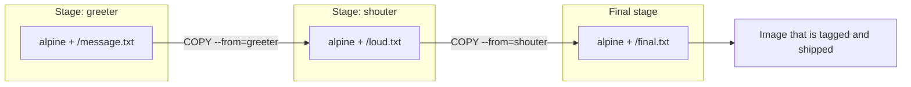
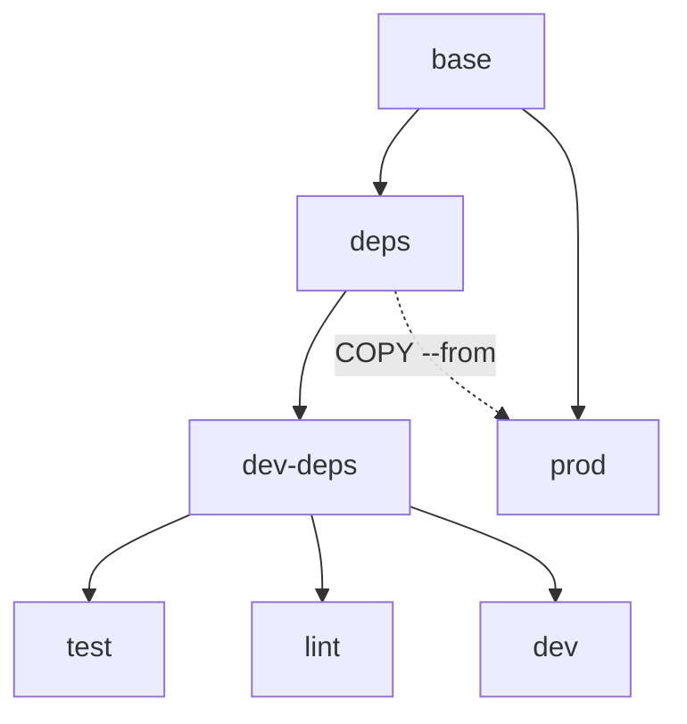

# Multi-stage builds: packaging Python, Node and compiled apps from source

## In plain words

To bake bread you need a mixer, bowls, a hot oven and a floury worktop. To *serve* the bread you need a plate. Nobody carries the oven to the dinner table.

Software is the same. *Building* an application needs heavy tools: a **compiler** (a program that turns source code into something a computer can run), package managers, test frameworks. *Running* it needs only the finished result. If one Dockerfile does both jobs in one go, all the tools end up inside the image that is shipped: larger, slower to download, and with more software in which security flaws can hide.

A **multi-stage build** fixes this. One Dockerfile contains several **stages**. The early stages are the kitchen: they have the tools and do the building. The last stage is the plate: it starts clean and receives only the finished result copied over from the kitchen. Only the last stage is shipped.

Why this matters for a job: multi-stage builds are the standard way to package real applications in every language, and they are the main answer to "how do you make an image smaller?".

> **Before this lesson:** you need [Dockerfile instructions, one by one](#/lesson/docker/dockerfile-instructions) and [Layers, the build cache, the context and .dockerignore](#/lesson/docker/layers-cache-context). The examples use Go, Node.js and Python, and each new command is explained; you do not need to know those languages.

## Why this matters

There are two different jobs hiding in "build an image". One is **building the application**: compiling, bundling, downloading dependencies, running tests. That needs compilers, package managers, header files and often hundreds of megabytes of tooling. The other is **running the application**, which needs the built output and a runtime, and nothing else.

If one Dockerfile stage does both, the tooling ships to production. A Go service whose binary is 12 MB ends up in an 850 MB image because the Go toolchain came along. That image is slower to pull, has a far larger attack surface (a compiler and a shell are useful to an intruder), and shows up in vulnerability scans with dozens of findings in packages the app never calls.

The alternative used to be a build script on the host that compiled the app and then copied the result into a small image. That reintroduces the problem Docker was meant to solve: the build depends on whatever toolchain the host happens to have.

**Multi-stage builds** solve both. One Dockerfile describes several images in sequence. Early stages contain the tools and do the work; the final stage starts from a small base and copies in only the artefacts. The whole build runs inside containers, so the only thing a developer or CI runner needs installed is Docker.

## The mechanics

Each `FROM` starts a new **stage**. Stages can be named with `AS`. A later stage can pull files out of an earlier one with `COPY --from=<stage>`. Only the last stage (or the one you select with `--target`) becomes the output image; the others are discarded once the build finishes, although their layers stay in the build cache.

```dockerfile
# syntax=docker/dockerfile:1
FROM alpine:3.20 AS greeter
RUN echo "built in stage one" > /message.txt

FROM alpine:3.20 AS shouter
COPY --from=greeter /message.txt /message.txt
RUN tr a-z A-Z < /message.txt > /loud.txt

FROM alpine:3.20
COPY --from=shouter /loud.txt /final.txt
CMD ["cat", "/final.txt"]
```

```bash
docker build -t demo/stages . && docker run --rm demo/stages
```

```text
BUILT IN STAGE ONE
```

Line by line: the first `FROM ... AS greeter` starts a stage named `greeter`, and its `RUN` writes a small text file. The second `FROM` starts a fresh stage named `shouter`; `COPY --from=greeter` fetches the file out of the first stage, and `RUN tr a-z A-Z` rewrites it in capital letters. The third `FROM` starts the final stage, copies in only the finished file, and `CMD` prints it when a container starts. `docker build ... && docker run ...` builds the image and, if that succeeded, runs it.

The final image contains Alpine plus one file. Neither `/message.txt` nor the layers of the first two stages are in it.



Facts worth knowing:

- A stage can also be referenced by index (`--from=0`), but names survive reordering.
- `--from` accepts any image, not only a stage: `COPY --from=nginx:1.27-alpine /etc/nginx/nginx.conf /defaults/`.
- A stage can start from an earlier stage: `FROM build AS test` continues from where `build` left off.
- `ARG` and `ENV` do not cross stages. Each stage starts with only what its own base provides.
- BuildKit builds a dependency graph of stages. Stages that the target does not depend on are **skipped**, and independent stages run **in parallel**.

## Compiled language: a Go service

Compiled languages show the biggest win, because the output is a single file. Our service is `beacon`, an uptime pinger.

```dockerfile
# syntax=docker/dockerfile:1
FROM golang:1.23 AS build
WORKDIR /src

COPY go.mod go.sum ./
RUN go mod download

COPY . .
RUN CGO_ENABLED=0 go build -trimpath -ldflags="-s -w" -o /out/beacon ./cmd/beacon

FROM gcr.io/distroless/static-debian12:nonroot
COPY --from=build /out/beacon /beacon
EXPOSE 9000
ENTRYPOINT ["/beacon"]
```

Stage one is ordinary: copy the module files, download dependencies (cached until `go.sum` changes), copy the source, compile. `CGO_ENABLED=0` produces a statically linked binary with no dependency on a C library, which is what allows the final stage to be nearly empty.

Stage two uses a distroless image: CA certificates, timezone data, a `nonroot` user, and no shell or package manager.

```bash
docker build -t harbour/beacon:2.0 .
docker image ls --format 'table {{.Repository}}:{{.Tag}}\t{{.Size}}' | grep -E 'beacon|golang'
```

```text
harbour/beacon:2.0     14.6MB
golang:1.23            838MB
```

The toolchain image is 57 times larger than what ships. With `FROM scratch` instead of distroless the image would be the size of the binary alone, but you would have to copy in CA certificates yourself and there would be no non-root user defined.

> [!TIP]
> If the program needs C libraries (CGO), you cannot use `scratch` or `static`. Use a base that has the right libc, for example `gcr.io/distroless/base-debian12` or `debian:bookworm-slim`, and make sure the build stage and the final stage use the *same* libc family. A binary linked against glibc will not start on Alpine's musl; the error is a confusing `no such file or directory` for a file that clearly exists.

## Interpreted language with a build step: Node

Node apps do not compile to a binary, but they still have a split between build-time and run-time needs: `devDependencies` (TypeScript, bundlers, test frameworks) are required to produce `dist/` and are dead weight afterwards.

```dockerfile
# syntax=docker/dockerfile:1
FROM node:22-alpine AS deps
WORKDIR /app
COPY package.json package-lock.json ./
RUN npm ci

FROM deps AS build
COPY tsconfig.json ./
COPY src/ src/
RUN npm run build            # emits /app/dist

FROM node:22-alpine AS prod-deps
WORKDIR /app
COPY package.json package-lock.json ./
RUN npm ci --omit=dev

FROM node:22-alpine
ENV NODE_ENV=production
WORKDIR /app
COPY --from=prod-deps /app/node_modules ./node_modules
COPY --from=build /app/dist ./dist
COPY package.json ./
USER node
EXPOSE 3000
CMD ["node", "dist/server.js"]
```

Four stages, each with one job. `deps` installs everything; `build` extends it and compiles; `prod-deps` installs only production dependencies; the final stage assembles. `build` and `prod-deps` do not depend on each other, so BuildKit runs them concurrently.

Two details matter in the last stage. `USER node` uses the unprivileged account that the official image already provides. And the command is `node dist/server.js`, not `npm start`: `npm` would become PID 1, would not pass `SIGTERM` to the server, and would add a process for no benefit.

## Interpreted language without a build step: Python

Python has no bundle step, yet multi-stage still pays off whenever a dependency needs compiling or you want the installer tooling kept out of the result. The pattern is "build a virtual environment in one stage, copy it whole into the next".

```dockerfile
# syntax=docker/dockerfile:1
FROM python:3.12-slim AS build
RUN apt-get update \
 && apt-get install -y --no-install-recommends build-essential libpq-dev \
 && rm -rf /var/lib/apt/lists/*
RUN python -m venv /opt/venv
ENV PATH="/opt/venv/bin:$PATH"
COPY requirements.txt .
RUN --mount=type=cache,target=/root/.cache/pip \
    pip install -r requirements.txt

FROM python:3.12-slim
RUN apt-get update \
 && apt-get install -y --no-install-recommends libpq5 \
 && rm -rf /var/lib/apt/lists/* \
 && useradd --system --uid 10001 ledger
COPY --from=build /opt/venv /opt/venv
ENV PATH="/opt/venv/bin:$PATH" PYTHONUNBUFFERED=1
WORKDIR /srv/ledger
COPY --chown=10001:10001 ledger/ ledger/
USER 10001
EXPOSE 8000
CMD ["gunicorn", "--bind", "0.0.0.0:8000", "ledger.wsgi:app"]
```

The build stage has the compiler and the PostgreSQL *development* headers (`libpq-dev`), needed to compile the database driver. The final stage has only the *runtime* shared library (`libpq5`). The virtual environment is copied to the **same path** in both stages, which matters because scripts inside a venv have its absolute path baked into their first line.

```bash
docker image ls --format 'table {{.Repository}}:{{.Tag}}\t{{.Size}}' | grep ledger
```

```text
harbour/ledger:single-stage    512MB
harbour/ledger:multi-stage     187MB
```

| Language | Build stage has | Final stage has | Typical final base |
|---|---|---|---|
| Go, Rust (static) | Compiler, modules, source | One binary | `scratch`, distroless `static` |
| C/C++, CGO | Compiler, `-dev` headers | Binary + runtime `.so` libraries | distroless `base`/`cc`, `debian-slim` |
| Java | JDK, Maven or Gradle | JAR + JRE | `eclipse-temurin:21-jre` |
| .NET | SDK | Published DLLs + runtime | `mcr.microsoft.com/dotnet/aspnet` |
| Node | devDependencies, compiler | `dist/` + production `node_modules` | `node:22-alpine` or `-slim` |
| Python | Compilers, `-dev` headers, pip cache | venv + source | `python:3.12-slim` |

## Stages as a workflow: test, lint, dev and prod from one file

Stages are not only for shrinking. Because you can build any one of them with `--target`, a single Dockerfile can serve several purposes.

```dockerfile
# syntax=docker/dockerfile:1
FROM python:3.12-slim AS base
WORKDIR /srv/ledger
ENV PATH="/opt/venv/bin:$PATH"
RUN python -m venv /opt/venv

FROM base AS deps
COPY requirements.txt .
RUN pip install -r requirements.txt

FROM deps AS dev-deps
COPY requirements-dev.txt .
RUN pip install -r requirements-dev.txt

FROM dev-deps AS test
COPY . .
RUN pytest -q

FROM dev-deps AS lint
COPY . .
RUN ruff check .

FROM dev-deps AS dev
CMD ["flask", "--app", "ledger", "run", "--debug", "--host", "0.0.0.0"]

FROM base AS prod
COPY --from=deps /opt/venv /opt/venv
COPY ledger/ ledger/
USER 10001
CMD ["gunicorn", "--bind", "0.0.0.0:8000", "ledger.wsgi:app"]
```

```bash
docker build --target test -t harbour/ledger:test .   # runs the test suite; fails the build on a failing test
docker build --target dev  -t harbour/ledger:dev  .   # image with debug tooling
docker build --target prod -t harbour/ledger:1.8.0 .  # the shippable image
```



When you build `--target prod`, BuildKit walks the graph backwards from `prod`: it needs `base` (its parent) and `deps` (a `COPY --from` source). `dev-deps`, `test`, `lint` and `dev` are not reachable, so they are **not built at all**.

> [!WARNING]
> That skipping means a plain `docker build .` of the file above does **not** run your tests: `prod` does not depend on `test`. If the tests must gate the image, either build the `test` target explicitly in CI before `prod`, or make `prod` depend on it, for example with `COPY --from=test /srv/ledger/.test-passed /tmp/`.

The short simulation below computes which stages a target needs, the same reachability walk BuildKit does.

```python-run
def needed(stages, target):
    """stages: {name: {"from": parent stage or None, "copies": [stage, ...]}}"""
    seen, order = set(), []
    def visit(name):
        if name in seen or name not in stages:
            return                      # external images such as python:3.12-slim
        seen.add(name)
        s = stages[name]
        if s["from"]:
            visit(s["from"])
        for c in s["copies"]:
            visit(c)
        order.append(name)              # post-order: dependencies first
    visit(target)
    return order

stages = {
    "base":     {"from": None,       "copies": []},
    "deps":     {"from": "base",     "copies": []},
    "dev-deps": {"from": "deps",     "copies": []},
    "test":     {"from": "dev-deps", "copies": []},
    "lint":     {"from": "dev-deps", "copies": []},
    "dev":      {"from": "dev-deps", "copies": []},
    "prod":     {"from": "base",     "copies": ["deps"]},
}
for t in ["prod", "test", "dev"]:
    n = needed(stages, t)
    print(f"--target {t:5s} builds {n}  skips {sorted(set(stages) - set(n))}")
```

## Packaging from source with nothing but Docker

Put the pieces together and a new team member's setup instructions shrink to:

```bash
git clone https://git.example/harbour/beacon && cd beacon
docker build -t harbour/beacon:local .
docker run --rm -p 9000:9000 harbour/beacon:local
```

No Go installation, no matching compiler version, no "works on my machine". The toolchain version is whatever the Dockerfile's build stage says, identical on every laptop and in CI. Upgrading the compiler is a one-line change reviewed like any other.

The cost is that the compiler's own caches live inside the build, so a naive setup recompiles everything whenever source changes. Cache mounts fix that:

```dockerfile
RUN --mount=type=cache,target=/go/pkg/mod \
    --mount=type=cache,target=/root/.cache/go-build \
    CGO_ENABLED=0 go build -o /out/beacon ./cmd/beacon
```

## Pitfalls

- **Copying too much from the build stage.** `COPY --from=build /app /app` brings source, tests and `node_modules` with dev dependencies. Copy named artefacts: the binary, `dist/`, the venv.
- **libc mismatch.** Building on Debian (glibc) and running on Alpine (musl), or the reverse, produces binaries that fail to start. Keep the families aligned or link statically.
- **Missing runtime libraries.** The build stage had `libpq-dev`; the final stage still needs `libpq5`. The error appears at import time, not build time. Run the image in CI as a smoke test.
- **Different paths for a venv.** Virtual environments are not relocatable; copy to the same absolute path.
- **Expecting `ARG`/`ENV` to carry over.** Redeclare them in each stage that uses them.
- **Assuming test stages run.** Unreachable stages are skipped; target them explicitly.
- **Forgetting certificates and timezone data on `scratch`.** HTTPS calls fail with "certificate signed by unknown authority". Copy `/etc/ssl/certs/ca-certificates.crt` from the build stage or use distroless `static`.
- **Losing file ownership.** `COPY --from` writes files as root unless you add `--chown`; an app running as UID 10001 may then be unable to write where it expects.

## Cheat sheet

| Need | Syntax |
|---|---|
| Name a stage | `FROM image AS name` |
| Copy from a stage | `COPY --from=name /src /dest` |
| Copy from any image | `COPY --from=image:tag /src /dest` |
| Continue from a stage | `FROM name AS next` |
| Build one stage | `docker build --target name .` |
| Rebuild one stage without cache | `docker build --no-cache-filter name .` |
| Static Go binary | `CGO_ENABLED=0 go build` then `FROM scratch` or distroless `static` |
| Node production deps | `npm ci --omit=dev` in its own stage |
| Python deps | Build `/opt/venv`, copy to the same path |
| Keep compiler caches | `RUN --mount=type=cache,target=...` |

## Summary

- Building and running are different jobs with different needs; multi-stage builds give each its own image inside one Dockerfile.
- Each `FROM` begins a stage; `COPY --from` moves artefacts between stages; only the target stage is shipped.
- Compiled languages can ship a single binary on `scratch` or distroless. Node ships `dist/` plus production modules. Python ships a virtual environment.
- BuildKit builds only the stages the target depends on and runs independent stages in parallel, so extra stages for tests or dev tooling cost nothing in the production build, but also do not run unless targeted.
- The whole toolchain is defined in the Dockerfile, so Docker is the only prerequisite on a developer machine or CI runner.

## Glossary

| Term | Meaning |
|---|---|
| Compiler | A program that turns source code into a runnable program |
| Binary | A compiled, runnable program file |
| Stage | One section of a Dockerfile beginning with `FROM` |
| Multi-stage build | A Dockerfile with several stages, of which only the last is shipped |
| Artefact | A product of a build, such as a binary or a folder of bundled files |
| Target | The stage a build stops at, chosen with `--target` |
| Static linking | Building a binary that contains all the library code it needs |
| libc (glibc, musl) | The basic C library programs rely on; Debian uses glibc and Alpine uses musl |
| Distroless | Base images with only a runtime: no shell and no package manager |
| scratch | The empty base image |
| Virtual environment (venv) | A self-contained folder of installed Python packages |
| devDependencies | Node.js packages needed only for building and testing |
| Toolchain | The set of tools used to build software |

## Check yourself

```quiz
[
  {"q": "In a multi-stage Dockerfile, which stage's filesystem becomes the image that is tagged by `docker build -t app .`?",
   "options": ["The first stage", "All stages merged together", "The last stage in the file", "The largest stage"],
   "answer": 2,
   "explain": "Without --target, the final stage is the output. Earlier stages exist only in the build cache and contribute only what is explicitly copied from them."},
  {"q": "A Dockerfile has stages base, deps (FROM base), test (FROM deps) and prod (FROM base, COPY --from=deps). You run `docker build --target prod .`. Which stages are built?",
   "options": ["base, deps, test, prod", "base, deps, prod", "base, prod", "prod only"],
   "answer": 1,
   "explain": "prod's parent is base and it copies from deps. test is not reachable from prod, so BuildKit skips it."},
  {"q": "Why is `CGO_ENABLED=0` commonly set when building Go binaries for `FROM scratch`?",
   "options": ["It makes the build faster", "It produces a statically linked binary with no dependency on a C library, which scratch does not contain", "It enables cross-compilation only", "It strips debug symbols"],
   "answer": 1,
   "explain": "scratch has no libc. A dynamically linked binary would fail to start because its loader and shared libraries are missing."},
  {"q": "A Python image compiles a database driver in the build stage with libpq-dev installed. The final stage copies the venv but the app crashes with `ImportError: libpq.so.5: cannot open shared object file`. What is missing?",
   "options": ["The compiler in the final stage", "The runtime shared library package (libpq5) in the final stage", "The pip cache", "A newer Python version"],
   "answer": 1,
   "explain": "The -dev package provides headers for compiling; the compiled extension still needs the runtime .so at import time, which must be installed in the final image."},
  {"q": "A binary built in `golang:1.23` (Debian, glibc) with CGO enabled is copied into `alpine:3.20` and fails with `no such file or directory`. Why?",
   "options": ["The file was not copied", "The binary's dynamic loader path refers to glibc, which Alpine (musl) does not provide", "Alpine cannot run Go programs", "The binary lacks execute permission"],
   "answer": 1,
   "explain": "The kernel reports the missing interpreter (ld-linux) as if the binary itself were missing. Match libc families or build statically."},
  {"q": "An ENV set in the build stage is not visible in the final stage. Why?",
   "options": ["ENV only works with --build-arg", "Each stage starts fresh from its own FROM; ENV and ARG do not carry across stages", "ENV values expire after one RUN", "The final stage must be named"],
   "answer": 1,
   "explain": "Stages are independent images. Only files copied with COPY --from cross the boundary; configuration must be redeclared."},
  {"q": "Why install production Node dependencies in a separate stage with `npm ci --omit=dev`?",
   "options": ["npm cannot run twice in one stage", "So the final image's node_modules contains no compilers, bundlers or test tools", "It makes TypeScript compile faster", "It is required by Alpine"],
   "answer": 1,
   "explain": "The build needs devDependencies; the runtime does not. A dedicated stage yields a clean production node_modules that can be copied into the final image."},
  {"q": "What is the main benefit of doing the compile inside a build stage rather than on the host?",
   "options": ["Compilation is always faster in a container", "The toolchain version is defined in the Dockerfile, so every machine and CI runner builds identically with only Docker installed", "It avoids the need for source control", "It removes the need for tests"],
   "answer": 1,
   "explain": "The build environment becomes part of the versioned recipe, eliminating host toolchain drift."}
]
```

> **Source:** Stoneman, *Learn Docker in a Month of Lunches*, ch. 4 (topic coverage). Syntax checked against <https://docs.docker.com/build/building/multi-stage/> and <https://docs.docker.com/build/cache/optimize/>. All wording and examples are original.
