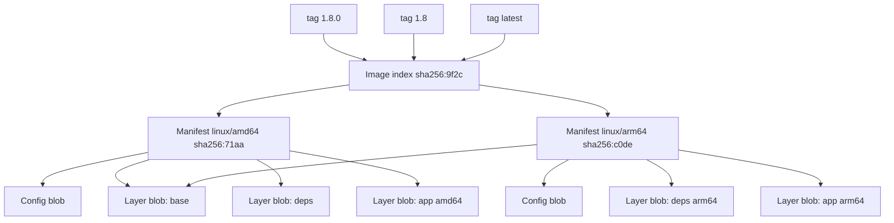

# Registries, image references, tags and digests

## In plain words

You have built an image on your own computer. How does it reach a server, or a colleague? Through a **registry**: an online warehouse for images. You **push** (upload) an image to it and others **pull** (download) it, much as an app store distributes apps.

To find anything in a warehouse you need an address. An image's full name is its address: which warehouse, which shelf, which version. `nginx:1.27` is a short form that Docker completes for you with default values.

The version part comes in two kinds. A **tag** is a label such as `1.27` or `latest`. It is like a sticky note: someone can peel it off and stick it on a different box later. A **digest** is a fingerprint calculated from the image's contents. It is more like a serial number stamped into the metal: it can never refer to anything else.

Why this matters for a job: deploying "whatever that label happens to point at today" is a classic cause of mysterious production problems. Knowing how image names are read, and when to use a tag or a digest, is expected of anyone who deploys containers.

> **Before this lesson:** you should be able to build and run an image ([Dockerfile instructions, one by one](#/lesson/docker/dockerfile-instructions)) and know that an image is made of layers ([What a container is](#/lesson/docker/what-is-a-container)).

## Why this matters

An image on your laptop is useful to exactly one person. To run it on a server, in CI or on a colleague's machine it has to travel, and the vehicle is a **registry**: an HTTP service that stores image layers and hands them out on request. `docker pull` and `docker push` are the client side of that protocol.

The name you type, something like `registry.harbourline.example/payments/ledger:1.8.0`, is not a decorative label. It is an address. It says which server to contact, which repository on that server, and which version. Get one part wrong and you push to the wrong place, pull something you did not mean to, or deploy an image that silently changed since you tested it.

That last risk is the important one. A **tag** such as `1.8.0` or `latest` is a movable pointer. A **digest** such as `sha256:9f2c...` is the content itself, by hash. Knowing when each is appropriate is the difference between "we deployed what we tested" and "we deployed whatever that tag pointed to at 3 a.m.".

## Anatomy of an image reference

```text
registry.harbourline.example:5000/payments/ledger:1.8.0@sha256:9f2c4e...
\______________________________/ \_____________/ \___/ \______________/
          registry host             repository    tag       digest
          (and optional port)       (path)
```

Every part except the repository's last component has a default:

| You write | Docker understands | Rule applied |
|---|---|---|
| `nginx` | `docker.io/library/nginx:latest` | default registry, `library/` namespace, tag `latest` |
| `nginx:1.27` | `docker.io/library/nginx:1.27` | default registry and namespace |
| `harbour/ledger` | `docker.io/harbour/ledger:latest` | default registry and tag |
| `ghcr.io/harbour/ledger:1.8.0` | as written | first component is a registry host |
| `localhost:5000/ledger` | `localhost:5000/ledger:latest` | `localhost` is a registry host |
| `ledger@sha256:9f2c...` | `docker.io/library/ledger@sha256:9f2c...` | digest given, no tag defaulted |

How does Docker decide whether the first path component is a registry host or part of the repository? It is treated as a **host** if it contains a dot (`ghcr.io`), contains a colon (`myhost:5000`), or is exactly `localhost`. Otherwise it is a namespace on Docker Hub. That is why `harbour/ledger` goes to Docker Hub but `harbour.example/ledger` goes to a server called `harbour.example`.

Two further details:

- Single-name repositories on Docker Hub (`nginx`, `python`, `postgres`) are the curated "official images" and live under the hidden `library/` namespace.
- Repository names are lowercase: letters, digits, and separators `.`, `_`, `-`, with `/` between components. Tags may contain letters, digits, `_`, `.`, `-`, up to 128 characters, and may not start with `.` or `-`.

The parser below applies exactly these rules. Edit the list and check your intuition.

```python-run
def parse(ref):
    digest = None
    if "@" in ref:
        ref, digest = ref.split("@", 1)
    first, _, rest = ref.partition("/")
    if rest and ("." in first or ":" in first or first == "localhost"):
        registry, path = first, rest
    else:
        registry, path = "docker.io", ref
    tag = None
    last = path.rsplit("/", 1)[-1]
    if ":" in last:                       # a colon in the LAST component is a tag
        path, tag = path.rsplit(":", 1)
    if registry == "docker.io" and "/" not in path:
        path = "library/" + path
    if tag is None and digest is None:
        tag = "latest"
    return dict(registry=registry, repository=path, tag=tag, digest=digest)

for r in ["nginx", "harbour/ledger:1.8.0", "localhost:5000/ledger",
          "ghcr.io/harbour/tools/lint:2", "registry.harbourline.example:5000/payments/ledger",
          "python@sha256:abc123", "quay.io/prom/node-exporter:v1.8.2@sha256:def456"]:
    print(f"{r:55s} {parse(r)}")
```

Notice the subtlety in `localhost:5000/ledger`: the colon belongs to the host's port, not to a tag. A colon is a tag separator only when it appears in the last path component.

## What a registry stores

A registry does not store "images" as single files. It stores two kinds of object, both addressed by the SHA-256 of their bytes:

- **Blobs**: compressed layer tarballs and the image's config JSON.
- **Manifests**: small JSON documents listing the config blob and the layer blobs (with digests and sizes) that make up one image for one platform.

A **tag** is a named pointer from a repository to a manifest. A multi-platform image adds one more level: an **image index** (also called a manifest list) that points to one manifest per platform.



Because blobs are content-addressed, they are stored once per registry no matter how many images or tags reference them. That is what makes pushes and pulls incremental.

## Pushing

Pushing takes three steps: authenticate, name the image for its destination, push.

```bash
docker login registry.harbourline.example
```

```text
Username: mara
Password:
Login Succeeded
```

`docker login` followed by a registry's address asks for your user name and password for that registry and remembers them for later pushes and pulls.

```bash
docker image tag harbour/ledger:dev registry.harbourline.example/payments/ledger:1.8.0
docker image push registry.harbourline.example/payments/ledger:1.8.0
```

```text
The push refers to repository [registry.harbourline.example/payments/ledger]
5f70bf18a086: Pushed
a3ed95caeb02: Pushed
c1f2a9d7e410: Layer already exists
8d3ac3489996: Layer already exists
1.8.0: digest: sha256:9f2c4e1ab7d0c3e58a6f4b2d19e07c5a3f8b6d4e2c0a1f3e5d7b9c1a3e5f7092 size: 1783
```

`docker image tag` does not copy anything. It adds a second name pointing to the same local image ID, as cheap as a symbolic link. The reference you push must include the registry host, because the name *is* the destination.

In the output, `Layer already exists` means the registry already had a blob with that digest (perhaps from a previous version or from an entirely different image on the same base), so nothing was uploaded for it. The final line is the important one: the **digest of the manifest** that tag `1.8.0` now points to. Record it; it is the permanent identity of what you pushed a moment ago.

> [!WARNING]
> `docker login` stores credentials in `~/.docker/config.json`. Without a credential helper they are only base64-encoded, not encrypted. On shared or CI machines use a credential helper or short-lived tokens, and prefer access tokens scoped to push/pull over your account password.

## Pulling

```bash
docker pull registry.harbourline.example/payments/ledger:1.8.0
```

```text
1.8.0: Pulling from payments/ledger
c1f2a9d7e410: Already exists
8d3ac3489996: Already exists
a3ed95caeb02: Pull complete
5f70bf18a086: Pull complete
Digest: sha256:9f2c4e1ab7d0c3e58a6f4b2d19e07c5a3f8b6d4e2c0a1f3e5d7b9c1a3e5f7092
Status: Downloaded newer image for registry.harbourline.example/payments/ledger:1.8.0
```

The client asks the registry for the manifest behind the tag, selects the entry for the local platform if it is an index, then downloads only the layers it does not already have. Every blob is verified against its digest after download, so a corrupted or tampered layer is rejected.

`docker run` pulls automatically **only if no local image has that exact reference**. That has a consequence people miss: if `ledger:latest` exists locally from last month, `docker run ledger:latest` uses last month's image and never contacts the registry. Use `docker pull` first, or `docker run --pull always`.

## Tags are mutable, digests are not

A tag can be moved to a different manifest at any time by anyone with push access. Nothing in the protocol prevents `1.8.0` from pointing at different bits tomorrow.

```bash
docker pull python:3.12-slim          # Monday
docker pull python:3.12-slim          # a month later: same tag, new digest, new contents
```

That is by design for tags such as `3.12-slim`: they track the newest patch release with the newest OS security fixes. It is a hazard for deployment, where you want "the image I tested".

A digest reference pins the content:

```bash
docker pull registry.harbourline.example/payments/ledger@sha256:9f2c4e1ab7d0c3e58a6f4b2d19e07c5a3f8b6d4e2c0a1f3e5d7b9c1a3e5f7092
```

If the bytes change, the hash changes, and the reference no longer resolves to them. A digest cannot be retargeted.

| | Tag | Digest |
|---|---|---|
| Looks like | `:1.8.0`, `:latest` | `@sha256:9f2c...` (64 hex characters) |
| Chosen by | A person or pipeline | Computed from content |
| Can be moved | Yes | No |
| Human-friendly | Yes | No |
| Guarantees same bytes | No | Yes |
| Good for | Communication, tracking a release line | Deployment manifests, base-image pinning, audit |

You can combine them, `ledger:1.8.0@sha256:9f2c...`. Docker then resolves by digest and the tag is only a comment for readers.

Find the digest of something you already have:

```bash
docker image inspect registry.harbourline.example/payments/ledger:1.8.0 --format '{{index .RepoDigests 0}}'
docker buildx imagetools inspect registry.harbourline.example/payments/ledger:1.8.0
```

```text
registry.harbourline.example/payments/ledger@sha256:9f2c4e1ab7d0c3e58a6f4b2d19e07c5a3f8b6d4e2c0a1f3e5d7b9c1a3e5f7092
```

> [!INTERVIEW]
> "What is the difference between an image ID, a tag and a digest?" The **image ID** is the hash of the local image config. A **tag** is a mutable name pointing at a manifest. The **repo digest** is the hash of the manifest as stored in a registry; it only exists after a push or pull. Deploy by digest when you need immutability; use tags to communicate intent.

### The `latest` trap

`latest` is not magic. It is the tag applied when you give none, on build, push and pull alike. It does not mean "newest": if you push `2.0.0` explicitly and never push `latest`, then `latest` still points at whatever was last pushed without a tag, possibly a year-old build.

Problems with deploying `latest`:

- You cannot tell from the deployment config which version is running.
- Two servers that pulled a day apart run different code under the same name.
- Rollback has no target: "the previous latest" is not a name.
- An orchestrator sees no change in the image field, so it does not start a rollout.

Use `latest` for convenience on a workstation; never in a deployment manifest.

## Pinning base images

The same reasoning applies to `FROM`. A base tag moves when the maintainers rebuild it, which is good for security patches and bad for reproducibility. Pinning by digest gives you both, provided something updates the pin:

```dockerfile
FROM python:3.12-slim@sha256:5f0a1b2c3d4e5f60718293a4b5c6d7e8f9a0b1c2d3e4f5061728394a5b6c7d8e
```

The tag is kept for readers; the digest is what the builder uses. Dependency-update bots (Renovate, Dependabot) understand this format and open a pull request when the tag's digest changes, so updates arrive as reviewable commits instead of silent drift.

## Registries you will meet

| Registry | Host | Notes |
|---|---|---|
| Docker Hub | `docker.io` | The default; official images; anonymous pulls are rate limited |
| GitHub Container Registry | `ghcr.io` | Tied to GitHub accounts and Actions tokens |
| Amazon ECR | `<account>.dkr.ecr.<region>.amazonaws.com` | Short-lived tokens via the AWS CLI |
| Google Artifact Registry | `<region>-docker.pkg.dev` | IAM-based access |
| Azure Container Registry | `<name>.azurecr.io` | Integrates with Entra ID |
| Quay | `quay.io` | Home of many CNCF project images |
| Harbor / self-hosted `registry:2` | Your own host | Full control; you run it |

All of them speak the same OCI distribution API, so the Docker commands are identical; only the hostname and the login method differ.

## Inspecting without pulling

```bash
docker buildx imagetools inspect nginx:1.27-alpine
```

```text
Name:      docker.io/library/nginx:1.27-alpine
MediaType: application/vnd.oci.image.index.v1+json
Digest:    sha256:2140dad235c1...

Manifests:
  Name:      docker.io/library/nginx:1.27-alpine@sha256:b1c8a4f0...
  Platform:  linux/amd64

  Name:      docker.io/library/nginx:1.27-alpine@sha256:6e7d3c91...
  Platform:  linux/arm64
```

The top-level digest is that of the index; each platform has its own manifest digest. Pinning the index digest keeps the reference multi-platform, which is usually what you want.

## Pitfalls

- **Pushing without the registry in the name.** `docker push ledger:1.8.0` tries Docker Hub's `library/ledger` and is denied. Tag with the full reference first.
- **`denied: requested access to the resource is denied`** almost always means not logged in to that host, logged in as the wrong account, or the namespace in the name is not yours.
- **Assuming a local image is current.** `docker run img:tag` does not check the registry if the tag exists locally.
- **Believing `latest` is the newest.** It is whatever was last pushed under that name.
- **Overwriting a release tag.** Rebuilding and pushing `1.8.0` again changes what everyone gets. Treat full version tags as write-once; many registries can enforce tag immutability.
- **Uppercase in repository names.** `Harbour/Ledger` is rejected with "repository name must be lowercase".
- **Confusing image ID with digest.** The ID shown by `docker images` is local; the digest printed by push/pull identifies the registry manifest.
- **Insecure registries.** Docker requires HTTPS for every registry except `localhost`. A plain-HTTP internal registry must be listed under `insecure-registries` in the daemon config, which you should avoid outside a lab.

## Cheat sheet

| Task | Command |
|---|---|
| Log in / out | `docker login HOST` / `docker logout HOST` |
| Add a name to an image | `docker image tag SRC HOST/REPO:TAG` |
| Push | `docker image push HOST/REPO:TAG` |
| Push all tags of a repo | `docker image push --all-tags HOST/REPO` |
| Pull by tag / digest | `docker pull REPO:TAG` / `docker pull REPO@sha256:...` |
| Always check registry on run | `docker run --pull always IMAGE` |
| Show digest of a local image | `docker image inspect IMAGE --format '{{.RepoDigests}}'` |
| Show digests with listing | `docker images --digests` |
| Inspect remote manifest | `docker buildx imagetools inspect IMAGE` |
| Pin a base image | `FROM image:tag@sha256:...` |

## Summary

- An image reference is an address: registry host, repository path, tag and/or digest, with defaults `docker.io`, `library/` and `latest`.
- The first path component is a registry host only if it contains `.` or `:` or is `localhost`.
- Registries store content-addressed blobs and manifests; tags are pointers to manifests. Shared layers are uploaded and downloaded once.
- Tags can move; digests cannot. Communicate with tags, deploy and pin with digests.
- `latest` is only the default tag name and carries no guarantee of recency.
- All mainstream registries speak the same protocol; only naming and authentication differ.

## Glossary

| Term | Meaning |
|---|---|
| Registry | A server that stores images and serves them to clients |
| Repository | A named collection of versions of one image inside a registry |
| Push / pull | Upload an image to a registry / download one from it |
| Image reference | The full name of an image: registry, repository, tag and/or digest |
| Tag | A human-chosen, movable label for an image version |
| Digest | A SHA-256 fingerprint of an image's manifest; it can never point to different content |
| SHA-256 | A function that turns any data into a 64-character fingerprint |
| Manifest | A small document listing the layers and configuration of one image |
| Image index | A list of manifests, one per platform, behind a single tag |
| Blob | A stored piece of content in a registry, such as a compressed layer |
| Namespace | The account or organisation part of a repository path |
| Docker Hub | The default public registry, `docker.io` |
| Mutable / immutable | Able to be changed / not able to be changed |

## Check yourself

```quiz
[
  {"q": "What does `docker pull redis` actually fetch?",
   "options": ["docker.io/redis/redis:stable", "docker.io/library/redis:latest", "The newest version tag that exists", "It fails without a tag"],
   "answer": 1,
   "explain": "Defaults are applied in turn: registry docker.io, namespace library/ for single-name repositories, and tag latest."},
  {"q": "In `buildbox:5000/tools/lint`, what is `buildbox:5000`?",
   "options": ["A repository named buildbox with tag 5000", "A registry host with port 5000", "A Docker Hub namespace", "Invalid syntax"],
   "answer": 1,
   "explain": "A first component containing a colon (or a dot, or equal to localhost) is a registry host. The colon is a port separator; no tag is given, so latest applies."},
  {"q": "You push `shop/api:2.4.1` and the output shows `Layer already exists` for three of four layers. Why?",
   "options": ["The push failed for those layers", "The registry already stores blobs with those digests, so they are not uploaded again", "Those layers are empty", "They belong to another user"],
   "answer": 1,
   "explain": "Layers are content-addressed. If a blob with the same SHA-256 is already present, the client skips the upload."},
  {"q": "Which reference guarantees you get byte-for-byte the same image next month?",
   "options": ["api:latest", "api:2.4.1", "api:2.4", "api@sha256:71aa..."],
   "answer": 3,
   "explain": "Any tag can be re-pointed. A digest is the hash of the manifest, so it can only ever resolve to that content."},
  {"q": "`myimg:latest` exists locally from last month. A newer `latest` is in the registry. What does `docker run myimg:latest` use?",
   "options": ["The newer registry image, pulled automatically", "The local month-old image", "It refuses to run until you pull", "It compares dates and picks the newer"],
   "answer": 1,
   "explain": "By default run only pulls when the reference is absent locally. Use `docker pull` or `--pull always` to refresh."},
  {"q": "What does `docker image tag app:dev registry.example/team/app:1.0` do?",
   "options": ["Uploads the image to registry.example", "Copies all layers under a new ID", "Adds another local name pointing at the same image", "Renames the image, removing app:dev"],
   "answer": 2,
   "explain": "Tagging is a local, instant operation that creates an additional reference. Nothing is copied and nothing is sent until you push."},
  {"q": "Why is deploying `:latest` to an orchestrator a poor practice?",
   "options": ["It is slower to pull", "The reference does not change between releases, so you cannot tell what is running, roll back precisely, or trigger a rollout", "Registries delete latest regularly", "latest images cannot have health checks"],
   "answer": 1,
   "explain": "Deployment tooling reacts to changes in the image reference and operators need to know the version. A constant, movable tag defeats both."},
  {"q": "A multi-platform tag points to which kind of object in the registry?",
   "options": ["A single manifest with layers for all platforms mixed", "An image index listing one manifest per platform", "A tarball containing every platform", "A blob"],
   "answer": 1,
   "explain": "The index (manifest list) maps platforms to manifests. The client selects the entry matching its OS and architecture."}
]
```

> **Source:** Stoneman, *Learn Docker in a Month of Lunches*, ch. 5 (topic coverage). Checked against <https://docs.docker.com/reference/cli/docker/image/tag/>, <https://docs.docker.com/reference/cli/docker/image/push/> and <https://docs.docker.com/dhi/core-concepts/digests/>. All wording and examples are original.
