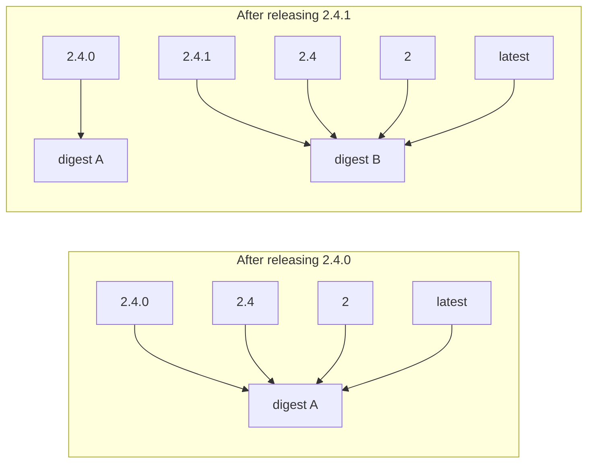

# Tagging and versioning strategy, and running your own registry

## In plain words

Books come in editions. "Third edition" tells a reader something useful: it is newer than the second, and page numbers may have moved. A reprint that only corrects spelling mistakes is not a new edition. Publishers follow rules about this so that readers, shops and libraries all mean the same thing.

Images need the same discipline. The previous lesson showed that a **tag** is a label you may attach to an image and move later. That is a mechanism. This lesson is about the rules a team agrees on: what the labels should look like, which ones may move and which must never move, and how long old images are kept. The usual scheme is **semantic versioning**: three numbers such as `2.4.1`, where each position has a meaning.

Why this matters for a job: when something breaks in production, the first question is "which version is running?". With a good tagging scheme the answer is immediate and you can go back to the previous version in one step. With a bad one, the answer is "`latest`", which tells nobody anything.

> **Before this lesson:** read [Registries, image references, tags and digests](#/lesson/docker/registries-tags-digests) first; this lesson relies on the terms registry, tag, digest, push and pull.

## Why this matters

The previous lesson showed that a tag is a movable pointer. That is a mechanism; this lesson is about policy. Which tags should a release carry? Which of them are allowed to move? What should the people consuming your image put in their Dockerfiles and deployment files? Where should the images live, and for how long?

These sound like housekeeping questions until something goes wrong. A base image is rebuilt under the same tag and forty downstream services change behaviour at their next build. An incident responder asks "what exactly is running in production?" and the answer is `api:latest`. A registry fills its disk with three years of CI builds nobody will ever pull. A good tagging scheme prevents all three, and it costs a few lines in a pipeline.

## What a tag is for

A tag answers a question for the person or system reading it. Different readers ask different questions:

| Reader | Question | Tag that answers it |
|---|---|---|
| Developer debugging | Which commit is this? | `git-4f2c9d1` |
| Release manager | Which release is this? | `2.4.1` |
| Downstream team | Give me fixes, never breaking changes | `2.4` or `2` |
| Operator deploying | Exactly these bytes, please | `@sha256:...` |
| Someone trying it out | Whatever is current | `latest` |

One image can and should carry several tags at once. They cost nothing: each is a pointer to the same manifest.

## Semantic versioning in sixty seconds

Most image versioning schemes borrow from semantic versioning: `MAJOR.MINOR.PATCH`.

- **PATCH** (`2.4.1` to `2.4.2`): bug and security fixes, no behaviour change you should notice.
- **MINOR** (`2.4.2` to `2.5.0`): new features, backwards compatible.
- **MAJOR** (`2.5.0` to `3.0.0`): breaking changes.

A pre-release suffix such as `3.0.0-rc.1` sorts *before* `3.0.0`. Comparison is numeric per field: `2.10.0` is newer than `2.9.3`, which is where naive string sorting goes wrong.

## The multi-tag release pattern

When version `2.4.1` is released, push the same image under a ladder of tags:

```bash
IMAGE=registry.harbourline.example/payments/ledger
docker build -t $IMAGE:2.4.1 .
docker image tag $IMAGE:2.4.1 $IMAGE:2.4
docker image tag $IMAGE:2.4.1 $IMAGE:2
docker image tag $IMAGE:2.4.1 $IMAGE:latest
docker image push --all-tags $IMAGE
```

```text
The push refers to repository [registry.harbourline.example/payments/ledger]
...
2: digest: sha256:9f2c... size: 1783
2.4: digest: sha256:9f2c... size: 1783
2.4.1: digest: sha256:9f2c... size: 1783
latest: digest: sha256:9f2c... size: 1783
```

Four tags, one digest. What each tag promises:

| Tag | Moves when | Consumer gets |
|---|---|---|
| `2.4.1` | Never (write-once) | One specific release |
| `2.4` | A new `2.4.x` is released | Latest patch of 2.4 |
| `2` | A new `2.x.y` is released | Latest minor and patch of 2 |
| `latest` | Any newer stable release | Newest stable |



A consumer chooses their own risk appetite. A team that writes `FROM .../ledger:2` accepts automatic minor upgrades; one that writes `2.4` takes only patches; one that writes `2.4.1` takes nothing until they edit the file.

The moving tags need care when you maintain more than one release line. If you ship `1.9.7` (a patch to the old line) after `2.4.1`, the pipeline must move `1.9` and `1`, but **not** `latest`. The rule is: a moving tag points to the highest version that matches its prefix. The function below computes the right pointers from a list of released versions; it is the logic a release pipeline needs.

```python-run
import re

def parse(v):
    m = re.fullmatch(r"(\d+)\.(\d+)\.(\d+)(?:-([0-9A-Za-z.]+))?", v)
    major, minor, patch, pre = m.groups()
    return (int(major), int(minor), int(patch), pre)

def key(v):
    major, minor, patch, pre = parse(v)
    return (major, minor, patch, pre is None, pre or "")   # a pre-release sorts before its final

def moving_tags(released):
    stable = [v for v in released if parse(v)[3] is None]
    tags = {}
    for v in sorted(stable, key=key):
        major, minor, _, _ = parse(v)
        tags[f"{major}.{minor}"] = v      # later (higher) versions overwrite
        tags[f"{major}"] = v
        tags["latest"] = v
    return tags

released = ["1.9.6", "2.4.0", "2.4.1", "1.9.7", "2.10.0", "2.9.3", "3.0.0-rc.1"]
for tag, target in sorted(moving_tags(released).items()):
    print(f"{tag:7s} -> {target}")
```

Note that `2` and `latest` point at `2.10.0`, not `2.9.3` (numeric comparison), and that the release candidate moves nothing.

> [!WARNING]
> Never re-push a full version tag. If `2.4.1` has a bug, release `2.4.2`. Consumers who pinned `2.4.1` did so because they wanted it not to change; replacing it breaks that promise invisibly. Turn on tag immutability in the registry if it offers it.

## Build identifiers for every commit

Releases are rare; builds are constant. Every CI build should produce an image with a unique, traceable tag even if it is never released.

```bash
SHA=$(git rev-parse --short=8 HEAD)
docker build \
  --label org.opencontainers.image.revision=$(git rev-parse HEAD) \
  --label org.opencontainers.image.created=$(date -u +%Y-%m-%dT%H:%M:%SZ) \
  -t $IMAGE:git-$SHA \
  -t $IMAGE:build-${BUILD_NUMBER} .
```

Common schemes, and what each gives you:

| Scheme | Example | Strength | Weakness |
|---|---|---|---|
| Git short SHA | `git-4f2c9d1e` | Maps straight to source | Not ordered; cannot tell newer from older by eye |
| CI build number | `build-1482` | Ordered | Meaningless outside that CI system |
| Date + SHA | `20260302-4f2c9d1e` | Ordered and traceable | Longer |
| Branch name | `main`, `feature-login` | Easy to find | Moves on every push; not an identity |
| Semantic version | `2.4.1` | Communicates compatibility | Needs a human or tool to decide the bump |

A practical combination: tag every build with the commit SHA; on a release, add the semantic version ladder to the image that was *already built and tested*. Do not rebuild for release. Rebuilding produces different bits from the ones you tested. **Promotion is re-tagging, not rebuilding:**

```bash
docker buildx imagetools create \
  --tag $IMAGE:2.4.1 --tag $IMAGE:2.4 --tag $IMAGE:2 --tag $IMAGE:latest \
  $IMAGE:git-4f2c9d1e
```

`imagetools create` adds tags on the registry side without pulling or pushing layers, and it preserves multi-platform indexes.

Record the same facts inside the image so that it can identify itself even when pulled by digest:

```bash
docker image inspect $IMAGE:2.4.1 --format '{{json .Config.Labels}}'
```

```text
{"org.opencontainers.image.created":"2026-03-02T09:14:07Z","org.opencontainers.image.revision":"4f2c9d1e8a6b...","org.opencontainers.image.version":"2.4.1"}
```

## What consumers should write

| Place | Recommended reference | Why |
|---|---|---|
| `FROM` in a Dockerfile | `image:2.4@sha256:...` plus an update bot | Reproducible builds, reviewed updates |
| Compose file for local dev | `image:2.4` | Convenience; pick up patches |
| Production manifest | `image:2.4.1@sha256:...` or digest only | Deployed bits equal tested bits |
| README quick start | `image:2` or `latest` | Low friction |
| CI test of a pull request | `image:git-<sha>` | Exactly this commit |

> [!INTERVIEW]
> "How would you tag images in a CI/CD pipeline?" Unique immutable tag per build (commit SHA), semantic version tags added on release by re-tagging the tested image, moving `major`/`major.minor` tags for consumers who want patches, deploy by digest, and never rely on `latest`. Mention retention policy to show you have operated a registry.

## Selecting a version by constraint

Tools that update dependencies need to answer "what is the newest tag satisfying this rule?". The common constraint forms are:

| Constraint | Meaning | Matches from `1.9.7, 2.4.0, 2.4.1, 2.10.0, 3.0.0` |
|---|---|---|
| `2.4.1` | Exactly | `2.4.1` |
| `~2.4.0` | Same major.minor, patch at least 0 | `2.4.1` |
| `^2.4.0` | Same major, at least 2.4.0 | `2.10.0` |
| `>=2.0.0 <3.0.0` | Range | `2.10.0` |
| `*` | Any stable | `3.0.0` |

Pre-releases are normally excluded unless the constraint itself names one. The tilde and caret forms correspond directly to the `2.4` and `2` moving tags, which is no accident: moving tags are a constraint baked into a name.

## Running your own registry

You do not need a hosted service to have a registry. The reference implementation is itself an image.

```bash
docker run -d --name registry --restart unless-stopped \
  -p 127.0.0.1:5000:5000 \
  -v registry-data:/var/lib/registry \
  registry:2
```

```bash
docker image tag harbour/ledger:dev localhost:5000/payments/ledger:2.4.1
docker image push localhost:5000/payments/ledger:2.4.1
curl -s localhost:5000/v2/_catalog
curl -s localhost:5000/v2/payments/ledger/tags/list
```

```text
{"repositories":["payments/ledger"]}
{"name":"payments/ledger","tags":["2.4.1"]}
```

The registry API is plain HTTP under `/v2/`. The volume matters: without it, every image is lost when the registry container is removed.

A local registry is useful for experiments, air-gapped environments, a pull-through cache in front of Docker Hub, and fast CI caches. For anything shared you need three more things the bare image does not give you by default:

1. **TLS.** Docker refuses plain HTTP to any host other than `localhost`. Either terminate TLS in the registry (mount a certificate and set `REGISTRY_HTTP_TLS_CERTIFICATE`/`KEY`) or put a reverse proxy in front.
2. **Authentication.** At minimum basic auth with an `htpasswd` file; in practice token auth integrated with your identity provider. An open registry lets anyone on the network overwrite your tags.
3. **Garbage collection and retention.** Deleting a tag removes a pointer, not the blobs. The registry needs a periodic garbage-collection run to reclaim unreferenced layers.

A pull-through cache needs only one extra setting:

```yaml
# registry config.yml (excerpt)
proxy:
  remoteurl: https://registry-1.docker.io
```

Point the Docker daemon at it with `"registry-mirrors": ["https://mirror.harbourline.example"]` in `daemon.json`, and repeated pulls of public images are served locally, which also shields CI from upstream rate limits.

For production most teams choose a managed registry or run Harbor, which adds users and projects, vulnerability scanning, signing, replication and retention rules on top of the same storage model.

## Retention: what to keep

Without a policy a registry grows without bound. A sensible default:

| Tag pattern | Keep |
|---|---|
| Semantic version releases | Forever, or N years for compliance |
| Anything currently deployed | Always (protect by digest) |
| `git-*` builds from the main branch | Last 30 to 90 days |
| Pull-request / feature-branch builds | 7 to 14 days |
| Untagged manifests | Delete after a day or two |

"Untagged" deserves a note. When a moving tag is re-pointed, the old manifest loses its name but stays in storage; only its digest can reach it. If something is deployed by that digest, deleting untagged manifests breaks the next pull on a fresh node. Retention rules must know what is in use.

## Signing and provenance, briefly

A digest proves the bytes are the same as before. It does not prove who built them. Image **signing** (Sigstore's `cosign`, or Notation) attaches a cryptographic signature to the digest in the registry; an admission policy can then refuse anything unsigned. Build **provenance** attestations and a software bill of materials can be generated at build time:

```bash
docker buildx build --provenance=mode=max --sbom=true -t $IMAGE:2.4.1 --push .
```

You do not need these on day one, but know that they exist and that they attach to digests, another reason digests are the unit that matters.

## Pitfalls

- **String-sorting versions.** `2.9.3` sorts after `2.10.0` alphabetically. Parse into integers.
- **Moving `latest` on a maintenance release.** A patch to the 1.x line must not move `latest` backwards.
- **Rebuilding for release.** Different base patch level, different dependency resolution, different bits. Re-tag the tested image.
- **Branch tags as deployment targets.** `main` moves on every merge; you are deploying an unknown.
- **No labels.** An image pulled by digest with no `revision` label cannot be traced to source.
- **Deleting by age alone.** The oldest image may be the one in production.
- **A registry without a volume, TLS or auth.** Fine on `localhost` for a demo; a liability anywhere else.

## Cheat sheet

| Task | Command or rule |
|---|---|
| Tag one build many ways | `docker build -t R:2.4.1 -t R:2.4 -t R:2 .` |
| Push every local tag of a repo | `docker image push --all-tags R` |
| Promote without rebuilding | `docker buildx imagetools create -t R:2.4.1 R:git-<sha>` |
| Unique build tag | `git-$(git rev-parse --short=8 HEAD)` |
| Standard labels | `org.opencontainers.image.{revision,version,created,source}` |
| Local registry | `docker run -d -p 127.0.0.1:5000:5000 -v registry-data:/var/lib/registry registry:2` |
| List repos / tags | `GET /v2/_catalog`, `GET /v2/<repo>/tags/list` |
| Full versions | Write-once |
| Moving tags | Highest stable version matching the prefix |
| Production reference | Digest, optionally with a tag for readability |

## Summary

- Give each image several tags because different readers need different promises: a unique build ID, an immutable release version, moving major and minor tags, and optionally `latest`.
- Full version tags are write-once; moving tags track the highest matching stable version, compared numerically.
- Build once, test, then promote by adding tags to the same digest.
- Consumers pick their update policy by choosing which tag to follow, and pin digests where reproducibility matters.
- A registry is easy to run and needs TLS, authentication, persistent storage, garbage collection and a retention policy to be production-worthy.
- Signatures and attestations attach to digests and answer "who built this, from what".

## Glossary

| Term | Meaning |
|---|---|
| Semantic versioning | Version numbers of the form MAJOR.MINOR.PATCH with agreed meanings |
| Major / minor / patch | Breaking change / new compatible feature / fix |
| Pre-release | A version before the final one, such as `3.0.0-rc.1` |
| Moving tag | A tag such as `2` or `2.4` that is re-pointed at each new matching release |
| Immutable tag | A tag that is never re-pointed once pushed |
| Commit SHA | The identifier of one saved change in Git |
| Promotion | Advancing an already built and tested image to the next environment by adding tags |
| Constraint | A rule describing acceptable versions, such as `^2.4.0` |
| Label | A key-value note stored inside an image's metadata |
| Retention policy | Rules for how long images are kept in a registry |
| Garbage collection | Removing stored data that nothing refers to any more |
| Pull-through cache | A local registry that keeps copies of images fetched from another registry |
| Signing | Attaching a cryptographic proof of who published an image |

## Check yourself

```quiz
[
  {"q": "Version 3.2.5 is released. Following the multi-tag pattern, which tags should now point at it?",
   "options": ["Only 3.2.5", "3.2.5, 3.2, 3 and latest", "3.2.5 and latest only", "3 and latest only"],
   "answer": 1,
   "explain": "The full version is created, and the moving minor, major and latest tags are advanced to the same digest, assuming 3.2.5 is the highest stable release."},
  {"q": "After 2.4.1 is out, a patch 1.9.7 is released for the old line. Which tags move?",
   "options": ["1.9, 1 and latest", "1.9 and 1 only", "latest only", "None"],
   "answer": 1,
   "explain": "Moving tags point to the highest version matching their prefix. 1.9.7 is the highest 1.9.x and 1.x.y, but it is lower than 2.4.1, so latest stays where it is."},
  {"q": "Which is newer under semantic versioning: 2.9.3 or 2.10.0?",
   "options": ["2.9.3, because 9 is greater than 1", "2.10.0, because fields are compared as integers", "They are equal", "It cannot be determined"],
   "answer": 1,
   "explain": "Each dot-separated field is a number. Minor 10 is greater than minor 9. String comparison gets this wrong."},
  {"q": "A bug is found in the released image 2.4.1. What is the right action?",
   "options": ["Fix it, rebuild and push 2.4.1 again", "Release 2.4.2 and move the 2.4, 2 and latest tags", "Delete 2.4.1 from the registry", "Push the fix as latest only"],
   "answer": 1,
   "explain": "Full version tags are immutable by convention. Consumers pinned to 2.4.1 keep what they tested; those following 2.4 get the fix automatically."},
  {"q": "Why should a release be promoted by re-tagging the CI image instead of rebuilding from the release commit?",
   "options": ["Rebuilding is not allowed by registries", "A rebuild may produce different bytes (newer base, different dependency resolution), so it is not the image that was tested", "Re-tagging compresses the image", "Rebuilds cannot be labelled"],
   "answer": 1,
   "explain": "Build once, promote the same digest through environments. Only then does test evidence apply to what is deployed."},
  {"q": "What happens to the old manifest when a moving tag such as `2.4` is re-pointed?",
   "options": ["It is deleted immediately", "It stays in the registry, reachable only by digest, until garbage collection or a retention rule removes it", "It is renamed to 2.4-old", "It is merged into the new manifest"],
   "answer": 1,
   "explain": "Tags are pointers. Moving one leaves the previous manifest untagged but present, which is why digest-based deployments keep working, and why retention rules must check usage."},
  {"q": "You start `registry:2` without a volume and later remove the container. What happens to pushed images?",
   "options": ["They remain in Docker's image cache", "They are lost, because they were stored in the container's writable layer", "They are uploaded to Docker Hub", "They are kept in the registry image"],
   "answer": 1,
   "explain": "Registry data lives under /var/lib/registry inside the container. Without a volume that path is in the writable layer and is deleted with the container."},
  {"q": "A team writes `FROM registry.example/base/python:3` in their Dockerfile. What have they agreed to?",
   "options": ["Never receiving updates", "Automatically receiving any 3.x.y release at their next uncached build", "Receiving only patch releases of one minor version", "Pinning to one digest"],
   "answer": 1,
   "explain": "The major tag follows the highest 3.x.y. That includes new minor versions, so features and fixes arrive without an edit, at the cost of less reproducibility."}
]
```

> **Source:** Stoneman, *Learn Docker in a Month of Lunches*, ch. 5 (topic coverage). Checked against <https://semver.org/>, <https://distribution.github.io/distribution/> and <https://docs.docker.com/reference/cli/docker/buildx/imagetools/create/>. All wording and examples are original.
