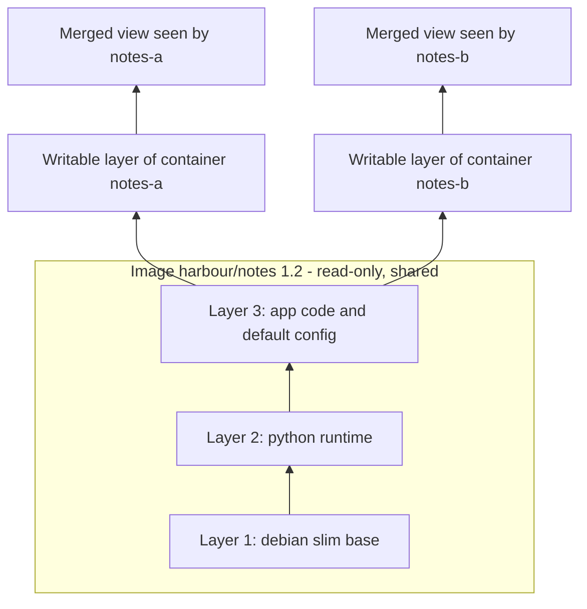

# The writable layer and copy-on-write

## In plain words

Picture a printed textbook that many students share. Nobody is allowed to write in the book itself. Each student lays a sheet of clear plastic over a page and writes on that. Looking down through the plastic, a student sees the printed page together with their own notes. Another student has a different sheet and sees different notes. When a student leaves, their sheet goes in the bin, and the book is exactly as it was.

A container's files work the same way. The **image** is the printed book: read-only and shared. Each container gets its own clear sheet on top, called the **writable layer**. Every file the container creates or changes is recorded on that sheet. When the container is removed, the sheet is thrown away.

Why this matters for a job: sooner or later everyone loses data by storing it inside a container, and then replacing the container during an upgrade. Understanding exactly where a file write goes, and how long that place lasts, is what prevents it. It also explains a popular interview puzzle: why deleting a file in a Dockerfile does not make the image smaller.

> **Before this lesson:** you need the picture of an image as a stack of layers from [What a container is](#/lesson/docker/what-is-a-container) and the container lifecycle from [Running, inspecting and stopping containers](#/lesson/docker/running-containers).

## Why this matters

Sooner or later everyone loses data in a container. The pattern is always the same: an application writes to its filesystem, everything appears to work, the container is replaced by a new version, and the uploads, the SQLite file or the session store are gone. Nothing malfunctioned. The data was written to a place whose lifetime is tied to one container.

To choose correctly between "leave it in the container", "put it in a volume" and "mount a host directory", you need to know precisely where a write lands and how long that place lasts. This lesson covers the first half: the container's own filesystem. The next covers the alternatives.

## A container's filesystem is a stack

Recall the picture from the first lesson. An image is an ordered list of read-only layers. When a container is created, the engine adds one thin read-write layer on top and mounts the whole stack as a single tree.



Two containers from the same image share all three image layers and each gets a private writable layer. Whatever `notes-a` writes is invisible to `notes-b`.

With the default `overlay2` storage driver, these are real directories on the host:

```bash
docker run -d --name notes-a harbour/notes:1.2
docker inspect notes-a --format '{{json .GraphDriver.Data}}' | python -m json.tool
```

```text
{
    "LowerDir": "/var/lib/docker/overlay2/7c1e.../diff:/var/lib/docker/overlay2/3ab9.../diff:/var/lib/docker/overlay2/e04f.../diff",
    "MergedDir": "/var/lib/docker/overlay2/b8d2.../merged",
    "UpperDir": "/var/lib/docker/overlay2/b8d2.../diff",
    "WorkDir": "/var/lib/docker/overlay2/b8d2.../work"
}
```

- `LowerDir` is the colon-separated list of image layer directories, topmost first.
- `UpperDir` is this container's writable layer.
- `MergedDir` is the unified view that becomes the container's `/`.
- `WorkDir` is scratch space OverlayFS needs for atomic operations.

## The four operations

Everything a process does to files reduces to four cases.

### Read

The filesystem looks for the path in the upper directory, then in each lower directory from top to bottom, and returns the first match. A file that exists in several layers is taken from the highest one; the lower versions are shadowed.

### Create

A brand-new file is written into the upper directory.

### Modify: copy-on-write

Modifying a file that lives in an image layer cannot change that layer. Instead, on the first write the driver performs a **copy-up**: it copies the *entire file* from the lower layer into the upper directory, and then applies the change to the copy. From then on reads find the upper copy first.

```bash
docker exec notes-a sh -c 'echo "theme = dark" >> /app/config/defaults.ini'
docker diff notes-a
```

```text
C /app
C /app/config
C /app/config/defaults.ini
```

The first command, `docker exec notes-a sh -c '...'`, runs a small shell command inside the running container; `>>` appends a line to the named file. The second, `docker diff notes-a`, lists what the container has changed compared with its image.

`C` means changed. The parent directories are listed because their entries were copied up too.

### Delete: whiteouts

A file in a lower layer cannot be removed either. Deleting it creates a **whiteout** in the upper directory: a special marker (in OverlayFS, a character device with device number 0/0) with the same name. A lookup that meets a whiteout stops and reports that the file does not exist. Deleting a whole directory and recreating it produces an **opaque directory**, which hides everything beneath it in lower layers.

```bash
docker exec notes-a rm /app/config/sample-notes.json
docker diff notes-a
```

```text
C /app
C /app/config
C /app/config/defaults.ini
D /app/config/sample-notes.json
```

`D` is the whiteout. The original bytes are still in layer 3.

The simulation below implements all four operations, including opaque directories, and prints what `docker diff` would show.

```python-run
WH, OPAQUE = "<whiteout>", "<opaque>"

class Overlay:
    def __init__(self, lowers):
        self.lowers = lowers            # list of dicts, bottom first
        self.upper = {}
    def _stack(self):
        return [self.upper] + self.lowers[::-1]      # search order: top first
    def read(self, path):
        for layer in self._stack():
            if path in layer:
                return None if layer[path] == WH else layer[path]
            # an opaque marker on any ancestor hides lower layers
            parts = path.rstrip("/").split("/")
            if any(layer.get("/".join(parts[:i]) or "/") == OPAQUE for i in range(1, len(parts))):
                return None
        return None
    def write(self, path, data):
        existed_below = any(path in l and l[path] != WH for l in self.lowers)
        self.upper[path] = data
        return "copy-up + modify" if existed_below else "create"
    def delete(self, path):
        if any(path in l for l in self.lowers):
            self.upper[path] = WH       # must hide the lower copy
        else:
            self.upper.pop(path, None)  # only existed in upper: really gone
    def diff(self):
        out = []
        for p, v in sorted(self.upper.items()):
            below = any(p in l for l in self.lowers)
            out.append(("D " if v == WH else "C " if below else "A ") + p)
        return out

fs = Overlay([{"/etc/hostname": "base"},
              {"/app/defaults.ini": "theme = light", "/app/sample.json": "[]"}])
print(fs.write("/app/defaults.ini", "theme = dark"))
print(fs.write("/app/notes.db", "<binary>"))
fs.delete("/app/sample.json")
fs.write("/tmp/scratch", "x"); fs.delete("/tmp/scratch")
print("read sample.json ->", fs.read("/app/sample.json"))
print("read defaults.ini ->", fs.read("/app/defaults.ini"))
print("\n".join(fs.diff()))
print("lower layer untouched:", fs.lowers[1]["/app/defaults.ini"])
```

Notice the last operation pair: a file created and deleted within the writable layer leaves no trace, because there was nothing below to hide.

## Lifetime: what survives what

This table is the heart of the lesson.

| Event | Writable layer |
|---|---|
| Process inside restarts (same container) | Kept |
| `docker stop` then `docker start` | Kept |
| `docker restart` | Kept |
| Host reboot (container not removed) | Kept |
| `docker rm` | **Deleted** |
| `docker run --rm` when the process exits | **Deleted** |
| `docker compose up` after changing the image or config (container is *recreated*) | **Deleted** |
| `docker compose down` | **Deleted** |
| Orchestrator replaces the container (update, node failure, rescheduling) | **Deleted** |

The first four lines lull people into trusting the writable layer: you stop the container, start it again, and the data is still there. The last five are what happens in every real deployment. **Updating an application means replacing its container**, and replacing a container discards its writable layer.

Demonstration:

```bash
docker run -d --name notes-a harbour/notes:1.2
docker exec notes-a sh -c 'echo "buy milk" > /app/data/notes.txt'
docker stop notes-a && docker start notes-a
docker exec notes-a cat /app/data/notes.txt
```

```text
buy milk
```

```bash
docker rm -f notes-a
docker run -d --name notes-a harbour/notes:1.3      # the "upgrade"
docker exec notes-a cat /app/data/notes.txt
```

```text
cat: can't open '/app/data/notes.txt': No such file or directory
```

> [!WARNING]
> "It survived a restart" is not evidence that data is safe. Test persistence by removing the container and creating a new one, because that is what an upgrade does.

## Getting data out of a writable layer

If you are stuck with data in a container's layer, there are escape hatches. All of them work on stopped containers, so do not remove it yet.

```bash
docker cp notes-a:/app/data ./rescued-data          # copy files out
docker export notes-a -o notes-a-rootfs.tar         # the whole merged filesystem as a tarball
docker commit notes-a harbour/notes:rescued         # freeze the writable layer as a new image layer
```

`docker commit` turns the writable layer into an image layer. It is occasionally useful for forensics ("keep the exact state of the broken container"). It is a poor way to build images, because the result has no Dockerfile and cannot be reproduced.

## Performance characteristics

Copy-on-write is cheap for the use it was designed for, a filesystem that is mostly read. It has costs when a workload writes heavily.

| Behaviour | Cost | Consequence |
|---|---|---|
| First write to a file from a lower layer | Whole file is copied up, regardless of how little changes | Appending one line to a 2 GB file copies 2 GB once |
| Subsequent writes to the same file | Normal | Only the first write pays |
| Many layers | Lookup may traverse the stack | Negligible for dozens of layers thanks to caching |
| Writes in general | Go through OverlayFS, not directly to the backing filesystem | Slower than a volume for write-heavy loads |
| Growth | Writable layer shares the host's Docker storage, with no size limit by default | A runaway log file can fill the host disk |

For databases, queues, search indexes and anything else that writes constantly, a **volume** bypasses the storage driver and writes to the host filesystem directly. That is faster and, as the next lesson shows, has the right lifetime.

See how much each container has written:

```bash
docker ps -s --format 'table {{.Names}}\t{{.Size}}'
```

```text
NAMES      SIZE
notes-a    1.2MB (virtual 187MB)
notes-b    0B (virtual 187MB)
```

The first number is the writable layer; "virtual" adds the shared image layers. Twenty containers from this image cost 187 MB once plus twenty small writable layers, not twenty times 187 MB.

## Why deleting files in a Dockerfile does not shrink the image

The same mechanics apply at build time. Each `RUN` executes in a temporary container; when it finishes, that container's writable layer is saved as a new image layer. So:

```dockerfile
FROM debian:bookworm-slim
RUN apt-get update && apt-get install -y build-essential      # layer A: +350 MB
RUN make -C /src install                                      # layer B: + your binaries
RUN apt-get purge -y build-essential && apt-get autoremove -y # layer C: whiteouts only
```

Layer C contains whiteouts hiding the compiler. Layer A still contains the compiler. The image is still 350 MB heavier, and anyone who extracts layer A can read whatever was "deleted". This matters doubly for secrets:

```dockerfile
COPY id_ed25519 /root/.ssh/id_ed25519          # layer with the private key
RUN git clone git@git.example:harbour/private.git
RUN rm /root/.ssh/id_ed25519                   # too late: the key is in the earlier layer
```

```bash
docker save harbour/leaky:1 -o leaky.tar && tar -tf leaky.tar | head
```

Anyone with the image can unpack the layer tarballs and recover the key. The remedies are to do the add and the remove in a single `RUN`, to use a multi-stage build so the sensitive layer never reaches the final image, or best, to use a build secret mount that never writes the secret to any layer.

> [!INTERVIEW]
> "I delete a big file in my Dockerfile but the image is no smaller. Why?" Because every instruction creates an immutable layer and a delete is only a whiteout in a new layer. Fix by cleaning up in the same `RUN` that created the files, or by using a multi-stage build and copying only the artefacts.

## Read-only root filesystems

If nothing important should be written to the writable layer, you can forbid writing to it altogether:

```bash
docker run -d --name notes-ro --read-only --tmpfs /tmp --tmpfs /run \
  -v notes-data:/app/data harbour/notes:1.3
docker exec notes-ro touch /app/hack.txt
```

```text
touch: /app/hack.txt: Read-only file system
```

With `--read-only` the upper layer is not writable. The application can write only to the places you explicitly provide: a volume for real data, in-memory `tmpfs` mounts for scratch files. This is both a security measure (an attacker cannot drop a binary or alter the code) and a discipline: it makes every write location an explicit decision.

Finding out where an app writes is easy. Run it normally, exercise it, and ask:

```bash
docker diff notes-a | grep -v '^C /app$'
```

```text
A /app/data/notes.db
A /tmp/upload-3f9a.part
A /var/cache/notes/thumbs/1.png
C /var/log/notes.log
```

Each line is a decision: `notes.db` needs a volume, `/tmp` a tmpfs, the cache perhaps a tmpfs or a volume, and the log file should go to stdout instead.

## Pitfalls

- **Treating stop/start survival as persistence.** Replacement, not restart, is the real test.
- **Storing database files in the writable layer.** Slow and doomed.
- **`docker commit` as a workflow.** Unreproducible images with hidden history.
- **Assuming delete means gone.** Whiteouts hide; they do not erase. Applies to size and to secrets.
- **Large files modified in place.** The first write copies the entire file up.
- **Unbounded growth.** Logs or temp files in the writable layer can exhaust the host's Docker storage and take down every container on it.
- **Expecting two containers to share files through the image.** Each has a private upper layer; sharing needs a volume.

## Cheat sheet

| Question | Command |
|---|---|
| What has this container written? | `docker diff NAME` |
| How big is its writable layer? | `docker ps -s` |
| Where are the overlay directories? | `docker inspect NAME --format '{{json .GraphDriver.Data}}'` |
| Rescue files | `docker cp NAME:/path ./dest` |
| Snapshot the state as an image | `docker commit NAME repo:tag` |
| Dump the merged filesystem | `docker export NAME -o rootfs.tar` |
| Forbid writes | `docker run --read-only --tmpfs /tmp ...` |
| Storage driver in use | `docker info --format '{{.Driver}}'` |

| `docker diff` letter | Meaning |
|---|---|
| `A` | Added: exists only in the writable layer |
| `C` | Changed: copied up and modified (or a directory whose contents changed) |
| `D` | Deleted: whiteout hiding a lower-layer file |

## Summary

- A container's root filesystem is the image's read-only layers plus one private writable layer, merged by a union filesystem.
- Reads search top-down; new files go to the top; modifying a lower file copies the whole file up first; deleting a lower file writes a whiteout.
- The writable layer lives exactly as long as the container. It survives stop and start, and is destroyed by removal, recreation and orchestrated replacement, which is how upgrades happen.
- Copy-on-write is efficient for read-mostly filesystems and a poor fit for write-heavy data.
- At build time the same rules mean a later instruction can hide but never remove what an earlier layer added.
- `--read-only` makes every write location explicit, and `docker diff` tells you what those locations need to be.

## Glossary

| Term | Meaning |
|---|---|
| Writable layer | The private, top layer of a container where its file changes are stored |
| Read-only layer | An image layer; it can be read by many containers and changed by none |
| Union filesystem | A filesystem that merges stacked layers into one view |
| OverlayFS / overlay2 | The Linux union filesystem and Docker's storage driver built on it |
| Storage driver | The Docker component that implements layered filesystems |
| Copy-on-write | Copying a file up into the writable layer on its first modification |
| Copy-up | The copy made by copy-on-write |
| Whiteout | A marker that hides a lower-layer file after it is deleted |
| Opaque directory | A marker that hides everything below a recreated directory |
| Persistence | Data surviving beyond the life of a container |
| `docker diff` | Shows what a container added (A), changed (C) or deleted (D) |
| Read-only root filesystem | A container started with `--read-only`, which cannot write to its own layers |

## Check yourself

```quiz
[
  {"q": "A container appends one line to a 1 GB file that exists in an image layer. What does the storage driver do on that first write?",
   "options": ["Appends the line to the image layer", "Copies the whole 1 GB file into the writable layer, then appends", "Stores only the one-line difference", "Refuses the write"],
   "answer": 1,
   "explain": "OverlayFS copy-up works on whole files. The first modification pays for a full copy; later writes hit the upper copy directly."},
  {"q": "Which event destroys a container's writable layer?",
   "options": ["docker stop followed by docker start", "docker restart", "A host reboot", "docker rm, or the container being recreated for an upgrade"],
   "answer": 3,
   "explain": "Stop, start, restart and reboot keep the container object and its upper directory. Removing or replacing the container deletes it."},
  {"q": "`docker diff web` prints `D /etc/motd`. What is physically in the writable layer?",
   "options": ["Nothing; the file was removed from the image", "A whiteout marker named motd that hides the lower-layer file", "A zero-byte copy of the file", "A symlink to /dev/null"],
   "answer": 1,
   "explain": "Lower layers are immutable. The delete is recorded as a whiteout in the upper directory, which makes lookups stop and report the file as missing."},
  {"q": "Two containers are started from the same image. Container A edits /app/settings.json. What does container B see?",
   "options": ["A's edited version", "The original from the image", "An error, the file is locked", "An empty file"],
   "answer": 1,
   "explain": "The edit was copied up into A's private writable layer. B's stack still resolves the path to the shared read-only image layer."},
  {"q": "A Dockerfile copies an SSH key in one instruction and removes it with `RUN rm` two instructions later. Is the key in the final image?",
   "options": ["No, rm removed it", "Yes, it remains in the earlier layer and can be extracted from the image", "Only if the image is pushed", "Only with the overlay2 driver"],
   "answer": 1,
   "explain": "The rm layer contains only a whiteout. The layer created by COPY still holds the key bytes and ships with the image."},
  {"q": "What does `docker ps -s` report as `2MB (virtual 310MB)`?",
   "options": ["2 MB of RAM and 310 MB of swap", "2 MB in the container's writable layer; 310 MB including shared image layers", "2 MB compressed, 310 MB uncompressed", "2 MB of logs and 310 MB of volumes"],
   "answer": 1,
   "explain": "The first figure is the per-container upper layer. The virtual size adds the read-only image layers, which are shared with other containers from the same image."},
  {"q": "Why is the writable layer a poor home for a database's data files?",
   "options": ["Databases cannot run in containers", "Writes go through the union filesystem (slower) and the data disappears when the container is replaced", "The writable layer is limited to 10 MB", "Files there cannot be fsynced"],
   "answer": 1,
   "explain": "Both performance and lifetime are wrong. Volumes bypass the storage driver and outlive the container."},
  {"q": "A container runs with `--read-only --tmpfs /tmp -v data:/var/lib/app`. Where can the process write?",
   "options": ["Anywhere", "Nowhere", "Only /tmp (in memory) and /var/lib/app (the volume)", "Only its home directory"],
   "answer": 2,
   "explain": "--read-only makes the root filesystem's upper layer unwritable. Mounts are separate filesystems and keep their own permissions, so the tmpfs and the volume remain writable."}
]
```

> **Source:** Stoneman, *Learn Docker in a Month of Lunches*, ch. 6 (topic coverage). Checked against <https://docs.docker.com/engine/storage/drivers/> and <https://docs.docker.com/engine/storage/drivers/overlayfs-driver/>. All wording and examples are original.
