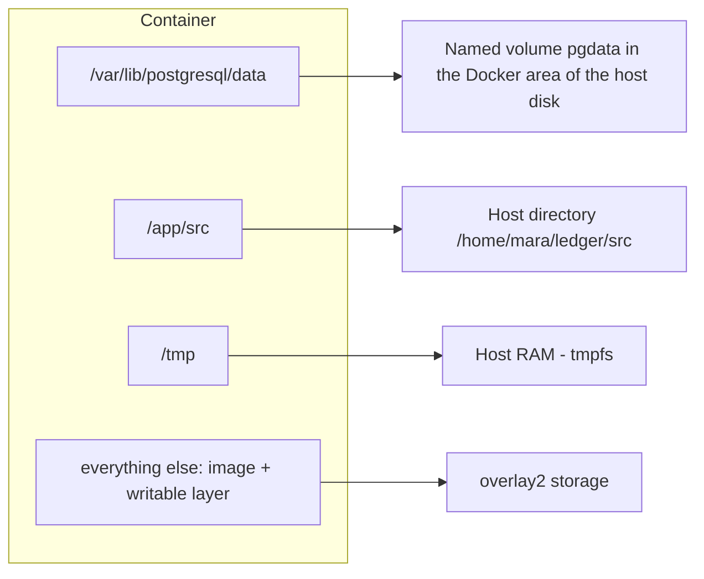

# Volumes, bind mounts and tmpfs

## In plain words

The previous lesson ended with a warning: anything a container writes into its own filesystem is thrown away when the container is removed. So where should a database keep its data?

Think of a laptop and an external hard drive. If the laptop is replaced, whatever was on its internal disk goes with it, but the external drive can be unplugged and connected to the new laptop with everything intact. Docker lets you plug outside storage into a container in the same way. Attaching storage at a particular folder is called **mounting**, and there are three kinds:

- a **volume**: an external drive that Docker looks after for you and that you refer to by name;
- a **bind mount**: a specific folder on your own computer that is shared with the container;
- a **tmpfs mount**: a scratch pad that lives only in memory and is wiped when the container stops.

Why this matters for a job: every real application has data that must survive upgrades. "What is the difference between a volume and a bind mount?" is one of the most frequently asked Docker interview questions.

> **Before this lesson:** read [The writable layer and copy-on-write](#/lesson/docker/writable-layer) first. You should also be comfortable with `docker run` options from [Running, inspecting and stopping containers](#/lesson/docker/running-containers).

## Why this matters

The writable layer dies with its container. Real applications have state that must not: database files, user uploads, message queues, TLS certificates, caches that take an hour to warm. Docker's answer is to **mount** storage with an independent lifetime into the container's directory tree.

There are three kinds of mount, and choosing between them is one of the standard interview questions because each is right for a different job:

- a **volume**, storage created and managed by Docker;
- a **bind mount**, a specific directory or file on the host, mapped in;
- a **tmpfs mount**, memory-backed scratch space that never touches disk.

All three look identical from inside the container: a directory like any other. They differ in where the bytes live, who manages them and how long they last.



## How a mount changes the picture

A mount replaces a path in the container's filesystem with a different filesystem. Whatever the image had at that path is **hidden** for as long as the mount is in place. Writes to the path go straight to the mounted storage, bypassing the union filesystem entirely: no copy-on-write, native speed, and nothing recorded in the writable layer (`docker diff` shows nothing under a mount point).

## Named volumes

A volume is a directory that Docker owns, by default under `/var/lib/docker/volumes/<name>/_data` on the host (inside the Linux VM on Docker Desktop). You refer to it by name and never need to know the path.

```bash
docker volume create pgdata
docker run -d --name db \
  -e POSTGRES_PASSWORD=devonly \
  -v pgdata:/var/lib/postgresql/data \
  postgres:16
```

Create some data, then destroy the container and start a different one on the same volume:

```bash
docker exec db psql -U postgres -c "create table notes(body text); insert into notes values ('survive me');"
docker rm -f db
docker run -d --name db2 -e POSTGRES_PASSWORD=devonly -v pgdata:/var/lib/postgresql/data postgres:16
docker exec db2 psql -U postgres -t -c "select body from notes;"
```

```text
 survive me
```

The data outlived the container because it was never in the container.

Step by step: `docker exec db psql ...` ran the database's own command-line client inside the container to create a table and insert one row. `docker rm -f db` deleted that container completely. `docker run ... -v pgdata:...` started a brand-new container attached to the same volume, and the final command read the row back.

```bash
docker volume ls
docker volume inspect pgdata
```

```text
DRIVER    VOLUME NAME
local     pgdata

[
    {
        "CreatedAt": "2026-03-02T09:30:11Z",
        "Driver": "local",
        "Labels": null,
        "Mountpoint": "/var/lib/docker/volumes/pgdata/_data",
        "Name": "pgdata",
        "Options": null,
        "Scope": "local"
    }
]
```

Properties of volumes:

- **Lifecycle is independent.** Removing a container never removes a named volume. You delete it explicitly with `docker volume rm` (refused while any container, even a stopped one, references it).
- **Auto-created.** `-v pgdata:/path` creates `pgdata` if it does not exist.
- **Pre-populated on first use.** If a *new, empty* volume is mounted over a directory that has content in the image, Docker copies that content into the volume first. This is why a fresh Postgres volume gets the right ownership, and why config defaults baked into an image appear in a new volume. It happens once, only for volumes (not bind mounts), and only when the volume is empty.
- **Portable across hosts in the abstract.** The same `-v pgdata:/path` works on any Docker host, whatever its directory layout or operating system.
- **Pluggable.** A volume driver can back a volume with NFS, a cloud block device or a clustered filesystem. The `local` driver itself can mount NFS: `docker volume create --driver local --opt type=nfs --opt o=addr=10.0.0.5,rw --opt device=:/exports/pgdata pgdata`.

### Anonymous volumes

If you give only a container path, `-v /var/lib/postgresql/data`, or if the image declares `VOLUME /var/lib/postgresql/data` and you mount nothing there, Docker creates a volume with a random 64-character name. The data is outside the writable layer, so it is fast, but nothing ties it to the next container: a replacement gets a fresh anonymous volume and the old one lingers as an orphan.

```bash
docker volume ls --filter dangling=true
```

```text
DRIVER    VOLUME NAME
local     4a1f0c9e7b6d5a3c2e1f0b9a8d7c6e5f4a3b2c1d0e9f8a7b6c5d4e3f2a1b0c9d
```

Anonymous volumes are removed by `docker rm -v`, by `--rm`, and by `docker volume prune`. Prefer named volumes for anything you care about.

## Bind mounts

A bind mount maps an existing host path into the container.

```bash
docker run -d --name ledger-dev \
  -p 8000:8000 \
  -v "$(pwd)/src":/srv/ledger/src \
  harbour/ledger:dev
```

Edit a file under `./src` on the host and the container sees the change instantly, because it is the same file. That makes bind mounts the tool for local development with a live-reloading server, for handing a container a config file, and for collecting build output on the host.

```bash
docker run --rm -v "$(pwd)":/work -w /work golang:1.23 go build -o bin/beacon ./cmd/beacon
ls bin/
```

```text
beacon
```

The compiler ran in a container; the binary landed on the host.

Properties of bind mounts:

- **The host path must be absolute** with `-v` (or begin with `./` or `~`, depending on the shell and Docker version; an unqualified word is interpreted as a *volume name*, a classic source of confusion).
- **No pre-population.** The host directory replaces the image's directory. If the host directory is empty, the container sees an empty directory, even though the image had files there.
- **Host coupling.** The mount depends on that exact path existing on that host, with suitable permissions.
- **Permissions are numeric.** The kernel compares UID and GID numbers. A container process running as UID 10001 writing to a host directory owned by UID 1000 gets "permission denied"; files created by a root container show up on the host owned by root.
- **Full power over the host path.** A writable bind mount lets the container change or delete host files. Mounting `/` or `/var/run/docker.sock` effectively gives the container control of the host.

Read-only mounts reduce the risk:

```bash
docker run -d -v "$(pwd)/nginx.conf":/etc/nginx/nginx.conf:ro nginx:1.27-alpine
```

> [!WARNING]
> With `-v`, if the host path does not exist Docker **creates it as an empty directory owned by root**. Mistype a config file's path and you get a directory where the app expected a file, typically followed by a confusing "is a directory" error. The `--mount` syntax fails with a clear error instead.

### The masking trap

A bind mount hides whatever the image placed at the target. The textbook case is Node:

```bash
docker run -v "$(pwd)":/app harbour/storefront:dev
```

```text
Error: Cannot find module 'express'
```

The image had `/app/node_modules`, installed at build time. The bind mount replaced all of `/app` with the host's project directory, which has no `node_modules` (or has one built for a different operating system). The usual fix is to mount a volume *on top of* the bind mount for that subdirectory, since deeper mount points win:

```bash
docker run -v "$(pwd)":/app -v storefront_modules:/app/node_modules harbour/storefront:dev
```

## tmpfs mounts

A tmpfs mount is backed by memory. Nothing is written to disk, nothing persists, and nothing is shared between containers.

```bash
docker run -d --name api --read-only \
  --tmpfs /tmp:rw,noexec,nosuid,size=64m \
  harbour/ledger:1.8.0
docker exec api df -h /tmp
```

```text
Filesystem      Size  Used Avail Use% Mounted on
tmpfs            64M     0   64M   0% /tmp
```

Use it for scratch files with a read-only root filesystem, for secrets that should never reach a disk, and for small high-churn temporary data. The memory used counts against the container's memory limit, so give it a `size`.

## Choosing

| | Named volume | Bind mount | tmpfs |
|---|---|---|---|
| Where data lives | Docker-managed area on the host (or a driver's backend) | A host path you choose | RAM |
| Created by | Docker, on demand | Must already exist (or `-v` makes an empty dir) | Docker, at start |
| Survives container removal | Yes | Yes (it is an ordinary host directory) | No |
| Pre-populated from image | Yes, if empty | No | No |
| Portable across hosts | Yes (name only) | No (depends on host path) | Yes |
| Host can edit files easily | Awkward | Yes, that is the point | No |
| Performance on Linux | Native | Native | Fastest |
| Performance on Docker Desktop | Native (inside the VM) | Slower (crosses the VM file-sharing boundary) | Native |
| Typical use | Databases, uploads, anything persistent in production | Source code in development, config files, build output | Scratch space, secrets |

> [!INTERVIEW]
> "Volume or bind mount?" A volume is managed by Docker, referenced by name, portable and pre-populated: the default for persistent application data. A bind mount exposes a specific host path: ideal for development and for injecting host files, but it couples the container to the host layout and to host permissions. Finish with tmpfs for non-persistent, memory-only data.

## Two syntaxes: -v and --mount

`-v` (`--volume`) packs everything into one colon-separated string. `--mount` uses explicit key-value pairs.

```bash
# Named volume
docker run -v pgdata:/var/lib/postgresql/data postgres:16
docker run --mount type=volume,source=pgdata,target=/var/lib/postgresql/data postgres:16

# Bind mount, read-only
docker run -v /srv/conf/app.toml:/etc/app/app.toml:ro img
docker run --mount type=bind,source=/srv/conf/app.toml,target=/etc/app/app.toml,readonly img

# tmpfs
docker run --tmpfs /tmp:size=64m img
docker run --mount type=tmpfs,target=/tmp,tmpfs-size=67108864 img
```

How `-v` is interpreted depends on the shape of the first field:

| `-v` argument | Interpreted as |
|---|---|
| `/data` | Anonymous volume at `/data` |
| `cache:/data` | Named volume `cache` at `/data` |
| `/srv/cache:/data` | Bind mount of host `/srv/cache` |
| `./cache:/data` | Bind mount of a path relative to the current directory |
| `cache:/data:ro` | Named volume, read-only |
| `/srv/cache:/data:ro` | Bind mount, read-only |

The rule: a source that starts with `/`, `./`, `../` or `~` is a host path; anything else is a volume name. The same classification applies in a Compose file's short syntax.

```python-run
def classify(spec):
    parts = spec.split(":")
    mode = "rw"
    if parts[-1] in ("ro", "rw") and len(parts) >= 2:
        mode = parts.pop()
    if len(parts) == 1:
        return dict(type="volume", source=None, target=parts[0], mode=mode, note="anonymous")
    source, target = parts[0], parts[1]
    is_path = source.startswith(("/", "./", "../", "~"))
    return dict(type="bind" if is_path else "volume", source=source, target=target, mode=mode)

for s in ["/data", "cache:/data", "/srv/cache:/data", "./src:/app/src:ro", "pgdata:/var/lib/postgresql/data", "conf:/etc/app:ro"]:
    print(f"{s:36s} {classify(s)}")
```

`--mount` is longer and unambiguous, and it refuses to invent a missing host directory. Prefer it in scripts and documentation.

## Sharing data and backing it up

Several containers can mount the same volume. One writer and many readers is safe:

```bash
docker run -d --name writer -v reports:/out harbour/report-gen:3
docker run -d --name site -v reports:/usr/share/nginx/html:ro -p 8080:80 nginx:1.27-alpine
```

Several writers are only safe if the application coordinates access. Two Postgres containers on one data volume will corrupt it. A volume shares bytes; it provides no locking.

Because a volume is opaque, the idiomatic backup uses a throwaway container that mounts both the volume and a host directory:

```bash
docker run --rm -v pgdata:/data:ro -v "$(pwd)":/backup alpine:3.20 \
  tar czf /backup/pgdata-2026-03-02.tgz -C /data .
```

Restore is the mirror image into a fresh volume. For a live database, prefer the database's own dump tool so the backup is consistent:

```bash
docker exec db pg_dump -U postgres notes > notes.sql
```

## Volumes in Compose

```yaml
services:
  db:
    image: postgres:16
    environment:
      POSTGRES_PASSWORD: devonly
    volumes:
      - pgdata:/var/lib/postgresql/data            # named volume
      - ./initdb:/docker-entrypoint-initdb.d:ro    # bind mount
    tmpfs:
      - /tmp

volumes:
  pgdata:            # declared at top level; created as <project>_pgdata
```

`docker compose down` leaves `pgdata` in place; `docker compose down -v` deletes it. That single flag is the difference between "stop my stack" and "wipe my database".

## Pitfalls

- **Bind-mount name confusion.** `-v data:/app/data` is a *volume called data*, not the `./data` directory. Write `./data` or an absolute path.
- **Masking image content.** A bind mount or a non-empty volume hides what the image put at that path, including dependencies installed at build time.
- **Stale volume shadowing a new image.** Pre-population happens only once. If version 2 of the image ships new default files in a directory that a volume from version 1 covers, the container still sees the version 1 files.
- **UID mismatches.** Non-root containers cannot write to root-owned mounts. Set ownership in the Dockerfile for volumes (the pre-population copies it), or `chown` the host directory to the container's UID for bind mounts.
- **Windows and macOS bind-mount speed.** File access crosses a virtualisation boundary. Large dependency trees over a bind mount are slow; keep them in a volume.
- **`down -v` and `prune --volumes`.** They delete data. Know which volumes hold something irreplaceable.
- **Mounting the Docker socket.** `-v /var/run/docker.sock:/var/run/docker.sock` grants root-equivalent control of the host. Do it only for tools you trust completely.
- **Assuming a volume is a backup.** It is one copy on one disk.

## Cheat sheet

| Task | Command |
|---|---|
| Create / list / inspect | `docker volume create N` / `ls` / `inspect N` |
| Remove one / all unused | `docker volume rm N` / `docker volume prune` |
| Named volume | `-v name:/path` or `--mount type=volume,source=name,target=/path` |
| Bind mount | `-v /abs/host:/path` or `--mount type=bind,source=/abs/host,target=/path` |
| Read-only | append `:ro` or add `readonly` |
| tmpfs | `--tmpfs /path:size=64m` |
| What is mounted | `docker inspect C --format '{{json .Mounts}}'` |
| Orphaned volumes | `docker volume ls --filter dangling=true` |
| Back up a volume | `docker run --rm -v vol:/data:ro -v $(pwd):/b alpine tar czf /b/vol.tgz -C /data .` |
| Remove container and its anonymous volumes | `docker rm -v C` |

## Summary

- A mount replaces a path in the container with storage that has its own lifetime and bypasses the union filesystem.
- **Volumes** are Docker-managed, named, portable and pre-populated when empty: the default for persistent data.
- **Bind mounts** map a host path: best for development and injecting files, coupled to the host's layout and numeric permissions, and never pre-populated.
- **tmpfs** is memory-only scratch space that vanishes with the container.
- In `-v`, a source that looks like a path is a bind mount; a bare name is a volume. `--mount` says so explicitly.
- Mounts hide image content at their target; volumes share bytes but do not coordinate writers; deleting volumes is always an explicit act with real consequences.

## Glossary

| Term | Meaning |
|---|---|
| Mount | Attach storage at a folder inside a container |
| Volume | Storage created and managed by Docker, referred to by name |
| Named / anonymous volume | A volume with a name you chose / one given a random name by Docker |
| Bind mount | A folder or file on the host attached into a container |
| tmpfs | Storage held in memory, gone when the container stops |
| Host | The machine on which Docker and the containers run |
| Mount point (target) | The folder inside the container where storage is attached |
| Read-only mount | A mount the container can read but not change, marked `:ro` |
| Pre-population | Docker copying the image's files into a new, empty volume on first use |
| Volume driver | A plug-in that stores volumes somewhere other than the local disk |
| UID / GID | The numeric user and group IDs that file permissions are checked against |
| Dangling volume | A volume no container refers to any more |

## Check yourself

```quiz
[
  {"q": "`docker run -v appdata:/var/lib/app img`: what is `appdata`?",
   "options": ["A directory named appdata in the current folder", "A named volume managed by Docker, created if absent", "An anonymous volume", "A tmpfs mount"],
   "answer": 1,
   "explain": "A source without a leading /, ./, ../ or ~ is a volume name. To bind-mount a local directory you must write ./appdata or an absolute path."},
  {"q": "A new empty named volume is mounted at a path where the image contains files. What does the container see?",
   "options": ["An empty directory", "The image's files, copied into the volume on first use", "An error", "The files, but read-only"],
   "answer": 1,
   "explain": "Docker pre-populates an empty volume with the image content at the mount point, once. Bind mounts do not get this behaviour."},
  {"q": "You bind-mount your project directory over /app and the Node app fails with `Cannot find module`. Most likely cause?",
   "options": ["Node is not installed in the image", "The bind mount hides the image's /app/node_modules that was installed at build time", "Bind mounts are read-only by default", "The port is not published"],
   "answer": 1,
   "explain": "A mount replaces the whole target directory. Dependencies baked into the image at that path become invisible unless the host directory has them or a volume is mounted over the subdirectory."},
  {"q": "Which mount type is the best default for a production database's data directory?",
   "options": ["The container's writable layer", "A tmpfs mount", "A named volume", "An anonymous volume"],
   "answer": 2,
   "explain": "A named volume persists across container replacement, performs natively and can be re-attached by name. tmpfs loses data; anonymous volumes are not reattached to the next container."},
  {"q": "What happens to a named volume when its container is removed with `docker rm -f`?",
   "options": ["It is deleted", "It remains until explicitly removed", "It is converted to an anonymous volume", "It is archived to a tarball"],
   "answer": 1,
   "explain": "Named volumes have an independent lifecycle. Only `docker volume rm`, `volume prune` of unused ones, or `compose down -v` delete them."},
  {"q": "A process running as UID 10001 in a container cannot write to a bind-mounted host directory owned by UID 1000 with mode 755. Why?",
   "options": ["Bind mounts are always read-only", "The kernel checks numeric ownership; UID 10001 is 'other' for that directory and has no write permission", "The directory must be inside /var/lib/docker", "Containers cannot write to ext4"],
   "answer": 1,
   "explain": "Without user namespace remapping, container UIDs are host UIDs. Ordinary Unix permission checks apply to the mounted directory."},
  {"q": "With `-v /srv/conf/app.yml:/etc/app/app.yml` and a typo so that the host file does not exist, what does Docker do?",
   "options": ["Fails with file not found", "Creates an empty directory at the host path and mounts it, so the app finds a directory where it wanted a file", "Creates an empty file", "Ignores the mount"],
   "answer": 1,
   "explain": "The -v syntax auto-creates missing host paths as root-owned directories. --mount type=bind reports an error instead, which is one reason to prefer it."},
  {"q": "Which statement about tmpfs mounts is true?",
   "options": ["They persist across container restarts", "They are stored in the image", "They live in memory, vanish when the container stops, and count toward its memory limit", "They can be shared between containers by name"],
   "answer": 2,
   "explain": "tmpfs is RAM-backed and private to one container. It is ideal for scratch files and secrets, but its usage is charged to the container's memory cgroup."}
]
```

> **Source:** Stoneman, *Learn Docker in a Month of Lunches*, ch. 6 (topic coverage). Checked against <https://docs.docker.com/engine/storage/volumes/>, <https://docs.docker.com/engine/storage/bind-mounts/> and <https://docs.docker.com/engine/storage/tmpfs/>. All wording and examples are original.
