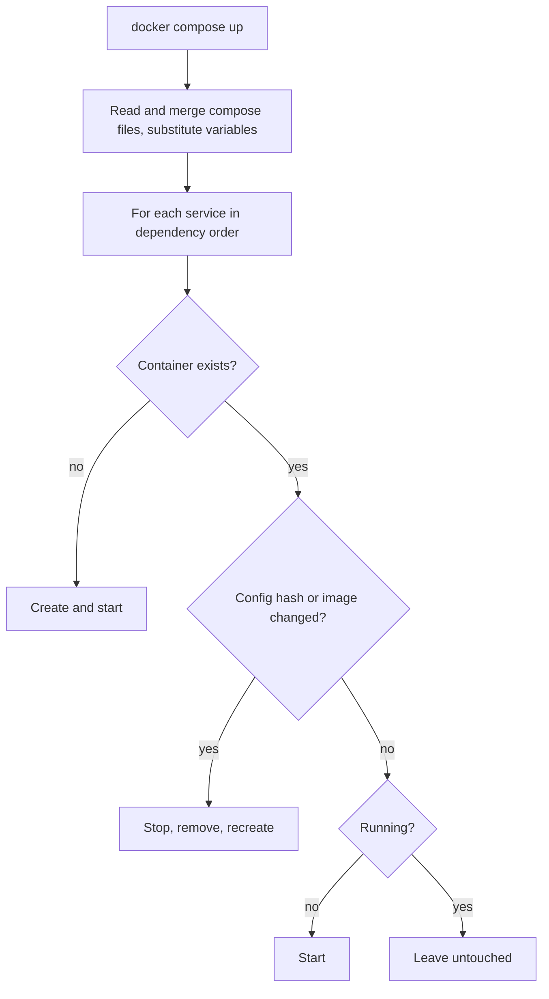
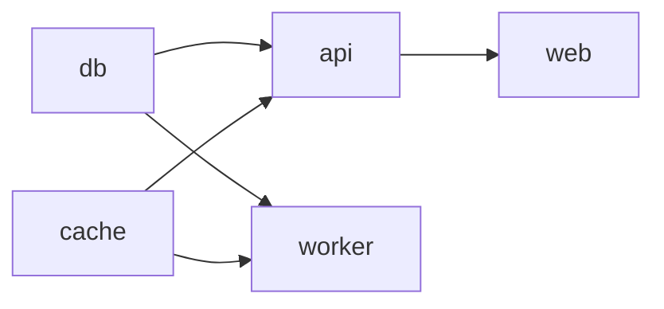

# Compose fundamentals: services, projects and start order

## In plain words

A real application is rarely one container. A typical one has a web program, a database and a cache, each in its own container. Starting them by hand means typing several long commands in the right order, every time, without mistakes.

An orchestra does not rely on each musician remembering when to come in. There is a score: one document showing every part and how they fit together. **Docker Compose** gives your application a score. You write a single file listing each container, the image it uses, its settings and how the containers connect. Then one command, `docker compose up`, starts everything, and one command stops it.

That file is written in **YAML**, a plain-text format that shows structure by indentation (how far each line is pushed in from the left).

Why this matters for a job: nearly every project has a Compose file for local development, and it is usually the first file a new team member opens. Reading and editing one is a day-one skill.

> **Before this lesson:** you should be able to run containers with ports, environment variables and volumes ([Running, inspecting and stopping containers](#/lesson/docker/running-containers), [Volumes, bind mounts and tmpfs](#/lesson/docker/volumes-bind-mounts)) and to read a Dockerfile ([Dockerfile instructions, one by one](#/lesson/docker/dockerfile-instructions)).

## Why this matters

Almost no real application is one container. Even a modest web product has an API, a database, a cache and perhaps a background worker and a front end. You *can* start all of that with `docker run`: create a network, create two volumes, then type five long commands in the right order with the right flags, and remember to repeat them identically next week.

Nobody remembers. The flags drift, the README falls behind, and a new joiner spends their first day working out which environment variable the worker needs.

**Docker Compose** replaces that ritual with a file. You describe the *desired state* of the whole application in YAML: which containers, from which images, with which ports, volumes, networks and configuration. Then one command, `docker compose up`, makes reality match the file. The file lives in the repository, is reviewed like code, and is the single most useful piece of documentation an application can have.

## From docker run to a Compose file

Here is a small application called **tasklane**: a web API, a Postgres database and a Redis cache. With plain commands:

```bash
docker network create tasklane
docker volume create tasklane-db
docker run -d --name db --network tasklane \
  -e POSTGRES_PASSWORD=devonly -e POSTGRES_DB=tasklane \
  -v tasklane-db:/var/lib/postgresql/data postgres:16
docker run -d --name cache --network tasklane redis:7-alpine
docker run -d --name api --network tasklane -p 8000:8000 \
  -e DATABASE_URL=postgresql://postgres:devonly@db/tasklane \
  -e REDIS_URL=redis://cache:6379/0 \
  harbour/tasklane-api:0.9
```

The same thing as `compose.yaml`:

```yaml
services:
  api:
    image: harbour/tasklane-api:0.9
    ports:
      - "8000:8000"
    environment:
      DATABASE_URL: postgresql://postgres:devonly@db/tasklane
      REDIS_URL: redis://cache:6379/0
    depends_on:
      - db
      - cache

  db:
    image: postgres:16
    environment:
      POSTGRES_PASSWORD: devonly
      POSTGRES_DB: tasklane
    volumes:
      - db-data:/var/lib/postgresql/data

  cache:
    image: redis:7-alpine

volumes:
  db-data:
```

```bash
docker compose up -d
```

Reading the file: `services:` begins the list of containers. `api`, `db` and `cache` are names you choose. Under each, `image:` says which image to run; `ports:` publishes a port (`"8000:8000"` connects port 8000 on your machine to port 8000 in the container); `environment:` sets environment variables; `volumes:` attaches storage; and `depends_on:` lists services that must be started first. The final `volumes:` block at the left margin declares the named volume used above. Indentation matters in YAML: lines pushed further in belong to the line above them.

`docker compose up -d` reads the file and starts everything in the background.

```text
[+] Running 5/5
 ✔ Network tasklane_default     Created      0.1s
 ✔ Volume "tasklane_db-data"    Created      0.0s
 ✔ Container tasklane-cache-1   Started      0.6s
 ✔ Container tasklane-db-1      Started      0.6s
 ✔ Container tasklane-api-1     Started      0.9s
```

Every flag has a home in the file, and Compose did three things you did not ask for explicitly: it created a network, it named everything with a common prefix, and it started the database and cache before the API.

> [!NOTE]
> The modern command is `docker compose` (a plugin to the Docker CLI, sometimes called Compose v2). The older standalone `docker-compose` binary is retired. The preferred file name is `compose.yaml`; `docker-compose.yml` is still recognised. The top-level `version:` key seen in older files is obsolete and ignored.

## Vocabulary: project, service, container

| Term | Meaning |
|---|---|
| **Project** | One application: everything defined by a Compose file. Its name defaults to the directory name (here `tasklane`) and prefixes every resource. |
| **Service** | A named role in the application, such as `api` or `db`, with its configuration. A service can run as one container or several identical ones. |
| **Container** | A running instance of a service, named `<project>-<service>-<index>`, e.g. `tasklane-api-1`. |

The project name is how Compose knows which containers belong to which file. Run the same file with a different name and you get a completely separate copy of the application:

```bash
docker compose -p tasklane-test up -d
```

Compose stamps every resource with labels (`com.docker.compose.project`, `com.docker.compose.service`), which is how later commands find them.

## The structure of a Compose file

A file has up to five top-level sections:

```yaml
name: tasklane          # optional explicit project name

services:               # the containers (required)
  ...
networks:               # extra networks beyond the default
  ...
volumes:                # named volumes
  ...
configs:                # non-sensitive config files
  ...
secrets:                # sensitive files
  ...
```

Inside a service, the keys map closely onto `docker run` flags:

| Compose key | `docker run` equivalent | Notes |
|---|---|---|
| `image` | the image argument | |
| `build` | (runs `docker build`) | Path or `{context, dockerfile, target, args}` |
| `command` | arguments after the image | Overrides `CMD` |
| `entrypoint` | `--entrypoint` | |
| `ports` | `-p` | Quote them: `"8000:8000"` |
| `environment`, `env_file` | `-e`, `--env-file` | |
| `volumes` | `-v` / `--mount` | |
| `networks` | `--network` | |
| `restart` | `--restart` | |
| `user`, `working_dir` | `--user`, `-w` | |
| `depends_on` | none | Start ordering |
| `healthcheck` | `--health-*` | |
| `deploy.resources.limits` | `--memory`, `--cpus` | |
| `profiles` | none | Opt-in services |

> [!WARNING]
> Always quote port mappings. YAML parses unquoted `22:22` style values with two-digit numbers on both sides as a base-60 integer in some parsers. `"5432:5432"` as a string is always safe.

## Building as part of the project

During development you usually want Compose to build the image from source rather than pull it:

```yaml
services:
  api:
    build:
      context: ./api
      dockerfile: Dockerfile
      target: dev
      args:
        PY_VERSION: "3.12"
    image: harbour/tasklane-api:dev      # name given to the built image
    ports:
      - "8000:8000"
```

```bash
docker compose build            # build every service that has a build section
docker compose up -d --build    # build, then start
```

Without `--build`, `up` builds only if the image does not exist yet. That catches everyone once: you change the code, run `up`, and the old image is used.

## The commands you need

```bash
docker compose up -d              # create/update everything, in the background
docker compose ps                 # this project's containers
docker compose logs -f api        # follow one service's logs
docker compose exec api sh        # shell inside the running api container
docker compose run --rm api pytest   # one-off container for a service
docker compose stop               # stop containers, keep them
docker compose down               # stop and remove containers and networks
docker compose down -v            # ... and the named volumes too
docker compose config             # print the fully resolved configuration
docker compose pull               # pull newer images for all services
docker compose restart api        # restart without recreating
docker compose top                # processes in each container
```

```bash
docker compose ps
```

```text
NAME               IMAGE                      SERVICE   STATUS          PORTS
tasklane-api-1     harbour/tasklane-api:0.9   api       Up 2 minutes    0.0.0.0:8000->8000/tcp
tasklane-cache-1   redis:7-alpine             cache     Up 2 minutes    6379/tcp
tasklane-db-1      postgres:16                db        Up 2 minutes    5432/tcp
```

Note the `PORTS` column: `6379/tcp` with no arrow means the port is known but **not published** to the host. Only the API is reachable from outside. The database and cache are reachable only from other containers on the project network, which is exactly the exposure you want.

`exec` versus `run` is worth getting straight: `exec` enters a container that is already running; `run` starts a **new** container from the service's definition, attached to the same networks, to execute a one-off command such as a migration or a test suite.

## Desired state and reconciliation

`up` is not "start everything". It is "make the running state match the file". Compose compares the configuration of each existing container (it stores a hash of the service definition in a label) with the file and acts only on differences.



Change the API image tag to `0.10` and run `up -d` again:

```text
[+] Running 3/3
 ✔ Container tasklane-cache-1   Running      0.0s
 ✔ Container tasklane-db-1      Running      0.0s
 ✔ Container tasklane-api-1     Started      1.2s
```

Only the API was recreated. The database kept running and, because its data is in a named volume, would have kept its data even if it had been recreated. Remember from the storage lessons: **recreating a container discards its writable layer.**

If you delete a service from the file, `up` does not remove its container by default; it is reported as an orphan. `docker compose up -d --remove-orphans` cleans up.

## Start order and depends_on

Compose starts services in dependency order and stops them in reverse. `depends_on` declares the edges of the graph:

```yaml
services:
  web:
    image: harbour/tasklane-web:0.9
    depends_on: [api]
  api:
    image: harbour/tasklane-api:0.9
    depends_on: [db, cache]
  worker:
    image: harbour/tasklane-worker:0.9
    depends_on: [db, cache]
  db:
    image: postgres:16
  cache:
    image: redis:7-alpine
```



A valid start order is any topological order of that graph: `db` and `cache` first (in either order, in practice in parallel), then `api` and `worker`, then `web`. A cycle (`a` depends on `b`, `b` depends on `a`) is rejected:

```text
dependency cycle detected: a -> b -> a
```

The resolver below does what Compose does, using Kahn's algorithm with alphabetical tie-breaking so the output is deterministic. Introduce a cycle and see what it reports.

```python-run
import heapq

def start_order(services):
    """services: {name: [dependencies]}. Returns the start order, or raises on a cycle."""
    indeg = {s: 0 for s in services}
    dependants = {s: [] for s in services}
    for s, deps in services.items():
        for d in set(deps):
            if d not in services:
                raise ValueError(f"service {s!r} depends on undefined service {d!r}")
            indeg[s] += 1
            dependants[d].append(s)
    ready = [s for s, n in indeg.items() if n == 0]
    heapq.heapify(ready)
    order = []
    while ready:
        s = heapq.heappop(ready)
        order.append(s)
        for t in dependants[s]:
            indeg[t] -= 1
            if indeg[t] == 0:
                heapq.heappush(ready, t)
    if len(order) != len(services):
        stuck = sorted(s for s in services if s not in order)
        raise ValueError(f"dependency cycle among {stuck}")
    return order

app = {"web": ["api"], "api": ["db", "cache"], "worker": ["db", "cache"], "db": [], "cache": []}
order = start_order(app)
print("start:", order)
print("stop: ", order[::-1])
```

### "Started" is not "ready"

The short form `depends_on: [db]` waits only for the dependency's container to be **started**. Postgres takes a few seconds after its process starts before it accepts connections. An API that connects on boot and exits on failure will crash in that window:

```text
tasklane-api-1  | psycopg.OperationalError: connection refused
tasklane-api-1 exited with code 1
```

The long form lets you wait for a *condition*:

```yaml
services:
  api:
    image: harbour/tasklane-api:0.9
    depends_on:
      db:
        condition: service_healthy
      migrate:
        condition: service_completed_successfully
      cache:
        condition: service_started

  migrate:
    image: harbour/tasklane-api:0.9
    command: ["python", "-m", "tasklane", "migrate"]
    depends_on:
      db:
        condition: service_healthy

  db:
    image: postgres:16
    environment:
      POSTGRES_PASSWORD: devonly
    healthcheck:
      test: ["CMD-SHELL", "pg_isready -U postgres"]
      interval: 5s
      timeout: 3s
      retries: 10
```

| Condition | Waits until the dependency... |
|---|---|
| `service_started` | has been started (the default) |
| `service_healthy` | reports `healthy` from its health check |
| `service_completed_successfully` | has run to completion with exit code 0 |

With this file, `up` starts `db`, waits for `pg_isready` to succeed, runs the one-shot `migrate` service and waits for it to exit 0, and only then starts `api`.

> [!INTERVIEW]
> "Does `depends_on` guarantee the database is ready?" No. The plain form orders *starts* only. Use `condition: service_healthy` with a health check, and still make the application retry its connections, because dependencies can also disappear and come back long after start-up, when Compose is no longer involved.

## Scaling a service

```bash
docker compose up -d --scale worker=3
docker compose ps worker
```

```text
NAME                 SERVICE   STATUS
tasklane-worker-1    worker    Up 5 seconds
tasklane-worker-2    worker    Up 5 seconds
tasklane-worker-3    worker    Up 5 seconds
```

Scaling works for services that do not publish a fixed host port (three containers cannot all bind host port 8000) and do not set `container_name`. Other services reaching `worker` by name get all three addresses from DNS. Compose runs on one host, so this is useful for testing how an app behaves with several instances, not for production capacity.

## Profiles: optional services

Some services are only wanted sometimes: an admin UI, a mail catcher, a load generator.

```yaml
services:
  api:
    image: harbour/tasklane-api:0.9
  adminer:
    image: adminer:4
    ports: ["8081:8080"]
    profiles: [debug]
```

```bash
docker compose up -d                    # api only
docker compose --profile debug up -d    # api and adminer
```

A service with no `profiles` key always starts; one with profiles starts only when a listed profile is active.

## Pitfalls

- **Forgetting `--build`.** `up` reuses an existing image even if the source changed.
- **Trusting short `depends_on`.** It orders starts; it does not wait for readiness.
- **`down -v` by habit.** It deletes the database volume.
- **Fixed `container_name`.** It prevents scaling and causes conflicts between two copies of the project.
- **Using `localhost` between services.** Inside the API container, `localhost` is the API container. The database is at `db`. The next lesson explains why.
- **Unquoted ports and booleans.** YAML has opinions about `yes`, `on`, `no` and colon-separated numbers. Quote strings that are meant to be strings, especially in `environment`.
- **Running from the wrong directory.** The project name comes from the directory; the same file in another folder is a different project with different volumes.
- **Treating Compose as a production cluster.** It manages one host and does not reschedule containers elsewhere if that host dies.

## Cheat sheet

| Task | Command |
|---|---|
| Start or update in background | `docker compose up -d` |
| Rebuild images and start | `docker compose up -d --build` |
| Status | `docker compose ps` |
| Logs | `docker compose logs -f [service]` |
| Shell in running service | `docker compose exec service sh` |
| One-off command | `docker compose run --rm service cmd` |
| Stop and remove | `docker compose down` |
| ... including volumes | `docker compose down -v` |
| Show merged config | `docker compose config` |
| Scale | `docker compose up -d --scale service=N` |
| Different project name | `docker compose -p name ...` |
| Specific file(s) | `docker compose -f a.yaml -f b.yaml ...` |
| Optional services | `docker compose --profile name up -d` |
| Remove deleted services | `docker compose up -d --remove-orphans` |

## Summary

- A Compose file is a declarative description of a multi-container application; `docker compose up` reconciles the running state with it.
- A project groups services; each service runs as one or more containers named `project-service-index`, on a project network with named volumes.
- `up` is idempotent: unchanged services are left alone, changed ones are recreated.
- `depends_on` defines start order as a dependency graph; cycles are errors. Use the long form with `service_healthy` or `service_completed_successfully` to wait for real readiness.
- `exec` enters a running container; `run` starts a one-off container from a service definition.
- Compose is a single-host tool: excellent for development, testing and small deployments, and the starting point for the orchestrators covered later.

## Glossary

| Term | Meaning |
|---|---|
| Docker Compose | The tool that runs multi-container applications from one description file |
| YAML | A plain-text format that shows structure by indentation |
| Compose file | The file, normally `compose.yaml`, that describes the application |
| Service | One named part of the application, such as `api` or `db`, run as one or more containers |
| Project | Everything one Compose file defines; its name prefixes all its resources |
| Desired state | The description of what should be running |
| Reconcile | Change what is running until it matches the description |
| Recreate | Replace a container with a new one because its definition changed |
| `depends_on` | The key that states which services must start first |
| Topological order | An ordering in which everything comes after the things it depends on |
| Cycle | A loop of dependencies, which cannot be ordered |
| Scale | Run several containers of the same service |
| Profile | A label that makes a service start only when asked for |
| Orphan | A container left from a service that is no longer in the file |

## Check yourself

```quiz
[
  {"q": "A Compose file in the directory `shopfront` defines a service `web`. What is the first container called?",
   "options": ["web", "shopfront_web", "shopfront-web-1", "web-1"],
   "answer": 2,
   "explain": "Containers are named <project>-<service>-<index>, and the project name defaults to the directory name."},
  {"q": "You change only the image tag of the `api` service and run `docker compose up -d`. What happens to the `db` service's container?",
   "options": ["It is recreated too", "It is left running untouched", "It is restarted", "It is removed"],
   "answer": 1,
   "explain": "Compose compares each service's configuration with the existing container and recreates only those that differ."},
  {"q": "`depends_on: [db]` in its short form guarantees what?",
   "options": ["That db accepts connections before api starts", "That db's container is started before api's container", "That db is healthy", "That api restarts if db fails"],
   "answer": 1,
   "explain": "The short form only orders container starts. Readiness requires condition: service_healthy plus a health check, and application-level retries."},
  {"q": "Which condition makes a service wait for a one-shot migration container to finish with exit code 0?",
   "options": ["service_started", "service_healthy", "service_completed_successfully", "service_exited"],
   "answer": 2,
   "explain": "service_completed_successfully waits for the dependency to exit with status 0, the right fit for init or migration jobs."},
  {"q": "What is the difference between `docker compose exec api sh` and `docker compose run --rm api sh`?",
   "options": ["None", "exec runs in the existing running container; run creates a new container from the service definition", "exec builds the image first", "run only works for stopped projects"],
   "answer": 1,
   "explain": "exec adds a process to a running container. run starts a fresh, separate container (removed afterwards with --rm), useful for tests and migrations."},
  {"q": "Services: web depends on api; api depends on db and cache. Which is a valid start order?",
   "options": ["web, api, db, cache", "db, cache, api, web", "api, db, cache, web", "cache, web, db, api"],
   "answer": 1,
   "explain": "Every service must come after all of its dependencies: db and cache (any order), then api, then web."},
  {"q": "Why can't you run `--scale api=3` when the api service has `ports: [\"8000:8000\"]`?",
   "options": ["Compose cannot scale services with images", "Three containers cannot all bind host port 8000", "Scaling requires Swarm", "Ports must be UDP to scale"],
   "answer": 1,
   "explain": "A host port can be bound once. Publish only the container port (random host ports) or put a proxy in front to scale."},
  {"q": "What does `docker compose down -v` remove that `docker compose down` keeps?",
   "options": ["Images", "Named volumes declared in the file", "The compose file", "The build cache"],
   "answer": 1,
   "explain": "Plain down removes containers and networks. The -v flag additionally deletes the project's named and anonymous volumes, and with them the data."}
]
```

> **Source:** Stoneman, *Learn Docker in a Month of Lunches*, ch. 7 (topic coverage). Checked against <https://docs.docker.com/compose/intro/compose-application-model/>, <https://docs.docker.com/reference/compose-file/services/> and <https://docs.docker.com/compose/how-tos/startup-order/>. All wording and examples are original.
