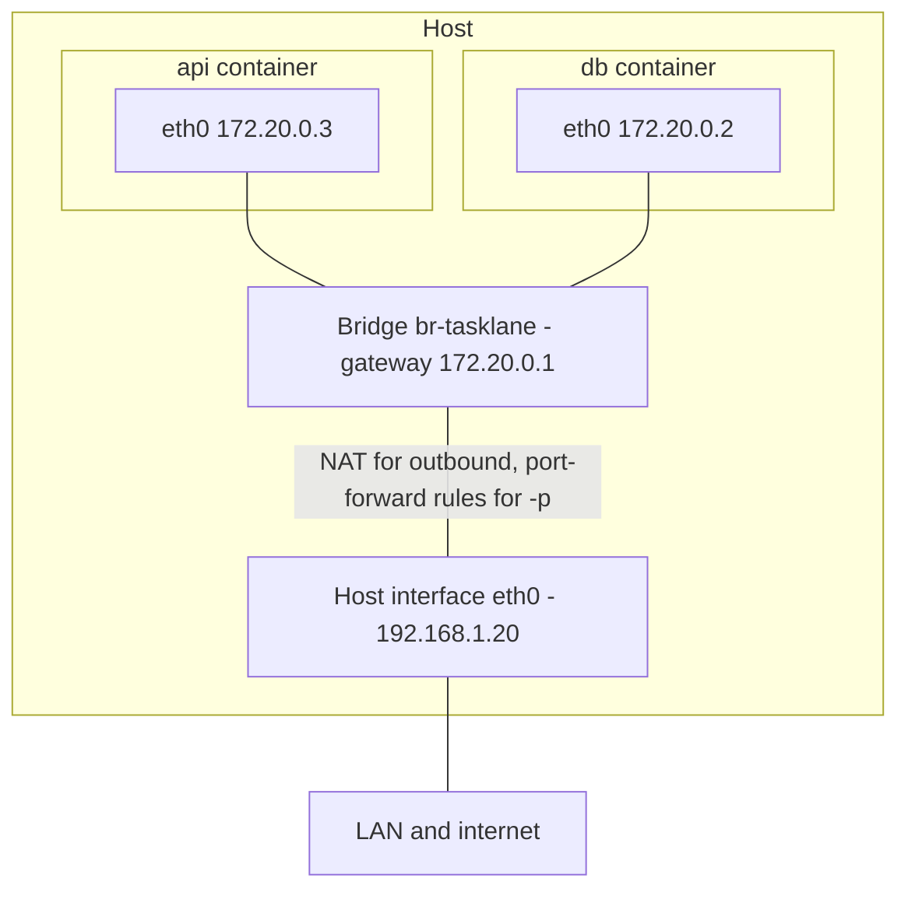
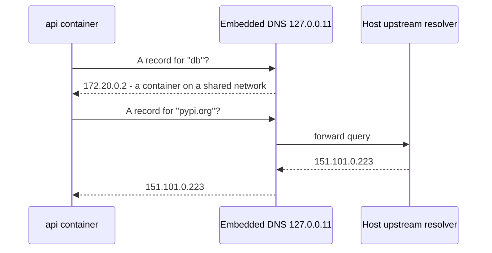
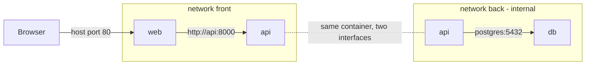

# Container networking and DNS on user-defined networks

## In plain words

Inside an office, you ring a colleague by dialling a short extension or by looking up their name in the internal directory. You do not need their mobile number. People outside the company cannot dial extensions at all; they must call the public number at reception.

Containers work the same way. Docker gives a group of containers a private **network**, like the office's internal phone system. On it, each container can reach the others **by name**, because Docker keeps a directory that turns names into addresses. That directory service is called **DNS** (Domain Name System), the same idea that turns a website name into a numeric address on the internet. A numeric address on a network is an **IP address**. Nothing outside can reach a container unless you deliberately open a public line to it, which Docker calls **publishing a port**.

Why this matters for a job: "my web container cannot connect to my database container" is probably the most common Docker problem there is. Almost every case is explained by the ideas in this lesson.

> **Before this lesson:** read [Compose fundamentals: services, projects and start order](#/lesson/docker/compose-basics) first. Publishing ports with `-p` is introduced in [Running, inspecting and stopping containers](#/lesson/docker/running-containers).

## Why this matters

In the previous lesson the API's connection string was `postgresql://postgres:devonly@db/tasklane`. The host is the single word `db`. No IP address, no port published to the host, no entry in a hosts file. It worked because Docker runs a small DNS server for every container and Compose puts all of a project's services on one network where each service's name resolves to its containers.

That mechanism is the foundation of every multi-container application, and it is the source of a large share of "it works with `docker run` but not in Compose" and "connection refused" questions. This lesson explains what is actually happening: the network drivers, why the default bridge is different from a user-defined one, how name resolution works, and how to use more than one network to keep parts of an application apart.

## Network drivers

Each container gets its own network namespace. What that namespace is connected to depends on the network's **driver**.

| Driver | What the container gets | Typical use |
|---|---|---|
| `bridge` | A virtual interface on a private software switch on the host, NAT to the outside | The default; single-host apps |
| `host` | No isolation: shares the host's network stack directly | Maximum throughput, tools that must see host interfaces |
| `none` | Only a loopback interface | Batch jobs that must not talk to anything |
| `overlay` | A virtual network spanning several hosts | Swarm services across a cluster |
| `macvlan` / `ipvlan` | Its own address on the physical LAN | Legacy systems needing a routable IP per container |

A fresh Docker installation has three networks:

```bash
docker network ls
```

```text
NETWORK ID     NAME      DRIVER    SCOPE
2f1c8a4b7e90   bridge    bridge    local
9d3e5f7a1c2b   host      host      local
6b8d0e2f4a6c   none      null      local
```

`docker run` with no `--network` flag attaches to the one called `bridge`, the **default bridge**.

### How a bridge network works



The engine creates a Linux bridge device (a software switch) and, for each container, a pair of connected virtual interfaces: one end inside the container as `eth0`, the other plugged into the bridge. Containers on the same bridge reach each other directly. Traffic leaving for the outside world is source-NATed to the host's address. Inbound traffic reaches a container only through a published port, which is a destination-NAT rule.

## Default bridge versus user-defined bridge

This distinction matters more than any other in single-host networking.

| | Default `bridge` | User-defined bridge |
|---|---|---|
| Created by | Docker at install | `docker network create`, or Compose |
| Containers reach each other by IP | Yes | Yes |
| **Containers reach each other by name** | **No** | **Yes, via embedded DNS** |
| Isolation | Every container without `--network` shares it | Only containers you attach |
| Attach/detach running containers | No | Yes |
| Configurable subnet per app | Shared | Per network |

Demonstration. On the default bridge, names do not resolve:

```bash
docker run -d --name cache redis:7-alpine
docker run --rm alpine:3.20 ping -c 1 cache
```

```text
ping: bad address 'cache'
```

The first command starts a Redis container named `cache` in the background. The second starts a temporary Alpine container (`--rm` removes it afterwards) and runs `ping -c 1 cache`, which tries to send one test message to the machine named `cache`. The name cannot be found.

On a user-defined network they do:

```bash
docker network create tasklane
docker run -d --name cache --network tasklane redis:7-alpine
docker run --rm --network tasklane alpine:3.20 ping -c 1 cache
```

```text
PING cache (172.20.0.2): 56 data bytes
64 bytes from 172.20.0.2: seq=0 ttl=64 time=0.091 ms
```

> [!TIP]
> Never design around container IP addresses. They are assigned from the subnet in start order and change when a container is recreated. The name is the stable identifier; DNS exists so that you never need the number.

## The embedded DNS server

Every container attached to a user-defined network has its resolver pointed at `127.0.0.11`:

```bash
docker run --rm --network tasklane alpine:3.20 cat /etc/resolv.conf
```

```text
nameserver 127.0.0.11
options ndots:0
```

That address is a DNS server run by the engine inside the container's network namespace. When the app looks up a name, the server answers from its own table if the name belongs to a container or service **on a network this container is attached to**; otherwise it forwards the query to the host's configured resolvers, so public names still work.



What names does a container answer to on a given network?

| Name | Source | Example |
|---|---|---|
| Container name | `--name` or Compose's generated name | `tasklane-db-1` |
| Service name | Compose service key | `db` |
| Network alias | `--network-alias` or `networks.<net>.aliases` | `postgres`, `primary-db` |
| Short container ID | Automatic | `9b1f4e0c62a7` |
| Hostname | `--hostname` / `hostname:` (if set) | `db01` |

Resolution is **scoped per network**. A name is visible only to containers that share at least one network with its owner. Two containers on different networks cannot resolve each other even if they are on the same host.

### Several containers behind one name

When a service is scaled, all its containers share the service name. DNS returns every address:

```bash
docker compose up -d --scale worker=3
docker compose exec api nslookup worker
```

```text
Server:    127.0.0.11
Address:   127.0.0.11:53

Name:      worker
Address:   172.20.0.5
Name:      worker
Address:   172.20.0.6
Name:      worker
Address:   172.20.0.7
```

The order rotates between queries, giving crude round-robin load balancing. It is crude because clients cache: an application that resolves once at start-up and keeps a connection pool will talk to one worker forever. For even distribution put a proxy in front, the subject of a later lesson.

The small resolver below models scoping and aliases. It is the logic to keep in your head when a lookup fails.

```python-run
def resolve(containers, asker, name):
    """containers: {cname: {"service": str, "networks": {net: [aliases]}, "ip": {net: ip}}}"""
    my_nets = set(containers[asker]["networks"])
    answers = []
    for cname, c in sorted(containers.items()):
        for net in sorted(my_nets & set(c["networks"])):
            names = {cname, c["service"], *c["networks"][net]}
            if name in names:
                answers.append((net, c["ip"][net]))
    return answers or "NXDOMAIN (forwarded upstream)"

app = {
    "shop-web-1":  {"service": "web",  "networks": {"front": []},                 "ip": {"front": "172.21.0.2"}},
    "shop-api-1":  {"service": "api",  "networks": {"front": [], "back": []},     "ip": {"front": "172.21.0.3", "back": "172.22.0.3"}},
    "shop-api-2":  {"service": "api",  "networks": {"front": [], "back": []},     "ip": {"front": "172.21.0.4", "back": "172.22.0.4"}},
    "shop-db-1":   {"service": "db",   "networks": {"back": ["postgres"]},        "ip": {"back": "172.22.0.2"}},
}
print("web -> api      :", resolve(app, "shop-web-1", "api"))
print("web -> db       :", resolve(app, "shop-web-1", "db"))
print("api -> db       :", resolve(app, "shop-api-1", "db"))
print("api -> postgres :", resolve(app, "shop-api-1", "postgres"))
print("db  -> web      :", resolve(app, "shop-db-1", "web"))
```

`web` cannot resolve `db` at all: they share no network. That is not a bug; it is the design in the next section.

## Networks in Compose

With no `networks:` section, Compose creates one network called `<project>_default` and attaches every service to it. Every service can reach every other by service name. That is the right default for small applications.

Declaring networks lets you **segment**:

```yaml
services:
  web:
    image: harbour/shop-web:3
    ports:
      - "80:8080"
    networks: [front]

  api:
    image: harbour/shop-api:3
    networks: [front, back]

  db:
    image: postgres:16
    networks:
      back:
        aliases: [postgres]

networks:
  front:
  back:
    internal: true
```



- `web` and `api` share `front`, so `web` can call `api`.
- `api` and `db` share `back`, so `api` can query `db`.
- `web` and `db` share nothing. A compromised web container cannot even resolve the database's name, let alone connect.
- `internal: true` removes the network's route to the outside. Containers attached *only* to `back` cannot reach the internet, a cheap egress control for a database.

The `api` container has two interfaces, one per network, and two IP addresses.

### Using a network that already exists

Sometimes two Compose projects must talk, or a shared reverse proxy runs in its own project. Mark the network as external and Compose will join it instead of creating it:

```yaml
networks:
  edge:
    external: true
    name: shared-edge
```

```bash
docker network create shared-edge      # once, by hand or by the proxy's project
```

## Publishing versus exposing, again

Three different things are called "a port":

| Thing | Where it is set | Who can connect |
|---|---|---|
| The port the app listens on | Application code/config | Anything that can route to the container: other containers on a shared network |
| `EXPOSE` / `expose:` | Dockerfile / Compose | Nobody extra; it is documentation |
| `ports:` / `-p` | Compose / CLI | Processes on the host and, unless bound to 127.0.0.1, the outside world |

Container-to-container traffic on a shared network needs **no** published ports. `api` reaches `db:5432` directly. Publishing the database port is only for tools on your workstation, and in that case bind it to loopback:

```yaml
  db:
    ports:
      - "127.0.0.1:5432:5432"
```

A frequent confusion is which port to use in a connection string. Between containers it is always the **container** port. If Redis is published as `"6380:6379"`, other services still connect to `cache:6379`; `6380` exists only on the host.

## Reaching the host and other special cases

**Calling a service on the host machine** from a container: `localhost` will not work, since it is the container itself. Docker Desktop provides the name `host.docker.internal`. On Linux add it explicitly:

```yaml
services:
  api:
    extra_hosts:
      - "host.docker.internal:host-gateway"
```

**Host networking** removes the namespace boundary:

```bash
docker run --rm --network host nginx:1.27-alpine
```

The container binds directly to host ports; `-p` is ignored. There is no port isolation and no network-scoped DNS for it, so use it sparingly.

**Sharing another container's network namespace** is how a debugging toolbox can be attached to a minimal container that has no tools:

```bash
docker run --rm -it --network container:tasklane-api-1 nicolaka/netshoot ss -ltnp
```

```text
State   Recv-Q  Send-Q  Local Address:Port   Process
LISTEN  0       2048          0.0.0.0:8000   users:(("uvicorn",pid=1,fd=6))
```

The toolbox sees exactly the interfaces and listening sockets of the API container.

## Troubleshooting connectivity

Work outward from the failing container, one layer at a time.

```bash
# 1. Does the name resolve?
docker compose exec api getent hosts db
```

```text
172.20.0.2      db
```

No output means a DNS problem: wrong name, different network, or the target is not running.

```bash
# 2. Is the port open at that address?
docker compose exec api nc -zv db 5432
```

```text
db (172.20.0.2:5432) open
```

"Connection refused" means the name resolved and the host answered, but nothing is listening on that port *on that interface*. Either the service has not finished starting or it is bound to `127.0.0.1` inside its own container.

```bash
# 3. What networks are the two containers actually on?
docker inspect tasklane-api-1 --format '{{range $k, $v := .NetworkSettings.Networks}}{{$k}} {{$v.IPAddress}}{{"\n"}}{{end}}'
docker network inspect tasklane_default --format '{{range .Containers}}{{.Name}} {{.IPv4Address}}{{"\n"}}{{end}}'
```

| Symptom | Likely cause |
|---|---|
| `bad address` / `Name or service not known` | Not on a shared user-defined network; typo; target not running |
| `Connection refused` | Target not listening yet, wrong port, or bound to its own loopback |
| Timeout | Firewall, `internal` network blocking egress, wrong IP cached |
| Works by IP, not by name | Containers are on the default bridge |
| Works from host, not from container | Using `localhost` or the published host port inside the container |

> [!INTERVIEW]
> "How do two containers talk to each other?" Put them on the same user-defined network; Docker's embedded DNS resolves container and service names to their IPs on that network; connect to the name and the *container* port. Published ports are only for traffic entering from the host. Add that the default bridge has no name resolution and that separate networks give isolation.

## Pitfalls

- **`localhost` between containers.** Each container has its own loopback.
- **Using the published host port from another container.** Use the container port.
- **Relying on the default bridge.** No DNS. Create a network or use Compose.
- **Hard-coding IPs.** They change on recreation.
- **Server bound to 127.0.0.1.** Reachable from nowhere but its own container. Bind `0.0.0.0`.
- **Subnet collisions.** Docker's default pools (172.17.0.0/16 and up) can overlap a corporate VPN, making some internal hosts unreachable from containers. Set `default-address-pools` in the daemon config or a `subnet` on the network.
- **Publishing databases to `0.0.0.0`.** On Linux, published ports bypass many host firewall front ends.
- **DNS caching in clients.** One lookup at start means no rebalancing after scaling and stale addresses after a dependency is recreated.

## Cheat sheet

| Task | Command or key |
|---|---|
| Create a network | `docker network create NAME` |
| Run on it | `docker run --network NAME ...` |
| Add an alias | `--network-alias db` / `networks: {back: {aliases: [db]}}` |
| Connect a running container | `docker network connect NAME CONTAINER` |
| List / inspect | `docker network ls` / `docker network inspect NAME` |
| No outbound access | `internal: true` |
| Join an existing network | `external: true` |
| Reach the host | `host.docker.internal` (+ `host-gateway` on Linux) |
| Debug in another container's netns | `docker run --network container:NAME netshoot` |
| Resolve a name | `getent hosts NAME` or `nslookup NAME` |
| Test a port | `nc -zv HOST PORT` |

## Summary

- Each container has its own network namespace, connected by default to a bridge network with NAT to the outside.
- User-defined networks provide name resolution through an embedded DNS server at `127.0.0.11`; the legacy default bridge does not.
- A container answers to its container name, service name, aliases and short ID, but only for containers sharing a network with it.
- Compose creates one default network per project; declaring several lets you segment tiers, and `internal: true` blocks egress.
- Service-to-service traffic uses service names and container ports, with nothing published. `ports:` is only for traffic from the host or beyond.
- Diagnose in layers: resolve the name, test the port, check network membership.

## Glossary

| Term | Meaning |
|---|---|
| Network | A group of connected machines or containers that can exchange data |
| IP address | The numeric address of a machine on a network |
| DNS | Domain Name System: the service that turns names into IP addresses |
| Resolve | Look a name up to obtain its address |
| Network driver | The kind of Docker network: bridge, host, none, overlay, macvlan |
| Bridge network | A private software network inside one host |
| User-defined network | A network you (or Compose) create, which provides name lookup |
| NAT | Network address translation: rewriting addresses so private machines can reach the outside |
| Network alias | An extra name a container answers to on a network |
| Loopback / localhost | The address `127.0.0.1`, by which a machine or container talks to itself |
| Gateway | The address through which traffic leaves a network |
| Internal network | A Docker network with no route to the outside |
| Round robin | Handing out several addresses in rotating order |
| Subnet | A range of IP addresses belonging to one network |

## Check yourself

```quiz
[
  {"q": "Two containers started with plain `docker run` (no --network) cannot reach each other by name. Why?",
   "options": ["They are in different network namespaces", "The default bridge network has no embedded DNS for container names", "Names only work with Swarm", "They need published ports"],
   "answer": 1,
   "explain": "Automatic name resolution is a feature of user-defined networks. On the default bridge only IP addresses work."},
  {"q": "Redis is defined with `ports: [\"6380:6379\"]`. What address should another service in the same Compose project use?",
   "options": ["localhost:6380", "cache:6380", "cache:6379", "host.docker.internal:6379"],
   "answer": 2,
   "explain": "Between containers you use the service name and the container port. 6380 exists only on the host side of the port mapping."},
  {"q": "What is at 127.0.0.11 inside a container on a user-defined network?",
   "options": ["The host machine", "The network gateway", "Docker's embedded DNS server", "The container's own loopback web server"],
   "answer": 2,
   "explain": "The engine runs a resolver there that answers for names on the container's networks and forwards everything else upstream."},
  {"q": "web is on network `front`; db is on network `back`; api is on both. Can web resolve the name `db`?",
   "options": ["Yes, through api", "Yes, DNS is global on a host", "No, name resolution is scoped to shared networks", "Only if db publishes a port"],
   "answer": 2,
   "explain": "A container only sees names of containers it shares a network with. Being reachable through a third container does not route or resolve automatically."},
  {"q": "A service is scaled to three containers. What does a DNS lookup of the service name return?",
   "options": ["Only the first container's IP", "A virtual IP that load-balances", "All three container IPs, in rotating order", "An error"],
   "answer": 2,
   "explain": "Compose's DNS returns one A record per container. Clients that cache the first answer will not spread load, which is why a proxy is often added."},
  {"q": "An API container gets `Connection refused` when connecting to `db:5432`, though `getent hosts db` returns an IP. Which cause is plausible?",
   "options": ["The containers are on different networks", "The name db is misspelled", "Postgres has not finished starting, or is listening only on its own 127.0.0.1", "The port is not published"],
   "answer": 2,
   "explain": "Resolution succeeded and the host responded, so networking is fine. Refused means nothing is accepting on that port and interface yet."},
  {"q": "What does `internal: true` on a network do?",
   "options": ["Encrypts traffic", "Removes outbound connectivity to the outside world for that network", "Hides the network from docker network ls", "Makes all containers share one IP"],
   "answer": 1,
   "explain": "An internal network has no gateway route to external networks, so containers attached only to it cannot reach the internet."},
  {"q": "From inside a container, how do you reach a service running directly on the host machine?",
   "options": ["localhost", "127.0.0.1", "host.docker.internal (added via host-gateway on Linux)", "The container's own hostname"],
   "answer": 2,
   "explain": "localhost refers to the container's own namespace. host.docker.internal maps to the host's gateway address."}
]
```

> **Source:** Stoneman, *Learn Docker in a Month of Lunches*, ch. 7 (topic coverage). Checked against <https://docs.docker.com/engine/network/>, <https://docs.docker.com/engine/network/drivers/bridge/> and <https://docs.docker.com/compose/how-tos/networking/>. All wording and examples are original.
