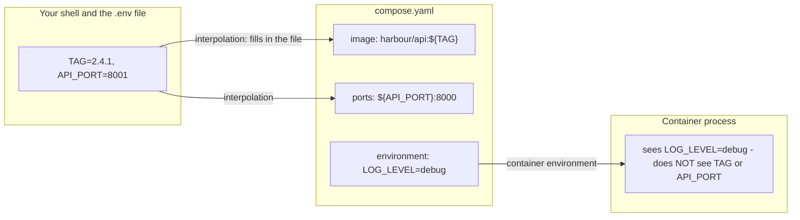

# Environment, configuration and override files

## In plain words

The same car is driven differently in town, on a motorway and on a test track. Nobody builds a different car for each. You adjust the seat, the mirrors and the driving mode.

An application is the same. It runs on a developer's laptop, on a test server and in production, and each place needs different **settings**: a different database address, more or less detail in the logs, different ports. The image should be the same everywhere, because that is the only way testing proves anything. What changes is the settings around it.

Compose offers three tools for this, which beginners often mix up: **environment variables** (named values handed to the program inside a container), **variable substitution** (placeholders such as `${TAG}` in the Compose file that are filled in before anything starts) and **override files** (small extra Compose files that are layered on top of a base file).

Why this matters for a job: every team needs development, test and production setups. Done badly, that means three nearly identical files that slowly drift apart. Done well, it is one base file and a few lines of difference.

> **Before this lesson:** read [Compose fundamentals: services, projects and start order](#/lesson/docker/compose-basics) and [Container networking and DNS on user-defined networks](#/lesson/docker/compose-networking) first.

## Why this matters

The same application has to run in several places: on a laptop with live reload and a throwaway database; in CI with test data and no published ports; in a staging environment that looks like production; in production itself. The *image* should be identical everywhere, because that is what makes testing meaningful. What changes is everything around it: connection strings, log levels, port numbers, replica counts, which volumes exist, whether a debugger is attached.

If you handle that by copying `compose.yaml` to `compose-dev.yaml`, `compose-test.yaml` and `compose-prod.yaml`, the three files drift apart within a month and nobody can say what the real difference between environments is.

Compose gives you three cooperating mechanisms that avoid the copy:

1. **Environment variables for containers**: `environment:` and `env_file:`.
2. **Variable interpolation in the Compose file itself**: `${TAG:-latest}`.
3. **Multiple Compose files merged in order**: a base plus small per-environment overrides.

People confuse the first two constantly. This lesson separates them, then shows how they combine into a clean multi-environment setup.

## Two different jobs for variables



- **Interpolation** happens when Compose *reads the file*. `${TAG}` is replaced by text before anything starts. The values come from your shell and from a file named `.env` beside the Compose file. They shape the Compose model.
- **Container environment** is what the process inside the container sees. It comes from the image's `ENV`, from `env_file:` and from `environment:`.

A variable in `.env` does **not** reach a container unless the Compose file passes it on.

## Setting a container's environment

```yaml
services:
  api:
    image: harbour/tasklane-api:0.9
    environment:
      LOG_LEVEL: debug
      FEATURE_EXPORT: "true"
      SENTRY_DSN:                 # no value: pass through from the shell if set
    env_file:
      - ./config/common.env
      - path: ./config/local.env
        required: false
```

`environment` accepts a map (as above) or a list of `KEY=value` strings. A key with no value is a **pass-through**: Compose copies the value from the environment it was launched in, and omits the variable if it is unset there.

An env file is plain lines of `KEY=value`:

```text
# config/common.env
DATABASE_URL=postgresql://postgres:devonly@db/tasklane
REDIS_URL=redis://cache:6379/0
LOG_LEVEL=info
```

### Precedence for the container's environment

When the same variable is defined in several places, the highest row wins:

| Priority | Source |
|---|---|
| 1 (highest) | `docker compose run -e KEY=value` on the command line |
| 2 | `environment:` in the Compose file |
| 3 | `env_file:` entries (later files in the list override earlier ones) |
| 4 (lowest) | `ENV` in the image's Dockerfile |

With the files above, `LOG_LEVEL` is `debug`: the `environment:` entry beats the env file's `info`.

Check what a container actually received instead of reasoning about it:

```bash
docker compose exec api env | sort | grep -E 'LOG_LEVEL|DATABASE_URL'
```

```text
DATABASE_URL=postgresql://postgres:devonly@db/tasklane
LOG_LEVEL=debug
```

> [!WARNING]
> Environment variables are visible to anyone who can run `docker inspect` on the container, are inherited by child processes and tend to end up in crash reports. They are fine for non-sensitive settings and acceptable for development passwords. For real credentials use secrets, covered in a later lesson.

## Interpolation in the Compose file

```yaml
services:
  api:
    image: harbour/tasklane-api:${TAG:-dev}
    ports:
      - "${API_PORT:-8000}:8000"
    environment:
      LOG_LEVEL: ${LOG_LEVEL:-info}
      DATABASE_URL: postgresql://postgres:${DB_PASSWORD:?DB_PASSWORD must be set}@db/tasklane
```

The supported forms:

| Syntax | Result when VAR is set and non-empty | VAR set but empty | VAR unset |
|---|---|---|---|
| `${VAR}` or `$VAR` | value | empty string | empty string, with a warning |
| `${VAR:-default}` | value | `default` | `default` |
| `${VAR-default}` | value | empty string | `default` |
| `${VAR:?message}` | value | error with `message` | error with `message` |
| `${VAR?message}` | value | empty string | error with `message` |
| `${VAR:+alt}` | `alt` | empty string | empty string |
| `${VAR+alt}` | `alt` | `alt` | empty string |
| `$$` | a literal `$` | | |

The colon makes the operator treat *empty* the same as *unset*. `${VAR:?...}` is the way to make a missing required setting fail fast with a readable message instead of producing a silently broken configuration.

Where interpolation values come from, highest priority first:

1. The shell environment in which you run `docker compose`.
2. The `.env` file in the project directory (or the file given with `--env-file`).

```text
# .env  (interpolation defaults for this checkout; usually git-ignored)
TAG=0.9
API_PORT=8001
DB_PASSWORD=devonly
```

```bash
docker compose config | grep -E 'image:|published:'
```

```text
    image: harbour/tasklane-api:0.9
      published: "8001"
```

```bash
TAG=0.10 docker compose config | grep image:
```

```text
    image: harbour/tasklane-api:0.10
```

The shell value beat the `.env` value. `docker compose config` prints the fully resolved model and is the tool for answering "what will Compose actually do?".

The function below implements the substitution rules from the table, which makes the colon/no-colon distinction concrete.

```python-run
import re

PATTERN = re.compile(r"\$\$|\$\{(\w+)(?:(:?[-?+])([^}]*))?\}|\$(\w+)")

def interpolate(text, env):
    def repl(m):
        if m.group(0) == "$$":
            return "$"
        name = m.group(1) or m.group(4)
        op, arg = m.group(2), m.group(3) or ""
        is_set = name in env
        value = env.get(name, "")
        missing = (not is_set) or (op and op.startswith(":") and value == "")
        if op is None:
            return value
        kind = op[-1]
        if kind == "-":
            return arg if missing else value
        if kind == "?":
            if missing:
                raise ValueError(f"required variable {name} is missing a value: {arg}")
            return value
        if kind == "+":
            return "" if missing else arg
    return PATTERN.sub(repl, text)

env = {"TAG": "0.9", "EMPTY": ""}
for s in ["img:${TAG}", "img:${MISSING:-dev}", "x=${EMPTY:-fallback}", "x=${EMPTY-fallback}",
          "debug${TAG:+-enabled}", "cost: $$5", "port=$PORT."]:
    print(f"{s:28s} -> {interpolate(s, env)!r}")
try:
    interpolate("${DB_PASSWORD:?set it in .env}", env)
except ValueError as e:
    print("error:", e)
```

## Multiple files: base plus overrides

Compose can read several files and merge them. Later files override earlier ones.

```bash
docker compose -f compose.yaml -f compose.prod.yaml up -d
```

There is one piece of built-in convention: with no `-f` flags, Compose loads `compose.yaml` and then, if it exists, `compose.override.yaml`. That makes the override file a natural home for *local development* settings: a developer types `docker compose up` and nothing more.

### Merge rules

How two definitions of the same service combine depends on the type of each key:

| Kind of value | Examples | Merge behaviour |
|---|---|---|
| Single value | `image`, `command`, `restart`, `user`, `entrypoint` | Later file **replaces** |
| Mapping | `environment`, `labels`, `healthcheck`, `deploy`, `build` | Merged **key by key**; later wins per key |
| List of unique items | `ports`, `expose`, `dns`, `cap_add`, `profiles` | **Appended** (duplicates dropped) |
| `volumes` | | Merged by **container path**; later wins for the same target |
| Services, networks, volumes not in the base | | **Added** |

The surprising rows are the lists. Overriding `ports: ["8000:8000"]` with `ports: ["9000:8000"]` gives you *both* mappings, not only the second. To replace or clear instead of merging, Compose provides two YAML tags:

```yaml
services:
  api:
    ports: !override
      - "9000:8000"
    volumes: !reset []
```

`!override` replaces the base value entirely; `!reset` removes it.

### A worked three-environment layout

```yaml
# compose.yaml : what is true everywhere
services:
  api:
    image: harbour/tasklane-api:${TAG:-dev}
    environment:
      DATABASE_URL: postgresql://postgres:${DB_PASSWORD:-devonly}@db/tasklane
      LOG_LEVEL: info
    depends_on:
      db:
        condition: service_healthy
  db:
    image: postgres:16
    environment:
      POSTGRES_PASSWORD: ${DB_PASSWORD:-devonly}
      POSTGRES_DB: tasklane
    healthcheck:
      test: ["CMD-SHELL", "pg_isready -U postgres"]
      interval: 5s
      retries: 10
```

```yaml
# compose.override.yaml : local development (loaded automatically)
services:
  api:
    build:
      context: .
      target: dev
    ports:
      - "8000:8000"
    environment:
      LOG_LEVEL: debug
    volumes:
      - ./src:/srv/tasklane/src
  db:
    ports:
      - "127.0.0.1:5432:5432"
```

```yaml
# compose.test.yaml : CI
services:
  api:
    environment:
      LOG_LEVEL: warning
  db:
    tmpfs:
      - /var/lib/postgresql/data      # fast, disposable database
  tests:
    image: harbour/tasklane-api:${TAG:-dev}
    command: ["pytest", "-q"]
    environment:
      DATABASE_URL: postgresql://postgres:devonly@db/tasklane
    depends_on:
      api:
        condition: service_started
```

```yaml
# compose.prod.yaml : single-host production
services:
  api:
    restart: unless-stopped
    ports:
      - "127.0.0.1:8000:8000"
    deploy:
      resources:
        limits:
          memory: 512M
          cpus: "1.0"
  db:
    restart: unless-stopped
    volumes:
      - db-data:/var/lib/postgresql/data
volumes:
  db-data:
```

```bash
docker compose up -d                                                    # dev: base + override
docker compose -f compose.yaml -f compose.test.yaml -p tasklane-ci \
  up --abort-on-container-exit --exit-code-from tests                   # CI
TAG=2.4.1 docker compose -f compose.yaml -f compose.prod.yaml up -d     # prod
```

Resolved configuration for the `api` service in development, after merging:

| Key | From base | From override | Result |
|---|---|---|---|
| `image` | `harbour/tasklane-api:dev` | | `harbour/tasklane-api:dev` |
| `build` | | `context: ., target: dev` | added |
| `environment.DATABASE_URL` | set | | kept |
| `environment.LOG_LEVEL` | `info` | `debug` | `debug` (per-key merge) |
| `ports` | | `8000:8000` | `8000:8000` |
| `volumes` | | `./src:/srv/tasklane/src` | added |
| `depends_on` | `db: service_healthy` | | kept |

Once you pass `-f`, the automatic `compose.override.yaml` is **not** loaded, which is precisely why the CI and production commands do not pick up the development bind mount.

The CI flags are worth knowing: `--abort-on-container-exit` stops everything when any container exits, and `--exit-code-from tests` makes the `docker compose` command return the test container's exit status, so the pipeline fails when the tests fail.

## Running several environments side by side

Project names isolate copies on one machine. Each project gets its own network, volumes and containers:

```bash
docker compose -p tasklane-dev up -d
API_PORT=8100 docker compose -p tasklane-uat -f compose.yaml -f compose.uat.yaml up -d
docker compose ls
```

```text
NAME            STATUS       CONFIG FILES
tasklane-dev    running(2)   /home/mara/tasklane/compose.yaml,/home/mara/tasklane/compose.override.yaml
tasklane-uat    running(2)   /home/mara/tasklane/compose.yaml,/home/mara/tasklane/compose.uat.yaml
```

The only shared resource is the host's port space, which is why published ports should come from variables or override files and never be fixed in the base.

## Reducing repetition inside one file

Two more tools help.

**Extension fields and YAML anchors** let services share a block:

```yaml
x-common-env: &common-env
  LOG_LEVEL: ${LOG_LEVEL:-info}
  TZ: UTC

services:
  api:
    image: harbour/tasklane-api:${TAG:-dev}
    environment:
      <<: *common-env
      ROLE: api
  worker:
    image: harbour/tasklane-api:${TAG:-dev}
    command: ["python", "-m", "tasklane", "worker"]
    environment:
      <<: *common-env
      ROLE: worker
```

Any top-level key starting with `x-` is ignored by Compose, so it is a safe place to park reusable fragments.

**`include`** pulls in another Compose file as a unit, with its own relative paths and `.env`, which suits a monorepo where each team owns its fragment:

```yaml
include:
  - ./infra/compose.observability.yaml
services:
  api:
    image: harbour/tasklane-api:${TAG:-dev}
```

## Pitfalls

- **Expecting `.env` to populate containers.** It feeds interpolation. Add `env_file: .env` or `environment:` entries if the container needs the values.
- **Expecting a list to be replaced.** `ports`, `expose` and similar lists append across files. Use `!override`.
- **Forgetting that `-f` disables the automatic override.** Conversely, forgetting that plain `docker compose up` on a server *will* load `compose.override.yaml` if it was deployed there by accident.
- **Unset variables silently becoming empty.** `image: harbour/api:${TAG}` with no `TAG` yields `harbour/api:`, an invalid reference. Give a default or use `:?`.
- **Dollar signs in passwords.** `pa$$word` in a Compose value needs `$$` to mean a literal `$`; in an env file loaded with `env_file`, interpolation rules also apply to unquoted values.
- **Relative paths in override files.** All paths resolve relative to the *first* file's directory, not the file they are written in.
- **Committing `.env` with real credentials.** Commit a `.env.example`; ignore the real one.
- **Divergent images per environment.** Overrides should change configuration around the image, not swap in a differently built one for production.

## Cheat sheet

| Need | Mechanism |
|---|---|
| Value inside the container | `environment:` or `env_file:` |
| Pass a shell variable through | `environment: [NAME]` (no value) |
| Parametrise the Compose file | `${NAME:-default}` + `.env` or shell |
| Require a value | `${NAME:?message}` |
| Literal dollar | `$$` |
| See the final result | `docker compose config` |
| Local dev tweaks | `compose.override.yaml` (auto-loaded) |
| Explicit environment | `-f compose.yaml -f compose.prod.yaml` |
| Replace instead of merge | `!override` / `!reset` |
| Second copy on one host | `-p other-name` |
| Share YAML blocks | `x-` fields with anchors `&name` / `*name` |
| CI test run | `up --abort-on-container-exit --exit-code-from tests` |

## Summary

- Keep one image and vary the configuration around it.
- Interpolation (`${VAR}` from the shell and `.env`) shapes the Compose file; `environment` and `env_file` set what the containerised process sees. They are separate mechanisms.
- Container environment precedence: CLI `-e`, then `environment:`, then `env_file:`, then the image's `ENV`. Interpolation precedence: shell, then `.env`.
- `:-` supplies defaults, `:?` enforces required values, and the colon decides whether empty counts as missing.
- Multiple `-f` files merge in order: scalars replace, mappings merge per key, lists append, volumes merge by target.
- A base file plus small overrides, different project names and variable-driven ports let dev, test and production share one definition without colliding.

## Glossary

| Term | Meaning |
|---|---|
| Environment variable | A named value given to a process when it starts |
| Interpolation (substitution) | Replacing `${NAME}` placeholders in the Compose file with values |
| `.env` file | A file of `NAME=value` lines that supplies values for interpolation |
| `env_file` | A Compose key that loads variables from a file into a container |
| Precedence | The rule for which source wins when several define the same thing |
| Default value | The value used when none is supplied, written `${NAME:-default}` |
| Override file | An extra Compose file whose contents are merged over a base file |
| Merge | Combine two definitions of the same service according to fixed rules |
| Scalar / mapping / list | A single value / a set of named values / an ordered series of values |
| Project name | The prefix that keeps one copy of an application separate from another |
| Anchor and alias | YAML's way to define a block once (`&name`) and reuse it (`*name`) |
| Extension field | A top-level key starting with `x-`, ignored by Compose and used for shared blocks |

## Check yourself

```quiz
[
  {"q": "A `.env` file next to compose.yaml contains `API_KEY=abc`. The service has no `environment` or `env_file` entries. Does the container see API_KEY?",
   "options": ["Yes, .env is injected into every container", "No, .env only supplies values for interpolation in the Compose file", "Only if the image declares ENV API_KEY", "Only with docker compose run"],
   "answer": 1,
   "explain": "The project-level .env feeds ${...} substitution. Containers receive only what environment, env_file or the image define."},
  {"q": "LOG_LEVEL is `info` in an env_file and `debug` under `environment:`. The image has `ENV LOG_LEVEL=warning`. What does the process see?",
   "options": ["warning", "info", "debug", "It is undefined"],
   "answer": 2,
   "explain": "Precedence for container environment: environment beats env_file, which beats the image's ENV."},
  {"q": "With VAR set to the empty string, what do `${VAR:-x}` and `${VAR-x}` produce?",
   "options": ["x and x", "x and the empty string", "the empty string and x", "both empty"],
   "answer": 1,
   "explain": "With the colon, empty counts as missing and the default is used. Without it, only an unset variable triggers the default."},
  {"q": "The base file has `ports: [\"8000:8000\"]`. An override file has `ports: [\"9000:8000\"]`. Which host ports are published after merging?",
   "options": ["9000 only", "8000 only", "Both 8000 and 9000", "Neither; it is an error"],
   "answer": 2,
   "explain": "Port lists are appended across files. To replace the list, use the !override tag in the later file."},
  {"q": "You run `docker compose -f compose.yaml -f compose.prod.yaml up -d`. Is compose.override.yaml loaded?",
   "options": ["Yes, always", "No, the automatic override is only used when no -f is given", "Only if it is listed in .env", "Only in the first run"],
   "answer": 1,
   "explain": "Specifying files explicitly disables the default lookup of compose.yaml plus compose.override.yaml."},
  {"q": "Base: `environment: {A: 1, B: 2}`. Override: `environment: {B: 3, C: 4}`. Result?",
   "options": ["{B: 3, C: 4}", "{A: 1, B: 2, C: 4}", "{A: 1, B: 3, C: 4}", "{A: 1, B: 2}"],
   "answer": 2,
   "explain": "Mappings merge key by key, with the later file winning for keys defined in both."},
  {"q": "Which expression makes Compose stop with a clear error if DB_PASSWORD is not provided?",
   "options": ["${DB_PASSWORD}", "${DB_PASSWORD:-}", "${DB_PASSWORD:?DB_PASSWORD is required}", "\\$\\$DB_PASSWORD"],
   "answer": 2,
   "explain": "The :? operator raises an error with the given message when the variable is unset or empty."},
  {"q": "How do you run two independent copies of the same Compose application on one machine?",
   "options": ["It is not possible", "Use different project names with -p and make sure published host ports differ", "Rename every service in a copy of the file", "Use --scale 2"],
   "answer": 1,
   "explain": "The project name prefixes containers, networks and volumes, isolating each copy. Only host ports are a shared resource."}
]
```

> **Source:** Stoneman, *Learn Docker in a Month of Lunches*, ch. 7 and ch. 10 (topic coverage). Checked against <https://docs.docker.com/compose/how-tos/environment-variables/envvars-precedence/>, <https://docs.docker.com/reference/compose-file/interpolation/> and <https://docs.docker.com/reference/compose-file/merge/>. All wording and examples are original.
