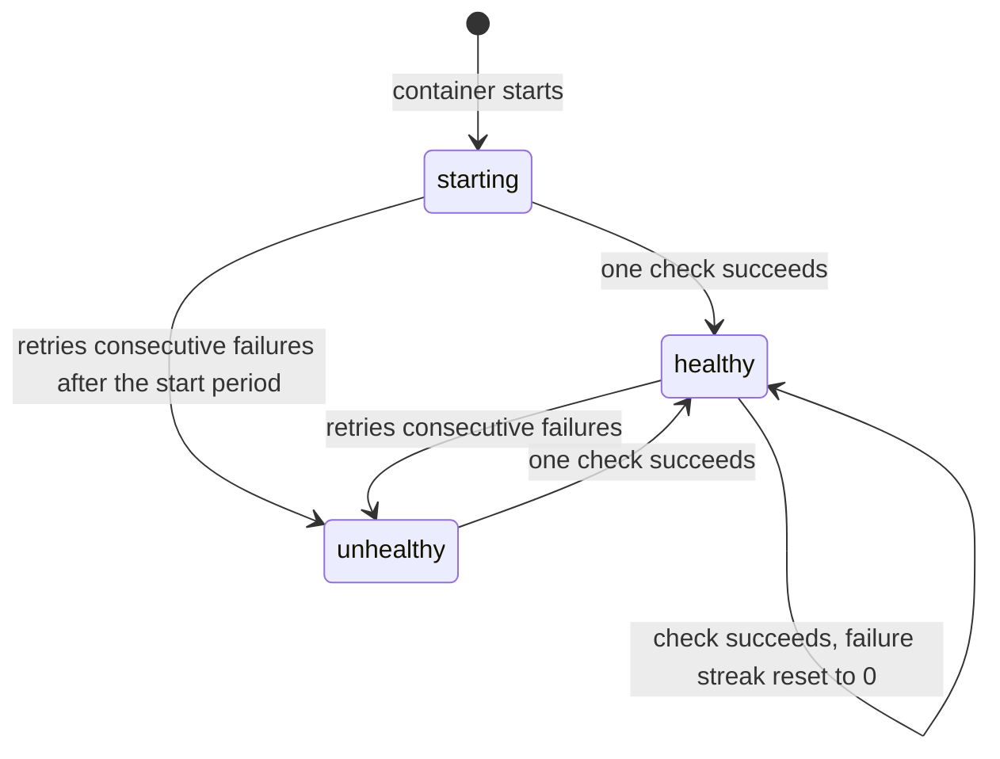
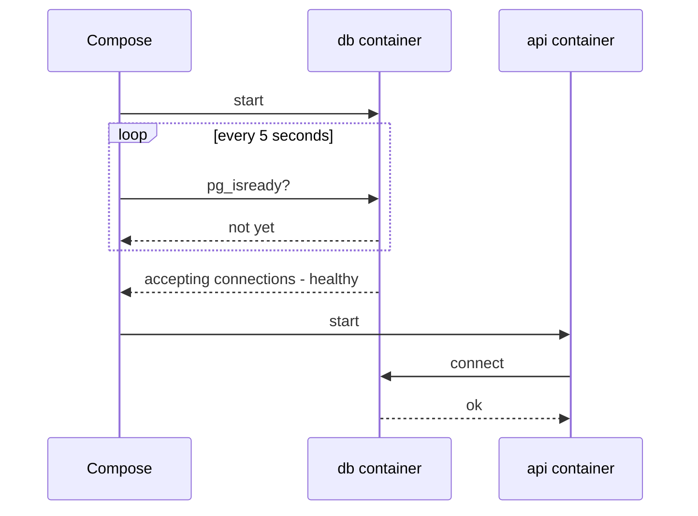

# Health checks and dependency checks

## In plain words

A program can be switched on and still be useless. Think of a shop with its lights on and its door unlocked, but nobody behind the counter: from the street it looks open, yet no customer gets served. Docker has the same blind spot. Out of the box, the only thing Docker knows about your application is whether its main process is still alive. A web server that is alive but answers every request with an error looks perfectly fine to Docker.

A **health check** is a small test, written by you, that Docker runs again and again inside the container to ask "are you really working?". A **dependency check** is a similar test that the application runs once before it starts, to ask "are the things I need (a database, another service) reachable?".

Why this matters for a job: production systems are expected to notice their own failures and recover without a human being woken up. Health checks are the signal every automatic recovery mechanism is built on, in Docker, in Docker Swarm and in Kubernetes. "How does the platform know your app is healthy?" is a routine interview question.

> **Before this lesson:** you should know how to write a Dockerfile ([Dockerfile instructions, one by one](#/lesson/docker/dockerfile-instructions)), how to run and inspect containers ([Running, inspecting and stopping containers](#/lesson/docker/running-containers)) and what a Compose file is ([Compose fundamentals](#/lesson/docker/compose-basics)).

## What Docker knows without a health check

A container is a running process (the first lesson called it PID 1, the first process inside the container). Docker watches that one process. If it exits, the container's status becomes `exited`. If it is still there, the status is `Up`. That is all.

Here is the simplest possible demonstration. The image `harbour/coinflip:1` is a tiny web application (an **API**, short for application programming interface: a program other programs talk to over the network) with a deliberate bug: after a few requests it starts returning errors, but the process keeps running.

```bash
docker run -d --name flip -p 8080:8000 harbour/coinflip:1
curl -s -o /dev/null -w "%{http_code}\n" localhost:8080/flip
curl -s -o /dev/null -w "%{http_code}\n" localhost:8080/flip
curl -s -o /dev/null -w "%{http_code}\n" localhost:8080/flip
curl -s -o /dev/null -w "%{http_code}\n" localhost:8080/flip
docker ps --format 'table {{.Names}}\t{{.Status}}'
```

Line by line:

- `docker run -d --name flip -p 8080:8000 ...` starts the container in the background (`-d`), names it `flip`, and connects port 8080 on your machine to port 8000 inside the container.
- Each `curl` line sends one web request. `-s` hides the progress bar, `-o /dev/null` throws away the response body, and `-w "%{http_code}\n"` prints only the **HTTP status code**, the three-digit number a web server sends to say how the request went (200 means success, 500 means the server failed).
- `docker ps` lists running containers, here printing only the name and status columns.

```text
200
200
200
500
NAMES     STATUS
flip      Up 14 seconds
```

The fourth request failed, and every request after it will fail too. Yet Docker reports `Up`. From Docker's point of view nothing is wrong, because the process has not exited.

## Adding a health check to the image

The `HEALTHCHECK` instruction in a Dockerfile tells Docker what command to run to test the application. Docker judges the result by the command's **exit code**, the number every program hands back when it finishes:

| Exit code of the check command | Docker's interpretation |
|---|---|
| 0 | Success: the app is healthy |
| 1 | Failure: the app is unhealthy |
| 2 | Reserved; do not use |

The smallest useful version:

```dockerfile
FROM python:3.12-slim
WORKDIR /app
COPY . .
RUN pip install --no-cache-dir -r requirements.txt

HEALTHCHECK CMD curl --fail http://localhost:8000/health || exit 1

CMD ["python", "server.py"]
```

Only the `HEALTHCHECK` line is new:

- `HEALTHCHECK CMD ...` means "run this command inside the container on a schedule".
- `curl --fail http://localhost:8000/health` requests the app's health page. `--fail` makes `curl` finish with a non-zero exit code if the server answers with an error status such as 500. Without `--fail`, `curl` would exit 0 for any answer at all.
- `localhost` is correct here because the check runs *inside* the container, right beside the app.
- `|| exit 1` means "if the command on the left failed, finish with exit code 1". `curl` has many different failure codes; this converts all of them to the one value Docker expects.

A `/health` page (often called a **health endpoint**, an address the app provides specifically for this purpose) should be cheap and honest: do a quick internal test and answer 200 if the app can do its job, 500 otherwise.

Build the new version and repeat the experiment:

```bash
docker build -t harbour/coinflip:2 .
docker run -d --name flip2 -p 8081:8000 harbour/coinflip:2
docker ps --format 'table {{.Names}}\t{{.Status}}'
```

```text
NAMES     STATUS
flip2     Up 5 seconds (health: starting)
```

There is a new piece of information in brackets. After about thirty seconds:

```text
flip2     Up 41 seconds (healthy)
```

Now break it with four requests and wait about a minute and a half:

```text
flip2     Up 3 minutes (unhealthy)
```

Docker now knows the truth.

## The three health states

A container with a health check is always in one of three health states, in addition to its ordinary running state.



- **starting**: the container has begun but has not yet passed a check.
- **healthy**: the most recent check passed.
- **unhealthy**: the check has failed several times in a row.

A single failure does not make a container unhealthy. Networks hiccup and garbage collectors pause; Docker waits for a **streak** of consecutive failures. One success at any time resets the streak to zero and makes the container healthy.

## Tuning the timing

Four options control the schedule. All have defaults.

```dockerfile
HEALTHCHECK --interval=10s --timeout=3s --start-period=30s --retries=3 \
  CMD curl --fail http://localhost:8000/health || exit 1
```

| Option | Default | Meaning |
|---|---|---|
| `--interval` | 30s | Time between the end of one check and the start of the next |
| `--timeout` | 30s | If a check runs longer than this, it counts as a failure |
| `--retries` | 3 | Consecutive failures needed to become `unhealthy` |
| `--start-period` | 0s | Grace time after start-up during which failures are not counted |
| `--start-interval` | 5s | Time between checks *during* the start period (newer Docker versions) |

The **start period** exists for slow starters. A Java service might need forty seconds before it can answer anything. During the start period a failing check is ignored (it does not add to the streak), but a passing check immediately makes the container `healthy` and ends the start period early.

How long does it take to notice a failure? Roughly `interval x retries`. With the defaults that is about 90 seconds; with the tuned values above, about 30. Faster detection costs more check runs, and each run starts a process inside the container, so do not set the interval to one second for an app that takes half a second to answer.

The simulation below plays out a timeline of check results using exactly these rules. Change the settings and the result list and predict the states before you run it.

```python-run
def health_timeline(results, interval=10, retries=3, start_period=30):
    """results: list of booleans, one per check, True = check passed."""
    state, streak, t, rows = "starting", 0, 0, []
    for ok in results:
        t += interval
        if ok:
            state, streak = "healthy", 0
        else:
            in_grace = state == "starting" and t <= start_period
            if not in_grace:
                streak += 1
                if streak >= retries:
                    state = "unhealthy"
        rows.append((t, "pass" if ok else "FAIL", streak, state))
    return rows

T, F = True, False
for t, res, streak, state in health_timeline([F, F, F, T, T, F, T, F, F, F, F, T]):
    print(f"t={t:3d}s  check={res}  failing streak={streak}  state={state}")
```

Read the output carefully: the first three failures happen inside the 30-second start period and are forgiven; the lone failure at 60 seconds starts a streak of one that the next success wipes out; only three failures in a row flip the state to `unhealthy`; and one pass at the end brings it back.

## Reading the health record

Docker keeps the results of the last five checks, including whatever the check command printed. This is the first place to look when a container is unhealthy.

```bash
docker inspect flip2 --format '{{json .State.Health}}' | python -m json.tool
```

`docker inspect` prints everything Docker knows about the container; the `--format` part selects only the health section, and the final command pretty-prints it.

```text
{
    "Status": "unhealthy",
    "FailingStreak": 4,
    "Log": [
        {
            "Start": "2026-03-02T10:02:11.104Z",
            "End": "2026-03-02T10:02:11.187Z",
            "ExitCode": 1,
            "Output": "curl: (22) The requested URL returned error: 500\n"
        }
    ]
}
```

`FailingStreak` is the current run of consecutive failures, and `Output` shows exactly what the check saw.

## An unhealthy container is not restarted by Docker alone

This surprises nearly everyone. On a single machine running plain Docker or Compose, an `unhealthy` container keeps running. Docker records and reports the status, and does nothing else.

The reason is caution. Docker on one machine cannot know whether killing your only database container would make things better or worse, so it leaves the decision to you. A **cluster** (several machines managed as one, covered later in the track) is different: it can start a replacement elsewhere first, so Docker Swarm and Kubernetes do replace unhealthy containers automatically.

| Platform | Reaction to `unhealthy` |
|---|---|
| `docker run`, Docker Compose | Status is reported; container keeps running |
| Docker Swarm | Container is killed and replaced; new versions are not rolled out further if they fail |
| Kubernetes | Uses its own probes; restarts or stops sending traffic |

On a single host the health status is still valuable: you can see it, monitoring can alert on it, and other services can wait for it, which is the next topic.

## Health checks without curl

Using `curl` means `curl` must be installed in the image. That is an extra tool that makes the image bigger and gives an attacker one more thing to use. Many minimal images contain no `curl` and no shell at all. A better pattern is to write the check in the same language as the app, so nothing extra is needed.

```python
# healthcheck.py: exit 0 if the app answers 200, otherwise exit 1
import sys
import urllib.request

try:
    with urllib.request.urlopen("http://localhost:8000/health", timeout=2) as response:
        sys.exit(0 if response.status == 200 else 1)
except Exception as error:
    print(f"health check failed: {error}")
    sys.exit(1)
```

```dockerfile
HEALTHCHECK --interval=10s --timeout=3s --start-period=20s \
  CMD ["python", "healthcheck.py"]
```

This version uses the *exec form* (a list in square brackets), which runs the program directly without a shell. The script prints a reason on failure, and that text appears in the `Output` field you saw above.

Not every container is a web server. A check can be any command:

| Kind of container | Example check |
|---|---|
| PostgreSQL database | `pg_isready -U postgres` |
| Redis cache | `redis-cli ping` |
| Background worker | Test that a "last heartbeat" file was updated in the last minute |
| Anything | A small program that exercises the main function and exits 0 or 1 |

## Health checks in a Compose file

You can define or override a health check in Compose, which is useful for images you did not build.

```yaml
services:
  db:
    image: postgres:16
    environment:
      POSTGRES_PASSWORD: devonly
    healthcheck:
      test: ["CMD-SHELL", "pg_isready -U postgres"]
      interval: 5s
      timeout: 3s
      retries: 10
      start_period: 10s
```

- `test` is the command. `CMD-SHELL` means "run this string with the container's shell"; `CMD` followed by separate list items means "run directly, no shell".
- The other four keys are the same timing options as in the Dockerfile.
- `healthcheck: {disable: true}` turns off a check that the image defined.

## Waiting for dependencies

Applications rarely work alone. An API needs its database. If the API starts first and tries to connect immediately, it crashes.

Compose can hold a service back until another is healthy:

```yaml
services:
  api:
    image: harbour/tasklane-api:0.9
    depends_on:
      db:
        condition: service_healthy
  db:
    image: postgres:16
    environment:
      POSTGRES_PASSWORD: devonly
    healthcheck:
      test: ["CMD-SHELL", "pg_isready -U postgres"]
      interval: 5s
      retries: 10
```

`depends_on` with `condition: service_healthy` means "do not start `api` until `db` reports healthy". Without the condition, Compose waits only for the database container to be *started*, which is several seconds earlier than *ready*.



### Dependency checks inside the image

Compose ordering only helps when Compose starts both containers together. In a cluster, containers are started and replaced independently, in any order, at any time. A robust image therefore checks its own dependencies when it starts. This is a **dependency check**: a quick test that runs *before* the real application and fails fast with a clear message.

```dockerfile
COPY wait_for_db.py .
CMD python wait_for_db.py && exec python server.py
```

- `python wait_for_db.py` tries to open a connection to the database, retrying for a limited time, and exits 0 on success or 1 on failure.
- `&&` means "run the next command only if the previous one succeeded".
- `exec python server.py` replaces the shell with the server process, so that the server becomes PID 1 and receives stop signals properly (the reason was covered in the Dockerfile lesson).

If the database is missing, the container exits with an error straight away instead of starting in a broken state:

```text
waiting for db:5432 ... attempt 1/10
waiting for db:5432 ... attempt 10/10
dependency check failed: db:5432 unreachable after 30s
```

An exited container is something every platform understands: it can be restarted (next lesson), and the reason is in the logs.

| | Dependency check | Health check |
|---|---|---|
| When it runs | Once, before the app starts | Repeatedly, for the whole life of the container |
| Question | "Can I start?" | "Am I still working?" |
| On failure | Container exits | Container is marked `unhealthy` |
| Typical content | Can I reach the database and other services? | Does my own main function still work? |

> [!WARNING]
> Be careful about testing *dependencies* inside the repeated *health* check. If the health check of every API container fails whenever the database is slow, a cluster will kill and restart all the API containers at once, which does not fix the database and adds a start-up storm on top. A health check should mostly answer "is *this* container broken?".

> [!INTERVIEW]
> "What is the difference between liveness and readiness?" Kubernetes splits the idea in two. A *liveness* probe failing means "restart me". A *readiness* probe failing means "I am alive but do not send me traffic yet". Docker's single `HEALTHCHECK` plays both roles: Swarm replaces unhealthy containers and also keeps them out of load balancing until they are healthy.

> [!TIP]
> Make the health endpoint cheap. It runs every few seconds on every container. A check that runs a heavy database query can become the largest source of load on a quiet system.

## Pitfalls

- **`curl` without `--fail`.** It exits 0 on a 500 response, so the check always passes.
- **Checking the wrong address.** The check runs inside the container: use `localhost` and the *container* port, not the published host port.
- **The checking tool is not in the image.** If `curl` is missing, every check fails with "executable file not found" and the container is permanently unhealthy.
- **No start period for a slow app.** The app is declared unhealthy, and in a cluster killed, before it has finished starting; it then restarts forever.
- **Expecting Compose to restart unhealthy containers.** It does not.
- **A check that always passes.** Testing only that the process exists adds nothing to what Docker already knows.
- **A check with side effects.** A check that writes a row or sends an email does so thousands of times a day.
- **Heavy checks.** Timeouts under load make a busy but working app look broken.

## Cheat sheet

| Task | Syntax |
|---|---|
| Define in Dockerfile | `HEALTHCHECK --interval=10s --timeout=3s --retries=3 --start-period=30s CMD <command>` |
| Disable inherited check | `HEALTHCHECK NONE` |
| Define at run time | `docker run --health-cmd "<command>" --health-interval 10s ...` |
| Define in Compose | `healthcheck: {test: [...], interval: 5s, retries: 5}` |
| See status | `docker ps` (shown in brackets) |
| See last results | `docker inspect NAME --format '{{json .State.Health}}'` |
| Wait for a dependency | `depends_on: {db: {condition: service_healthy}}` |
| List only unhealthy | `docker ps --filter health=unhealthy` |

## Summary

- Without a health check Docker only knows whether the main process is alive, not whether the application works.
- `HEALTHCHECK` defines a command run on a schedule; exit code 0 means healthy and 1 means unhealthy.
- States are `starting`, `healthy` and `unhealthy`. It takes `retries` consecutive failures to become unhealthy and one success to recover; failures inside the start period are forgiven.
- Plain Docker and Compose report health but do not act on it; Swarm and Kubernetes replace unhealthy containers.
- `depends_on` with `condition: service_healthy` delays a service until its dependency is ready.
- A dependency check at start-up makes a container fail fast and visibly when something it needs is missing.

## Glossary

| Term | Meaning |
|---|---|
| Health check | A command Docker runs repeatedly inside a container to test whether the app works |
| Exit code | The number a finished program returns; 0 means success |
| Health endpoint | A web address an app provides only to report its own health, often `/health` |
| HTTP status code | Three-digit result of a web request; 200 is success, 500 is a server error |
| Interval | Time between health checks |
| Timeout | Longest a check may run before it counts as failed |
| Retries | Number of consecutive failures needed to become unhealthy |
| Start period | Grace time after start in which failures are not counted |
| Failing streak | Current count of consecutive failed checks |
| Dependency check | A test run once at start-up to confirm required services are reachable |
| Liveness / readiness | Kubernetes terms for "restart me if this fails" and "do not send me traffic if this fails" |

## Check yourself

```quiz
[
  {"q": "A container has no health check. Its web server is running but returns an error for every request. What does `docker ps` show?",
   "options": ["Up (unhealthy)", "Up", "Exited (1)", "Restarting"],
   "answer": 1,
   "explain": "Without a health check Docker only watches whether the main process is alive. The process is alive, so the status is Up with no health information."},
  {"q": "Which exit code from the health check command tells Docker the container is healthy?",
   "options": ["0", "1", "2", "200"],
   "answer": 0,
   "explain": "Exit code 0 means success. 1 means unhealthy. 200 is an HTTP status code, not an exit code."},
  {"q": "Why is `curl http://localhost:8000/health` (without --fail) a broken health check?",
   "options": ["curl cannot reach localhost", "curl exits 0 even when the server answers 500, so the check always passes", "curl is too slow", "It needs HTTPS"],
   "answer": 1,
   "explain": "By default curl only reports failure when it cannot connect at all. --fail makes HTTP error statuses produce a non-zero exit code."},
  {"q": "Settings: interval 10s, retries 3, start period 0. The app breaks completely. About how long until the container is marked unhealthy?",
   "options": ["3 seconds", "10 seconds", "30 seconds", "90 seconds"],
   "answer": 2,
   "explain": "It takes three consecutive failed checks, ten seconds apart: roughly interval multiplied by retries."},
  {"q": "A container is healthy. Checks then go: fail, fail, pass, fail, fail. With retries set to 3, what is the state?",
   "options": ["unhealthy, because there were four failures", "healthy, because the pass reset the streak and only two failures followed", "starting", "exited"],
   "answer": 1,
   "explain": "Only consecutive failures count. The single pass reset the streak to zero, and two failures are below the threshold of three."},
  {"q": "On a single machine with Docker Compose, what happens when a container becomes unhealthy?",
   "options": ["Compose restarts it", "Compose removes it", "The status is reported and the container keeps running", "The host reboots"],
   "answer": 2,
   "explain": "Single-host Docker only records health. Automatic replacement is done by orchestrators such as Swarm and Kubernetes."},
  {"q": "What does `depends_on: {db: {condition: service_healthy}}` do for the api service?",
   "options": ["Restarts api whenever db fails", "Starts api only after db's health check has passed", "Starts both at the same time", "Copies db's health check to api"],
   "answer": 1,
   "explain": "Compose waits until the dependency reports healthy before starting the dependent service. It applies at start-up only."},
  {"q": "What is the purpose of the start period?",
   "options": ["To delay the first check", "To ignore failed checks while a slow app is still starting, so it is not marked unhealthy too early", "To limit how long the container may run", "To set the stop timeout"],
   "answer": 1,
   "explain": "Failures during the start period do not count toward the retry limit. A success during it marks the container healthy straight away."}
]
```

> **Source:** Stoneman, *Learn Docker in a Month of Lunches*, ch. 8 (topic coverage). Checked against <https://docs.docker.com/reference/dockerfile/#healthcheck> and <https://docs.docker.com/compose/how-tos/startup-order/>. All wording and examples are original.
