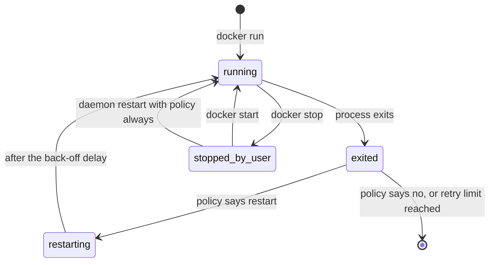
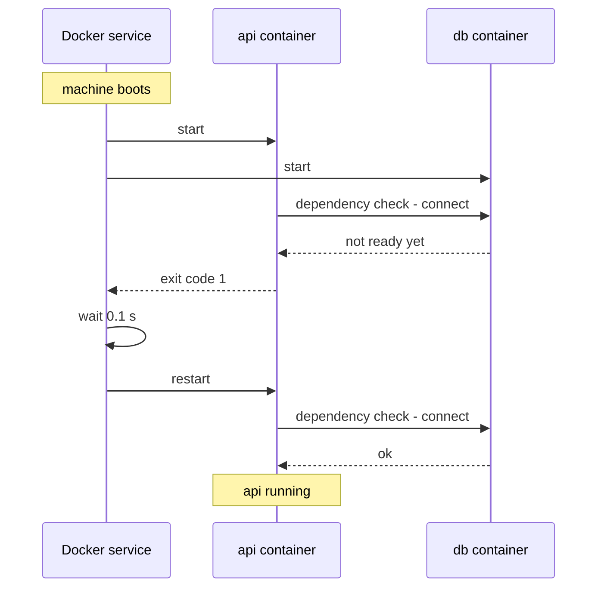

# Restart policies and self-healing containers

## In plain words

Programs crash. A bug, a full disk, a database that vanished for a moment, a server that was rebooted for updates overnight: sooner or later the process inside your container stops. The question is what happens next.

Think of a thermostat. You do not stand next to the boiler switching it on whenever the room gets cold. You tell the thermostat the temperature you want, and it keeps correcting the room for you. A **restart policy** is the same kind of standing instruction for a container: "if this stops, start it again". You set it once when you create the container, and Docker follows it for as long as the container exists, including after the whole machine restarts.

Why this matters for a job: a service that stays down until someone notices is the most basic kind of outage, and the cheapest to prevent. Restart policies are one line of configuration. Interviewers also like to ask about the four policy names and the subtle differences between them, and about what "exit code 137" or a container stuck "Restarting" tells you.

> **Before this lesson:** you should be comfortable starting and stopping containers and reading `docker ps` output ([Running, inspecting and stopping containers](#/lesson/docker/running-containers)), and know what a health check is ([Health checks and dependency checks](#/lesson/docker/health-checks)).

## What happens with no policy

Start with the simplest case. The image `harbour/wobbly:1` is a tiny program that prints a line every second and deliberately crashes after five seconds.

```bash
docker run -d --name wobbly harbour/wobbly:1
sleep 8
docker ps -a --format 'table {{.Names}}\t{{.Status}}'
```

- `docker run -d --name wobbly ...` starts the container in the background and names it `wobbly`.
- `sleep 8` waits eight seconds so the crash has time to happen.
- `docker ps -a` lists all containers, including stopped ones (`-a` means "all"); the `--format` part prints only two columns.

```text
NAMES     STATUS
wobbly    Exited (1) 3 seconds ago
```

`Exited (1)` means the main process ended and handed back **exit code** 1. An exit code is the number a program returns when it finishes: 0 means "finished normally", anything else means "something went wrong". The container stays stopped. Nothing brings it back.

## The four restart policies

You choose a policy with the `--restart` option when the container is created.

| Policy | Restarts when the process exits with an error (non-zero code)? | Restarts when it exits cleanly (code 0)? | Starts again after the Docker service or the machine restarts? | Restarts after you run `docker stop`? |
|---|---|---|---|---|
| `no` (the default) | No | No | No | No |
| `on-failure` | Yes | No | Yes, if it had exited with an error | No |
| `on-failure:5` | Yes, at most 5 times | No | Yes, if it had exited with an error | No |
| `always` | Yes | Yes | **Yes, even if you had stopped it by hand** | Not immediately, but it returns when Docker restarts |
| `unless-stopped` | Yes | Yes | Yes, **unless you had stopped it by hand** | No |

The only difference between `always` and `unless-stopped` is what happens after the Docker service (the background program, called the *daemon*, that runs containers) restarts. With `unless-stopped`, a container you deliberately stopped stays stopped. With `always`, it comes back. For most long-running services `unless-stopped` is the least surprising choice.

Try the failing program again with a policy:

```bash
docker rm -f wobbly
docker run -d --name wobbly --restart on-failure:3 harbour/wobbly:1
```

`docker rm -f wobbly` removes the old container (`-f` forces removal even if it is running) so the name can be reused. The new part is `--restart on-failure:3`: restart when the program exits with an error, but give up after three restarts.

Watch it for half a minute:

```bash
docker ps -a --format 'table {{.Names}}\t{{.Status}}'
```

```text
NAMES     STATUS
wobbly    Up 2 seconds
```

```text
wobbly    Restarting (1) 1 second ago
```

```text
wobbly    Exited (1) 12 seconds ago
```

Three different answers at three different moments: running, in the pause before a restart, and finally stopped for good once the limit was used up. Docker keeps a count:

```bash
docker inspect wobbly --format 'restarts={{.RestartCount}} exit={{.State.ExitCode}}'
```

```text
restarts=3 exit=1
```

`docker inspect` prints the full record Docker keeps for a container; the `--format` text picks out two fields from it.

## The lifecycle with a restart policy



## Back-off: waiting longer each time

If a program crashes the instant it starts, restarting it immediately in a tight loop would burn processor time and flood the logs. Docker therefore waits before each restart, and the wait grows. This is called **exponential back-off**: the delay starts at 100 milliseconds and doubles after each failed attempt (200 ms, 400 ms, 800 ms and so on) up to a ceiling of one minute.

The delay is reset once the container has stayed up for at least ten seconds. A container that runs for an hour and then crashes is restarted almost at once; a container that dies within a second of every start is retried less and less often.

The simulation below follows these rules. Each number in `runtimes` is how many seconds the program survives on one attempt.

```python-run
def simulate(policy, runtimes, exit_codes, max_retries=None):
    """Return a log of what Docker does. policy: no | on-failure | always | unless-stopped."""
    delay, restarts, clock, log = 0.1, 0, 0.0, []
    for attempt, (ran, code) in enumerate(zip(runtimes, exit_codes), start=1):
        clock += ran
        log.append(f"t={clock:7.1f}s  attempt {attempt} ran {ran}s, exit code {code}")
        wants = (policy in ("always", "unless-stopped")) or (policy == "on-failure" and code != 0)
        if not wants:
            log.append("            policy says: do not restart")
            break
        if policy == "on-failure" and max_retries is not None and restarts >= max_retries:
            log.append(f"            retry limit {max_retries} reached: give up")
            break
        if ran >= 10:
            delay = 0.1                      # stable long enough: reset the back-off
        log.append(f"            wait {delay:.1f}s then restart")
        clock += delay
        delay = min(delay * 2, 60.0)
        restarts += 1
    return log, restarts

log, n = simulate("on-failure", runtimes=[0.5, 0.5, 0.5, 0.5, 40, 0.5, 3], exit_codes=[1, 1, 1, 1, 1, 1, 0])
print("\n".join(log))
print("restart count:", n)
```

Notice three things in the output: the waits double while the program keeps dying quickly; the wait drops back to 0.1 seconds after the attempt that ran for 40 seconds; and the final clean exit (code 0) ends the story, because `on-failure` only reacts to errors. Change the policy to `"always"` and the last line changes.

## Exit codes worth recognising

The restart decision for `on-failure` depends on the exit code, and the code is also your first clue about what happened.

| Exit code | Meaning | Typical cause |
|---|---|---|
| 0 | Finished normally | A job that completed |
| 1 (or other small numbers) | The application reported an error | Unhandled exception, bad configuration |
| 125 | Docker itself could not run the container | Wrong option, missing image |
| 126 | The command exists but cannot be executed | File lacks execute permission |
| 127 | The command was not found | Typo in the command, wrong image |
| 137 | The process was killed outright | Out of memory, `docker kill`, or a stop that timed out |
| 143 | The process was asked to terminate and did | `docker stop` |

Codes above 128 mean "ended by a **signal**", a message the operating system sends to a process. Subtract 128 to get the signal number: 137 is signal 9 (`SIGKILL`, cannot be refused) and 143 is signal 15 (`SIGTERM`, a polite request to shut down).

For 137, one more field says whether memory was the reason:

```bash
docker inspect wobbly --format 'exit={{.State.ExitCode}} oom={{.State.OOMKilled}}'
```

```text
exit=137 oom=true
```

`oom` stands for "out of memory". `true` means the container went over its memory limit and the operating system killed it.

> [!WARNING]
> A container that is killed for using too much memory, restarted, and killed again is in a loop that a restart policy will happily continue forever. The restart hides the outage for a few seconds each cycle. Watch `RestartCount`; a number that keeps climbing is a bug report.

## Restart policies in Compose

In a Compose file the policy is the `restart` key of a service:

```yaml
services:
  api:
    image: harbour/tasklane-api:0.9
    restart: unless-stopped
    depends_on:
      db:
        condition: service_healthy

  db:
    image: postgres:16
    restart: unless-stopped
    environment:
      POSTGRES_PASSWORD: devonly
    volumes:
      - db-data:/var/lib/postgresql/data

  migrate:
    image: harbour/tasklane-api:0.9
    command: ["python", "-m", "tasklane", "migrate"]
    restart: on-failure:3
    depends_on:
      db:
        condition: service_healthy

volumes:
  db-data:
```

Reading the choices:

- `api` and `db` are long-running services. `unless-stopped` brings them back after a crash or a reboot, and respects a deliberate stop.
- `migrate` is a one-off job that updates the database structure and then finishes. With `always` it would be run again and again after succeeding. `on-failure:3` retries a failed run a few times and leaves a successful run alone.

You can also change the policy of a container that already exists:

```bash
docker update --restart unless-stopped tasklane-api-1
```

`docker update` changes settings of an existing container without recreating it.

## Surviving a reboot

Two things must be true for your containers to come back after the machine restarts:

1. The Docker service itself starts at boot. On most Linux systems: `sudo systemctl enable docker` (this tells the system's service manager to start Docker automatically).
2. The containers have a policy of `always`, `unless-stopped` or `on-failure` (the last only if they had failed).

Containers come back in no particular order, and Compose's `depends_on` plays **no part** in a reboot, because Compose is not running then; the Docker service restarts each container independently. This is exactly why the previous lesson recommended a dependency check inside the image: an API container that starts before the database exits with an error, the restart policy tries it again after a short wait, and by the second or third attempt the database is ready.



Restart policy plus dependency check equals an application that sorts itself out without anyone supervising the start order. This "crash and retry until the world is ready" behaviour is how applications are expected to behave in clusters too.

## Restart policy and health checks together

A restart policy reacts to the process **exiting**. A health check detects a process that is **alive but not working**. On a single machine these do not connect on their own: an `unhealthy` container has not exited, so the restart policy never fires.

There are three ways to close that gap:

| Approach | How it works |
|---|---|
| Make the app exit when it is broken | The app notices it cannot work (for example it lost its database for too long) and ends with a non-zero code; the restart policy does the rest |
| Run under an orchestrator | Swarm and Kubernetes replace unhealthy containers automatically |
| A watcher container | A small helper that watches Docker's event stream for `unhealthy` and restarts those containers; it needs access to the Docker control socket, which is a serious security trade-off |

The first is the cleanest for a single host. An application that cannot recover should stop, loudly, and let the platform restart it.

> [!INTERVIEW]
> "What is the difference between `always` and `unless-stopped`?" Both restart the container whenever it exits. They differ only after the Docker daemon restarts: `unless-stopped` leaves a manually stopped container stopped, `always` starts it again. A good follow-up to volunteer: neither restarts an *unhealthy* container, because unhealthy is not exited.

> [!TIP]
> `docker events --filter event=die --filter event=restart` prints a live line every time a container dies or restarts. It is a quick way to see whether something is quietly crash-looping.

## What a restart does not fix

A restart gives you the same container again: the same image, the same settings, the same writable layer (the container's private scratch storage, described in the storage lessons). That has consequences.

- **Bad configuration stays bad.** A wrong database password fails identically on every attempt.
- **Corrupted local state stays corrupted.** If the app wrote a broken file into its own filesystem, the restart finds it again.
- **Work in progress is lost.** Requests being handled at the moment of the crash are gone.
- **Memory leaks return.** The restart buys time, not a cure.

Restart policies are a safety net for the unexpected, not a substitute for fixing the cause. Treat every restart as an event worth understanding.

## Pitfalls

- **`always` on a one-off job.** It runs forever, repeatedly.
- **Using `--rm` together with a restart policy.** They contradict each other; Docker refuses the combination.
- **Assuming `docker stop` is ignored.** A manual stop wins over every policy until the daemon restarts (and with `unless-stopped`, even after).
- **Expecting restarts on `unhealthy`.** Not on a single host.
- **Not noticing a crash loop.** `docker ps` shows `Up 3 seconds` at the moment you look. Check `RestartCount` and the "Up" time.
- **A shell as the main process.** If a startup script launches the app in the background and exits, the container "exits" straight away and the policy restarts it endlessly.
- **Relying on start order after a reboot.** There is none. Build in dependency checks and retries.
- **No limit with `on-failure`.** Without `:N` it retries indefinitely.

## Cheat sheet

| Task | Command or key |
|---|---|
| Set at creation | `docker run --restart unless-stopped ...` |
| Limit retries | `--restart on-failure:5` |
| Compose | `restart: unless-stopped` |
| Change on an existing container | `docker update --restart always NAME` |
| How many restarts so far | `docker inspect NAME --format '{{.RestartCount}}'` |
| Why did it stop | `docker inspect NAME --format '{{.State.ExitCode}} {{.State.OOMKilled}}'` |
| Last words | `docker logs --tail 50 NAME` |
| Watch deaths live | `docker events --filter event=die` |
| Start Docker at boot | `sudo systemctl enable docker` |

| Kind of container | Sensible policy |
|---|---|
| Long-running service | `unless-stopped` |
| One-off job or migration | `on-failure:N` or `no` |
| Local experiment | `no` |
| Infrastructure that must always run (for example a log collector) | `always` |

## Summary

- By default a container that exits stays exited.
- A restart policy is a standing instruction: `no`, `on-failure[:N]`, `always` or `unless-stopped`.
- `on-failure` reacts only to non-zero exit codes; `always` and `unless-stopped` react to any exit and differ only in how they treat a manually stopped container after the daemon restarts.
- Docker waits between restarts with a delay that doubles from 100 ms up to one minute and resets after ten seconds of successful running.
- Exit codes tell the story: 1 is an application error, 137 is a kill (check `OOMKilled`), 127 is command not found.
- Restart policies do not react to `unhealthy` on a single host, and Compose start order does not apply after a reboot. Dependency checks plus a restart policy make an application start correctly in any order.
- A restart restores the same container; it cannot fix bad configuration or a bug.

## Glossary

| Term | Meaning |
|---|---|
| Restart policy | A per-container rule telling Docker whether to start the container again after it exits |
| Exit code | The number a process returns when it ends; 0 is success |
| Daemon | A program that runs in the background; here, the Docker service that manages containers |
| Signal | A message the operating system sends to a process, such as "please stop" (SIGTERM) or "stop now" (SIGKILL) |
| SIGTERM / SIGKILL | Signal 15, a polite stop request / signal 9, an immediate kill that cannot be refused |
| OOM | Out of memory: the process exceeded its memory limit and was killed |
| Exponential back-off | Waiting twice as long after each failed attempt |
| Crash loop | A container that starts, fails, is restarted and fails again, repeatedly |
| Self-healing | A system that detects and corrects its own failures without a person stepping in |
| Orchestrator | Software such as Docker Swarm or Kubernetes that manages containers across many machines |

## Check yourself

```quiz
[
  {"q": "A container is started with no --restart option. Its process crashes with exit code 1. What does Docker do?",
   "options": ["Restarts it once", "Restarts it with back-off", "Nothing; it stays exited", "Removes it"],
   "answer": 2,
   "explain": "The default policy is `no`. An exited container remains stopped until someone starts it."},
  {"q": "A batch job finishes successfully with exit code 0. Which policy would start it again?",
   "options": ["no", "on-failure", "on-failure:3", "always"],
   "answer": 3,
   "explain": "on-failure reacts only to non-zero exit codes. always (and unless-stopped) restart after any exit, which is wrong for one-off jobs."},
  {"q": "You run `docker stop web` on a container with `--restart unless-stopped`, then reboot the machine. Is `web` running after boot?",
   "options": ["Yes", "No, because it was stopped by hand before the restart", "Only if it has a health check", "Only if Compose is installed"],
   "answer": 1,
   "explain": "unless-stopped remembers a manual stop. With the policy always, the container would have been started again after the daemon came back."},
  {"q": "A container crashes immediately on every start. With a restart policy, how are the restart attempts spaced?",
   "options": ["Exactly every 10 seconds", "Immediately with no pause", "With a delay that doubles each time from 100 ms up to one minute", "Once per hour"],
   "answer": 2,
   "explain": "Docker applies exponential back-off to avoid a tight crash loop, and resets the delay after the container has run for ten seconds."},
  {"q": "`docker inspect` shows exit code 137 and OOMKilled true. What happened?",
   "options": ["The command was not found", "The app exited normally", "The container exceeded its memory limit and was killed", "docker stop was used"],
   "answer": 2,
   "explain": "137 is 128 + 9, a SIGKILL. OOMKilled true identifies the out-of-memory killer as the sender."},
  {"q": "A container on a single Docker host becomes `unhealthy` and has `--restart always`. What happens?",
   "options": ["It is restarted immediately", "It is restarted after the back-off delay", "Nothing: the process has not exited, so the restart policy does not apply", "It is removed"],
   "answer": 2,
   "explain": "Restart policies react to the process exiting. Health status is only reported on a single host; orchestrators are what act on it."},
  {"q": "After a machine reboot, the api container starts before the db container. What makes the application recover by itself?",
   "options": ["Compose's depends_on", "A dependency check that makes api exit, combined with a restart policy that retries it", "A larger memory limit", "Publishing the database port"],
   "answer": 1,
   "explain": "Compose is not involved after a reboot. The api fails fast, exits, and is restarted until the database is reachable."},
  {"q": "What does `--restart on-failure:5` mean?",
   "options": ["Restart every 5 seconds", "Restart on a non-zero exit code, at most 5 times", "Restart after 5 failures of the health check", "Wait 5 seconds before the first restart"],
   "answer": 1,
   "explain": "The number is the maximum retry count. After five restarts Docker gives up and leaves the container exited."}
]
```

> **Source:** Stoneman, *Learn Docker in a Month of Lunches*, ch. 8 (topic coverage). Checked against <https://docs.docker.com/engine/containers/start-containers-automatically/> and <https://docs.docker.com/reference/cli/docker/container/update/>. All wording and examples are original.
