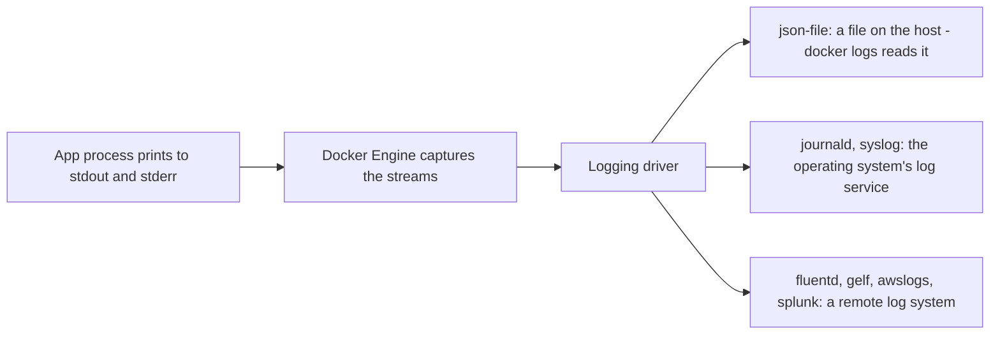
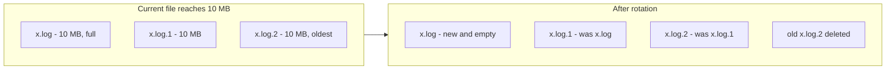
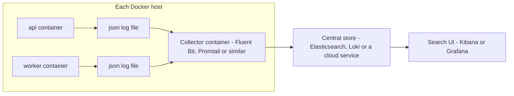

# Container logs, logging drivers and logging patterns

## In plain words

A **log** is the diary a program keeps while it runs: one line for each thing worth noting, such as "server started", "user 42 signed in" or "could not reach the database". When something goes wrong at three in the morning, the log is usually the only witness.

On an ordinary server each program writes its diary to its own file in its own folder, and you need to know where to look. Containers change the deal. Imagine a block of flats where, instead of every resident keeping post in a private drawer, everyone drops their letters into the same kind of letterbox by the front door, and one postal worker empties all the boxes. With containers, the application's only job is to **print its log lines to the screen**. Docker catches everything printed, stores it, and can pass it on to wherever your organisation keeps logs.

Why this matters for a job: "the container is failing, find out why" is the most common task you will be given, and the answer nearly always starts with `docker logs`. You also need to know the ways this can go wrong: an app whose logs are invisible because it writes to a file, and a server whose disk fills up because nobody limited the log size.

> **Before this lesson:** you should know how to run containers and use `docker ps` and `docker inspect` ([Running, inspecting and stopping containers](#/lesson/docker/running-containers)), what a volume is ([Volumes, bind mounts and tmpfs](#/lesson/docker/volumes-bind-mounts)) and how to read a Compose file ([Compose fundamentals](#/lesson/docker/compose-basics)).

## Standard output and standard error

Every program on Linux starts with three open channels, called **standard streams**:

| Stream | Short name | Purpose |
|---|---|---|
| Standard input | stdin | Where the program reads typed input from |
| Standard output | stdout | Where the program prints normal output |
| Standard error | stderr | Where the program prints error messages |

When you run a program in a terminal, stdout and stderr both appear on your screen. In Python, `print("hello")` writes to stdout.

Docker connects to the stdout and stderr of a container's main process and records every line. That is the whole mechanism. The simplest possible demonstration:

```bash
docker run --name hello-log alpine:3.20 sh -c 'echo "an ordinary line"; echo "an error line" >&2'
```

- `docker run --name hello-log alpine:3.20` starts a container called `hello-log` from the small Alpine Linux image.
- `sh -c '...'` runs the quoted text as a tiny shell script.
- `echo "an ordinary line"` prints to stdout.
- `echo "an error line" >&2` prints to stderr; `>&2` means "send this to stream number 2", which is stderr.

```text
an ordinary line
an error line
```

The container has finished, but Docker kept what it printed:

```bash
docker logs hello-log
```

```text
an ordinary line
an error line
```

`docker logs` shows what a container printed, even after it has stopped. The record is deleted only when the container is removed.

## Reading logs: the options you will use

```bash
docker logs quotes                    # everything so far
docker logs --tail 20 quotes          # only the last 20 lines
docker logs -f quotes                 # follow: keep printing new lines (Ctrl+C to stop watching)
docker logs --since 15m quotes        # lines from the last 15 minutes
docker logs --since 2026-03-02T09:00:00 --until 2026-03-02T09:30:00 quotes
docker logs -t quotes                 # add the time Docker received each line
```

```bash
docker logs -t --tail 3 quotes
```

```text
2026-03-02T09:14:07.512883401Z INFO  server listening on 0.0.0.0:8000
2026-03-02T09:14:31.090112874Z INFO  GET /quote 200 3ms
2026-03-02T09:15:02.774530019Z ERROR database timeout after 5000ms
```

The long value at the start of each line is a **timestamp** (date and time) added by Docker; the `Z` means the time is in UTC, the worldwide reference time zone.

In a Compose project the same idea covers every service at once, with the service name as a prefix:

```bash
docker compose logs -f --tail 5
```

```text
api-1    | INFO  GET /tasks 200 12ms
db-1     | LOG:  checkpoint complete
worker-1 | INFO  processed job 8812
```

## Where Docker keeps the lines

By default Docker saves each line in a file on the host machine, using a format called **JSON** (JavaScript Object Notation: a common text format of `"name": value` pairs inside curly brackets).

```bash
docker inspect quotes --format '{{.LogPath}}'
```

```text
/var/lib/docker/containers/9b1f4e0c62a7.../9b1f4e0c62a7...-json.log
```

Each line of that file wraps one line of your output:

```text
{"log":"INFO  server listening on 0.0.0.0:8000\n","stream":"stdout","time":"2026-03-02T09:14:07.512883401Z"}
{"log":"ERROR database timeout after 5000ms\n","stream":"stderr","time":"2026-03-02T09:15:02.774530019Z"}
```

- `log` is the text the app printed.
- `stream` records whether it came from stdout or stderr.
- `time` is when Docker received it.

The component that decides what happens to captured lines is called a **logging driver**. The default one, which writes these files, is named `json-file`.



## The disk-filling problem and log rotation

Here is the trap in the default setup: the `json-file` driver has **no size limit** unless you set one. A busy container printing a few kilobytes a second writes gigabytes within weeks. When the disk holding `/var/lib/docker` is full, every container on the machine starts failing, often in confusing ways.

The cure is **log rotation**: when the log file reaches a chosen size, Docker closes it, renames it, and starts a new one, keeping only a fixed number of old files and deleting the oldest.

```bash
docker run -d --name quotes \
  --log-opt max-size=10m \
  --log-opt max-file=3 \
  harbour/quotes-api:1.4
```

- `--log-opt` sets an option for the logging driver.
- `max-size=10m` means "start a new file when the current one reaches 10 megabytes".
- `max-file=3` means "keep at most three files in total".

The container can now never use more than about 30 MB of disk for logs. The cost is that the oldest lines are eventually thrown away.



The simulation below rotates files using exactly these rules, with tiny sizes so you can follow every step. Each number written is the size of one log line.

```python-run
def rotate(line_sizes, max_size, max_file):
    """Return (files, bytes_lost). files[0] is the current file; each file is a list of line sizes."""
    files, lost = [[]], 0
    for size in line_sizes:
        if files[0] and sum(files[0]) + size > max_size:
            files.insert(0, [])                 # start a new current file; others shift down
            while len(files) > max_file:
                lost += sum(files.pop())        # delete the oldest file
        files[0].append(size)
    return files, lost

lines = [4, 4, 4, 4, 4, 4, 4, 4, 4, 4, 4]      # eleven lines of 4 bytes each
files, lost = rotate(lines, max_size=10, max_file=3)
for i, f in enumerate(files):
    name = "x.log" if i == 0 else f"x.log.{i}"
    print(f"{name:8s} lines={f} total={sum(f)} bytes")
print("bytes deleted by rotation:", lost)
```

With a 10-byte limit each file holds two 4-byte lines (a third would make 12). Eleven lines need six files; only three are kept, so the oldest lines are gone. That loss is the price of a bounded disk.

To make rotation the default for every new container on a machine, put it in Docker's settings file, `/etc/docker/daemon.json`, and restart Docker:

```json
{
  "log-driver": "json-file",
  "log-opts": { "max-size": "10m", "max-file": "3" }
}
```

In Compose, set it per service:

```yaml
services:
  api:
    image: harbour/tasklane-api:0.9
    logging:
      driver: json-file
      options:
        max-size: "10m"
        max-file: "3"
```

> [!WARNING]
> Changing `daemon.json` affects only containers created afterwards. Existing containers keep the logging settings they were created with, so recreate them.

A newer driver named `local` stores logs in a more compact format and rotates by default (20 MB per file, five files). It is a good choice when nothing outside Docker needs to read the raw files.

## When the app writes to a file instead

Many older applications write their diary to a file such as `/var/log/app/app.log` and print nothing. Run one in a container and:

```bash
docker logs legacy-billing
```

```text
```

Nothing at all. The log lines exist, but inside the container's own private filesystem, where Docker's log capture does not look, and where they vanish when the container is removed. There are three ways out, from best to least good.

**1. Reconfigure the app to print to stdout.** Most logging libraries have a "console" option. This is always the first thing to try.

**2. Point the file at stdout.** On Linux, the special path `/dev/stdout` *is* the standard output stream. If the app insists on a file name, give it that one, or replace its log file with a **symbolic link** (a signpost file that redirects to another path):

```dockerfile
RUN ln -sf /dev/stdout /var/log/billing/access.log \
 && ln -sf /dev/stderr /var/log/billing/error.log
```

`ln -sf A B` creates a link named `B` that points to `A` (`-s` makes it symbolic, `-f` replaces `B` if it already exists). The official nginx image uses this exact trick.

**3. Relay the file with a second process.** When the app runs as a background service and the first two options are impossible, a small helper can read the file continuously and print each new line:

```dockerfile
CMD billing-server start && exec tail -F /var/log/billing/billing.log
```

`tail -F` prints lines as they are added to a file and keeps going if the file is replaced. It works, with two costs: every line is stored twice (once in the file inside the container, once by Docker), and the container's main process is now `tail`, so Docker no longer notices if the real application dies. Use it only as a bridge while the application is being fixed.

## Sending logs somewhere central

Log files on one machine do not help when you have twenty machines, or when a machine dies and takes its files with it. Teams therefore collect logs into one searchable place. There are two broad approaches.

### Approach A: a different logging driver

Docker itself sends each line straight to a collector.

```yaml
services:
  api:
    image: harbour/tasklane-api:0.9
    logging:
      driver: fluentd
      options:
        fluentd-address: "logs.harbourline.example:24224"
        tag: "tasklane.api"
        fluentd-async: "true"
```

| Driver | Sends lines to |
|---|---|
| `json-file`, `local` | Files on the host |
| `journald` | The Linux system journal |
| `syslog` | A syslog server, the traditional Unix log service |
| `fluentd` | A Fluentd or Fluent Bit collector |
| `gelf` | Graylog or Logstash |
| `awslogs`, `gcplogs` | Amazon or Google cloud logging |
| `none` | Nowhere: output is discarded |

### Approach B: keep the default driver and run a collector

A collector program (itself usually a container) runs on every machine, reads the JSON log files Docker writes, adds labels such as the container name, and ships the lines onward.



A well-known combination is **EFK**: Elasticsearch (a search database that stores the lines), Fluentd (the collector) and Kibana (a web page for searching). Approach B is the more common choice, because applications and their Compose files need no changes, `docker logs` keeps working, and a collector outage does not affect the applications.

> [!TIP]
> With a remote driver such as `fluentd`, a container may refuse to start if the collector is unreachable, and can stall when the collector is slow. Options such as `fluentd-async: "true"` or the general `mode: non-blocking` with `max-buffer-size` trade a small risk of losing lines for an application that never blocks on logging.

## Writing logs that are useful

Capturing lines is half the work. The other half is making each line worth capturing.

**One event per line.** Collectors split on line breaks. A Python error report (a *traceback*) printed over fifteen lines becomes fifteen unrelated records.

**Structured logs.** Instead of free text, print each event as one JSON object:

```text
{"ts":"2026-03-02T09:15:02Z","level":"error","msg":"database timeout","request_id":"7c1e","duration_ms":5000}
```

A machine can now filter precisely ("all lines where `level` is `error` and `duration_ms` is above 1000") without guessing at text patterns.

**Levels.** A **log level** marks how serious a line is:

| Level | Use for |
|---|---|
| `DEBUG` | Detail useful only while investigating; off in production |
| `INFO` | Normal events worth recording |
| `WARNING` | Something odd that the app coped with |
| `ERROR` | An operation failed |
| `CRITICAL` | The app cannot continue |

Make the level a setting read from an environment variable, so you can turn on `DEBUG` for an hour without building a new image.

**No buffering.** Some languages collect output in memory (a *buffer*) and print it in batches. Python does this when its output is not a terminal, so lines appear late or are lost when the container is killed. Set `PYTHONUNBUFFERED=1` in the image.

**Never log secrets.** Passwords, access tokens and personal data in a log are copied to every system the logs travel through.

**Include a request identifier.** A short random ID attached to every line produced while handling one request lets you follow that request across several services.

> [!INTERVIEW]
> "How should a containerised app handle logging?" Print to stdout and stderr, one structured event per line, and let the platform collect and route it. Do not write log files inside the container. Then mention rotation limits on the default driver and a collector that ships logs to a central store. This is factor eleven, "treat logs as event streams", of the well-known twelve-factor app guidelines.

## Pitfalls

- **No rotation configured.** The default `json-file` driver grows until the disk is full.
- **Logging to a file inside the container.** `docker logs` shows nothing, and the file is lost when the container is replaced.
- **`docker logs` with a remote driver on old Docker versions.** Recent versions keep a local copy ("dual logging") so the command still works; very old ones reported an error.
- **Expecting logs after `docker rm`.** They are deleted with the container. A collector must have shipped them first.
- **Multi-line messages.** They are split into separate records unless you log as single-line JSON.
- **Buffered output.** Lines arrive late or never. Disable buffering.
- **Blocking on a remote collector.** A slow log system should not slow the application; use non-blocking mode.
- **Debug level left on.** Costly in disk, money and noise.
- **Timestamps in local time.** Use UTC everywhere so lines from different machines can be compared.

## Cheat sheet

| Task | Command or setting |
|---|---|
| Show logs | `docker logs NAME` |
| Last N lines, follow | `docker logs --tail 100 -f NAME` |
| Time window | `docker logs --since 10m --until 5m NAME` |
| With timestamps | `docker logs -t NAME` |
| All services in a project | `docker compose logs -f` |
| Where the file is | `docker inspect NAME --format '{{.LogPath}}'` |
| Which driver | `docker inspect NAME --format '{{.HostConfig.LogConfig.Type}}'` |
| Limit size per container | `--log-opt max-size=10m --log-opt max-file=3` |
| Limit size for the whole host | `log-opts` in `/etc/docker/daemon.json` |
| Different driver | `--log-driver fluentd --log-opt fluentd-address=host:24224` |
| Never block the app | `--log-opt mode=non-blocking --log-opt max-buffer-size=4m` |
| File to stdout | `ln -sf /dev/stdout /path/to/app.log` |
| Unbuffered Python | `ENV PYTHONUNBUFFERED=1` |

## Summary

- A containerised app should print its log to stdout and stderr; Docker captures both streams of the main process.
- `docker logs` reads what was captured, with `--tail`, `-f`, `--since` and `-t` to narrow it down. Logs disappear when the container is removed.
- A logging driver decides where captured lines go. The default `json-file` writes a file on the host and has no size limit until you set `max-size` and `max-file`.
- Rotation bounds disk use by deleting the oldest files.
- Apps that write to files can be redirected with `/dev/stdout`, a symbolic link or, as a last resort, a relay process.
- For more than one machine, ship logs to a central store, either through a logging driver or, more commonly, with a collector that reads the default files.
- Good log lines are single-line, structured, levelled, unbuffered, in UTC and free of secrets.

## Glossary

| Term | Meaning |
|---|---|
| Log | The record of events a program writes while running |
| stdout / stderr | Standard output and standard error: the two channels a program prints normal and error text to |
| Timestamp | The date and time attached to a log line |
| UTC | Coordinated Universal Time, the reference time zone used to avoid confusion between machines |
| JSON | A text format of named values in curly brackets, easy for programs to read |
| Logging driver | The Docker component that decides where captured output is stored or sent |
| Log rotation | Starting a new log file at a size limit and deleting the oldest ones |
| Symbolic link | A file that points to another path |
| Collector | A program that gathers log lines from a machine and forwards them |
| Structured logging | Writing each event as named fields (usually JSON) instead of free text |
| Log level | A label such as DEBUG, INFO or ERROR giving a line's seriousness |
| Buffering | Holding output in memory and writing it in batches |
| EFK | Elasticsearch, Fluentd and Kibana: a common set of tools for storing and searching logs |

## Check yourself

```quiz
[
  {"q": "Which output does Docker capture as a container's logs?",
   "options": ["Any file under /var/log", "Whatever the main process writes to stdout and stderr", "Only lines that start with a timestamp", "Only error messages"],
   "answer": 1,
   "explain": "Docker attaches to the standard output and standard error streams of the container's main process. Files written inside the container are not captured."},
  {"q": "An app writes its log only to /var/log/app.log inside the container. What does `docker logs` show?",
   "options": ["The file's contents", "Nothing", "The last 100 lines of the file", "An error about the logging driver"],
   "answer": 1,
   "explain": "Nothing was printed to stdout or stderr, so nothing was captured. Reconfigure the app, or link the file to /dev/stdout."},
  {"q": "With the default json-file driver and no options, how large can a container's log grow?",
   "options": ["10 MB", "100 MB", "1 GB", "There is no limit; it grows until the disk is full"],
   "answer": 3,
   "explain": "Rotation is off by default for json-file. Set max-size and max-file per container or in daemon.json."},
  {"q": "A container runs with `--log-opt max-size=5m --log-opt max-file=4`. What is the most disk its logs can use, approximately?",
   "options": ["5 MB", "9 MB", "20 MB", "Unlimited"],
   "answer": 2,
   "explain": "Up to four files of up to 5 MB each are kept. When a fifth would be needed, the oldest is deleted."},
  {"q": "What does `ln -sf /dev/stdout /var/log/nginx/access.log` achieve in an image?",
   "options": ["It copies old logs to the screen once", "It makes anything written to access.log go to the container's standard output, where Docker captures it", "It disables logging", "It rotates the access log"],
   "answer": 1,
   "explain": "The log path becomes a symbolic link to the stdout stream, so an app that insists on writing a file is in fact writing to stdout."},
  {"q": "What happens to a container's json-file logs when you run `docker rm` on it?",
   "options": ["They are kept for 30 days", "They are deleted with the container", "They are moved to /var/log", "They are uploaded to the registry"],
   "answer": 1,
   "explain": "The log file belongs to the container. Keeping logs beyond the life of a container requires shipping them to a central store."},
  {"q": "Why is one JSON object per line preferred over free-text log messages?",
   "options": ["It uses less disk", "Machines can filter and search by named fields reliably, and multi-line messages are not split apart", "Docker requires it", "It hides secrets"],
   "answer": 1,
   "explain": "Structured single-line events are unambiguous for collectors and query tools. Free text needs fragile pattern matching."},
  {"q": "Why is running a collector that reads Docker's default log files often preferred over switching every container to a remote logging driver?",
   "options": ["Collectors are faster than drivers in every case", "Apps need no changes, docker logs keeps working, and a collector outage does not stop or block the applications", "Remote drivers cannot send JSON", "It avoids the need for rotation"],
   "answer": 1,
   "explain": "Decoupling shipping from the container's own logging path makes the system more tolerant of problems in the log pipeline. Rotation is still needed."}
]
```

> **Source:** Stoneman, *Learn Docker in a Month of Lunches*, ch. 19 (topic coverage). Checked against <https://docs.docker.com/engine/logging/>, <https://docs.docker.com/engine/logging/configure/> and <https://docs.docker.com/engine/logging/drivers/json-file/>. All wording and examples are original.
