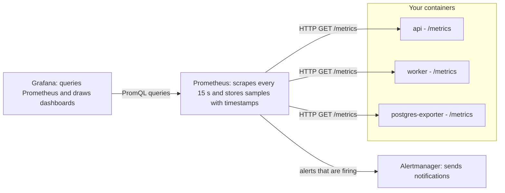

# Metrics with Prometheus and dashboards with Grafana

## In plain words

A car's dashboard does not tell you the story of your journey. It shows a few numbers that change all the time: speed, fuel level, engine temperature. One glance tells you whether everything is fine, and a needle creeping into the red warns you *before* the engine fails.

Software needs the same thing. A **metric** is a number that describes a running system at a moment in time: how many requests have been served, how much memory is in use, how long the last database call took. Logs (the previous lesson) tell you *what happened* in words. Metrics tell you *how much* and *how fast*, cheaply enough to record every few seconds for every container, and in a form you can draw as a graph.

**Prometheus** is a widely used free program that collects metrics and stores them with their timestamps. **Grafana** is a program that draws them as dashboards. Both run happily as containers next to your application.

Why this matters for a job: containers come and go constantly, so you cannot log in to a server and look around the way administrators once did. **Observability**, the ability to understand what a system is doing from the outside, is expected of any production service. Being able to say what you would measure and how you would collect it is a common interview topic.

> **Before this lesson:** you should understand Compose services and how containers find each other by name ([Compose fundamentals](#/lesson/docker/compose-basics) and [Container networking and DNS](#/lesson/docker/compose-networking)), and what container logs are ([Container logs](#/lesson/docker/container-logs)).

## Starting with what Docker already measures

Docker tracks resource use for every container. You saw this command earlier in the track:

```bash
docker stats --no-stream
```

`docker stats` shows live resource figures; `--no-stream` prints one snapshot instead of refreshing continuously.

```text
NAME      CPU %   MEM USAGE / LIMIT   MEM %   NET I/O        PIDS
api-1     2.31%   88.4MiB / 512MiB    17.3%   1.2MB / 3MB    9
db-1      0.42%   61.0MiB / 15.6GiB   0.4%    2.9MB / 1MB    7
```

This is useful and limited. It shows only this instant, on this one machine, and nothing about what the application itself is doing: how many requests, how many errors, how slow. To see history and application behaviour you need a system built for the purpose.

## The idea: every container tells its own numbers

The Prometheus approach rests on one convention. Each application offers a web page, by custom at the address `/metrics`, that lists its current numbers as plain text. Prometheus visits that page on a schedule, every 15 seconds for example, and stores what it reads. Visiting the page to collect the numbers is called **scraping**.



Notice the direction of the arrows. Prometheus *pulls* numbers from the applications; the applications do not push anything anywhere and do not need to know that Prometheus exists. Adding monitoring to a container means adding one page to it.

## What a metrics page looks like

```bash
curl -s localhost:8000/metrics
```

`curl -s` fetches a web address and prints the response without a progress bar.

```text
# HELP http_requests_total Total HTTP requests handled.
# TYPE http_requests_total counter
http_requests_total{method="GET",path="/tasks",status="200"} 1482
http_requests_total{method="GET",path="/tasks",status="500"} 7
http_requests_total{method="POST",path="/tasks",status="201"} 311
# HELP tasks_in_queue Tasks waiting to be processed.
# TYPE tasks_in_queue gauge
tasks_in_queue 14
```

Reading it line by line:

- Lines starting with `#` are comments. `HELP` describes a metric in words; `TYPE` states what kind it is.
- `http_requests_total` is the **metric name**.
- The part in curly brackets is a set of **labels**: name-and-value pairs that split one metric into several separate series. Here the request count is kept separately for each combination of method, path and status.
- The number at the end is the current value.

Each distinct combination of name and labels is one **time series**: a sequence of values with timestamps, built up one scrape at a time.

## The four kinds of metric

| Type | Behaviour | Everyday comparison | Examples |
|---|---|---|---|
| **Counter** | Only ever goes up (and restarts from 0 when the program restarts) | A car's odometer | Requests served, errors, bytes sent |
| **Gauge** | Goes up and down | A fuel gauge | Memory in use, queue length, active connections |
| **Histogram** | Counts observations into size ranges called *buckets* | Sorting parcels into "under 1 kg", "under 5 kg", "under 20 kg" | Request duration, response size |
| **Summary** | Like a histogram, with the percentages worked out inside the app | | Less common today |

Counters cause the most confusion. A counter's raw value, "1482 requests since the program started", is rarely interesting. What you want is how fast it is growing: requests *per second*. That speed is called a **rate**, and it is computed from two readings:

$$\text{rate} = \frac{\text{newer value} - \text{older value}}{\text{seconds between them}}$$

The simulation below scrapes a counter every 15 seconds and computes the rate, including the case where the app restarts and the counter drops back to zero.

```python-run
def rates(samples):
    """samples: list of (time_seconds, counter_value). Returns per-second rate between scrapes."""
    out = []
    for (t0, v0), (t1, v1) in zip(samples, samples[1:]):
        increase = v1 - v0 if v1 >= v0 else v1          # counter reset: it restarted from zero
        out.append((t1, round(increase / (t1 - t0), 2)))
    return out

scrapes = [(0, 1000), (15, 1045), (30, 1090), (45, 1240), (60, 30), (75, 75)]
for t, r in rates(scrapes):
    bar = "#" * int(r * 3)
    print(f"t={t:3d}s  {r:5.2f} requests/second  {bar}")
```

Between 30 and 45 seconds traffic jumps to 10 requests a second. At 60 seconds the value falls from 1240 to 30: the app restarted. A drop in a counter is always treated as a reset, so the increase is counted from zero rather than as a huge negative number.

## Adding metrics to an application

Client libraries exist for every common language. In Python, with the `prometheus-client` package:

```python
from prometheus_client import Counter, Gauge, Histogram, start_http_server

REQUESTS = Counter("http_requests_total", "Total HTTP requests handled.", ["method", "path", "status"])
QUEUE = Gauge("tasks_in_queue", "Tasks waiting to be processed.")
DURATION = Histogram("http_request_duration_seconds", "Time spent handling a request.", ["path"])

start_http_server(9100)        # serve the metrics page on port 9100

def handle(request):
    with DURATION.labels(path=request.path).time():      # measures how long the block takes
        response = process(request)
    REQUESTS.labels(method=request.method, path=request.path, status=str(response.status)).inc()
    return response
```

- The first three statements create one metric of each main type. The list at the end names its labels.
- `start_http_server(9100)` starts a small web server whose only page is the metrics text.
- `DURATION.labels(...).time()` times the code inside the `with` block and records the result in the histogram.
- `.inc()` adds one to the counter.

The library also publishes standard numbers about the process itself (memory, processor time, open files) without any code from you.

### Software you did not write: exporters

A database cannot be edited to add a `/metrics` page. For such software you run an **exporter**: a small helper container that asks the real program for its statistics and republishes them in Prometheus format.

| Exporter | Reports on |
|---|---|
| `node-exporter` | The host machine: processor, memory, disk, network |
| `cAdvisor` | Every container on the host: processor, memory, network, disk per container |
| `postgres-exporter`, `redis-exporter`, `mysqld-exporter` | The named database or cache |
| `blackbox-exporter` | Whether an address answers from the outside |

The Docker Engine can also publish its own metrics when `"metrics-addr": "0.0.0.0:9323"` is set in its `daemon.json` settings file.

## Running Prometheus beside the app

```yaml
# compose.yaml
services:
  api:
    image: harbour/tasklane-api:0.9
    ports:
      - "8000:8000"

  cadvisor:
    image: gcr.io/cadvisor/cadvisor:v0.49.1
    volumes:
      - /:/rootfs:ro
      - /var/run:/var/run:ro
      - /sys:/sys:ro
      - /var/lib/docker/:/var/lib/docker:ro

  prometheus:
    image: prom/prometheus:v2.53.0
    volumes:
      - ./prometheus.yml:/etc/prometheus/prometheus.yml:ro
      - prom-data:/prometheus
    ports:
      - "127.0.0.1:9090:9090"

  grafana:
    image: grafana/grafana:11.1.0
    volumes:
      - grafana-data:/var/lib/grafana
    ports:
      - "127.0.0.1:3000:3000"

volumes:
  prom-data:
  grafana-data:
```

What is new here:

- `cadvisor` needs to read information about every container, so several host folders are mounted into it. The `:ro` at the end of each makes the mount read-only.
- `prometheus` gets its configuration from a file on your machine (a bind mount) and keeps its collected data in the named volume `prom-data`, so history survives when the container is replaced.
- Both web interfaces are published only on `127.0.0.1`, meaning they are reachable from this machine and not from the network.

The Prometheus configuration says what to scrape:

```yaml
# prometheus.yml
global:
  scrape_interval: 15s

scrape_configs:
  - job_name: api
    static_configs:
      - targets: ["api:9100"]

  - job_name: containers
    static_configs:
      - targets: ["cadvisor:8080"]
```

- `scrape_interval: 15s` is how often to collect.
- Each entry under `scrape_configs` is a **job**: a named group of things to scrape.
- `targets` lists addresses. `api:9100` works because Prometheus is on the same Compose network as the `api` service, and Docker's built-in name lookup turns `api` into the container's address. The path `/metrics` is assumed.

Start everything and open `http://localhost:9090/targets` in a browser:

```bash
docker compose up -d
```

```text
Endpoint                        State   Labels                                  Last Scrape
http://api:9100/metrics         UP      instance="api:9100", job="api"          4.2s ago
http://cadvisor:8080/metrics    UP      instance="cadvisor:8080", job="containers"  9.8s ago
```

`UP` means the last scrape succeeded. Prometheus adds two labels of its own to everything it collects: `job` (from the configuration) and `instance` (the address scraped).

### Several copies of a service

`static_configs` with one address reaches one container. If the `api` service is scaled to three containers, Prometheus must scrape each of them separately, because each has its own counters. Ask Docker's name lookup for all of them:

```yaml
  - job_name: api
    dns_sd_configs:
      - names: ["api"]
        type: A
        port: 9100
```

`dns_sd_configs` means "DNS service discovery": look the name up, and scrape every address returned. As containers are added and removed, the list of targets follows automatically.

## Asking questions: a first taste of PromQL

Prometheus has its own query language, **PromQL**. Type queries into the box at `http://localhost:9090/graph`.

| Question | Query |
|---|---|
| Is each target up? (1 yes, 0 no) | `up` |
| Requests per second, averaged over 5 minutes | `rate(http_requests_total[5m])` |
| The same, totalled per path | `sum by (path) (rate(http_requests_total[5m]))` |
| Share of requests that failed | `sum(rate(http_requests_total{status=~"5.."}[5m])) / sum(rate(http_requests_total[5m]))` |
| Memory per container, in megabytes | `container_memory_working_set_bytes{name!=""} / 1024 / 1024` |
| The time 95 % of requests finish within | `histogram_quantile(0.95, sum by (le) (rate(http_request_duration_seconds_bucket[5m])))` |

The pieces:

- `http_requests_total[5m]` means "the readings from the last five minutes".
- `rate(...)` turns those readings into a per-second speed, handling counter resets as in the simulation above.
- `{status=~"5.."}` keeps only series whose `status` label matches the pattern "5 followed by any two characters", that is, the server-error codes 500 to 599.
- `sum by (path) (...)` adds series together, keeping one result per value of `path`.

The last query introduces the word **percentile**. "The 95th percentile is 300 ms" means 95 out of every 100 requests finished within 300 ms. Percentiles describe what slow requests feel like; an average hides them.

## What to measure

A newcomer's instinct is to measure everything. Two short lists help you choose.

For a service that answers requests, the **RED** method:

| Letter | Measure | Tells you |
|---|---|---|
| **R**ate | Requests per second | How busy it is |
| **E**rrors | Failed requests per second, or as a share | Whether it is working |
| **D**uration | How long requests take, as percentiles | Whether it is fast enough |

For a resource such as a machine, a disk or a container's memory, the **USE** method: **U**tilisation (how full), **S**aturation (how much work is waiting), **E**rrors.

Google's site reliability engineers describe almost the same thing as the "four golden signals": latency, traffic, errors and saturation.

## Dashboards with Grafana

Grafana turns queries into pictures. Open `http://localhost:3000`, sign in (a new installation asks you to set the administrator password), and connect it to Prometheus under *Connections > Data sources*, using the address `http://prometheus:9090`. Use the service name: Grafana runs in a container, so `localhost` would mean the Grafana container itself.

A **dashboard** is a page of **panels**, each drawing the result of one query. A good first dashboard for a service has one row per question:

| Row | Panel | Query idea |
|---|---|---|
| Is it up? | Number of healthy instances | `sum(up{job="api"})` |
| How busy? | Requests per second by path | `sum by (path) (rate(http_requests_total[5m]))` |
| Is it failing? | Error share | the error-ratio query above |
| Is it slow? | 50th, 95th and 99th percentile duration | `histogram_quantile(...)` |
| Is it running out? | Memory used compared with the limit, per container | cAdvisor metrics |

Dashboards can be exported as JSON files and loaded automatically at start-up (Grafana calls this *provisioning*). Keeping them in version control means a new environment comes up with its dashboards already in place.

> [!TIP]
> Put the question a panel answers in its title: "Are requests failing?" is more useful at 3 a.m. than "http_requests_total 5xx rate".

## From graphs to alerts

Nobody watches a dashboard all night. An **alert rule** is a query plus a condition; when the condition stays true for a set time, Prometheus fires the alert and a companion program, Alertmanager, delivers it by e-mail, chat message or pager.

```yaml
groups:
  - name: api
    rules:
      - alert: HighErrorRate
        expr: sum(rate(http_requests_total{status=~"5.."}[5m])) / sum(rate(http_requests_total[5m])) > 0.05
        for: 10m
        labels:
          severity: page
        annotations:
          summary: "More than 5% of API requests are failing"
```

- `expr` is the condition: the error share is above 0.05, which is 5 %.
- `for: 10m` requires the condition to hold for ten minutes without a break, so a brief blip wakes nobody.

Alert on what users experience (errors, slowness), not on every internal number.

> [!WARNING]
> Every distinct combination of label values is a separate time series held in memory. A label with unlimited possible values (a user ID, an e-mail address, a full web address with its query string) can create millions of series and bring Prometheus down. This is known as a **cardinality** problem. Labels must have a small, fixed set of values.

> [!INTERVIEW]
> "How would you monitor a containerised application?" Expose a `/metrics` endpoint from each service using a client library; run exporters such as cAdvisor and node-exporter for containers and hosts; have Prometheus scrape them, using service discovery so that new containers are picked up; build Grafana dashboards around rate, errors and duration; alert on symptoms. Then explain logs versus metrics: metrics tell you *that* something is wrong and where; logs tell you *why*.

## Pitfalls

- **Graphing a raw counter.** It is a line that climbs forever. Wrap it in `rate()`.
- **One target for a scaled service.** A single address returns different containers on different scrapes, mixing their counters into nonsense. Use DNS or Docker service discovery so each container is its own target.
- **High-cardinality labels.** Covered in the warning above.
- **Averages for response time.** They hide slow requests. Use percentiles from a histogram.
- **`localhost` in container-to-container addresses.** Use service names.
- **No volume for Prometheus.** Recreating the container wipes all history.
- **Publishing metrics pages to the internet.** They reveal internals. Keep them on the private network.
- **Scraping too often.** A 1-second interval multiplies storage and load for little benefit; 15 to 60 seconds is normal.
- **Dashboards nobody reads.** Fewer panels, each answering a real question, beat a wall of graphs.

## Cheat sheet

| Item | Value |
|---|---|
| Metrics page convention | `GET /metrics`, plain text |
| Prometheus web interface | port 9090; `/targets` shows scrape status |
| Grafana web interface | port 3000 |
| Container metrics | cAdvisor, port 8080 |
| Host metrics | node-exporter, port 9100 |
| Docker Engine metrics | `"metrics-addr"` in `daemon.json`, port 9323 |
| Per-second speed of a counter | `rate(name[5m])` |
| Group and total | `sum by (label) (...)` |
| Filter by label | `name{label="value"}`; pattern match with `=~` |
| Percentile from a histogram | `histogram_quantile(0.95, sum by (le) (rate(name_bucket[5m])))` |
| Is the target alive | `up` |
| Reload configuration | `docker compose kill -s HUP prometheus` |

## Summary

- Metrics are numbers sampled over time. They are cheap, easy to graph and suitable for alerts; logs complement them with detail.
- Each service exposes a `/metrics` page; Prometheus pulls from it on a schedule and stores time series identified by a name and labels.
- Counters only rise and are read with `rate()`; gauges move both ways; histograms count observations into buckets and give percentiles.
- Exporters publish metrics for software you cannot change, including the host (node-exporter) and all containers (cAdvisor).
- In Compose, Prometheus finds targets by service name; use DNS service discovery when a service has several containers.
- PromQL selects, filters, rates and totals series. Grafana draws the results; alert rules watch them for you.
- Measure rate, errors and duration for services, and keep label values few.

## Glossary

| Term | Meaning |
|---|---|
| Metric | A number describing a system at a moment, such as requests served or memory used |
| Observability | Being able to understand a system's internal state from what it reports |
| Time series | One metric with one set of label values, recorded repeatedly with timestamps |
| Scrape | Prometheus fetching a metrics page |
| Target | One address that Prometheus scrapes |
| Job | A named group of targets in the Prometheus configuration |
| Label | A name-and-value pair attached to a metric to split it into separate series |
| Counter | A metric that only increases |
| Gauge | A metric that can rise and fall |
| Histogram | A metric that counts observations into ranges (buckets) |
| Rate | How fast a counter grows, per second |
| Percentile | The value below which a given percentage of observations fall |
| Exporter | A helper that publishes metrics on behalf of software that cannot do so itself |
| PromQL | The Prometheus query language |
| Dashboard / panel | A page of graphs / one graph on that page |
| Cardinality | The number of distinct time series; too many exhausts memory |
| Alert rule | A condition on a query that triggers a notification when it stays true |

## Check yourself

```quiz
[
  {"q": "How does Prometheus normally obtain metrics from an application?",
   "options": ["The application sends them to Prometheus after every request", "Prometheus fetches the application's /metrics page on a schedule", "Docker copies them from the container logs", "Grafana uploads them"],
   "answer": 1,
   "explain": "Prometheus uses a pull model: it scrapes an HTTP endpoint on each target at a regular interval."},
  {"q": "Which metric type suits 'total number of failed logins since start'?",
   "options": ["Gauge", "Counter", "Histogram", "Label"],
   "answer": 1,
   "explain": "A value that only ever increases is a counter. A gauge is for values that also go down, such as queue length."},
  {"q": "A counter reads 600 at one scrape and 900 at a scrape 60 seconds later. What is the rate?",
   "options": ["900 per second", "300 per second", "5 per second", "15 per second"],
   "answer": 2,
   "explain": "The increase is 300 over 60 seconds, which is 5 per second."},
  {"q": "A counter reads 5000, then 40 at the next scrape. How does rate() treat this?",
   "options": ["As a decrease of 4960", "As a counter reset: the process restarted, so the increase is counted from zero", "As an error that stops the query", "It ignores both readings"],
   "answer": 1,
   "explain": "Counters never go down by themselves, so a drop means the process restarted. The new value is taken as the increase since the reset."},
  {"q": "You cannot add code to PostgreSQL. How do you get its metrics into Prometheus?",
   "options": ["Parse its logs with Grafana", "Run an exporter container that queries PostgreSQL and exposes /metrics", "It is not possible", "Mount its data volume into Prometheus"],
   "answer": 1,
   "explain": "An exporter translates a third-party system's own statistics into the Prometheus text format."},
  {"q": "In a Compose project, what target address should Prometheus use for the api service's metrics on port 9100?",
   "options": ["localhost:9100", "127.0.0.1:9100", "api:9100", "0.0.0.0:9100"],
   "answer": 2,
   "explain": "Prometheus runs in its own container, where localhost means itself. Services reach each other by service name on the shared network."},
  {"q": "Why is `user_id` a poor choice of label?",
   "options": ["Labels cannot contain numbers", "Every distinct value creates a separate time series, so an unbounded label can exhaust Prometheus's memory", "It is not allowed by Grafana", "It slows down the application's requests"],
   "answer": 1,
   "explain": "This is the cardinality problem. Labels should have a small, fixed set of possible values."},
  {"q": "What do the letters in the RED method stand for?",
   "options": ["Restarts, Exits, Deployments", "Rate, Errors, Duration", "Requests, Events, Disk", "Read, Execute, Delete"],
   "answer": 1,
   "explain": "For request-driven services measure how many requests arrive, how many fail and how long they take."}
]
```

> **Source:** Stoneman, *Learn Docker in a Month of Lunches*, ch. 9 (topic coverage). Checked against <https://prometheus.io/docs/concepts/metric_types/>, <https://prometheus.io/docs/prometheus/latest/configuration/configuration/> and <https://docs.docker.com/engine/daemon/prometheus/>. All wording and examples are original.
