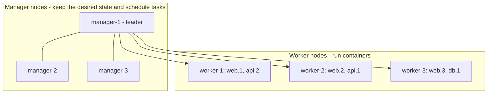
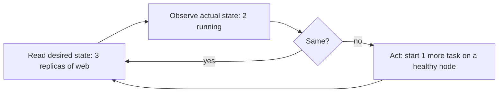
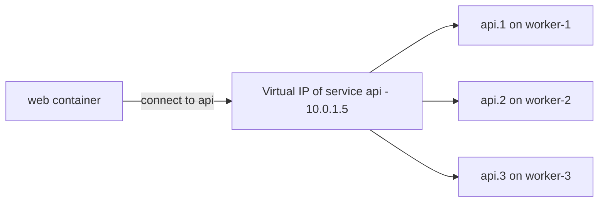
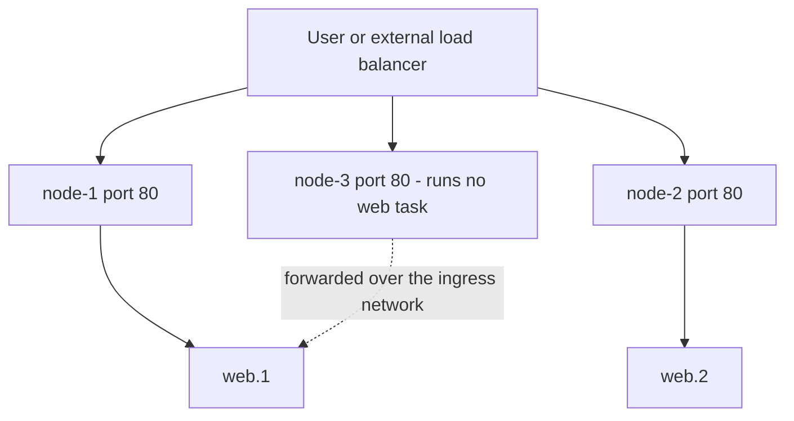

# Orchestration with Docker Swarm

## In plain words

So far every container in this track has run on one computer. That is fine for development, and it has two weaknesses in production. If that computer breaks, everything on it stops. And if the application becomes popular, one computer is eventually not enough.

The answer is to use several computers and treat them as one pool. Think of a restaurant kitchen. The head chef does not cook every dish. The chef receives the orders, decides which cook prepares what, notices when a cook goes home ill, and hands that cook's dishes to someone else. Customers never learn which cook made their meal.

An **orchestrator** is that head chef for containers. You tell it *what* you want ("six copies of the web app, always"), and it decides *where* each copy runs, watches them, and replaces any that fail. A group of machines managed this way is called a **cluster**.

**Docker Swarm** is the orchestrator built into Docker. It is the gentlest one to learn because it reuses the commands and the Compose file format you already know. The dominant orchestrator in industry is Kubernetes, covered in the next lesson; the ideas you learn here carry over almost one for one.

Why this matters for a job: "desired state", "replicas", "rolling update" and "service discovery" are the working vocabulary of every team that runs containers in production, whichever orchestrator they use.

> **Before this lesson:** you should understand Compose files, services and networks ([Compose fundamentals](#/lesson/docker/compose-basics), [Container networking and DNS](#/lesson/docker/compose-networking)), health checks ([Health checks and dependency checks](#/lesson/docker/health-checks)) and restart behaviour ([Restart policies](#/lesson/docker/restart-policies)).

## The vocabulary

Seven words describe a swarm. Each is defined here before it is used.

| Term | Meaning |
|---|---|
| **Node** | One machine (physical or virtual) that has joined the cluster |
| **Manager** | A node that makes decisions and stores the cluster's records |
| **Worker** | A node that only runs containers it is told to run |
| **Service** | Your description of something to run: which image, how many copies, which ports |
| **Replica** | One of the identical copies of a service |
| **Task** | One slot of a service: "replica number 3 of `web`", which is filled by one container |
| **Stack** | A group of services deployed together from one Compose file |



## Desired state: the one idea to take away

With `docker run` you give an **instruction**: "start this container now". If it later dies, Docker has no memory of what you wanted.

With an orchestrator you give a **description**: "there should be three replicas of this service". The orchestrator stores that description, called the **desired state**, and runs a never-ending loop:



This loop is called a **reconciliation loop** (to reconcile means to make two things agree). It is why a cluster repairs itself: a crashed container, a failed health check and a machine that lost power all look the same to the loop, "actual is less than desired", and all get the same response.

The simulation below runs that loop for a small cluster while things go wrong.

```python-run
def reconcile(desired, nodes, tasks):
    """tasks: {task_id: node}. Drop tasks on dead nodes, then top up on the least busy live node."""
    live = [n for n, up in nodes.items() if up]
    tasks = {t: n for t, n in tasks.items() if n in live}
    actions = []
    next_id = max(list(tasks) + [0]) + 1
    while len(tasks) < desired and live:
        target = min(live, key=lambda n: (sum(1 for x in tasks.values() if x == n), n))
        tasks[next_id] = target
        actions.append(f"start web.{next_id} on {target}")
        next_id += 1
    while len(tasks) > desired:
        victim = max(tasks)
        actions.append(f"stop web.{victim} on {tasks.pop(victim)}")
    return tasks, actions

nodes = {"node-a": True, "node-b": True, "node-c": True}
tasks = {}
events = [("deploy with 3 replicas", 3, None), ("node-b loses power", 3, "node-b"),
          ("scale up to 5", 5, None), ("scale down to 2", 2, None)]
for label, desired, dead in events:
    if dead:
        nodes[dead] = False
    tasks, actions = reconcile(desired, nodes, tasks)
    print(f"{label}:")
    for a in actions or ["nothing to do"]:
        print("   ", a)
    print("    now:", dict(sorted(tasks.items())))
```

Nobody told the cluster how to recover from `node-b` failing. The loop noticed two tasks where three were wanted and started one more.

## Creating a swarm

Swarm mode is part of the Docker Engine; there is nothing extra to install. On the first machine:

```bash
docker swarm init --advertise-addr 10.0.0.11
```

- `docker swarm init` turns this Docker Engine into a one-node cluster and makes it a manager.
- `--advertise-addr` is the network address other nodes should use to reach it.

```text
Swarm initialized: current node (k3x9p1...) is now a manager.

To add a worker to this swarm, run the following command:

    docker swarm join --token SWMTKN-1-5d2k...-9ax4... 10.0.0.11:2377
```

The **join token** is a long secret. Running the printed command on another machine makes it a worker. Treat the token like a password: anyone who has it can add a machine to your cluster.

```bash
docker node ls
```

```text
ID              HOSTNAME    STATUS   AVAILABILITY   MANAGER STATUS
k3x9p1... *     manager-1   Ready    Active         Leader
m7q2w8...       worker-1    Ready    Active
r4t6y0...       worker-2    Ready    Active
```

The `*` marks the node you are connected to. Commands that change the cluster must be sent to a manager.

> [!TIP]
> You can try all of this on a single laptop: `docker swarm init` creates a one-node swarm, and every command in this lesson works. `docker swarm leave --force` undoes it.

### Why managers come in threes

Managers must agree on the cluster's records, so they vote. A decision needs a **quorum**: more than half of the managers. The voting scheme is called Raft.

| Managers | Needed to agree | Failures survived |
|---|---|---|
| 1 | 1 | 0 |
| 2 | 2 | 0 |
| 3 | 2 | 1 |
| 5 | 3 | 2 |
| 7 | 4 | 3 |

Two managers are no safer than one, because losing either leaves no majority. That is why the recommended numbers are odd: three for most clusters, five for large ones. If quorum is lost, containers that are already running keep running, but nothing can be changed and nothing is repaired until a majority returns.

## Services: describing what should run

```bash
docker service create --name web --replicas 3 --publish 8080:80 nginx:1.27-alpine
```

- `docker service create` registers a new service with the managers.
- `--name web` names it.
- `--replicas 3` is the desired state: three copies.
- `--publish 8080:80` opens port 8080 on the cluster and sends traffic to port 80 in the containers.

```bash
docker service ls
```

```text
ID             NAME   MODE         REPLICAS   IMAGE               PORTS
p9w3k2x7q1m4   web    replicated   3/3        nginx:1.27-alpine   *:8080->80/tcp
```

`3/3` reads "three running out of three wanted". To see where each task landed:

```bash
docker service ps web
```

```text
ID        NAME    IMAGE               NODE        DESIRED STATE   CURRENT STATE
a1b2...   web.1   nginx:1.27-alpine   worker-1    Running         Running 20 seconds ago
c3d4...   web.2   nginx:1.27-alpine   worker-2    Running         Running 20 seconds ago
e5f6...   web.3   nginx:1.27-alpine   manager-1   Running         Running 20 seconds ago
```

Now damage it deliberately. On `worker-1`, remove the container by hand, then look again:

```text
ID        NAME        IMAGE               NODE       DESIRED STATE   CURRENT STATE
g7h8...   web.1       nginx:1.27-alpine   worker-1   Running         Running 4 seconds ago
a1b2...    \_ web.1   nginx:1.27-alpine   worker-1   Shutdown        Failed 9 seconds ago
```

The task `web.1` failed and a new container took its slot within seconds. The old attempt is kept in the list as history.

Changing the desired state is one command:

```bash
docker service scale web=6
docker service update --image nginx:1.27.2-alpine web
docker service rm web
```

`scale` changes the replica count; `update` changes any other setting, here the image version, which triggers a gradual replacement (the subject of the lesson on rolling updates); `rm` removes the service and all its containers.

A second kind of service, a **global** service (`--mode global`), runs exactly one task on *every* node. It suits helpers that each machine needs, such as a log collector or a metrics exporter.

## Networking across machines

Containers of one service now live on different machines. Two mechanisms make that invisible.

### Overlay networks

An **overlay network** is a virtual network laid over the real one, so that containers on different nodes can talk as if they were plugged into the same switch.

```bash
docker network create --driver overlay --attachable shop-net
docker service create --name api --network shop-net --replicas 3 harbour/shop-api:3
docker service create --name web --network shop-net --replicas 2 -p 80:8080 harbour/shop-web:3
```

Inside any `web` container, the name `api` works as it did in Compose. The difference is what it resolves to. In Swarm each service gets one stable **virtual IP** (VIP): an address that belongs to no single container. Connections to it are spread across the healthy replicas by the Linux kernel's built-in load balancer.



This is better than the plain list of addresses that Compose's name lookup returns: the address never changes when replicas come and go, and unhealthy tasks are taken out of rotation automatically. Finding and reaching a service by name, wherever its containers happen to be, is called **service discovery**.

### The routing mesh

For traffic from outside, Swarm uses the **routing mesh**: a published port is opened on *every* node in the cluster, whether or not that node runs a task of the service. A request arriving at any node is forwarded to a healthy task somewhere.



You can therefore point an external load balancer, or a simple DNS record, at all the nodes and never care where the containers are.

## Stacks: Compose files for a cluster

Typing `docker service create` for each service has the same weakness as typing `docker run`. A **stack** deploys a whole Compose file to a swarm.

```yaml
# stack.yaml
services:
  web:
    image: harbour/shop-web:3
    ports:
      - "80:8080"
    networks: [front]
    deploy:
      replicas: 2

  api:
    image: harbour/shop-api:3
    networks: [front, back]
    deploy:
      replicas: 3
      resources:
        limits:
          cpus: "0.50"
          memory: 256M
        reservations:
          memory: 128M
      restart_policy:
        condition: on-failure
      placement:
        constraints:
          - node.role == worker

  db:
    image: postgres:16
    networks: [back]
    volumes:
      - db-data:/var/lib/postgresql/data
    deploy:
      replicas: 1
      placement:
        constraints:
          - node.labels.storage == ssd

networks:
  front:
  back:

volumes:
  db-data:
```

The file is ordinary Compose plus a `deploy` section per service, which is where cluster settings live:

- `replicas` is the number of copies.
- `resources.limits` is the ceiling each container may use; `reservations` is the amount the scheduler sets aside when choosing a node.
- `restart_policy` replaces the single-host `restart:` key.
- `placement.constraints` restricts which nodes may run the service. `node.role == worker` keeps application containers off the managers; `node.labels.storage == ssd` uses a label you attach yourself with `docker node update --label-add storage=ssd worker-3`.

```bash
docker stack deploy -c stack.yaml shop
```

```text
Creating network shop_front
Creating network shop_back
Creating service shop_web
Creating service shop_api
Creating service shop_db
```

```bash
docker stack services shop
```

```text
NAME       MODE         REPLICAS   IMAGE                PORTS
shop_api   replicated   3/3        harbour/shop-api:3
shop_db    replicated   1/1        postgres:16
shop_web   replicated   2/2        harbour/shop-web:3   *:80->8080/tcp
```

Running the same `docker stack deploy` again after editing the file updates only what changed, like `docker compose up`.

Some Compose keys are ignored by a stack because they make no sense on a cluster: `build` (nodes pull images from a registry; they do not build), `container_name`, and `depends_on` (tasks start in any order on any node, so applications must tolerate missing dependencies, as the reliability lessons explained).

## Scheduling: how a node is chosen

For each new task the scheduler works through three steps:

1. **Filter.** Remove nodes that are down, are set not to accept work, fail a placement constraint, or lack the reserved CPU or memory.
2. **Spread.** Among the remaining nodes, prefer the one running the fewest tasks of this service, so that replicas are not all lost with a single machine.
3. **Assign.** Give the task to that node, which pulls the image and starts the container.

If no node passes the filter, the task waits in the `Pending` state. `docker service ps --no-trunc web` shows the reason, for example "insufficient resources on 3 nodes".

For maintenance, a node can be emptied gracefully:

```bash
docker node update --availability drain worker-2
```

**Draining** tells the scheduler to move this node's tasks elsewhere and send it no new ones. `--availability active` brings it back; existing tasks are not moved back automatically.

## Storage on a cluster

The `db` service above has a trap. A named volume with the default driver is a folder on *one* node. If the database task is rescheduled to another node, it finds an empty volume there, and the data appears to be gone. There are three common answers:

| Approach | How |
|---|---|
| Pin the service to one node | A placement constraint, as in the example. No failover if that node dies. |
| Shared storage | A volume driver backed by network storage (NFS or a cloud disk) that can follow the task |
| Keep state outside the cluster | A managed database service; the cluster runs only stateless services |

A **stateless** service keeps no data of its own, so any replica can be replaced at any time. Orchestrators are at their best with stateless services; **stateful** ones need deliberate design.

> [!WARNING]
> Do not leave application workloads on manager nodes in a real cluster. A runaway container that starves a manager of memory can cost you quorum. Constrain services to workers, or drain the managers.

> [!INTERVIEW]
> "What does an orchestrator give you that Docker on one host does not?" Scheduling across machines, self-healing through a reconciliation loop on desired state, scaling by changing a number, service discovery and load balancing, rolling updates with rollback, and distribution of configuration and secrets. Then name the cost: more moving parts, and state becomes harder.

## Pitfalls

- **An even number of managers.** Two give no fault tolerance; four are no better than three.
- **Local images.** Every node pulls from a registry. An image that exists only on your laptop gives "No such image" on the workers. Push first.
- **Using `latest`.** Nodes that pull at different times run different code. Use exact tags or digests.
- **Expecting `depends_on` to order start-up.** It is ignored by stacks.
- **Local volumes for data that must move.** The data stays on the old node.
- **Forgetting firewall ports.** Nodes need 2377/tcp (management), 7946/tcp and udp (node communication) and 4789/udp (overlay traffic) open between them.
- **No resource reservations.** The scheduler then packs tasks without knowing what they need, and nodes run out of memory.
- **Publishing through the mesh and expecting the client's address.** The mesh hides it; `mode: host` publishing preserves it.

## Cheat sheet

| Task | Command |
|---|---|
| Create a swarm | `docker swarm init --advertise-addr IP` |
| Show the worker join command | `docker swarm join-token worker` |
| List nodes | `docker node ls` |
| Drain a node | `docker node update --availability drain NODE` |
| Label a node | `docker node update --label-add key=value NODE` |
| Create a service | `docker service create --name N --replicas 3 -p 80:8080 IMAGE` |
| List services / tasks | `docker service ls` / `docker service ps N` |
| Scale | `docker service scale N=5` |
| Change the image | `docker service update --image IMAGE N` |
| Service logs | `docker service logs -f N` |
| Deploy a stack | `docker stack deploy -c stack.yaml NAME` |
| Inspect a stack | `docker stack services NAME` / `docker stack ps NAME` |
| Remove a stack | `docker stack rm NAME` |
| Overlay network | `docker network create -d overlay NAME` |

## Summary

- An orchestrator manages containers across a cluster of machines; you describe the desired state and a reconciliation loop keeps reality matching it.
- A swarm has manager nodes, which store state and need a majority (quorum) to act, and worker nodes, which run tasks. Use an odd number of managers.
- A service describes what to run; each replica is a task filled by a container, and failed tasks are replaced automatically.
- Overlay networks connect containers across nodes. A service name resolves to a virtual IP that load-balances over healthy tasks, and the routing mesh publishes a port on every node.
- A stack is a Compose file deployed to a swarm, with cluster settings under `deploy`.
- The scheduler filters nodes by constraints and resources and spreads replicas. Stateless services move freely; data needs a plan.

## Glossary

| Term | Meaning |
|---|---|
| Orchestrator | Software that decides where containers run across many machines and keeps them running |
| Cluster | A group of machines managed as one |
| Node | One machine in the cluster |
| Manager / worker | Node that decides and stores state / node that runs containers |
| Desired state | The description of what should be running |
| Reconciliation loop | The repeating process that compares desired and actual state and corrects differences |
| Service | A description of an image to run, with replica count and settings |
| Replica | One of several identical copies of a service |
| Task | One slot of a service, filled by a container on some node |
| Stack | A set of services deployed together from a Compose file |
| Quorum | The majority of managers needed to make a decision |
| Overlay network | A virtual network spanning several machines |
| Virtual IP (VIP) | One stable address for a service that spreads connections over its tasks |
| Routing mesh | Swarm feature that opens a published port on every node |
| Service discovery | Finding a service's address by its name |
| Drain | Moving all tasks off a node for maintenance |
| Stateless / stateful | Keeping no data locally / keeping data that must survive |

## Check yourself

```quiz
[
  {"q": "What is the main difference between `docker run` and `docker service create`?",
   "options": ["service create is faster", "run gives a one-time instruction; service create records a desired state that the cluster keeps enforcing", "run works only on Linux", "service create cannot publish ports"],
   "answer": 1,
   "explain": "A service is a stored description. The managers keep comparing it with reality and start or stop tasks to match."},
  {"q": "A swarm has 3 managers. How many can fail while the cluster can still be changed?",
   "options": ["0", "1", "2", "3"],
   "answer": 1,
   "explain": "Decisions need a majority, which is 2 of 3. Losing one manager leaves 2, still a majority. Losing two leaves no quorum."},
  {"q": "A service has 4 replicas and the node running two of them loses power. What does the swarm do?",
   "options": ["Waits for the node to return", "Starts two replacement tasks on the remaining healthy nodes", "Removes the service", "Reduces the desired replica count to 2"],
   "answer": 1,
   "explain": "The desired state is still 4. The reconciliation loop sees 2 running and schedules 2 more elsewhere."},
  {"q": "In a swarm, what does the service name `api` resolve to by default from another container on the same overlay network?",
   "options": ["The IP of the first api container", "A virtual IP that load-balances across healthy api tasks", "The manager's IP", "Nothing; names do not work across nodes"],
   "answer": 1,
   "explain": "Swarm gives each service a stable virtual IP. The kernel's load balancer distributes connections among the healthy tasks behind it."},
  {"q": "A service publishes port 80 through the routing mesh. A request reaches a node that runs no task of that service. What happens?",
   "options": ["Connection refused", "The node forwards the request to a node that does run a task", "The request is queued until a task starts there", "The node starts a task immediately"],
   "answer": 1,
   "explain": "The routing mesh listens on every node and forwards traffic over the ingress network to a healthy task."},
  {"q": "Which Compose key is ignored by `docker stack deploy`?",
   "options": ["image", "networks", "build", "deploy"],
   "answer": 2,
   "explain": "Cluster nodes pull prebuilt images from a registry. build, container_name and depends_on are not used by stacks."},
  {"q": "A database service with a default local named volume is rescheduled to a different node. What does it find?",
   "options": ["Its data, copied automatically", "A new empty volume on that node", "An error and no start", "A read-only copy"],
   "answer": 1,
   "explain": "The local volume driver stores data on one node only. Without shared storage or a placement constraint, the task starts with an empty volume elsewhere."},
  {"q": "What does `docker node update --availability drain worker-2` do?",
   "options": ["Deletes the node from the swarm", "Reschedules its tasks on other nodes and stops assigning new ones to it", "Shuts the machine down", "Removes all images from it"],
   "answer": 1,
   "explain": "Draining is the graceful way to empty a node before maintenance. Setting availability back to active lets it receive tasks again."}
]
```

> **Source:** Stoneman, *Learn Docker in a Month of Lunches*, ch. 12-13 (topic coverage). Checked against <https://docs.docker.com/engine/swarm/key-concepts/>, <https://docs.docker.com/engine/swarm/admin_guide/> and <https://docs.docker.com/engine/swarm/ingress/>. All wording and examples are original.
