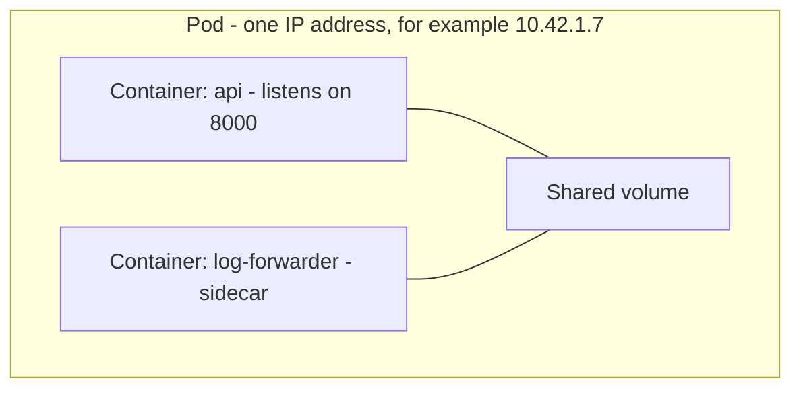
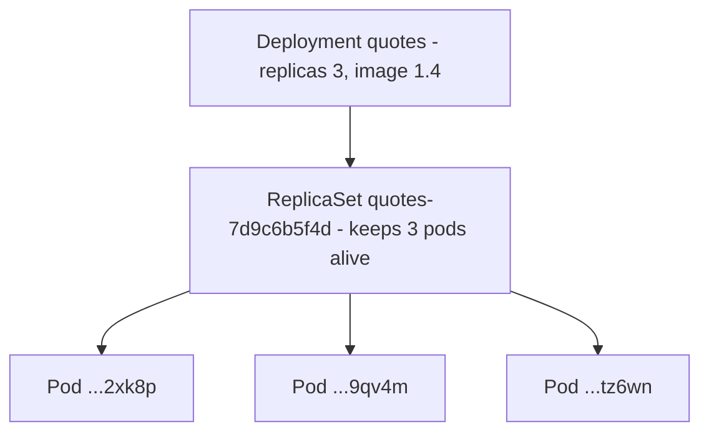
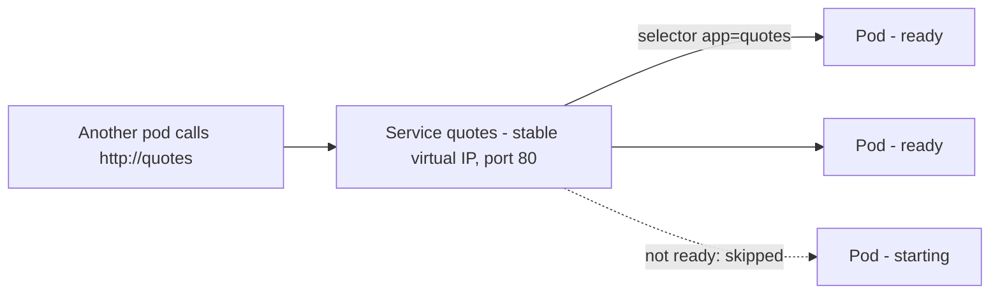

# Kubernetes for Docker users: pods, deployments, services

## In plain words

The previous lesson introduced the idea of an orchestrator, a program that runs containers across many machines and keeps them running, using Docker Swarm. **Kubernetes** (often shortened to **K8s**, because there are eight letters between the K and the s) is the orchestrator most companies actually use. It does the same job as Swarm, with more features and more parts to learn.

A comparison helps. Swarm is like a small van: you can drive it straight away with an ordinary licence. Kubernetes is like a lorry with a trailer: it carries far more, every transport company has one, and you need extra training before you take it on the road. Both move goods from A to B.

The good news is that Kubernetes runs the same container images you have been building all along, and its core ideas (desired state, replicas, finding a service by name) are the ones you already met. This lesson is a translation guide: for each thing you know from Docker and Swarm, here is what Kubernetes calls it and how it differs.

Why this matters for a job: almost every job advert that mentions containers also mentions Kubernetes. You are not expected to administer a cluster on day one, but you are expected to know what a pod, a deployment and a service are, and to read the files that describe them.

> **Before this lesson:** read [Orchestration with Docker Swarm](#/lesson/docker/swarm) first. This lesson relies on its vocabulary: cluster, node, desired state, replica, service discovery. You should also be able to read a Compose file ([Compose fundamentals](#/lesson/docker/compose-basics)).

## The same image, a different runner

A Docker image follows an open standard (the OCI image format, from the Open Container Initiative). Kubernetes pulls images from the same registries and runs them with a container runtime, usually `containerd`, the same low-level program Docker uses internally. Nothing about your Dockerfile changes.

What changes is how you *describe* what should run. Docker uses command-line options and Compose files. Kubernetes uses **manifests**: files written in YAML (the same indentation-based format as Compose) that each describe one **object**, a record of something you want to exist. You hand manifests to the cluster with a command-line tool called `kubectl` (said "cube control" or "cube C T L").

```bash
kubectl apply -f web.yaml        # "make the cluster match this file"
kubectl get pods                 # list running pods
```

`kubectl apply` is the Kubernetes equivalent of `docker compose up` or `docker stack deploy`: it sends a description, and the cluster works to make reality match.

## A translation table

| Idea | Docker / Compose / Swarm | Kubernetes |
|---|---|---|
| Smallest unit that runs | Container | **Pod** (one or more containers together) |
| "Keep N copies running" | Swarm service with `replicas` | **Deployment** (which manages a ReplicaSet) |
| Stable name and load balancing | Swarm service name and virtual IP | **Service** |
| Traffic from the internet by host and path | Published port, or a reverse proxy | **Ingress** (or Gateway) |
| Non-secret settings | Environment, config objects | **ConfigMap** |
| Sensitive settings | Secrets | **Secret** |
| Persistent storage | Volume | **PersistentVolumeClaim** |
| One helper on every node | Global service | **DaemonSet** |
| Database-style workload | Service pinned to a node | **StatefulSet** |
| Run once and finish | `docker run`, a one-off service | **Job** / **CronJob** |
| Group and isolate applications | Stack, project name | **Namespace** |
| Description file | `compose.yaml` | Manifests (`.yaml`) |
| Command-line tool | `docker` | `kubectl` |

Notice the word **service** means different things. In Swarm a service *runs* containers. In Kubernetes a Service only *finds and load-balances* pods that something else runs. This is the most common source of confusion for people moving between the two.

## Pods: a wrapper around containers

Kubernetes never runs a bare container. It runs a **pod**: a group of one or more containers that are always placed on the same node and share one network address and, if you wish, storage. Most pods hold exactly one container.

Here is the smallest useful manifest:

```yaml
apiVersion: v1
kind: Pod
metadata:
  name: quotes
  labels:
    app: quotes
spec:
  containers:
    - name: api
      image: harbour/quotes-api:1.4
      ports:
        - containerPort: 8000
```

Every Kubernetes manifest has the same four top-level parts:

- `apiVersion` says which version of the Kubernetes interface defines this kind of object.
- `kind` is the type of object, here a Pod.
- `metadata` holds the object's name and its **labels**: free-form `key: value` tags. Labels are how Kubernetes objects find each other, so they matter far more than labels in Docker.
- `spec` (short for specification) is the desired state. For a pod that is a list of containers, each with a name, an image and the port it listens on.

```bash
kubectl apply -f pod.yaml
kubectl get pods
```

```text
NAME     READY   STATUS    RESTARTS   AGE
quotes   1/1     Running   0          12s
```

`READY 1/1` means one container out of one is ready. `RESTARTS` counts how often a container in the pod has been restarted.

### Why pods and not plain containers?

Containers in one pod share a network namespace: they reach each other on `localhost` and share one IP address. That makes a pod the right home for a main container plus a small helper that must sit right beside it, called a **sidecar** (like the passenger car bolted to a motorcycle): a log forwarder, a proxy, a metrics exporter.



The rule of thumb: put containers in the same pod only if they must run together, scale together and live and die together. A web app and its database belong in *different* pods.

A pod created directly, as above, is fragile. If its node fails, the pod is gone and nothing recreates it. For that you need the next object.

## Deployments: keep N pods running

A **Deployment** is the Kubernetes counterpart of a replicated Swarm service: a description of a pod plus the number of copies wanted.

```yaml
apiVersion: apps/v1
kind: Deployment
metadata:
  name: quotes
spec:
  replicas: 3
  selector:
    matchLabels:
      app: quotes
  template:
    metadata:
      labels:
        app: quotes
    spec:
      containers:
        - name: api
          image: harbour/quotes-api:1.4
          ports:
            - containerPort: 8000
          env:
            - name: QUOTES_LANG
              value: "en"
          resources:
            requests:
              cpu: 100m
              memory: 64Mi
            limits:
              memory: 128Mi
          readinessProbe:
            httpGet:
              path: /health
              port: 8000
            periodSeconds: 5
          livenessProbe:
            httpGet:
              path: /health
              port: 8000
            periodSeconds: 10
            failureThreshold: 3
```

Reading it from the top:

- `replicas: 3` is the desired number of pods.
- `selector.matchLabels` tells the Deployment which pods are "its" pods: every pod carrying the label `app: quotes`.
- `template` is the pod description, the same shape as the Pod manifest earlier, without a name (pods get generated names). Its labels must match the selector.
- `env` sets environment variables, like `environment:` in Compose.
- `resources.requests` is what the scheduler sets aside when choosing a node (Swarm calls this a reservation). `100m` means 100 *millicores*, one tenth of a processor core; `64Mi` is 64 mebibytes of memory. `limits` is the ceiling the kernel enforces.
- The two **probes** replace Docker's single `HEALTHCHECK`, and are explained below.

```bash
kubectl apply -f deployment.yaml
kubectl get deployments,pods
```

```text
NAME                     READY   UP-TO-DATE   AVAILABLE   AGE
deployment.apps/quotes   3/3     3            3           30s

NAME                          READY   STATUS    RESTARTS   AGE
pod/quotes-7d9c6b5f4d-2xk8p   1/1     Running   0          30s
pod/quotes-7d9c6b5f4d-9qv4m   1/1     Running   0          30s
pod/quotes-7d9c6b5f4d-tz6wn   1/1     Running   0          30s
```

Delete one pod and watch the reconciliation loop from the last lesson at work:

```bash
kubectl delete pod quotes-7d9c6b5f4d-2xk8p
kubectl get pods
```

```text
NAME                      READY   STATUS    RESTARTS   AGE
quotes-7d9c6b5f4d-9qv4m   1/1     Running   0          2m
quotes-7d9c6b5f4d-tz6wn   1/1     Running   0          2m
quotes-7d9c6b5f4d-h5c7r   1/1     Running   0          4s
```

A new pod with a new name appeared. Pods are disposable; you never repair one, you let it be replaced.



Between the Deployment and the pods sits a **ReplicaSet**, an object whose only job is to keep a fixed number of identical pods alive. You rarely touch it. It exists so that when you change the image, the Deployment can create a *new* ReplicaSet for the new version and move pods gradually from the old one to the new one, which is how rolling updates work in Kubernetes.

### Two probes instead of one health check

Docker has one health check. Kubernetes separates two questions:

| Probe | Question | If it fails |
|---|---|---|
| **Liveness** | Is this container stuck beyond repair? | The container is restarted |
| **Readiness** | Can this container take requests right now? | The pod is removed from load balancing, and is not restarted |
| **Startup** | Has a slow application finished starting? | The other probes wait; too many failures cause a restart |

The split is useful. An application that is temporarily overloaded, or whose database is briefly unreachable, should stop receiving traffic (readiness) without being killed (liveness).

## Services: one stable address for many pods

Pods come and go, and each new pod gets a new IP address. Other applications need one address that stays put. A Kubernetes **Service** provides it.

```yaml
apiVersion: v1
kind: Service
metadata:
  name: quotes
spec:
  selector:
    app: quotes
  ports:
    - port: 80
      targetPort: 8000
```

- `selector` chooses the pods to send traffic to: all pods labelled `app: quotes`, whichever Deployment made them.
- `port` is the port the Service listens on; `targetPort` is the container port traffic is forwarded to.

Inside the cluster, any pod can now reach `http://quotes` (or the full name `quotes.default.svc.cluster.local`, where `default` is the namespace). A cluster-wide name server maintains that entry. The Service has one stable virtual address and spreads connections over the pods that are currently **ready**.



The label selector is a loose coupling. The short simulation below shows the matching rule a Service uses: a pod is selected when it carries *every* label in the selector and is ready.

```python-run
def endpoints(selector, pods):
    """Return the addresses a Service sends traffic to."""
    out = []
    for pod in pods:
        has_all = all(pod["labels"].get(k) == v for k, v in selector.items())
        if has_all and pod["ready"]:
            out.append(pod["ip"])
    return out

pods = [
    {"ip": "10.42.1.7", "labels": {"app": "quotes", "version": "1.4"}, "ready": True},
    {"ip": "10.42.2.3", "labels": {"app": "quotes", "version": "1.4"}, "ready": False},
    {"ip": "10.42.2.9", "labels": {"app": "quotes", "version": "1.5"}, "ready": True},
    {"ip": "10.42.3.1", "labels": {"app": "billing"},                 "ready": True},
]
print("app=quotes             ->", endpoints({"app": "quotes"}, pods))
print("app=quotes,version=1.5 ->", endpoints({"app": "quotes", "version": "1.5"}, pods))
print("app=search             ->", endpoints({"app": "search"}, pods))
```

A selector that matches nothing produces a Service with no endpoints, and every connection to it fails. A typing mistake in a label is the classic cause of "my Service does not work".

### Service types

| Type | Reachable from | Docker comparison |
|---|---|---|
| `ClusterIP` (the default) | Inside the cluster only | A service on a network with no published port |
| `NodePort` | A fixed port (30000 to 32767) on every node | Swarm's routing mesh |
| `LoadBalancer` | The internet, through a load balancer created by the cloud provider | No direct equivalent |

For websites, most teams put an **Ingress** in front: one entry point that routes requests to different Services by host name and path, as a reverse proxy does (a later lesson covers reverse proxies).

## Configuration, secrets and storage in brief

**ConfigMap** and **Secret** objects hold settings outside the image. A pod can receive them as environment variables or as files:

```yaml
          envFrom:
            - configMapRef:
                name: quotes-config
          volumeMounts:
            - name: db-password
              mountPath: /run/secrets
              readOnly: true
      volumes:
        - name: db-password
          secret:
            secretName: quotes-db
```

For storage, a pod asks for space with a **PersistentVolumeClaim** ("I need 10 gigabytes that survive restarts") and the cluster provides a matching disk. This solves the problem from the Swarm lesson, where a local volume stayed behind on the old node: in a cloud cluster the disk can be detached and reattached wherever the pod lands.

## Compose and Kubernetes side by side

The same small service, described both ways:

```yaml
# compose.yaml
services:
  quotes:
    image: harbour/quotes-api:1.4
    ports: ["8080:8000"]
    environment:
      QUOTES_LANG: en
    deploy:
      replicas: 3
```

In Kubernetes this is the Deployment and the Service shown above: about fifty lines instead of eight. Kubernetes is more verbose because each concern is a separate object that can be changed, reused and given permissions independently. Tools named Helm and Kustomize exist to manage that volume of YAML.

## How Swarm and Kubernetes differ in practice

| | Docker Swarm | Kubernetes |
|---|---|---|
| Setup | One command, built into Docker | A separate system; usually a managed cloud offering |
| Description format | Compose file | Many manifests, one per object |
| Learning curve | Gentle | Steep |
| Unit of deployment | Container | Pod |
| Health checks | One, from the image or Compose | Liveness, readiness and startup probes |
| Automatic scaling on load | Not built in | Built in |
| Storage that follows workloads | Needs volume plug-ins | Built-in claim system |
| Ecosystem | Small | Very large |
| Where it is found | Small teams, simple setups | Most of the industry |

Neither is "better" in the abstract. A handful of services on three servers are served well by Swarm. A large organisation with many teams needs what Kubernetes offers.

## Everyday kubectl, for Docker users

| You want to | Docker | Kubernetes |
|---|---|---|
| List what is running | `docker ps` | `kubectl get pods` |
| See logs | `docker logs NAME` | `kubectl logs POD` |
| Run a command inside | `docker exec -it NAME sh` | `kubectl exec -it POD -- sh` |
| See full details | `docker inspect NAME` | `kubectl describe pod POD` |
| Apply a description | `docker compose up -d` | `kubectl apply -f FILE` |
| Scale | `docker service scale web=5` | `kubectl scale deployment web --replicas=5` |
| Change the image | `docker service update --image ...` | `kubectl set image deployment/web api=IMAGE` |
| Undo an update | `docker service rollback web` | `kubectl rollout undo deployment/web` |
| Reach a port from your machine | `-p 8080:8000` | `kubectl port-forward svc/quotes 8080:80` |
| Remove | `docker compose down` | `kubectl delete -f FILE` |

`kubectl describe` is the first thing to run when a pod misbehaves; the *Events* section at the bottom of its output usually states the reason in words.

| Pod status | Meaning |
|---|---|
| `Pending` | No node can run it yet: not enough resources, or storage is not ready |
| `ImagePullBackOff` | The image cannot be pulled: wrong name or tag, or missing registry credentials |
| `CrashLoopBackOff` | The container starts, exits, and is being restarted with growing delays |
| `OOMKilled` | The container went over its memory limit |
| `Running` but not `READY` | The readiness probe is failing |

> [!INTERVIEW]
> "What is a pod, and why not run containers directly?" A pod is the smallest unit Kubernetes schedules: one or more containers sharing a network address and volumes, always placed together. It exists so that tightly coupled helpers (sidecars) can sit beside the main container. Then relate the rest: a Deployment keeps a set of pods at the desired count and rolls out changes; a Service gives those pods one stable name and balances traffic across the ready ones.

> [!TIP]
> Docker Desktop includes a single-node Kubernetes cluster that you can switch on in its settings. Tools such as `kind` and `minikube` do the same job. Any of them lets you run every command in this lesson on a laptop.

> [!WARNING]
> Kubernetes Secrets are only base64-encoded in manifests, not encrypted. base64 is a way of writing bytes as text, and anyone can reverse it. Do not commit Secret manifests to a repository, and make sure the cluster encrypts them where it stores them.

## Pitfalls

- **Labels that do not match.** A Service selector or a Deployment selector with a different label than the pods silently selects nothing.
- **Confusing the two meanings of "service".** A Kubernetes Service runs nothing.
- **Creating bare pods.** Nothing replaces them when they fail. Use a Deployment.
- **No resource requests.** The scheduler cannot make sensible placement decisions and nodes become overloaded.
- **A liveness probe that depends on a database.** A short database outage then restarts every application pod at once.
- **The `latest` tag.** A changed image behind an unchanged tag does not trigger a rollout, and nodes may hold different versions.
- **Expecting `localhost` between pods.** `localhost` is shared only *inside* one pod. Between pods, use the Service name.
- **Too many containers in a pod.** They cannot be scaled separately.

## Cheat sheet

| Object | One-line purpose |
|---|---|
| Pod | One or more containers sharing an IP address, scheduled together |
| Deployment | Keeps N identical pods running and rolls out new versions |
| ReplicaSet | Keeps N identical pods alive; managed by a Deployment |
| Service | Stable name and virtual address that balances over ready pods |
| Ingress | Routes outside web traffic to Services by host and path |
| ConfigMap / Secret | Non-sensitive / sensitive settings, as environment variables or files |
| PersistentVolumeClaim | A request for storage that outlives a pod |
| StatefulSet | Pods with stable names and their own storage, for databases |
| DaemonSet | One pod on every node |
| Job / CronJob | Run to completion once / on a schedule |
| Namespace | A named partition of the cluster |

## Summary

- Kubernetes runs the same OCI images as Docker; only the way you describe workloads changes.
- A **pod** wraps one or more containers that share a network address. A **Deployment** keeps a set of pods at the desired count through a ReplicaSet. A **Service** gives matching, ready pods one stable name and address.
- Objects are connected by **labels and selectors**, not by direct references.
- Kubernetes separates liveness (restart me) from readiness (do not send me traffic), where Docker has a single health check.
- Requests are what the scheduler reserves; limits are what the kernel enforces.
- Swarm is simpler and built into Docker; Kubernetes is more capable, more verbose and far more widely used. The underlying ideas are shared.

## Glossary

| Term | Meaning |
|---|---|
| Kubernetes (K8s) | The most widely used container orchestrator |
| kubectl | The command-line tool for talking to a Kubernetes cluster |
| Manifest | A YAML file describing one Kubernetes object |
| Object | A stored record of something you want to exist in the cluster |
| Pod | The smallest schedulable unit: one or more containers sharing a network address |
| Sidecar | A helper container that runs in the same pod as the main container |
| Label / selector | A key-value tag on an object / a rule that picks objects by their labels |
| Deployment | An object that keeps a number of identical pods running and manages updates |
| ReplicaSet | An object that keeps a fixed number of identical pods alive |
| Service (Kubernetes) | A stable name and address that load-balances across pods |
| Ingress | An object that routes outside web traffic to Services |
| Probe | A health test run by Kubernetes: liveness, readiness or startup |
| Request / limit | Resources reserved for scheduling / the enforced maximum |
| Millicore | One thousandth of a processor core |
| ConfigMap / Secret | Objects holding non-sensitive / sensitive settings |
| PersistentVolumeClaim | A pod's request for durable storage |
| Namespace | A named partition that separates groups of objects in a cluster |

## Check yourself

```quiz
[
  {"q": "What is a pod?",
   "options": ["A Kubernetes word for an image", "One or more containers that share a network address and are always scheduled together", "A machine in the cluster", "A load balancer"],
   "answer": 1,
   "explain": "The pod is the smallest unit Kubernetes schedules. Its containers share one IP address and can share volumes."},
  {"q": "Which object should you create to keep three copies of a web app running and replace any that fail?",
   "options": ["Three Pod manifests", "A Deployment with replicas: 3", "A Service", "A ConfigMap"],
   "answer": 1,
   "explain": "A Deployment (through a ReplicaSet) maintains the desired number of pods. Bare pods are not recreated when they are lost."},
  {"q": "How does a Kubernetes Service decide which pods receive traffic?",
   "options": ["By pod name", "By a label selector, and only pods that are ready", "By the order they were created", "By the image name"],
   "answer": 1,
   "explain": "The Service's selector matches pod labels. Pods failing their readiness probe are left out of the endpoints."},
  {"q": "A pod's readiness probe fails while its liveness probe succeeds. What happens?",
   "options": ["The container is restarted", "The pod is deleted", "The pod stops receiving traffic through Services and is not restarted", "Nothing changes"],
   "answer": 2,
   "explain": "Readiness controls membership in load balancing. Only a failing liveness probe causes a restart."},
  {"q": "What is the closest Kubernetes equivalent of a replicated Docker Swarm service?",
   "options": ["A Service alone", "A Deployment (to run the replicas) together with a Service (to reach them by name)", "A Namespace", "A PersistentVolumeClaim"],
   "answer": 1,
   "explain": "Swarm's service both runs containers and gives them a name. Kubernetes splits these into a Deployment and a Service."},
  {"q": "In `resources`, what is the difference between requests and limits?",
   "options": ["They are the same", "Requests are reserved by the scheduler when placing the pod; limits are the maximum the container may use", "Limits apply to CPU only", "Requests apply after the pod starts"],
   "answer": 1,
   "explain": "Requests drive placement decisions. Limits are enforced at run time; exceeding a memory limit gets the container killed."},
  {"q": "A pod shows the status `ImagePullBackOff`. What is the most likely cause?",
   "options": ["The app crashed on start", "The node is out of memory", "The image name or tag is wrong, or registry credentials are missing", "The readiness probe is failing"],
   "answer": 2,
   "explain": "The node could not pull the image and is retrying with growing delays. Check the image reference and pull credentials."},
  {"q": "Two containers in the same pod want to talk to each other. Which address can they use?",
   "options": ["The Service name only", "localhost, because they share a network namespace", "The node's IP address", "They cannot communicate"],
   "answer": 1,
   "explain": "Containers in one pod share the network namespace, so they reach each other on localhost. Between pods, use Service names."}
]
```

> **Source:** Stoneman, *Learn Docker in a Month of Lunches*, ch. 12 (topic coverage: orchestration, Swarm and Kubernetes). Checked against <https://kubernetes.io/docs/concepts/workloads/pods/>, <https://kubernetes.io/docs/concepts/workloads/controllers/deployment/> and <https://kubernetes.io/docs/concepts/services-networking/service/>. All wording and examples are original.
