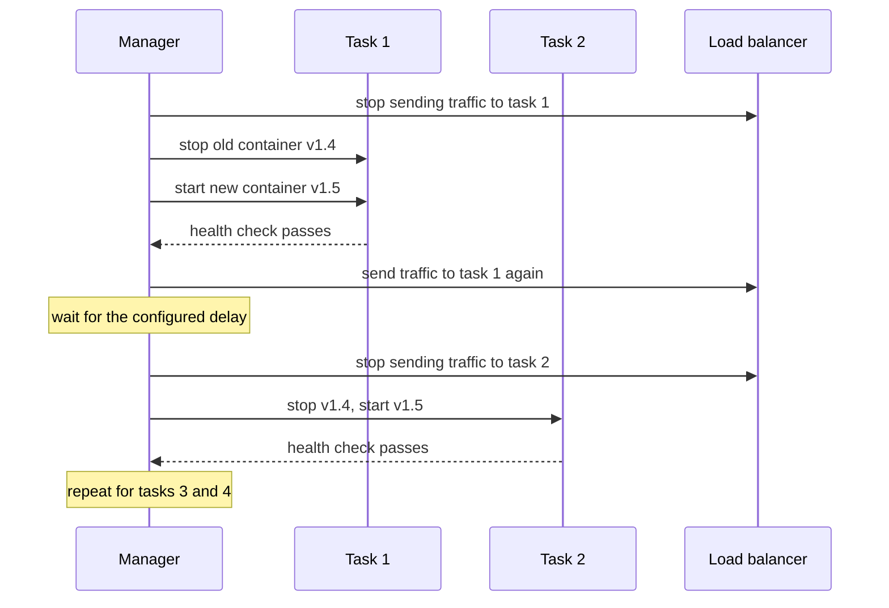
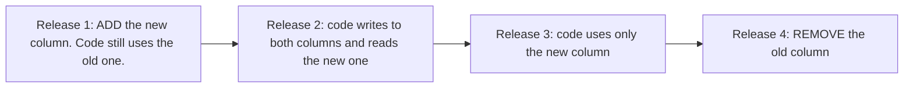

# Rolling updates and rollbacks

## In plain words

Releasing a new version of an application used to mean a notice saying "the site will be unavailable on Sunday between 2 and 4 a.m.". Someone stopped the old version, installed the new one, started it and hoped.

Now picture a busy road bridge that needs resurfacing. Nobody closes the whole bridge. The workers close one lane, resurface it, reopen it, and move on to the next lane. Traffic keeps flowing the whole time, a little slower. If the new surface turns out to be faulty, they stop after one lane instead of ruining all four.

A **rolling update** does that with containers. When several copies of an application are running, the orchestrator (the program that manages containers across machines, from the Swarm lesson) replaces them a few at a time, checks that each new copy is healthy, and only then continues. A **rollback** is the reverse journey: going back to the previous version when the new one misbehaves, ideally without a human having to notice first.

Why this matters for a job: teams that deploy many times a day depend on this. In interviews, "how do you deploy without downtime?" and "what happens if the new version is broken?" are standard questions, and the honest answer involves health checks, update settings and a tested way back.

> **Before this lesson:** you need [Orchestration with Docker Swarm](#/lesson/docker/swarm) (services, replicas, tasks, stacks) and [Health checks and dependency checks](#/lesson/docker/health-checks). The tagging ideas from [Tagging and versioning strategy](#/lesson/docker/versioning-strategy) explain why each release needs its own image tag.

## The simplest update, and what is wrong with it

On a single machine, updating means replacing the container:

```bash
docker rm -f quotes
docker run -d --name quotes -p 8080:8000 harbour/quotes-api:1.5
```

- `docker rm -f quotes` stops and deletes the running container.
- `docker run ...:1.5` starts a new one from the new image version.

Between those two commands nothing is listening on port 8080. Every request in that gap fails. And if version 1.5 crashes on start, the service stays down until someone starts 1.4 again by hand. With one copy on one machine, some interruption is unavoidable: you cannot keep the old copy on the port while the new one takes it.

Rolling updates need **more than one replica** (identical copy), so that some can serve while others are replaced.

## A rolling update, step by step

Take a Swarm service with four replicas of version 1.4:

```bash
docker service create --name quotes --replicas 4 -p 8080:8000 harbour/quotes-api:1.4
```

Changing the image starts an update:

```bash
docker service update --image harbour/quotes-api:1.5 quotes
```

`docker service update` changes the stored description of the service. The managers see that the running tasks no longer match and replace them, by default one at a time:

```text
quotes
overall progress: 2 out of 4 tasks
1/4: running   [==================================================>]
2/4: running   [==================================================>]
3/4: preparing [=================================>                 ]
4/4:
```



During the update, tasks 3 and 4 still answer requests with the old version while 1 and 2 answer with the new one. Users never see an outage. They may, for a short while, see either version, which has a consequence discussed later.

## The settings that control an update

Six settings decide how careful or how fast an update is. They can be given on the command line or, better, written in the stack file so that they are versioned with the application.

```yaml
services:
  quotes:
    image: harbour/quotes-api:1.5
    deploy:
      replicas: 4
      update_config:
        parallelism: 1
        delay: 10s
        order: start-first
        failure_action: rollback
        monitor: 30s
        max_failure_ratio: 0
      rollback_config:
        parallelism: 2
        order: start-first
```

| Setting | Meaning | Default |
|---|---|---|
| `parallelism` | How many tasks are replaced at the same time (a *batch*). 0 means all at once. | 1 |
| `delay` | Pause between one batch finishing and the next starting | 0s |
| `order` | `stop-first`: stop the old task, then start the new. `start-first`: start the new, wait until it is healthy, then stop the old. | `stop-first` |
| `monitor` | How long to keep watching each new task for failure after it starts | 5s |
| `failure_action` | What to do when an update fails: `pause`, `continue` or `rollback` | `pause` |
| `max_failure_ratio` | Share of tasks allowed to fail before the update counts as failed | 0 |

### stop-first or start-first

The `order` setting trades capacity against resources.

| | `stop-first` | `start-first` |
|---|---|---|
| During a batch | Fewer tasks than normal are running | More tasks than normal are running |
| Capacity | Drops by `parallelism` | Never drops |
| Needs spare room on the nodes | No | Yes, for the extra tasks |
| Safe for | Anything, including services that must not run two copies at once | Stateless services that can run old and new side by side |

With 4 replicas and `parallelism: 1`, `stop-first` runs on 3 tasks for a moment, a 25 % cut in capacity. With 2 replicas it is a 50 % cut. `start-first` avoids the dip by briefly running 5.

The simulation below plays an update batch by batch and reports the lowest and highest number of running tasks, so you can see the effect of each setting.

```python-run
def rollout(replicas, parallelism, order, failing=(), failure_action="pause"):
    tasks = ["old"] * replicas
    step = parallelism or replicas
    low = high = replicas
    for start in range(0, replicas, step):
        batch = range(start, min(start + step, replicas))
        if order == "stop-first":
            low = min(low, replicas - len(batch))        # old ones stopped before new ones are up
        else:
            high = max(high, replicas + len(batch))      # new ones started beside the old
        bad = False
        for i in batch:
            tasks[i] = "FAILED" if (i + 1) in failing else "new"
            bad = bad or tasks[i] == "FAILED"
        print(f"  batch {start // step + 1}: {tasks}")
        if bad and failure_action == "pause":
            return tasks, "paused", low, high
        if bad and failure_action == "rollback":
            return ["old"] * replicas, "rolled back", low, high
    return tasks, "completed", low, high

for order, action, failing in [("stop-first", "pause", ()), ("start-first", "pause", ()), ("start-first", "rollback", (3,))]:
    print(f"order={order}, failure_action={action}, failing tasks={list(failing)}")
    tasks, status, low, high = rollout(6, 2, order, failing, action)
    print(f"  result: {status}; running tasks stayed between {low} and {high}\n")
```

In the third run task 3 fails in the second batch. Because the action is `rollback`, every task ends up back on the old version, including the ones that had been updated successfully.

## How the orchestrator knows an update failed

This is where health checks, from an earlier lesson, earn their keep. A new task counts as failed if, within the `monitor` period, its container exits or its health check reports `unhealthy`.

Without a health check, the only failure Swarm can see is a container that exits. A new version that starts, stays up and answers every request with an error would be rolled out to every replica. **A rolling update is only as safe as the health check behind it.**

With `start-first` and a health check, the old task is not stopped until the new one reports `healthy`. A version that cannot start therefore never takes traffic at all.

> [!WARNING]
> Set `monitor` longer than the time your health check needs to detect a failure (roughly `start_period + interval x retries`). If the monitoring window closes before the health check can turn `unhealthy`, the update moves on to the next batch with a broken task behind it.

## Rollbacks

### Automatic rollback

With `failure_action: rollback`, a failed update reverses itself:

```bash
docker service update --image harbour/quotes-api:1.6-broken quotes
```

```text
overall progress: rolling back update: 4 out of 4 tasks
rollback: update rolled back due to failure or early termination of task x7k2...
service rolled back: rollback completed
```

```bash
docker service inspect quotes --format '{{.UpdateStatus.State}} / {{.Spec.TaskTemplate.ContainerSpec.Image}}'
```

```text
rollback_completed / harbour/quotes-api:1.5
```

Swarm remembers the **previous** service description, exactly one step back, and returns to it using the `rollback_config` settings. Those are usually more aggressive than the update settings (higher parallelism, no delay), because a rollback is a move towards a version known to work.

The three failure actions compared:

| `failure_action` | After a failed batch | Good for |
|---|---|---|
| `pause` | Stops. The service is left part old, part new, until a person decides. | When you want to look before anything else changes |
| `continue` | Carries on regardless | Rarely appropriate |
| `rollback` | Returns every task to the previous description | Unattended deployments |

### Manual rollback

```bash
docker service rollback quotes
```

`docker service rollback` returns the service to its previous description. Because only one earlier description is kept, running it twice takes you forward again to the version you were escaping from.

The sturdier habit, when deploying from a stack file kept in version control, is to **roll forward to a known good version**: change the image tag in the file back to the last good release and deploy again. The repository then shows exactly what is running and why.

```bash
git revert HEAD                              # undo the commit that changed the tag
docker stack deploy -c stack.yaml shop       # deploy the previous description
```

> [!TIP]
> Rehearse a rollback before you need one. Deploy a deliberately broken version to a test cluster and watch what happens. A rollback path that has never been exercised usually has a surprise in it.

## Zero downtime needs help from the application

The orchestrator can only do so much. Three things are the application's responsibility.

**1. Shut down gracefully.** When a task is stopped, its main process receives a **signal** (a message from the operating system) called `SIGTERM`, asking it to finish. A well-behaved server stops accepting new connections, completes the requests it is already handling, and exits. If it is still running when the grace period ends, it is killed outright and those requests fail. The grace period is configurable:

```yaml
    stop_grace_period: 30s
```

**2. Report health honestly.** Covered above: the health check is the orchestrator's only evidence.

**3. Tolerate the old and new versions running together.** During a rolling update both versions serve traffic at once, and both use the same database. This is the hard part.

### The database problem

Suppose version 1.5 renames a database column from `fullname` to `display_name`. The moment the change is applied, every 1.4 task still running starts failing, because it asks for a column that no longer exists. And if you then roll back to 1.4, it is broken too.

The standard remedy is called **expand and contract**: split one incompatible change into several compatible releases.



Each step is safe to run alongside the release before it, and safe to roll back from. The rule to remember: **a release must work with the database structure of the previous release and of the next one.**

The same thinking applies to anything two versions share: message formats on a queue, cached values, and the interface between a front end and its API.

## Other release strategies

Rolling updates are the default. Two other strategies are worth being able to name.

**Blue-green deployment.** Run the complete new version (green) beside the complete old version (blue), test green privately, then switch all traffic at once by changing where the load balancer points. Rolling back is switching back. It needs twice the capacity for a while, and there is never a mixture of versions serving users.

**Canary release.** Send a small share of traffic, perhaps 5 %, to the new version and compare its error rate and speed with the old one before going further. The name comes from the canaries that miners carried to detect dangerous gas early. Swarm has no built-in traffic percentages; you approximate a canary by running the new version as a second, small service behind the same proxy.

| Strategy | Versions serving users at once | Extra capacity | Speed of rollback |
|---|---|---|---|
| Recreate (stop all, start all) | One, with an outage | None | Slow |
| Rolling update | Both, briefly | Little or none | Moderate |
| Blue-green | One | Double | Instant |
| Canary | Both, deliberately | A little | Fast |

## The same ideas in Kubernetes

A Kubernetes Deployment (from the previous lesson) performs rolling updates by default, with different names for the same controls:

| Swarm | Kubernetes |
|---|---|
| `parallelism` with `order: stop-first` | `maxUnavailable` |
| `parallelism` with `order: start-first` | `maxSurge` |
| Health check and `monitor` | Readiness probe and `minReadySeconds` |
| `docker service rollback` | `kubectl rollout undo deployment/NAME` |
| One previous description kept | Several previous versions kept (`revisionHistoryLimit`) |
| `failure_action: rollback` | Not built in; the rollout stalls and add-on tools automate the undo |

## Pitfalls

- **One replica.** There is nothing to roll; `stop-first` gives an outage.
- **No health check.** A version that runs but does not work is rolled out everywhere.
- **`monitor` shorter than failure detection.** Bad tasks are accepted.
- **Reusing a tag.** Updating to the same tag (for example `latest`) may do nothing, and a rollback to "the same tag" is meaningless. Give every release its own tag.
- **`start-first` on a full cluster.** There is no room for the extra tasks, and the update stalls with tasks pending.
- **`start-first` for a service that must be single.** Two database containers on the same data files corrupt them.
- **Incompatible database changes.** They break the old version during the update and make rollback impossible.
- **Ignoring `SIGTERM`.** Requests in progress are cut off every time a task is replaced.
- **Leaving an update paused.** A half-updated service is easy to forget; `docker service inspect` shows `UpdateStatus`.

## Cheat sheet

| Task | Command or key |
|---|---|
| Update the image | `docker service update --image IMAGE SERVICE` |
| Update from a stack file | `docker stack deploy -c stack.yaml NAME` |
| Batch size / pause | `update_config.parallelism` / `update_config.delay` |
| Avoid capacity dips | `update_config.order: start-first` |
| Reverse automatically | `update_config.failure_action: rollback` |
| Watch new tasks for longer | `update_config.monitor: 60s` |
| Roll back by hand | `docker service rollback SERVICE` |
| Update state | `docker service inspect SERVICE --format '{{json .UpdateStatus}}'` |
| Task history | `docker service ps SERVICE` |
| Time allowed to shut down | `stop_grace_period: 30s` |
| Force replacement with no change | `docker service update --force SERVICE` |

## Summary

- A rolling update replaces replicas a batch at a time so that some are always serving; it needs at least two replicas.
- `parallelism`, `delay` and `order` set the pace and whether capacity dips (`stop-first`) or is briefly exceeded (`start-first`).
- The orchestrator judges each new task through its health check during the `monitor` window, so the health check decides how safe a deployment is.
- `failure_action` chooses between pausing, continuing and rolling back; Swarm keeps one previous description to return to.
- Rolling forward to a known good tag from version control is the most traceable way to undo a release.
- Old and new versions run together during an update, so the application must shut down gracefully and every change to shared data must be backward compatible (expand and contract).

## Glossary

| Term | Meaning |
|---|---|
| Rolling update | Replacing the copies of a service a few at a time while the rest keep serving |
| Rollback | Returning to the previous version after a bad release |
| Replica | One of several identical copies of a service |
| Batch | The group of tasks replaced together in one step |
| Parallelism | The size of a batch |
| stop-first / start-first | Stop the old task before starting the new one / start the new one first |
| Monitor period | Time a new task is watched for failure |
| Failure action | What the orchestrator does when an update fails: pause, continue or roll back |
| Graceful shutdown | Finishing work in progress before exiting when asked to stop |
| SIGTERM | The operating system signal that asks a process to stop |
| Expand and contract | Making a breaking data change in several compatible steps |
| Blue-green deployment | Running old and new in full and switching all traffic at once |
| Canary release | Sending a small share of traffic to the new version first |
| Zero downtime | A release during which no user request fails because of the release |

## Check yourself

```quiz
[
  {"q": "A service has 4 replicas, parallelism 1 and order stop-first. What is the lowest number of tasks serving traffic during the update?",
   "options": ["4", "3", "2", "0"],
   "answer": 1,
   "explain": "One task at a time is stopped before its replacement starts, so capacity dips to 3 for each batch."},
  {"q": "With order start-first, 4 replicas and parallelism 2, what is the highest number of tasks running at once?",
   "options": ["4", "5", "6", "8"],
   "answer": 2,
   "explain": "Two new tasks are started beside the four existing ones before two old ones are stopped."},
  {"q": "A new version starts and stays running but returns an error for every request. The service has no health check. What does the rolling update do?",
   "options": ["Rolls back automatically", "Pauses", "Completes, replacing every replica with the broken version", "Refuses to start"],
   "answer": 2,
   "explain": "Without a health check the orchestrator only notices containers that exit. A running container looks successful."},
  {"q": "What does `failure_action: rollback` do when a batch fails?",
   "options": ["Stops and leaves the service half updated", "Returns all tasks to the previous service description", "Deletes the service", "Retries the same batch forever"],
   "answer": 1,
   "explain": "The service is reverted to the description it had before the update, using the rollback_config settings."},
  {"q": "You run `docker service rollback web` twice in a row. Where do you end up?",
   "options": ["Two versions back", "On the version you were trying to leave, because only one previous description is stored", "On the first version ever deployed", "The second command fails"],
   "answer": 1,
   "explain": "Swarm keeps exactly one previous spec. Rolling back swaps current and previous, so doing it twice returns to the start."},
  {"q": "Why can renaming a database column in one release break a rolling update?",
   "options": ["Databases cannot be changed while containers run", "Old-version tasks still running during the update expect the old column and start failing", "Swarm blocks schema changes", "It slows the health check"],
   "answer": 1,
   "explain": "Both versions share the database during the rollout. Use expand and contract so each release is compatible with its neighbours."},
  {"q": "Which release strategy keeps a full copy of the old version running and switches all traffic at once?",
   "options": ["Rolling update", "Canary release", "Blue-green deployment", "Recreate"],
   "answer": 2,
   "explain": "Blue-green runs both environments in full and moves traffic in one switch, which also makes rollback a single switch back."},
  {"q": "What should an application do when it receives SIGTERM during an update?",
   "options": ["Exit immediately", "Ignore it", "Stop accepting new requests, finish those in progress, then exit", "Restart itself"],
   "answer": 2,
   "explain": "Graceful shutdown lets in-flight requests complete within the stop grace period, so replacing a task does not fail user requests."}
]
```

> **Source:** Stoneman, *Learn Docker in a Month of Lunches*, ch. 14 (topic coverage). Checked against <https://docs.docker.com/engine/swarm/swarm-tutorial/rolling-update/>, <https://docs.docker.com/reference/compose-file/deploy/> and <https://docs.docker.com/reference/cli/docker/service/rollback/>. All wording and examples are original.
